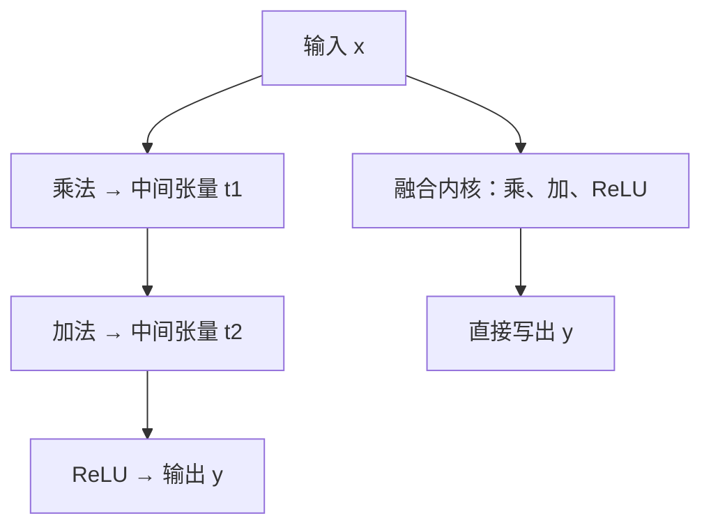

# 手写 CUDA 一定更快吗？三种实现同场比较

> **自定义算子 · 第五篇**
>
> 内核（kernel）写出来了，结果也对，却不一定更快。与其问“手写到底快不快”，不如先把三种实现放到同一条件下比较，再判断一次优化是否值得。
>
> 面向具备基础 Python 知识的 AI 兴趣者；C++／CUDA 代码可跳读。本文提供一套可复用的比较方法与完整四文件工程；创作环境未安装 PyTorch，未执行 C++／CUDA 编译、GPU 测试或跑分，所有示意数值均注明推导或假设，不作为实测结果。资料核对日期：2026 年 10 月 19 日。

<!-- more -->

## 01｜同样三步计算，自己写为什么还可能输？

设想一台门口摄像头。画面进入视觉模型之前，需要做一段简化的逐元素变换：乘上系数、加上偏移，再把负数变为零。

```python
y = torch.relu(x * 2.0 - 1.0)
```

这是用于教学的仿射变换加 ReLU，不代表所有摄像头模型都使用它。我们只研究输入已经在 GPU 上时，这段计算如何执行。

前三篇走通了 CUDA 调用和正式注册，第四篇接上了自动微分。但这些能力完成之后，性能仍然需要单独验证。

对于已有成熟实现的仿射加 ReLU，自己写出同样的运算，未必省掉任何重要工作；还可能因为内存访问、并行配置或接口开销而更慢。

本篇换成三步运算，原因很具体：**它给了我们一个可以观察的优化对象——中间数据的读写和多次内核启动。**

不过，最终比较不能只挑最容易超过的基线。除了原生急执行（eager）实现，还要让 `torch.compile` 先优化同一段原生函数。

## 02｜先算清楚：融合到底省了什么？

eager 可以先理解为按普通调用方式执行框架操作。对于没有被融合的这条逐元素链，计算可能分别落到乘法、加法、ReLU 内核，中间结果落成张量。

PyTorch 官方调优指南指出，逐元素操作融合可以减少内存访问和内核启动开销；TorchInductor 也会对合适的运算进行融合。[1]

对照一下两条数据路径：



融合没有省掉数学上需要的步骤，而是让线程读入一个元素后，连续完成计算，再写出最终结果。中间值可留在线程使用的寄存器中。

对 N 个 float32 元素，按“每步各读一次、写一次”的简化模型：

| 实现 | 逻辑内存流量 | 内核启动 |
| --- | --- | --- |
| 三步分别执行 | 3 × (4N + 4N) = 24N 字节 | 假设为三次 |
| 一次融合 | 4N + 4N = 8N 字节 | 一次 |

这只是理论记账，忽略缓存、标量读取、分配及其他细节。实际启动次数需要观察时间线，实际显存流量需要硬件计数器；不能用 24N／8N 直接宣布加速三倍。

NVIDIA 的优化指南也强调根据测量定位瓶颈，并区分内存吞吐等指标的计算口径。[2]

## 03｜输入规模改变，最值得省的开销也会改变

可以用一个定性模型理解本例：

$$
T\approx T_{\text{调用与调度}}+T_{\text{分配}}+T_{\text{GPU工作}}
$$

这些部分可能重叠，不是硬件时间线的严格相加公式。它帮助我们避免只盯着最后一项。

### 小输入：固定开销更显眼，但融合也省启动次数

只处理几百、几千个数字时，实际乘加很快，Python 调用、分派器（dispatcher）、内存分配和内核启动等成本会占据较大比例。此时**融合主要省下内核启动次数**（例如三步变一次），收益来自更少的提交，而不是更少的字节；不过外围调用成本也可能抵消这部分收益，最终仍要看测量。

### 较大输入：数据读写变得更重要

需要访问更多元素时，反复读写中间张量的成本上升，融合的收益空间随之打开。但“较大”没有统一的元素数门槛：缓存容量、带宽、时钟与同卡负载都会移动这条线；反复读同一段输入，也会让缓存表现优于真实视频帧流。

### 已有融合：手写方案没有明显优势

如果编译器已经生成合适的融合内核，手写实现就没有多少冗余可消除——结果接近、甚至手写更慢，都在预期之内。

### 手写为什么可能更慢：四个可检验的方向

把“手写更慢”拆成可检验的方向，比给一个笼统结论更有用：

1. **固定开销被摊薄得不够。** 每次调用都要经过 Python 入口、分派器（dispatcher）、参数检查、输出分配和内核启动，这些成本与元素个数无关。N 很小时，乘加本身很快，固定开销的占比被放大。
2. **省的是启动次数，不是单次启动成本。** 手写把三步合成一次启动，减少中间张量读写；但这一次启动本身的成本不变。
3. **对手也在融合。** **compiled 路径**可能由 TorchInductor 生成融合内核 [1]；此时手写与 compiled 的差距可能只剩访存与指令选择，胜负更难拉开。
4. **内核算得慢也是可能。** 手写方案也可能输在访存方式、指令生成或并行配置，而不只是外围开销。

这里要纠正一个常见误解：**“融合只有大张量才划算”并不成立。** 融合减少的是内核启动次数和中间读写，小张量同样受益于“启动次数”这一项；只是外围调用成本也可能抵消它。哪条路径在什么规模下更快，只能由实测回答。

也不能反过来先下“手写一定输”的结论。原生路径同样有调用与启动成本，单列出这些成本，并不能解释手写为什么比原生更慢——差距出在哪一段，要靠后面的证据去分辨。

### 边界：本篇只固定语义，不预设胜负

“可能更慢”的幅度取决于 GPU、库版本与规模，声明一次就够：本篇固定数学语义、扫描输入规模，观察三条执行路径，把判断交给测量口径与 §07 的观察方法。

## 04｜比较前，先把三条路径放到同一张表上

| 路径 | 做什么 | 本篇如何使用 |
| --- | --- | --- |
| eager | 原生 PyTorch 乘法、加法、ReLU | 正确性和基础性能参照 |
| fused | 自定义 CUDA 融合三步 | 观察手写融合的成本与收益 |
| compiled | 编译同一段原生函数 | 检查已有编译优化能做到什么 |

第三条编译的是原生函数，不是把本篇自定义算子放进 `torch.compile`。后者需要的 FakeTensor 等接入工作留到第六篇。

本篇只测前向，关闭梯度记录；输入统一为一维、连续布局的 CUDA float32 张量，`scale`、`bias` 为 Python 标量，所有路径返回新输出。输入已驻留 GPU，不计相机采集、解码和主机到设备传输。

自定义前向没有梯度注册，会拒绝需要梯度的输入。第四篇已经说明怎样接梯度；这里不把不同目标混进同一个性能实验。

编译器会替我们完成一部分优化，但外部专用库的接入，以及特定工作负载下的实现选择，仍然需要开发者判断。学习自定义算子，也是在学习怎样定义计算接口、验证实现，并判断一次优化是否值得。

## 05｜手写内核的关键几行代码

融合能不能省下开销，关键就在下面这几行——一个线程读入一个元素，连续完成乘、加和 ReLU，再写出结果：

```cpp
const int64_t i = static_cast<int64_t>(blockIdx.x) * blockDim.x + threadIdx.x;

if (i < n) {
    const float value = __fadd_rn(__fmul_rn(x[i], scale), bias);
    y[i] = value > 0.0f ? value : 0.0f;
}
```

它对应“读一次输入、连续完成计算、写一次输出”。中间值 `value` 留在线程寄存器里，不落成中间张量，这正是 §02 里 24N 与 8N 差别的来源。

旁注：`__fmul_rn`、`__fadd_rn` 是显式按 float32 舍入的乘加内建函数，用来让结果与 eager 的“先乘后加”对齐。它和硬件的融合乘加指令（FMA）不是一回事——FMA 只舍入一次。是否使用 FMA 由编译器决定，因此正确性测试用容差比较。[4]

本版固定 `scale=2.0`、`bias=-1.0`，输入取 [−2, 2) 的有限值；不承诺 NaN、无穷大或溢出等特殊值语义。

这是一个教学基线：每线程一个元素，没有做向量化加载或更细的参数调优，不代表手写内核的性能上限。完整的注册、构建与调用代码，连同四文件工程，放在附录 A。

## 06｜怎样公平测量三条路径？

CUDA 操作通常异步提交。如果只在 Python 调用前后读时钟，而不等待 GPU 完成，测到的可能主要是任务提交时间。PyTorch 官方 CUDA 文档解释了同步计时与 CUDA Event 等方法。[5]

本篇采用：预热后，每轮连续执行 100 次，在这一组前后同步，用总墙钟时间除以 100。口径是 **Python 连续调用到该组 GPU 工作完成的平均耗时**，包含框架调用、调度、分配与同步相关成本；不包含首次编译、输入生成、数据传输或完整模型。它也不是线上请求的延迟分位数——100 次调用的平均值，与线上请求的 P99 是不同指标。

为了让三条路径可比，测量脚本做了几项处理：

- 每条路径都返回新张量，不把一方改成复用输出缓冲区、另一方仍反复分配；中间张量的差别正是融合要研究的对象。
- 在每个规模上先调用并验证 compiled，避免把首次编译算进稳态时间。
- 三条路径在相同 inference 模式、dtype、输入设备与返回新输出的条件下执行。
- 预热后测七轮，每轮轮换路径顺序，降低固定顺序造成的偏差。
- 报告中位数与四分位数，而不是只挑最好的一次。
- 编译不可用时明确记录，不把 eager 结果冒充 compiled；正确性不通过则直接报错。

`fullgraph=True` 用于避免以图中断切出的片段悄悄替代本例完整函数的编译。它不代表一定只生成一个内核；最终执行情况仍需查看时间线。

冷启动与缓存是另一笔成本。编译的缓存命中和重新编译会影响实际部署，官方资料单独讨论了这些机制。[7] 需要冷启动指标时，应在独立实验中记录编译与首调用，不能从这里的稳态时间反推。

完整的 `bench_affine.py`（含计时函数、正确性检查、规模扫描、时间线记录与运行环境输出）放在附录 B。

## 07｜结果不同，应该查看什么证据？

先记住一句分工：**时间线看全程，内核分析看细节。** 先确认时间花在 CPU 提交、等待还是 GPU 执行，再去看单个内核受什么限制。

环境需要支持 CUDA 的 PyTorch、兼容的驱动、本地 CUDA Toolkit、C++ 编译器和 Ninja，以及该平台上可用的 TorchInductor GPU 编译依赖：

```bash
python -c "import torch; print(torch.__version__, torch.version.cuda, torch.cuda.is_available())"
nvcc --version
c++ --version
python -m pip install ninja
python bench_affine.py
PROFILE=1 python bench_affine.py   # 可选：导出时间线
```

其中 `torch.version.cuda` 是 PyTorch 构建所用的 CUDA 版本，不等于本地安装的 CUDA Toolkit 版本。四个文件放在同一目录；构建资源受限时，可用 `MAX_JOBS=1` 限制并行编译。记录结果时，应一并写下驱动、GPU 型号、PyTorch 与本地 CUDA Toolkit 版本，因为倍数会随环境变化。

**本文没有实际跑分表。**程序运行后才会打印真实结果。`eager/time > 1` 表示当前路径的中位耗时低于 eager，`< 1` 表示高于 eager；不要在相对顺序不同的机器上复用别人的倍数。

可能出现的现象，可以这样继续调查。每行是一个需要进一步验证的假设，不是结论：

| 观察到的结果 | 可提出的解释 | 用什么确认 |
| --- | --- | --- |
| 小规模差别不大或 fused 更慢 | 调用、分配与启动成本相对更大 | 先用时间线看这段区间里 CPU 提交、等待与 GPU 执行各占多少 |
| fused 比 eager 快 | 融合减少了启动次数与中间读写 | 时间线数内核数量并对比单内核时长；再比较实际 DRAM 读写字节数与缓存指标 |
| compiled 与 fused 接近 | 编译器已生成相近的融合内核 | 时间线对比两者的 launch 数与单内核时长 |
| 大规模 fused 仍明显慢 | 访存方式、并行配置或编译产物问题 | 用 Nsight Compute 看单个内核的内存、指令与资源指标 |
| 多轮结果起伏很大 | 共享 GPU 负载、时钟、温度与主机调度 | nvidia-smi dmon 观察 SM／显存占用与温度 |

两点容易误读。其一，应先用时间线定位、再用内核分析，不宜把 Nsight Compute 的耗时直接除以独立跑分的墙钟时间——它可能通过重放等方式收集指标。其二，DRAM Throughput 高低不能单独证明读写减少，它和传输总量是不同指标；occupancy 更高也不自动意味着更快。这些都要结合读写字节数与时间线一起看。

中位数很接近、分布重叠明显时，应保留判断，增加独立重复或回到实际应用中比较。

### 这套实验也有自己的边界

同一个规模内反复复用 x，会受到缓存和内存分配器复用的影响。它更接近驻留数据的重复调用，不能直接代表不断到来的新帧，也不能按逻辑字节数除以这里的墙钟时间，就宣称测到了真实显存带宽。

同样，CUDA Event 可以提供设备时间线上的计时视角，但测量区间也可能包含等待或主机提交造成的空隙；不能把所有 Event 时间都叫“纯计算时间”。进一步分析应结合 profiler 和硬件指标。[2][5]

## 08｜算子快了一倍，整个应用为什么只快一点？

再算一笔教学账：某次处理需要 20 ms，其中这段计算占 1 ms。假设把它加速两倍，其他部分保持不变：

$$
T_{\text{新}}=19+0.5=19.5\ \text{ms}
$$

整段耗时只降低 2.5%。

更一般地，若待优化部分占原总时间的比例为 p，局部加速倍数为 s，忽略额外开销并假设其他部分不变，整体加速比为：

$$
S=\frac{1}{(1-p)+p/s}
$$

这是 Amdahl 定律的常见表达，也提醒我们先测应用热点。[2] 真实系统存在并发、排队和资源竞争时，还需重新测量完整链路。

对摄像头来说，采集、解码、传输、模型推理和业务处理可能都在影响响应。局部基准测试决定“这段实现是否值得继续研究”，端到端实验才决定“用户是否明显受益”。

## 09｜什么时候值得继续手写？

如果 compiled 已经满足目标，自定义实现没有稳定、可重复的额外收益，那么保留原生表达式可能更划算：它通常意味着更少的构建、分发与版本维护工作。

如果手写融合在关键规模上有稳定收益，还需要继续确认：

1. 收益是否发生在真实业务的热点，而不仅是某个挑选出来的长度？
2. 加入真实数据布局、数据准备和框架调用之后，优势是否仍在？
3. 精度、特殊值和支持范围是否满足应用需求？
4. 节省的运行成本，是否值得承担开发、测试和维护成本？

回到门口摄像头。如果真正耗时的是解码或检测模型，改写这段逐元素计算可能收益有限；只有当测量确认它确实是热点，才值得继续研究融合实现。

本篇交付的是一套可以重复使用的比较方法，以及一个便于理解的融合基线。它不预设手写胜出，也没有完成工业级优化。

下一篇继续处理另一个实际断点：自定义算子单独调用正常，放进编译流程却报错时，FakeTensor、输出元数据与注册验证分别在解决什么？

---

## 附录 A：完整四文件工程

正文只保留了内核的关键几行，这里给出可以复现的完整工程。建立新目录，放入四个文件：

| 文件 | 作用 |
| --- | --- |
| `affine_op.cpp` | 正式定义算子，注册 CUDA 实现 |
| `affine_kernel.cu` | 检查输入、分配输出、启动融合内核 |
| `affine.py` | 构建并加载动态库 |
| `bench_affine.py` | 正确性检查、预热、规模扫描与性能记录（见附录 B） |

### 文件一：`affine_op.cpp`

```cpp
/*
 * 手写 CUDA 一定更快吗？三种实现同场比较（第6章 · 自定义算子）。
 * 本文件是对应博文代码块的实现/演示；运行依赖：PyTorch（torch.utils.cpp_extension 编译）。
 */
#include <ATen/ATen.h>
#include <torch/library.h>

at::Tensor affine_relu_cuda(const at::Tensor& x, double scale, double bias);

TORCH_LIBRARY(affine_lab5, m) {
    m.def("affine_relu(Tensor x, float scale, float bias) -> Tensor");
}

TORCH_LIBRARY_IMPL(affine_lab5, CUDA, m) {
    m.impl("affine_relu", &affine_relu_cuda);
}
```

schema 中的 `float` 标量对应 C++ 的 `double`，不能仅凭名字把两边都机械写成 C++ `float`。内核会再将标量转换成 float32。[3]

### 文件二：`affine_kernel.cu`

下面两段按顺序保存到同一文件。

```cpp
/*
 * 手写 CUDA 一定更快吗？三种实现同场比较（第6章 · 自定义算子）。
 * 本文件是对应博文代码块的实现/演示；运行依赖：PyTorch（torch.utils.cpp_extension 编译）。
 */
#include <ATen/ATen.h>
#include <ATen/cuda/CUDAContext.h>
#include <c10/cuda/CUDAGuard.h>
#include <c10/cuda/CUDAException.h>
#include <cuda_runtime.h>
#include <cstdint>
#include <limits>

__global__ void affine_relu_kernel(const float* x, float* y, int64_t n,
                                    float scale, float bias) {
    const int64_t i = static_cast<int64_t>(blockIdx.x)
                      * blockDim.x + threadIdx.x;
    if (i < n) {
        // 分别按 float32 舍入乘法和加法，避免隐式合成 FMA。
        const float value = __fadd_rn(__fmul_rn(x[i], scale), bias);
        y[i] = value > 0.0f ? value : 0.0f;
    }
}
```

```cpp
at::Tensor affine_relu_cuda(const at::Tensor& x, double scale, double bias) {
    TORCH_CHECK(x.is_cuda(), "x must be CUDA");
    TORCH_CHECK(x.layout() == c10::kStrided && x.is_contiguous(),
                "x must have contiguous strided layout");
    TORCH_CHECK(x.scalar_type() == at::kFloat, "x must be float32");
    TORCH_CHECK(!x.requires_grad(), "this forward-only demo has no autograd");
    TORCH_CHECK(x.numel() <= std::numeric_limits<int>::max(),
                "too many elements for this tutorial");

    const c10::cuda::CUDAGuard guard(x.device());
    auto y = at::empty_like(x);
    const int64_t n = x.numel();
    if (n == 0) return y;
    constexpr int threads = 256;
    const int blocks = static_cast<int>((n + threads - 1) / threads);
    cudaStream_t stream = at::cuda::getCurrentCUDAStream();
    affine_relu_kernel<<<blocks, threads, 0, stream>>>(
        x.data_ptr<float>(), y.data_ptr<float>(), n,
        static_cast<float>(scale), static_cast<float>(bias));
    C10_CUDA_KERNEL_LAUNCH_CHECK();
    return y;
}
```

线程索引、空输入、设备选择与当前 stream 的处理延续前面的实现，不在本篇重新推导。

**实验约束：只使用有限数值输入，固定 `scale=2.0`、`bias=-1.0`，随机输入范围为 [−2, 2)。本版不承诺 NaN、无穷大、溢出或任意标量取值下的特殊值语义。**实现没有为了测试而扫描整个输入检查有限性，调用方负责满足约定。

### 文件三：`affine.py`

```python
"""编译并加载手写 CUDA affine+ReLU 算子，暴露 affine_relu 给基准脚本使用。

仅做算子构建：真正的「三种实现同场比较」在 bench_three_ways.py。
运行本文件要求本机有可用的 CUDA 工具链（nvcc）与 torch，否则会在
torch.cuda.is_available() 检查时报「需要可用的 CUDA GPU」并退出。
"""
from pathlib import Path
import torch
from torch.utils.cpp_extension import load

if not torch.cuda.is_available():
    raise RuntimeError("需要可用的 CUDA GPU")

root = Path(__file__).resolve().parent
load(
    name="affine_lab5_ext",
    sources=[str(root / "affine_op.cpp"), str(root / "affine_kernel.cu")],
    extra_cflags=["-O2"],
    extra_cuda_cflags=["-O2"],
    is_python_module=False,
    verbose=True,
)
affine_relu = torch.ops.affine_lab5.affine_relu.default
```

这是一个教学基线：每线程一个元素，没有做向量化加载或更细的参数调优。它实现了明确的融合思路，不代表手写内核的性能上限。

## 附录 B：完整基准脚本

下面所有代码块按顺序组成 `bench_affine.py`。

### 定义计算和一组计时

```python
"""手写 CUDA 一定更快吗？三种实现同场比较（第6章 · 自定义算子）。

本文件是对应博文代码块的实现/演示，直接运行可见效果；运行依赖：PyTorch。
"""
import os
import random
import statistics
import time
import torch
from affine import affine_relu

def eager(x):
    return torch.relu(x * 2.0 - 1.0)

def fused(x):
    return affine_relu(x, 2.0, -1.0)

def measure_group_ms(fn, x, repeats=100):
    torch.cuda.synchronize(x.device)
    start = time.perf_counter()
    for _ in range(repeats):
        result = fn(x)
    torch.cuda.synchronize(x.device)
    return (time.perf_counter() - start) * 1000.0 / repeats

def check_close(fn, x):
    torch.testing.assert_close(fn(x), eager(x), rtol=1e-5, atol=1e-6)
```

### 可选的时间线记录函数

```python
def profile_once(functions, x):
    from torch.profiler import profile, record_function, ProfilerActivity
    torch.cuda.synchronize(x.device)
    with profile(activities=[ProfilerActivity.CPU, ProfilerActivity.CUDA],
                 record_shapes=True) as prof:
        for name, fn in functions.items():
            with record_function(name):
                result = fn(x)
        torch.cuda.synchronize(x.device)
    prof.export_chrome_trace("affine_relu_trace.json")
    print("Trace written: affine_relu_trace.json")
```

此函数在正式跑分之后单独运行，避免 profiler 的额外开销进入报告时间。PyTorch Profiler 支持记录 CPU／CUDA 活动和导出时间线。[6]

### 正确性检查、规模扫描与轮换测试顺序

```python
@torch.inference_mode()
def main():
    torch.manual_seed(0)
    order_rng = random.Random(0)
    print("PyTorch:", torch.__version__,
          "PyTorch built with CUDA:", torch.version.cuda)
    print("GPU:", torch.cuda.get_device_name(0))
    print("dtype=float32; scale=2; bias=-1; repeats=100; rounds=7")
    print("compile: backend=inductor, mode=default, fullgraph=True, dynamic=False")

    for n in (0, 1, 255, 256, 257):
        check_close(fused, torch.rand(n, device="cuda") * 4.0 - 2.0)
    special = torch.tensor([-2., 0., 0.5, 1., 2.], device="cuda")
    check_close(fused, special)

    compiled = None
    try:
        compiled = torch.compile(eager, backend="inductor", mode="default",
                                 fullgraph=True, dynamic=False)
    except Exception as error:
        print("UNAVAILABLE compiled:", type(error).__name__, str(error)[:200])

    for n in (1_024, 65_536, 1_000_000, 8_000_000):
        x = torch.rand(n, device="cuda", dtype=torch.float32) * 4.0 - 2.0
        functions = {"eager": eager, "fused": fused}
        check_close(fused, x)
        if compiled is not None:
            try:
                actual = compiled(x)  # 首次编译或该形状的重编译在计时外。
            except Exception as error:
                print("UNAVAILABLE compiled for N=", n,
                      type(error).__name__, str(error)[:200])
            else:
                # 正确性失败应直接报错，不能当成编译不可用而略过。
                torch.testing.assert_close(actual, eager(x), rtol=1e-5, atol=1e-6)
                functions["compiled"] = compiled

        for fn in functions.values():
            for _ in range(20):
                fn(x)
        torch.cuda.synchronize(x.device)
        samples = {name: [] for name in functions}
        for _ in range(7):
            order = list(functions)
            order_rng.shuffle(order)
            for name in order:
                samples[name].append(measure_group_ms(functions[name], x))

        baseline = statistics.median(samples["eager"])
        print(f"\nN={n}; input={x.numel() * x.element_size() / 2**20:.3f} MiB")
        for name, values in samples.items():
            median = statistics.median(values)
            p25, _, p75 = statistics.quantiles(values, n=4, method="inclusive")
            print(f"{name:8s} median={median:.6f} ms "
                  f"p25={p25:.6f} p75={p75:.6f} "
                  f"eager/time={baseline / median:.3f}x")

    if os.environ.get("PROFILE") == "1":
        profile_once(functions, x)  # 最后一个规模，且仅记录可用路径。

if __name__ == "__main__":
    main()
```

这段脚本用于计时，不能用来证明某个路径启动了几个内核——内核数量要靠时间线观察。

---

## 参考资料

核对日期：2026 年 10 月 19 日。在线文档会更新，实际开发应匹配本地安装版本。

1. [PyTorch Performance Tuning Guide — Fuse operations](https://docs.pytorch.org/tutorials/recipes/recipes/tuning_guide.html#fuse-operations)：逐元素融合、中间数据访问与 TorchInductor 优化。
2. [NVIDIA CUDA C++ Best Practices Guide](https://docs.nvidia.com/cuda/cuda-c-best-practices-guide/index.html)：性能测量、带宽分析、瓶颈定位与 Amdahl 定律。
3. [Custom C++ and CUDA Operators](https://docs.pytorch.org/tutorials/advanced/cpp_custom_ops.html)：schema 标量类型、设备实现与常规注册方式。
4. [CUDA Math API — Single Precision Intrinsics](https://docs.nvidia.com/cuda/cuda-math-api/cuda_math_api/group__CUDA__MATH__INTRINSIC__SINGLE.html)：`__fmul_rn`、`__fadd_rn` 的单精度舍入语义。
5. [PyTorch CUDA semantics](https://docs.pytorch.org/docs/stable/notes/cuda.html)：异步执行、同步与 CUDA Event 计时。
6. [PyTorch Profiler](https://docs.pytorch.org/tutorials/recipes/recipes/profiler_recipe.html)：CPU／CUDA 活动记录及时间线导出。
7. [Compile Time Caching in torch.compile](https://docs.pytorch.org/tutorials/recipes/torch_compile_caching_tutorial.html)：编译缓存与冷启动成本。
