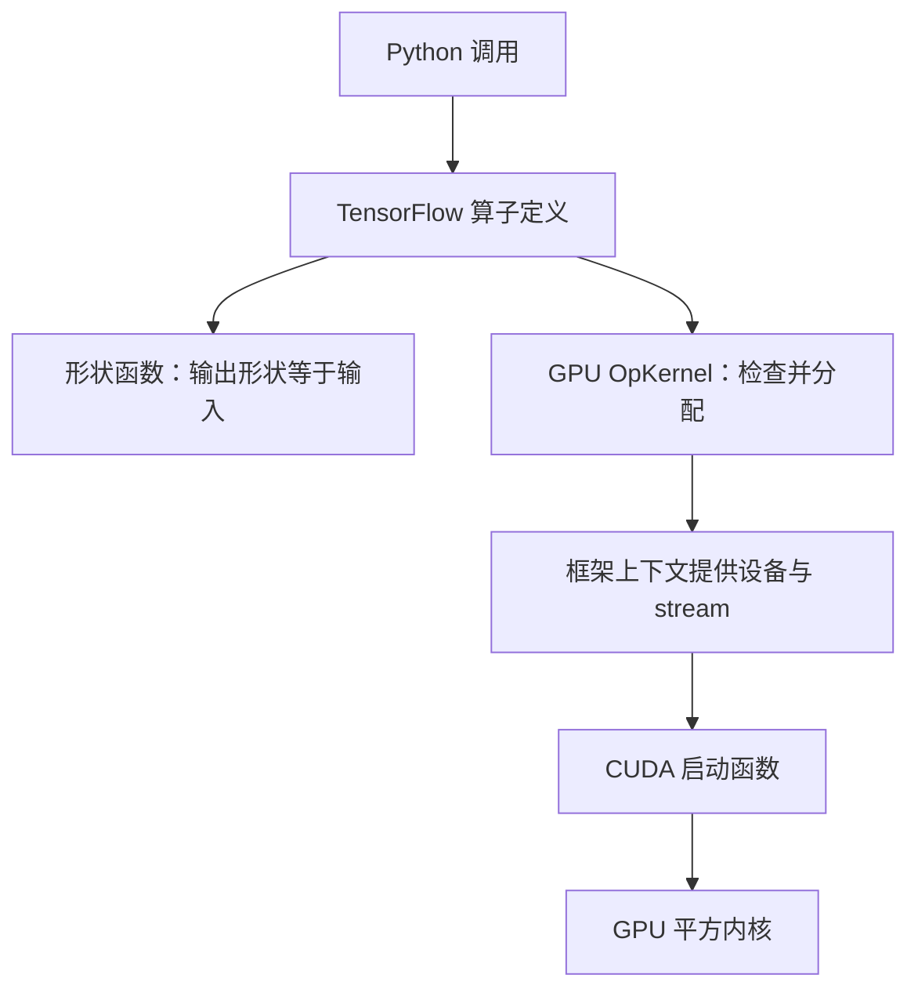

# 同一段 CUDA，怎样接入 TensorFlow？

> **自定义算子 · 第七篇**
>
> GPU 上的平方公式没有变，为什么换一个框架还要写不少代码？这篇从可复用的计算逻辑出发，把 TensorFlow 的算子定义、形状推导、设备执行、构建加载和梯度注册连成一条路径。
>
> 面向有基础 Python 知识的 AI 兴趣者。本文提供独立的六文件教学工程；创作环境未安装 TensorFlow，未进行 C++／CUDA 编译、GPU 运行或梯度测试。示例数值为数学预期，不是实测日志。资料核对日期：2026 年 10 月 19 日。

<!-- more -->

## 01｜换框架，哪些东西真的需要重写？

设想一个视觉团队：一部分模型用 PyTorch，另一部分仍由 TensorFlow 维护。现在希望把同样的 GPU 计算接到两边。

为了看清框架差异，我们暂时放下较复杂的激活函数，回到第二篇的平方：

$$
y_i=x_i\times x_i
$$

线程还是根据下标读取一个元素、计算平方、写到输出。它不关心 Python 使用哪个框架。

需要改变的是外围适配：PyTorch 的张量对象、ATen 分配接口和算子注册宏，不能原样交给 TensorFlow。

| 部分 | 迁移时的处理 |
| --- | --- |
| 数学定义、线程索引、边界判断 | 可以复用思路和相应内核代码 |
| 输入校验、输出分配 | 改用目标框架接口 |
| 设备与 stream | 从目标框架的执行上下文获取 |
| 算子定义与设备实现注册 | 按目标框架重新注册 |
| 梯度与图分析支持 | 按目标框架的机制提供并验证 |
| 编译产物 | 使用匹配的工具链重新构建，不直接搬 `.so` |

**可复用的是计算，不是整套框架扩展。**TensorFlow 官方同样建议先尝试原生操作组合，确有表达或效率需要时，再增加 C++ 自定义算子。[1]

这里自己实现平方，是学习接入方法，不是替代成熟的 `tf.square`，也不预设速度更快。

### 哪一部分才是真正复用的“同一段 CUDA”？

把一次迁移拆成三层，就能看清哪些代码直接搬过去、哪些必须重写：

| 层次 | 是否可以跨框架复用 |
| --- | --- |
| `SquareKernel` 中的索引与平方计算 | 可以复用内核源码 |
| 获取设备、stream，检查启动状态 | 需要设计适配边界 |
| 张量分配、算子与梯度注册 | 使用各框架接口 |

接下来的代码会分别标注“沿用第二篇”和“TensorFlow 新增”，让复用范围可见。`LaunchSquare` 接收 `Eigen::GpuDevice`，已经属于 TensorFlow 适配层；真正跨框架不变的是它调用的那几行 CUDA 线程逻辑。如果要把复用做到极致，可以把纯 CUDA 内核独立成公共文件，由两个框架各自提供包装，公共接口只用指针、元素数和 CUDA stream，不暴露框架张量类型——本篇不展开，但方向就在这里。

## 02｜TensorFlow 也要先知道“是什么”，再知道“怎样执行”

TensorFlow 中，`REGISTER_OP` 定义算子的名字、输入输出及形状函数；`REGISTER_KERNEL_BUILDER` 将相应实现关联到设备等条件。[1]

本例定义一个 GPU 专用的 `CudaSquareLesson`：

```cpp
REGISTER_OP("CudaSquareLesson")
    .Input("x: float")
    .Output("y: float");
```

这里的 `float` 是 TensorFlow 算子定义中的 float32 类型。它与上一篇 PyTorch schema 中标量 `float` 对应 C++ `double` 的规则，不是一回事；PyTorch schema 里张量的元素类型也不写在类型名中，而是由 `Tensor` 本身携带。类型名称相似，不能跨框架机械套用。

另一个容易混淆的词是 kernel：

- TensorFlow 的 `OpKernel` 是框架侧实现类，负责接收上下文、检查输入、分配输出等工作。
- CUDA kernel 是 `__global__` 函数，真正由 GPU 线程执行。

两个都叫“内核”，但处于不同层次。打个比方：`OpKernel` 像餐厅前台，负责核对订单（检查输入）、安排座位（分配输出）、叫号交接；CUDA kernel 才是后厨里真正炒菜的人。一次自定义算子调用里两个角色要配合，但谁都不该越位——前台不会冲进后厨炒菜，CUDA kernel 也不该自己去分配张量或决定设备。

把前一篇 PyTorch 的注册方式放在旁边，对应关系如下（双方口径均来自各自官方文档 [1][8]）：

| 环节 | TensorFlow | PyTorch C++ 扩展 |
| --- | --- | --- |
| 入口宏 | `REGISTER_OP("Name")` | `TORCH_LIBRARY(命名空间, m)` |
| 模式声明 | `.Input` / `.Output("y: float")` | `m.def(schema 字符串)` |
| 形状推导 | `.SetShapeFn(...)` | 通过已注册的 fake 实现描述输出元数据 |
| 设备实现 | `REGISTER_KERNEL_BUILDER(...Device(DEVICE_GPU))` | `TORCH_LIBRARY_IMPL(命名空间, CUDA, m)` |
| 梯度注册 | Python 侧 `tf.RegisterGradient` | C++ autograd 或 Python `register_autograd` |

名字和入口各不相同，“先声明模式、再绑定设备实现、最后补梯度”的三段式是共通的。

不过，最后一行的两项支撑有交集但不能画等号：TensorFlow 的 shape inference 主要描述**形状关系**，而 PyTorch 的 fake 实现还要携带 dtype、device、stride 等元数据。普通 wrapper 里顺手检查或记录一下形状，并不等于已经为编译分析提供了 fake 实现，两者不是可互换的同一个接口。

## 03｜形状推导，与上篇 FakeTensor 有什么关系？

第六篇讲过：编译或图分析阶段，需要在不知道真实数值时推导输出属性。

TensorFlow 的 shape inference 也解决了其中的形状问题。本例无论输入值是什么，输出形状都与输入相同，因此可以直接把输入形状传给输出。

例如输入签名是 `[None]`，表示静态分析时长度未知的一维张量，输出也应是 `[None]`。`None` 说的是“图里这一维还没定下来”，而不是“运行时真的没有长度”，两者不要混为一谈。不要把 `None` 随便改成首次运行碰巧遇到的那个长度。

不过，**形状函数不是数值实现，也不能替代运行时校验**。它们需要分别存在：图分析阶段描述关系，真实执行阶段检查约束并分配结果。[1]



读者应观察：形状函数只走左侧分支（算子定义→形状函数），不经过 GPU；只有真实运行时才进入右侧的 OpKernel 与 CUDA 路径。也正因如此，**本例的形状函数只依赖输入形状，不读取运行时 GPU 元素值**。形状推导在一般情形下并非只能处理形状：当输出尺寸无法静态确定时，应当保留未知信息，而不是猜一个长度填进去。

本篇只验证 eager 和普通 `tf.function(jit_compile=False)`，不验证 XLA。图执行与 XLA 编译是不同能力，不能因为进入了 `tf.function`，就宣布外部 CUDA 算子支持 XLA。[2]

## 04｜准备一份边界明确的接口约定

| 项目 | 本例约定 |
| --- | --- |
| 输入 | TensorFlow 管理的 float32 稠密张量 |
| 设备 | 仅注册 GPU 实现，测试明确选择 GPU 0 |
| 形状 | 标量、任意维与空张量；不超过 2³¹−1 个元素 |
| 输出 | 新分配，形状与输入一致，不修改输入 |
| 梯度 | 使用原生 TensorFlow 运算表达 `2 × x × grad_output` |
| 执行模式 | 提供 eager 与普通 tf.function 的验证方法 |
| 未覆盖 | XLA、混合精度、其他 dtype、模型分发与性能优化 |

本例使用 TensorFlow 普通稠密 Tensor 的线性数据表示，不把 PyTorch 中针对任意 stride 的判断照搬过来。稀疏张量、RaggedTensor 等具有另外的表示和接口，不在范围内。

工程包括六个文件：`square_launcher.h`、`square_op.cc`、`square_kernel.cu.cc`、`build.py`、`square_tf.py`、`test_square_tf.py`。都放在同一新目录。

## 05｜把框架与 CUDA 之间的边界切开

先保存 `square_launcher.h`：

```cpp
#pragma once
#include <cstdint>
#include "absl/status/status.h"
#include "tensorflow/core/framework/op_kernel.h"

absl::Status LaunchSquare(const Eigen::GpuDevice& device, int64_t n,
                          const float* input, float* output);
```

这是一个普通 C++ 函数声明，不含 `<<<...>>>` 启动语法。这样，框架注册文件可以由常规 C++ 编译器处理，CUDA 启动函数则交给 `nvcc`。

再保存 `square_kernel.cu.cc`：

```cpp
#include "square_launcher.h"
#include "tensorflow/core/platform/errors.h"
#include <cuda_runtime.h>

// 沿用第二篇：线程索引与平方计算，跨框架不改
__global__ void SquareKernel(int64_t n, const float* input, float* output) {
    const int64_t i = static_cast<int64_t>(blockIdx.x)
                      * blockDim.x + threadIdx.x;
    if (i < n) {
        const float value = input[i];
        output[i] = value * value;
    }
}

// TensorFlow 新增：设备与 stream 来自传入的适配层对象
absl::Status LaunchSquare(const Eigen::GpuDevice& device, int64_t n,
                          const float* input, float* output) {
    if (n == 0) return absl::OkStatus();
    constexpr int threads = 256;
    const int blocks = static_cast<int>((n + threads - 1) / threads);
    SquareKernel<<<blocks, threads, 0, device.stream()>>>(n, input, output);
    const cudaError_t error = cudaGetLastError();
    if (error != cudaSuccess) {
        return tensorflow::errors::Internal(
            "SquareKernel launch failed: ", cudaGetErrorString(error));
    }
    return absl::OkStatus();
}
```

平方线程的逻辑延续第二篇。变化集中在启动函数：stream 来自 TensorFlow 传入的 `Eigen::GpuDevice`。

不要硬编码 `cudaSetDevice(0)`，也不要擅自把任务放到另一条默认 stream。TensorFlow 框架负责设备执行环境，自定义实现应接住当前上下文提供的执行流。官方 GPU 示例也使用 `d.stream()` 启动 CUDA 内核。[1]

`cudaGetLastError()` 检查启动后的错误状态，不等待整个内核完成。本例不在每次调用后执行全设备同步；测试读取结果时再等待相应计算，避免用强制同步掩盖调用方式问题。

## 06｜框架侧：定义、推导、分配与注册

保存 `square_op.cc`：

```cpp
#include <limits>
#include "square_launcher.h"
#include "tensorflow/core/framework/op.h"
#include "tensorflow/core/framework/shape_inference.h"
#include "tensorflow/core/platform/errors.h"

using namespace tensorflow;

REGISTER_OP("CudaSquareLesson")
    .Input("x: float")
    .Output("y: float")
    .SetShapeFn([](shape_inference::InferenceContext* c) {
        c->set_output(0, c->input(0));
        return absl::OkStatus();
    });

class CudaSquareLessonOp : public OpKernel {
 public:
    explicit CudaSquareLessonOp(OpKernelConstruction* context)
        : OpKernel(context) {}

    void Compute(OpKernelContext* context) override {
        const Tensor& input = context->input(0);
        const int64_t n = input.NumElements();
        OP_REQUIRES(context, n <= std::numeric_limits<int>::max(),
                    errors::InvalidArgument("Too many elements for this tutorial"));
        Tensor* output = nullptr;
        // TensorFlow 新增：输出交给框架分配，形状沿用输入
        OP_REQUIRES_OK(context, context->allocate_output(0, input.shape(), &output));
        if (n == 0) return;
        // TensorFlow 新增：从上下文取设备对象，再调用普通 C++ 启动函数
        OP_REQUIRES_OK(context, LaunchSquare(
            context->eigen_device<Eigen::GpuDevice>(), n,
            input.flat<float>().data(), output->flat<float>().data()));
    }
};

REGISTER_KERNEL_BUILDER(
    Name("CudaSquareLesson").Device(DEVICE_GPU), CudaSquareLessonOp);
```

这段代码完成四件事：

1. 注册 float32 输入输出的算子定义。
2. 将输入的静态形状关系传给输出。
3. 运行时检查元素上限，并通过 TensorFlow 分配输出。
4. 从上下文获取 GPU 设备对象，调用普通 C++ 启动函数。

输出归 TensorFlow 管理，不需要自己创建一块框架不了解的 `cudaMalloc` 内存再想办法归还。`Compute` 也没有把每次调用的数据指针保存到共享成员中，避免制造额外的并发状态。

只注册 GPU 实现，不代表自动生成 CPU 回退；dtype 已在算子定义中固定，也不是支持所有浮点类型的通用实现。

## 07｜构建：必须把两类代码一起链接进去

同一份数学，换框架要重编，不能把第二篇的 `.so` 直接搬过来。构建这件事拆开看只有三步：

1. **问环境要参数**。用 `tf.sysconfig.get_compile_flags()` / `get_link_flags()` 取头文件、ABI 与框架库的链接设置，而不是把某台机器的路径写死。[4]
2. **选对 GPU 架构**。从当前 GPU 的 compute capability 推导，或由 `CUDA_ARCH` 显式指定；架构选错，加载时往往表现为“找不到 kernel”。
3. **把两类目标文件一起链接**。`square_op.cc`（框架注册）和 `square_kernel.cu.cc`（CUDA 启动）分别编译，最后合成一个 `.so`，缺一个都拿不到能用的算子。

工具链只有一条硬纪律：**nvcc、头文件、运行库必须来自同一套 CUDA Toolkit。** 若 `CUDA_HOME` 指向一套、PATH 里的 `nvcc` 来自另一套，就会出现“编译器是一套 CUDA、头文件与运行库是另一套”的混用，很容易编译通过却在加载或运行时失败。因此脚本在设置了 `CUDA_HOME` 时会优先使用其中的 `bin/nvcc`，未设置时才从 PATH 里找到的 `nvcc` 反推根目录，并在开建前打印实际编译器、CUDA 根目录与目标架构。完整 `build.py` 见附录 A。

本脚本只在本地构建，不是官方发布打包系统，也不覆盖全部 CUDA 安装布局。TensorFlow 的“2.x”范围仍然偏宽，发布前应选定一组实际验证过的 TensorFlow、Python、CUDA Toolkit 与主机编译器组合；官方构建矩阵可以作为参考，但不能替代这次扩展自身的编译验证。[3]

## 08｜加载之后，还要给 GradientTape 一条反向规则

保存 `square_tf.py`：

```python
from pathlib import Path
import tensorflow as tf

root = Path(__file__).resolve().parent
module = tf.load_op_library(str(root / "cuda_square_lesson.so"))
square = module.cuda_square_lesson

@tf.RegisterGradient("CudaSquareLesson")
def square_gradient(op, grad_output):
    x = op.inputs[0]
    return [grad_output * (2.0 * x)]
```

`tf.load_op_library` 加载注册代码并返回包含 Python 包装函数的模块，CamelCase 名称转换为 snake_case，因此这里是 `cuda_square_lesson`。[5]

`tf.RegisterGradient` 按算子类型名注册梯度函数，接收原始 op 和上游梯度，返回与输入顺序对应的梯度列表。[6]

平方的反向关系为：

$$
\frac{\partial L}{\partial x_i}=\frac{\partial L}{\partial y_i}\cdot 2x_i
$$

这个公式在 TensorFlow 与 PyTorch 中一样，注册方式却不同。仅注册前向 GPU 实现，不能据此宣布支持训练。

模块应在使用算子求导前导入。交互式环境重复执行注册代码可能产生重复注册错误；本例建议在新 Python 进程中运行测试，不通过吞掉注册异常掩盖加载问题。

## 09｜完整测试：eager、形状、梯度各查一遍

下面五段按顺序组成 `test_square_tf.py`。

### 一：GPU 上的前向与手算梯度

```python
import numpy as np
import tensorflow as tf
from square_tf import square

if not tf.config.list_physical_devices("GPU"):
    raise RuntimeError("测试需要可见的 GPU")
tf.config.set_soft_device_placement(False)
tf.random.set_seed(0)
print("TensorFlow:", tf.__version__)

with tf.device("/GPU:0"):
    for shape in [(0,), (), (1,), (255,), (256,), (257,), (2, 3, 5)]:
        x = tf.random.uniform(shape, minval=-2.0, maxval=2.0, dtype=tf.float32)
        y = square(x)
        assert "GPU:0" in y.device.upper(), y.device
        np.testing.assert_allclose(y.numpy(), tf.square(x).numpy(), rtol=1e-6, atol=1e-7)
        assert y.shape == x.shape and y.dtype == x.dtype

    x = tf.Variable([-2., 0., 3.], dtype=tf.float32)
    weights = tf.constant([2., 3., 4.], dtype=tf.float32)
    with tf.GradientTape() as tape:
        y = square(x)
        loss = tf.reduce_sum(y * weights)
    grad = tape.gradient(loss, x)
    np.testing.assert_allclose(y.numpy(), [4., 0., 9.])
    np.testing.assert_allclose(grad.numpy(), [-8., 0., 24.])
print("PASS eager forward and hand-derived gradient")
```

关闭 soft placement，能防止明确指定的设备放置被悄悄改到其他设备；本例还检查输出的设备字段。读出 `.numpy()` 会取得实际结果，但这是正确性验证，不应作为高性能 GPU 链路中的默认操作。

### 二：长度未知的一维图签名

```python
@tf.function(input_signature=[tf.TensorSpec([None], tf.float32)], jit_compile=False)
def graph_forward_backward(x):
    with tf.GradientTape() as tape:
        tape.watch(x)
        y = square(x)
        loss = tf.reduce_sum(y)
    return y, tape.gradient(loss, x)

concrete = graph_forward_backward.get_concrete_function()
assert concrete.output_shapes[0] == tf.TensorShape([None])
with tf.device("/GPU:0"):
    for n in (0, 1, 257):
        x = tf.linspace(-1.0, 1.0, n)
        y, grad = graph_forward_backward(x)
        np.testing.assert_allclose(y.numpy(), tf.square(x).numpy(), rtol=1e-6, atol=1e-7)
        np.testing.assert_allclose(grad.numpy(), (2.0 * x).numpy())
print("PASS ordinary tf.function shape and gradients")
```

形状函数保留未知长度，实际执行再接收不同 n，这里从 `n=0`（空张量）一路测到 `n=257`（跨过一个 256 线程块边界），确认动态长度在普通图里也成立。这仍只是一个明确的动态长度场景，不能推导出任意动态图和 XLA 编译都受支持。

### 三：用有限差分检查梯度

```python
with tf.device("/GPU:0"):
    x = tf.constant([-1.5, -0.5, 0.5, 1.5], dtype=tf.float32)
    theoretical, numerical = tf.test.compute_gradient(square, [x], delta=1e-3)
np.testing.assert_allclose(theoretical[0], numerical[0], rtol=1e-3, atol=1e-3)
print("PASS finite-difference gradient comparison")
```

`tf.test.compute_gradient` 返回理论与数值雅可比矩阵。[7] 本例只支持 float32，因此使用较大的差分步长和相应容差；不能照搬 float64 梯度检查的设置。这个小测试不代表验证了极大、极小数值等全部条件。

### 四：确认梯度能够驱动一次更新

```python
with tf.device("/GPU:0"):
    w = tf.Variable(2.0, dtype=tf.float32)
    optimizer = tf.keras.optimizers.SGD(learning_rate=0.01)
    with tf.GradientTape() as tape:
        loss = tf.square(square(w) - 1.0)
    grad = tape.gradient(loss, w)
    before = float(loss.numpy())
    np.testing.assert_allclose(grad.numpy(), 24.0)
    optimizer.apply_gradients([(grad, w)])
    after = float(tf.square(square(w) - 1.0).numpy())
    np.testing.assert_allclose(w.numpy(), 1.76, rtol=1e-6)
    assert after < before
print("PASS one optimizer update")
```

这里优化的是平方算子的输入变量 w，而不是给平方内核增加内部参数。数学上初始损失为 9，梯度为 24，更新后 w 为 1.76。这些是验收预期，不是本文运行记录，也不是训练效果的普遍结论。

### 五：确认接口会拒绝不支持的 dtype

```python
with tf.device("/GPU:0"):
    try:
        square(tf.constant([1.0, 2.0], dtype=tf.float64))
        raise AssertionError("float64 应当被拒绝")
    except (tf.errors.InvalidArgumentError, TypeError) as exc:
        print("rejected as expected:", type(exc).__name__)
```

算子定义里输入的 `float` 已经固定为 float32，所以在图里把 float64 张量喂进来应当直接失败。这一项确认“只支持 float32”不是文档里的一句声明，而是接口层面的实际约束。

## 10｜怎样运行，失败时先查哪一层？

从文件所在目录执行：

```bash
python -c "import tensorflow as tf; print(tf.__version__, tf.sysconfig.get_build_info()); print(tf.config.list_physical_devices('GPU'))"
nvcc --version
g++ --version
python build.py
python test_square_tf.py
```

若脚本不能自动识别架构，可以按真实 GPU 设置 `CUDA_ARCH`，并在必要时指定 `CUDA_HOME`。不要把文中示例数字当作自己的硬件配置。

**本篇没有在当前环境完成这些命令。**CUDA Toolkit 的安装布局、TensorFlow 的头文件／ABI 与编译器兼容性，都需要在目标环境核实。官方也提醒，自定义算子的构建与分发必须注意二进制兼容。[1][3]

| 问题 | 优先排查 |
| --- | --- |
| 找不到 Eigen GPU 类型或 CUDA 头文件 | GPU 宏定义、TensorFlow 编译参数及 CUDA include 路径 |
| C++ 编译器不认识 `<<<...>>>` | CUDA 启动代码是否被错误地交给常规 C++ 编译器 |
| 加载动态库时报符号或 ABI 错误 | 框架库链接参数、编译器、TensorFlow 版本及运行库路径 |
| 加载后没有预期函数 | 算子名、生成的 snake_case 名称，是否链接注册目标文件 |
| 找不到 GPU kernel | 是否注册 GPU 实现、是否正确构建 GPU 接口与匹配硬件代码 |
| 梯度缺失 | 是否在求导前导入了梯度注册模块，类型名是否一致 |
| tf.function 正常，XLA 失败 | 两种执行能力不同；本例没有提供 XLA 对应支持 |

测试目前覆盖前向、基础边界（含空张量）、普通图执行、数值梯度、一次参数更新与 dtype 拒绝。多 GPU、复杂并发、分发部署和性能评估需要另外设计验证，不能把没有执行的测试写成“全部通过”。

## 11｜迁移完成后，真正应该留下什么？

回看这次迁移，最值得复用的不只是几行平方代码，还有一组稳定的问题：

- 数学语义有没有变化？
- 框架怎样理解输入输出和形状？
- 谁分配和管理输出内存？
- 设备与 stream 从哪里来？
- 梯度在哪里注册，怎样独立验证？
- 构建和加载是否包含完整注册链路？

在 PyTorch 中可用的 `.so` 不能直接变成 TensorFlow 插件；也不能因为底层都使用 CUDA，就直接混用两个框架的张量对象。跨框架共享内存还有独立的所有权与同步问题，本篇不涉及。

发布模型时也一样：保存了图，不等于自定义 GPU 实现自动成为所有环境中的内置能力。目标进程仍需有兼容的库与加载、注册安排；部署前应单独验证。

### 学的是接入链路，不是某个框架的宏

对同时维护多种框架的团队来说，自定义算子的价值不只是接入一段 CUDA 计算，还包括明确输入输出、设备执行、梯度与二进制兼容的边界。本篇用 TensorFlow 演示的正是这一点：数学逻辑可以保持一致，框架适配必须独立设计。

OpKernel、注册、形状推导这套设计思想也可以迁移——即使换到 PyTorch C++ 扩展，“定义—推导—执行—注册—梯度”的链路依然成立。学的是链路，不是某个宏的名字。[1][8]

下一篇我们换一条开发路线：用 Triton 描述同类 GPU 计算时，哪些 C++／CUDA 工作可以减少，哪些接口契约和验证仍然必须保留？

---

## 附录 A｜`build.py` 完整内容

三段按顺序组成完整脚本。它在设置了 `CUDA_HOME` 时优先使用其中的 `bin/nvcc`，避免编译器、头文件与运行库来自不同 Toolkit；未设置时才从 PATH 的 `nvcc` 反推根目录，并在开建前打印实际使用的编译器、CUDA 根目录与目标架构。

### 找到环境与编译参数

```python
from pathlib import Path
import os
import shutil
import subprocess
import tensorflow as tf

root = Path(__file__).resolve().parent
if not tf.test.is_built_with_cuda():
    raise RuntimeError("需要支持 CUDA 的 TensorFlow 构建")
cxx = os.environ.get("CXX", "g++")
cuda_home = os.environ.get("CUDA_HOME")
if cuda_home:
    cuda_root = Path(cuda_home).resolve()
    nvcc = cuda_root / "bin" / "nvcc"
    if not nvcc.is_file():
        raise RuntimeError(f"CUDA_HOME={cuda_root} 下找不到 bin/nvcc")
else:
    found = shutil.which("nvcc")
    if not found:
        raise RuntimeError("找不到 nvcc，请安装并配置匹配的 CUDA Toolkit")
    nvcc = Path(found).resolve()
    cuda_root = nvcc.parent.parent
print("nvcc:", nvcc, "| CUDA root:", cuda_root, "| host CXX:", cxx)

cuda_lib = cuda_root / "lib64"
if not cuda_lib.is_dir():
    cuda_lib = cuda_root / "targets" / "x86_64-linux" / "lib"
if not cuda_lib.is_dir():
    raise RuntimeError("找不到 CUDA 库目录，请按实际安装布局调整脚本")

flags = list(tf.sysconfig.get_compile_flags())
if not any(f.startswith(("-std=", "--std=")) for f in flags):
    flags.append("-std=c++17")
common = ["-O2", "-DGOOGLE_CUDA=1", "-DEIGEN_USE_GPU=1",
          "-I", str(root), "-I", str(cuda_root / "include"), *flags]
```

`GOOGLE_CUDA` 和 `EIGEN_USE_GPU` 让本例涉及的 TensorFlow／Eigen GPU 接口可见。`.cu.cc` 的扩展名不是所有工具都默认识别为 CUDA，因此后面显式指定 `-x cu`。

### 选择 GPU 架构并分别编译

```python
arch = os.environ.get("CUDA_ARCH")
if not arch:
    gpus = tf.config.list_physical_devices("GPU")
    details = tf.config.experimental.get_device_details(gpus[0]) if gpus else {}
    capability = details.get("compute_capability")
    if not capability:
        raise RuntimeError("无法检测目标架构，请设置 CUDA_ARCH，例如 89")
    arch = f"{capability[0]}{capability[1]}"
if not arch.isdigit():
    raise ValueError("CUDA_ARCH 应为计算能力数字，例如 89；需按实际 GPU 选择")
print("TensorFlow:", tf.__version__, "CUDA_ARCH:", arch)

def run(args):
    subprocess.run(args, cwd=root, check=True)

run([cxx, "-c", str(root / "square_op.cc"), "-o", str(root / "square_op.o"),
     "-fPIC", *common])
run([str(nvcc), "-ccbin", cxx, "--use_fast_math", "-x", "cu", "-c",
     str(root / "square_kernel.cu.cc"), "-o", str(root / "square_kernel.o"),
     "-fPIC", *common, f"-gencode=arch=compute_{arch},code=sm_{arch}"])
```

这里的要点是：`nvcc` 与主机的 `g++` 通过 `-ccbin` 绑定，避免“主机编译器来自一套、CUDA 前端来自另一套”；`.cu.cc` 不会被所有工具默认识别为 CUDA，所以显式加 `-x cu`；`-gencode` 只保留一个目标架构，便于在本地快速验证。

### 链接

```python
run([cxx, "-shared", str(root / "square_op.o"), str(root / "square_kernel.o"),
     "-o", str(root / "cuda_square_lesson.so"),
     "-L", str(cuda_lib), "-lcudart",
     f"-Wl,-rpath,{tf.sysconfig.get_lib()}", f"-Wl,-rpath,{cuda_lib}"])
print("built:", root / "cuda_square_lesson.so")
```

## 参考资料

核对日期：2026 年 10 月 19 日。官方教程包含跨年代示例，本文采用现代接口组织教学工程，但未实测具体版本组合；请与本地安装版本及构建矩阵对照。

1. [TensorFlow — Create an op](https://www.tensorflow.org/guide/create_op)：算子定义、形状函数、OpKernel、GPU 适配、构建与加载。
2. [tf.function](https://www.tensorflow.org/api_docs/python/tf/function)：输入签名、图执行与 jit_compile 参数。
3. [TensorFlow — Build from source](https://www.tensorflow.org/install/source)：官方测试过的编译器、CUDA 等构建配置。
4. [tf.sysconfig.get_compile_flags](https://www.tensorflow.org/api_docs/python/tf/sysconfig/get_compile_flags) 与 [get_link_flags](https://www.tensorflow.org/api_docs/python/tf/sysconfig/get_link_flags)：获取当前安装的编译与链接参数。
5. [tf.load_op_library](https://www.tensorflow.org/api_docs/python/tf/load_op_library)：加载算子动态库与生成 Python 包装。
6. [tf.RegisterGradient](https://www.tensorflow.org/api_docs/python/tf/RegisterGradient)：注册梯度函数及返回值约定。
7. [tf.test.compute_gradient](https://www.tensorflow.org/api_docs/python/tf/test/compute_gradient)：理论与数值雅可比矩阵比较。
8. [PyTorch — Custom operators with TORCH_LIBRARY](https://docs.pytorch.org/tutorials/advanced/custom_ops.html)：PyTorch 侧算子注册、schema、设备实现与自动微分接口，供两框架对照。
