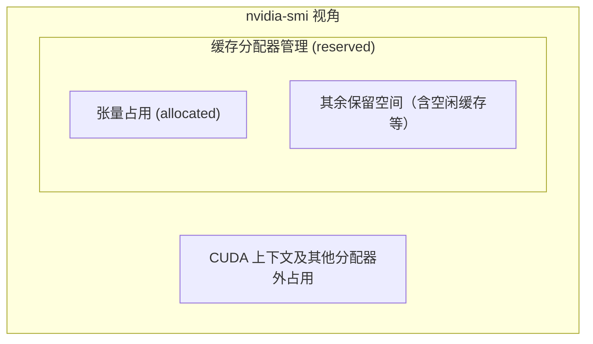

# 删了张量，显存为什么还没降？

> **GPU 内存优化 · 第 1 篇**  
> 模型跑完了，输入也删了，显存却还占着。先别急着反复清缓存：看懂哪些数据仍然活着，才能判断该释放什么。

> **工程深度｜验证状态：** L2 工程｜概念验证（访存视角）
假设你刚开始尝试在本地训练一个小模型。第一轮顺利完成，你删除输入和输出，又执行了网上常见的一行代码：

```python
torch.cuda.empty_cache()
```

打开 `nvidia-smi`，显存没有归零。你可能会想：Python 没清干净？模型泄漏了？还是这行代码根本没用？

这里有一个更值得先问的问题：**程序里还有谁在使用 GPU 上的数据？**

这篇文章从这个教学场景出发，解释显存的占用、复用和释放，并用一个小实验把它们区分开。本篇先解决“空间被谁占用”，再逐步讨论 GPU 怎样更高效地取数和搬运数据。这是 GPU 内存优化系列第一篇，文末附有七篇的完整路线图。

资料核对日期：2026 年 10 月 20 日。文中的容量计算是依据数据类型和参数数量做出的理论计算；实验代码未在本文生成环境中完成 GPU 运行验证，不提供虚构的输出或加速比。

## 01｜删掉一个名字，不等于删掉那份数据

先暂时放下神经网络，观察这几行代码：

```python
x = torch.ones(1024, device="cuda")
y = x
del x
```

`x` 和 `y` 指向同一个张量对象。删除 `x` 后，`y` 仍然可以访问它，因此那份数据仍然需要存在。

如果改成 `y = x[:512]`，情况也值得留意：这个切片通常是一个**视图**，也就是共享原存储、以另一种形状或范围访问数据的张量。即使视图只暴露部分元素，它仍可能让原存储继续存活。PyTorch 官方的视图文档说明了这种共享关系。[1]

所以，`del x` 的含义更接近“移除这个名字所持有的引用”，而不是“命令 GPU 立即擦除这块空间”。模型对象、优化器、列表、闭包，甚至交互式环境保留的输出，都可能继续持有相关对象。

当不再有对象需要那份存储，并且相关 GPU 使用已经安全结束后，它才具备回收或复用的条件。PyTorch 的常规 CUDA 分配器还会决定：是留下来复用，还是归还给底层系统。[2]

于是，显存释放至少涉及两个不同问题：

- **这份数据还用不用？**看对象引用与计算任务的生命周期。
- **不用的空间交给谁？**看分配器是否保留它作为缓存。

把这两个问题分开，后面的数字就容易解释了。

## 02｜三个显存数字，观察的不是同一件事

这里讨论的显存，是放置 GPU 张量等数据所需的设备内存。它与电脑的 CPU 内存分别管理；本篇也不把内核使用的寄存器、共享内存与这些容量统计混为一谈。

PyTorch 为减少反复申请设备内存的成本，使用缓存分配器。张量不再需要某块空间后，分配器可能先保留它，后续创建张量时再复用。[2]

可以将它理解为工作台：零件已经拿走，工作台上的位置空出来了，但整张工作台还由你使用。这个比喻只用于解释管理关系，并不表示底层显存一定是一段连续区域。

在常规分配器下，可以先这样读数：

| 观测方式 | 主要回答什么问题 | 不要据此直接判断什么 |
|---|---|---|
| `torch.cuda.memory_allocated()` | 当前设备上的张量占用了多少显存 | 不能当作整个进程的全部 GPU 占用 |
| `torch.cuda.memory_reserved()` | PyTorch 缓存分配器总共管理了多少显存 | 不能全部视为仍在使用的张量 |
| `nvidia-smi` | 从驱动视角观察进程或设备占用 | 不能直接定位到某个 Python 变量 |

前两个 API 分别用于观察张量占用与缓存分配器管理的空间。[3][4] `nvidia-smi` 还可能包含 CUDA 上下文等开销，因此不必与前两者相等。若程序还使用直接调用 CUDA 分配内存的库，相关占用也可能不出现在 PyTorch 的内存分析结果中。[3][5] 三个数字的管理范围可以概括成下图。下图只示意常规分配器下的管理范围，不表示各项能按图直接精确相加：



由此就能解释一种常见现象：

> 删除临时张量后，`allocated` 下降，但 `reserved` 仍然较高。

这与“空间已经可以复用，但还留在分配器里”相符，不能仅凭这一现象判定泄漏。

同样，**`reserved - allocated` 不能直接叫作“碎片大小”**。差额可能包含正常缓存、分配粒度产生的余量，以及尚不能整块归还的空间。判断碎片需要更细的分配信息。[2]

本文使用默认的常规分配器建立认识。自定义分配器、其他分配后端或 CUDA Graph 等环境可能带来额外规则，不宜将示意关系当作所有配置下的精确公式。

## 03｜模型还在，显存就不该归零

用一个两层网络算一笔账。示例模型有两层全连接层：

```text
1000 维输入 → 10000 维隐藏层 → ReLU → 1000 维输出
```

全连接层里的每个权重和偏置都是一个参数。计算如下：

| 层 | 权重数量 | 偏置数量 |
|---|---:|---:|
| 第一层 | 1000 × 10000 | 10000 |
| 第二层 | 10000 × 1000 | 1000 |
| 合计 | 20000000 | 11000 |

总参数量为 **20011000**。当这些参数以 FP32（32 位浮点数）存储时，每个占 4 字节：

\[
\text{参数存储量}=20011000\times4
=80044000\ \text{字节}
\approx76.34\ \text{MiB}
\]

这里的 MiB 等于 \(1024^2\) 字节。它与十进制的 MB 不同；计算与显示最好统一单位。

**只要这份 FP32 模型完整地保留在 GPU 上，仅参数就需要约 76.34 MiB。**这还没有计入训练数据、梯度和优化器状态。因此，如果模型已经完整放在 GPU 上、参数仍然存活，那么张量占用不应显示为零；遇到这种结果，应先核对设备、采样位置与运行环境，而不是把它当成正常输出。

更容易忽视的是：训练时需要的东西，远不止参数。

### 一次训练，为什么会逐步增加占用

先看四类主要对象：

| 对象 | 用途 | 通常什么时候出现 |
|---|---|---|
| 参数 | 模型当前的权重与偏置 | 将模型放进 GPU 时 |
| 前向中间结果 | 为反向计算提供所需信息 | 前向传播期间 |
| 参数梯度 | 表示参数应如何调整 | 反向传播期间 |
| 优化器状态 | 帮助优化器更新参数 | Adam 通常在首次更新时初始化相关状态 |

前向传播是“拿当前参数算出结果”。反向传播则根据损失，计算各参数的梯度。为完成后者，自动求导系统会保留所需的前向信息；普通反向传播执行后，其中用于反向的保存数据通常会被释放，而梯度仍可能保存在参数的 `.grad` 中。[6][7]

Adam 还为参数维护两组主要统计量，用来跟踪梯度及梯度平方的移动平均。在本文采用的普通 FP32、无额外主权重副本的设置中，可以用参数存储量 \(P\) 做一笔粗账：[6]

\[
\text{参数}+\text{梯度}+\text{Adam 主要状态}
\approx P+P+2P=4P
\]

对于上面的模型，这几类数据合计约 **305.34 MiB**。

**这是指定条件下的主要张量存储估算，不是显存峰值预测。**输入、输出、前向中间结果、算子临时空间、优化器实现和分配器余量，都可能改变真实占用。混合精度、其他优化器与分片训练也会改变这笔账。

现在再看原来的清理动作：

```python
del input_tensor, target, output, loss
```

它删除的是这些名字的引用。`model` 还在，参数还在；如果梯度没有清理，梯度也在；`optimizer` 还在，Adam 的状态通常也还在。

此时显存没有归零，是可以解释的正常结果。

**把同一笔账放大到大模型。**以一个 70 亿参数的模型做纯理论估算：仅 FP32 参数就需要 \(7\times10^9\times4=28\) GB；按本篇参数、梯度与 Adam 主要状态的 4P 口径，约为 112 GB，尚未计入激活和临时空间。这说明，训练时需要保存的内容可能远多于参数本身。能否放进单张 GPU，还取决于设备容量、模型结构与训练方式；这里不继续展开。本篇的小实验，就是在安全尺寸下把这套账亲手走一遍。

## 04｜做一个实验，看看空间在哪一步出现

下面的实验沿用上述网络，只训练两个随机批次。目的不是训练出有用模型，而是观察不同阶段的显存变化。

**环境与验证状态：**需要 NVIDIA CUDA GPU、可用的驱动，以及支持该设备的 CUDA 版 PyTorch。代码使用 PyTorch 2.x 的常用公开接口，按单进程、单 GPU、FP32、普通即时执行方式编写，未启用混合精度、编译或分布式训练。本文生成环境未安装 PyTorch；代码仅做了语法与静态逻辑检查，尚未完成 CUDA 执行验证。

建议在独立 Python 进程中运行，避免 Notebook 中已有对象干扰观察。如果可用显存不足，可以减小隐藏层宽度，并重新计算参数量。

读代码时建议分两遍：第一遍只跟着 `report()` 看每个采样点在哪个阶段；第二遍再看 `del`、`zero_grad()` 和 `empty_cache()` 分别改变了什么。

将下列代码保存为 `memory_ledger.py`，执行 `python memory_ledger.py`：

```python
"""删了张量，显存为什么还没降？（第7章 · 访存与传输）。

本文件是对应博文代码块的实现/演示，直接运行可见效果；运行依赖：PyTorch。
"""
import gc
import torch
from torch import nn


def main():
    if not torch.cuda.is_available():
        raise SystemExit("需要可用的 CUDA GPU 和 CUDA 版 PyTorch。")

    device = torch.device("cuda:0")
    torch.cuda.set_device(device)
    torch.manual_seed(42)

    print("PyTorch:", torch.__version__)
    print("PyTorch 构建使用的 CUDA:", torch.version.cuda)
    print("GPU:", torch.cuda.get_device_name(device))
    print("分配器后端:", torch.cuda.memory.get_allocator_backend())

    def report(stage):
        # 诊断时等待本设备工作完成，便于对照阶段；不是测速代码。
        torch.cuda.synchronize(device)
        mib = 1024 ** 2
        allocated = torch.cuda.memory_allocated(device) / mib
        reserved = torch.cuda.memory_reserved(device) / mib
        peak = torch.cuda.max_memory_allocated(device) / mib
        print(
            f"{stage:<18} | allocated={allocated:9.2f} MiB"
            f" | reserved={reserved:9.2f} MiB"
            f" | peak={peak:9.2f} MiB"
        )

    report("初始状态")
    model = nn.Sequential(
        nn.Linear(1000, 10000),
        nn.ReLU(),
        nn.Linear(10000, 1000),
    ).to(device=device, dtype=torch.float32)

    # 固定实现选项，减少 foreach 临时张量对教学观察的干扰。
    optimizer = torch.optim.Adam(model.parameters(), foreach=False)
    criterion = nn.MSELoss()
    parameter_bytes = sum(
        p.numel() * p.element_size() for p in model.parameters()
    )
    print(f"参数理论存储量: {parameter_bytes / 1024 ** 2:.2f} MiB")
    report("模型与优化器创建后")

    for step in range(1, 3):
        print(f"\n第 {step} 轮")
        optimizer.zero_grad(set_to_none=True)
        # 重置峰值统计，不释放显存；从本轮起重新观察高水位。
        torch.cuda.reset_peak_memory_stats(device)
        inputs = torch.randn(64, 1000, device=device, dtype=torch.float32)
        target = torch.randn(64, 1000, device=device, dtype=torch.float32)
        report("输入创建后")

        output = model(inputs)
        loss = criterion(output, target)
        report("前向后")

        loss.backward()
        report("反向后")
        optimizer.step()
        report("参数更新后")

        del inputs, target, output, loss
        report("删除本轮临时对象后")
        optimizer.zero_grad(set_to_none=True)
        report("梯度设为 None 后")

        if step == 1:
            # 只作一次观察对照，不建议照搬为每轮训练的固定步骤。
            torch.cuda.empty_cache()
            report("清理空闲缓存后")

    # 实验结束：优化器也持有参数引用，所以与模型一起删除。
    del optimizer, model
    gc.collect()
    torch.cuda.empty_cache()
    report("删除模型与优化器后")


if __name__ == "__main__":
    main()
```

这段代码在观测点显式同步，会影响正常流水线运行，因此不能拿它测训练速度。`foreach=False` 是为了减少实验中的一个实现变量，不代表它在所有模型上都应关闭。[6]

我们不预填运行数字，而是先写下待验证的预期：

| 观测点 | 按上述机制预计看到什么 | 怎样解释 |
|---|---|---|
| 模型进入 GPU 后 | 张量占用明显高于初始状态 | 参数已经存在 |
| 前向后 | 通常出现额外占用 | 输出与反向需要的信息产生 |
| 反向后 | 与前向后数值不同，不保证单调上升 | 保存数据逐步释放，梯度逐步产生 |
| 首次参数更新后 | 通常出现持久的新占用 | Adam 状态初始化 |
| 删除本轮临时对象后 | 占用可能下降，但不会只因这一步归零 | 参数、梯度和状态仍存在 |
| 梯度设为 `None` 后 | 无其他引用时，梯度存储可回收复用 | 参数与 Adam 状态仍保留 |
| 清理空闲缓存后 | `reserved` 可能下降，活跃参数不会被清走 | 缓存与活跃数据是两回事 |

清掉梯度后，值得把剩下的账单独算一遍：**参数 \(P\) 与 Adam 的两组主要状态 \(2P\) 仍然存在**，在本篇限定条件下合计约 \(3P\approx229.01\) MiB。这仍只是主要张量的理论存储估算，不是承诺 `memory_allocated()` 必须打印这个值。[6] 换句话说，即使临时对象与梯度都已清理，显存仍不应因此归零——这正面回答了标题里的疑问。

第二轮尤其值得看：Adam 的状态通常已经建立，不会再按同样方式增加一整套。这种“第一轮上升，后续趋稳”的模式，与“每轮都留下新的活跃对象”需要分开判断。

第一轮后的清缓存是单独的观察动作，它会改变第二轮的缓存起点：第二轮可能需要重新申请部分空间。因此，第二轮仍可能重新增加 `reserved`；这里重点比较哪些活跃张量继续存在，不要求两轮缓存曲线完全一致，也不能仅凭两轮就排除内存泄漏。

`peak` 是自上次重置以来，张量占用达到过的最高值；重置统计不会清空当前对象。[8][9] 因此，一轮结束时只剩较少占用，也不能证明这一轮没有出现过更高的峰值。

## 05｜三种清理动作，各自解决什么

### 清梯度：让不再需要的梯度退出生命周期

```python
optimizer.zero_grad(set_to_none=True)
```

它将相关参数的梯度设为 `None`。与将现有梯度缓冲区填零不同，这样可以让不再被引用的梯度存储具备回收条件。官方文档也提醒，两种方式在优化器如何处理没有收到梯度的参数时存在行为差异。[10]

这不意味着“每个反向后都应该立刻清梯度”。如果你有意做**梯度累积**——多个小批次累积梯度，再统一更新——就必须等这次累积完成再清理。

### 清引用：别让日志与容器继续保存 GPU 数据

训练时经常要记录损失。若只想保留数字，可以写：

```python
loss_history.append(loss.item())
```

`loss.item()` 得到 Python 标量，不会让这条日志持有 GPU 张量。[14] 不过，读取 CUDA 标量会涉及等待结果，不能据此推导“每步大量调用都没有开销”。

反过来，持续保存 `loss` 或 `output` 张量，会让相关对象继续存活。尤其是保存尚未完成反向的结果，或不必要地使用 `retain_graph=True` 时，可能保留大量反向所需的数据。PyTorch FAQ 提醒，不要无意地跨训练循环累积自动求导历史。[11]

这里需要说得准确一些：**普通 `backward()` 后，保存一个 `loss`，不等于整份前向激活必然一直保留。**反向通常已经释放所需的保存数据；具体留下多少空间，要结合计算图、张量和引用关系分析。[7]

另一个常见误区是认为 `detach()` 会把结果移出 GPU。它只是使返回张量脱离自动求导关系，仍与原张量共享存储。若长期保存 GPU 上的 `output.detach()`，输出数据照样占显存。[12]

只需要日志就存标量；确实需要保存预测结果时，再按用途选择移到 CPU、分批写出或设置有界缓冲区。

### 清缓存：归还已经空闲的空间

```python
torch.cuda.empty_cache()
```

它释放分配器持有的未使用缓存，供其他 GPU 应用使用，也可能改变 `nvidia-smi` 中看到的占用；它不能释放活跃张量。[13]

因此，模型仍在使用时，清缓存后显存不归零，并不说明调用失败。

缓存原本就是为复用服务的。把清缓存放进每个批次，可能导致后续重新申请空间；本文没有做性能对比，不能给出其耗时影响的固定比例。更合适的应用时机，是一个阶段确实结束、对象已释放，并且希望把闲置空间交给其他工作。

`gc.collect()` 也不是 GPU 清空按钮。它主要处理 Python 中可回收的对象，尤其是引用环；仍然可达的模型、列表和优化器，不会因为调用它而自动消失。[15]

## 06｜什么情况下才值得继续排查

不要只问“显存有没有下降”，而要在相同位置连续观察：

| 现象 | 下一步检查 |
|---|---|
| 第一轮增加，固定形状的后续轮次趋稳 | 是否只是优化器初始化和缓存建立 |
| 每轮结束后的 `allocated` 仍持续增长 | 是否保存了新张量、计算图或不断增长的状态 |
| `allocated` 较稳定，`reserved` 上升后稳定 | 是否在建立适应工作负载的缓存 |
| 结束时占用不高，运行中仍 OOM | 查看峰值，以及前向、反向、更新哪个阶段达到峰值 |
| `nvidia-smi` 与 PyTorch 数字差距明显 | CUDA 上下文、其他库的分配，以及指标口径 |

这些是排查方向，不是仅凭曲线就能下的诊断。输入形状变化、库的懒初始化、自定义算子和分配策略，都可能让曲线发生变化。

如果简单采样仍解释不了，可以使用 PyTorch 官方的内存快照与 Memory Visualizer，查看分配事件、调用栈以及空间何时被释放。它们主要观察 PyTorch 分配器管理的内存，不能替代整个进程的 GPU 内存审计。[5]

对于刚开始接触 GPU 优化的读者，第一步不必改复杂配置。先在自己的程序里标出五个位置：模型加载后、前向后、反向后、参数更新后、本轮清理后。固定输入规模，记录当前占用和峰值，再问每一段增加的空间是否有对应的对象。

**如果是参数、梯度或优化器状态仍在，接下来应调整工作负载或存储方式；如果是无意保留的引用，就修正生命周期；如果只是可复用缓存，就没有必要为了让数字变小而反复清空。**看懂这笔账，才知道下一次优化应该落在哪一行代码上。

## 本系列七篇

| 篇 | 读到什么现象时翻回本篇 |
|---|---|
| 1 显存没归零（本篇） | 删了张量，显存没归零 |
| 2 读表差这么多 | 相邻线程在同一条指令上访问哪些地址 |
| 3 共享内存 | 省下什么，又增加了哪些同步和资源成本 |
| 4 常量内存 | 只读系数表没有优势，warp 内是否读取相同地址 |
| 5 传输等待 | GPU 在等 CPU 送数据，有没有多余往返 |
| 6 异步重叠 | 打开异步仍没加速，时间线上真的重叠了吗 |
| 7 P2P 与 NVLink | 两卡交换不够快，身份、拓扑、测量口径是否对齐 |

## 参考资料

以下优先使用官方资料。为便于复核，多数 API 链接固定到 PyTorch 2.9 文档；这用于明确资料版本，不表示该版本是当前最新版本，也不表示本文代码已在该版本完成实测。

1. [PyTorch：Tensor Views](https://docs.pytorch.org/docs/2.9/tensor_view.html) — 视图与底层存储共享关系。
2. [PyTorch：CUDA semantics — Memory management](https://docs.pytorch.org/docs/2.9/notes/cuda.html#memory-management) — 缓存分配器、统计口径和分配后端注意事项。
3. [PyTorch：memory_allocated](https://docs.pytorch.org/docs/2.9/generated/torch.cuda.memory.memory_allocated.html) — 当前张量占用，以及与 `nvidia-smi` 的差异。
4. [PyTorch：memory_reserved](https://docs.pytorch.org/docs/2.9/generated/torch.cuda.memory.memory_reserved.html) — 缓存分配器管理的显存。
5. [PyTorch：Understanding CUDA Memory Usage](https://docs.pytorch.org/docs/2.9/torch_cuda_memory.html) — 内存快照、可视化与观测边界。
6. [PyTorch 官方教程：How to save memory by fusing the optimizer step into the backward pass](https://docs.pytorch.org/tutorials/intermediate/optimizer_step_in_backward_tutorial.html) — 训练内存构成、Adam 状态和临时内存；本文只引用其机制说明，没有采用其性能结果。
7. [PyTorch：Tensor.backward](https://docs.pytorch.org/docs/2.9/generated/torch.Tensor.backward.html) — 梯度累积与计算图保留语义。
8. [PyTorch：max_memory_allocated](https://docs.pytorch.org/docs/2.9/generated/torch.cuda.memory.max_memory_allocated.html) — 张量显存峰值。
9. [PyTorch：reset_peak_memory_stats](https://docs.pytorch.org/docs/2.9/generated/torch.cuda.memory.reset_peak_memory_stats.html) — 重置峰值统计。
10. [PyTorch：Optimizer.zero_grad](https://docs.pytorch.org/docs/2.9/generated/torch.optim.Optimizer.zero_grad.html) — `set_to_none=True` 的作用与行为差异。
11. [PyTorch：Frequently Asked Questions](https://docs.pytorch.org/docs/2.9/notes/faq.html#my-model-reports-cuda-runtime-error-2-out-of-memory) — 不必要的引用与自动求导历史累积。
12. [PyTorch：Tensor.detach](https://docs.pytorch.org/docs/2.9/generated/torch.Tensor.detach.html) — 脱离自动求导但共享原存储。
13. [PyTorch：empty_cache](https://docs.pytorch.org/docs/2.9/generated/torch.cuda.memory.empty_cache.html) — 释放空闲缓存及适用边界。
14. [PyTorch：Tensor.item](https://docs.pytorch.org/docs/2.9/generated/torch.Tensor.item.html) — 从单元素张量取得 Python 数值。
15. [Python：gc — Garbage Collector interface](https://docs.python.org/3/library/gc.html) — 垃圾回收器及其职责。

材料基础：用户提供的《第 8 章 GPU 内存优化》图片文字转写稿。本文沿用其第一节的模型结构，重新组织机制解释、实验流程和引用，未沿用原稿中未经核验的运行数字。
