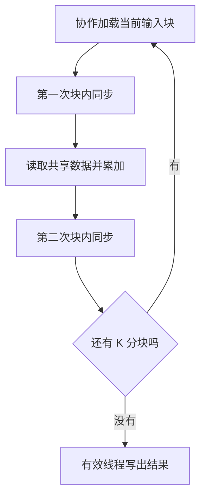

# 共享内存这么快，为什么不能全放进去？

> **GPU 内存优化 · 第 3 篇**  
> 多放一份数据，反而可能少做许多重复工作。但复制、同步和有限的片上资源，也都有成本。

> **工程深度｜验证状态：** L2 工程｜概念验证（访存视角）
上一篇，我们给一张矩阵交换行列，遇到了一个麻烦：让相邻线程连续读取输入，写入输出时就可能变得分散；把线程方向换过来，问题又移到了读取一侧。

直觉上，似乎只差一张“中转台”：先按好读的顺序把一小块数据搬进来，再由线程们换一种顺序拿走。

CUDA 的**共享内存（shared memory）**可以承担这项工作。它还有另一种用途：一批线程需要反复使用同一份数据时，先协作取回来，再在块内复用。

这正是分块矩阵乘法的出发点。但问题也随之而来：既然共享内存快，为什么不把整个矩阵都放进去？已经有线程块了，代码为什么还沿着矩阵循环？两次同步又在等什么？

本篇围绕这些问题展开，重点是共享内存的收益与代价。矩阵、地址和容量计算用于教学；代码未完成 GPU 实测，不提供虚构的运行时间或加速比。资料核对日期：2026 年 10 月 20 日。

## 01｜它是一块协作空间，不是显存扩容

先区分两个东西：

- **全局内存**：本篇中用来存放完整输入和输出矩阵，普通设备数组通常放在这里。
- **共享内存**：供线程协作使用的片上存储。本文采用常规线程块内用法，由程序安排加载、读取与同步。[1]

可以把它理解为一组人共同使用的工作台。但这个比喻有两条边界：工作台空间有限，而且不会自动准备好你想要的材料。

你需要决定搬哪些数据、谁负责搬、什么时候允许其他线程使用、什么时候可以覆盖。Numba-CUDA 的 `cuda.shared.array()` 用于声明这样的共享数组；初始内容不能假设已经清零。[2]

在本文的常规用法中，**每个线程块拥有自己的共享数组，它随该块存在**；不同块即使声明同名数组，也不会得到一块所有线程共同使用的全局存储。这个边界在第 08 节计算容量时会再次用到。

这也不同于缓存。硬件缓存会按自身规则保留部分数据；共享内存则给程序显式组织协作的机会。[1] 即使代码没有使用共享内存，全局读取也不意味着每次都必须重新访问显存芯片。

现代 CUDA 还有线程块集群等更复杂的协作机制；本篇不使用它们。下面所有同步，都限定在同一个线程块里。

## 02｜先接住上一题：为什么中转一次能让转置更顺

把矩阵分成小方块，称为 **tile**。以一个 4×4 小块为示意，元素 `a12` 表示原块第 1 行第 2 列：

\[
\begin{bmatrix}
a_{00}&a_{01}&a_{02}&a_{03}\\
a_{10}&a_{11}&a_{12}&a_{13}\\
a_{20}&a_{21}&a_{22}&a_{23}\\
a_{30}&a_{31}&a_{32}&a_{33}
\end{bmatrix}
\quad\longrightarrow\quad
\begin{bmatrix}
a_{00}&a_{10}&a_{20}&a_{30}\\
a_{01}&a_{11}&a_{21}&a_{31}\\
a_{02}&a_{12}&a_{22}&a_{32}\\
a_{03}&a_{13}&a_{23}&a_{33}
\end{bmatrix}
\]

第二篇的直接转置，让同一个线程完成“从全局读、向全局写”。现在可以把这两件事拆开：

| 阶段 | 同一组相邻线程做什么           |
| -- | -------------------- |
| 加载 | 从输入的一行连续读取，写入共享数组的一行 |
| 同步 | 确认整个小块已准备好           |
| 输出 | 从共享数组的一列取数，连续写入输出的一行 |

负责写出某个元素的线程，不必是最初加载它的线程。共享内存把两端的线程映射解耦了。完整矩阵转置时，还需要交换小块在输出中的位置，不能只转置块内部。

这样做并没有减少转置必须读取和写出的元素数量，而是改变全局访存的组织方式。NVIDIA 官方转置教程展示了这种方法。[3]

不过，列方向读取共享内存还可能产生另一种冲突。我们先把“数据复用”讲清，再回来处理它。

## 03｜矩阵乘法里，哪些数据被反复使用

转置利用共享内存改变访问顺序；矩阵乘法利用它复用输入。两者收益不同，都会付出搬运、同步和资源占用的成本——这就是本篇要用两个例子的原因。

先看它在 AI 训练中的位置：Transformer 的注意力投影和 FFN 包含大量矩阵乘法（GEMM）。成熟 GEMM 实现也广泛采用分层分块与片上数据复用——线程块、warp、线程各级各自负责一小块结果，并把 A、B 的数据协作搬进片上存储后再相乘，NVIDIA CUTLASS 的文档对此有集中说明。[10] 本篇手写 16×16 版本只展示其中最基础的一层，不是为了取代这些库，而是让你看懂它们在优化什么。

设矩阵乘法为：

\[
A_{M\times K}B_{K\times N}=C_{M\times N}
\]

一个输出元素由 A 的一行与 B 的一列相乘、求和：

\[
C_{r,c}=\sum_{k=0}^{K-1}A_{r,k}B_{k,c}
\]

朴素实现让一个线程负责一个输出。计算 `C[r, c]`，它读取 A 的第 r 行；旁边的线程计算 `C[r, c+1]`，又需要同一行 A。另一个输出行还会使用 B 中相同的列。

先从代码层面算账。要完成一个 T×T 输出块，并处理 K 方向上的 T 个位置：

- 有 T² 个输出；
- 每个输出执行 T 次乘加；
- 如果每次都显式读取 A 和 B，共有约 2T³ 次输入元素读取。

分块版本可以让线程们先共同加载一个 T×T 的 A 块与一个 T×T 的 B 块，只需 2T² 次全局元素加载；随后，每个输入元素在块内参与多次计算。

当 T=16 时，这个完整阶段的显式全局元素加载数从 8192 降为 512。**这是忽略边界的算法级计数，不是实测 DRAM 流量减少 16 倍，更不是速度提高 16 倍。**朴素版本也可能受益于缓存或相同地址访问的合并处理。

Numba-CUDA 官方示例同样以朴素和分块矩阵乘法说明这种复用思路。[4] 本文重新组织索引，并直接按 K 维度计算循环次数，便于理解非方阵和边界情况。

## 04｜已经有线程块，为什么还要循环

这是最容易读过去、却最影响理解的一步。

**线程块决定“负责 C 的哪一块”，K 方向的循环决定“这块结果还要累加哪些输入”。**它们处理的是不同维度。

先将 tile 边长缩成 2，假设 A 是 4×6、B 是 6×4。一个线程块负责 C 中的一个 2×2 小块，但每个输出都需要累加 6 个乘积。

共享数组每次只装 K 方向的 2 个位置，因此必须分三轮：

| 轮次 i | 取 A 的列 | 取 B 的行 | 得到什么   |
| ---- | ------ | ------ | ------ |
| 0    | 0、1    | 0、1    | 第一段部分和 |
| 1    | 2、3    | 2、3    | 第二段部分和 |
| 2    | 4、5    | 4、5    | 第三段部分和 |

例如，专门为教学选取：

\[
A_{1,:}=[1,2,3,4,5,6],\qquad
B_{:,2}=[10,20,30,40,50,60]^T
\]

那么负责 `C[1, 2]` 的线程会依次得到：

\[
\underbrace{1\times10+2\times20}_{50}
+\underbrace{3\times30+4\times40}_{250}
+\underbrace{5\times50+6\times60}_{610}
=910
\]

结果是在三轮中累加出来的，不能只算一轮。

### `i * 16 + threadIdx.x` 究竟在找哪里

正式代码采用 T=16。加载 A 时：

```python
ak = i * TILE + tx
```

可以直接读成：

> 当前 K 分块的起点，加上这个线程在块内的横向位置。

对于 `tx=3` 的线程：

| i | 当前 K 分块范围 | `i * 16 + 3` |
| - | --------- | -----------: |
| 0 | 0～15      |            3 |
| 1 | 16～31     |           19 |
| 2 | 32～47     |           35 |

加载 B 时则用 `i * TILE + ty` 找到对应的 K 方向行坐标。A 沿列推进，B 沿行推进，二者必须对应同一段 K。

若 K=40，需要三轮；最后一轮只有位置 32～39 有效，其余位置填零。零不会增加乘积贡献，但能保持块内协作流程一致。

## 05｜两次同步，各自挡住一种错误

一轮分块计算有三个阶段：



第一次同步防止“还没搬齐就开始读”。一个线程加载的数，可能马上被另一个线程使用，不能假设大家恰好同时到达。

第二次同步防止“有人还在读，就被下一轮覆盖”。先完成计算的线程不能立刻用下一轮数据改写共享数组，否则慢一点的线程可能读到两轮混杂的内容。

`cuda.syncthreads()` 是线程块内的屏障，不是整个 GPU 的同步。Numba-CUDA 文档要求块内线程都参加，否则可能出现未定义行为。[2]

因此，下面这个习惯在带屏障的分块代码里不能照搬：

```python
if row >= m or col >= n:
    return
```

边缘线程即使没有合法输出，也可能负责加载其他线程需要的数据。本文让所有线程参加加载与同步：越界输入填零，只在最后写出时检查输出边界。

## 06｜关键代码：先看坐标，再看乘加

下面是可运行脚本的第一部分。`tx`、`ty` 是块内坐标；`col`、`row` 是负责的输出位置。对于本例的行主序数组，令 x 方向对应列：

```python
"""共享内存这么快，为什么不能全放进去？（第7章 · 访存与传输）。

本文件是对应博文代码块的实现/演示，直接运行可见效果；运行依赖：Numba、NumPy。
"""
import numpy as np
from numba import cuda, float32

TILE = 16  # 编译时常量；共享数组形状与启动块尺寸必须一致。


@cuda.jit
def matmul_naive(a, b, c):
    col, row = cuda.grid(2)
    if row < c.shape[0] and col < c.shape[1]:
        acc = float32(0.0)
        for k in range(a.shape[1]):
            acc += a[row, k] * b[k, col]
        c[row, col] = acc


@cuda.jit
def matmul_tiled(a, b, c):
    sa = cuda.shared.array((TILE, TILE), dtype=float32)
    sb = cuda.shared.array((TILE, TILE), dtype=float32)
    tx, ty = cuda.threadIdx.x, cuda.threadIdx.y
    col = cuda.blockIdx.x * TILE + tx
    row = cuda.blockIdx.y * TILE + ty
    acc = float32(0.0)

    for i in range((a.shape[1] + TILE - 1) // TILE):
        ak = i * TILE + tx  # A 的全局列号。
        bk = i * TILE + ty  # B 的全局行号。
        sa[ty, tx] = float32(0.0)
        sb[ty, tx] = float32(0.0)
        if row < a.shape[0] and ak < a.shape[1]:
            sa[ty, tx] = a[row, ak]
        if bk < b.shape[0] and col < b.shape[1]:
            sb[ty, tx] = b[bk, col]
        cuda.syncthreads()

        for j in range(TILE):
            acc += sa[ty, j] * sb[j, tx]
        cuda.syncthreads()

    if row < c.shape[0] and col < c.shape[1]:
        c[row, col] = acc
```

特别留意内层循环：`sa[ty, j]` 是共享 A 块中的一行，`sb[j, tx]` 是共享 B 块中的一列。`j` 在当前小块内部移动；外层 `i` 则把这个小块沿 K 维移到下一段。

这里的「沿行 / 沿列」描述的是**单个线程**随 `j` 推进的轨迹。分析 bank conflict 时，要换一个视角：固定某一次 `j`，同时查看整个 warp 的访问地址。在本文 16×16 配置和第 07 节的 FP32 bank 模型下，`sa[ty, j]` 让同一半 warp 读取同一位置，可以广播；`sb[j, tx]` 让两个半 warp 各自遍历 16 个位置，也不等于 32 个不同地址挤进同一个 bank。这是地址推导，不是实测结论，第 07 节会回到这个话题。

线程数不会因为加循环而变成串行单线程。每个线程仍计算不同输出，只是都需要依次完成自己那份求和。

代码中的 16×16 线程块，其一个 warp 跨越两个局部行，不等于“32 个线程恰好读取完整的一行”。分析合并访问时仍要按实际地址计算；这里不声称这种配置已经最优。

## 07｜快的存储，也可能让线程排队

回到转置。我们让线程们从共享数组的一列取数，这比全局列访问更容易安排，但也可能遇到 **bank conflict，存储体冲突**。

共享内存被分为可并行服务的 bank。在常见的 32 个 bank、连续 32 位字映射到连续 bank 的模型下，若同一个 warp 的线程访问同一 bank 中的不同位置，请求可能需要拆开处理；多个线程读取同一个位置则可以广播，不能简单视为冲突。[5] 下图展示了这种错位访问的形态——每一行的相同列落进同一个存储体，一列读下来就要排队：


对于 FP32 的二维共享数组，可以用一个简化映射观察布局：

\[
\text{bank}=(\text{row}\times\text{行宽}+\text{col})\bmod32
\]

设 32 个线程分别读取第 0～31 行的同一列：

| 共享数组布局     | bank 编号的变化                   | 这个访问模式的含义      |
| ---------- | ---------------------------- | -------------- |
| `[32][32]` | `(row × 32 + col) % 32`，结果相同 | 不同位置集中到同一 bank |
| `[32][33]` | `(row + col) % 32`，依次变化      | 分散到不同 bank     |

多加的一列叫作 **padding**，只改变共享数组每行的跨度，不改变转置输出的数学形状。NVIDIA 转置教程使用过这一办法。[3] 下面两张图正是这一对比：第一张每行 32 个元素，同一列全部落进同一 bank；第二张每行 33 个元素，同样的列访问被摊开到不同 bank。


这不是“所有共享数组都应加一列”的规则。上表只推导了指定类型、布局与访问模式；它也不能直接用来宣布前面的 16×16 矩阵乘法存在同样冲突。应先找出实际指令中各线程的地址，再用 profiler 检查。

## 08｜为什么不能把整个矩阵都放进去

最直接的原因是容量。本文一个线程块的两个 16×16 FP32 共享数组只需要：

\[
2\times16\times16\times4=2048\ \text{字节}=2\ \text{KiB}
\]

而一个 4096×4096 的 FP32 矩阵就需要 64 MiB。共享内存的限额依赖设备和配置，不能把它当成放完整大矩阵的普通显存。[1]

另一个原因是并发。GPU 的计算单元 SM 会同时安排一定数量的线程块；一个块使用的共享内存、寄存器越多，能同时驻留的块数就可能越少。[6] 这也是每个线程块各自的账——第 01 节说过共享数组随块存在，驻留限制按各块占用的资源叠加，不是全 GPU 共用一份。

这里可以把 **occupancy，驻留占用率**理解为活跃 warp 数相对硬件上限的比例。它能帮助判断资源限制，但不是越高就一定越快。想快速确认内核的资源账，可用 Nsight Compute 查看寄存器、共享内存占用和驻留限制，区分理论占用率与实际运行表现。

本实现把 TILE 从 16 改为 32，会同时增加每块线程数（256→1024）和共享内存用量（2 KiB→8 KiB）。可驻留块数与活跃 warp 数如何变化，需要结合设备和编译结果判断，不能只根据共享数组容量推断——驻留块数减少也不等于 occupancy 必然下降，还要看每块包含多少 warp。这笔资源账帮你了解是否吃紧，不能替代对真实耗时的测量。

共享内存版本还新增了加载、共享读写、同步和索引工作。如果数据只使用一次，或者原来的缓存已很好地服务访问，这些代价可能抵消收益。

因此，真正该问的是：**这一块数据会被怎样复用，或者能否帮助改变低效的访问顺序？**若这两个问题都没有明确答案，仅仅“先搬进更快的地方”不构成优化依据。

## 09｜怎样验证这个版本值得使用

本实验以 `matmul_naive` 为基线，与 `matmul_tiled` 完成同一任务；两者均为 FP32、一个线程计算一个输出，不使用 Tensor Core 专用路径。数据预先在 GPU 上，输出预分配，首次编译和正确性检查不计入测量。

先验证非方阵与边界，再测重复运行的耗时。浮点乘加可能因编译与融合方式产生小差异，因此使用与本教学输入匹配的容差比较，而不是要求误差必为零。

**环境与验证状态：**代码需要 NumPy、NVIDIA 维护的 Numba-CUDA 及兼容的 CUDA 环境，安装依官方文档进行。[7] 本文生成环境没有 Numba-CUDA，也未进行 GPU 编译或执行。已检查 Python 语法，并用 CPU 协作调度模型（按线程块顺序模拟各阶段）验证多个形状下的索引、补零和两阶段屏障流程；该模型只支持索引与阶段流程分析，不模拟 GPU 并发、浮点行为与性能，不能替代真实 GPU 验证。

测量采用 CUDA Event，在默认流中连续启动同一版本，每组 5 次，共 5 组，报告每组单次均值的中位数与范围。事件返回毫秒。[8] 不包含主机与设备复制；对很短的内核，还需注意主机提交间隙和事件分辨率。

运行后可以整理下面的记录，不必预设一定获得加速：

| 输入尺寸 M、K、N | 朴素版本 / ms | 分块版本 / ms | 正确性 | 备注          |
| ---------- | --------- | --------- | --- | ----------- |
| 自行填写       | 待测        | 待测        | 待验证 | GPU、版本、重复条件 |

若分块版更慢，应继续检查规模是否过小、同步等待、共享访问冲突及资源限制。Nsight Compute 的 Memory Workload Analysis 和占用率相关信息，可以提供进一步证据。[9]

本文也不以手写版本挑战成熟矩阵乘法库。工程中仍应优先评估框架提供的算子；若要加入 `torch.matmul` 等参照，还需单独说明实际计算精度、允许的硬件路径和计时条件。

对 AI 兴趣者而言，理解共享内存，不必从追逐一个加速比开始。先说明一份数据将被谁重复使用，再算清哪些全局访问能省掉；或者画出重排前后的地址，说明哪一端变得连续。最后把新增的同步与资源占用一起纳入测量，才能判断这张“协作工作台”是否值得搭起来。

## 附：补齐实验入口

将下面代码接在前面的两个内核之后，保存为 `shared_memory_lab.py`，执行 `python shared_memory_lab.py`。不要改变 `TILE` 后只改启动尺寸而不重新编译内核；本实验固定使用 16。脚本打印主要包版本与设备信息，请同时自行记录驱动版本。

```python
from importlib.metadata import version
from statistics import median


def measure(kernel, grid, block, a, b, c):
    for _ in range(3):
        kernel[grid, block](a, b, c)
    cuda.synchronize()
    start = cuda.event(timing=True)
    end = cuda.event(timing=True)
    timings = []
    for _ in range(5):
        start.record()
        for _ in range(5):
            kernel[grid, block](a, b, c)
        end.record()
        end.synchronize()
        timings.append(cuda.event_elapsed_time(start, end) / 5)
    return median(timings), min(timings), max(timings)


def run_case(m, k, n, benchmark=False):
    rng = np.random.default_rng(42)
    # 小幅随机输入，避免本教学容差被不必要的大数值放大。
    ah = (rng.random((m, k), dtype=np.float32) - np.float32(0.5))
    bh = (rng.random((k, n), dtype=np.float32) - np.float32(0.5))
    # 用 CPU float64 结果作为数值参照，不将其耗时与 GPU 对比。
    expected = ah.astype(np.float64) @ bh.astype(np.float64)
    a, b = cuda.to_device(ah), cuda.to_device(bh)
    c = cuda.device_array((m, n), dtype=np.float32)
    block = (TILE, TILE)
    grid = ((n + TILE - 1) // TILE, (m + TILE - 1) // TILE)
    tasks = [("naive", matmul_naive), ("tiled", matmul_tiled)]
    print(f"shape: M={m}, K={k}, N={n}")
    for name, kernel in tasks:
        kernel[grid, block](a, b, c)
        cuda.synchronize()
        got = c.copy_to_host()
        # 容差用于这些 FP32 小幅随机输入，不是通用精度承诺。
        np.testing.assert_allclose(got, expected, rtol=1e-4, atol=1e-4)
        error = np.max(np.abs(got.astype(np.float64) - expected))
        print(f"  {name}: correctness PASS, max_abs_error={error:.3e}")
    if benchmark:
        for name, kernel in tasks:
            mid, low, high = measure(kernel, grid, block, a, b, c)
            print(
                f"  {name}: median={mid:.6f} ms"
                f", group means range=[{low:.6f}, {high:.6f}] ms"
            )


def main():
    if not cuda.is_available():
        raise SystemExit("需要可用的 NVIDIA CUDA 环境。")
    print("NumPy:", np.__version__)
    print("Numba:", version("numba"))
    print("Numba-CUDA:", version("numba-cuda"))
    gpu = cuda.get_current_device()
    print("GPU:", gpu.name, "compute capability:", gpu.compute_capability)
    print("TILE=16, FP32, warmup=3, repeats=5, samples=5")
    for shape in [(5, 23, 7), (19, 35, 21), (33, 7, 17)]:
        run_case(*shape)
    for shape in [(256, 256, 256), (512, 512, 512)]:
        run_case(*shape, benchmark=True)


if __name__ == "__main__":
    main()
```

默认按朴素、分块的顺序测试。差异较小时，应交换顺序、重复采样，并检查 GPU 是否有其他任务争用；没有做这些检查前，不宜把一次排名当作稳定结论。

## 参考资料

下列资料均来自官方文档或官方技术文章。固定版本链接用于明确核验口径，不表示该版本是当前最新版本；本文没有沿用文献示例的硬件性能数字。

1. [NVIDIA：CUDA C++ Programming Guide 12.8 — Shared Memory](https://docs.nvidia.com/cuda/archive/12.8.1/cuda-c-programming-guide/index.html#shared-memory) — 共享内存、线程块协作与设备资源限制。
2. [NVIDIA Numba-CUDA：CUDA Kernel API](https://nvidia.github.io/numba-cuda/reference/kernel.html) — 共享数组、初始化语义和块内同步要求。
3. [NVIDIA Technical Blog：An Efficient Matrix Transpose in CUDA C/C++](https://developer.nvidia.com/blog/efficient-matrix-transpose-cuda-cc/) — 通过共享内存重排转置访问，以及 padding 的作用。
4. [NVIDIA Numba-CUDA：Examples — Matrix multiplication](https://nvidia.github.io/numba-cuda/user/examples.html#matrix-multiplication) — 朴素与共享内存分块矩阵乘法。
5. [NVIDIA：CUDA C++ Best Practices Guide 12.8 — Shared Memory and Memory Banks](https://docs.nvidia.com/cuda/archive/12.8.2/cuda-c-best-practices-guide/index.html#shared-memory-and-memory-banks) — bank 映射、冲突及广播。
6. [NVIDIA：CUDA C++ Programming Guide 12.8 — Hardware Multithreading](https://docs.nvidia.com/cuda/archive/12.8.1/cuda-c-programming-guide/index.html#hardware-multithreading) — 寄存器、共享内存与驻留线程块之间的关系。
7. [NVIDIA Numba-CUDA：Installation](https://nvidia.github.io/numba-cuda/user/installation.html) — 安装与环境依赖。
8. [NVIDIA Numba-CUDA：CUDA Host API — Events](https://nvidia.github.io/numba-cuda/reference/host.html#events) — 事件计时与同步。
9. [NVIDIA Nsight Compute：Profiling Guide](https://docs.nvidia.com/nsight-compute/ProfilingGuide/index.html) — 内存访问、bank conflict 与性能诊断。
10. [NVIDIA CUTLASS Documentation：Efficient GEMM](https://docs.nvidia.com/cutlass/latest/media/docs/cpp/efficient_gemm.html) — 线程块、warp、线程层级的分块与共享内存、寄存器复用。

材料基础：用户提供的《第 8 章 GPU 内存优化》图片文字转写稿。本篇重构其共享内存矩阵乘法示例，修正行列映射，补充 K 分块、边界补零与同步解释；未使用原稿中未经核验的运行时间和误差输出。
