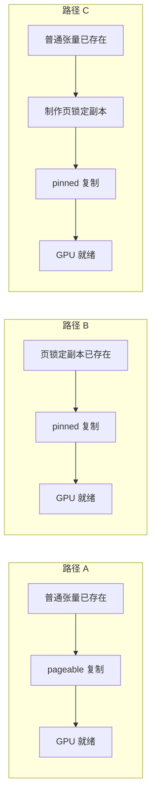

# 数据还没送到，GPU 已经等急了

> **GPU 内存优化 · 第 5 篇**  
> 内核里的取数方式优化好了，还要看数据怎样抵达 GPU。先少搬，再把必要的搬运测清楚。

> **工程深度｜验证状态：** L2 工程｜静态复核 + 逻辑验证（传输重叠需上机实测）
假设你正在用 GPU 批量识别图片。模型已加载，输入也做了缩放和归一化。你关注过矩阵运算，甚至知道共享内存与常量内存的用途，但整个程序仍没有预想中流畅。

这时，值得沿着数据的来路看一眼：图片从哪里读取？预处理在哪里执行？什么时候进入 GPU？中间结果有没有又回到 CPU？

前四篇分别讨论显存占用、全局访问、共享内存与常量内存。本篇把视角移到 **CPU 内存与 GPU 显存之间的传输**，只回答一个问题：

**怎样减少 CPU 到 GPU 的搬运成本，又不把“传输阶段更快”误认为“完整流程更快”？**

下面的图片流水线是教学场景，不是某个项目的实测案例。容量计算依据明确的形状和数据类型；实验代码尚未完成 GPU 执行验证，不提供虚构的运行输出或加速比。资料核对日期：2026 年 10 月 20 日。

## 01｜先算搬多少，再问搬多快

以常见的独立 GPU 环境为背景，输入若在 CPU 上，进入 GPU 计算前通常需要一次主机到设备复制，简称 **H2D（host to device）**。结果回到 CPU，则是 **D2H（device to host）**。

设一批图片整理成 `[64, 3, 224, 224]` 的 FP32 张量：64 张图、3 个通道、每张 224×224，每个元素 4 字节。这批数据占：

\[
64\times3\times224\times224\times4
=38535168\ \text{字节}
=36.75\ \text{MiB}
\]

这里算的是**解码、整理后的张量**，不是磁盘上 JPEG 文件的大小。图片压缩文件很小，不代表送进模型的张量也同样小。

对于一个完全串行的教学流程，可以将单批时间拆为：

\[
T_{\text{单批}}=
T_{\text{读取与解码}}+
T_{\text{预处理}}+
T_{\text{H2D}}+
T_{\text{GPU计算}}+
T_{\text{必要结果回传}}
\]

真实流水线可能重叠这些阶段，不能把这个加法直接当作所有系统的吞吐模型。但它提醒我们：模型算得快，只覆盖其中一段。

NVIDIA 最佳实践强调，主机与设备之间的数据传输应尽量减少，多个 GPU 阶段之间尤其应考虑让数据留在设备上。[1] 在这个问题上，少搬一次，往往比为那一次搬运调整参数更值得先检查。

## 02｜先看有没有不必要的往返

一种容易出现的多余往返，是先把 GPU 张量转到 CPU NumPy，再上传给另一个 GPU 库的设备数组。

可以把关键动作拆开看：

| 操作 | 数据发生了什么 |
|---|---|
| GPU 张量执行 `.cpu()` | 复制到 CPU |
| CPU 张量执行 `.numpy()` | 在满足条件时，可与 CPU 张量共享存储；不能理解成数据仍在 GPU |
| 再执行 `cuda.to_device()` | 将 CPU 数组复制到 GPU |

PyTorch 的 `numpy()` 文档明确说明了默认转换的设备、梯度与类型条件，以及符合条件时与张量共享存储的关系。[10]

如果只是为了连接两个计算阶段，这里就值得重新审视：中间结果能否留在设备上？是否需要统一实现路径，或使用经过验证的设备互操作方式？

同样，一份输出可能很大，但应用只需要每张图的预测类别。若后处理可在 GPU 上完成，可以考虑先得到较小结果，再回传必要数据，而不是将全部中间特征送回 CPU。

这里的原则是**按实际用途缩小设备边界上的数据量**，不是要求所有操作都必须放在 GPU。若下游确实依赖 CPU 库，或者 GPU 后处理的成本更高，回传仍可能合理。

检查自己的程序时，可以先列一张小账单：

| 跨设备的数据 | 谁产生、谁消费 | 是否必须跨过去 |
|---|---|---|
| 模型输入 | CPU 预处理 → GPU 模型 | 通常需要 |
| 中间特征 | GPU 算子 → GPU 算子 | 优先检查能否留在设备 |
| 最终预测或统计量 | GPU → CPU 应用逻辑 | 按应用需要回传 |

先确定边界，再优化剩下的传输。

顺带一提，主机与设备之间的通道本身就比设备内部窄：在采用 PCIe 4.0 x16 的独立 GPU 系统中，链路理论单向带宽约为 32 GB/s（PCI-SIG 规范值[11]），实际应用吞吐通常更低。与许多 GPU 的显存带宽相比，主机到设备的通道更窄，因此应先检查不必要的跨设备搬运。具体差距取决于 GPU 型号和实际链路配置——这就是"边界天然狭窄"的硬件根源。

## 03｜页锁定内存，锁住的是什么

现在假设 H2D 确实不可省。你可能见过这个写法：

```python
pinned = cpu_tensor.pin_memory()
gpu_tensor = pinned.to("cuda", non_blocking=True)
```

这里的 **pinned memory，页锁定内存**，仍然是 CPU 内存，不是另一种 GPU 显存。

操作系统通常按“页”管理内存。普通内存允许系统进行分页管理；页锁定内存则使相关页不能被换出，为设备传输提供稳定的主机内存区域。CUDA 可以利用 DMA 等机制在主机与设备之间搬运数据；DMA 可简单理解为由硬件承担数据传输，而不是让 CPU 逐个元素执行复制。[1]

对于普通的 pageable（可分页）主机缓冲区，CUDA 可能需要经过页锁定暂存区等处理。具体同步与暂存行为依接口、方向和内存类型而异，不能一概而论。[2]

这不是说普通内存每次传输都会先读写磁盘，也不是说页锁定会提高 PCIe 通道本身的理论带宽。它改善的是这条传输路径的组织条件。

### `pin_memory()` 本身也要做事

对尚未页锁定的 CPU 张量，PyTorch 的 `pin_memory()` 会把数据复制到页锁定内存中；如果已经处于页锁定内存，则可直接返回自身。[3]

因此，原本的一步：

> 普通 CPU 张量 → GPU

可能被你写成两步：

> 普通 CPU 张量 → 页锁定副本 → GPU

第二步的条件变好了，第一步却不是免费的。PyTorch 官方教程明确讨论了主线程中手动执行 `pin_memory()` 的等待与复制成本，提醒不要据此默认获得完整流程加速。[4]

这也解释了为什么“页锁定内存有利于传输”和“临时先锁页再上传，可能更慢”可以同时成立。

## 04｜原来的比较，漏算了哪一段

一种常见的不完整比较，是先为普通张量传输计时，再提前创建页锁定副本，只给这个副本的上传计时。这样的数字最多用于比较**源数据已经准备好的两段传输**。

它没有回答：如果原始数据现在还在普通内存里，先制作页锁定副本，直到 GPU 真正收到数据，总共需要多久？

此外，如果第一次 `.to("cuda")` 恰好触发 CUDA 初始化，或两次调用都要新建 GPU 输出，测量还混入了其他成本。

更清楚的办法是分成三条路径，并让 GPU 目标缓冲区提前分配：

| 路径 | 从哪里开始计时 | 回答的问题 |
|---|---|---|
| A：普通内存直接复制 | 普通张量已存在 | 当前直接复制并等它完成要多久？ |
| B：已页锁定内存复制 | 页锁定副本已存在 | 准备好的页锁定数据上传要多久？ |
| C：临时页锁定后复制 | 普通张量已存在，尚未创建本次副本 | 临时准备加上传是否划算？ |

三条路径都使用相同的 FP32 内容、相同的 `non_blocking=True`，复制到同一个预分配 GPU 张量。这里用 `copy_()`，避免每次 `.to()` 创建新输出成为额外变量；该接口支持跨设备复制。[5] 三条路径的成本构成可以画成这样：



A 与 C 才接近“手里只有普通张量时，我该选哪条路”的比较。A 与 B 则关注源数据已准备好的传输条件。B 没计准备成本，不等于准备成本不存在。

本篇把 C 称为“准备＋复制的局部流程”，不称其为完整应用的端到端时间，因为它还没有包括读取、解码和模型计算。

## 05｜不要把函数返回，误当成数据已到

`non_blocking=True` 可以让复制尝试相对主机异步执行，但不意味着数据在 Python 调用返回时已经抵达 GPU。普通可分页源还可能需要暂存处理，调用本身也未必立即返回。[2][5]

因此，需要分开观察：

- **调用耗时**：`copy_()` 从进入到返回用了多久。
- **完成耗时**：从准备开始，到等待复制工作完成用了多久。

下面的计时思路只用于诊断：

```python
torch.cuda.synchronize(device)  # 先排除之前尚未完成的设备工作。
start = time.perf_counter()
# 若本路径有准备动作（如 pin_memory()），在复制前完成并计入此点。
prepared = time.perf_counter()
dst.copy_(src, non_blocking=True)
submitted = time.perf_counter()
torch.cuda.synchronize(device)  # 再等本次工作完成。
finished = time.perf_counter()
```

`torch.cuda.synchronize(device)` 会等待指定设备上的 CUDA 工作完成。[6] `perf_counter()` 则用于读取高分辨率墙钟时间差。[7]

把三个时间点串起来：`start→prepared` 是准备阶段，`prepared→submitted` 是复制调用阶段，`submitted→finished` 是调用返回后的等待阶段；下面实验中的 `complete_ms` 覆盖这三段。还要注意，复制可能在调用尚未返回时就已经开始，因此这些主机时间段不能被解释为互不重叠的硬件传输阶段。

完成区间包含 Python 调用、相关主机处理、复制以及等待开销。它适合本篇要回答的局部流程问题，**不能当作纯粹的 PCIe 物理传输时间**。如果另有任务使用同一设备，等待还可能受干扰，因此应尽量在没有其他计算争用时测试。

每个样本后同步，会主动禁止样本之间重叠。这是为了分清成本，不是推荐你在训练循环中每次复制后都同步。

另一个必须守住的边界是源数据生命周期：页锁定缓冲区在异步复制完成前，不要随意改写或复用。反方向的 GPU→CPU 异步复制，同样不能在完成前就读取结果。[4]

至于怎样一边计算当前批次，一边上传下一批次，需要独立的执行队列、依赖与缓冲管理，留到第六篇。

## 06｜把三条路径放进同一个实验

下面的脚本不加载模型，只测准备与复制。你可以把它看作定位传输成本的一把尺子，而不是训练吞吐量测试。

**环境与验证状态：**需要可用的 NVIDIA CUDA GPU、驱动和兼容的 CUDA 版 PyTorch。代码使用 PyTorch 2.x 常用公开接口，在单进程、单 GPU、默认 stream、连续 FP32 张量条件下编写。本生成环境未安装 PyTorch；已进行 Python 语法检查和静态逻辑审阅，未完成 PyTorch 导入、CUDA 执行或性能验证。

脚本先初始化设备、分配缓冲区，再预热各条路径。正式测量轮换三条路径的先后顺序，减少始终先测某一种带来的偏差，但不声称消除了所有缓存与系统状态影响。

保存为 `host_to_device_lab.py`，执行 `python host_to_device_lab.py`。复现时请一并记录实际驱动版本、GPU 型号与链路配置（PCIe 代际与宽度），它们都会影响测到的数字：

```python
"""数据还没送到，GPU 已经等急了（第7章 · 访存与传输）。

本文件是对应博文代码块的实现/演示，直接运行可见效果；运行依赖：PyTorch。
"""
import time
from statistics import median
import torch

CASES = ("pageable", "pinned_ready", "pin_then_copy")


def one_sample(kind, pageable, pinned, dst, device):
    torch.cuda.synchronize(device)
    start = time.perf_counter()
    if kind == "pageable":
        src = pageable
    elif kind == "pinned_ready":
        src = pinned
    elif kind == "pin_then_copy":
        src = pageable.pin_memory()
    else:
        raise ValueError(kind)
    prepared = time.perf_counter()

    dst.copy_(src, non_blocking=True)
    submitted = time.perf_counter()
    # src 保留到复制完成，避免本实验提前复用主机缓冲区。
    torch.cuda.synchronize(device)
    finished = time.perf_counter()
    return {
        "prepare_ms": (prepared - start) * 1000,
        "call_ms": (submitted - prepared) * 1000,
        "complete_ms": (finished - start) * 1000,
    }


def run_case(elements, device):
    pageable = torch.randn(elements, dtype=torch.float32, device="cpu")
    pinned = pageable.pin_memory()  # B 的准备成本特意放在计时外。
    dst = torch.empty(elements, dtype=torch.float32, device=device)
    assert not pageable.is_pinned()
    assert pinned.is_pinned()
    size_mib = pageable.numel() * pageable.element_size() / 1024 ** 2
    print(f"\nFP32 payload: {size_mib:.2f} MiB")

    for kind in CASES:
        for _ in range(2):
            one_sample(kind, pageable, pinned, dst, device)
        # 正确性检查在计时外，回传结果与源数据逐元素比较。
        torch.testing.assert_close(dst.cpu(), pageable, rtol=0, atol=0)
        print(f"  {kind}: correctness PASS")

    records = {kind: [] for kind in CASES}
    for round_id in range(9):
        shift = round_id % len(CASES)
        order = CASES[shift:] + CASES[:shift]
        for kind in order:
            records[kind].append(
                one_sample(kind, pageable, pinned, dst, device)
            )

    for kind in CASES:
        samples = records[kind]
        totals = [s["complete_ms"] for s in samples]
        preparation = median(s["prepare_ms"] for s in samples)
        call = median(s["call_ms"] for s in samples)
        print(
            f"  {kind}: completion median={median(totals):.4f} ms"
            f", range=[{min(totals):.4f}, {max(totals):.4f}] ms"
            f"; prepare median={preparation:.4f} ms"
            f", copy call median={call:.4f} ms"
        )


def main():
    if not torch.cuda.is_available():
        raise SystemExit("需要可用的 CUDA GPU 和 CUDA 版 PyTorch。")
    device = torch.device("cuda:0")
    torch.cuda.set_device(device)
    torch.cuda.init()
    torch.manual_seed(42)
    print("PyTorch:", torch.__version__)
    print("PyTorch 构建使用的 CUDA:", torch.version.cuda)
    print("GPU:", torch.cuda.get_device_name(device))
    print("default stream, preallocated GPU destination, non_blocking=True")
    print("warmup=2 per path, samples=9 per path")
    for elements in (1 << 18, 1 << 22, 1 << 24):
        run_case(elements, device)


if __name__ == "__main__":
    main()
```

最后一组的有效载荷为 64 MiB；同时存在普通源、页锁定副本、C 路径的临时副本，以及 GPU 输出，另有分配器缓存和检查时的 CPU 副本。内存紧张时应减小规模。

各列中位数来自独立统计，不应按列相加来重建某一次样本。本实验还重复使用同一普通输入，并对页锁定分配进行了预热；C 包含每次 `pin_memory()` 的调用与数据复制，但可能复用了已建立的页锁定分配缓存，**不代表冷启动时第一次申请锁页内存的成本**。

运行后，先记录事实，再解释机制：

| 观测结果 | 可以得出的判断 | 不能直接得出的判断 |
|---|---|---|
| B 的完成耗时低于 A | 本环境中，已准备好的页锁定源有利于这个传输区间 | 临时先锁页一定更快 |
| C 的完成耗时高于 A | 当前规模下，临时准备成本没有被上传收益抵消 | 页锁定内存对所有流水线都无用 |
| 调用很快，完成仍需等待 | 返回与完成是不同时间点 | 传输已经与模型计算重叠 |
| 小数据三者接近 | 固定开销可能掩盖差异，需要进一步检查 | 互联带宽没有作用 |

没有实测前，表格只是解释框架，不是本文的实验结果。

## 07｜放进真实任务，重点是提前准备

手工在主线程里临时锁页，是为了看清成本，不一定适合作为数据加载方案。

PyTorch 的 `DataLoader(pin_memory=True)` 可以让取出的张量批次进入页锁定内存。[8] 它并没有消除锁页复制成本。在本文这种多进程加载配置下，它可以通过独立的锁页线程准备批次，减少主线程临时执行这一步的压力；如果准备速度仍赶不上消费速度，主线程依然会等待。[4] 因此，将读取、预处理与准备工作合理组织，才有机会避免所有成本都挤在 GPU 即将要数据的时刻。

下面是集成示意，假设你已定义 `dataset`、将 `model` 放到 GPU，且数据集返回图片与标签；它不是独立可运行的脚本：

```python
loader = torch.utils.data.DataLoader(
    dataset,
    batch_size=32,
    num_workers=2,       # 教学起点，按存储、CPU 与内存条件调节。
    pin_memory=True,
)

for images, labels in loader:
    images = images.to("cuda:0", non_blocking=True)
    # 若后续在 GPU 上计算损失，再上传 labels。
    output = model(images)
    # 后续按任务计算预测结果或损失。
```

多进程脚本应将入口放进 `if __name__ == "__main__":`。`num_workers=2` 只是示意值；解码、预处理和存储速度不同，合适的 worker 数也不同。

此外，自定义批次对象不一定被默认锁页逻辑识别；PyTorch 文档为这类对象提供了实现 `pin_memory()` 方法的方式。[8] 不要仅凭开关已设置，就认定任意自定义容器里的数据都已正确准备。

可能有人会问：复制还没提交完，为什么下一行就能计算？在本文普通的同一流执行方式下，后续计算会按顺序等待前面的复制完成；Python 可以继续提交工作，并不意味着 GPU 会提前使用尚未复制好的数据。但这段代码也没有证明传输与计算发生重叠——它只是建立了页锁定来源与非阻塞提交的常见使用方式。是否真能提高吞吐，应测量整个数据加载与计算循环。

## 08｜什么时候该用，什么时候先停一下

页锁定内存是受限的系统资源。大量占用会影响主机内存管理；锁页操作本身也可能昂贵。NVIDIA 与 PyTorch 都提醒，不应无限增加其使用量。[1][9]

因此，批次、worker 和预取规模一起增加时，要同步观察主机内存压力，而不是只看 GPU 利用率。

面对一个“GPU 在等数据”的程序，可以按下面的顺序决定：

1. **先查路径。**删除没有业务必要的 CPU↔GPU 往返，让相邻 GPU 阶段尽量共享设备上的中间结果。
2. **再查数据量。**区分压缩文件大小与模型张量大小，只回传应用需要的结果。
3. **再比较 A、B、C。**确认你优化的是传输阶段，还是包含临时准备的局部流程。
4. **最后看完整任务。**如果读取或解码才是主要瓶颈，单独加快 H2D 不会解决供数不足。

如果一份数据即将只上传一次，临时 `.pin_memory()` 未必划算；如果数据源能提前提供页锁定批次，或者你能安全地复用有界缓冲区，它就更值得评估。

**真正要缩短的，是应用等待数据可用的时间。**把这段等待拆开，才知道下一步应该少搬一份、提前准备一批，还是开始组织传输与计算的重叠。

## 参考资料

优先采用官方文档。PyTorch 与 CUDA 的固定版本链接用于明确核验口径，不表示它们是当前最新版本；本文未采用资料中的性能数字作为自己的实测结果。

1. [NVIDIA：CUDA C++ Best Practices Guide 12.8 — Data Transfer Between Host and Device / Pinned Memory](https://docs.nvidia.com/cuda/archive/12.8.2/cuda-c-best-practices-guide/index.html#data-transfer-between-host-and-device) — 减少传输、批量处理与页锁定内存的作用和代价。
2. [NVIDIA：CUDA Runtime API — API synchronization behavior](https://docs.nvidia.com/cuda/archive/12.8.1/cuda-runtime-api/api-sync-behavior.html) — 不同复制方向、主机内存类型与同步行为。
3. [PyTorch：Tensor.pin_memory](https://docs.pytorch.org/docs/2.9/generated/torch.Tensor.pin_memory.html) — 页锁定复制与已锁页情况。
4. [PyTorch 官方教程：A guide on good usage of non_blocking and pin_memory()](https://docs.pytorch.org/tutorials/intermediate/pinmem_nonblock.html) — 锁页成本、异步提交及缓冲区使用边界。
5. [PyTorch：Tensor.copy_](https://docs.pytorch.org/docs/2.9/generated/torch.Tensor.copy_.html) — 跨设备复制与 `non_blocking` 参数。
6. [PyTorch：torch.cuda.synchronize](https://docs.pytorch.org/docs/2.9/generated/torch.cuda.synchronize.html) — 指定设备上的工作完成等待。
7. [Python：time.perf_counter](https://docs.python.org/3/library/time.html#time.perf_counter) — 性能计时所用的高分辨率时钟。
8. [PyTorch：torch.utils.data — Memory Pinning](https://docs.pytorch.org/docs/2.9/data.html#memory-pinning) — DataLoader、批次锁页与自定义类型。
9. [PyTorch：CUDA semantics — Use pinned memory buffers](https://docs.pytorch.org/docs/2.9/notes/cuda.html#use-pinned-memory-buffers) — 锁页使用与主机内存压力。
10. [PyTorch：Tensor.numpy](https://docs.pytorch.org/docs/2.9/generated/torch.Tensor.numpy.html) — CPU 张量与 NumPy 的转换及共享存储条件。
11. [PCI-SIG：What bit rate is PCIe 4.0 specification](https://pcisig.com/what-bit-rate-pcie-40-specification-and-how-does-it-compare-prior-generations-pcie) — PCIe 4.0 每通道 16 GT/s 的规范速率；实际吞吐还受链路宽度、协议开销与主机系统影响。

材料基础：用户提供的《第 8 章 GPU 内存优化》图片文字转写稿。本篇整合其重复的 CPU–GPU 页锁定传输示例，重写比较口径和观测代码，未沿用原稿未经核验的运行时间及加速比。
