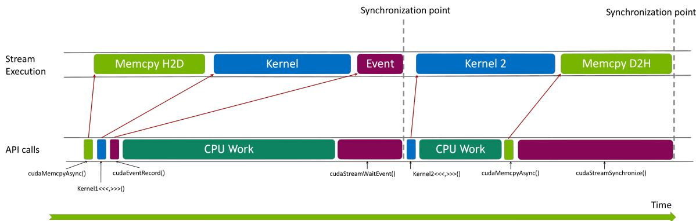

# 打开异步传输，为什么还是没变快？

> **GPU 内存优化 · 第 6 篇**  
> CPU 不再等，不代表 GPU 同时在搬数据和做计算。要让两段工作重叠，先把它们的依赖安排清楚。

> **工程深度｜验证状态：** L2 工程｜静态复核 + 逻辑验证（传输重叠需上机实测）
上一篇，我们把 CPU 到 GPU 的搬运拆成几条路径：普通内存直接上传、已页锁定数据上传，以及临时锁页后再上传。

现在，你让数据加载器提前准备页锁定批次，还给上传加了一个参数：

```python
images = images.to("cuda", non_blocking=True)
output = model(images)
```

假设程序依然没有明显变快。问题可能不在这个参数是否生效，而在你期待它完成什么：你希望 CPU 早点往下执行，还是希望 GPU 一边计算当前批次，一边上传下一批次？

这两件事有关联，却不是同一件事。

本篇接着图像批处理的教学场景，讨论**传输与计算重叠**。只讲单 GPU、主机到设备复制与独立批次计算，不展开训练反向、多 GPU 通信或 CUDA Graph。示例没有完成 GPU 实测；时间表中的数字均为明确标注的教学假设，不是性能报告。资料核对日期：2026 年 10 月 20 日。

## 01｜输入还没到，模型当然不能先算

`non_blocking=True` 可以让复制尝试相对主机异步执行：CPU 提交工作后，不必在这个位置额外等到传输完成。但 pageable 暂存等处理仍可能让调用花时间；它也不保证复制已经完成。[1]

即使 CPU 很快返回，`model(images)` 需要的仍是这一批图片。输入还没复制完，相关计算就不能读取未准备好的内容。

还要看 **stream，CUDA 流**。可以把它理解为设备工作的有序提交队列：同一 stream 中的操作按顺序执行；不同 stream 的工作则有机会并发，具体还受依赖和资源限制。[2]

如果复制与模型计算进入同一条 stream，设备看到的仍然是：

> 上传第 0 批 → 计算第 0 批 → 上传第 1 批 → 计算第 1 批。

CPU 可以更早提交后面的工作，但这个设备队列里的前后顺序不会因此消失。

所以，先分清三个问题：

| 问题              | 应观察什么                |
| --------------- | -------------------- |
| CPU 是否在复制处等待    | 主机调用与同步行为            |
| GPU 上两段工作能否同时进行 | stream、数据依赖与硬件能力     |
| 程序是否更快          | 完整测量区间，而不只是一条调用的返回时间 |

**异步提交提供了组织流水线的机会，不会自动替你建立流水线。**

## 02｜能重叠的，是不同批次的独立工作

当前批次的计算依赖当前批次的输入，这条依赖不能删除。但它通常不依赖下一批图片。

于是可以尝试：

- 一条 stream 计算第 n 批；
- 另一条 stream 上传第 n+1 批。

PyTorch 官方教程给出的典型条件包括：主机源数据位于页锁定内存，复制使用独立的非默认 stream，硬件具有可用的 DMA 复制引擎。[3] 这些是建立这类重叠的重要条件，不是应用一定加速的保证。

例如，若 CPU 解码跟不上、任务太短、依赖写得过强，或者复制与计算争用带宽，就算创建了第二条 stream，也未必有值得保留的收益。

### 用一张假设时间表看清“重叠”

为了只看顺序，假设每批上传需要 2 ms、计算需要 5 ms；源数据已准备好，忽略提交与同步成本，并假设硬件允许二者互不干扰地执行。以下均为教学假设：

| 批次 | 复制 stream 的时间区间 | 计算 stream 的时间区间 |
| -- | --------------- | --------------- |
| 0  | 0～2 ms          | 2～7 ms          |
| 1  | 2～4 ms          | 7～12 ms         |
| 2  | 7～9 ms          | 12～17 ms        |

这里采用两个输入缓冲区。第 2 批要复用第 0 批的空间，所以等第 0 批计算完成后，才在 7 ms 开始覆盖。

三批完全串行需要 `3 × (2 + 5) = 21 ms`；这个理想安排需要 17 ms。第一批仍要先上传再计算，缩短的是连续批次完成的总时间，不是把每批自身的依赖链抹掉。这种“不同 stream 上的工作段相互错开、局部重叠”的模式，可以用下图建立直观认识：



这是一张通用的多流并发示意图，展示重叠的基本形态，不逐项对应上面的 2 ms/5 ms 时间表——具体哪个批次在哪个时刻开始，仍以时间表和你自己的 trace 为准。

在传输时间 H、计算时间 C 均固定、允许理想重叠的简化模型下，N 批时间为：

\[
T_{\text{串行}}=N(H+C)
\]

\[
T_{\text{流水线}}\approx H+C+(N-1)\max(H,C)
\]

公式包括启动和收尾。它解释吞吐量为何可能提高，却不是对真实 GPU 的预测；准备、提交、资源竞争都会改变结果。

## 03｜双缓冲，首先要解决“谁还在用”

最容易写错的版本，是所有批次复用一个 GPU 输入张量：一边让计算读取它，一边把下一批数据写进去。

这会形成数据竞争：计算可能读到被覆盖的新内容。

**双缓冲**就是准备两个输入位置，轮流使用：

| 批次 | 使用的输入槽位         |
| -- | --------------- |
| 0  | 0               |
| 1  | 1               |
| 2  | 0，等批次 0 计算结束后复用 |
| 3  | 1，等批次 1 计算结束后复用 |

两个槽位只是让工作有机会重叠。保证正确性，还需要两种通知：

| 通知            | 谁发出       | 谁等待       | 防止什么      |
| ------------- | --------- | --------- | --------- |
| `ready`：复制完成  | 复制 stream | 计算 stream | 输入未就绪就计算  |
| `done`：本批计算完成 | 计算 stream | 复制 stream | 输入仍在使用就覆盖 |

这两种通知可以由 CUDA **Event，事件**表示。事件记录的是某条 stream 上的执行进度。[4]

尤其注意两种“等待”的区别：

- `stream.wait_event(event)`：让该 stream 后续提交的工作等到事件完成，通常不会让 CPU 在此阻塞。
- `event.synchronize()` 或设备同步：让主机等待相关工作完成。

PyTorch 的 Stream 文档明确区分了这些行为。[5] 流水线内部通常需要表达的是前者；若每一批都让 CPU 等整个设备完成，就容易把重叠机会关掉。

## 04｜先看骨架，别急着加更多并发

下面是双缓冲调度的核心顺序，变量的创建放在完整脚本中：

```python
slot = batch_id % 2

with torch.cuda.stream(copy_stream):
    if used[slot]:
        copy_stream.wait_event(done[slot])
    inputs[slot].copy_(host_batch, non_blocking=True)
    ready[slot].record(copy_stream)

compute_stream.wait_event(ready[slot])
with torch.cuda.stream(compute_stream):
    torch.mm(inputs[slot], weight, out=outputs[batch_id])
    done[slot].record(compute_stream)
used[slot] = True
```

先问输入空间能否覆盖，再复制；先确认本批复制完成，再计算。`used` 表示槽位是否已经提交过任务，不表示 GPU 此刻是否执行完；实际顺序由事件约束。

`wait_event()` 应等待哪次记录，也需要跟着提交顺序看。本文对每个槽位复用事件：先安排对上一批 `done` 的等待，再记录本批 `done`；消费本批 `ready` 后，才在后续批次重用该事件。CUDA 的等待对应调用时最近的事件记录，后续重新记录不会追溯改变已经提交的等待。[6]

首次发生槽位复用的是批次 2（重新使用槽位 0），把它的四个动作摆开看：

| 提交批次 2 时的动作 | 实际含义 |
|---|---|
| 等待 `done[0]` | 等批次 0 的计算用完槽位 0 |
| 复制并重新记录 `ready[0]` | 槽位 0 已装入批次 2 |
| 计算流等待新的 `ready[0]` | 批次 2 输入就绪后才能计算 |
| 重新记录 `done[0]` | 标记批次 2 对槽位 0 的使用结束 |

事件对象虽然复用，每次等待对应的记录由主机调用顺序确定。

这段骨架用矩阵乘法代表一段独立批次计算。它没有标签、训练反向或实际分类模型，不应把它的吞吐量当作图片识别系统的成绩。

## 05｜事件依赖和内存生命周期，必须一起管理

即使依赖正确，过早释放对象也可能出问题。至少有三份数据需要照看：

**第一，页锁定的 CPU 源。**复制完成前，不能随意修改它的内容或将缓冲区交给其他任务写入。对象还活着，并不等于业务代码不会改写它。[3]

**第二，GPU 输入槽位。**当前计算使用完后，才能覆盖。`done` 负责这条依赖。

**第三，分配器看到的生命周期。**张量跨 stream 使用时，分配器还需要知道何时可以安全复用其底层内存。PyTorch 提供 `record_stream()` 帮助追踪，也允许调用者通过显式同步管理整个生命周期。[7]

`record_stream()` 不能代替数据就绪依赖。它不意味着“复制已完成”，也不能阻止你主动覆盖仍在使用的缓冲区。

本文实验采用容易审阅的做法：所有主机批次在整个测试期间保留、不修改；两个 GPU 输入槽位由闭包一直持有；每轮工作全部完成后才开始下一轮。这样，不依靠对象过早析构来回收空间，也不需要在本例中额外调用 `record_stream()`。

初始化时，还要让复制 stream 等待分配这些缓冲区的 stream 已提交的工作。即使准备覆盖一个 `empty()` 张量，也可能遇到缓存分配器复用旧存储的情况，不能只因“不会读旧值”就省略初始化依赖。[2]

这次等待只覆盖调用时计算流已经提交的工作，不会追踪它之后提交的整轮计算；轮内再由各槽位的事件建立必要依赖。[5] 所以它不会把整轮重新串行化——那正是流水线所需的边界。

这套写法是教学实验的边界，不是可以直接照搬到无限数据流的生产预取器。后者还要管理主机缓冲复用、有限队列、异常退出，以及下游是否仍使用输出。

## 06｜对照三种程序，再看时间线

一个合理的实验，不应只比较“有 stream”和“没有 stream”。本篇设置三种模式：

| 模式            | 复制参数                 | 设备上的安排                | 目的            |
| ------------- | -------------------- | --------------------- | ------------- |
| `blocking`    | `non_blocking=False` | 同一计算 stream 内复制、计算    | 常规等待提交的基线     |
| `same_stream` | `non_blocking=True`  | 仍在同一 stream 内复制、计算    | 区分主机提交优化与设备重叠 |
| `overlap`     | `non_blocking=True`  | 独立复制 stream，加事件与双输入缓冲 | 允许跨批次重叠       |

三种模式都使用相同的页锁定批次、权重和数学计算；GPU 输入和输出提前分配。输出按批次分别保留，是为了逐批核对结果，额外空间不代表生产系统也应无限保留输出。

归因时按两组对比推进：**`blocking` 对比 `same_stream`**，观察减少主机逐次等待带来的变化；**`same_stream` 对比 `overlap`**，观察加入跨流调度与事件依赖后整轮表现如何变化。至于是否真的重叠，总时间只是一条证据，最终仍以设备时间线为准（见下文）。还要注意，`overlap` 同时增加了事件与调度开销，因此两种模式的耗时差不是“纯粹的重叠收益”，而是整套安排的净结果。

**环境与验证状态：**需要 NVIDIA CUDA GPU、兼容驱动与 CUDA 版 PyTorch。代码面向 PyTorch 2.x 常用接口，使用单 GPU、FP32 输入与输出，不启用自动求导、AMP 或 `torch.compile`。不强行指定所有版本通用的矩阵乘法内部路径；相同进程内沿用相同后端配置，版本和配置会影响耗时。

本文生成环境没有安装 PyTorch，未完成真实 CUDA 执行。代码经过语法检查和 CPU 依赖图模型检查；后者只验证提交顺序中的缓冲依赖，不证明 GPU 能重叠或已经加速。

先用 `blocking` 生成 GPU 数值参照，再对其他模式逐批核对。这个比较能发现批次错位或覆盖导致的差异，但不是独立的矩阵乘法精度认证。

测速用主机墙钟覆盖一整轮提交，起止都等待设备完成；这避免只计到 CPU 提交结束、漏掉设备尾部工作。它包含 Python 调度、依赖提交与启动收尾，不是单个内核延迟。循环内部不插入设备全局同步。

### 怎样证明重叠真的发生

总时间变短是一条证据，但不足以单独证明原因。还应该查看 trace 中两个设备工作区间：

- H2D 复制出现在复制 stream；
- 当前批次的计算 kernel 出现在计算 stream；
- 二者在时间轴上有实际交叠；
- 同一批的计算仍发生在其输入准备好之后。

PyTorch Profiler 可以采集 CPU 与 CUDA 活动，导出 Chrome Trace 格式。[8] 只看 Python 中 `copy_()` 与 `mm()` 调用框的重叠没有意义，要看设备上的 memcpy 和 kernel。

若所在环境不能采集 CUDA 活动，或 trace 只有 CPU 事件，就不能据此判断设备重叠。Profiler 也有采集开销，应将 trace 用于诊断，普通运行另行计时。

## 07｜完整实验：两条队列、两个输入槽位

保存为 `overlap_lab.py`。执行 `python overlap_lab.py` 测速；执行 `python overlap_lab.py --trace` 还会在当前目录生成三种模式的 trace。用支持 Chrome Trace 的时间线查看器打开，重点检查设备事件。

默认保留 12 批页锁定输入，每批约 2 MiB，页锁定输入载荷共 24 MiB；GPU 侧的两个输入槽位、权重、逐批输出与参照副本等显式张量载荷约 56 MiB，另有运行库、工作区和分配器开销。资源紧张可减小批次数或矩阵形状；规模改变后需重新判断瓶颈。

```python
"""打开异步传输，为什么还是没变快？（第7章 · 访存与传输）。

本文件是对应博文代码块的实现/演示，直接运行可见效果；运行依赖：PyTorch。
"""
import sys
import time
from statistics import median
import torch

MODES = ("blocking", "same_stream", "overlap")


def make_runner(host_batches, weight, device):
    compute_stream = torch.cuda.current_stream(device)
    copy_stream = torch.cuda.Stream(device=device)
    inputs = [torch.empty_like(host_batches[0], device=device) for _ in range(2)]
    outputs = [
        torch.empty(
            (h.shape[0], weight.shape[1]), dtype=h.dtype, device=device
        ) for h in host_batches
    ]
    ready = [torch.cuda.Event() for _ in range(2)]
    done = [torch.cuda.Event() for _ in range(2)]

    def enqueue(mode):
        if mode not in MODES:
            raise ValueError(mode)
        # 调用者在每轮前后等待设备完成；轮内不全局同步。
        used = [False, False]
        with torch.cuda.stream(compute_stream):
            if mode == "overlap":
                # 包括初始化/缓存分配器相关的 stream 顺序要求。
                copy_stream.wait_stream(compute_stream)
            for batch_id, host_batch in enumerate(host_batches):
                slot = batch_id % 2
                if mode == "overlap":
                    with torch.cuda.stream(copy_stream):
                        if used[slot]:
                            copy_stream.wait_event(done[slot])
                        inputs[slot].copy_(host_batch, non_blocking=True)
                        ready[slot].record(copy_stream)
                    compute_stream.wait_event(ready[slot])
                else:
                    inputs[slot].copy_(
                        host_batch, non_blocking=(mode == "same_stream")
                    )

                torch.mm(inputs[slot], weight, out=outputs[batch_id])
                if mode == "overlap":
                    done[slot].record(compute_stream)
                    used[slot] = True

    return enqueue, outputs


@torch.no_grad()
def main():
    if not torch.cuda.is_available():
        raise SystemExit("需要可用的 CUDA GPU 和 CUDA 版 PyTorch。")
    device = torch.device("cuda:0")
    torch.cuda.set_device(device)
    torch.manual_seed(42)
    print("PyTorch:", torch.__version__, "CUDA build:", torch.version.cuda)
    print("GPU:", torch.cuda.get_device_name(device))

    count, rows, width = 12, 512, 1024
    host_batches = [
        torch.randn(rows, width, dtype=torch.float32, device="cpu", pin_memory=True)
        for _ in range(count)
    ]
    weight = torch.randn(width, width, device=device, dtype=torch.float32) * 0.01
    enqueue, outputs = make_runner(host_batches, weight, device)
    print(f"batches={count}, input=({rows}, {width}), FP32, two input slots")

    torch.cuda.synchronize(device)
    enqueue("blocking")
    torch.cuda.synchronize(device)
    reference = [out.clone() for out in outputs]
    torch.cuda.synchronize(device)

    for mode in MODES:
        # 先清成 NaN：若本轮漏写某一批，比较会失败，
        # 而不会被上一轮留下的正确旧输出掩盖。
        for out in outputs:
            out.fill_(float("nan"))
        torch.cuda.synchronize(device)
        enqueue(mode)
        torch.cuda.synchronize(device)
        for out, expected in zip(outputs, reference):
            torch.testing.assert_close(out, expected, rtol=1e-4, atol=1e-5)
        print(mode, "all batch results match the blocking reference")

    timings = {mode: [] for mode in MODES}
    for round_id in range(6):
        shift = round_id % len(MODES)
        order = MODES[shift:] + MODES[:shift]
        for mode in order:
            torch.cuda.synchronize(device)
            start = time.perf_counter()
            enqueue(mode)
            torch.cuda.synchronize(device)
            timings[mode].append((time.perf_counter() - start) * 1000)
    for mode in MODES:
        samples = timings[mode]
        mid = median(samples)
        print(
            f"{mode}: round median={mid:.4f} ms"
            f", range=[{min(samples):.4f}, {max(samples):.4f}] ms"
            f", throughput={count / (mid / 1000):.2f} batches/s"
        )

    if "--trace" in sys.argv:
        for mode in MODES:
            torch.cuda.synchronize(device)
            with torch.profiler.profile(activities=[
                torch.profiler.ProfilerActivity.CPU,
                torch.profiler.ProfilerActivity.CUDA,
            ]) as prof:
                enqueue(mode)
                torch.cuda.synchronize(device)
            path = f"{mode}_trace.json"
            prof.export_chrome_trace(path)
            print("trace:", path)


if __name__ == "__main__":
    main()
```

吞吐量按“本轮批次数 / 整轮完成时间”计算，不把整轮平均值当作每个请求的真实延迟。有限的 12 批仍包含启动与收尾；增加批次数会增加本脚本保留的数据量，不能无限扩展。

主机批次已全部准备好，因此本实验没有测图片读取、解码和 DataLoader 供数。它只是观察复制与一段矩阵计算怎样排队。

## 08｜没有变快，该看哪里

先看 trace，再决定下一步，而不是继续增加 stream：


| 现象 | 优先检查 |
|---|---|
| 两条 stream 仍完全错开 | 是否存在过强等待、硬件限制或缺少独立工作 |
| CPU 提交之间有明显空档 | Python 调度、供数与任务粒度 |
| 确实重叠，总时间却接近原来 | 一段占比过大、启动收尾或资源竞争 |
| overlap 模式结果与基线不同 | ready/done 依赖、槽位覆盖和源数据是否被改写 |
| 实验有效，完整应用仍慢 | 解码、预处理、其他同步或下游阶段是否成为瓶颈 |

特别是 `.item()`、需要结果回到 CPU 的操作，以及循环中的设备同步，都可能改变流水线等待关系。不能将所有同步都删掉；要判断它在保护哪条依赖，是否可以移到真正需要结果的位置。

如果只是单批、低频请求，双缓冲未必能改善体验；如果连续批次之间有独立工作、传输占比值得关注，并且你能管理好源数据与缓冲区生命周期，就值得尝试这种组织方式。NVIDIA 最佳实践也将异步传输与计算重叠建立在明确的 stream 和硬件条件上。[9]

**先让结果正确，再让时间线证明并行，最后用完整区间衡量收益。**这三个步骤，比多写一个 `non_blocking=True` 更接近真正的异步优化。

## 参考资料

以下采用官方资料。固定版本链接用于明确核验口径，不表示它们是当前最新版本，也不表示本文实验已经在该版本完成运行。

1. [PyTorch：Tensor.copy_](https://docs.pytorch.org/docs/2.9/generated/torch.Tensor.copy_.html) 与 [NVIDIA：CUDA API synchronization behavior](https://docs.nvidia.com/cuda/archive/12.8.1/cuda-runtime-api/api-sync-behavior.html) — 复制与主机同步边界。
2. [PyTorch：CUDA semantics — CUDA streams](https://docs.pytorch.org/docs/2.9/notes/cuda.html#cuda-streams) — stream 顺序、跨 stream 依赖及分配器相关同步。
3. [PyTorch 官方教程：A guide on good usage of non_blocking and pin_memory()](https://docs.pytorch.org/tutorials/intermediate/pinmem_nonblock.html) — 页锁定来源、独立复制 stream、硬件条件及缓冲区使用。
4. [PyTorch：torch.cuda.Event](https://docs.pytorch.org/docs/2.9/generated/torch.cuda.Event.html) — 事件记录、查询与同步。
5. [PyTorch：torch.cuda.Stream](https://docs.pytorch.org/docs/2.9/generated/torch.cuda.Stream.html) — `wait_event()`、`wait_stream()` 与主机非阻塞行为。
6. NVIDIA CUDA Runtime API：[Stream Management](https://docs.nvidia.com/cuda/archive/12.8.1/cuda-runtime-api/group__CUDART__STREAM.html) 与 [Event Management](https://docs.nvidia.com/cuda/archive/12.8.1/cuda-runtime-api/group__CUDART__EVENT.html) — 事件捕获、重新记录，以及已提交等待的语义。
7. [PyTorch：Tensor.record_stream](https://docs.pytorch.org/docs/2.9/generated/torch.Tensor.record_stream.html) — 分配器生命周期追踪与手动依赖管理。
8. [PyTorch：torch.profiler](https://docs.pytorch.org/docs/2.9/profiler.html) — CUDA 活动采集及 Chrome Trace 导出。
9. [NVIDIA：CUDA C++ Best Practices Guide 12.8 — Asynchronous and Overlapping Transfers with Computation](https://docs.nvidia.com/cuda/archive/12.8.2/cuda-c-best-practices-guide/index.html#asynchronous-and-overlapping-transfers-with-computation) — 异步传输、stream 与重叠条件。

图片来源：第 02 节的多流并发示意图为教学示意图，展示重叠的基本形态，不对应本实验的具体时间数值。

材料基础：用户提供的《第 8 章 GPU 内存优化》图片文字转写稿。本篇承接其页锁定与非阻塞传输内容，补充跨批次重叠、事件依赖和双输入缓冲管理，未沿用未经核验的运行数字。
