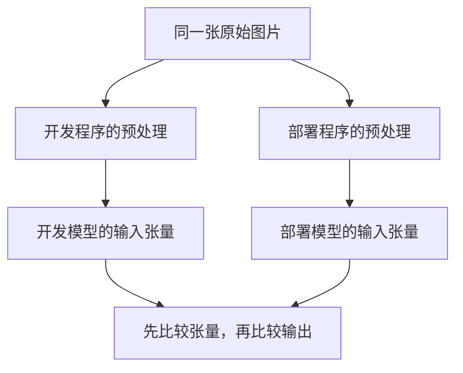

# 模型导出成功，为什么结果却变了？

> **TensorRT 推理加速 · 第 1 篇**
>
> 想让模型跑得更快，先要确认它换了一种执行方式后，仍然在算同一件事。本篇从 PyTorch 到 ONNX，搭起进入 TensorRT 之前的第一段验证流程：固定输入、导出模型、核对结果。
>
> **工程深度｜验证状态：** L1 入门｜代码通过语法检查，依赖未安装、未实际运行（见第 05 节说明）；正文无性能实测结果
>
> 资料核对日期：2026 年 10 月 21 日。场景为教学设定。

> **路线图位置**
> **上一站**：第 60–66 篇讲访存与显存管理——模型在 GPU 上跑起来之后，数据怎么搬、显存为什么不降。
> **这一站**：进入部署主线第一步——从 PyTorch 导出 ONNX，并核对「导出没有改变计算」。
> **不解决**：引擎构建、融合、量化与性能比较（68–71 篇）。
> **前置**：不需要 GPU；会读 Python 即可。
> **下一个动作**：装好依赖后运行 `export_and_check.py`，保存权重、参考数据与版本清单三样东西。

## 01｜同一张图片，为什么换个程序就认错了？

设想你在给一条产线部署质检模型。

模型在开发程序里能识别零件。为了降低推理延迟，你准备把它交给 TensorRT。第一步，先导出一个 ONNX 文件。

终端没有报错，文件也生成了。你把同一张图片送进另一个推理程序，却发现分类结果变了。

该怀疑模型吗？还是推理引擎不可靠？

先别急。两个程序接收的虽然是同一张图片，真正送进模型的数字，可能已经不同：一个按 RGB 排列，另一个按 BGR；一个把像素缩放到特定范围，另一个直接使用原始数值；也可能模型输出的是类别分数，部署程序却把它当成概率，直接套用了概率阈值。

**模型文件相同，不代表整个预测过程相同。**

这是 TensorRT 加速之前值得先过的一关：如何确认导出没有改变我们想执行的计算？

## 02｜先分清：模型、ONNX 和 TensorRT 是什么关系？

把模型看成“一个权重文件”，容易漏掉计算本身。

一个最简单的两层网络，也至少涉及三件事：输入数字按什么形状排列，依次做哪些运算，以及运算使用哪些权重。

例如，本文沿用原始材料中的小型网络：

```text
一条 256 维特征 → 线性层 256→64 → ReLU → 线性层 64→10 → 10 个类别分数
```

这里的“线性层”可以理解为对输入做加权组合并加上偏置；ReLU 将负值变为零。网络输出的 10 个数字称为**类别分数（logits）**，即尚未经过 softmax 归一化的原始输出。它们允许为负，也不要求相加等于 1。

ONNX 则用一种模型表示格式，记录计算图、参数和张量信息。PyTorch 官方提供 ONNX 导出能力，导出的模型可交给支持它的运行时执行；这里使用 ONNX Runtime 来核对结果。[1]

TensorRT 的工作更进一步：它能够把支持的模型编译为面向目标部署配置优化的执行引擎。ONNX 是进入 TensorRT 的一种常见路径，并非所有 TensorRT 工作流都必须经过它。[2]

因此，本系列选择的路线是：

| 阶段 | 主要回答的问题 |
|---|---|
| PyTorch 模型 | 原始计算是什么？ |
| ONNX 模型 | 能否把计算表达给其他工具？ |
| TensorRT 引擎 | 能否为目标 GPU 选择更合适的执行方案？ |

这一篇只把前两步核对清楚。引擎构建、融合、量化和性能比较，留到后续文章。

## 03｜真正需要对齐的，是输入输出约定

在导出之前，先给模型写一张小表，比直接调整导出参数更有用。

| 项目 | 本文约定 |
|---|---|
| 输入名称 | `features` |
| 输入形状 | `[1, 256]`：一次输入一条特征 |
| 输入类型 | `float32` |
| 输入含义 | 已准备好的 256 维特征，不是原始图片 |
| 输出名称 | `logits` |
| 输出形状 | `[1, 10]` |
| 输出含义 | 10 个类别分数；本例不包含 softmax |

为什么输入不是图片？

因为我们要先把导出与核对讲清楚。用 256 个数，读者可以集中观察计算和形状，不必同时处理图片读取、缩放和颜色通道。

回到真实质检场景，特征提取的成本和正确性仍然要单独验证。**本例的 256 维特征输入，不能被当成完整的图片质检流水线。**

再看一个更隐蔽的区别：两份程序都输出 10 个数，一份是 logits，另一份是 softmax 后的概率，它们并不能逐项直接比较。单纯对同一组 logits 做 softmax 通常保留最大值对应类别，但会改变数值的含义。

这里要分清两种不同的失效：如果双方都只沿同一类别轴取最大值，单纯增加 softmax 通常不会解释类别变化；但阈值判断和其他后处理则可能受影响，输出含义的改变完全可能改变最终决策。

所以，核对模型之前，先确认双方说的是同一种“输入语言”和“输出语言”。

## 04｜导出成功，需要通过几层检查？

至少分四层。

**第一层：文件有没有生成。** 这只能说明程序写出了文件。

**第二层：模型结构是否通过检查。** ONNX 的 `check_model` 检查模型一致性；设置 `full_check=True` 时，还会进行形状推断检查。它不能替我们判断前处理是否符合业务，也不能证明预测正确。[3]

**第三层：相同输入下，结果是否足够接近。** 把同一个输入数组交给 PyTorch 与 ONNX Runtime，比较输出。

**第四层：真实任务质量是否达标。** 用带标签的数据评估准确率或对应任务指标。

本篇完成前三层的教学闭环。第四层需要训练好的模型和真实评价数据，不能用随机输入代替。

尤其要注意：一个随机初始化模型，即使在两套程序里输出完全一致，也只能说明这两套程序对它的计算一致，不能说明它已经学会分类。

## 05｜动手：用同一份数字核对两套执行结果

下面是一份连续脚本，不需要 GPU，也不需要先安装 TensorRT。PyTorch 和 ONNX Runtime 都在 CPU 上运行，目的是核对计算，不是比较谁更快。

**用途与环境**：面向支持 `torch.onnx.export(..., dynamo=True)` 的现代 PyTorch 环境，需要 Python、PyTorch、NumPy、ONNX、ONNX Script 和 ONNX Runtime。PyTorch 官方推荐使用这一基于 `torch.export` 的导出路线。[1] 实际使用时应选择相互兼容的依赖版本，并保存版本清单。

可在独立虚拟环境中安装依赖：

```bash
python -m pip install torch numpy onnx onnxscript onnxruntime
```

这是一条依赖安装入口，**不是已经验证过的锁版本环境**。本文编写环境缺少 PyTorch、ONNX、ONNX Script 与 ONNX Runtime，未实际执行下面的导出及推理流程；仅对代码进行了 Python 语法检查，不提供虚构的运行输出。

将下面代码保存为 `export_and_check.py`，再运行 `python export_and_check.py`：

```python
"""模型导出成功，为什么结果却变了？（第8章 · TensorRT 部署）。

本文件是对应博文代码块的实现/演示，直接运行可见效果；运行依赖：PyTorch、ONNX、ONNX Runtime、NumPy。
"""
from importlib.metadata import version
from pathlib import Path

import numpy as np
import onnx
import onnxruntime as ort
import torch
from torch import nn


class SmallClassifier(nn.Module):
    def __init__(self):
        super().__init__()
        self.fc1 = nn.Linear(256, 64)
        self.fc2 = nn.Linear(64, 10)

    def forward(self, x):
        # 输入 [1, 256]，隐藏特征 [1, 64]，输出 logits [1, 10]。
        return self.fc2(torch.relu(self.fc1(x)))


def main():
    # 打印实际环境；后续复现实验时应保留这份记录。
    for package in ("torch", "numpy", "onnx", "onnxscript", "onnxruntime"):
        print(f"{package}={version(package)}")

    torch.manual_seed(42)
    rng = np.random.default_rng(42)
    model = SmallClassifier().cpu().eval()
    # 这是随机初始化模型，用于验证导出流程，不用于评价分类能力。

    # 单个样例提供输入形状；本篇固定 batch=1，不声明动态维度。
    example = torch.from_numpy(rng.standard_normal((1, 256)).astype(np.float32))
    output_dir = Path("onnx_demo")
    output_dir.mkdir(exist_ok=True)
    model_path = output_dir / "small_classifier.onnx"

    torch.onnx.export(
        model,
        (example,),
        str(model_path),
        input_names=["features"],
        output_names=["logits"],
        dynamo=True,
        opset_version=18,
        external_data=False,
        report=True,
        artifacts_dir=str(output_dir),
    )
    # opset 18 是本例的明确选择，接收端仍需支持它和实际导出的算子。
    onnx.checker.check_model(str(model_path), full_check=True)

    # 保存 PyTorch 权重；下一篇直接加载同一份权重核对 TensorRT，
    # 不依赖相同随机种子在不同环境重新生成同一模型。
    torch.save(model.state_dict(), output_dir / "small_classifier.pt")

    session = ort.InferenceSession(
        str(model_path), providers=["CPUExecutionProvider"]
    )
    in_meta = session.get_inputs()[0]
    out_meta = session.get_outputs()[0]
    print("ONNX 输入:", in_meta.name, in_meta.shape, in_meta.type)
    print("ONNX 输出:", out_meta.name, out_meta.shape, out_meta.type)
    if in_meta.type != "tensor(float)" or out_meta.type != "tensor(float)":
        raise AssertionError(
            f"输入输出类型与约定不符: {in_meta.type} / {out_meta.type}"
        )

    # 多测几种输入；仍然不是覆盖所有输入的数学证明。
    cases = [("zeros", np.zeros((1, 256), dtype=np.float32))]
    for scale in (0.1, 1.0, 10.0):
        for index in range(4):
            x = (rng.standard_normal((1, 256)) * scale).astype(np.float32)
            cases.append((f"scale={scale}, case={index}", x))

    # 仅是本例浮点结果比较的起始容限，不是所有模型的统一标准。
    atol, rtol = 1e-5, 1e-4
    worst_abs_error = 0.0
    references = []
    for name, x in cases:
        with torch.inference_mode():
            reference = model(torch.from_numpy(x)).numpy()
        actual = session.run(["logits"], {"features": x})[0]
        references.append(reference)

        # 先核对形状，避免数组广播掩盖接口错误。
        if actual.shape != reference.shape:
            raise AssertionError(f"{name}: 输出形状不同")
        if not (np.isfinite(actual).all() and np.isfinite(reference).all()):
            raise AssertionError(f"{name}: 输出包含 NaN 或 Inf")
        # 容差比较通过不代表 dtype 相同，这里显式核对约定的 float32。
        if actual.dtype != np.float32:
            raise AssertionError(f"{name}: 输出 dtype={actual.dtype}，约定为 float32")

        error = float(np.max(np.abs(actual - reference)))
        worst_abs_error = max(worst_abs_error, error)
        if not np.allclose(actual, reference, atol=atol, rtol=rtol):
            diff = np.abs(actual - reference)
            pos = np.unravel_index(np.argmax(diff), diff.shape)
            raise AssertionError(
                f"{name}: 超出容限，最大绝对误差={error:.3e}，"
                f"位置={pos}，参考值={reference[pos]:.6e}，实际值={actual[pos]:.6e}"
            )

    # 保存本批输入与 PyTorch 参考输出、容差和依赖版本，
    # 下一篇核对 TensorRT 时直接复用，不再重新随机生成样本。
    np.savez(
        output_dir / "reference_inputs_outputs.npz",
        atol=np.array(atol),
        rtol=np.array(rtol),
        **{f"x_{i}": x for i, (_, x) in enumerate(cases)},
        **{f"reference_{i}": r for i, r in enumerate(references)},
    )

    print(f"通过 {len(cases)} 组数值核对；最大绝对误差={worst_abs_error:.3e}")
    print("已保存权重与参考数据:", output_dir / "small_classifier.pt")
    print("已保存输入与参考输出:", output_dir / "reference_inputs_outputs.npz")
    print("这不代表模型分类准确，也不代表 TensorRT 已通过验证。")


if __name__ == "__main__":
    main()
```

代码看起来步骤不少，但核心只有三件事：

1. **只创建一个模型**：导出与原始推理使用同一份权重，没有为两个运行时各随机生成一个模型。
2. **只准备一份输入**：同一个 NumPy 数组分别交给两边，减少前处理差异。
3. **给差异设定明确标准**：先查形状与有限数值，再判断误差是否在容限内。

顺带解释代码里两个容易被当成重复的操作。`.eval()` 设置模型的评估行为，影响 Dropout、BatchNorm 这类训练与推理表现不同的层；`inference_mode()` 主要关闭自动求导相关开销，**不会**自动调用 `.eval()`。本文的小网络没有这类层，两者看不出差别，但换真实模型时必须分别处理这两件事。

`report=True` 让导出过程在 `artifacts_dir` 下生成一份导出报告，用于排查转换问题。如果脚本失败，按这个顺序定位：先看终端异常和导出报告；若导出与结构检查都通过、只有数值比较失败，再根据失败信息里的最大误差位置、参考值和实际值，判断是接近零的容差问题还是输出整体偏移。

`CPUExecutionProvider` 明确选择 CPU 执行后端。ONNX Runtime 可以通过**执行后端（Execution Provider）**选择不同的计算实现；本篇固定 CPU，是为了避免引入 GPU 安装和执行差异。[4]

`opset_version` 指定 ONNX 算子集版本，可理解为这份计算图使用哪一版算子规则。版本越新不代表接收端一定越容易支持。后续交给 TensorRT 时，仍需核对实际版本、算子与类型是否受支持。

## 06｜结果“足够接近”，到底接近到什么程度？

浮点运算并不总满足纸面上的结合律。不同实现的计算顺序可能不同，结果出现小幅差异并不自动意味着导出错误。

不过，“差一点没关系”也不能只凭感觉。

代码使用的判定对应下面这条规则，其中 `reference` 是 PyTorch 输出：[5]

```text
|actual - reference| ≤ atol + rtol × |reference|
```

`atol` 是绝对容限，照顾接近零的数字；`rtol` 是相对容限，让可接受误差随参考数值大小变化。

把代码里的数字代入这条公式：`atol=1e-5`、`rtol=1e-4` 时，参考值为 100，允许误差约为 0.01001；参考值为 0.00001 时，允许误差约为 0.000010001。因此同样相差 0.001，前者可能通过，后者不会通过。不能只用一个“误差很小”的形容词带过。

本文给出的容限只是简单浮点网络的起始选择。真实模型需要结合数值范围、执行精度和任务要求确定，不能在失败后不断放宽，直到程序显示通过。

还要区分**数值误差**和**类别变化**。

假设前两类分数是下面两组教学数字：

| 执行结果 | 类别 A | 类别 B | 取最大值的类别 |
|---|---:|---:|---|
| 参考结果 | 2.0000 | 2.0001 | B |
| 另一结果 | 2.0001 | 2.0000 | A |

数值只变化了一点，类别却翻转了，因为两个候选原本就很接近。反过来，类别一直相同，也不能说明所有输出数字都一致。

因此，对真实分类模型，数值核对之后仍需使用带标签的评价集，观察准确率、错误样本和关键类别表现。

## 07｜为什么同一张图片仍可能绕过这套检查？

现在回到开头：两边都能运行，导出数值检查也通过了，部署程序为什么仍可能出错？

因为上面的代码验证的是：**对相同的模型输入张量，两种执行得到的输出接近。**

它没有验证“从原始图片生成张量”的过程。



这张图给出了一个实用的排查顺序。

先保存两边**真正进入模型的张量**，比较形状、类型和数值。若这里就不一致，先查图片缩放、裁剪、通道顺序和归一化。若输入一致而输出不同，再查模型权重、导出规则和运行时。

也就是说，先寻找差异第一次出现的位置，比同时调整模型、导出器和推理引擎更容易找到原因。

遇到问题，可以按下面的顺序收窄范围：

| 观察 | 优先核对 |
|---|---|
| 两边输入张量不同 | 前处理、布局、dtype、输入范围 |
| 输入相同，输出形状不同 | 输入输出名称、维度约定、导出设置 |
| 形状相同，数值差异明显 | 同一权重、评估模式、算子支持、输出语义 |
| 数值接近，少量类别变化 | 候选分数间隔、实际任务容忍度 |
| 数值核对通过，但业务质量差 | 原模型质量、数据分布、后处理与业务规则 |

## 08｜什么时候可以继续交给 TensorRT？

当你已经能够回答这些问题：模型实际接收什么数字，导出的输入输出是否符合约定，同样的输入是否得到容限内的结果，以及真实任务质量如何评价，就有了一份可用的基线。

随后，才是把 ONNX 交给 TensorRT 构建引擎，并再次核对输出。

这里不能跳过一步：**ONNX Runtime 核对通过，不代表 TensorRT 已经验证通过。** 两者是不同的执行实现；TensorRT 还要经过模型解析、编译和目标 GPU 上的执行。NVIDIA 的官方入门流程也将 ONNX 构建引擎与加载引擎运行作为后续步骤。[2]

这一篇没有测量耗时，因为我们还没有建立可比较的 GPU 执行链路。用本例的 CPU 结果去宣称 TensorRT 能加速多少，没有依据。

实际项目中，建议保存三样东西：**固定的模型权重、可复用的输入样本、明确的误差与任务质量标准**。每换一次模型表示、执行引擎或数值精度，就用它们重新核对。

本篇脚本已经按此执行：`small_classifier.pt` 保存了权重，`reference_inputs_outputs.npz` 保存了本批输入、PyTorch 参考输出与本次容差，依赖版本也逐行打印在运行记录里。**下一篇直接读取本次保存的输入和参考输出核对 TensorRT，不重新生成一套随机模型与样本。**

下一篇再解释：既然不重新训练模型，TensorRT 究竟改变了哪些执行步骤，又该用什么证据确认优化发生了。

## 参考资料

以下均为官方文档。正文中的 [1]—[5] 对应下列资料；在线文档可能更新，复现时请同时记录实际依赖版本。

1. **PyTorch：ONNX 导出器与官方教程**。说明基于 `torch.export` 的导出路线、`dynamo=True` 等参数，以及导出后使用 ONNX Runtime 执行的流程。  
   [torch.export-based ONNX Exporter](https://docs.pytorch.org/docs/stable/onnx_export.html)；[Export a PyTorch model to ONNX](https://docs.pytorch.org/tutorials/beginner/onnx/export_simple_model_to_onnx_tutorial.html)
2. **NVIDIA：TensorRT 文档与首个引擎教程**。说明模型编译为引擎，以及从 ONNX 构建、加载与执行的基本流程。  
   [NVIDIA TensorRT Documentation](https://docs.nvidia.com/deeplearning/tensorrt/latest/)；[Build Your First Engine](https://docs.nvidia.com/deeplearning/tensorrt/latest/getting-started/build-your-first-engine.html)
3. **ONNX：模型检查 API**。说明 `check_model` 的检查范围与 `full_check`。  
   [onnx.checker](https://onnx.ai/onnx/api/checker.html)
4. **ONNX Runtime：Python API**。说明推理会话、输入输出与执行后端。  
   [Python API Overview](https://onnxruntime.ai/docs/api/python/api_summary.html)
5. **NumPy：浮点数组的容差比较**。说明 `allclose` 的判定公式、参考值方向与接近零时的注意事项。  
   [numpy.allclose](https://numpy.org/doc/stable/reference/generated/numpy.allclose.html)
