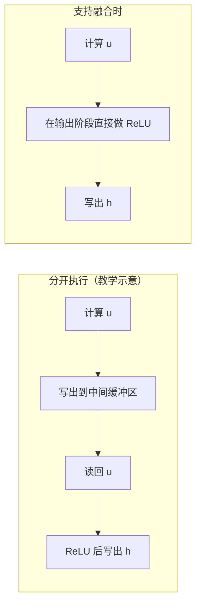

# TensorRT 没改模型，为什么还能更快？

> **TensorRT 推理加速 · 第 2 篇**
>
> 同一套模型计算，可以用不同的方式执行。TensorRT 把优化工作提前到引擎构建阶段：尝试合并运算、减少中间步骤，并为目标 GPU 选择合适的实现。本篇从一次模型部署出发，讲清这些变化发生在哪里，以及怎样寻找证据。
>
> 资料核对日期：2026 年 10 月 21 日。场景为教学设定；代码依据 TensorRT 11.4 官方接口编写，仅做 Python 语法检查，未实际构建或执行引擎，文中没有性能实测数据。

## 01｜模型没有重新训练，时间省在哪里？

继续上一期的质检场景。

你已经把一个 PyTorch 模型导出为 ONNX，并准备好相同输入下的结果核对方法。现在，打算将它交给 TensorRT。

这里有个看似矛盾的地方：模型没有重新学习，输入仍然是那些特征，输出仍然是类别分数。既然要做的事情没变，为什么还有加速空间？

因为**计算的定义，和计算的执行过程，并不是一回事。**

例如，“先做一次矩阵乘法，再加偏置，最后把负数变成零”，规定了结果如何产生，却没有规定：每一步是否都要单独启动 GPU 程序，中间结果是否必须写回显存，以及矩阵乘法采用哪一种实现。

这些决定，会影响完成同一任务所需要的时间。

TensorRT 的一个核心作用，就是将支持的模型编译为面向目标部署配置的执行引擎。构建时进行图优化和实现选择，部署时加载引擎执行。[1]

“没改模型”也需要说得准确：这里指**没有重新训练权重、希望保持模型的计算语义**。TensorRT 会改变内部执行图；浮点计算的实现和顺序变化也可能带来数值差异，因此最终输出仍需核对。

## 02｜ONNX 交代要算什么，Engine 保存怎样执行

先把四个容易混淆的名字分开。

| 对象 | 可以怎样理解 | 在本文中负责什么 |
|---|---|---|
| ONNX 模型 | 对计算的描述 | 提供运算、参数与输入输出信息 |
| 解析器（Parser） | 读取并转换模型的入口 | 将支持的 ONNX 内容导入 TensorRT 网络定义 |
| 构建器（Builder） | 为目标配置生成执行方案的编译器 | 优化网络，选择实现，生成引擎 |
| 引擎（Engine） | 构建得到的执行产物 | 保存优化后的网络及相关执行信息 |

运行时还需要 **Runtime** 加载序列化引擎，随后由执行上下文组织具体的推理。这个运行阶段，下一篇再展开。[1]

因此，`.onnx` 变成 `.engine`，不是简单地换一个文件后缀。

Builder 会利用目标 GPU 和构建配置的信息生成执行产物。这也解释了为什么构建引擎可能需要时间：它不只是在复制权重，还可能评估候选实现。[1]

这些工作通常放在部署准备阶段，而不是每处理一张图片就重新做一遍。第一次构建较慢，与后续单次推理较快，可以同时成立。

但引擎也不是可以随意搬运的通用模型文件。TensorRT 版本、平台、GPU 以及是否启用兼容选项，都会影响它能在哪里使用；不能把“一台机器构建成功”理解为“任何 NVIDIA GPU 都能直接加载”。[2]

## 03｜融合：省掉的可能是中间步骤

先看上一期使用的小网络：

```text
256 维特征 → Linear(256, 64) → ReLU → Linear(64, 10)
```

其中第一层的计算，可以写成：

```text
u = x × Wᵀ + b
h = max(u, 0)
```

`W` 是权重，`b` 是偏置，`max(u, 0)` 就是 ReLU。

为了理解融合，先设想一种分开执行的方式：第一步计算 `u`，将它写入一个中间缓冲区；第二步读取 `u`，把负值变成零，再写出 `h`。

如果某个实现支持把激活处理放在线性计算的输出阶段，就有机会直接产生 `h`，减少中间结果的读写和独立调用。

| 观察角度 | 分开执行的教学模型 | 支持融合时的执行思路 |
|---|---|---|
| 要表达的计算 | 线性计算，再做 ReLU | 仍然包含线性计算与 ReLU |
| 中间结果 | `u` 先交给下一步 | 尽量不单独物化 `u` |
| 可能减少的工作 | — | 中间缓冲区读写、独立 kernel 调用 |

这里的**内核（kernel）**，指一次在 GPU 上执行的计算程序。

NVIDIA 官方给出的一个明确例子是卷积后接 ReLU：支持的实现可以在卷积 kernel 内完成 ReLU，省去第二次 kernel 调用。官方文档也列出了多种融合模式及其限制。[3]

如下图所示，把两种执行方式的数据流并排看，融合省掉的部分就直观了：



请重点观察上排的“写出→读回”这两步：中间缓冲区的一次完整写出和一次完整读回，在下排消失了，独立的第二次调用也没有了。这正是“融合”在执行层面省掉的工作，而不是把两个方框简单合并。

因此，“融合”不只是把图上的两个方框画成一个。它的价值在于：执行时是否少做了原本可以避免的工作。

### 少一次读写，到底能省多少？

做一笔教学计算。

假设一个 FP32 中间张量有 1,048,576 个元素，每个元素占 4 字节。它本身是 4 MiB；如果能够避免一次完整写出和一次完整读回，对应的逻辑数据访问量就是 8 MiB。

**这是按元素数量推导的读写规模，不是显存流量实测，也不是延迟预测。** 实际是否经过缓存、采用什么存储方式，以及其他计算是否成为瓶颈，都需要进一步观察。

而上一期的小网络只有 64 个隐藏特征，单条输入的这份中间结果很小。它适合看懂机制，不能据此期待明显的整模型加速。

此外，图中的一层、引擎中的一层与一次 GPU kernel 调用，也不总是一一对应。只数节点，不能精确判断 GPU 实际启动了多少次程序。

## 04｜同一道计算，为什么还有不同的“做法”？

融合之外，TensorRT 还会面对另一类选择：**同一个运算，可以有多个候选实现。**

就拿矩阵乘法来说，矩阵大小、批量大小和数据类型不同，适合的分块与实现方式也可能不同。某种方案单次调用开销小，另一种方案在更大规模下更能发挥 GPU 的并行能力。

TensorRT 把这类可选执行实现称为**候选实现（tactic）**，可以先理解为“完成某段计算的候选方案”。Builder 会结合形状、目标硬件、约束及测量等信息作出选择。[4]

这不是对所有可能实现的穷尽搜索，也不保证选出全局最快方案。官方文档指出，计时噪声、工作区限制和格式转换等因素都可能影响选择。[4]

其中，工作区很容易被误解。

有些实现需要额外的临时空间。如果构建时给的工作区预算较小，部分候选方案就可能不再适用。增大预算，意味着可能放宽候选范围，**不意味着性能一定提高**。

也不要把工作区预算当成整个程序的显存上限。权重、输入输出以及其他执行所需内存，不能都用这一个配置解释。[5]

所以，TensorRT 的加速空间可以先记住两件事：

- **少做一些中间工作**，例如融合带来的潜在读写与调用减少。
- **为当前条件选择更合适的实现**，例如不同矩阵形状下的 tactic 选择。

低精度也是优化方向，但本篇先不引入 FP16 或 INT8 模型转换，避免把不同因素混在一起。

## 05｜动手：从上一期的 ONNX 构建引擎

接下来把概念落到代码。

输入仍是上一期导出的 `onnx_demo/small_classifier.onnx`：固定输入 `[1, 256]`，输出 `[1, 10]`，浮点计算图。没有阅读上一期也没关系，只需先准备这个两层 Linear 网络的 ONNX 文件；本篇不重复展开导出过程。

**环境范围**：下面依据 TensorRT 11.4 官方 Python API 编写，需要受支持的 NVIDIA GPU、兼容的驱动/CUDA 与 TensorRT Python 包。具体组合按官方支持矩阵选择，不能仅凭 `import tensorrt` 成功判断 GPU 环境已经完整可用。[6]

TensorRT 11.x 使用强类型网络；旧教程中的 `BuilderFlag.FP16`、`BuilderFlag.INT8` 等精度开关已移除，不应直接照搬到这里。[7]

本文环境没有 TensorRT、`trtexec` 或可供本实验使用的 GPU 工具链，**以下脚本仅通过语法检查，没有实际构建记录**。代码保留浮点模型，不声称它已经通过数值或性能验收。

将下面内容保存为 `build_engine.py`，在上一期相同工作目录运行：

```python
"""TensorRT 没改模型，为什么还能更快？（第8章 · TensorRT 部署）。

本文件是对应博文代码块的实现/演示，直接运行可见效果；运行依赖：TensorRT。
"""
from pathlib import Path
import time

import tensorrt as trt


def main():
    print("TensorRT:", trt.__version__)
    if trt.__version__.split(".")[0] != "11":
        raise RuntimeError("本例面向 TensorRT 11.x，请先核对版本。")

    onnx_path = Path("onnx_demo/small_classifier.onnx")
    engine_path = onnx_path.with_suffix(".engine")
    info_path = onnx_path.with_suffix(".engine.json")

    # 详细日志用于观察解析、优化与构建过程。
    logger = trt.Logger(trt.Logger.VERBOSE)
    builder = trt.Builder(logger)
    network = builder.create_network()
    parser = trt.OnnxParser(network, logger)

    if not parser.parse(onnx_path.read_bytes()):
        errors = [str(parser.get_error(i)) for i in range(parser.num_errors)]
        raise RuntimeError("ONNX 解析失败：\n" + "\n".join(errors))

    # 本篇只处理固定形状；动态输入需要额外的 optimization profile。
    for index in range(network.num_inputs):
        tensor = network.get_input(index)
        if any(dim < 0 for dim in tensor.shape):
            raise ValueError("发现动态输入，本篇脚本只演示固定形状。")
        print("输入:", tensor.name, tuple(tensor.shape), tensor.dtype)

    config = builder.create_builder_config()
    # 1 GiB 是教学配置，不是推荐值，也不是程序的显存总上限。
    config.set_memory_pool_limit(trt.MemoryPoolType.WORKSPACE, 1 << 30)
    # 构建时记录详细信息，供后面的 Engine Inspector 查看。
    config.profiling_verbosity = trt.ProfilingVerbosity.DETAILED

    start = time.perf_counter()
    plan = builder.build_serialized_network(network, config)
    build_seconds = time.perf_counter() - start
    if plan is None:
        raise RuntimeError("引擎构建失败，请检查完整 TensorRT 日志。")

    engine_bytes = bytes(plan)
    engine_path.write_bytes(engine_bytes)

    # 加载刚刚在本机构建的引擎；这一步尚未执行模型推理。
    runtime = trt.Runtime(logger)
    engine = runtime.deserialize_cuda_engine(engine_bytes)
    if engine is None:
        raise RuntimeError("引擎反序列化失败。")

    inspector = engine.create_engine_inspector()
    info = inspector.get_engine_information(trt.LayerInformationFormat.JSON)
    info_path.write_text(info, encoding="utf-8")

    print(f"构建耗时: {build_seconds:.3f} 秒（不是推理耗时）")
    print("引擎文件:", engine_path)
    print("引擎信息:", info_path)
    print("完成构建与信息导出；输出正确性和性能仍待验证。")


if __name__ == "__main__":
    main()
```

在 Bash 中，可以这样保存完整日志：

```bash
set -o pipefail
python build_engine.py 2>&1 | tee build.log
```

代码的关键路径并不复杂：

**解析 ONNX → 设置构建配置 → 生成序列化引擎 → 加载并导出信息。**

`build_serialized_network` 生成的是序列化执行产物，不是在训练模型；这里计时的只是这一构建调用，不包含前面的解析，也不能当作单次推理耗时。[8]

如果只想先确认命令行构建能否跑通，也可以使用安装包提供的工具：

```bash
trtexec --onnx=onnx_demo/small_classifier.onnx \
  --saveEngine=onnx_demo/small_classifier.engine \
  --skipInference --verbose
```

它是另一种构建入口，无需与 Python 脚本都执行一遍。`--skipInference` 表示跳过后续推理阶段，因此这条命令不提供性能验收。`trtexec` 的可用性取决于安装方式，官方列出的 pip wheel 不包含这个命令行工具。[6][9]

## 06｜生成文件以后，怎样确认优化发生了？

脚本生成了 engine，并不等于我们已经证明它更快。现在应做的是：把优化从一句描述，变成可以检查的证据。

### 先读日志：Builder 实际做了什么？

查看 `build.log`，寻找解析、融合、候选实现和构建失败等信息。官方说明，融合优化会在构建日志中记录；具体内容和命名取决于版本与网络。[3]

不要预先写死“应当出现某条日志”，更不要把官方示例日志当成自己的运行记录。上一期导出的 Linear 在 ONNX 中如何表示，也要看实际文件，不能只根据 PyTorch 源码猜测。

### 再读引擎信息：最终留下了什么？

脚本使用 Engine Inspector 导出 JSON。构建时设置 `ProfilingVerbosity.DETAILED`，是为了让它保留更详细的层、张量格式与执行实现等信息。[10]

可以拿原始 ONNX 与这份信息对照，观察某些运算是否被合并，以及引擎报告了怎样的数据类型、格式和 tactic。TensorRT 11 的 JSON 字段相较 10.x 有变化，本文只保存原始结果，不写依赖旧字段名的解析程序。[11]

需要留一个边界：**引擎信息不是 GPU kernel 时间线。** 如果要确认实际调用次数或每次调用的耗时，还需要运行引擎，再用相应的性能分析工具观察。

### 最后判断：这些证据能支持哪句话？

| 你手上的证据 | 可以支持的结论 | 还不能支持的结论 |
|---|---|---|
| ONNX 解析成功 | 当前解析器接受了这份网络 | 输出一定正确 |
| 引擎生成并能加载 | 构建与加载流程完成 | 模型已完成推理 |
| 日志或引擎信息显示融合 | 对应执行结构发生了优化 | 整模型加速都来自融合 |
| 同输入下输出通过核对 | 已测输入符合指定数值标准 | 所有业务数据都没有质量变化 |
| 同条件下的重复性能测量 | 在声明条件下观察到性能差异 | 换任意硬件或 batch 都一样快 |

本篇脚本做到前三行涉及的构建与观察入口。数值核对需要真正执行引擎；完整性能结论则需要统一基线和测量方法。

## 07｜为什么不能直接说“融合让它快了三倍”？

即便后续测出 TensorRT 比某个基线更快，也不能立即把全部收益归给融合。

两套执行流程之间，可能同时改变了图结构、实现选择、数据布局、调用开销和计算精度。**总耗时的差异，是这些因素共同作用后的结果。**

若想单独归因某一种融合，需要能控制其他条件的实验；有时并没有一个适用于所有网络的简单开关，可以只改变这一项。因此，更稳妥的写法是：

> 在指定硬件、模型和输入条件下观察到性能变化；构建信息同时显示了某些融合，但尚未单独量化融合的贡献。

这并不妨碍得出有用的部署结论。实际选型首先关心的是：结果是否合格，目标负载下是否更快，资源成本是否值得。

还有一个容易漏掉的变量：**FP32 输入输出不保证内部所有算术都以完全相同的方式进行。** TensorRT 对 FP32 运算还涉及 TF32 等计算控制，比较性能和误差时需要记录这些设置，不能只看输入数组的 `float32`。[12]

真正的性能比较，应使用同一份权重、输入、batch 和明确的精度策略，并区分纯执行时间、数据传输与端到端延迟。上一期的 ONNX Runtime 使用 CPU，不能拿它与 TensorRT GPU 的差异直接说明“编译优化本身带来了多少收益”。

具体计时留给性能测量专篇；这里不填任何预设的倍数。

## 08｜什么时候值得构建一个引擎？

如果模型会在相对明确的硬件与输入条件下重复执行，就值得评估：能否在部署前多做一些准备，换取运行时更合适的执行过程。

反过来，模型规模很小、调用很少，或者应用主要慢在数据读取和前处理，构建 TensorRT 引擎也不一定能带来明显的用户体验改善。这需要测量，不能只根据模型文件大小判断。

到这里，我们可以回答开头的问题了：TensorRT 不需要重新训练模型，也可能减少中间工作，并选择不同的执行实现。**它改变的是模型怎样在硬件上完成计算。**

接下来最有价值的一步，是保存本次模型、构建配置、环境版本和日志，再真正运行引擎，用上一期的固定输入核对输出。只有答案合格，才继续讨论速度。

下一篇将沿着这一步展开：引擎已经生成，为什么推理仍可能因为形状、类型、内存地址或执行时序而失败？

## 参考资料

以下为 NVIDIA 官方资料。主要链接固定至 TensorRT 11.4.0 文档；涉及实际运行时，仍应以安装版本及对应支持矩阵为准。

1. [How TensorRT Works](https://docs.nvidia.com/deeplearning/tensorrt/11.4.0/architecture/how-trt-works.html)：构建阶段、运行阶段与执行方案选择。
2. [Engine Compatibility](https://docs.nvidia.com/deeplearning/tensorrt/11.4.0/inference-library/engine-compatibility.html)：引擎的版本、硬件与平台兼容条件。
3. [Layer Fusion Catalog](https://docs.nvidia.com/deeplearning/tensorrt/11.4.0/performance/fusion-catalog.html)：融合模式、条件和日志观察方法。
4. [Optimizing TensorRT Performance](https://docs.nvidia.com/deeplearning/tensorrt/11.4.0/performance/optimization.html)：执行实现、融合与性能影响因素。
5. [IBuilderConfig API](https://docs.nvidia.com/deeplearning/tensorrt/11.4.0/_static/python-api/infer/Core/BuilderConfig.html)：工作区等内存池限制配置。
6. [Build Your First Engine](https://docs.nvidia.com/deeplearning/tensorrt/11.4.0/getting-started/build-your-first-engine.html)；[Support Matrix](https://docs.nvidia.com/deeplearning/tensorrt/11.4.0/getting-started/support-matrix.html)：安装前提、命令行工具和支持范围。
7. [Python Migration Patterns for TensorRT 11.x](https://docs.nvidia.com/deeplearning/tensorrt/11.4.0/api/migration/tensorrt-10x-to-11x-python-api-patterns.html)：强类型网络与已移除的精度开关。
8. [Builder API](https://docs.nvidia.com/deeplearning/tensorrt/11.4.0/_static/python-api/infer/Core/Builder.html)：网络创建及序列化引擎构建接口。
9. [Performance Benchmarking](https://docs.nvidia.com/deeplearning/tensorrt/11.4.0/performance/benchmarking.html)：`trtexec` 的构建、执行阶段与测量口径。
10. [Engine Tools and Debugging](https://docs.nvidia.com/deeplearning/tensorrt/11.4.0/inference-library/engine-tools.html)：Engine Inspector 与详细信息配置。
11. [Migrating IEngineInspector Usage from TensorRT 10.x to 11.x](https://docs.nvidia.com/deeplearning/tensorrt/11.4.0/api/migration/tensorrt-10x-to-11x-IEngineInspector.html)：JSON 字段变化。
12. [Precision Control](https://docs.nvidia.com/deeplearning/tensorrt/11.4.0/inference-library/precision-control.html)：张量类型与计算精度控制。
