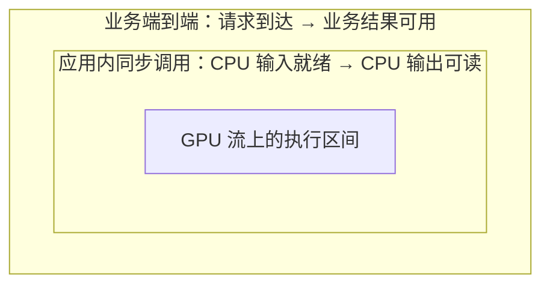

# 推理只要 1 毫秒，应用为什么还在等？

> **TensorRT 推理加速 · 第 4 篇**
>
> GPU 执行模型的时间，和用户等到结果的时间，并不是同一个数字。本篇从一次质检请求出发，讲清计时边界、预热与统计，再用同一个 TensorRT 引擎比较两种内存分配方式。
>
> 资料核对日期：2026 年 10 月 21 日。标题中的“1 毫秒”是教学场景中的假设，不是本文实测。代码仅完成 Python 语法检查，未执行 GPU 性能实验。

## 01｜模型已经很快，结果为什么还没回来？

继续前几篇的质检场景：应用收到零件图片，准备输入，交给 GPU，拿回类别分数，再判断是否需要报警。

前一篇已经解决了“引擎怎样执行并交付正确结果”。现在的问题变成了速度。

假设有人告诉你：“模型在 GPU 上只需要 1 毫秒。”

听起来已经很快，但应用仍然让人等待。两句话不一定矛盾，因为那 1 毫秒可能只覆盖请求中很短的一段。

图片可能还在解码，输入可能还在等待复制，请求可能在排队，输出也可能要经过后处理才能使用。

**判断 TensorRT 是否改善了应用，首先要问：计时从哪里开始，到哪里结束？**

否则，一个数字写着“推理耗时”，里面却可能混着模型构建、内存分配、数据复制、执行和同步；另一个数字则只测了 GPU 工作，两者放在一起并没有可比性。

## 02｜先把三种时间分开

不妨给一次调用划出三个范围。

| 计时范围 | 起点和终点 | 能回答什么 |
|---|---|---|
| GPU 流上的执行区间 | 流中模型执行前后放置的计时事件 | 这段 GPU 流区间经过了多久？ |
| 应用内一次同步调用 | 已准备好的 CPU 输入开始处理，到 CPU 输出可读 | 当前调用方式让应用等待多久？ |
| 业务端到端 | 请求到达，到业务结果可用 | 用户实际要等多久？ |

这三段范围是层层包含的关系，如下图所示：



请从最外层往里看：模型优化只直接作用于最内层的执行区间。开头那笔教学账——模型执行从 10 毫秒降到 5 毫秒、整条请求只快 5%——原因就在这张图里：外两层的准备、传输与排队并不随模型变快而自动缩小。

第一项还需要说明事件之间包含了什么。如果事件之间存在主机提交不及时造成的 GPU 空闲，经过的时间也会被记录；不能不加条件地称为“所有 kernel 执行时间之和”。**CUDA 事件（CUDA Event）**是流上的时间标记，不是自动识别模型边界的工具。[1][2]

第二项可能包含分配、绑定地址、复制、提交以及等待。第三项范围更大，可能包含输入读取、前后处理和排队。

另外，构建引擎、加载引擎、创建上下文和首次调用应单独记录。它们影响启动体验，却不应混进预热后的稳态调用时间。

### 模型变快，应用能快多少？

用一组**教学假设**算一笔账：一条串行请求原本需要 100 毫秒，其中模型执行占 10 毫秒，其他步骤占 90 毫秒。

如果模型部分缩短为 5 毫秒，整条请求就是 95 毫秒，总耗时只减少了 5%。

| 项目 | 优化前 | 优化后 |
|---|---:|---:|
| 模型执行 | 10 ms | 5 ms |
| 其余步骤 | 90 ms | 90 ms |
| 请求总耗时 | 100 ms | 95 ms |

计算本身没有问题，应用的收益取决于被优化部分原本占多少时间。

这张表假设各阶段串行、其他条件不变。实际流水线若存在重叠，应沿关键路径分析，不能把不同阶段的平均值随意相加；各阶段 P95 相加，也不等于总请求的 P95。

## 03｜异步执行，最容易把计时变成“发单时间”

下面这种代码看起来顺理成章：

```python
start = time.perf_counter()
context.execute_async_v3(stream.cuda_stream)
elapsed = time.perf_counter() - start
```

但它测到的是 CPU 调用前后经过的时间。对于异步执行，其中通常没有等待 GPU 完成；某些网络特性又可能引入同步，所以它甚至不是固定含义的“纯提交开销”。

若要测应用等待一次调用完成的时间，应在计时前排空相关工作，并让计时终点位于必要的完成等待之后。若还要求输出回到 CPU，则终点应放在输出复制完成之后。[1][3]

若要观察 GPU 流区间，可以在同一流上放置 CUDA Event，等结束事件完成后读取经过时间。PyTorch 的 `elapsed_time` 返回毫秒，不要再误乘一次 1000。[2]

两种计时方法回答的问题不同，都有用。关键是别拿其中一个冒充另一个。

## 04｜一次快，不代表重复运行都快

首先要预热。

首次执行可能涉及延迟初始化、内存池准备或执行状态更新。尤其在改变动态形状后，第一次调用还可能承担额外准备。正式采样前，应在目标形状和调用路径上预热。[4]

但“预热 50 次”只是可以尝试的起点，不是所有模型都已稳定的保证。可以观察连续几轮的分布，确认没有明显的启动趋势后再记录正式结果。

然后，收集多次样本。

- **均值**：总体平均水平，会受到极慢样本影响。
- **P50**：中位数，帮助观察典型水平。
- **P95**：按本次样本估计的第 95 百分位，帮助观察较慢一端。

本文使用 NumPy 的线性插值方法计算百分位；报告时应保留方法和样本数。[5]

这里还要留一个边界：对一个固定输入、串行运行 500 次得到的 P95，**不是生产服务的 P95**。它没有覆盖真实请求到达、队列拥塞、输入变化和其他服务竞争。

也不要先把一组请求的总时间除以次数，再把这几个平均值的 P95 当成单请求 P95。平均化已经改变了要观察的对象。

## 05｜先做一个受控实验：换内存分配方式，不换引擎

上一期的代码为了让生命周期清楚，每次调用都创建输入输出 GPU 张量。这一篇比较两种路径：

| 路径 | 每次调用怎样准备 GPU 缓冲区？ | 其他主要条件 |
|---|---|---|
| A：每次创建张量 | 每次 `torch.empty` 获取输入输出张量 | 同引擎、输入、流、复制和同步方式 |
| B：复用缓冲区 | 提前创建，随后反复使用 | 与 A 保持一致 |

两条路径都采用提前准备好的页锁定 CPU 输入输出，执行相同的 H2D、推理和 D2H，再等待流完成。这样不会一边换分配方式，一边又换成另一种传输方式。

页锁定内存是被固定在主机物理内存中的缓冲区，可用于相应的异步传输流程。本实验提前分配它，并在复制完成前保持数据和对象不变。异步复制的内存及读取条件不能省略。[6]

还要说明：**每次 `torch.empty` 不等于每次都调用底层 `cudaMalloc`。** PyTorch 使用缓存分配器，预热后的分配可能命中缓存。本实验比较的是两种应用写法的实际调用成本，不是孤立测量 CUDA 内存分配接口。[3]

## 06｜代码：测一次完整返回，再测一段 GPU 流

下面代码延续上一期的 `FeatureRunner`。将上一期代码保存为同目录的 `run_engine.py`；导入时不会执行它的 `main()`。本文复用其中已经解释过的引擎加载、输入类型与格式检查，不再重复整段代码。

即使没有阅读前文，也可以理解实验：`runner` 持有一个 TensorRT 引擎、执行上下文和 CUDA 流；张量按名称绑定，`execute_async_v3` 提交执行。模型仍为 `[B,256] → [B,10]` 的小网络，不包含图片特征提取。

**环境**：CUDA 可用的 PyTorch、TensorRT 11.x、NumPy、ONNX Runtime，以及兼容的 GPU/驱动/运行库。接口按 TensorRT 11.4 文档核对。需要前面构建的 engine 及用于构建它的同名 ONNX 文件；不是已验证的锁版本环境。

**验证状态**：编写环境缺少相关推理依赖，下面脚本仅通过 Python 语法检查，未执行 GPU 实验；不提供预设耗时、提速比例或输出日志。

保存为 `benchmark_engine.py`：

```python
"""推理只要 1 毫秒，应用为什么还在等？（第8章 · TensorRT 部署）。

本文件是对应博文代码块的实现/演示，直接运行可见效果；运行依赖：PyTorch、TensorRT、ONNX Runtime、NumPy。
"""
from pathlib import Path
import sys
import time

import numpy as np
import onnxruntime as ort
import tensorrt as trt
import torch

from run_engine import FeatureRunner


def measure_wall(call, batch, warmup=50, samples=500):
    for _ in range(warmup):
        call()  # call 返回时 CPU 输出已经可读。
    times_ms = []
    total_start = time.perf_counter()
    for _ in range(samples):
        start = time.perf_counter()
        call()
        times_ms.append((time.perf_counter() - start) * 1000)
    total_seconds = time.perf_counter() - total_start
    return {
        "samples": samples,
        "mean_ms": float(np.mean(times_ms)),
        "p50_ms": float(np.percentile(times_ms, 50, method="linear")),
        "p95_ms": float(np.percentile(times_ms, 95, method="linear")),
        # 总循环墙钟包含计时和记录开销；这是串行实验完成速率。
        "serial_samples_per_second": batch * samples / total_seconds,
    }


def main():
    path = Path(sys.argv[1] if len(sys.argv) > 1
                else "onnx_demo/small_classifier.engine")
    batch = int(sys.argv[2]) if len(sys.argv) > 2 else 1
    runner = FeatureRunner(path)
    ctx, stream = runner.context, runner.stream
    x_np = np.random.default_rng(42).standard_normal((batch, 256)).astype(np.float32)

    # 先核对正确性，并落实当前 batch；这些步骤不在性能计时内。
    session = ort.InferenceSession(
        str(path.with_suffix(".onnx")), providers=["CPUExecutionProvider"]
    )
    expected = session.run(["logits"], {"features": x_np})[0]
    actual = runner(x_np)
    np.testing.assert_allclose(
        actual, expected, atol=1e-5, rtol=1e-4, equal_nan=False
    )

    x_host = torch.empty((batch, 256), dtype=torch.float32, pin_memory=True)
    y_host = torch.empty((batch, 10), dtype=torch.float32, pin_memory=True)
    x_host.copy_(torch.from_numpy(x_np))
    with torch.cuda.stream(stream):
        x_buffer = torch.empty_like(x_host, device=runner.device)
        y_buffer = torch.empty_like(y_host, device=runner.device)

    def bind(x_gpu, y_gpu):
        for name, tensor in (("features", x_gpu), ("logits", y_gpu)):
            if not ctx.set_tensor_address(name, tensor.data_ptr()):
                raise RuntimeError(f"绑定 {name} 失败")

    def enqueue():
        if not ctx.execute_async_v3(stream.cuda_stream):
            raise RuntimeError("提交执行失败")

    def call(reuse):
        with torch.cuda.stream(stream):
            if reuse:
                x_gpu, y_gpu = x_buffer, y_buffer
            else:
                x_gpu = torch.empty_like(x_buffer)
                y_gpu = torch.empty_like(y_buffer)
            try:
                x_gpu.copy_(x_host, non_blocking=True)
                bind(x_gpu, y_gpu)
                enqueue()
                y_host.copy_(y_gpu, non_blocking=True)
            finally:
                stream.synchronize()  # 等待复制与计算，所有缓冲区仍存活。

    print("GPU:", torch.cuda.get_device_name(0))
    print("PyTorch:", torch.__version__, "CUDA:", torch.version.cuda)
    print("Engine:", path, "batch:", batch, "TensorRT:", trt.__version__)
    for reuse in (False, True):
        call(reuse)
        # 两条被测路径都先验收；检查和打印不放进采样区间。
        np.testing.assert_allclose(
            y_host.numpy(), expected, atol=1e-5, rtol=1e-4, equal_nan=False
        )
        result = measure_wall(lambda: call(reuse), batch)
        print("复用缓冲区" if reuse else "每次创建张量", result)

    # 输入留在 GPU，地址固定；事件区间内不做 H2D、D2H 或新张量分配。
    call(True)
    bind(x_buffer, y_buffer)
    start_event = torch.cuda.Event(enable_timing=True)
    end_event = torch.cuda.Event(enable_timing=True)
    # 先初始化事件，避免把事件首次创建混入正式区间。
    start_event.record(stream)
    end_event.record(stream)
    end_event.synchronize()
    group_means = []
    repeats = 200
    try:
        for _ in range(10):
            start_event.record(stream)
            for _ in range(repeats):
                enqueue()
            end_event.record(stream)
            end_event.synchronize()
            group_means.append(start_event.elapsed_time(end_event) / repeats)
    finally:
        stream.synchronize()
    print("事件法：10组、每组200次，平均流区间 ms/次:", float(np.mean(group_means)))


if __name__ == "__main__":
    main()
```

使用固定 batch=1 引擎时：

```bash
python benchmark_engine.py onnx_demo/small_classifier.engine 1
```

若已按第三篇构建动态 batch 为 1～8 的引擎，可以分别运行：

```bash
python benchmark_engine.py onnx_demo/small_classifier_dynamic.engine 1
python benchmark_engine.py onnx_demo/small_classifier_dynamic.engine 4
python benchmark_engine.py onnx_demo/small_classifier_dynamic.engine 8
```

### 怎样读这份脚本？

前半段用 CPU 墙钟，测的是：**已准备好的页锁定 CPU 输入 → GPU 输入复制 → 模型执行 → 输出复制 → CPU 输出可读**。不包含图片读取、特征准备、排队、引擎加载或任务后处理。

因此，它可以称为“本实验调用边界内的同步往返耗时”，不能直接称为质检应用的完整端到端延迟。

后半段把输入留在 GPU，重复提交 200 次，再用事件测整组区间，除以次数，重复 10 组取平均。这个协议降低了逐次打点与逐次等待的干扰，但它测的是**批量提交下的平均流区间**，不是单请求 P95。

代码没有使用 CUDA Graphs。对于这个很小的模型，Python 提交间隙可能进入事件区间，使 GPU 等待。因此事件结果也不能无条件解释为 kernel 纯计算时间。若要确认这类空隙，应查看 CPU/GPU 时间线。

两段代码采用不同协议，不能用“墙钟结果减去事件结果”，就声称得到了精确的数据传输开销。

## 07｜测到差异以后，怎样解释才可靠？

先看缓冲区复用是否改善了同一边界下的统计结果。它不一定带来明显收益：缓存分配器可能已降低分配成本，其他步骤也可能占据主要时间。

更严谨的做法是交换 A/B 顺序、重复几轮，并观察分布是否稳定。不要只保留最有利的一次。GPU 的频率、功耗、温度及其他工作负载都可能影响结果；CPU 调度也会影响主机侧时间。[1]

结果报告至少应包含这些信息：

| 项目 | 本文实验应记录什么 |
|---|---|
| 对象 | 同一 engine、对应 ONNX 的文件标识或哈希 |
| 环境 | GPU、驱动、TensorRT、PyTorch、CUDA 版本 |
| 计算约定 | batch、shape、dtype、内部精度控制与构建设置 |
| 调用方式 | 单流、无并发、是否使用 CUDA Graphs、是否包含复制 |
| 统计方法 | 预热次数、采样次数、均值、P50、P95、百分位方法 |
| 负载范围 | 固定随机特征，不包含图片处理与真实请求队列 |

脚本会打印部分环境，驱动、文件哈希和构建配置需在实验记录中补齐。不能因为脚本能输出数字，就省略报告条件。

### batch 变大，要看两个指标

假设一次提交包含 B 条样本，完成 N 次提交，总墙钟为 T 秒，则本实验完成速率为：

```text
样本完成速率 = B × N / T
```

每秒完成多少次调用，与每秒处理多少条样本，要分开标注。

batch 增大可能改善资源利用，也可能让单次调用更慢。在真实应用中，还可能需要等待样本凑成一批，这段时间没有进入上面的脚本。只展示 samples/s，无法证明单个用户更早得到结果。

此外，本文测的是“完成一个调用再开始下一个”的串行完成速率，不是多流或服务并发下的饱和吞吐能力。

## 08｜为什么 trtexec 的结果和 Python 差这么多？

不要先怀疑某一边算错了，先核对执行方式。

TensorRT 11 的 `trtexec` 默认关闭输入输出数据传输，并默认启用 CUDA Graphs。旧版教程里的 `--noDataTransfers`、`--useCudaGraph` 在 11.x 已被列为无效果的兼容参数；需要包含传输时使用 `--includeDataTransfers`，需要关闭图执行时使用 `--noCudaGraph`。[7]

所以直接执行：

```bash
trtexec --loadEngine=onnx_demo/small_classifier.engine
```

与本文包含复制、每次等待的 Python 往返实验，条件并不相同。

想更接近本文的“包含复制、不开图”设置，可以先运行：

```bash
trtexec --loadEngine=onnx_demo/small_classifier.engine \
  --includeDataTransfers --noCudaGraph
```

但这仍不是完全一致的实验。官方文档说明，`trtexec` 为提高利用率会提前提交后续 batch；而本文的墙钟实验逐次同步。两者的调度方式不同，主机开销也不同。[1]

读报告时，还需区分 `GPU Compute Time`、`Enqueue Time`、H2D/D2H 与工具定义的 `Host Latency`。工具定义的“端到端”只覆盖它声明的推理边界，不会自动包含你的图片解码、业务排队与报警处理。

`trtexec` 很适合诊断引擎执行表现，应用自己的请求计时则回答交付体验。二者需要相互解释，不必强求数字一致。

## 09｜如果真的要比较 PyTorch 与 TensorRT

本文的 A/B 实验比较的是同一个 TensorRT 引擎的调用方式，并没有给出两种框架的速度排名。

要扩展为 PyTorch GPU 与 TensorRT GPU 比较，应先准备**同一份权重**，固定输入、batch、前后处理和精度策略，再对双方使用相同的计时边界、预热与统计方法。

如果比较 GPU 驻留执行，双方都排除传输；如果比较 CPU 输入到 CPU 输出，双方都包含所需的复制与完成等待。不能一边使用 CUDA Graphs，另一边直接运行，却把差异全部归因于编译优化。

前几篇的随机初始化模型用于理解流程。若没有保存当时的权重，不应重新随机创建一份 PyTorch 模型，便声称它与现有引擎是严格的同模型基线。ONNX Runtime CPU 输出在本篇只用于正确性参考，也不参与 GPU 加速比计算。

## 10｜下一步该优化哪里？让时间分布回答

在实际质检应用里，最有用的做法是给同一请求打上标识，记录到达、开始处理、输入准备完成、执行完成和结果交付这些时刻。这样才能看见一次请求到底等在何处。

| 观察到的现象 | 值得优先检查 |
|---|---|
| 模型执行短，准备输入长 | 解码、预处理、特征提取 |
| 数据复制占比高 | 数据位置、复制次数、能否保留在 GPU |
| GPU 工作之间有明显空隙 | 主机提交、Python 开销、同步与调度 |
| 无负载测试很快，真实请求很慢 | 排队、批处理等待、其他任务竞争 |
| 只有第一次或切换形状后慢 | 启动准备、形状更新、预热策略 |

需要进一步定位时，可使用 Nsight Systems 观察 CPU/GPU 时间线，包括 kernel 启动、复制与等待；只有看到实际时间分布，才适合决定是否继续做融合、并发或图执行。[4]

先把计时范围写清，再确认质量和条件一致，最后报告有代表性的统计结果。这样，“模型快了”才能逐步转化为“应用更及时地交付了结果”。

下一篇将把这个评价方法用于 INT8 量化：模型使用更低精度后，究竟交换了哪些误差、资源和时间？

## 参考资料

1. [NVIDIA TensorRT 11.4 Performance Benchmarking](https://docs.nvidia.com/deeplearning/tensorrt/11.4.0/performance/benchmarking.html)：计时边界、工具指标、调度方式及环境影响。
2. [PyTorch CUDA Event](https://docs.pytorch.org/docs/2.14/generated/torch.cuda.streams.Event.html)：事件记录、同步和毫秒计时。
3. [PyTorch CUDA semantics](https://docs.pytorch.org/docs/2.14/notes/cuda.html)：异步执行、同步和缓存内存分配器。
4. [Optimizing TensorRT Performance](https://docs.nvidia.com/deeplearning/tensorrt/11.4.0/performance/optimization.html)；[CUDA Best Practices Guide](https://docs.nvidia.com/cuda/cuda-c-best-practices-guide/index.html)：形状更新、执行优化及性能分析方法。
5. [NumPy percentile](https://numpy.org/doc/stable/reference/generated/numpy.percentile.html)：百分位估计和插值方法。
6. [PyTorch: non_blocking and pin_memory](https://docs.pytorch.org/tutorials/intermediate/pinmem_nonblock.html)：页锁定内存、异步复制及 CPU 访问完成条件。
7. [Migrating trtexec Usage from TensorRT 10.x to 11.x](https://docs.nvidia.com/deeplearning/tensorrt/11.4.0/api/migration/tensorrt-10x-to-11x-trtexec.html)：默认执行行为及参数变化。
