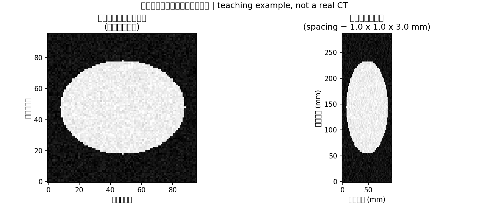
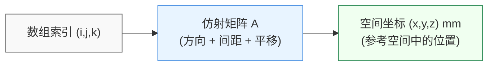

# CT 看着是一叠图，GPU 要处理的究竟是什么？

> **CUDA 医疗影像实战 · 第1篇（专栏第74篇）**
>
> 把CT交给GPU之前，先弄清三个问题：一个数对应哪里、一个体素有多大、器官标签是否与影像对齐。本篇完成数据检查和三平面可视化，为下一篇三维器官分割建立输入基础。

> **工程深度｜验证状态：** L3 工程｜端到端实战（需数据/环境）
设想这样一个入门场景：你准备做一个脾脏分割实验。数据已经下载好了，文件能打开，切片也能显示。你把数组送进模型，程序没有报错。

可等到器官轮廓叠回原图，位置却对不上；换一个方向观察，身体的比例也有些奇怪。

这时，先别急着调整网络。

**数组能参与计算，只说明它的形状和类型满足了接口，不代表程序正确理解了它对应的空间。**

> 比例异常，先核对显示是否采用真实间距（`spacing`）；轮廓错位，先核对病例、网格和变换记录（`affine`/同网格检查）。两者都可能发生，但检查入口不同。

前面的CUDA内容讨论过如何少搬数据、怎样融合计算、推理时为什么还会等待。从这一篇开始，我们把这些知识放进一个具体任务：从公开腹部CT中分割脾脏。

第一步先把输入弄明白。否则，GPU可能只是更快地处理了一份位置关系已经出错的数据。

*上面的情节是教学场景，不是某家医院的运行记录。本文不训练模型、不生成预测，也不报告加速倍数。*

## 01｜屏幕上一张张翻，数据里是一整个体积

看CT时，我们常常逐张翻阅切片。对三维分割程序来说，这些切片通常共同组成一个三维数组。

普通灰度图片可以用两个索引寻找一个像素，例如`image[row, col]`。三维影像多了一个索引，例如`volume[i, j, k]`，对应一个**体素**：可以先把它理解为带有空间尺寸的三维采样单元。NiBabel的官方文档用数据数组、空间变换和元数据共同描述一幅影像。[1][r1]

假设一个体积的形状是：

```python
shape = (512, 512, 300)  # 教学假设，不是本文读取的真实病例尺寸。
```

它表示三个数组轴上分别有512、512、300个采样位置，共计78,643,200个体素。

但仅凭这个形状，还不知道：

- 每个采样位置之间相隔多少毫米；
- 第一个数组轴朝人体左侧还是右侧；
- 这块体积在参考空间中的什么位置。

因此，看到`(512, 512, 300)`，不能立刻断言“前两维就是屏幕的高宽，最后一维就是人体从脚到头”。这些含义需要结合空间信息确认。

本系列选择Medical Segmentation Decathlon（MSD）的脾脏CT任务作为实践入口。MONAI的官方脾脏分割模型说明也采用这一任务，并将输出定义为背景与脾脏两类。[2][r2] 本篇只使用其中一对影像和**参考标签**：标签来自数据集，不是我们的模型预测。

## 02｜同样300层，为什么看起来会被“压扁”？

问题往往藏在**体素间距**里。

体素间距通常记为`spacing`，表示沿各个数组轴，相邻体素中心之间的物理距离。对于规则、轴对齐的网格，可以把它看成每个采样格子的三个边长。

继续使用教学假设：

| 项目        | 假设值                  | 告诉我们什么      |
| --------- | -------------------- | ----------- |
| 数组形状      | `512 × 512 × 300`    | 各轴有多少个体素    |
| 体素间距      | `0.8 × 0.8 × 2.5 mm` | 相邻采样中心相隔多远  |
| 单通道FP32数组 | `300 MiB`            | 仅数值数组占用多少内存 |

如果绘图时把三个方向的单位步长都画成同样长度，那么真实间距为2.5毫米的方向，就可能被压缩成与0.8毫米方向一样的比例。

这与数组有没有丢失元素无关。**数值可以完整，显示比例仍然可以错误。**

如下图所示，同一份合成体积在忽略间距时会被“压扁”，按毫米比例显示才更接近真实的物理比例。这里的对比只是教学用合成数据，不代表真实CT病例。



> 观察要点：左图按数组格子等比例绘制，右图用 `extent` 配合 `aspect="equal"` 按毫米坐标显示。两张图数值完全相同，只是坐标轴的单位和比例不同。按数组格子显示时，间距较大的方向显得被压缩。

按上述规则网格假设，每个体素覆盖单元沿第三轴的宽度为2.5毫米，300个单元的总宽度是750毫米；首尾两个体素中心之间的距离则是：

$$
(300-1)\times2.5=747.5\ \text{mm}.
$$

二者相差一个体素间距，因为一个算单元覆盖宽度，一个算首尾中心距离。分清它们，后面给图片设置物理坐标时就不容易错半格或一格。

还要区别**层间距**与**层厚**：前者描述采样位置的距离，后者与切片的重建厚度有关，不能直接当成同一个量。DICOM标准分别定义了Slice Thickness和Spacing Between Slices。[12][r12] 本文讨论的是三维网格的间距，不从数组形状反推扫描参数。

对于有旋转或剪切的网格，三个间距值也不足以描述完整几何，还需要方向信息。

## 03｜数组里的“第10格”，不等于人体里的某个固定位置

不妨用一张座位表来理解：行号与列号能找到格子，但如果不知道这张表的朝向和摆放位置，就不知道格子在房间里靠近哪面墙。

医学影像的数组索引也是如此。

NiBabel通过一个通常称为`affine`的4×4仿射矩阵，把体素索引映射到参考空间坐标。它可以表达轴的方向、尺度和位置关系。[1][r1]

$$
\begin{bmatrix}x\\y\\z\\1\end{bmatrix}
=
A
\begin{bmatrix}i\\j\\k\\1\end{bmatrix}.
$$

这里不必先记住矩阵运算的全部细节。只需要抓住：左边是空间位置，右边是数组位置，`A`负责告诉程序如何从一边到另一边。



> **图解说明：** 上图展示的是“索引 -> 空间”的映射关系。数组里的同一个格子编号，在不同的 `affine`（不同摆放/朝向）下会落到参考空间中完全不同的位置。也就是说，**数组顺序本身并不等于人体方位。**

例如，下面这个**教学矩阵**没有旋转或剪切：

$$
A=
\begin{bmatrix}
0.8&0&0&-100\\
0&0.8&0&-120\\
0&0&2.5&-50\\
0&0&0&1
\end{bmatrix}.
$$

对于索引`(10, 20, 30)`，空间坐标就是：

$$
x=0.8\times10-100=-92,\quad
y=0.8\times20-120=-104,\quad
z=2.5\times30-50=25.
$$

假定空间单位是毫米，这个位置便是`(-92, -104, 25) mm`。如果换一个平移项，数组里的数值完全不变，对应的空间位置却变了。

这也解释了一个常见误区：**两份数组形状相同，不能证明它们已经对齐。** 只要 `affine` 不一致，同样形状的 CT 和标签就可能错位，后续所有叠加、滑窗和评价都会建立在错误的空间关系上。

### RAS不是另一个模型参数

NiBabel采用RAS+参考坐标约定：三个正方向分别指向人体右侧（Right）、前方（Anterior）、上方（Superior）。它提供`aff2axcodes`查看数组轴最接近的解剖方向。[3][r3]

例如：

```python
nib.aff2axcodes(image.affine)  # 例如返回('L', 'A', 'S')；具体结果取决于文件。
```

这说明第一轴增大时最接近朝向左侧，而不是说“第一轴一定是从左到右”。有斜切时，这些字母表示最接近的方向，不能代替完整矩阵。

横断面、冠状面和矢状面，则分别从上下、前后、左右的关系切开体积。3D Slicer的坐标文档给出了这三种解剖平面及RAS/LPS约定的说明。[4][r4]

画图时还必须交代屏幕方向。本篇示例明确标出方向箭头，横断面中人体右侧显示在画面右侧；不要据此推断所有医学阅片软件都采用同样的左右显示习惯。

## 04｜器官标签必须跟着影像一起走

分割任务还需要一份标签数组，常称为**掩码**。本篇采用的约定是：

| 数值  | 含义 |
| --- | -- |
| `0` | 背景 |
| `1` | 脾脏 |

影像记录强度，标签记录类别。它们描述的是同一空间里的不同信息。[2][r2]

如果翻转了CT，却没翻转标签，程序仍然可能拿到两个相同形状的数组。但某个位置的强度与类别，已经不再对应。

所以检查至少有两层：

1. **病例对应正确**：文件来自同一个病例，不能只看名字相似。
2. **网格对应正确**：数组形状、空间单位及索引到空间的映射相符。

即使这些检查都通过，也只说明文件在几何上符合当前处理约定，不能证明人工标注一定正确。

### “换朝向”与“换网格”是两件事

这是本篇最值得记住的区别：

| 操作       | 做了什么                      | 是否需要插值 |
| -------- | ------------------------- | ------ |
| 重排或翻转数组轴 | 改变元素的存放顺序，并同步更新空间映射       | 通常不需要  |
| 重采样      | 在新的采样位置重新计算数值，例如统一spacing | 通常需要   |

NiBabel的`as_closest_canonical`可以通过轴重排和翻转，让数组轴尽可能接近RAS；它不等于“变成1毫米等间距”，也不会自动消除斜切。[3][r3][5][r5] `enforce_diag=True`检查的是重排后的空间变换是否**接近轴对齐**，不满足时抛出错误；它不会自动把斜切校正成标准网格。

当确实需要重采样时，影像和标签要使用同一个目标网格，但插值方式可以不同。强度影像可以使用线性插值；离散类别标签通常采用最近邻，避免把0和1插出0.3、0.7这样的非类别值。MONAI的官方脾脏分割示例就分别配置了影像和标签的插值方式。[6][r6]

仅仅为了让两个文件“看起来对齐”，直接把标签的affine改成影像的affine，并不会移动标签内容。除非已确认只是元数据错误，否则这种做法会制造表面一致的错误。

## 05｜动手：生成一张空间关系明确的三平面图

本次练习的目标很具体：输入同一病例的CT和参考标签，先检查，再画图，同时保存元数据。

### 数据与环境

从[MSD官方项目入口][r7]获取`Task09_Spleen`，使用带参考标签的训练数据。下载和使用前查看数据集说明与许可。解压后选择`imagesTr`与`labelsTr`中同名的一对文件，例如：

| 用途   | 路径示例                                     |
| ---- | ---------------------------------------- |
| CT   | `Task09_Spleen/imagesTr/spleen_2.nii.gz` |
| 参考标签 | `Task09_Spleen/labelsTr/spleen_2.nii.gz` |

路径是使用示例，请按实际文件位置调整。本文从NIfTI体积起步，不处理医院DICOM序列的排序、解码与转换。

下面代码只需要CPU：

```bash
python -m venv .venv
source .venv/bin/activate
python -m pip install numpy matplotlib nibabel
```

**实际验证状态**：本文代码在Python 3.12.14、NumPy 2.3.5、Matplotlib 3.10.8、NiBabel 5.4.2环境中，用合成NIfTI数据执行了正向流程、轴重排一致性、命令行入口及错误输入检查。**没有下载并运行真实MSD病例，也没有执行CUDA或分割模型。** 上面的安装命令不锁版本；复现实验时应记录实际依赖版本。

**本次合成测试覆盖记录（已执行）**

| 检查项 | 结果 | 说明 |
|---|---|---|
| 轴重排后影像与标签仍对应 | 通过 | `as_closest_canonical` 同步调整数组与 `affine`，重排后逐项校验网格一致 |
| 不同 `affine` 被拒绝 | 通过 | 修改平移/变换后，形状相同但 `affine` 不一致时抛出错误 |
| 非二值标签被拒绝 | 通过 | 用含 0、1、2 的标签验证严格二值检查（标签现用 `float64` 读取后检查） |
| 空标签被拒绝 | 通过 | 全部背景时触发 `not np.any(mask == 1)` 错误 |
| 含 NaN/Inf 被拒绝 | 通过 | 有限值检查 |
| 斜切输入按约定停止 | 通过 | 在 `enforce_diag=True` 下非轴对齐时按约定拒绝或由检查器拦截 |
| FP32 舍入边界（`1.00000001`） | 通过（NumPy 演示） | 用 FP64 检查可发现这类缩放舍入导致的“伪二值”；这不是对完整 NIfTI 脚本的全量重跑 |

> 上表只列实际执行过的项目。`get_fdata(dtype=np.float64)` 修复的是“先降为 FP32 再检查二值”可能漏检的舍入边界，目的在于强化检查器的严格承诺。

### 这段代码怎样控制范围

> **阅读重点（第一遍建议先看这三处）：**  
> 1. **同网格判断** — `image.shape != label.shape` 或 `affine` 不匹配就直接报错（不伪造对齐）。  
> 2. **同步重排** — 用 `nib.as_closest_canonical` 同步调整数组轴与 `affine`，并用 `enforce_diag=True` 限制为近轴对齐的范围。  
> 3. **毫米比例显示** — 用 `extent` 配合 `aspect="equal"` 按体素间距设置坐标范围，实现按毫米比例绘图。

为了避免在第一篇同时引入重采样，代码只接受：空间单位明确为毫米、同网格的三维影像与非空二分类标签，并且在重排后网格与RAS坐标轴对齐。

遇到斜切、剪切、单位不明或不同网格，会停止；这不代表文件必然损坏，而是超出了这个教学检查器的范围。NIfTI还可能同时记录qform和sform两套空间映射，NiBabel有自己的选择规则。两者可以表达不同的参考空间，不一致不必然表示文件损坏；本例在两者均有效却不一致时，保守地要求先人工核实应采用哪套空间。[8][r8]

`get_fdata(dtype=np.float32)`会应用NIfTI文件规定的数值缩放，并返回FP32数组。[9][r9] 这不意味着任意NIfTI数值都自动成了CT的HU值。若从原始DICOM处理CT，还要核对其重标定参数与输出单位；DICOM标准明确规定了相关映射关系和适用条件。[10][r10]

> **方向说明：** 重排后 `data[:, :, k]` 沿第三轴固定位置。经 `.T` 转置后，数组第一轴成为画面横轴，第二轴成为纵轴，配合 `aff2axcodes` 得到 `L -> R`、`P -> A` 等方向标签。本篇示例只在轴对齐的 RAS 数据上绘制这些方向箭头。

把下面完整代码保存为`inspect_ct.py`：

```python
"""教学用：检查同网格的二分类NIfTI影像/标签，生成三平面叠加图。"""
import argparse
import json
from pathlib import Path

import matplotlib
matplotlib.use("Agg")  # 无桌面环境也可以保存图片。
import matplotlib.pyplot as plt
from matplotlib.colors import ListedColormap
import nibabel as nib
import numpy as np


def load_volume(path):
    volume = nib.load(path)  # 读取文件头及数据访问对象。
    if len(volume.shape) != 3:
        raise ValueError("本例只处理三维体积，不自动压缩四维数据。")
    if volume.header.get_xyzt_units()[0] != "mm":
        raise ValueError("本例要求空间单位明确为mm，请先核实单位。")
    affine = volume.affine
    if not np.isfinite(affine).all() or abs(np.linalg.det(affine[:3, :3])) < 1e-8:
        raise ValueError("空间变换无效，请检查文件来源。")
    qform, qcode = volume.get_qform(coded=True)
    sform, scode = volume.get_sform(coded=True)
    if qcode and scode and not np.allclose(qform, sform, rtol=0, atol=1e-3):
        raise ValueError("qform与sform不一致，需人工确认应采用的空间。")
    return volume


def inspect_pair(image_path, label_path, output_path):
    image = load_volume(image_path)
    label = load_volume(label_path)
    # 形状和空间映射必须同时匹配；不通过修改文件头伪造对齐。
    if image.shape != label.shape or not np.allclose(
        image.affine, label.affine, rtol=0, atol=1e-3
    ):
        raise ValueError("图像与标签不在本例要求的同一网格上。")

    original = {"shape": list(image.shape), "affine": image.affine.tolist()}
    # 重排/翻转数组，同时更新affine；不插值，不统一体素间距。
    # 拒绝仍有斜切/剪切的情况，避免把斜切面标成标准解剖平面。
    image = nib.as_closest_canonical(image, enforce_diag=True)
    label = nib.as_closest_canonical(label, enforce_diag=True)
    if image.shape != label.shape or not np.allclose(
        image.affine, label.affine, rtol=0, atol=1e-3
    ):
        raise ValueError("重排后的图像与标签网格不一致。")
    if nib.aff2axcodes(image.affine) != ("R", "A", "S"):
        raise ValueError("本例只绘制轴对齐的RAS数据。")

    data = image.get_fdata(dtype=np.float32)  # 应用文件数值缩放，明确使用FP32。
    # 标签用更高精度读取后再检查二值：FP32转换本身也会做舍入，
    # 例如1.00000001会先变成1.0，从而掩盖非法值。
    mask = label.get_fdata(dtype=np.float64)
    if not np.isfinite(data).all() or not np.isfinite(mask).all():
        raise ValueError("图像或标签包含NaN/Inf。")
    if not np.isin(mask, [0, 1]).all() or not np.any(mask == 1):
        raise ValueError("本例要求非空二分类标签：0为背景，1为目标。")
    mask = mask.astype(bool)  # 完成有限值与二值检查后，再转为布尔数组。
    foreground = mask
    spacing = nib.affines.voxel_sizes(image.affine)
    # 每个方向独立选择前景面积最大的切片，只用于展示参考标注。
    indices = [int(np.argmax(foreground.sum(axis=tuple(j for j in range(3) if j != a))))
               for a in range(3)]
    nx, ny, nz = data.shape
    sx, sy, sz = spacing
    i, j, k = indices
    views = [
        ("Axial", data[:, :, k].T, foreground[:, :, k].T, nx, ny, sx, sy, "L -> R", "P -> A", k),
        ("Coronal", data[:, j, :].T, foreground[:, j, :].T, nx, nz, sx, sz, "L -> R", "I -> S", j),
        ("Sagittal", data[i, :, :].T, foreground[i, :, :].T, ny, nz, sy, sz, "P -> A", "I -> S", i),
    ]
    fig, axes = plt.subplots(1, 3, figsize=(12, 5), layout="constrained")
    for ax, (name, section, region, width, height, dx, dy, xdir, ydir, index) in zip(axes, views):
        # 坐标为切片内部相对毫米；半体素边界让像素中心落在0、dx、2dx……。
        extent = (-dx / 2, (width - 0.5) * dx, -dy / 2, (height - 0.5) * dy)
        ax.imshow(section, cmap="gray", origin="lower", extent=extent,
                  aspect="equal", vmin=-100, vmax=200, interpolation="nearest")
        ax.imshow(np.ma.masked_where(~region, region), cmap=ListedColormap(["lime"]),
                  origin="lower", extent=extent, aspect="equal", alpha=0.35,
                  interpolation="nearest", vmin=0, vmax=1)
        ax.set(title=f"{name}: index {index}", xlabel=f"{xdir} (relative mm)",
               ylabel=f"{ydir} (relative mm)")
    fig.suptitle("Reference mask overlay | teaching view, not a prediction")
    output = Path(output_path)
    output.parent.mkdir(parents=True, exist_ok=True)
    fig.savefig(output, dpi=160)
    plt.close(fig)
    report = {"original": original, "display_shape": list(data.shape),
              "display_affine": image.affine.tolist(), "axes": list(nib.aff2axcodes(image.affine)),
              "spacing_mm": spacing.tolist(), "dtype": str(data.dtype),
              "array_MiB": data.nbytes / 2**20, "selected_ijk": indices}
    output.with_suffix(".json").write_text(json.dumps(report, indent=2), encoding="utf-8")
    print(f"Saved: {output}; metadata: {output.with_suffix('.json')}")
    return report


if __name__ == "__main__":
    parser = argparse.ArgumentParser(description=__doc__)
    parser.add_argument("image", help="CT的NIfTI路径")
    parser.add_argument("label", help="同病例参考标签的NIfTI路径")
    parser.add_argument("--out", default="ct_three_planes.png")
    args = parser.parse_args()
    inspect_pair(args.image, args.label, args.out)
```

运行：

```bash
python inspect_ct.py \
  Task09_Spleen/imagesTr/spleen_2.nii.gz \
  Task09_Spleen/labelsTr/spleen_2.nii.gz \
  --out ct_three_planes.png
```

正常完成后，会保存三平面图`ct_three_planes.png`和元数据`ct_three_planes.json`。具体形状、间距和切片编号取决于输入，本文不填入虚构的真实病例输出。

图中绿色区域是**参考标注**。三个方向分别选择该方向前景面积最大的切片，所以它们不保证通过同一个空间点。使用标签选片，只是为了观察参考数据，不是模型自动定位器官，也不是后续推理时可直接采用的裁剪策略。

绘图还有三个细节值得读懂：

- **`.T`** 把切片数组的第一轴放到屏幕水平方向；配合明确的轴约定，才能解释方向箭头。
- **`extent`和`aspect="equal"`** 使图像按毫米比例显示，而不是按数组格子等宽显示；坐标是片内相对距离，不是完整affine映射后的世界坐标。[11][r11]
- **`vmin=-100, vmax=200`** 只控制教学图的灰度显示范围，不修改`data`，也不是训练模型的归一化配方。

脚本保留原始与显示时的affine。当前它没有输出变换后的分割文件；后续若改变了网格，保存预测时还需要追踪并恢复空间关系，不能只把数组写回去。

## 06｜走到这里，CUDA问题才有了明确对象

回到开头那个假设体积：`512 × 512 × 300`。

如果单通道使用FP32，每个元素4字节：

$$
512\times512\times300\times4
=314{,}572{,}800\ \text{bytes}
=300\ \text{MiB}.
$$

这是可直接复算的教学计算，**不是GPU实测显存**。它只计算一个数组，不包括标签、权重、网络中间特征、工作区、输出缓冲和框架缓存。压缩后的`.nii.gz`文件大小也不能直接当作解压数组的内存大小。

由此，后续优化会变得具体：

- 三个方向各有多少元素，决定实际计算规模；
- 数据类型和内存布局，决定存储与访存方式；
- 模型期望的spacing和强度范围，决定前处理不能随意更改；
- 原始空间与模型空间的关系，决定预测怎样叠回影像。

到了模型接口里，我们还会遇到`[B, C, D, H, W]`：批量、通道和三个空间轴。它是计算接口的维度约定，不能取代医学空间信息。即使把数组转成连续内存，再成功送到GPU，人体左右与物理尺度仍然需要由变换记录来解释。

**开始医疗影像实战时，值得先保存的不是一条“推理成功”日志，而是影像与标签的空间检查结果，以及一张方向和比例明确的叠加图。** 它们能够帮助你在网络参与之前发现数据问题。

本篇先做到这里：知道GPU即将处理的是怎样一份三维数据，并能检查它与参考标签的关系。下一篇再让三维分割网络参与进来，看看它怎样为每个体素生成类别分数，最终勾出一个器官。

## 参考资料

1. NiBabel：Coordinate systems and affines。影像数组、体素索引与空间映射。
2. MONAI：spleen_ct_segmentation 0.6.0 模型说明。本系列任务入口及标签定义；不将模型卡结果视为本文实测。
3. NiBabel：Image voxel orientation。RAS、轴方向与canonical重排。
4. 3D Slicer：Coordinate systems。解剖平面及RAS/LPS坐标约定。
5. NiBabel：as_closest_canonical API。轴重排与`enforce_diag`限制。
6. MONAI官方教程：3D spleen segmentation。影像、标签的配对处理与插值配置。
7. Medical Segmentation Decathlon。公开数据集项目入口。
8. NiBabel：Working with NIfTI images。NIfTI空间映射、qform/sform与数值缩放。
9. NiBabel：DataobjImage / get_fdata。数值读取、缩放和dtype。
10. DICOM标准：CT Image Module。CT存储值、重标定与输出单位。
11. Matplotlib：imshow。显示范围、坐标范围与宽高比例。
12. DICOM标准：Image Plane Module。层厚、层间距与影像平面几何。

*资料核对日期：2026年10月22日。本文是公开数据研究的入门练习，完成空间检查不等于完成模型验证或临床验证。*

[r1]: https://nipy.org/nibabel/coordinate_systems.html
[r2]: https://huggingface.co/MONAI/spleen_ct_segmentation/blob/0.6.0/docs/README.md
[r3]: https://nipy.org/nibabel/image_orientation.html
[r4]: https://slicer.readthedocs.io/en/latest/user_guide/coordinate_systems.html
[r5]: https://nipy.org/nibabel/reference/nibabel.funcs.html#nibabel.funcs.as_closest_canonical
[r6]: https://github.com/Project-MONAI/tutorials/blob/main/3d_segmentation/spleen_segmentation_3d.ipynb
[r7]: https://medicaldecathlon.com/
[r8]: https://nipy.org/nibabel/nifti_images.html
[r9]: https://nipy.org/nibabel/reference/nibabel.dataobj_images.html
[r10]: https://dicom.nema.org/medical/dicom/current/output/chtml/part03/sect_C.8.2.html
[r11]: https://matplotlib.org/stable/api/_as_gen/matplotlib.pyplot.imshow.html
[r12]: https://dicom.nema.org/medical/dicom/current/output/chtml/part03/sect_C.7.6.2.html
