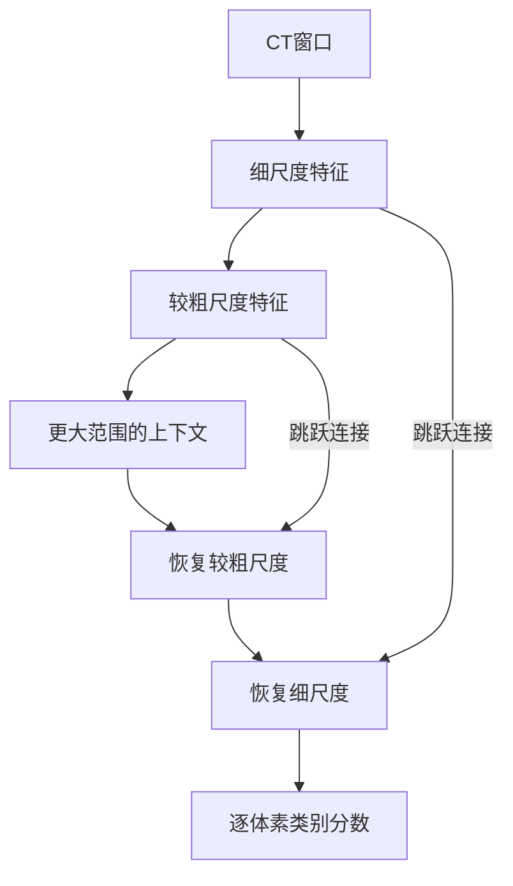

# AI 怎样在 CT 里勾出一个器官？

> **CUDA 医疗影像实战 · 第2篇（专栏第75篇）**
>
> 上一篇检查了CT的空间关系。这一篇让分割网络参与进来：看懂三维卷积和U形结构，分清分数、概率与标签，再用一个固定版本的预训练模型建立单病例推理基线。

> **工程深度｜验证状态：** L3 工程｜端到端实战（需数据/环境）
上一篇讨论了CT与参考标签怎样在空间上对齐。假设我们把参考标签叠在CT上，用绿色显示脾脏区域。

现在，把这份标注暂时收起来，只把CT交给模型：它能不能生成另一份器官掩码，让我们叠回原图比较？

这次真正要回答的问题是：**一块只有强度数值的三维数组，怎样经过网络，变成“这里是脾脏、那里是背景”的空间判断？**

先不急着训练，也不打开TensorRT。本篇沿着数据走一遍：看模型怎样产生结果，以及怎样确认结果回到了正确的位置。

## 01｜模型不是先认出轮廓，再沿边描一圈

看一张分割叠加图，很容易产生这样的直觉：模型找到了器官，然后像画笔一样描出边缘。

对本篇使用的模型来说，更接近实际的过程是：**为每个输出体素生成两个类别分数，再据此决定标签。** MONAI的脾脏分割模型把任务定义为逐体素的二分类，类别为背景与脾脏。[1][r1]

输入一个CT窗口时，可以把接口写成：

| 阶段 | 形状示例 | 含义 |
|---|---|---|
| 输入 | `[1, 1, 96, 96, 96]` | 1个窗口、1个强度通道、3个空间轴 |
| 网络输出 | `[1, 2, 96, 96, 96]` | 每个体素对应2个类别分数 |
| 最终掩码 | `[96, 96, 96]` | 每个体素只保留一个类别编号 |

这里的96来自所选模型的窗口配置。[2][r2] 它不是所有医学分割模型的统一输入尺寸。

三个空间维度可以统称为`S1、S2、S3`。PyTorch接口中也常写成`D、H、W`。这些字母描述计算维度，不会自动告诉网络哪边是人体左右；方向、间距与处理顺序仍须由上一篇讨论的空间信息来约束。

### 两个分数如何变成一个标签？

假设某个体素的网络输出是：

- 背景分数：`0.2`；
- 脾脏分数：`1.4`。

这是一个**手算用的教学例子**。分数常称为`logits`，可以为负，也不要求加起来等于1。

用softmax把它们转换为两类概率：

\[
p_c=\frac{e^{z_c}}{e^{z_0}+e^{z_1}}.
\]

代入后，脾脏类别的概率约为0.769，背景约为0.231。再取较大值所在的类别，也就是`argmax`，该体素便得到标签1。

在**同一网格、同一位置**上，softmax不会改变两类分数的大小顺序，所以直接对logits做argmax会得到相同标签。但如果中间还要融合窗口或插值回原始网格，处理顺序就不能随意交换，后面会回到这个问题。

“脾脏概率0.769”也不表示“患者有某种疾病的概率是76.9%”，更不自动等于经过校准的可信程度。它只是当前模型、当前输入条件下的类别输出。

## 02｜单个体素看不出来的东西，要放到邻域里看

如果只给模型一个强度数值，它很难可靠地区分这个位置属于哪个器官。分割网络需要利用周围的结构和上下文。

三维卷积就是建立局部表示的一种方式。

想象在体积里取出一个`3×3×3`的小邻域。单输入通道时，一个卷积核对其中27个数分别乘以权重，再求和并加上偏置，得到一个输出值。核移到下一个位置，重复同样的计算。

**窗口上下文并不均匀。** 对于滑动窗口推理来说，位于窗口中心的体素能看到相对完整的邻域；靠近窗口边缘甚至角落的体素，可用的上下文会更少。加上补齐（padding）也只能填充数值，并不能凭空创造缺失的解剖信息。这也是后面要用滑窗拼接来处理的原因：同一个体素在不同窗口里的「可见范围」不同，最终需要靠合理的融合来尽量消解这种边缘效应。

这里的权重在不同位置共享，不是给每个体素分别存一套参数。严格按PyTorch的算子语义，这个操作使用三维互相关；深度学习中通常仍称它为卷积。[3][r3]

例如：

```python
import torch
from torch import nn

# 形状与局部计算的教学示例：没有训练，也没有加载脾脏模型权重。
layer = nn.Conv3d(1, 16, kernel_size=3, padding=1)
x = torch.zeros(1, 1, 32, 32, 32)  # 一个单通道三维窗口。
y = layer(x)  # 16个卷积核产生16个特征通道；此处预期形状为[1,16,32,32,32]。
```

`padding=1`在这个配置下补足边界，使输出空间尺寸保持不变。**16个通道不是16个器官**，而是16组由不同权重产生的特征。

多输入通道时，一个输出通道还会汇总所有输入通道的局部响应。后续层再组合这些特征，模型便有机会利用更大范围的上下文。

这些权重为什么有意义，取决于训练。本篇先使用已训练的权重；随机初始化网络即使能输出两通道数组，也不能据此认为它会分割脾脏。

还有一个边界：**三维CT的三个轴是空间轴，不是时间轴。** 本任务不需要为了“处理多张切片”就加入LSTM。如何利用空间邻域，与如何处理时间序列，是不同的建模问题。

## 03｜为什么网络要先缩小，再放大？

局部卷积能看邻域，但器官分割还需要兼顾两件事：

- 这个位置放在较大范围内，大致属于什么结构；
- 它与周围组织的边界，具体落在哪里。

U形网络用一条逐步降低分辨率的路径提取上下文，再用一条提高分辨率的路径生成空间输出。原始U-Net提出了收缩路径与扩张路径的组合；3D U-Net进一步使用三维操作处理体积数据。[4][r4][5][r5]

下面是**原理示意图，不是本篇预训练模型的逐层结构图**：



下采样降低空间分辨率，使后续计算能用较少的位置表示更大的区域。但细节也可能在这个过程中丢失。解码端恢复空间分辨率时，借助**跳跃连接**，把较早的高分辨率特征送到对应尺度参与计算。

可以把它理解为：判断“在哪里”时，既看压缩后的整体线索，也保留早期的局部信息。上采样本身不能凭空找回所有细节，跳跃连接也不保证边界一定正确；最终效果仍取决于数据、结构和训练。

本篇选用的MONAI模型使用带残差单元的三维UNet。其配置包括单输入通道、双输出通道，以及多个尺度的通道与步幅设置。[6][r6] **它继承U形网络的设计思路，但不等于逐层复刻2016年的3D U-Net。**

模型家族、具体代码和预训练权重，需要分别看清。自己写一个看起来相似的U形网络，再强行加载别人的权重，通常不是可靠的复现方法。

## 04｜有了权重，为什么还要带上配置？

一份CT进入模型前，可能改变过方向、体素间距和强度范围；预测出来以后，还要回到原始影像的网格。

所以，一个能复用的分割模型，至少需要这些信息：

| 内容 | 解决的问题 |
|---|---|
| 网络结构 | 参数应放进哪些层，各层怎样计算 |
| 训练后的权重 | 各层实际使用哪些参数 |
| 输入预处理 | 原始CT怎样变成模型期望的数据 |
| 推理与后处理 | 窗口怎样组合，输出怎样变成标签并保存 |

MONAI Bundle把配置、权重和相关说明组织在一起。本篇固定使用官方`spleen_ct_segmentation`的0.6.0版本，作为可追踪的教学入口，不将它称为最新版本。[1][r1][7][r7]

所核对的推理配置会统一输入方向和spacing，并执行指定的强度截断归一化；随后进行滑窗推理，按配置恢复原空间并生成标签。[2][r2]

这也是上一篇“显示窗”与“模型预处理”的分界：把图画得清楚，是为了人观察；按照训练时约定处理强度，是为了模型接收一致的输入。不能把一组顺眼的显示范围直接当作模型配方。

### 输出为什么要先回原空间，再取标签？

如果模型在重采样后的网格上生成了两通道结果，而参考标签在原始网格上，就不能立刻逐体素比较。

本篇所选配置的顺序是：

**融合窗口输出 → softmax概率 → 恢复原始网格 → argmax标签。**[2][r2]

这里被插值的是连续输出。它不同于先把结果变成0/1，再用最近邻插值硬标签；两条路径不保证得到相同边界。

因此，“最终都变成0和1”不是随意调整后处理顺序的理由。本篇先保留官方路径，滑窗覆盖与融合原理留到后续专篇展开。

## 05｜把同一份CT真正送进预训练模型

下面给出一个可保存、可检查的单病例执行入口。它调用官方配置完成网络构建、权重加载与推理；代码重点是把输入、版本、执行设置和输出范围写明白。

**验证状态先说明**：本次没有安装并执行PyTorch/MONAI推理环境，没有下载预训练权重，也没有运行真实MSD病例。下列深度学习代码进行了语法检查和配置来源核对，尚未完成端到端运行验证。后面的空间与Dice检查函数，另用合成NIfTI数据做了实际检查。本文不展示虚构预测图、真实病例分数或GPU耗时。

### 准备一个独立环境

0.6.0包的元数据记录了MONAI 1.4.0、PyTorch 2.4.0等版本。[2][r2] 为减少与第一篇NumPy环境的冲突，可另建环境，例如使用Python 3.10：

```bash
python3.10 -m venv .venv-seg
source .venv-seg/bin/activate

# Linux上的CUDA 12.1构建示例；先确认GPU及驱动支持这一构建。
python -m pip install torch==2.4.0 --index-url https://download.pytorch.org/whl/cu121
python -m pip install monai==1.4.0 numpy==1.24.4 nibabel==5.2.1 \
  pytorch-ignite==0.4.11 tensorboard==2.17.0 fire huggingface_hub
```

PyTorch官方历史版本页提供了2.4.0的CUDA 12.1安装路径。[8][r8] 这里固定的是一个旧模型包的复现起点，不是对当前所有硬件的通用安装建议，也不是已经实测通过的环境保证。只有CPU时，应使用官方CPU构建，并在下方运行时显式指定`--device cpu`；整份CT处理可能较慢。

### 下载固定提交，而不是浮动版本

以下代码保存为`download_bundle.py`后运行，下载前查看模型与数据的使用说明：

```python
from huggingface_hub import snapshot_download

snapshot_download(
    repo_id="MONAI/spleen_ct_segmentation",
    revision="da227867a503f2909ac2e441149e39fdeb370e34",  # 官方0.6.0对应提交。
    local_dir="spleen_bundle",
    allow_patterns=["configs/*", "models/model.pt", "docs/*", "LICENSE"],
)  # 保存配置、参数和说明；不下载本篇不用的TorchScript模型。
```

Hugging Face的下载接口支持指定提交版本和文件范围。[9][r9] 下方运行代码会计算权重校验和，供后续核对使用。

### 单病例执行入口

保存为`run_spleen_case.py`：

```python
"""使用固定的MONAI脾脏bundle执行单病例推理，不接收参考标签。"""
import argparse
import hashlib
import json
import time
from pathlib import Path

import monai
import torch
from monai.bundle import run


def sha256(path):
    digest = hashlib.sha256()
    with path.open("rb") as file:
        for block in iter(lambda: file.read(1024 * 1024), b""):
            digest.update(block)
    return digest.hexdigest()


def main():
    parser = argparse.ArgumentParser(description=__doc__)
    parser.add_argument("bundle")  # 下载好的0.6.0 bundle目录。
    parser.add_argument("image")  # 只输入CT，参考标签不参与推理。
    parser.add_argument("--out", default="case_output")
    parser.add_argument("--device", choices=["cuda:0", "cpu"], default="cuda:0")
    args = parser.parse_args()
    bundle = Path(args.bundle).resolve()
    image = Path(args.image).resolve()
    output = Path(args.out).resolve()
    source = bundle / "configs/inference.json"
    weights = bundle / "models/model.pt"
    for path in (image, source, weights):
        if not path.is_file():
            raise FileNotFoundError(path)
    if args.device.startswith("cuda") and not torch.cuda.is_available():
        raise RuntimeError("指定了CUDA设备，但PyTorch未检测到可用CUDA。")

    cfg = json.loads(source.read_text(encoding="utf-8"))
    transforms = cfg["postprocessing"]["transforms"]
    expected = ["Activationsd", "Invertd", "AsDiscreted", "SaveImaged"]
    if [item["_target_"] for item in transforms] != expected:
        raise ValueError("后处理结构与本文核对的0.6.0配置不符，请先检查版本。")
    # 保留官方网络、空间预处理、融合及逆变换顺序，只调整单病例执行和保存设置。
    cfg.update(bundle_root=str(bundle), datalist=[str(image)], output_dir=str(output),
               device=f"$torch.device('{args.device}')", load_pretrain=True,
               output_postfix="pred", output_dtype="$numpy.uint8", separate_folder=False)
    cfg["dataloader"]["num_workers"] = 0  # 单病例先减少进程配置的干扰。
    cfg["inferer"]["sw_batch_size"] = 1  # 每次仅送一个窗口，不改变窗口尺寸和重叠率。
    cfg["evaluator"]["amp"] = False  # 先建立不启用AMP的基线。
    transforms[-1]["resample"] = False  # Invertd已回原网格，保存时不再插值标签。
    output.mkdir(parents=True, exist_ok=True)
    case_config = output / "case_config.json"
    case_config.write_text(json.dumps(cfg, indent=2), encoding="utf-8")
    manifest = {"image": str(image), "weights_sha256": sha256(weights),
                "source_config_sha256": sha256(source), "torch": torch.__version__,
                "monai": monai.__version__, "device": args.device,
                "cuda_runtime": torch.version.cuda, "amp": False}

    # 禁用TF32，明确这一参考配置的计算设置；不宣称所有后端逐位一致。
    torch.backends.cuda.matmul.allow_tf32 = False
    torch.backends.cudnn.allow_tf32 = False
    use_cuda = args.device.startswith("cuda")
    if use_cuda:
        torch.cuda.synchronize()
    start = time.perf_counter()
    run(config_file=str(case_config))  # 官方流程负责构建网络、加载权重、推理与保存。
    if use_cuda:
        torch.cuda.synchronize()
    manifest["first_workflow_seconds"] = time.perf_counter() - start
    (output / "run_manifest.json").write_text(json.dumps(manifest, indent=2), encoding="utf-8")
    print("流程结束。请检查输出NIfTI、空间信息、叠加图和参考标签指标。")


if __name__ == "__main__":
    main()
```

这个脚本有四点值得留意：

- **没有标签输入。** 预测只依赖CT，不能偷偷利用参考标签裁剪出器官位置。
- **没有关闭预训练加载。** 官方配置的初始化阶段负责将检查点装入网络，不能把随机网络输出当成推理成果。[2][r2]
- **每次只计算一个窗口。** 这是单病例入门设置，不保证所有显存都足够；整幅输出和前后处理仍需要内存。
- **保存前已经恢复原网格。** 代码避免保存时再次插值硬标签；最终几何仍要通过下一节检查。

运行同一病例的原始CT文件，不使用上一节另存的截图：

```bash
python download_bundle.py
python run_spleen_case.py spleen_bundle \
  Task09_Spleen/imagesTr/spleen_2.nii.gz \
  --out case_output --device cuda:0
```

按这些保存设置，预期输出包括`case_output/spleen_2_pred.nii.gz`、执行配置`case_config.json`以及记录版本、校验和和耗时口径的`run_manifest.json`。这是**配置推导出的预期产物**，不是本次已生成的真实分割结果。

### 理解两个容易混淆的“推理开关”

如果自己组织前向计算，常见写法是：

```python
model.eval()  # 改变BatchNorm、Dropout等层的训练/评估行为。
with torch.inference_mode():  # 关闭推理中不需要的自动求导相关开销。
    logits = model(window)  # 此处只是说明调用方式，依赖已正确构建的model和window。
```

两者职责不同。`inference_mode()`不会自动调用`eval()`，`eval()`也不等于关闭梯度记录。[10][r10][11][r11] 本篇完整运行入口交由MONAI评估工作流管理这些步骤，不把这段示意代码额外插入bundle内部。

CUDA也不是一个“更懂CT”的模型：在这条路径中，框架将卷积等支持的运算交给GPU执行。结果是否有意义，仍取决于模型权重、输入与输出流程是否匹配。

## 06｜流程结束之后，先别只看有没有生成文件

现在可以把参考标签拿回来。先确认三份文件在同一个病例、同一个原始网格上，再计算指标。

为了让读者看清第一次比较的含义，这里只计算一个**前景Dice**：

\[
\mathrm{Dice}=\frac{2|P\cap G|}{|P|+|G|}.
\]

`P`是预测脾脏的体素集合，`G`是参考脾脏集合。它度量两块区域重叠得怎样，不是疾病诊断准确率。MONAI也提供相关指标实现，后续进行批量评价时应固定其背景、空集合和归约规则。[12][r12]

手算一个例子：参考区域10个体素，预测区域12个体素，其中重叠8个，Dice就是`16/22≈0.727`。这些数字是教学设定，不是模型测试成绩。

保存下面代码为`check_spleen_prediction.py`：

```python
"""在模型运行之后，检查原空间输出，并计算单病例前景Dice。"""
import argparse
import json
import nibabel as nib
import numpy as np


def check_prediction(image_path, label_path, pred_path):
    image, label, pred = [nib.load(path) for path in (image_path, label_path, pred_path)]
    for name, volume in [("image", image), ("label", label), ("prediction", pred)]:
        if len(volume.shape) != 3 or volume.header.get_xyzt_units()[0] != "mm":
            raise ValueError(f"{name}必须是空间单位为mm的三维体积。")
        if not np.isfinite(volume.affine).all():
            raise ValueError(f"{name}包含无效affine。")
    for volume in (label, pred):
        if volume.shape != image.shape or not np.allclose(
            volume.affine, image.affine, rtol=0, atol=1e-3
        ):
            raise ValueError("影像、标签、预测不在同一原始网格，停止逐体素比较。")
    truth, result = [volume.get_fdata(dtype=np.float32) for volume in (label, pred)]
    for values in (truth, result):
        if not np.isfinite(values).all() or not np.isin(values, [0, 1]).all():
            raise ValueError("标签与预测必须是有限数值的0/1掩码。")
    truth, result = truth == 1, result == 1
    denominator = int(truth.sum()) + int(result.sum())
    dice = 2.0 * int(np.logical_and(truth, result).sum()) / denominator if denominator else None
    # 双方均空时记为None，不将其悄悄计成完美分割。
    return {"foreground_dice": dice, "reference_voxels": int(truth.sum()),
            "prediction_voxels": int(result.sum()), "same_grid": True}


if __name__ == "__main__":
    parser = argparse.ArgumentParser(description=__doc__)
    parser.add_argument("image")
    parser.add_argument("label")
    parser.add_argument("prediction")
    args = parser.parse_args()
    print(json.dumps(check_prediction(args.image, args.label, args.prediction), indent=2))
```

运行：

```bash
python check_spleen_prediction.py \
  Task09_Spleen/imagesTr/spleen_2.nii.gz \
  Task09_Spleen/labelsTr/spleen_2.nii.gz \
  case_output/spleen_2_pred.nii.gz
```

本次实际检查了这个函数在合成数据上的已知Dice、完全重合、预测为空、双方均空、空间错配、非二分类标签及NaN输入。**这只能支持检查代码在这些条件下的行为，不能支持脾脏模型的质量结论。**

数值之外，还要把CT、参考标签和预测一起打开，观察相同位置的切片。3D Slicer支持加载NIfTI和标签/分割数据；加载时区分灰度影像与标签，并给参考与预测设置不同颜色，检查三种方向的轮廓。[13][r13]

不要只看器官中间最清楚的那张切片。还应查看器官开始与结束的位置、边界附近，以及预测是否出现远离目标的孤立区域。漂亮的三维表面图，也不能替代这些检查。

### 这一次比较能说明多少？

官方模型说明给出了其训练与验证数据来源。[1][r1] 因此，在MSD已有标注病例上运行这个预训练模型，可以用来学习流程、检查输出和建立工程基线，**不能未经病例血缘核对，就把所得分数称为独立测试性能**。

同样，单病例Dice不能说明跨医院、跨扫描协议的泛化能力。本文完成的是一次研究流程入口，不是临床有效性验证。

## 07｜第一条基线，应该留下哪些证据？

本篇不进行性能对比，只保留后续优化需要的起点：

| 记录 | 用途 |
|---|---|
| 原始输入、权重校验和、执行配置 | 确认后面比较的仍是同一个任务 |
| 原空间掩码、shape和affine检查 | 确认结果可以和原始影像对应 |
| 前景Dice和多位置叠加观察 | 发现明显分割或处理流程问题 |
| 软件、设备与精度设置 | 解释不同运行环境下的差异 |
| 首次工作流耗时 | 记录一次包含模型加载、读取、处理和保存的流程成本 |

脚本中的`first_workflow_seconds`从调用bundle工作流前开始，到流程结束并完成GPU同步为止；不包含模型下载、Python导入、校验和计算和此前的CUDA上下文初始化。**它不是纯网络前向耗时，也不是预热后的稳态延迟。**

如果后面替换内核或推理后端，应另外测量窗口前向和整病例流程，保持权重、病例、窗口设置及计时边界一致。不要把一个窗口的时间与一整份CT的时间放在一起算加速比。

到这里，“AI勾出器官”就有了可以追踪的机制：网络利用三维邻域和多尺度表示生成类别分数，处理流程把输出恢复到原始网格，再生成可比较的标签。显示出来的轮廓，只是这串空间判断的边界。

**实践时先保留一份未经性能优化、来源清楚、空间正确的结果。** 后面每一次“更快”，都应回到这份基线检查：输入有没有改变、结果有没有偏移、节省的究竟是哪一段时间。

下一篇从其中一个具体环节动手：CT预处理中的截断与归一化，能否用一个自定义CUDA内核减少重复读写？

## 参考资料

1. [MONAI：spleen_ct_segmentation 0.6.0 模型说明][r1]。
2. [MONAI官方0.6.0提交记录：推理配置与模型元数据][r2]。本次通过提交差异核对完整文件，单独文件页访问失败不作为证据。
3. [PyTorch：Conv3d][r3]。
4. [Ronneberger等：U-Net，2015][r4]。
5. [Çiçek等：3D U-Net，2016][r5]。
6. [MONAI：固定版本训练配置][r6]。网络结构与训练输入配置。
7. [MONAI 1.4.0：Model Bundle][r7]。
8. [PyTorch：历史版本安装说明][r8]。
9. [Hugging Face Hub：下载文件与固定revision][r9]。
10. [PyTorch：Module / eval][r10]。
11. [PyTorch：inference_mode][r11]。
12. [MONAI：Metrics][r12]。
13. [3D Slicer：Data Loading and Saving][r13]。

*资料核对日期：2026年10月22日。正文中的小数值和局部张量示例为教学设定；完整推理代码尚待真实环境执行验证，未报告本文模型实测结果。*

[r1]: https://huggingface.co/MONAI/spleen_ct_segmentation/blob/0.6.0/docs/README.md
[r2]: https://huggingface.co/MONAI/spleen_ct_segmentation/commit/da227867a503f2909ac2e441149e39fdeb370e34
[r3]: https://docs.pytorch.org/docs/2.9/generated/torch.nn.Conv3d.html
[r4]: https://arxiv.org/abs/1505.04597
[r5]: https://arxiv.org/abs/1606.06650
[r6]: https://huggingface.co/MONAI/spleen_ct_segmentation/blob/0.6.0/configs/train.json
[r7]: https://monai.readthedocs.io/en/1.4.0/bundle.html
[r8]: https://pytorch.org/get-started/previous-versions/
[r9]: https://huggingface.co/docs/huggingface_hub/guides/download
[r10]: https://docs.pytorch.org/docs/2.4/generated/torch.nn.Module.html
[r11]: https://docs.pytorch.org/docs/2.9/generated/torch.autograd.grad_mode.inference_mode.html
[r12]: https://monai.readthedocs.io/en/1.4.0/metrics.html
[r13]: https://slicer.readthedocs.io/en/latest/user_guide/data_loading_and_saving.html
