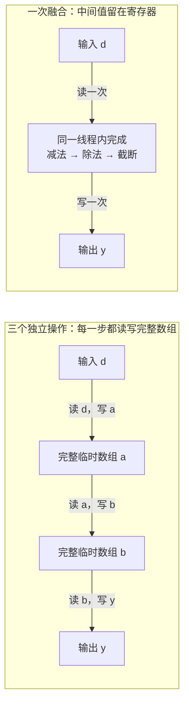

# CT 预处理只有三行，为什么还要写 CUDA？

> **CUDA 医疗影像实战 · 第3篇（专栏第76篇）**
>
> 上一篇建立了脾脏分割的单病例推理入口。这一篇暂时离开网络内部，拆开输入端的一步：把CT强度映射到模型要求的范围。我们用它理解线程、连续访存和算子融合，并设计一场不会把数据搬运藏起来的性能比较。

> **工程深度｜验证状态：** L3 工程｜端到端实战（需数据/环境）
假设你已经按上一篇的方法准备好推理流程，想让它更快一点。翻到预处理配置时，看到的并不是复杂公式，而是一段很朴素的操作：减一个数，除一个数，再把结果限制在0和1之间。

它很容易写成三行。问题也随之出现：**三行代码已经够短了，手写CUDA还能省下什么？**

可能省下的不是数学运算，而是中间数组的读写和内核启动。不过，这只是一个有待测量的优化方向。即使这一步变快，也不意味着整份CT的分割速度会等比例提高。

本篇只研究**强度截断与归一化**。不改模型权重，不改重采样，不展开滑窗推理，也不把教学内核直接替换进MONAI的空间变换链。

## 01｜先问清楚：这三行到底在改变什么？

延续上一篇，选定MONAI官方`spleen_ct_segmentation` 0.6.0配置。其推理预处理先统一方向、重采样，再用`ScaleIntensityRanged`将`[-57, 164]`映射到`[0, 1]`，并启用截断。[1][r1]

这里的上下界是**该预训练模型的配方**，不是所有CT、所有器官的通用标准。本文也不从文件扩展名推断强度一定已经是HU；实际接入时，必须确认数据的强度含义与模型训练约定一致。

用公式写出这一小步：

\[
y=\operatorname{clip}\left(\frac{x-(-57)}{164-(-57)},0,1\right)
=\operatorname{clip}\left(\frac{x+57}{221},0,1\right).
\]

`clip`就是把超出范围的部分压到边界：小于0的取0，大于1的取1。MONAI文档对这一变换的定义是先做范围缩放，再按需截断。[2][r2]

下面是**手算示例，不是真实病例测量**：

| 原始强度 | 缩放后的数 | 最终输出 |
|---|---:|---:|
| -1000 | 小于0 | 0 |
| -57 | 0 | 0 |
| 0 | 57/221 | 约0.258 |
| 164 | 1 | 1 |
| 1000 | 大于1 | 1 |

这一步不改变数组的形状，不把脾脏“找出来”，也不产生器官标签。它只改变模型看到的强度表示；截断还会丢掉范围外数值之间的差异，因此不能把结果当作可逆的原始CT存档。

也不要为了“先处理掉极端值”，把这一步提前到空间重采样之前。插值会组合邻近体素，而截断是非线性的，交换顺序可能改变结果。举一个独立的教学例子：两个数0和2先取平均再截断到`[0,1]`得到1；先分别截断再平均却得到0.5。**优化一个算子，不等于可以重排整条流程。**

## 02｜短代码，也可能让数组走三趟

先只看输入已经在GPU上的情况。为了把每趟工作写清楚，我们显式使用三个数组操作：

```python
# d是GPU上的float32连续数组，a、b、y是预先申请的同形状缓冲区。
cp.subtract(d, np.float32(-57), out=a)  # 第一趟：读d，写a。
cp.divide(a, np.float32(221), out=b)    # 第二趟：读a，写b。
cp.clip(b, np.float32(0), np.float32(1), out=y)  # 第三趟：读b，写y。
```

这里`cp`代表CuPy，`np`代表NumPy。这是**明确分开提交操作的教学基线**，不是说所有框架遇到三个操作都会原样执行三趟；编译或融合机制可能生成不同实现。

换一种组织方式：让一个线程读入一个体素，在本线程里算完减法、除法和截断，最后只写一次结果。中间值不再需要作为整份数组保存。

对`N`个float32元素，按每元素4字节、每趟一次读和一次写计算：

| 实现 | 数组处理趟数 | 算法层面的读写字节估算 |
|---|---:|---:|
| 上述三个独立操作 | 3 | `24N` |
| 一次融合操作 | 1 | `8N` |

这是**按代码访问模式推导的请求字节量**，不是显存硬件计数器的实测值。缓存、访存事务、编译结果和启动开销都会影响耗时，不能从`24N/8N=3`直接推出“三倍加速”。NVIDIA也区分有效带宽与实际内存吞吐量。[3][r3]

把数据流动画出来，差别更直观。关键不在计算方框有几个，而在**完整数组被读写了多少次**：



上图中，三个独立操作让数据完整地走过两组临时数组；融合版本只有一次整数组读入和一次整数组写出。**融合没有减少减法、除法和截断，而是让同一个线程连续完成它们**：中间结果不形成完整临时数组，因此少了两趟整数组读写，也少了几次内核启动。能省多少时间，仍要实测。

## 03｜一份三维CT，为什么可以用一维线程处理？

因为这个算子只依赖当前位置的强度。

它不像三维卷积，不需要读邻居，也不需要在不同线程之间交换中间结果。只要输入是连续内存，就可以按相同顺序遍历全部元素，输出再保留原形状。

若连续数组的形状是`[S1, S2, S3]`，下标`(a,b,c)`对应的线性位置是：

\[
i=(aS_2+b)S_3+c.
\]

对于逐元素变换，线程甚至不必还原`a、b、c`，只需要知道自己的`i`。

CUDA中，线程被组织在线程块里。这里每块256个线程，用下面的式子确定全局位置：

\[
i=\text{blockIdx.x}\times\text{blockDim.x}+\text{threadIdx.x}.
\]

这遵循CUDA的线程层次模型。[4][r4] 256是教学起点，不是已调优的最佳参数。

用一个257元素的小数组检验这个想法：

| 线程块 | 线程编号 | 对应位置 | 是否工作 |
|---|---|---|---|
| 第0块 | 0—255 | 0—255 | 全部工作 |
| 第1块 | 0 | 256 | 工作 |
| 第1块 | 1—255 | 257—511 | 立即返回 |

因此启动块数要向上取整，而内核必须检查`i < N`。少启动会漏掉尾部，多启动却不检查会越界。

相邻线程访问相邻float，符合连续访存的基本思路；具体内存事务仍与对齐和硬件有关。[3][r3] 本算子没有邻域数据复用的需求，先用直接读写即可，没必要为了“用了CUDA”额外搬进共享内存。

还有一个容易忽略的前提：**形状相同，不代表内存布局相同。** 转置、切片可能得到带步长的视图。下面的入口先把主机数组整理为float32连续内存；这一整理发生在计时外，真实应用中仍要统计它的成本。

## 04｜先把可验证的小实验写完整

本篇用CuPy承接Python数组与CUDA内核。`RawKernel`允许提交CUDA源代码，并在调用时编译、缓存；`ElementwiseKernel`则允许描述逐元素计算，由CuPy组织遍历。[5][r5][6][r6]

为什么同时保留两种融合实现？因为要判断的有两件事：

- 融合是否比三个独立操作更合适；
- 手写线程索引是否比已有的逐元素融合方式更值得维护。

如果只拿手写内核和刻意分开的三步实现比较，很容易把“融合的收益”误写成“手写一定更快”。

### 环境与验证状态

复现实验可单独建立Python 3.10或3.11环境。以下是对应CuPy 13.3.0文档的CUDA 12.x环境示例：[7][r7]

```bash
python3.10 -m venv .venv-ct-kernel
source .venv-ct-kernel/bin/activate
python -m pip install numpy==1.26.4 cupy-cuda12x==13.3.0
```

机器还需要兼容的NVIDIA GPU、驱动和相应CUDA工具链环境。这个命令是复现起点，不是覆盖所有硬件的安装承诺；不要在同一环境中混装多种CuPy发行包。**这里固定的是本篇拟复现的版本组合，不表示它是当前唯一推荐环境；换用其他版本时，应重新记录环境并验证。**

两种环境不要混为一谈：

| 用途 | Python | NumPy | CuPy／CUDA | 验证状态 |
|---|---|---|---|---|
| 本篇拟复现的GPU组合 | 3.10／3.11 | 1.26.4 | 13.3.0（`cupy-cuda12x`） | 待N卡实测 |
| 已执行的CPU检查路径 | 3.12.14 | 2.3.5 | 未安装 | 已执行 |

**本次实际验证范围**：在Python 3.12.14、NumPy 2.3.5环境执行了下方脚本的`--cpu-only`路径，检查数学参考、非连续布局整理、空输入、NaN/Inf与复数拒绝，以及尾部索引分配。当前环境未安装CuPy，没有运行CUDA编译、GPU数值对照、GPU计时或真实CT推理。上表第一行只是待复现的版本组合，尚未实测，不能借用第二行的CPU检查结果替它背书。本文没有可报告的GPU加速比。

### 读这份脚本，先抓三处

完整脚本同时包含CPU参考、输入检查、CUDA源码、两种融合实现、正确性检查与计时。第一遍不必逐行读，重点抓三处：CUDA内核怎样确定体素编号；三步CuPy操作、`ElementwiseKernel`与`RawKernel`怎样完成同一个公式；计时前怎样验证结果、计时范围到哪里为止。其余代码负责准备数据、打印环境和统计时间。

其中内核本身可以压缩成四个动作：

1. 由块号、块大小和线程号算出`i`；
2. 判断`i`是否超出有效元素数；
3. 读`x[i]`，计算并截断；
4. 写`y[i]`。

`extern "C"`让函数入口使用C链接名称，便于按`normalize`找到它；`__global__`标记由主机启动、在设备上执行的内核。`const float*`约定输入是float32数据，`np.uint64(d.size)`与CUDA端的64位无符号长度参数对应。

### 保存为 `ct_normalize.py`

脚本先检查正确性，再计时；默认生成`128×128×128`的合成强度数组。这些数值用于检验计算，**不代表真实CT的解剖结构或强度分布**。

```python
"""CT强度映射教学实验：CPU检查可单独运行，GPU实验需要CuPy和CUDA。"""
import argparse
import platform
import time
import numpy as np

LO, SPAN = np.float32(-57), np.float32(221)


def prepare(x):
    # 在计时外统一为float32连续内存；只接受非空、有限的实数数据。
    x = np.asarray(x)
    # 必须在dtype转换前拒绝复数，否则float32转换会丢弃虚部后静默通过。
    if np.iscomplexobj(x):
        raise ValueError("输入必须为实数，不能包含复数。")
    x = np.ascontiguousarray(x, dtype=np.float32)
    if x.size == 0 or not np.isfinite(x).all():
        raise ValueError("输入必须非空且不含NaN/Inf。")
    return x


def reference(x):
    # 与选定模型配置相同的数学映射；不冒充MONAI完整空间变换。
    return np.clip((x - LO) / SPAN, np.float32(0), np.float32(1))


def cases():
    edge = np.array([-1000, -57, -56.999, 0, 163.999, 164, 1000], np.float32)
    rng = np.random.default_rng(2026)
    return [edge] + [rng.uniform(-1000, 1000, n).astype(np.float32)
                     for n in (1, 255, 256, 257)] + [
        rng.uniform(-1000, 1000, (5, 7, 9)).astype(np.float32),
        np.arange(120, dtype=np.float32).reshape(4, 5, 6).transpose(2, 0, 1),
    ]


def cpu_check():
    expected = np.array([0, 0, 57 / 221, 1, 1], np.float32)
    np.testing.assert_allclose(reference(prepare([-1000, -57, 0, 164, 1000])),
                               expected, rtol=1e-6, atol=1e-6)
    for x in cases():
        x = prepare(x)
        y = reference(x)
        assert y.shape == x.shape and y.dtype == np.float32
        assert ((y >= 0) & (y <= 1)).all() and x.flags.c_contiguous
    for bad in ([], [np.nan], [np.inf], [-np.inf],
                [1 + 2j], np.array([1 + 0j, 2 + 0j])):
        try:
            prepare(bad)
        except ValueError:
            continue
        raise AssertionError("无效输入没有被拒绝。")
    # 只在CPU上检查索引分配，不能代替GPU越界检查。
    for n in (1, 255, 256, 257, 315):
        ids = [b * 256 + t for b in range((n + 255) // 256)
               for t in range(256) if b * 256 + t < n]
        assert ids == list(range(n))
    print("CPU检查通过：数学参考、布局转换、空/非有限/复数输入拒绝和索引分配；未验证CUDA。")


CUDA_SOURCE = r'''
extern "C" __global__
void normalize(const float* x, float* y, unsigned long long n,
               float lo, float span) {
    // 先提升类型再乘，避免用32位乘法计算大数组偏移。
    unsigned long long i = (unsigned long long)blockIdx.x * blockDim.x + threadIdx.x;
    if (i >= n) return;  // 向上取整启动时，末尾多出的线程不读写内存。
    float t = (x[i] - lo) / span;  // 本体素的中间结果保留在线程内。
    y[i] = fminf(fmaxf(t, 0.0f), 1.0f);  // 写出范围为[0,1]的值。
}
'''


def gpu_experiment(shape, repeats):
    import cupy as cp
    from cupyx.profiler import benchmark

    raw = cp.RawKernel(CUDA_SOURCE, "normalize", options=("--std=c++11",))
    elem = cp.ElementwiseKernel(
        "float32 x, float32 lo, float32 span", "float32 y",
        "float t = (x - lo) / span; y = fminf(fmaxf(t, 0.0f), 1.0f);",
        "normalize_elementwise")  # 融合对照：让CuPy管理线程索引。

    def operations(d):
        # 三种方案的输出和临时缓冲区都在计时外申请。
        a, b, out_three, out_raw, out_elem = [cp.empty_like(d) for _ in range(5)]
        blocks = (d.size + 255) // 256

        def three():
            cp.subtract(d, LO, out=a)
            cp.divide(a, SPAN, out=b)
            cp.clip(b, np.float32(0), np.float32(1), out=out_three)

        def fused_raw():
            raw((blocks,), (256,), (d, out_raw, np.uint64(d.size), LO, SPAN))

        def fused_elementwise():
            elem(d, LO, SPAN, out_elem)

        return [("cupy_three_pass", three, out_three),
                ("cupy_elementwise", fused_elementwise, out_elem),
                ("cuda_raw", fused_raw, out_raw)]

    # 先验证边界和多种布局；GPU结果回传后与CPU参考比较。
    for original in cases():
        x = prepare(original)
        for name, fn, out in operations(cp.asarray(x)):
            fn()
            np.testing.assert_allclose(cp.asnumpy(out), reference(x),
                                       rtol=1e-6, atol=1e-6, err_msg=name)
    print("GPU合成数据检查通过；尚未代表真实CT或完整模型验证。")
    cp.show_config()  # 留下软件、运行时和设备信息，便于复现实验。
    print("Python", platform.python_version(), "NumPy", np.__version__)
    print("driver", cp.cuda.runtime.driverGetVersion())
    props = cp.cuda.runtime.getDeviceProperties(cp.cuda.Device().id)
    print("GPU", props["name"], "shape", shape, "dtype float32", "block 256")

    rng = np.random.default_rng(2026)
    x = prepare(rng.uniform(-1000, 1000, shape))  # 合成强度，不模拟真实解剖。
    d = cp.asarray(x)
    expected = reference(x)
    for name, fn, out in operations(d):
        fn()  # 首次编译和执行发生在计时前。
        got = cp.asnumpy(out)
        max_abs = float(np.max(np.abs(got - expected)))
        np.testing.assert_allclose(got, expected, rtol=1e-6, atol=1e-6)
        # 不只报告"通过"，同时留下形状、dtype与最大绝对误差供复核。
        print(name, "shape", got.shape, "dtype", got.dtype,
              "max_abs_error", f"{max_abs:.3e}", "within_tolerance", True)
        result = benchmark(fn, (), n_warmup=10, n_repeat=repeats)
        us = result.gpu_times[0] * 1e6  # 当前设备上的CUDA事件时间，单位微秒。
        print(name, "GPU us median/p10/p90", np.percentile(us, [50, 10, 90]))
        if name == "cuda_raw":
            # 这是按一次读、一次写估算的有效带宽，不是DRAM硬件计数。
            print("raw effective GB/s", (8 * x.size) / (np.median(us) * 1e3))

    # CPU基线同样复用缓冲区；主机计时不与上述GPU事件冒充相同范围。
    a, b, y = [np.empty_like(x) for _ in range(3)]
    def cpu_three():
        np.subtract(x, LO, out=a)
        np.divide(a, SPAN, out=b)
        np.clip(b, np.float32(0), np.float32(1), out=y)
    for _ in range(10):
        cpu_three()
    times = []
    for _ in range(repeats):
        start = time.perf_counter()
        cpu_three()
        times.append((time.perf_counter() - start) * 1e6)
    print("numpy CPU us median/p10/p90", np.percentile(times, [50, 10, 90]))


if __name__ == "__main__":
    parser = argparse.ArgumentParser(description=__doc__)
    parser.add_argument("--cpu-only", action="store_true")
    parser.add_argument("--shape", type=int, nargs=3, default=[128, 128, 128])
    parser.add_argument("--repeats", type=int, default=50)
    args = parser.parse_args()
    if min(args.shape) < 1 or args.repeats < 1:
        parser.error("shape和repeats必须为正整数。")
    cpu_check()
    if not args.cpu_only:
        gpu_experiment(tuple(args.shape), args.repeats)
```

只运行CPU检查：

```bash
python ct_normalize.py --cpu-only
```

在准备好的GPU环境运行完整实验：

```bash
python ct_normalize.py --shape 128 128 128 --repeats 50
```

显存允许时，可以另外运行`--shape 256 256 256`；不同大小应分开记录。三步方案、两个融合方案和输入会同时占用缓冲区，GPU数组合计约为`6×4N`字节，另有运行时开销；CPU上也会保留输入、参考与临时数组。别从输入文件大小直接推断运行内存。

### 类型与数据契约

这些类型与布局约定不是装饰。把float64数组或任意步长视图直接交给这个裸指针内核，会破坏它的解释方式。脚本只通过`prepare`整理后的数组构造GPU输入；不要把内部启动函数当作已经检查过所有输入的公共接口。

`prepare`里还有一个顺序细节：**先拒绝复数，再做float32转换**。若先转换，复数数组会在丢弃虚部后被悄悄接受，与“只接受实数”的约定不一致。转换前用`np.iscomplexobj`拦下，才真正兑现了这个契约。

本篇也选择**拒绝NaN和Inf**，而不是悄悄把它们变成边界值。这只是实验的数据契约，不声称与所有库对非有限值的处理语义相同。检查很有必要，但若每次都在GPU上扫描并同步，也会产生额外成本，后续整合时需要决定检查位置。

## 05｜结果相同，究竟要验证到哪一层？

“能够启动”是第一步，远远不够。

脚本使用以下输入检查GPU三种实现与NumPy参考是否一致：阈值内外与边界附近的数值、单元素、255/256/257元素、非立方三维数组，以及经过转置后重新整理的输入。

为什么特意写257？因为它只比一个线程块多一个元素，最容易暴露向上取整和尾部处理的问题。非立方数组则帮助我们避免把尺寸碰巧相同当作布局正确。

比较容差设为`rtol=1e-6、atol=1e-6`，这是本教学实验的验收设置，不是所有算子的通用精度标准。CPU与GPU浮点实现可能产生微小差别，因此这里检查数值接近，不要求逐位相同。[3][r3]

但还要分清三个层次：

| 验证层次 | 本篇做到什么 | 仍不能推出什么 |
|---|---|---|
| CPU参考与索引推导 | 本次已执行检查 | CUDA代码已编译或不会越界 |
| GPU算子与CPU参考 | 脚本提供检查，尚待GPU运行 | 与MONAI整条预处理完全等价 |
| 原模型完整推理 | 本篇未执行替换实验 | Dice不变、器官边界不变、临床适用 |

若将来要接入真实流程，必须在**同一份重采样后的、尚未归一化的体积**上，比较官方`ScaleIntensityRanged`输出与自定义输出。之后固定病例、权重、滑窗和后处理，再比较模型分数、标签、空间信息及分割指标。

小的输入误差不保证硬标签完全一致：两个类别分数很接近时，微小变化也可能影响argmax。不能用“前处理误差小于某个值”直接替代下游检查。

## 06｜计时的边界，比小数点后的位数更重要

GPU执行通常相对CPU异步。主机提交完任务，不代表GPU已经完成；直接在启动函数外包一个未同步的CPU计时器，可能主要量到提交开销。

CuPy的`benchmark`使用当前流上的CUDA事件并同步结束事件，还支持预热。[8][r8] 本脚本把首次调用放到计时前，再预热10次、重复50次，打印中位数与10%、90%分位值。编译、上下文初始化、输入传输和缓冲区申请不纳入这组GPU计时。

这仍应称为**函数调用对应的GPU事件时间**，而不是绝对纯净的硬件指令时间；事件之间的提交空隙也可能影响短任务。重复使用同一输入还会受到缓存状态影响，不能把所得有效带宽直接当作显存的物理峰值。

脚本最后也测NumPy三步基线，不过使用的是CPU墙钟时间。因此应这样读结果：

| 要回答的问题 | 应比较的范围 |
|---|---|
| 融合是否有效？ | GPU驻留输入下，三步操作与两种融合实现的事件时间 |
| 手写索引值得吗？ | `RawKernel`与`ElementwiseKernel`的结果、耗时、维护复杂度 |
| 原来在CPU上的这一步是否值得迁到GPU？ | CPU处理时间，与包含必要传输和整理的GPU路径墙钟时间 |
| 整份CT是否更快？ | 相同输入到相同输出的完整流程墙钟时间 |

最后两项**没有在这个微基准里测量**。如果必须把数据送回CPU，应把D2H回传纳入；如果后续网络直接使用GPU数据，则按实际路径统计，不人为添加回传。CPU墙钟包住GPU路径时，应在开始前清空前序工作，并在结束前同步。

即使两种时间都以微秒打印，也不要把NumPy墙钟与GPU驻留输入的事件时间之比写成端到端加速比。NVIDIA建议尽量减少不必要的主机与设备间传输。[3][r3]

### 为什么还计算有效带宽？

融合内核的请求读写量约为`8N`字节。若某次实际测得耗时为`t`秒，就可以计算：

\[
B_{\mathrm{effective}}=\frac{8N}{t\times10^9}\quad\mathrm{GB/s}.
\]

这沿用有效带宽的计算口径。[3][r3] 它能帮助比较不同数组规模下的行为，但本篇尚无`t`的实测值。小数组可能更受启动开销影响，大数组才更有机会体现连续访存与融合的收益；这是待检验的机制判断。

记录结果时，至少同时保存GPU型号、驱动、CUDA运行时、CuPy/NumPy版本、数组形状与布局、块大小、预热和重复次数，以及机器是否有其他GPU负载。脚本打印了一部分环境信息，GPU负载和CPU型号等仍需自行记录。

可以先把要填的表头留好，运行后照此整理；下面的数字留空，不是示例成绩：

| 输入规模 | 实现 | GPU事件时间中位数 | P10／P90 | 最大绝对误差 |
|---|---|---|---|---|
| 待填写 | 三步CuPy | 待测 | 待测 | 待测 |
| 同上 | ElementwiseKernel | 待测 | 待测 | 待测 |
| 同上 | RawKernel | 待测 | 待测 | 待测 |

NumPy墙钟时间另列一行或单独成表，不放进同一个“GPU加速倍数”字段。换用不同输入规模时另起一组，不把不同形状的数字合并统计。

## 07｜要不要放回原来的分割流程？

可以把这一步作为候选优化，但先别改上一篇的完整推理基线。

首先看实际瓶颈。如果NIfTI读取、空间重采样、滑窗网络计算占了大部分时间，强度映射就算快很多，也可能只节省很少的总时间。

用一个**纯教学假设**说明：某环节原来占总耗时10%，现在快10倍，其余不变，总加速只有：

\[
\frac{1}{0.9+0.1/10}\approx1.10.
\]

这个约10%的整体提升来自假设计算，不是本系列的实测成绩。

其次看接入成本。上一篇的流程依赖MONAI的空间元数据与逆变换记录，CuPy数组本身不能替代这些记录。将来整合时，要保持原有空间处理链，在正确位置替换强度数值计算，并明确设备、流和张量所有权；也不能把CuPy输出转回CPU、重新构造张量的成本藏起来。

最后看替代方案。如果`ElementwiseKernel`已经提供相近性能，优先保留更容易维护的实现完全合理。只有当真实工作负载表明还有值得优化的差距，手写更多索引与调度细节才有依据。

本篇真正建立的是一个工作方法：**先固定数学与数据契约，再减少重复读写，最后按实际路径验证收益。** 三行预处理值得拆开学习，因为它足够简单，能让我们把“数学没变，执行方式变了”看得很清楚。

实践时，先运行CPU检查，再在GPU上通过合成数据对照；保留计时原始结果之后，才考虑真实病例和完整流程接入。下一篇回到更大的三维体积：为什么分割常常要切成滑动窗口，以及重叠区域怎样合成一份结果。

## 参考资料

1. [MONAI官方：spleen_ct_segmentation 0.6.0固定提交][r1]。核对推理预处理顺序与强度映射参数。
2. [MONAI 1.4.0：ScaleIntensityRange][r2]。范围缩放及截断语义。
3. [NVIDIA：CUDA C++ Best Practices Guide][r3]。数值检查、有效带宽、连续访存及主机与设备传输。
4. [NVIDIA：CUDA Programming Model][r4]。线程、线程块与网格。
5. [CuPy 13.3.0：RawKernel][r5]。CUDA源代码调用与编译缓存。
6. [CuPy 13.3.0：User-Defined Kernels][r6]。逐元素内核与裸内核。
7. [CuPy 13.3.0：Installation][r7]。Python、NumPy、CUDA版本与安装包要求。
8. [CuPy 13.3.0：Performance Best Practices][r8]；[benchmark接口][r9]。GPU异步计时与预热。

*资料核对日期：2026年10月22日。本文只报告CPU检查的实际执行状态；CUDA编译、GPU数值验证、性能比较和真实CT接入均待目标环境验证。*

[r1]: https://huggingface.co/MONAI/spleen_ct_segmentation/commit/da227867a503f2909ac2e441149e39fdeb370e34
[r2]: https://monai.readthedocs.io/en/1.4.0/transforms.html#scaleintensityrange
[r3]: https://docs.nvidia.com/cuda/cuda-c-best-practices-guide/index.html
[r4]: https://docs.nvidia.com/cuda/cuda-programming-guide/01-introduction/programming-model.html
[r5]: https://docs.cupy.dev/en/v13.3.0/reference/generated/cupy.RawKernel.html
[r6]: https://docs.cupy.dev/en/v13.3.0/user_guide/kernel.html
[r7]: https://docs.cupy.dev/en/v13.3.0/install.html
[r8]: https://docs.cupy.dev/en/v13.3.0/user_guide/performance.html
[r9]: https://docs.cupy.dev/en/v13.3.0/reference/generated/cupyx.profiler.benchmark.html
