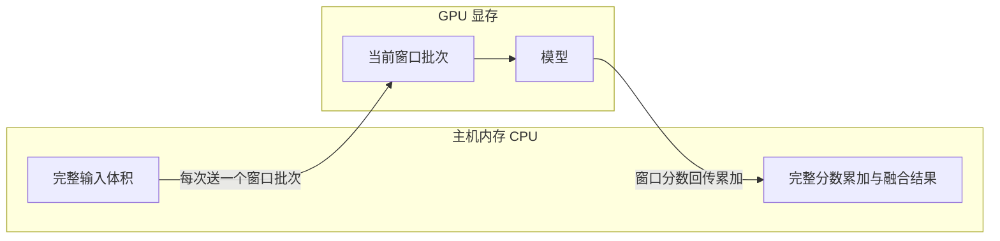

# CT 放不进显存，切成小块后怎样拼回去？

> **CUDA 医疗影像实战 · 第4篇（专栏第77篇）**
>
> 前两篇准备了CT空间检查和预训练模型推理入口，上一篇拆开了强度归一化。本篇解决另一个实际问题：整份三维体积太大，怎样分窗口计算，又不把器官边界拼成一格一格？
>
> **读者分流**：更关心算法原理（为什么融合要加权、三种合成方式的差别），重点看 02–04 节；更关心部署落地（显存、设备分工与内存不足排查），直接看 06–08 节。

> **工程深度｜验证状态：** L3 工程｜端到端实战（需数据/环境）

假设单个`96×96×96`窗口能顺利经过分割网络，但把整份CT交给同一个网络，显存却不够。

把体积切小，似乎就能解决问题。可当两块窗口覆盖同一位置时，它们可能给出不同分数：一个偏向“脾脏”，另一个偏向“背景”。最后该听谁的？

**滑动窗口推理不仅要决定怎样切，还要决定重复预测怎样合成，以及完整结果放在哪里。** 这三个问题连起来，才是一条能检查的推理路径。

本篇保持第2篇的预训练模型和预处理约定，不训练新网络，也不继续优化上一章的CUDA归一化内核。我们先把窗口覆盖与融合讲清，再用MONAI接口表达设备分工。

## 01｜省下的主要不是CT本身，而是中间特征

单通道float32体积每个体素占4字节。若处理网格为`512×512×400`，仅输入就约400 MiB。

但网络不会只保留输入。第2篇讲过，卷积会产生多个特征通道，不同尺度还有中间结果与计算工作区。即使关闭梯度，推理也需要这些计算资源；不能用“模型参数只有多少兆”推断整份CT一定能放下。

滑窗把一次前向计算限制在较小的空间范围内。**减小单次进入网络的体积，可以降低相应的中间特征需求；完整输入与输出的存储问题仍然存在。**

本系列固定的MONAI脾脏模型0.6.0配置使用`96×96×96`窗口、`overlap=0.5`，官方窗口批量为4。[1][r1] 第2篇为了先建立单病例入口，将窗口批量降为1。本篇延续这个保守起点，不把官方批量视为所有GPU的保证。

这里的窗口尺寸是在**完成方向与间距处理后的模型网格**上计算的，不是从原始CT中随便截96张截图。窗口的物理覆盖范围还受体素间距影响。

## 02｜沿着一根轴走一遍，就能看懂三维覆盖

先把三维问题压成一维。

假设某条轴有11个位置，窗口宽4，重叠比例为50%。步长取：

\[
s=\max\left(\left\lfloor r(1-o)\right\rfloor,1\right),
\]

其中`r`是窗口尺寸，`o`是目标重叠比例。本例`r=4、o=0.5`，所以`s=2`。这个整数步长规则与本篇核对的MONAI 1.4.0实现一致。[2][r2]

起点先按`0、2、4、6……`移动，但尾部不能漏掉：

| 窗口起点 | 覆盖的位置编号 | 说明 |
|---:|---|---|
| 0 | 0、1、2、3 | 第一个窗口 |
| 2 | 2、3、4、5 | 与前窗重叠 |
| 4 | 4、5、6、7 | 继续移动 |
| 6 | 6、7、8、9 | 还没有覆盖位置10 |
| 7 | 7、8、9、10 | 尾窗贴住末端 |

尾窗起点会调整为`length - roi`，所以最后一步可能小于常规步长。`overlap`只决定扫描步长，**并不保证每对相邻窗口都恰好重叠50%**；整数取整和尾窗贴边都会让实际重叠更大，这是最容易被误以为「重叠全都均匀」的细节。

三维时，分别计算三条轴的起点，再取所有组合。例如三个轴各有5个位置，就有`5×5×5=125`个窗口。

如果某条轴比窗口还短呢？可以先补齐到窗口大小，推理后裁掉补齐部分。MONAI支持这种处理。[3][r3] 补齐只让接口尺寸成立，不会创造真实解剖信息；外边缘位置仍可能缺少上下文。

## 03｜同一个体素，被预测两次后怎么办？

先别急着把每块结果变成0或1。

延续第2篇，网络为每个位置输出两通道类别分数，也就是logits。对于全局位置`v`，设覆盖它的窗口集合为`J(v)`，窗口`j`给出的第`c`类分数为`z_{j,c}(v)`，对应权重为`w_j(v)`。

融合后的分数是：

\[
\bar z_c(v)=\frac{\sum_{j\in J(v)}w_j(v)z_{j,c}(v)}
{\sum_{j\in J(v)}w_j(v)}.
\]

这个公式包含两件缺一不可的事：

- 分子累加“权重乘以分数”；
- 分母累加这个位置实际收到的权重。

只把分数相加，会让覆盖次数较多的位置得到不同尺度的输出；只除以一个固定窗口数，也会误处理边缘与尾窗。

等权融合时，所有权重都是1，分母就是每个位置的覆盖次数。高斯加权时，分母则是权重之和。MONAI的实现同样维护输出累加数组与权重累加数组。[2][r2]

### 为什么不先让每个窗口投票？

看一个**人为设定的三窗口例子**。用“脾脏logit减去背景logit”表示该窗口倾向，差值大于0就偏向脾脏。

| 覆盖同一位置的窗口 | 两类logit差值 | 本窗判定 |
|---|---:|---|
| A | 4 | 脾脏 |
| B | 4 | 脾脏 |
| C | -10 | 背景 |

先取硬标签再多数投票，结果是脾脏。等权平均logits后，差值为`(4+4-10)/3=-2/3`，结果却偏向背景。

如果改为先计算每窗概率，再平均概率，结果也可能不同：本例三窗的脾脏概率约为`0.982、0.982、0.000045`，平均约0.655，又偏向脾脏。

这并不证明哪条路径普遍更好。它只证明：**融合logits、融合概率、投票硬标签，是三种不同的计算，不能当作等价实现互换。**

本系列固定模型的路径是：窗口网络输出先融合，再softmax，随后恢复原始空间，最后argmax生成标签。[1][r1] 本篇保留这一顺序。MONAI滑窗函数本身并不替你判断“这是logits还是概率”，它融合的是预测器交给它的连续输出。

## 04｜高斯权重，为什么让窗口中心说话更大声？

两个窗口覆盖同一位置，但这个位置在两块窗口里的处境不同：它可能位于A的中心，却靠近B的边缘。

真实卷积网络的输出依赖周围内容。窗口边缘附近可用的上下文与体积内部不同，补齐也可能影响计算。因而，在融合时降低窗口边缘的权重，是一种处理局部边缘影响的策略。

MONAI提供两种模式：[3][r3]

| 模式 | 权重方式 | 应怎样理解 |
|---|---|---|
| `constant` | 每个窗口贡献等权 | 本系列固定配置的默认基线 |
| `gaussian` | 窗口中心权重大，边缘权重小 | 一种需要评价的替代融合设置 |

对某一条轴，教学上可写成：

\[
w(t)=\exp\left[-\frac{(t-\mu)^2}{2\sigma^2}\right],
\qquad \mu=\frac{r-1}{2},\quad \sigma=0.125r.
\]

三维权重可以由三个轴的权重相乘得到。后面的教学代码还会设置一个小的正下限，避免角落权重过小。

这个权重只由**窗口内的位置**决定，不是模型不确定性，也不是“该体素有多大概率正确”。

还要看清它改变的是什么：**权重调整的是多个窗口之间的相对贡献。** 如果某个位置只有一个窗口覆盖，分子和分母中的同一权重会相互抵消，它不会仅因位于窗口边缘就被压低分数。反过来说，高斯权重也补不回缺失的上下文——没有其他窗口提供信息时，仅调整权重解决不了边缘问题，更不能保证某个器官的Dice一定提高。

换模式就是改变推理方法。应先保留constant结果，再固定其他设置评价gaussian，而不是把它包装成无需验证的升级。

## 05｜用一个不会识别器官的预测器，检查拼接有没有出错

真实网络很复杂。若最终分割不好，很难立刻判断是模型能力不足，还是窗口拼错了。

因此，我们先换一个能手算的假预测器：对输入`x`返回两通道`[-x, x]`。它只依赖当前位置，不受窗口边界影响。无论分成多少窗口，只要切分、加权、归一化和裁回正确，结果都应接近整幅直接计算的`[-x, x]`。

**这是假预测器适合检查工程逻辑的原因，也是真实网络不能照搬该结论的原因。** 对真实网络，滑窗结果不保证等于整幅前向：窗口上下文、补齐、下采样位置乃至某些归一化层都可能改变输出。

下面的NumPy教学版只支持单幅三维输入、单输入通道，以及与输入窗口同空间尺寸的两通道输出。它逐窗执行，使用float64累加以便检查，不是MONAI完整实现，也没有CUDA性能优化。

读这份脚本时重点看三处：`starts()`怎样保证尾部覆盖；`score_sum`与`weight_sum`怎样配对累加；`crop`怎样去掉补齐部分。其余代码负责生成测试数据和打印结果。

保存为`sliding_window_toy.py`：

```python
"""NumPy教学版三维滑窗：只支持单幅、单输入通道、同分辨率两通道输出。"""
from itertools import product
from math import prod
import numpy as np


def starts(length, roi, overlap):
    # 调用方先补齐短轴，因此这里要求length >= roi。
    if not (isinstance(length, int) and isinstance(roi, int) and length >= roi > 0):
        raise ValueError("轴长度必须不小于正整数窗口尺寸。")
    if not 0 <= overlap < 1:
        raise ValueError("overlap必须位于[0,1)。")
    step = max(int(roi * (1 - overlap)), 1)
    positions = list(range(0, length - roi + 1, step))
    if positions[-1] != length - roi:
        positions.append(length - roi)  # 尾窗贴住末端，不丢掉剩余体素。
    return positions


def weights(roi, mode):
    if mode == "constant":
        return np.ones(roi, dtype=np.float64)
    if mode != "gaussian":
        raise ValueError("只支持constant或gaussian。")
    w = np.ones(roi, dtype=np.float64)
    for axis, size in enumerate(roi):
        coord = np.arange(size) - (size - 1) / 2
        g = np.exp(-0.5 * (coord / (0.125 * size)) ** 2)
        shape = [1, 1, 1]
        shape[axis] = size
        w *= g.reshape(shape)  # 三个轴的一维权重相乘。
    return np.maximum(w, 1e-3)  # 防止角落权重过小；不是模型置信度。


def merge(volume, predictor, roi=(4, 4, 4), overlap=0.5, mode="constant"):
    x = np.asarray(volume)
    # 必须在float64转换前拒绝复数，否则虚部会被丢弃后静默通过。
    if np.iscomplexobj(x):
        raise ValueError("本例只接受实数体积。")
    x = x.astype(np.float64, copy=False)
    if x.ndim != 3 or min(x.shape) < 1 or not np.isfinite(x).all():
        raise ValueError("输入必须是非空、有限的三维数组。")
    if len(roi) != 3 or any(not isinstance(r, int) or r < 1 for r in roi):
        raise ValueError("roi必须包含三个正整数。")
    # 小于窗口的轴补0；记录左侧补齐量，最后裁回输入网格。
    missing = [max(r - s, 0) for s, r in zip(x.shape, roi)]
    pads = [(n // 2, n - n // 2) for n in missing]
    padded = np.pad(x, pads, mode="constant", constant_values=0)
    axes = [starts(int(s), r, overlap) for s, r in zip(padded.shape, roi)]
    score_sum = np.zeros((2,) + padded.shape, dtype=np.float64)
    weight_sum = np.zeros(padded.shape, dtype=np.float64)
    w = weights(roi, mode)
    for pos in product(*axes):
        region = tuple(slice(p, p + r) for p, r in zip(pos, roi))
        pred = np.asarray(predictor(padded[region]))
        if np.iscomplexobj(pred):  # 预测器输出沿用同一套实数契约。
            raise ValueError("predictor必须返回实数分数。")
        pred = pred.astype(np.float64, copy=False)
        if pred.shape != (2,) + tuple(roi) or not np.isfinite(pred).all():
            raise ValueError("predictor必须返回有限、同分辨率的两通道分数。")
        score_sum[(slice(None),) + region] += pred * w  # 按通道累加分数。
        weight_sum[region] += w  # 单独累加分母，不能只累计分数。
    assert np.all(weight_sum > 0), "存在漏覆盖位置。"
    merged = score_sum / weight_sum[None]
    crop = tuple(slice(left, left + size) for (left, _), size in zip(pads, x.shape))
    # 只计数，不再重新生成所有起点组合，避免大窗口数时的额外主机内存。
    window_count = prod(len(axis) for axis in axes)
    return merged[(slice(None),) + crop], weight_sum[crop], window_count


def pointwise(patch):
    # 可精确核对的假预测器；没有训练、没有识别器官。
    return np.stack([-patch, patch], axis=0)


if __name__ == "__main__":
    rng = np.random.default_rng(2026)
    checked = 0
    for shape in [(7, 9, 5), (2, 3, 1), (4, 4, 4), (8, 8, 8)]:
        x = rng.normal(size=shape)
        for overlap in (0, 0.25, 0.5, 0.75):
            for mode in ("constant", "gaussian"):
                out, denominator, _ = merge(x, pointwise, overlap=overlap, mode=mode)
                np.testing.assert_allclose(out, pointwise(x), rtol=1e-12, atol=1e-12)
                assert out.shape == (2,) + shape and np.all(denominator > 0)
                checked += 1
    assert starts(11, 4, 0.5) == [0, 2, 4, 6, 7]

    # 复数体积必须在float64转换前被拒绝。
    for bad in (np.zeros((4, 4, 4), dtype=np.complex128),
                np.array([[[1 + 2j]]])):
        try:
            merge(bad, pointwise)
        except ValueError:
            continue
        raise AssertionError("复数体积没有被拒绝。")

    # 手算融合：同一位置收到分数2和10，权重3和1 → (6+10)/4=4；等权 → 6。
    scores, ws = np.array([2.0, 10.0]), np.array([3.0, 1.0])
    assert abs((scores * ws).sum() / ws.sum() - 4.0) < 1e-12
    assert abs(scores.mean() - 6.0) < 1e-12

    # 让两个重叠窗口给出不同分数，核对实际merge路径：
    # 位置0-1只被首窗覆盖→2，4-5只被尾窗覆盖→10，2-3等权→6。
    calls = {"n": 0}
    def two_scores(patch):
        value = 2.0 if calls["n"] == 0 else 10.0
        calls["n"] += 1
        return np.full((2,) + patch.shape, value)
    merged, _, count = merge(np.zeros((6, 1, 1)), two_scores,
                             roi=(4, 1, 1), overlap=0.5)
    np.testing.assert_allclose(merged[0, :, 0, 0], [2, 2, 6, 6, 10, 10])
    assert count == 2

    # 独立核对gaussian权重本身，避免只用逐点预测器自证。
    t = np.arange(4)
    expected_w = np.maximum(np.exp(-0.5 * ((t - 1.5) / 0.5) ** 2), 1e-3)
    np.testing.assert_allclose(weights((4, 1, 1), "gaussian").ravel(),
                               expected_w, rtol=1e-12, atol=1e-12)

    print(f"PASS: {checked}种合成组合；覆盖、加权归一化、短轴补齐与裁回；"
          "复数拒绝；窗口分歧融合与高斯权重手算。")
    for overlap in (0, 0.25, 0.5, 0.75):
        per_axis = len(starts(256, 96, overlap))
        print("overlap", overlap, "每轴窗口", per_axis, "三维总数", per_axis ** 3)
```

运行：

```bash
python sliding_window_toy.py
```

**本次实际运行情况**：在Python 3.12.14、NumPy 2.3.5上，脚本通过了4种形状、4种重叠比例、2种权重模式共32组合成检查（短轴补齐、非整齐尺寸、裁回），另外通过了复数拒绝、两个窗口给出不同分数时的融合，以及高斯权重的手算核对。容差`rtol=1e-12、atol=1e-12`只针对这个float64教学例子，不能直接作为真实模型的通用标准。

这里要收紧结论：前面的32组检查依赖`[-x, x]`这个逐点预测器，它对同一位置总返回相同分数，因此只能验证覆盖、恢复和补齐裁回，**不能单独证明高斯权重生成正确，也没有覆盖窗口分歧**。刚才补充的三项手算检查分别验证了加权公式、分歧融合和高斯权重本身；即便如此，它们也不代表真实网络的行为。

另下载了MONAI 1.4.0发布包，核对扫描步长、输出与权重累加、补齐及裁回相关源码；这属于源码检查，**不代表已运行MONAI或预训练模型**。[4][r4]

## 06｜重叠更大，为什么计算量涨得这么快？

重叠不是免费增加的质量开关。

以一个`256×256×256`体积和`96×96×96`窗口为例，按前面的步长与尾窗规则，教学脚本计算得到：

| overlap | 常规步长 | 每轴窗口数 | 三维窗口总数 |
|---:|---:|---:|---:|
| 0 | 96 | 3 | 27 |
| 0.25 | 72 | 4 | 64 |
| 0.5 | 48 | 5 | 125 |
| 0.75 | 24 | 8 | 512 |

这是**扫描计划的计算结果**，不是GPU运行时间。甚至设为0，也可能因尾窗贴边而出现部分重叠。

直觉上，在很大的三维体积内部，把三个轴的步长都缩小一半，窗口密度就会约增至8倍；有限尺寸和尾窗调整会让具体计数不同。上表给出了这个有限体积的实际计划数。

`sw_batch_size`处理的是另一个问题：一次网络调用最多装几个窗口。[3][r3] 对125个窗口，批量1需要125次调用，批量4需要`ceil(125/4)=32`次调用，但仍要处理125个窗口。

批量变大可能提高设备利用率，也会增加窗口批次及相应特征的显存需求；不保证更快，更不会减少扫描覆盖总量。它也不是“一次处理4位患者”。

因此，至少分开考虑三个旋钮：

- **窗口尺寸**：影响局部上下文、网络尺寸约束和每次前向的内存；
- **overlap**：影响重复覆盖与融合，同时改变总计算量；
- **sw_batch_size**：影响窗口如何分批，主要在吞吐与显存之间取舍。

调参时先一次只改一项，否则很难知道时间和结果为什么变化。

## 07｜窗口在GPU算，完整结果一定要放在GPU吗？

不一定。这里需要区分输入存放位置、窗口计算设备和结果融合设备。

MONAI中，`sw_device`指定窗口计算使用的设备，通常应与模型所在设备一致；`device`指定完整拼接输出所在设备。[3][r3] 输入张量本身在哪，还要由调用方决定。

一种节省显存的组织方式是：

| 内容 | 放置位置 |
|---|---|
| 完整、已经预处理的输入 | CPU内存 |
| 当前窗口批次与模型 | GPU显存 |
| 完整分数累加与融合结果 | CPU内存 |

这个分工可以画成两条跨设备的数据流：



读图时盯住两条跨设备的边：窗口批次上去、窗口分数回来——完整输入与完整结果始终留在 CPU，GPU 上只短暂存在当前窗口批次与模型。

这会增加窗口传输和CPU融合的工作；它首先是内存分配方案，不能预先宣称速度更快。主机与设备传输也是CUDA应用需要考虑的成本。[5][r5]

### 一个独立的MONAI连接检查

以下脚本继续使用假预测器。它可检查窗口设备、输出形状、短轴补齐和两种窗口批量，**不加载预训练权重，也不读取或分割真实CT**。

复用第2篇的独立PyTorch/MONAI环境，固定MONAI 1.4.0、PyTorch 2.4.0；若重建，Python 3.10环境中可按下面的Linux CUDA 12.1构建示例准备，再确认驱动兼容性：[6][r6]

```bash
python -m pip install torch==2.4.0 --index-url https://download.pytorch.org/whl/cu121
python -m pip install monai==1.4.0 numpy==1.24.4
```

只有CPU时，应选官方CPU构建。**本次没有安装并运行PyTorch/MONAI；下方代码完成语法与接口核对，尚待目标环境执行。** 下载MONAI发布包核查源码，不等于安装了可运行的推理环境。

读这份示例时重点看`inputs`、`sw_device`与`device`——它们分别回答“输入在哪”“窗口在哪算”“完整结果放在哪”。

保存为`monai_window_check.py`：

```python
"""检查MONAI滑窗的张量与设备连接；假预测器不用于器官分割。"""
import argparse
import torch
from monai.inferers import sliding_window_inference


class Pointwise(torch.nn.Module):
    def __init__(self):
        super().__init__()
        self.register_buffer("anchor", torch.tensor(0.0))

    def forward(self, patch):
        # 核对窗口确实进入了模型所在设备。
        if patch.device != self.anchor.device:
            raise RuntimeError("窗口与预测器不在同一设备。")
        return torch.cat([-patch, patch], dim=1)  # 两通道分数，不是学习到的结果。


def main():
    parser = argparse.ArgumentParser(description=__doc__)
    parser.add_argument("--device", choices=["cpu", "cuda:0"], default="cpu")
    args = parser.parse_args()
    if args.device.startswith("cuda") and not torch.cuda.is_available():
        raise RuntimeError("指定了CUDA，但当前PyTorch未检测到可用设备。")
    model = Pointwise().to(args.device).eval()
    generator = torch.Generator().manual_seed(2026)
    # 整个输入留在CPU；末轴95小于窗口96，会触发补齐与裁回。
    volume = torch.randn((1, 1, 111, 128, 95), generator=generator, dtype=torch.float32)
    expected = torch.cat([-volume, volume], dim=1)
    with torch.inference_mode():
        for mode in ("constant", "gaussian"):
            for batch in (1, 3):
                output = sliding_window_inference(
                    inputs=volume, roi_size=(96, 96, 96), sw_batch_size=batch,
                    predictor=model, overlap=0.5, mode=mode, sigma_scale=0.125,
                    padding_mode="constant", cval=0.0,
                    sw_device=args.device, device="cpu", buffer_steps=None,
                )  # GPU模式下仅窗口与预测器在GPU，融合结果留在CPU。
                torch.testing.assert_close(output, expected, rtol=1e-5, atol=1e-5)
                assert output.device.type == "cpu" and output.shape == expected.shape
                print("PASS", mode, "sw_batch_size", batch, "shape", tuple(output.shape))
    print("检查的是滑窗连接，不能证明真实网络的分割质量或GPU性能。")


if __name__ == "__main__":
    main()
```

先在CPU检查接口，再在可用CUDA设备上检查窗口传输：

```bash
python monai_window_check.py --device cpu
python monai_window_check.py --device cuda:0
```

按代码设置，预期输出形状为`[1, 2, 111, 128, 95]`，输出设备为CPU。这里说的是**预期行为**，不是本次已有GPU运行记录。

### 接回第2篇前，注意一个会抵消省显存效果的地方

不要只在旧配置中写`device="cpu"`，就认为完整输入也留在CPU了。外层评估器可能已经在调用滑窗前把整份输入移动到了GPU，应核对其`prepare_batch`和设备设置。[7][r7]

若要采用上面的分工，必须同时核对外层数据准备、模型位置与滑窗参数。第2篇入口使用MONAI评估工作流，本篇独立脚本并没有修改它。真正接入时，需要在保留预处理元数据和逆变换记录的前提下，显式组织这一设备路径。

还有一个重要的“原尺寸”：滑窗内部裁掉补齐部分，只是回到**滑窗输入网格**。此前做过间距重采样时，这个网格仍不同于原始NIfTI网格。还须按第2篇的后处理顺序逆变换，才能与原始标签逐体素比较。

## 08｜为什么已经切窗，最后还是可能内存不足？

因为输出仍是一整份体积。

继续用`512×512×400`的教学尺寸估算。若只有一个病例、两个输出通道、float32累加，单是分数累加就约800 MiB；再有一张float32权重累加图，约400 MiB。两者合计约1.17 GiB，还没有算输入、模型、窗口特征、运行时及后处理。

这些是**按元素数量计算的容量估算**，不是实际峰值测量。若softmax或逆变换另外产生完整数组，峰值还会增加。

因此，排查内存不足先看它发生在哪一段：

| 发生位置 | 优先检查的内容 |
|---|---|
| 完整输入上GPU时 | 外层是否提前移动整个体积 |
| 某次网络前向时 | 窗口尺寸、窗口批量与中间特征 |
| 初始化或更新融合输出时 | 完整分数和权重图在哪个设备 |
| softmax、逆变换或保存时 | 后处理产生的完整数组与设备转换 |

把融合移到CPU，只是将部分压力转给主机内存，不能让内存需求消失。更复杂的缓冲、分块保存等方案留待实际瓶颈出现后再讨论。

## 09｜怎样判断这次调整值得保留？

本篇不报告性能排名。真正运行预训练模型时，应以第2篇留下的配置、权重和病例为基线，先看正确性，再看收益。

如果只调整窗口批量或融合设备，应比较连续输出的最大误差、最终标签差异、原始空间叠加与分割指标；浮点累加差异也可能影响分数接近的位置。

如果改变overlap、窗口尺寸或权重模式，预测方法本身已经改变，应在固定验证集上评价，不能仅凭一幅更顺眼的图宣布改进。不要使用参考标签决定该在哪里滑窗。

记录性能时，把两种范围分开：

- **滑窗阶段**：从已预处理输入开始，到得到完整融合分数结束；CPU融合方案应计入窗口传输、预测回传和主机累加；
- **完整流程**：从同一输入文件到同一输出产物，包含读取、预处理、推理、逆变换和保存。

比较时固定权重、精度、输入尺寸、设备和预热条件，记录窗口总数、调用次数、重复测量结果及CPU/GPU内存情况。涉及CUDA的墙钟计时，需要在计时边界正确同步；不要只量任务提交。[5][r5]

还要记住，假预测器检查通过，只能让我们更相信“窗口没有漏、分数没有拼错”。它不能证明真实模型的器官识别质量。

对于这个系列，一个可行的起点是：保留`96³`窗口、50%重叠和constant融合，先使用窗口批量1建立可检查结果。显存紧张时，确认完整输入是否能够留在CPU，再考虑CPU融合；有了数值、空间和内存证据，才逐项试验更大批量或不同权重。

**切小解决单次计算的负担，融合解决重复预测的一致表达，设备分工解决完整结果的存储。** 三件事分别核对，才不会把“单个窗口能运行”误当成“整份CT已经处理正确”。

下一篇再进入训练：网络怎样利用参考标注更新权重，以及为什么训练时抽取小块、验证时覆盖整份体积，要分别设计。

## 参考资料

1. [MONAI官方脾脏模型0.6.0固定提交][r1]。核对窗口尺寸、重叠、官方窗口批量及后处理顺序。
2. [MONAI 1.4文档所链接的滑窗源码][r2]。核对整数步长、分数与权重累加；扫描与补齐细节另核对1.4.0发布包。[4][r4]
3. [MONAI 1.4.0：Inference methods][r3]。`SlidingWindowInferer`和`sliding_window_inference`的参数约定。
4. [MONAI 1.4.0发布包][r4]。本次下载的wheel SHA-256与页面记录一致：`a715ca9ff8a068e36efdd147420f0ff02ead744909e7ea0998f31129c4997c9b`。核对`monai/inferers/utils.py`和`monai/data/utils.py`，未安装执行完整框架。
5. [NVIDIA：CUDA C++ Best Practices Guide][r5]。设备传输、内存与计时范围。
6. [PyTorch：历史版本安装说明][r6]。2.4.0的CUDA与CPU构建示例。
7. [MONAI 1.4.0：Engines][r7]。外层工作流的数据准备与设备设置。

*资料核对日期：2026年10月22日。本文实际执行的是NumPy合成检查；MONAI接口示例、GPU内存与性能、真实病例推理均未在本次环境中实测。*

[r1]: https://huggingface.co/MONAI/spleen_ct_segmentation/commit/da227867a503f2909ac2e441149e39fdeb370e34
[r2]: https://github.com/Project-MONAI/MONAI/blob/46a5272196a6c2590ca2589029eed8e4d56ff008/monai/inferers/utils.py
[r3]: https://monai.readthedocs.io/en/1.4.0/inferers.html
[r4]: https://pypi.org/project/monai/1.4.0/
[r5]: https://docs.nvidia.com/cuda/cuda-c-best-practices-guide/index.html
[r6]: https://pytorch.org/get-started/previous-versions/
[r7]: https://monai.readthedocs.io/en/1.4.0/engines.html
