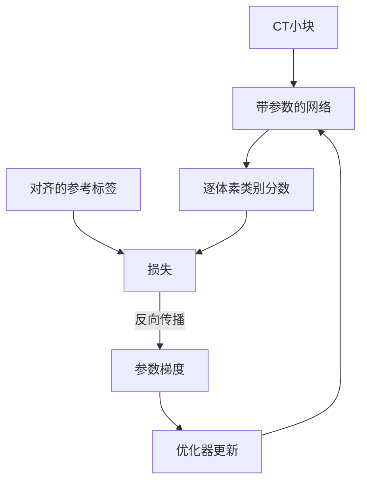

# 器官已经标出来了，AI 还要学什么？

> **CUDA 医疗影像实战 · 第5篇（专栏第78篇）**
>
> 前几篇解决了CT空间、模型推理、强度预处理与滑窗融合。这一篇把参考标签拿回来：看它怎样变成损失，损失怎样产生梯度，梯度又怎样更新网络。目标是讲清一次训练更新，以及它为什么还不能证明模型会处理新病例。

> **工程深度｜验证状态：** L3 工程｜端到端实战（需数据/环境）
假设你手里有一份CT，脾脏已经被逐体素标成1，其他位置是0。把这份标签叠在影像上，轮廓清清楚楚。

既然答案都在，为什么还要训练？让程序把这块绿色区域复制出去，不就结束了吗？

复制可以解决**这一份已经有答案的影像**。而分割模型要解决的是：面对另一份没有标签的CT，能否根据影像生成合理的分割。训练的工作，是用已有影像与参考标签，调整一套能在不同位置反复使用的网络参数。

本篇围绕一个问题展开：**一份标注，究竟怎样改变卷积网络里的权重？**

我们不重讲第2篇的网络结构，也不追求完整训练系统。先理解取样、损失与一次参数更新，再把训练检查与独立验证分开。

## 01｜标签参与比较，不作为模型的额外输入

训练时，CT与标签成对进入数据流程，但职责不同：

| 数据 | 形状示例 | 用途 |
|---|---|---|
| CT小块 | `[B, 1, S1, S2, S3]` | 输入网络 |
| 网络分数 | `[B, 2, S1, S2, S3]` | 背景、脾脏各一通道logits |
| 参考标签 | `[B, 1, S1, S2, S3]` | 供损失函数比较，元素为0或1 |

`B`是这一批小块的数量，不必等于患者数量。标签不会作为第二个影像通道送给本系列网络，否则就与推理时只有CT的条件不一致。

整个训练关系可以画成：



这张图有一条不能省略的前提：**CT和标签中的同一位置，要代表同一处空间。**

因此，两者要一起进行方向统一、空间重采样与裁剪。影像强度可以做连续插值，离散标签通常使用最近邻插值；不能把0与1插值成0.37之后，再假装它仍是原来的类别编号。本系列官方训练配置也分别使用影像与标签的插值模式。[1][r1]

强度归一化则只作用于影像。若后续加入几何增强，空间参数也应在影像与标签之间共享；只旋转影像、不旋转标签，会让正确答案落到错误位置。

## 02｜为什么不把整份CT里的小块完全随机地抽出来？

随机抽取听起来公平，但器官分割有一个具体困难：目标器官只占体积的一部分。若训练批次经常几乎没有前景，模型得到的反馈就可能主要来自背景。

设想一个**教学假设**：体素中只有1%属于目标器官。如果全预测为背景，逐体素准确率也能达到99%，但器官一个都没找对。这个数字不是本系列数据集的统计，只用来说明总体准确率可能掩盖前景失败。

本系列官方配置使用`RandCropByPosNegLabeld`：从前景或背景候选点抽样，再裁出`96³`小块；`pos=1、neg=1`，每个病例生成4个样本。[1][r1] MONAI用`pos/(pos+neg)`控制选择前景候选点的概率。[2][r2]

要把这句话读准：

- 它不是说每块内部有一半体素属于脾脏；
- 也不是保证每4块中恰好2块来自前景候选点；
- 从背景选点的窗口仍可能包含脾脏，靠近边界时裁剪位置还可能调整。

官方配置还使用`image_threshold=0`限制背景候选区域。在本模型归一化后的影像上，这是数值条件，**不等于精确的人体掩码**。

这种取样利用了训练标签，是为了让训练更经常看到有用区域。推理时没有标签，不能照搬“根据脾脏标签选窗口”的做法，否则就提前使用了答案。

### 两个病例，为什么可能变成八个训练小块？

官方配置的病例批量为2，每例裁4块。MONAI的数据整理会把生成的小块列表合并为批次，因此在两例都正常返回4块时，一次前向可看到8块。[1][r1][3][r3]

**同患者小块跨集会引入泄漏风险。** 假设把同一位患者的 CT 切成许多小块，随机打散后混入训练集和验证集。训练时模型已经接触过该患者的解剖结构，验证指标可能偏乐观，难以反映它处理「从未见过的患者」的能力。

若要评价模型处理新患者的能力，应先在患者级或更高层级划分数据，再分别裁块。患者互斥本身也不等于完成了泛化验证：预训练数据重叠、中心差异等偏差仍可能存在。详细讨论放在第06节。

这些小块来自两个病例，不是八位独立患者。即使从一份CT中抽出一万块，也没有得到一万个独立病例。

也要区分两个相似的名字：训练数据整理中的批量，决定这次更新使用哪些小块；第4篇的`sw_batch_size`决定推理时一次计算几个窗口。两者不是同一个参数。

## 03｜预测错了，怎样变成一个能用于学习的数？

网络输出的是连续分数。损失函数将这些分数与参考标签比较，得到一个标量；它定义了当前训练批次上“希望减少的差异”。

本系列固定的官方训练配置不是只用Dice，而是：[1][r1]

\[
L=0.5L_{\mathrm{Dice}}+0.5L_{\mathrm{CE}}.
\]

这两个0.5是损失项的组合权重，不能理解为两者一定对梯度贡献相等，更不是“有50%的概率使用某一项”。

组合的动机并不神秘：交叉熵逐体素惩罚正确类别概率过低；Dice项把一批小块中某类的区域重叠联系起来。放在一起，是在同时表达这两种约束，不保证一定优于任何单项损失。

### 交叉熵：检查正确类别得到多少概率

对某个体素，若正确类别是脾脏，交叉熵的这一项可以写成：

\[
\ell=-\log p_{\mathrm{脾脏}}.
\]

把正确类别概率从0.6提高到0.9，这一项约从0.511降到0.105。这是手算示例，说明交叉熵会惩罚对正确类别分配过低概率的输出。

实际代码应将原始logits交给相应损失实现，由它用数值稳定的方式处理。PyTorch的`CrossEntropyLoss`也要求输入未归一化的logits。[4][r4]

这里不能先对每个体素做argmax，再拿0/1结果训练：硬标签丢掉了两类分数之间的连续差异，普通argmax也不能提供这条训练路径需要的有效梯度。

### Dice损失：从区域重叠的角度约束输出

Dice类目标与分割区域的重叠有关。V-Net原始论文使用基于Dice的目标处理前景与背景不平衡，但本篇使用的仍是前面选定的MONAI UNet，**不是把网络换成V-Net**。[5][r5]

必须特别留意：第2篇用于报告结果的硬标签Dice，与这里的可微Dice损失不是同一个计算。

这里先不把概率变成硬标签，而是直接比较“预测为某类的程度”与参考区域，让重叠关系仍然能够求导。官方配置设置了`softmax=True、squared_pred=True、batch=True、include_background=True`；在本篇二分类、无额外类别权重的条件下，Dice部分可写成：[1][r1][6][r6]

\[
D_c=\frac{2\sum_v p_{c,v}y_{c,v}+\epsilon}
{\sum_v p_{c,v}^{2}+\sum_v y_{c,v}^{2}+\epsilon},
\qquad
L_{\mathrm{Dice}}=1-\frac{D_0+D_1}{2}.
\]

这里：

- `p`是softmax后的概率；`y`是参考标签的one-hot表示；
- 求和范围包含这一批的全部小块和空间位置；
- 类别0是背景，类别1是脾脏，两者都参与；
- 配置的分子、分母平滑常数均为`1e-5`。

`one-hot`没有给标签增加医学信息，只是将类别编号展开成与类别通道对应的表示。例如标签1变为`[0,1]`。

| 对比项 | 本篇训练Dice部分 | 第2篇前景评价Dice |
|---|---|---|
| 输入 | 连续概率 | 硬标签区域 |
| 分母 | 含平方项 | 区域体素数量之和 |
| 聚合范围 | 当前小块批次 | 指定完整病例 |
| 背景 | 参与 | 不参与前景指标 |

因此，不能把`1 - 训练Dice损失`直接写成完整病例前景Dice。可以同时观察训练损失与验证Dice的趋势，但不能把两者当成同一个指标解释：它们的定义、范围和评价对象都不同。

另一个后果是：`batch=True`的Dice会把这一批样本放在一起计算比值。把一大批拆成若干微批、各算损失再简单累积梯度，通常不等价于原来的批Dice目标；改变批量时，既要看内存，也要核对目标的含义。

## 04｜损失怎样改变卷积核里的数字？

损失只是当前表现的一个数。真正让模型变化的是它对参数的导数，也就是梯度。

设网络参数为`θ`。反向传播沿计算图应用链式法则，求出`∂L/∂θ`；优化器再根据梯度与自身规则更新参数。最简单的梯度下降可以写成：

\[
\theta_{\mathrm{new}}=\theta_{\mathrm{old}}-\eta\nabla_\theta L,
\]

`η`是学习率。这个式子用于解释更新方向；后面的Novograd优化器还维护内部状态，并不只是逐项套用这个最简公式。`backward()`与`optimizer.step()`的分工可参见PyTorch官方训练教程。[7][r7]

### 先用一个体素，检查梯度方向

为了看清发生了什么，暂时固定背景logit为0，只调整前景logit`z`，参考类别设为前景。此时前景概率是`sigmoid(z)`，单体素交叉熵对`z`的导数为`p-1`。

若`z=-1`，前景概率较低，梯度为负；按“减去梯度”的规则，`z`会上升。

下面代码只需要NumPy，可保存为`ce_one_voxel.py`：

```python
import numpy as np

# 教学假设：只调一个前景logit，背景logit固定为0，参考类别为前景。
z = -1.0
learning_rate = 0.1

def loss(value):
    return np.logaddexp(0.0, -value)  # -log(sigmoid(z))的稳定写法。

p = 1.0 / (1.0 + np.exp(-z))
gradient = p - 1.0  # 这个单体素交叉熵对z的导数。
h = 1e-6
finite_difference = (loss(z + h) - loss(z - h)) / (2 * h)
np.testing.assert_allclose(gradient, finite_difference, rtol=1e-6, atol=1e-7)
new_z = z - learning_rate * gradient
assert new_z > z and loss(new_z) < loss(z)
print("梯度核对通过；旧/新logit", z, new_z)
print("旧/新loss", loss(z), loss(new_z))
```

**本次在Python 3.12.14、NumPy 2.3.5上实际执行通过。** 这个例子更新后，logit约从`-1`变为`-0.927`，损失约从`1.313`降到`1.260`。

这些是人为小问题的运行结果，不是CT训练记录。这里直接调整一个logit，真实网络调整的是共享参数；一个权重会影响多个体素，也会影响其他病例。某一批的一步更新，不保证所有位置都改善，也不保证下一批损失更低。

### 从logit再走一步，到卷积核权重

单体素例子只更新了`z`。真实网络里，`z`由更早的层算出来。取最小的线性关系`z = wx + b`，并沿用“前景标签、前景logit”的设定：

\[
\frac{\partial L}{\partial w}
=\frac{\partial L}{\partial z}\frac{\partial z}{\partial w}
=(p-1)x.
\]

这一步说明了两件事。第一，标签不直接改权重；它决定损失怎样评价输出，误差再沿计算关系传回去。第二，同一个误差对权重的推动量还取决于输入`x`：`x`的符号决定更新方向，`x`的绝对值越大，推动越强。

卷积核的权重在许多位置重复使用。一次反向传播中，同一个权重会收到所有使用它的位置（以及这一批中多个小块）的梯度贡献，汇总后才由优化器统一更新。这就是“一份标注改变共享权重”的实际路径。

这里展开的是单体素交叉熵，不是完整Dice+CE目标的逐项推导。

本次还在Python 3.12.14、NumPy 2.3.5上对二分类复合目标（`0.5×Dice + 0.5×CE`）做了float64代数检查——是一个目标的两组输入，不是两种不同损失。脚本为`78-composite_loss_grad_check.py`，记录如下：

| 检查目标 | 输入 | 方法 | 容差 | 实测结果 |
|---|---|---|---|---|
| Dice+CE复合目标梯度 | 12体素、混合标签 | 解析梯度 vs 中心差分 | 最大绝对误差 < 1e-6 | `5.091e-11`，通过 |
| 同上 | 12体素、全背景 | 同上 | 同上 | `1.223e-10`，通过 |

它核对的是公式与求导，**没有替代MONAI运行或三维网络训练检查**。

### 为什么训练通常比推理更占内存？

推理只需要生成输出；训练还要为反向传播保留必要信息、保存参数梯度，并可能维护优化器状态。因此，第4篇已经能完成窗口推理，不代表同样大小、同样批量的窗口可以直接用于训练。

CUDA承担卷积及其反向计算等数值工作。它不会替你选择正确标签、修复数据划分或定义合适的损失。第3篇的强度预处理若作为不需要求导的数据准备步骤，可以放在参数学习的计算图之外；但这不表示任意自定义CUDA算子放进网络内部后，都自动具备反向传播能力。

## 05｜把一次训练更新写成可检查的代码

下面脚本只做一件事：抽两块数据，完成一次前向、损失计算、反向传播与参数更新，并检查损失、梯度和参数变化。

默认使用合成球体；也可传入一对真实NIfTI影像与标签。真实数据应先通过第1篇的完整空间检查（退化变换、qform／sform等）；这里保留的只是训练入口的基础配对检查：三维、毫米单位、affine有限、影像与标签同网格、标签二值。脚本既不输出验证成绩，也不保存可用模型。

为了降低试读门槛，网络缩为三尺度、窗口默认`32³`。这些是教学设定，**不等于官方`96³`预训练模型的训练复现**：

| 项目 | 所选官方配置 | 本文一次更新示例 |
|---|---|---|
| 网络 | 多尺度残差UNet | 缩小的三尺度UNet，随机初始化 |
| 小块 | `96³`，每例4块 | 默认`32³`，一例2块 |
| 损失 | 配置中的Dice+CE | 保留上述损失定义 |
| 优化器 | Novograd，学习率0.002 | 相同类型与学习率，仍只是教学起点 |
| 混合精度 | 官方启用 | 本篇不启用，留待下一篇讨论 |
| 目的 | 模型训练配方 | 检查一次训练更新是否连通 |

### 环境与验证状态

可复用第2篇的独立环境，使用Python 3.10、PyTorch 2.4.0、MONAI 1.4.0、NumPy 1.24.4和NiBabel 5.2.1。Linux CUDA 12.1构建示例：[8][r8]

```bash
python -m pip install torch==2.4.0 --index-url https://download.pytorch.org/whl/cu121
python -m pip install monai==1.4.0 numpy==1.24.4 nibabel==5.2.1
```

驱动与GPU需支持所选构建；CPU环境应选择官方CPU构建。这是固定版本的复现起点，不是当前所有硬件的通用推荐。

**本次未安装PyTorch/MONAI，未运行下面的训练脚本，也没有真实CT训练、GPU耗时或验证Dice。** 代码完成了Python语法检查与官方接口、训练配置核对；另检查了MONAI 1.4.0发布包中的Dice实现。前面的NumPy例子与二分类复合目标梯度检查已实际执行，后者脚本见第04节。[9][r9]

保存为`train_one_batch.py`：

```python
"""只完成一次训练更新；默认合成数据，可选一对真实NIfTI，不能生成可用器官模型。"""
import argparse
import numpy as np
import torch
from monai.data import list_data_collate
from monai.losses import DiceCELoss
from monai.networks.nets import UNet
from monai.optimizers import Novograd
from monai.transforms import (
    Compose, LoadImaged, EnsureChannelFirstd, Orientationd, Spacingd,
    ScaleIntensityRanged, EnsureTyped, SpatialPadd, RandCropByPosNegLabeld,
)


def prepare_real(image_path, label_path):
    import nibabel as nib
    image, label = nib.load(image_path), nib.load(label_path)
    for volume in (image, label):
        if len(volume.shape) != 3 or volume.header.get_xyzt_units()[0] != "mm":
            raise ValueError("要求空间单位为mm的三维NIfTI。")
        if not np.isfinite(volume.affine).all():
            raise ValueError("存在无效空间变换。")
    if image.shape != label.shape or not np.allclose(
        image.affine, label.affine, rtol=0, atol=1e-3
    ):
        raise ValueError("原始影像与标签不在同一网格，先停止训练。")
    # 标签在高精度下校验：FP32舍入可能把1.00000001变成1.0后蒙混过关。
    values = label.get_fdata(dtype=np.float64)
    if not np.isfinite(values).all() or not np.isin(values, [0, 1]).all():
        raise ValueError("本例只接受0/1二值标签。")
    if not np.isfinite(image.get_fdata(dtype=np.float32)).all():
        raise ValueError("影像含非有限值。")
    transform = Compose([
        LoadImaged(keys=["image", "label"]),
        EnsureChannelFirstd(keys=["image", "label"]),
        Orientationd(keys=["image", "label"], axcodes="RAS"),
        # 连续影像插值与离散标签插值分开；两者使用相同目标空间。
        Spacingd(keys=["image", "label"], pixdim=(1.5, 1.5, 2.0),
                 mode=("bilinear", "nearest")),
        ScaleIntensityRanged(keys="image", a_min=-57, a_max=164,
                             b_min=0, b_max=1, clip=True),
        EnsureTyped(keys=["image", "label"]),
    ])
    return transform({"image": image_path, "label": label_path})


def synthetic_case():
    coords = np.indices((48, 48, 48))
    sphere = ((coords - 24) ** 2).sum(axis=0) < 10 ** 2
    rng = np.random.default_rng(2026)
    # 人为让球内强度更高，只为检查张量和梯度；不模拟真实脾脏。
    image = 0.1 + 0.2 * rng.random(sphere.shape) + 0.5 * sphere
    return {"image": image[None].astype(np.float32),
            "label": sphere[None].astype(np.int64)}


def main():
    parser = argparse.ArgumentParser(description=__doc__)
    parser.add_argument("--image")
    parser.add_argument("--label")
    parser.add_argument("--device", choices=["cpu", "cuda:0"], default="cpu")
    parser.add_argument("--roi", type=int, default=32)
    args = parser.parse_args()
    if bool(args.image) != bool(args.label):
        parser.error("image和label必须同时提供。")
    if args.roi < 8 or args.roi % 4:
        parser.error("教学小网络要求roi为不小于8的4的倍数。")
    if args.device.startswith("cuda") and not torch.cuda.is_available():
        raise RuntimeError("指定了CUDA，但当前PyTorch没有可用CUDA设备。")
    torch.manual_seed(2026)  # 便于重复检查；不承诺跨设备逐位一致。
    torch.backends.cuda.matmul.allow_tf32 = False
    torch.backends.cudnn.allow_tf32 = False  # 明确本例不采用TF32作为FP32卷积近似。
    case = prepare_real(args.image, args.label) if args.image else synthetic_case()
    roi = (args.roi,) * 3
    sample = Compose([
        EnsureTyped(keys=["image", "label"]),
        SpatialPadd(keys=["image", "label"], spatial_size=roi,
                    mode="constant"),  # 教学适配：避免短轴导致随机裁剪失败。
        RandCropByPosNegLabeld(
            keys=["image", "label"], label_key="label", spatial_size=roi,
            pos=1, neg=1, num_samples=2, image_key="image", image_threshold=0,
        ),
    ])
    sample.set_random_state(seed=2026)
    batch = list_data_collate(sample(case))  # 两个小块合成窗口批次，不是两个患者。
    x = batch["image"].to(args.device, dtype=torch.float32)
    target = batch["label"].to(args.device, dtype=torch.long)
    assert x.shape == target.shape and x.shape[0] == 2
    # 缩小的随机网络，只检查训练链路；与官方预训练网络结构不同。
    model = UNet(spatial_dims=3, in_channels=1, out_channels=2,
                 channels=(4, 8, 16), strides=(2, 2),
                 num_res_units=1, norm="batch").to(args.device)
    criterion = DiceCELoss(
        include_background=True, to_onehot_y=True, softmax=True,
        squared_pred=True, batch=True, smooth_nr=1e-5, smooth_dr=1e-5,
        lambda_dice=0.5, lambda_ce=0.5,
    )  # 保留所选官方配置的损失定义。
    optimizer = Novograd(model.parameters(), lr=0.002)
    model.train()
    before = [p.detach().clone() for p in model.parameters()]
    optimizer.zero_grad(set_to_none=True)  # 本次只累积这一批的梯度。
    logits = model(x)  # 标签没有进入模型输入，仍用于后面的监督比较。
    assert logits.shape == (2, 2) + roi
    loss = criterion(logits, target)  # 不先softmax，也不先argmax。
    if not torch.isfinite(loss):
        raise RuntimeError("损失为非有限值。")
    loss.backward()  # 根据损失计算参数梯度，尚未更新参数。
    grads = [p.grad for p in model.parameters() if p.grad is not None]
    if not grads or not all(torch.isfinite(g).all().item() for g in grads):
        raise RuntimeError("缺少梯度或存在非有限梯度。")
    if not any(torch.count_nonzero(g).item() > 0 for g in grads):
        raise RuntimeError("所有梯度为0，请检查训练链路。")
    optimizer.step()  # 优化器根据梯度及其内部状态更新权重。
    if not all(torch.isfinite(p).all().item() for p in model.parameters()):
        raise RuntimeError("更新后出现非有限参数。")
    delta = max((p.detach() - old).abs().max().item()
                for p, old in zip(model.parameters(), before))
    if delta == 0:
        raise RuntimeError("参数没有发生变化。")
    print("输入/标签/logits形状", tuple(x.shape), tuple(target.shape), tuple(logits.shape))
    print("本批更新前loss", loss.item(), "最大参数变化", delta)
    print("只完成一次更新：不报告验证Dice，不保存或宣称可用器官模型。")


if __name__ == "__main__":
    main()
```

先用合成数据检查CPU路径，再在可用GPU上检查同一训练链路：

```bash
python train_one_batch.py --device cpu
python train_one_batch.py --device cuda:0
```

若已有与本系列一致、强度语义匹配的CT及二值脾脏标签，可显式运行：

```bash
python train_one_batch.py \
  --image Task09_Spleen/imagesTr/spleen_2.nii.gz \
  --label Task09_Spleen/labelsTr/spleen_2.nii.gz \
  --device cuda:0 --roi 32
```

命令里的路径是使用方式示例，不表示本次已经下载或训练该病例。运行真实影像也仍只是一次更新检查；把`--roi`改成96，并不会自动把这个缩小网络变成官方模型。

代码特意保留了几个检查点：

- `zero_grad`处理这次更新之前的梯度；这里没有设计跨批累积；
- `logits`直接交给损失，`softmax=True`只让Dice分支内部使用概率；CE分支仍处理logits；
- `backward()`之后检查有限梯度，`step()`之后检查有限参数和实际变化；
- 更新前的参数副本只是为了检查，会额外占内存，正式训练不必每步复制。

实际训练会重复处理批次，并在不同轮次重新抽取小块。一个`step`是一次参数更新；一个`epoch`通常指遍历一次训练病例清单。随机裁块时，遍历了一轮病例，不代表每个体素都已经参与过训练。

`model.train()`设置BatchNorm等模块的训练行为，但它本身不更新权重；真正的更新仍在优化器步骤。[10][r10] 脚本没有在一步更新后强求损失必降，因为随机网络、具体批次和优化器不提供这种逐步单调保证。

这里的小网络也不能加载第2篇的预训练权重。若要微调原模型，应保持网络结构和输入配方一致，明确从哪个检查点开始，并核查已有权重使用过哪些数据。

## 06｜训练损失下降，为什么还不能宣布模型学会了？

因为模型可能只是更适应它反复见过的小块。

有三件事情，证据强度不同：

| 观察到的现象 | 能说明什么 | 不能说明什么 |
|---|---|---|
| 一次更新后参数改变 | 优化链路产生了实际更新 | 更新方向对新病例有效 |
| 固定训练小块上表现很好 | 模型能拟合这些数据，可辅助排查链路 | 已经具备泛化能力 |
| 未参与训练病例上表现稳定 | 在该验证条件下有一定泛化证据 | 自动适用于其他医院或临床用途 |

重复拟合少量固定样本，是有用的工程检查。如果连小样本都拟合不了，应先排查标签、形状、损失、梯度和学习率；如果能拟合，也只是排除部分问题。

### 先划病例，再抽小块

不能先把一位患者的CT切成很多块，再随机分给训练集和验证集。两边会共享高度相似的解剖与采集信息，所得分数不再是对独立新患者的干净检验。

CLAIM 2024建议医疗影像的数据分区通常应在患者级或更高层级保持互斥。[11][r11] 对同一患者的多期检查、不同序列或不同重建，也应检查其归属。

实际工作中，先固定患者分组和清单，再分别生成训练小块与验证输入。验证集用于选择设置或检查点；反复调过的验证集，不能再冒充未接触的最终测试集。

如果使用预训练模型，患者划分还要考虑预训练数据。仅仅把某个文件从当前训练清单里移走，并不能证明模型从未见过它。

### 训练抽样，验证覆盖完整体积

训练时使用标签来增加前景抽样机会，是为了组织学习；验证时只检查这些“特意抽出来的小块”，就改变了评价问题。

本系列要检验的是完整CT分割。因此，验证应使用固定预处理，将完整体积交给第4篇的滑窗覆盖与融合，再计算完整病例结果。官方配置也把随机裁块用于训练，而验证沿用确定性预处理与滑窗推理。[1][r1]

验证阶段需要`model.eval()`以及不记录训练梯度的上下文，不执行反向传播与优化器更新。标签只参与最后比较，不决定扫描位置。`eval()`和关闭梯度是不同开关，不能相互替代。[10][r10]

还要标明评价空间：

- 若在模型的重采样网格评价，参考标签也要处在相同网格，并明确报告口径；
- 若报告原始空间表现，则按第2篇流程恢复预测，与原始参考标签对齐后再计算。

不要把重采样网格上的训练损失，与原空间的病例指标不加说明地混在一起。背景是否计入、空前景怎样处理、逐病例平均还是全体素合并，也应固定；后续系列的完整评价再展开这些细节。

## 07｜第一次真正训练，先追求什么结果？

先追求一条可解释、可检查的训练路径。

建议按这个顺序推进：先用默认合成样本检查张量和梯度；再用一对已检查的真实CT与标签确认预处理和配对裁剪；然后在少量固定训练小块上做拟合检查；最后才进入多患者训练与独立完整病例验证。

进入持续训练时，保留患者划分清单、预处理与损失参数、随机种子、初始化方式、训练步数和环境版本。若要恢复训练，还需要设计优化器与训练进度等状态的保存，不能只有一张“loss降了”的截图。

本篇没有比较训练速度。将来讨论CUDA吞吐时，应固定窗口、批量、精度与更新步数，并把取数、预处理、传输、前向、反向与优化器更新的计时边界写清楚；训练一次更新与推理一次前向不能直接比较。

**参考标注提供监督，损失定义要减少的差异，梯度连接差异与参数，独立验证检验这些参数能否处理新病例。** 四个环节缺一不可。

下一篇再讨论加速：混合精度怎样改变训练或推理的数值计算，以及为什么更快之前，仍要先固定这条FP32基线。

## 参考资料

1. [MONAI官方脾脏模型0.6.0固定提交][r1]。核对损失、优化器、配对预处理、采样与训练/验证分工。
2. [MONAI 1.4.0：Transforms][r2]。`RandCropByPosNegLabeld`的候选点概率、背景区域及裁剪约束。
3. [MONAI 1.4.0：Data][r3]。小块列表的`list_data_collate`及DataLoader默认整理方式。
4. [PyTorch 2.4：CrossEntropyLoss][r4]。logits与类别目标的约定。
5. [Milletari等：V-Net，2016][r5]。三维分割中的Dice目标；不将该论文架构当作本系列网络。
6. [MONAI 1.4.0：Loss functions][r6]。DiceLoss、DiceCELoss的平方分母、批次聚合及内部激活。
7. [PyTorch：Optimizing Model Parameters][r7]。梯度清理、反向传播与优化器步骤。
8. [PyTorch：历史版本安装说明][r8]。
9. [MONAI 1.4.0发布包][r9]。本次核对`monai/losses/dice.py`；仅检查源码，不代表执行了框架。
10. [PyTorch 2.4：Module][r10]。训练/评估模式的行为与梯度模式的区别。
11. [CLAIM 2024：数据划分的患者级互斥要求][r11]。RSNA官方条目说明，对应2024更新的第20项。

*资料核对日期：2026年10月22日。本文报告的实际运行仅限NumPy教学和梯度检查；未完成PyTorch/MONAI训练、GPU测量或真实病例验证。*

[r1]: https://huggingface.co/MONAI/spleen_ct_segmentation/commit/da227867a503f2909ac2e441149e39fdeb370e34
[r2]: https://monai.readthedocs.io/en/1.4.0/transforms.html#randcropbyposneglabeld
[r3]: https://monai.readthedocs.io/en/1.4.0/data.html#monai.data.utils.list_data_collate
[r4]: https://docs.pytorch.org/docs/2.4/generated/torch.nn.CrossEntropyLoss.html
[r5]: https://arxiv.org/abs/1606.04797
[r6]: https://monai.readthedocs.io/en/1.4.0/losses.html#diceceloss
[r7]: https://docs.pytorch.org/tutorials/beginner/basics/optimization_tutorial.html
[r8]: https://pytorch.org/get-started/previous-versions/
[r9]: https://pypi.org/project/monai/1.4.0/
[r10]: https://docs.pytorch.org/docs/2.4/generated/torch.nn.Module.html
[r11]: https://rsna.github.io/claim/item-20.html
