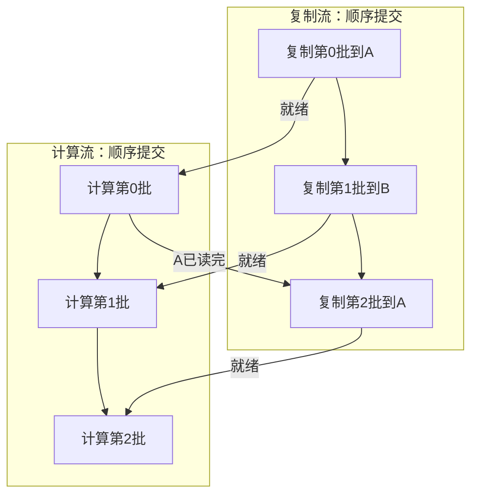

# CT 分割已经用上 GPU，为什么还在等数据？

> **CUDA 医疗影像实战 · 第7篇（专栏第80篇）**
>
> 上一篇讨论了混合精度。这一篇保持计算精度和模型行为不变，看看数据怎样及时抵达GPU：从预取、锁页内存到CUDA流，讲清传输与计算重叠的条件，以及缓冲区什么时候才能安全复用。

> **工程深度｜验证状态：** L3 工程｜端到端实战（需数据/环境）
假设你在自己的机器上完成了CT分割推理，准备继续优化。GPU算一个窗口的时间已经不长，但从一份影像进入流程，到最后生成分割结果，中间仍有不少等待。

你可能会先想到换更快的模型。可如果计算完成以后，下一个窗口还在解压、重采样或传输，单独加快卷积，并不能让数据提前到达。

这次要回答的是：**怎样让GPU计算当前窗口时，下一批数据已经在准备或传输，而不是所有环节轮流开始？**

本篇只研究单GPU上的数据准备与复制/计算衔接。CUDA流不是另一张GPU，也不会自动把任务分发到多张卡；多GPU数据并行属于另一层问题。

## 01｜“GPU没算”，不一定是模型有问题

把第2至6篇的过程串起来，输入端大致包含三类工作：

| 阶段 | 在做什么 | 常见等待来源 |
|---|---|---|
| 数据准备 | 读取、解压、方向与间距处理、裁块、组批 | 存储、CPU、内存或工作进程不足 |
| 传输 | 将主机内存中的窗口复制到GPU，即H2D | 传输带宽、传输粒度、同步和内存类型 |
| 计算 | 网络前向，或训练中的前向与反向 | 网络计算、显存访问与执行调度 |

这张表是分析框架，不是本次机器的性能测量。

第一步仍是定位：GPU等待之前，CPU在做什么？有没有正在执行的H2D？还是代码在等待一次结果回传？看一眼利用率曲线，无法区分这些情况。

CUDA流能帮助组织设备工作，却不能代替文件解压，也不会让CPU重采样自动搬到GPU上。不同问题需要在对应阶段处理。

## 02｜先理解重叠能省掉什么

先做一个**理想化教学假设**：所有主机数据已经准备好，一批窗口复制需要3毫秒，GPU计算需要5毫秒，共处理4批；设备允许复制与计算并发，不计调度开销与资源竞争。

若每批都等复制结束再计算，且下一批也排在同一条执行队列后面，总时间为：

\[
4(3+5)=32\ \mathrm{ms}.
\]

若在计算第0批时复制第1批，按双缓冲安排，可以得到：

| 批次 | H2D区间 | 计算区间 |
|---:|---|---|
| 0 | 0—3 ms | 3—8 ms |
| 1 | 3—6 ms | 8—13 ms |
| 2 | 8—11 ms | 13—18 ms |
| 3 | 13—16 ms | 18—23 ms |

总时间变为23毫秒。复制第2批为什么不在6毫秒就开始？因为它要复用第0批的输入槽位，必须等第0批计算读完。

在这个两阶段、固定耗时模型下，处理`N`批的理想时间是：

\[
T=H+C+(N-1)\max(H,C),
\]

其中`H`是每批复制时间，`C`是每批计算时间。开始时需要填充，最后还要排空，所以不能直接写成`N×max(H,C)`。

随文`pipeline_schedule.py`用一个CPU调度模型检查了12组批数与耗时组合，确认了上述依赖和公式；它只模拟两条流上的时间点，不调用CUDA。该脚本与本文放在同一目录，可直接运行`python pipeline_schedule.py`。**这是对人为时间表的核对，不是GPU实测。** 真实系统还可能受CPU供数、传输竞争和内核资源占用影响，达不到这个理想值。

这也解释了收益的边界：如果复制只占很小一部分，把它全部隐藏，也只能省掉那一小部分时间。

## 03｜先让CPU把下一批准备好

传输与计算重叠之前，主机端必须有数据可传。

PyTorch的`DataLoader`可以用多个工作进程加载与变换数据，并进行预取。`prefetch_factor`控制每个工作进程预取的批次数；`persistent_workers`可以在遍历结束后保留工作进程，减少后续轮次重建开销。[1][r1]

例如，下面是接入已有CPU数据集的**配置示意，不是已调优参数**：

```python
from torch.utils.data import DataLoader

workers = 2
loader = DataLoader(
    dataset,  # 已定义的数据集；返回CPU张量或可整理的CPU数据。
    batch_size=2,
    shuffle=True,  # 此处以训练为例，验证时另行固定顺序与采样策略。
    num_workers=workers,
    pin_memory=True,
    prefetch_factor=2 if workers > 0 else None,
    persistent_workers=workers > 0,
)
```

代码要放在适合当前多进程启动方式的程序结构中；独立脚本通常需要`if __name__ == "__main__":`入口。不要把“多开worker”理解成让每个worker都创建CUDA模型。

### 预取越多，越快吗？

不一定。CPU、存储已经饱和时，更多进程可能带来竞争；预取还要占内存。

用一个容量假设估算：每个**已整理批次**含2个`96³`的FP32窗口，只有影像就约6.75 MiB。4个worker、每个预取2批，对应8批，仅这些影像就约54 MiB；标签、中间结果、缓存与正在处理的批次还没算进去。这只是数量级估算，不是内存上限。

也要记住第5篇的区别：若每个病例又随机裁出多块，DataLoader的病例批量不等于最终窗口数量，应按整理后的实际形状估算。

在MONAI中，`CacheDataset`还可以缓存确定性的预处理结果。它会在首个随机变换之前建立缓存，后续随机裁剪仍可重新执行。[2][r2] 对反复使用的训练病例，这可能减少重复预处理；代价是主机内存或相应缓存资源。不能为了缓存效率，随意交换第3篇讨论过的重采样与归一化顺序。

后面的实验先假定CPU已经备好数据，只比较H2D与前向调度；它不验证DataLoader配置是否改善了完整流程。

CPU供数足够之后，再检查复制阶段。否则即使创建很多CUDA流，也只是给空队列起了更多名字。

## 04｜锁页内存、non_blocking和流，分别负责什么？

三个名词经常一起出现，但不能相互替代。

**锁页内存（pinned memory）**是主机内存的一种分配或注册方式，使相关内存页保持驻留，可用于合适的异步传输。它仍是CPU侧内存，不是GPU显存，也不是把所有数据永久锁住越多越好。[3][r3]

`pin_memory=True`让DataLoader在返回批次时安排相应的锁页处理。它不负责将整个批次直接放到GPU。

**`non_blocking=True`**表达的是尽量避免提交后立即让CPU等待复制完成；它不等于“下一条GPU计算已经和它并行”。实际行为还取决于源/目标内存、方向和执行路径。[4][r4]

**CUDA流（stream）**是设备任务的有序队列。同一条流上的操作按顺序执行；不同流上的工作在满足依赖与硬件条件时，才可能重叠。[5][r5]

因此：

```python
x = cpu_batch.to("cuda", non_blocking=True)
y = model(x)
```

如果两步都在同一流上，它们仍然是先复制本批，再计算本批。主机可能提前继续工作，但这两步不会因为多了一个参数就失去数据依赖。

要争取的是：**计算第i批时，复制第i+1批。** 在本文讨论的独立GPU主机传输场景中，这通常需要可并发复制/计算的硬件、锁页源数据、独立的复制流，以及正确的事件依赖。[3][r3][4][r4]

还要避免在每批热路径里现做`pin_memory()`再立即传输。锁页处理本身有成本，应把准备过程放在合适的位置，再按实际流程测量。

## 05｜双缓冲最重要的不是“两块内存”，而是两条等待规则

给GPU准备两个输入槽位A和B：第0批用A，第1批用B，第2批回到A。

为了安全，只需先讲清两条规则：

1. **先复制好，再读取。** 计算第i批之前，等待该批的复制完成事件。
2. **先读取完，再覆盖。** 复制第i+2批之前，等待第i批对同一槽位的读取完成。

用前三批表示依赖：



图里的箭头表示先后依赖，不是实测时间轴。第0批计算与第1批复制之间没有直接依赖，因而有机会重叠。

PyTorch的`Stream.wait_event()`为该流后续工作添加事件依赖；它不会把CPU线程阻塞到事件结束。[6][r6] 对比之下，`synchronize()`让主机等待完成。把全局同步放在每一批之间，会引入不必要的等待，打断原本可能发生的重叠。

### “数据就绪”与“内存活着”，也不是同一件事

即使复制顺序正确，内存也不能被过早释放、复用或修改：

- 主机锁页源在H2D完成前不能被改写；
- GPU输入槽位在计算读完之前不能被覆盖；
- 动态张量跨流使用时，还需处理分配器所见的生命周期。

`record_stream()`服务于最后一类问题，让分配器知道张量还会被哪条流使用。它不是“复制完成”的替代事件；手动建立依赖并在所有使用结束后再释放，也可以管理生命周期。[7][r7]

下面的教学实验采用较容易检查的约定：**小规模主机源数据保持不变，两个GPU输入槽位一直保留到最终同步；槽位复用通过事件控制。** 因此不靠在循环中释放这些跨流槽位来节省内存。

## 06｜完整实验：先比较结果，再看有没有收益

为了隔离机制，我们暂时不读CT文件，也不改第4篇的MONAI滑窗器。只准备若干批合成三维窗口，交给一个固定随机权重的小型三维卷积网络。

两条路径使用完全相同的输入与模型：

| 路径 | 组织方式 | 没有改变的内容 |
|---|---|---|
| 串行基线 | 同流上排复制、前向，再排下一批 | 权重、FP32、输入顺序、批量 |
| 流水候选 | 独立复制流、两个输入槽位、事件依赖 | 同一批数据执行同样的网络计算 |

基线也使用锁页源与`non_blocking=True`。这样比较的是调度组织，而不是同时把内存类型、精度与模型都换掉。

默认每批2个`32³`窗口，共12批。它们不是实际患者，也不代表真实CT的强度或解剖分布。网络只是执行负载，不是已经训练好的器官分割模型。

### 环境与验证状态

可使用独立Python 3.10环境、PyTorch 2.4.0、NumPy 1.24.4。Linux CUDA 12.1构建示例：[8][r8]

```bash
python -m pip install torch==2.4.0 --index-url https://download.pytorch.org/whl/cu121
python -m pip install numpy==1.24.4
```

机器需要兼容的GPU、驱动和相应运行环境。版本固定是为了复现，不表示适合当前所有硬件。

**本次未安装PyTorch，未运行以下CUDA代码，没有GPU正确性、真实重叠、性能或真实病例结果。** 脚本经过Python语法与接口来源检查；流和DataLoader相关接口还核对了v2.4.0官方源文件。[9][r9][r10] 本次实际执行的检查只有随文`pipeline_schedule.py`的CPU调度模型，运行结果为`PASS: 12组双缓冲调度组合与公式一致`，不能替代目标GPU上的测试。

读代码时先看三处：`ready[i]`决定本批输入何时可以读取；`done[i-2]`决定同一槽位何时可以覆盖；`measure()`说明为什么只在整轮边界同步。`wait_event()`只给后续设备工作添加依赖，不要求CPU在这里等待事件完成。

保存为`ct_copy_compute.py`：

```python
"""单GPU推理教学：比较同流串行和双缓冲复制/计算，不读取真实CT。"""
import argparse
import json
import time
from pathlib import Path
import numpy as np
import torch
from torch import nn


class Runner:
    def __init__(self, model, host_batches):
        self.model, self.host = model, host_batches
        if not self.host or not all(x.device.type == "cpu" and x.is_pinned()
                                    and x.dtype == torch.float32 for x in self.host):
            raise ValueError("要求非空、锁页、FP32主机批次列表。")
        if not all(x.shape == self.host[0].shape for x in self.host):
            raise ValueError("本例只处理同尺寸批次。")
        # 对象在所有运行结束并同步之前始终存活，固定主机数据也不再修改。
        self.slots = [torch.empty_like(self.host[0], device="cuda") for _ in range(2)]
        self.compute = torch.cuda.current_stream()
        self.copy = torch.cuda.Stream()
        self.ready = [torch.cuda.Event() for _ in self.host]
        self.done = [torch.cuda.Event() for _ in self.host]

    @torch.inference_mode()
    def run(self, pipelined, collect=False):
        outputs = []
        if not pipelined:
            with torch.cuda.stream(self.compute):
                for host in self.host:
                    self.slots[0].copy_(host, non_blocking=True)
                    out = self.model(self.slots[0])  # 同流：本批复制排在本批计算之前。
                    if collect:
                        outputs.append(out)
                    del out
            return outputs

        # 槽位在主流上分配；先建立初始化到复制流的依赖。
        self.copy.wait_stream(self.compute)

        def stage(i):
            with torch.cuda.stream(self.copy):
                if i >= 2:
                    self.copy.wait_event(self.done[i - 2])  # 槽位上次被读完才可覆盖。
                self.slots[i % 2].copy_(self.host[i], non_blocking=True)
                self.ready[i].record(self.copy)  # 记录这一批复制完成的点。

        stage(0)  # 预填首个槽位。
        for i in range(len(self.host)):
            with torch.cuda.stream(self.compute):
                self.compute.wait_event(self.ready[i])  # 这一批复制好，计算才可读。
                out = self.model(self.slots[i % 2])
                self.done[i].record(self.compute)  # 此推理网络已不再读取当前输入槽位。
                if collect:
                    outputs.append(out)
                del out
            if i + 1 < len(self.host):
                stage(i + 1)  # 可与已经提交的第i批计算重叠；不保证实际重叠。
        return outputs


def measure(runner, pipelined, repeats):
    for _ in range(3):
        runner.run(pipelined)
        torch.cuda.synchronize()  # 只在整轮边界同步，不在每批间强制同步。
    samples = []
    for _ in range(repeats):
        torch.cuda.synchronize()
        start = time.perf_counter()
        runner.run(pipelined)
        torch.cuda.synchronize()  # 包括两条流中本轮工作的完成与排空。
        samples.append((time.perf_counter() - start) * 1000)
    return np.percentile(samples, [50, 10, 90]).tolist()


def main():
    parser = argparse.ArgumentParser(description=__doc__)
    parser.add_argument("--roi", type=int, default=32)
    parser.add_argument("--batches", type=int, default=12)
    parser.add_argument("--repeats", type=int, default=5)
    parser.add_argument("--trace", action="store_true")
    parser.add_argument("--out", default="copy_compute_report.json")
    args = parser.parse_args()
    if min(args.roi, args.batches, args.repeats) < 1:
        parser.error("roi、batches、repeats必须为正整数。")
    if not torch.cuda.is_available():
        raise RuntimeError("本实验需要CUDA；CPU调度例子请运行pipeline_schedule.py。")
    torch.cuda.set_device(0)
    torch.manual_seed(2026)
    torch.backends.cuda.matmul.allow_tf32 = False
    torch.backends.cudnn.allow_tf32 = False
    torch.backends.cudnn.benchmark = False
    torch.backends.cudnn.deterministic = True
    shape = (2, 1, args.roi, args.roi, args.roi)  # 每批两个合成三维窗口。
    # 刻意在计时外准备小规模锁页列表，隔离H2D与计算；实际系统不应缓存所有CT。
    host = [torch.rand(shape).pin_memory() for _ in range(args.batches)]
    model = nn.Sequential(nn.Conv3d(1, 8, 3, padding=1), nn.ReLU(),
                          nn.Conv3d(8, 2, 3, padding=1)).cuda().eval()
    runner = Runner(model, host)
    try:
        serial = runner.run(False, collect=True)
        torch.cuda.synchronize()
        reference = [x.cpu() for x in serial]
        del serial  # 正确性检查输出不计入后面的计时。
        parallel = runner.run(True, collect=True)
        torch.cuda.synchronize()
        assert len(parallel) == len(reference)
        for actual, expected in zip(parallel, reference):
            torch.testing.assert_close(actual.cpu(), expected, rtol=1e-5, atol=1e-5)
        del parallel, reference
        serial_ms = measure(runner, False, args.repeats)
        pipeline_ms = measure(runner, True, args.repeats)
        report = {"torch": torch.__version__, "numpy": np.__version__,
                  "cuda_runtime": torch.version.cuda, "gpu": torch.cuda.get_device_name(0),
                  "shape_per_batch": list(shape), "batches": args.batches,
                  "tf32": False, "cudnn_deterministic": True,
                  "warmup_rounds": 3, "repeats": args.repeats,
                  "serial_ms_median_p10_p90": serial_ms,
                  "pipeline_ms_median_p10_p90": pipeline_ms,
                  "synthetic_output_check": "passed"}
        path = Path(args.out)
        path.parent.mkdir(parents=True, exist_ok=True)
        if args.trace:
            from torch.profiler import profile, ProfilerActivity
            for label, mode in [("serial", False), ("pipeline", True)]:
                with profile(activities=[ProfilerActivity.CPU, ProfilerActivity.CUDA]) as prof:
                    runner.run(mode)
                    torch.cuda.synchronize()
                trace = path.with_name(path.stem + "_" + label + "_trace.json")
                prof.export_chrome_trace(str(trace))  # 跟踪开销不纳入上面的计时。
        path.write_text(json.dumps(report, indent=2), encoding="utf-8")
        print(json.dumps(report, indent=2))
        print("仅比较合成窗口的H2D+推理；没有真实CT、训练或全流程速度结论。")
    finally:
        # 所有流的工作完成后，才释放固定GPU槽位与锁页主机源。
        torch.cuda.synchronize()


if __name__ == "__main__":
    main()
```

先复核CPU调度公式（不需要GPU）：

```bash
python pipeline_schedule.py
```

运行基础对照（需要GPU）：

```bash
python ct_copy_compute.py --out copy_compute_report.json
```

若显存与主机内存允许，可另测更接近本系列窗口尺寸的设置：

```bash
python ct_copy_compute.py --roi 96 --batches 12 --repeats 5 --trace \
  --out copy_compute_96.json
```

JSON报告与两份trace文件是**目标机器实际运行后才会产生的产物**。本次没有这些GPU运行记录，也不保证第二条命令一定比第一条或串行方案更快。

代码有几个刻意的安排：

- 正确性阶段逐批保留并比较完整输出，回传与比较不计入性能阶段；
- 计时阶段不保留分割输出，只测H2D与前向，因此不是可直接部署的完整分割服务；
- 复制与计算的事件各按批次记录，槽位则按`i % 2`复用；
- GPU槽位、锁页源、流和事件在运行结束之前保持有效，最后统一同步；
- 没有添加AMP、多GPU或训练更新，先避免其他变量干扰。

按批保存事件是为了简化本例检查；持续处理未知长度的数据流时，还需另外设计有界的事件与队列复用。

### 训练不能直接照搬“前向结束就复用”

本脚本使用`inference_mode()`。若改为训练，反向传播可能仍需要本批输入或相关保存内容，所以不能在前向刚结束时就覆盖同一输入槽位。

训练版还要一起处理标签传输、前向、损失、反向和缩放/优化器步骤，并把槽位可复用的事件放到最后一次读取之后。把脚本里的`model(...)`换成训练调用而不重新分析依赖，可能引入难以复现的错误。

## 07｜两条流都在，怎样证明它们真的重叠？

代码结构只提供机会，证据要看设备时间轴。

开启`--trace`后，脚本使用PyTorch Profiler记录CPU与CUDA活动，并导出跟踪文件。[10][r11] 在支持Chrome trace格式的查看器中，检查：

- H2D是否出现在独立的流轨道上；
- 第i批卷积执行时，第i+1批H2D是否确实在运行；
- 是否有长时间空白、意外同步或其他负载占用；
- 输入槽位的覆盖是否被应有的计算完成事件约束。

### 用Nsight Systems看设备时间轴

PyTorch Profiler适合从脚本内快速导出；需要更细的设备轨道时，可以另用Nsight Systems[11][r13]。对本文脚本，可以这样采集；不要同时加`--trace`，避免两种采集方式叠加：

```bash
nsys profile --trace=cuda,nvtx,osrt -o copy_compute \
  python ct_copy_compute.py --roi 96 --batches 12 --repeats 5
```

打开生成的`copy_compute.nsys-rep`（旧版使用`.qdrep`，Nsight Systems 2021.4起切换为`.nsys-rep`；具体选项按安装版本核对）。重点看三处：

- **GPU活动时间轴**：实际H2D（HtoD）复制区间与kernel执行区间是否重叠；
- **CUDA API轨道**：CPU何时提交复制、何时等待，用来解释提交与等待，不能单独作为复制／计算并发的证据；
- 是否存在不必要的`cudaStreamSynchronize`或`cudaDeviceSynchronize`，它们会引入等待，打断原本可能发生的重叠。

`cudaMemcpyAsync`是主机发起的API调用；CPU侧的调用区间与GPU真正执行H2D的区间不是一回事。判断是否并发，要看GPU工作负载轨道，而不是只看API调用。

整轮边界和资源释放前的同步是本实验的正确安排，不应为了让时间轴更漂亮而删除。分析器会带来额外开销，不要把trace耗时当成生产测量；先用代码计时确认，再用可视化工具定位细节。

即使确实重叠，总时间也可能没有缩短。传输与计算可能竞争内存资源，模型可能很小，事件与Python提交开销也可能占比明显。重叠本身不是性能结论。

不要在逐批循环中打印GPU张量，或反复调用`.item()`、`.cpu()`来“看进度”，然后再用这条路径评价无同步流水吞吐。这些操作可能引入等待。需要调试时可以用，但应区分调试配置与测量配置。

### 本脚本的耗时包含什么？

每条路径先预热3个完整轮次，再重复测量。每轮从已准备好的锁页批次开始，到这一轮所有复制与前向完成，包含填充与排空；主机计时边界使用CUDA同步。[3][r3]

当前固定先测串行、再测流水；正式比较时，可以重复多组整组测量并交替顺序，观察设备温度、频率或外部负载是否让固定顺序占便宜。默认5次适合快速检查，正式测量应增加重复次数。

它不包含文件读取、解压、预处理、初始锁页、模型加载、正确性检查、D2H回传和完整体积融合。分析器另行运行，其开销不计入报告中的正式计时。

因此，报告的整轮中位数与分位值，只回答**这批预先准备好的窗口，在这个网络和这台机器上，哪种H2D＋前向组织更合适**。它不能直接回答完整CT快了多少，也不能说明DataLoader已经不是瓶颈。

至少还应记录GPU、驱动、CUDA/PyTorch版本、输入形状、实际窗口批量、预热与重复次数、主机锁页用量、GPU负载，以及TF32等计算设置。脚本记录了其中一部分，其余需要随实际环境补充。

## 08｜把机制放回真实CT流程，先做哪一步？

回到开头，别从“增加几条流”开始，而是从观察到的等待开始：

| 证据指向 | 优先尝试 |
|---|---|
| CPU读取或变换迟迟没有完成 | 检查存储、工作进程、预取和可缓存的确定性变换 |
| 数据已就绪，H2D与计算明显串行 | 小规模比较锁页源、独立复制流和事件组织 |
| GPU持续计算，复制只占很少时间 | 回到第6篇的算子/精度分析，评估重叠的收益上限 |
| 输出回传或CPU融合成为等待点 | 检查第4篇融合位置及回传策略，另行设计输出缓冲 |

真实输入端应是有界队列。队列满时等待下游消费，而不是继续把全部CT解压并锁进内存；发生错误或提前停止时，也要先处理仍在飞行的工作，再释放相应缓冲区。

若对滑窗进行预取，数据项还应绑定病例标识、窗口坐标和相应融合信息。张量可以提前传输，这些对应关系不能错位。应在固定病例、权重、窗口顺序、精度与后处理条件下，比较原路径与候选路径的完整分数、标签和空间结果。

本实验没有改写MONAI内部的窗口调度，也没有实现异步D2H与CPU融合。输出回传若使用异步方式，CPU消费前同样必须等待复制完成；不能因为前向已经返回，就直接读取尚未完成写入的主机数组。

最后，再测一次同一输入文件到同一分割产物的完整时间。若局部时间变短、总时间没有改善，优化的价值就需要重新判断。

**流水化的目标，是让彼此独立的工作有机会重叠；事件、缓冲区和生命周期约定，则保证这种重叠不会改变“哪份数据由哪次计算使用”。** 先证明结果正确，再证明等待被减少，才值得把这条路径留在医疗影像流程里。

下一篇收束整个系列：把空间、分割质量、速度、内存与失败样例放进同一份评价记录，判断这套流程究竟完成了什么。

## 参考资料

1. [PyTorch：DataLoader与数据加载][r1]。多进程、预取、锁页与persistent workers；该页为本次可访问的2.14版，本文所用参数另外核对2.4.0源码。
2. [MONAI 1.4.0：CacheDataset][r2]。随机变换之前的缓存范围与内存取舍。
3. [NVIDIA：CUDA C++ Best Practices Guide][r3]。锁页内存、异步传输、复制/计算重叠条件与计时。
4. [PyTorch官方教程：non_blocking与pin_memory][r4]。主机异步、真实重叠及内存使用边界。
5. [NVIDIA：Asynchronous Execution][r5]。流的有序执行与跨流并发。
6. [PyTorch 2.4：Stream][r6]；[Event][r12]。事件记录与流等待。
7. [PyTorch 2.4：Tensor.record_stream][r7]。跨流生命周期与手动同步管理。
8. [PyTorch：历史版本安装说明][r8]。
9. [PyTorch v2.4.0：streams.py][r9]；[dataloader.py][r10]。本次直接获取源文件，核对示例涉及的接口。
10. [PyTorch：Profiler][r11]。CPU/CUDA活动与Chrome trace导出。分析器能力还依赖运行环境。
11. [NVIDIA：Nsight Systems User Guide][r13]。CUDA API轨道与GPU工作负载轨道的区别，以及`.nsys-rep`报告格式与命令行选项。

*资料核对日期：2026年10月23日。本篇只实际执行了随文`pipeline_schedule.py`的CPU调度检查；CUDA代码、GPU时间轴、性能与真实CT流程均未实测。*

[r1]: https://docs.pytorch.org/docs/2.14/data.html
[r2]: https://monai.readthedocs.io/en/1.4.0/data.html#cachedataset
[r3]: https://docs.nvidia.com/cuda/cuda-c-best-practices-guide/index.html
[r4]: https://docs.pytorch.org/tutorials/intermediate/pinmem_nonblock.html
[r5]: https://docs.nvidia.com/cuda/cuda-programming-guide/02-basics/asynchronous-execution.html
[r6]: https://docs.pytorch.org/docs/2.4/generated/torch.cuda.Stream.html
[r12]: https://docs.pytorch.org/docs/2.4/generated/torch.cuda.Event.html
[r7]: https://docs.pytorch.org/docs/2.4/generated/torch.Tensor.record_stream.html
[r9]: https://github.com/pytorch/pytorch/blob/v2.4.0/torch/cuda/streams.py
[r8]: https://pytorch.org/get-started/previous-versions/
[r10]: https://github.com/pytorch/pytorch/blob/v2.4.0/torch/utils/data/dataloader.py
[r13]: https://docs.nvidia.com/nsight-systems/UserGuide/index.html
[r11]: https://docs.pytorch.org/docs/2.14/profiler.html
