# CUDA Kernel Engineering 专栏合集（第 01–81 篇）

> 本文档由 81 篇独立博文按编号顺序合并而成，正文保持原样，仅统一了标题层级。
> 共 81 篇，约 43.5 万汉字；生成时间：2026-10-23 16:11。
> 图片引用指向 `blog/assets/`（本文件在 `_meta/` 下，故用 `../assets/`）。**这是 2026-10 的快照**：正文以 `blog/NNN-*.md` 为准，改动文章后本文件不会自动同步（合并脚本未入库）。

---

## 目录

> **学习路线速览：** 入门（01-13）→ 性能（10-13,60-66）→ 压缩部署（20-29,38,67-73）→ 并发服务（30-35,40-45）→ 分布式与算子（35,46-59）→ 端侧（36-40）→ 医疗（74-81）

## Phase 1：入门与线程映射（01–09）  
> **目标：** 理解线程索引、坐标映射、2D 网格、边界处理。

- [第 01 篇｜GPU 不认识矩阵：它怎样用 1024 个线程算完一个线性层？](#article-01)
- [第 02 篇｜反向传播不是魔法：用 PyCUDA 拆开全连接层的 `dX`、`dW` 与 SGD](#article-02)
- [第 03 篇｜GPU 明明很快，程序为什么还在等？一次讲透 CPU–GPU 协同计算](#article-03)
- [第 04 篇｜Kernel 已经很快，GPU 为什么还在等？用 PyCUDA 搭建批量数据流水线](#article-04)
- [第 05 篇｜一个线程处理一个像素：用 PyCUDA 手写图像水平翻转](#article-05)
- [第 06 篇｜裁剪不是“切一刀”：用 PyCUDA 讲透 ROI 坐标映射](#article-06)
- [第 07 篇｜Kernel 能编译，不代表它在算卷积：拆解 PyCUDA 二维卷积的三个反转](#article-07)
- [第 08 篇｜PyCUDA 手写 3D 卷积：26 万个输出线程，为什么同一批输入被反复访问？](#article-08)
- [第 09 篇｜两个 Kernel，为什么可以合成一个？](#article-09)
- [第 10 篇｜GPU 不只是“同时算”：为什么线程越多，归约和前缀和反而越难？](#article-10)
- [第 11 篇｜从局部乘加到共享内存复用：用 PyCUDA 拆开 GPU 矩阵乘法](#article-11)
- [第 12 篇｜一行 `SGEMM`，为什么藏着三套矩阵世界？](#article-12)
- [第 13 篇｜GPU 算得快，数据怎么搬也很关键：用 PyCUDA 拆解矩阵乘法的内存流（附完整代码）](#article-13)
- [第 14 篇｜1024 个数，为什么这份朴素 CUDA 实现要启动 55 次 Kernel？](#article-14)
- [第 15 篇｜把声音拆成频率，究竟发生了什么？](#article-15)
- [第 16 篇｜FFT 卷积：不再让卷积核一格一格滑，真的会更快吗？](#article-16)
- [第 17 篇｜1024 个 CUDA 线程一起模拟引力，为什么算出的"宇宙"可能是错的？](#article-17)
- [第 18 篇｜GPU 算了 1000 次，温度为什么只前进了一步？](#article-18)
- [第 19 篇｜26 万个 CUDA 线程，如何推动一滴墨水？](#article-19)
- [第 20 篇｜模型压缩全景图：参数少了、FLOPs 降了，为什么模型不一定跑得更快？](#article-20)
- [第 21 篇｜模型缩小近 4 倍，推理也会快 4 倍吗？](#article-21)
- [第 22 篇｜Loss 在下降，学生却没学到老师？一篇讲透知识蒸馏](#article-22)
- [第 23 篇｜参数缩到原来的 1/106，计算量却只少了 27%：小模型到底小在哪？](#article-23)
- [第 24 篇｜权重剪掉一半，模型就能快一倍？用 CUDA 算一笔账](#article-24)
- [第 25 篇｜别再搬运那些零：从 CSR 到 CUDA SpMM，拆开稀疏矩阵乘法](#article-25)
- [第 26 篇｜99.99% 都是零：40 GB 的矩阵，如何用 8.4 MB 存下？从 CSR 到 CUDA，讲透稀疏矩阵存储与计算](#article-26)
- [第 27 篇｜模型训练完了，为什么上线推理还是很慢？](#article-27)
- [第 28 篇｜PyTorch 转 TensorRT 到底快多少？一条推理链路跑出真实答案（附完整对照代码）](#article-28)
- [第 29 篇｜模型上了 GPU，请求为什么还在排队？一次 TensorRT 对照实验](#article-29)
- [第 30 篇｜三个 AI 模型一起跑，为什么可能比一个一个跑还慢？](#article-30)
- [第 31 篇｜开了 4 条 CUDA 流，GPU 就能同时推理 4 批图片吗？](#article-31)
- [第 32 篇｜10 个推理任务、4 张 GPU：换种排法，整批耗时为何能少 27%？（模拟实验）](#article-32)
- [第 33 篇｜GPU 明明算得很快，为什么还在等数据？——用 CUDA Streams 搭一条推理流水线](#article-33)
- [第 34 篇｜一张 GPU 同时跑三个 AI 模型，为什么请求反而越来越慢？——从 CUDA Streams 到 Triton 推理服务](#article-34)
- [第 35 篇｜4 张 GPU 推理一个模型：复制四份，还是把模型拆开？](#article-35)
- [第 36 篇｜摄像头认出人只要几十毫秒，为什么提醒却晚了两秒？](#article-36)
- [第 37 篇｜模型从 40 MB 缩到 10 MB，摄像头为什么还是卡？](#article-37)
- [第 38 篇｜把模型里的数字缩小四倍，摄像头就能快四倍吗？](#article-38)
- [第 39 篇｜手机明明有 NPU，为什么 AI 还在 CPU 上跑？](#article-39)
- [第 40 篇｜三个模型都很快，摄像头为什么还在看两秒前的画面？](#article-40)
- [第 41 篇｜四个 AI 一起干活，为什么不能快四倍？](#article-41)
- [第 42 篇｜开了四个线程，GPU 就会同时跑吗？](#article-42)
- [第 43 篇｜模型都放进显存了，为什么反而更慢？](#article-43)
- [第 44 篇｜多加一张显卡，任务该交给谁？](#article-44)
- [第 45 篇｜请求一多，AI 为什么开始排长队？](#article-45)
- [第 46 篇｜两张显卡各算一半数据，为什么还要对答案？](#article-46)
- [第 47 篇｜GPU 各算各的，结果怎么对齐？讲透 NCCL 通信](#article-47)
- [第 48 篇｜一层矩阵太大，怎样让多张 GPU 合力算？](#article-48)
- [第 49 篇｜模型分成几段，为什么显卡还会等着没活干？](#article-49)
- [第 50 篇｜模型参数没多大，训练为什么还是爆显存？](#article-50)
- [第 51 篇｜八张显卡，怎样同时分数据、分层、分矩阵？](#article-51)
- [第 52 篇｜PyTorch 已经会用 GPU，为什么还要自定义算子？](#article-52)
- [第 53 篇｜一行平方运算，怎样变成 GPU 上的自定义算子？](#article-53)
- [第 54 篇｜CUDA 代码跑通了，为什么还没真正接入 PyTorch？](#article-54)
- [第 55 篇｜自定义算子算对了，模型为什么还是学不会？](#article-55)
- [第 56 篇｜手写 CUDA 一定更快吗？三种实现同场比较](#article-56)
- [第 57 篇｜单独运行没问题，为什么一开编译就出错？](#article-57)
- [第 58 篇｜同一段 CUDA，怎样接入 TensorFlow？](#article-58)
- [第 59 篇｜有了 Triton，自定义算子还要写 C++ 吗？](#article-59)
- [第 60 篇｜删了张量，显存为什么还没降？](#article-60)
- [第 61 篇｜同样搬一张表，GPU 为什么还要看访问方式？](#article-61)
- [第 62 篇｜共享内存这么快，为什么不能全放进去？](#article-62)
- [第 63 篇｜一组线程读同一个数，GPU 有什么捷径？](#article-63)
- [第 64 篇｜数据还没送到，GPU 已经等急了](#article-64)
- [第 65 篇｜打开异步传输，为什么还是没变快？](#article-65)
- [第 66 篇｜两张 GPU 传数据，真的走了 NVLink 吗？](#article-66)
- [第 67 篇｜模型导出成功，为什么结果却变了？](#article-67)
- [第 68 篇｜TensorRT 没改模型，为什么还能更快？](#article-68)
- [第 69 篇｜引擎已经生成，为什么推理还会报错？](#article-69)
- [第 70 篇｜推理只要 1 毫秒，应用为什么还在等？](#article-70)
- [第 71 篇｜模型变成 INT8，精度到底丢在哪里？](#article-71)
- [第 72 篇｜给权重做剪枝，CUDA 到底加速了哪一步？](#article-72)
- [第 73 篇｜权重删了一半，模型为什么没快？](#article-73)
- [第 74 篇｜CT 看着是一叠图，GPU 要处理的究竟是什么？](#article-74)
- [第 75 篇｜AI 怎样在 CT 里勾出一个器官？](#article-75)
- [第 76 篇｜CT 预处理只有三行，为什么还要写 CUDA？](#article-76)
- [第 77 篇｜CT 放不进显存，切成小块后怎样拼回去？](#article-77)
- [第 78 篇｜器官已经标出来了，AI 还要学什么？](#article-78)
- [第 79 篇｜CT 分割想跑得更快，能少用一些精度吗？](#article-79)
- [第 80 篇｜CT 分割已经用上 GPU，为什么还在等数据？](#article-80)
- [第 81 篇｜CUDA 医疗影像实战（8）：CT分割跑完了，怎样判断它做得好不好？](#article-81)

---

<a id="article-01"></a>

## 第 01 篇｜GPU 不认识矩阵：它怎样用 1024 个线程算完一个线性层？

<!-- source: 01-pycuda-fully-connected-forward-backward.md -->


---

先看一个小任务：一家公司要按同一套评分规则，给 1024 个用户分别打分，每个用户有 512 项特征。放在 Python 里，这是一次矩阵—向量乘法：`input` 有 `N` 行（每个用户一行）、`M` 列，`weights` 是一个长度 `M` 的向量，写成一行：

```python
output = input @ weights
```

看起来只是一行矩阵运算。

但把它交给 GPU 后，问题突然多了起来：

- 1024 个用户，应该启动多少个线程？
- `row` 为什么能决定一个线程计算哪个用户？
- `input[row * M + col]` 到底在访问什么？
- 前向传播算出了什么？
- 反向传播里的 `grad_input` 和 `grad_weights` 有什么区别？
- 怎样验证算出来的梯度确实是正确的？

先在心里放一幅小画，后面会反复用到：**GPU 线程是“核算员”，一个用户就是核算员手头的一张表，`weights` 是全员共用的评分规则，`output` 是评完后的最终得分。**

这份 PyCUDA 教学程序非常适合入门，因为它把神经网络中最核心的三件事放到了一起：**线性层、GPU 并行和链式法则**。

我们不会一开始就铺开整页代码，而是「先拆解、后合拢」：逐段讲清线程编号、二维寻址、前向与反向内核，文末再给出**修正后的完整可运行代码**。

但先预警一个结论：这份程序埋了不止一个坑——回读结果时用错 API 会直接报错，`grad_input` 并不是真正的输入梯度，`grad_weights` 的并发累加还存在数据竞争。

本文不只带你读懂它们，还会给出数学推导、正确实现和验证方法。

---

### 先给结论：这是一个单输出、无 bias 的线性层

这份程序的前向计算是：

$$y_n = \sum_{m=0}^{M-1} X_{n,m}w_m$$

其中：

- $X$ 的形状是 $N \times M$；
- $w$ 的形状是 $M$；
- $y$ 的形状是 $N$。

它把每条样本的 $M$ 个特征与同一个权重向量做点积，最终每条样本只输出一个数。

精确地说，这是一个 `**out_features=1`、`bias=False` 的线性层**：`out_features=1` 表示每条样本只输出一个结果，`bias=False` 表示参数里没有偏置项。PyTorch 的 `nn.Linear` 允许任意 `out_features` 并支持关闭 bias，所以它并不是“伪”全连接层，而是多输出全连接层的一个合法特例——只是刻意去掉了偏置、激活和多输出这几个扩展项。

若把它扩展为常见的多输出形式，权重通常是 $M \times K$，输出则是 $N \times K$：

$$Y = XW + b$$

本文先围绕这份程序的单输出版本讲清原理，因为它已经包含了全连接层最关键的计算骨架。

---

### 一张图看懂：CPU 准备任务，GPU 并行处理样本

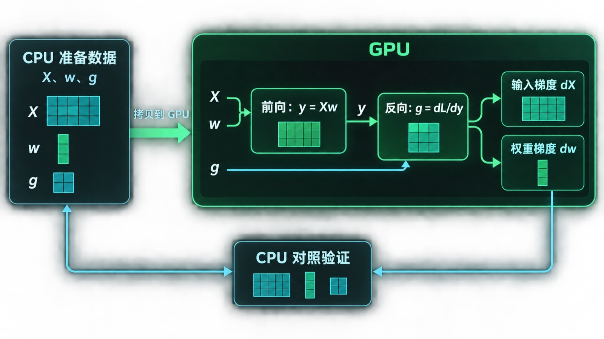

为了避免把下面这份程序误当成完整训练代码，先亮出它的能力边界：


| 能力             | 当前代码是否实现               |
| -------------- | ---------------------- |
| 单输出线性层前向计算     | 是                      |
| 当前层输入梯度 `dX`   | 是（修正版实现）               |
| 当前层权重梯度 `dW`   | 是（修正版实现）               |
| 真正的损失函数        | 否，用随机 `grad_output` 模拟 |
| 多输出线性层         | 否                      |
| 多层反向传播编排       | 否                      |
| 激活函数反向传播       | 否                      |
| bias 与 bias 梯度 | 否                      |
| 优化器更新权重        | 否                      |
| 完整训练循环         | 否                      |


下面这张表里"是"的部分，就是本文要逐行讲清的东西。

这里最重要的并行映射是：

```text
GPU 线程 0  → 样本 0 → output[0]
GPU 线程 1  → 样本 1 → output[1]
GPU 线程 2  → 样本 2 → output[2]
...
GPU 线程 1023 → 样本 1023 → output[1023]
```

线程不是凭空知道自己应该处理哪条样本。它依靠下面这一行计算全局编号：

```cpp
int row = threadIdx.x + blockIdx.x * blockDim.x;
```

接下来，我们把这行代码彻底拆开。

---

### `row` 从哪里来：Block、Thread 与全局线程编号

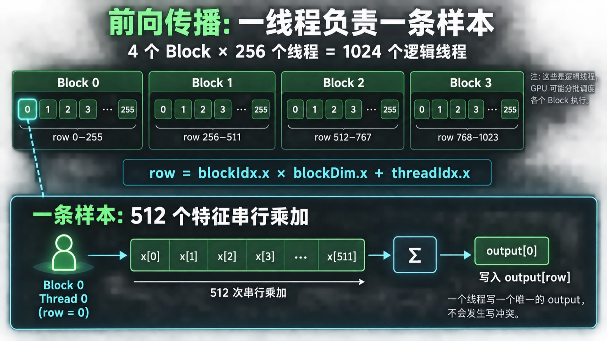

程序设置：

```python
block_size = 256
grid_size = (N + block_size - 1) // block_size
```

当 `N = 1024` 时：

```text
grid_size = (1024 + 256 - 1) // 256 = 4
```

于是 GPU 启动 4 个 Block，每个 Block 有 256 个线程，总计 1024 个线程。

```text
Block 0：线程 0～255    → row 0～255
Block 1：线程 0～255    → row 256～511
Block 2：线程 0～255    → row 512～767
Block 3：线程 0～255    → row 768～1023
```

以 Block 2 中的第 7 个线程为例：

```text
threadIdx.x = 7
blockIdx.x  = 2
blockDim.x  = 256

row = 7 + 2 × 256 = 519
```

因此，这个线程负责第 519 条样本。

#### 为什么还要判断 `row < N`

这次 `N=1024` 恰好能被 256 整除，但真实数据往往没有这么整齐。

假如 `N=1000`，仍然需要启动 4 个 Block，也就是 1024 个线程。多出来的 24 个线程没有对应样本，所以内核必须写：

```cpp
if (row < N) {
    // 只有合法线程才能访问数组
}
```

这不是可有可无的“保险代码”，而是避免越界访问的必要条件。

---

### 前向传播：一个线程完成一条样本与权重的点积

先对齐一下表达：PyTorch 里 `nn.Linear(M, 1)` 的实际权重是 `1×M` 的行矩阵，公式写作 $y=XW^T+b$；本文为了贴合"一个线程看一行、逐特征乘加"的视角，把权重展平成长度 $M$ 的向量 $w$，写作 $y=Xw$，两者数学等价。

核算员登场。每个线程负责给一个用户打分，做法是把该用户的 512 项特征逐一乘以对应的评分权重再累加。原始前向内核如下：

```cpp
__global__ void forward(
    float *input,
    float *weights,
    float *output,
    int N,
    int M)
{
    int row = threadIdx.x + blockIdx.x * blockDim.x;

    if (row < N) {
        float sum = 0.0f;

        for (int col = 0; col < M; col++) {
            sum += input[row * M + col] * weights[col];
        }

        output[row] = sum;
    }
}
```

表面上只有几行，里面却包含了 CUDA 入门最值得掌握的五个概念。

#### 1. `__global__`：这个函数由 CPU 发起、在 GPU 上执行

```cpp
__global__ void forward(...)
```

`__global__` 表示这是一个 CUDA Kernel：

- 调用方是 CPU；
- 执行方是 GPU；
- 同一个函数会被许多 GPU 线程同时执行。

Python 端的这次调用：

```python
forward_kernel(
    input_data_gpu,
    weights_gpu,
    output_data_gpu,
    np.int32(N),
    np.int32(M),
    block=(256, 1, 1),
    grid=(4, 1),
)
```

不是只执行一次 `forward`，而是启动 1024 个线程，每个线程都执行一遍同样的内核代码，只是它们看到的 `threadIdx.x` 和 `blockIdx.x` 不同。

#### 2. `float *input`：传入的是 GPU 显存地址

Python 中：

```python
input_data_gpu = cuda.to_device(input_data)
```

会在 GPU 上分配显存，并把 CPU 内存中的 `input_data` 复制过去。传给 Kernel 的 `input_data_gpu`，本质上代表设备端内存地址。

因此，内核中的：

```cpp
float *input
```

指向的不是 NumPy 数组对象，而是一段 GPU 可访问的连续显存。

#### 3. 二维矩阵为什么可以用一维下标访问

NumPy 中的 `input_data` 形状是：

```text
N 行 × M 列
```

连续的 C-order 数组在内存中按行存放：

```text
第 0 行：[X00, X01, X02, ... X0(M-1)]
第 1 行：[X10, X11, X12, ... X1(M-1)]
第 2 行：[X20, X21, X22, ... X2(M-1)]
```

摊平成一维后：

```text
[X00, X01, ..., X0(M-1), X10, X11, ..., X1(M-1), ...]
```

要找到第 `row` 行、第 `col` 列，需要先跳过前面的 `row` 行。每行有 `M` 个元素，所以偏移量是：

```text
row * M + col
```

于是：

```cpp
input[row * M + col]
```

就是数学中的 $X_{row,col}$。

例如 `M=4`，访问第 2 行第 3 列：

```text
index = 2 × 4 + 3 = 11
```

#### 4. `for (col)`：GPU 并行的是样本，不是特征

```cpp
for (int col = 0; col < M; col++)
```

这段实现采用的是：

```text
样本之间：并行
一条样本内部的 M 个特征：串行
```

也就是说，程序为 1024 条样本启动了 1024 个逻辑线程；GPU 会根据 SM 数量和资源占用，把这些线程块并发或分批调度，并不是 1024 个线程必然在同一物理时刻全部执行。对每一条样本而言，一个线程仍要依次执行 512 次乘加。

对第 `row` 条样本：

```text
sum = X[row,0] × w[0]
    + X[row,1] × w[1]
    + ...
    + X[row,M-1] × w[M-1]
```

这就是向量点积。

#### 5. `output[row] = sum`：每个线程写自己的结果

每个合法线程只写一个不同的输出位置：

```cpp
output[row] = sum;
```

线程 0 写 `output[0]`，线程 1 写 `output[1]`。线程之间没有写入同一个地址，因此这里不存在写冲突。

---

### 用一个 2×3 的小例子走完前向传播

假设：

$$
X =
\begin{bmatrix}
1 & 2 & 3 \\
4 & 5 & 6
\end{bmatrix},
\quad
w =
\begin{bmatrix}
0.1 \\
0.2 \\
0.3
\end{bmatrix}
$$

线程 0 负责第 0 条样本：

$$y_0 = 1\times0.1 + 2\times0.2 + 3\times0.3 = 1.4$$

线程 1 负责第 1 条样本：

$$y_1 = 4\times0.1 + 5\times0.2 + 6\times0.3 = 3.2$$

所以：

$$y = [1.4, 3.2]$$

如果只理解到这里，你已经读懂了原程序的前向部分。但神经网络之所以能“训练”，靠的不是只算出 $y$，而是知道损失应该沿着哪些参数往回传。

---

### 反向传播开始前：先把四个边界钉死

进入推导前，先回答一个多数读者会问的问题：这份代码，到底离"一次完整训练"差几步？

#### 边界一：没有损失函数，`grad_output` 是模拟的

完整训练要经历：预测 → 与目标值比较得到损失 → 求导得到梯度 → 更新参数。

本章示例**没有目标值、也没有损失函数**。附录 A 的代码直接随机生成了上游梯度：

```python
grad_output = rng.standard_normal(N).astype(np.float32)
```

这相当于假设损失函数已经把 $\partial L/\partial y$ 算好、传了回来。所谓"反向传播"，在这里只完成其中一个局部：已知 `grad_output`，求本层的 `grad_input` 与 `grad_weights`。它不是完整训练循环。

想看到一个真实的损失来源，最简单的是均方误差（MSE）：

$$\ell_n=\frac{1}{2}(y_n-t_n)^2,\qquad L=\frac{1}{N}\sum_{n=0}^{N-1}\ell_n$$

对 $y_n$ 求导：

$$\frac{\partial L}{\partial y_n}=\frac{y_n-t_n}{N}$$

这条公式就是 `grad_output[n]` 应有的值。用它替换随机生成后，本层的梯度就来自真实损失；但要构成一次完整训练，还需要目标值 `target`、损失值计算、参数更新（`weights -= lr * grad_weights`）和迭代训练循环——这些在本例中仍不包含。

#### 边界二：损失是 batch 平均值，`1/N` 只能出现一次

一个 batch 里有 $N$ 条样本，每条样本先有自己的损失 $\ell_n$，训练时通常取这批的平均值作为损失：

$$L=\frac{1}{N}\sum_{n=0}^{N-1}\ell_n$$

这决定了哪些梯度要跨样本求和：

输入是每个样本"私有"的，所以 `grad_input` 各算各的；权重是所有样本"共享"的，所以 `grad_weights` 必须汇总所有样本的贡献。


| 梯度                | 是否跨样本求和 | 原因             |
| ----------------- | -------: | -------------- |
| `grad_output[n]`  | 否       | 每条样本的损失各有自己的导数 |
| `grad_input[n,m]` | 否       | 每个样本有自己的输入特征   |
| `grad_weights[m]` | 是       | 所有样本共享同一份权重    |


如果损失已经用了 batch 平均，$1/N$ 就包含在 `grad_output` 里（见边界一的 MSE 导数），`grad_weights` 的 Kernel 里不要再除一次。

#### 边界三：先算完所有梯度，再统一更新参数

常见的误解是"先更新当前层权重，再带着新权重算前一层"。标准训练不是这样：

```text
第一阶段 backward ：从最后一层向第一层，只算梯度，不改任何参数
第二阶段 step     ：用已经算好的梯度，统一更新所有参数
```

框架里对应两行：

```python
loss.backward()      # 所有层的 grad_* 算好
optimizer.step()     # W1 -= lr*grad_W1，W2 -= lr*grad_W2，……
```

所以本示例只完成第一阶段（算出 `grad_weights`），没有 `weights -= lr * grad_weights` 这一步——这是刻意留下的边界，不是遗漏。

#### 边界四：`grad_input` 交给前一层，是"下一次 Kernel 调用"

假设一个两层网络：

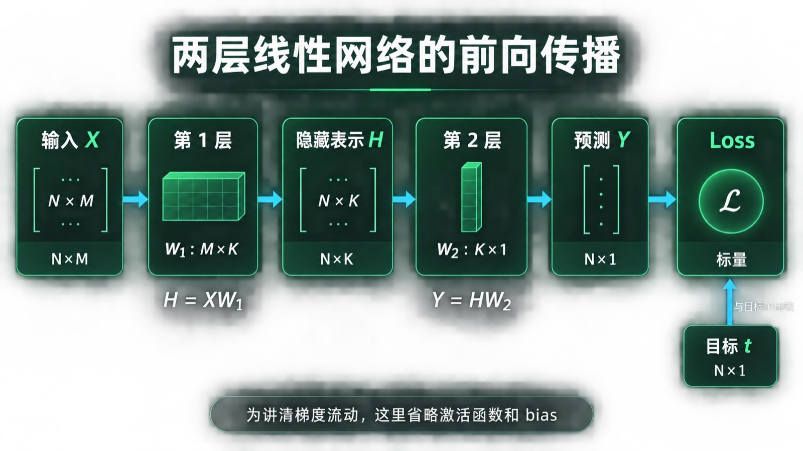

对第 2 层，$H$ 是它的输入，$\partial L/\partial H$ 是第 2 层的 `grad_input`；对第 1 层，$H$ 是它的输出，$\partial L/\partial H$ 是第 1 层的 `grad_output`。两者是同一个量：

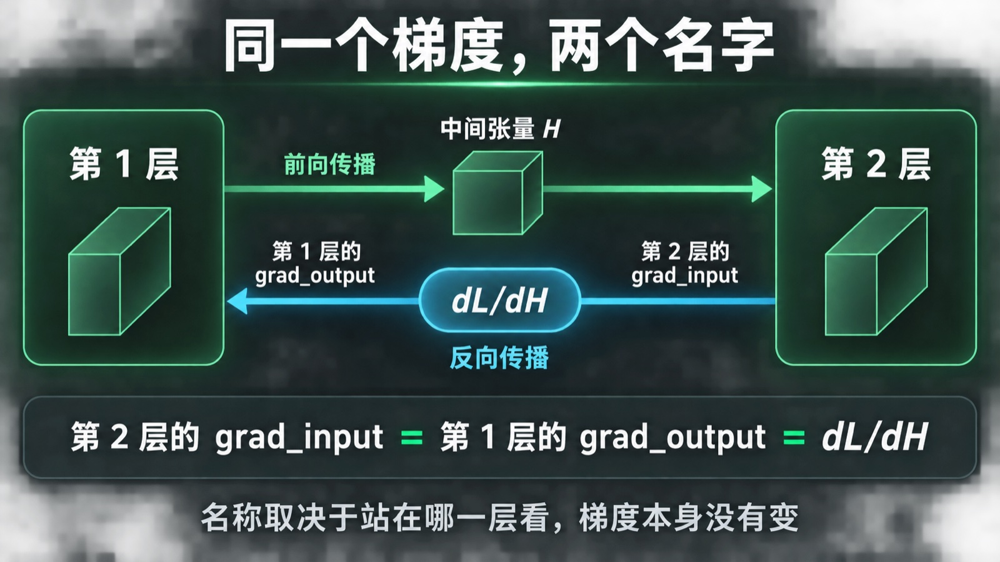

但这个交接不是 Kernel 顺手完成的，而是 CPU 端逐层发起调用。先看清楚形状：一般两层网络是 $X(N\times M)\to H(N\times K)\to Y(N\times 1)$，第 1 层（$M\to K$）有 $K$ 个隐藏单元，所以 $H$ 是矩阵而不是向量。逐层正确的写法是：

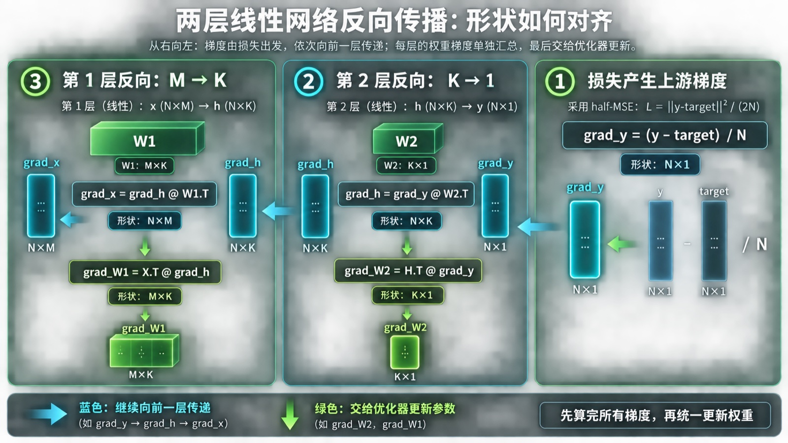

通用线性层的输入梯度，是对该层 $K$ 个输出求和：

$$\frac{\partial L}{\partial X_{n,m}}=\sum_{k=0}^{K-1}\frac{\partial L}{\partial H_{n,k}}\,W_{m,k}\quad\Longleftrightarrow\quad dX=dH\,W^T$$

本文实现的 `backward_input` 是这条通用公式在 $K=1$ 时的特例：它假定每条样本只有一个输出，因此 `grad_output[row]` 是标量、一个线程算一个分量即可。对 $K>1$ 的中间层，`grad_output` 是 $N\times K$ 矩阵，这篇文章的 Kernel 不能直接复用，需要按通用公式实现（或交给 cuBLAS 的 GEMM）。

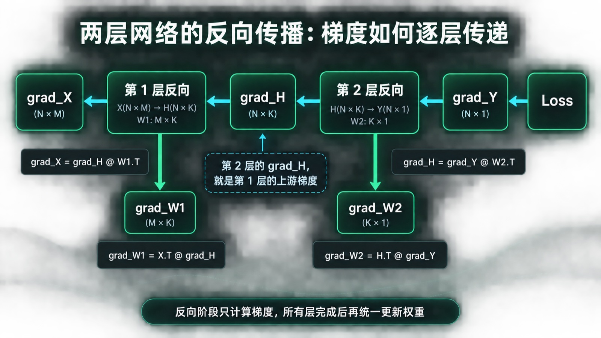

注意：本文示例只有一个线性层，`grad_input` 算完之后没有任何"前一层"来消费它。正文里说"传给前一层"，描述的是它在多层网络中的数学角色，不是本例已经实际发生的动作。

---

### 反向传播先别看代码：先认清三个梯度

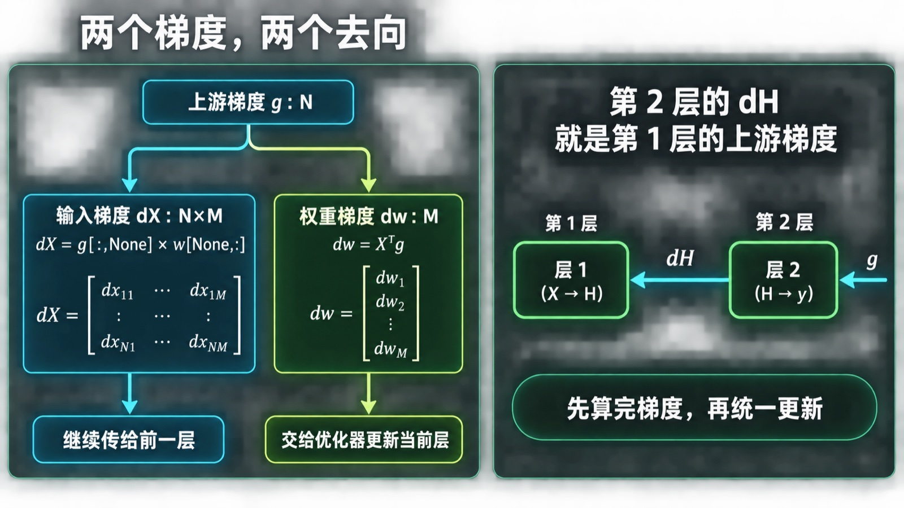

设最终损失为 $L$，线性层输出为：

$$y_n = \sum_m X_{n,m}w_m$$

承上文：损失函数（或后一层）会把边界一里说的那个上游梯度传回来：

$$g_n = \frac{\partial L}{\partial y_n}$$

它叫上游梯度，也常写作 `grad_output` 或 `dy`。

从这个上游梯度出发，线性层需要计算两类梯度。

#### 输入梯度 `grad_input`

输入 $X_{n,m}$ 对输出 $y_n$ 的局部导数是 $w_m$：

$$\frac{\partial y_n}{\partial X_{n,m}} = w_m$$

根据链式法则：

$$\frac{\partial L}{\partial X_{n,m}} = \frac{\partial L}{\partial y_n} \frac{\partial y_n}{\partial X_{n,m}} = g_n w_m$$

因此：

```text
grad_input[n, m] = grad_output[n] × weights[m]
```

它的形状必须与输入 $X$ 相同，即 $N \times M$。

#### 权重梯度 `grad_weights`

权重 $w_m$ 被所有 $N$ 条样本共同使用，所以它的梯度必须汇总所有样本的贡献：

$$\frac{\partial L}{\partial w_m} = \sum_{n=0}^{N-1} \frac{\partial L}{\partial y_n} \frac{\partial y_n}{\partial w_m} = \sum_{n=0}^{N-1} g_nX_{n,m}$$

因此：

```text
grad_weights[m] = Σ grad_output[n] × input[n, m]
```

它的形状与权重 $w$ 相同，即 $M$。

#### 三种量不要混为一谈


| 名称             | 数学含义                    | 正确形状    | 作用         |
| -------------- | -----------------------: | -------: | ---------- |
| `output`       | $y$                     | `N`     | 前向结果       |
| `grad_output`  | $\partial L/\partial y$ | `N`     | 从后一层传回来的梯度 |
| `grad_input`   | $\partial L/\partial X$ | `N × M` | 继续传给前一层    |
| `grad_weights` | $\partial L/\partial w$ | `M`     | 用来更新权重     |


这张表正是原代码问题的核心：它创建了长度为 `N` 的 `grad_input`，里面最初装的其实是 `grad_output`，随后又试图把它覆盖为输入梯度。但真正的输入梯度应该有 `N × M` 个元素，容器从一开始就不够大。

---

### 原始反向 Kernel 哪里错了

原代码的核心部分是：

```cpp
float grad = 0.0f;

for (int col = 0; col < M; col++) {
    grad += grad_input[row] * weights[col];
    grad_weights[col] += input[row * M + col] * grad_input[row];
}

grad_input[row] = grad;
```

它有三个层次的问题。

#### 问题一：`grad_input` 实际装的是 `grad_output`

Python 端创建它时写的是：

```python
grad_input = np.random.randn(N).astype(np.float32)
```

长度为 `N`，而且它在反向传播开始前就有值。根据计算过程，这些值只能代表：

```text
grad_output[row] = dL/dy[row]
```

所以更准确的变量名应该是 `grad_output`。

#### 问题二：代码算出的是一个标量和，不是真正的输入梯度

下面这行被循环执行 `M` 次：

```cpp
grad += grad_input[row] * weights[col];
```

最终得到的是 `g_row` 乘上 `M` 个权重之和：

$$grad = g_{row}\sum_m w_m$$

但真正的输入梯度是一整行向量。用一个数值例子钉死：假设第 `row` 个样本的 `grad_output[row] = 2`，`weights = [0.1, 0.2, 0.3]`，正确的输入梯度应为：

$$[2\times0.1,\ 2\times0.2,\ 2\times0.3] = [0.2,\ 0.4,\ 0.6]$$

第 `row` 个样本有 `M` 个输入特征，就该有 `M` 个输入梯度。`row` 只能定位到样本，`row` 与 `col` 一起才能定位到样本中的某一个特征——当前层有 `M` 个输入，就必须为每个样本保存 `M` 个输入梯度。

原代码却把这三项累加成一个数：

$$0.2 + 0.4 + 0.6 = 1.2$$

然后只写回一个标量：

```cpp
grad_input[row] = grad;
```

并不能得到 $dL/dX$——三行特征梯度被压缩成一个标量，无法再区分每个特征各自承担多少责任。

> **能力边界**
>
> 这个 `backward_input` Kernel 只适用于 `out_features=1` 的单输出线性层：它假定每条样本只有一个输出，因此 `grad_output[row]` 是标量。对一般的多输出中间层（$M$ 输入 → $K$ 输出），输入梯度应为 $dX = dY\,W^T$（对 $K$ 求和），本 Kernel 是 $K=1$ 时的特例。它也没有处理激活函数反向、bias 梯度、参数更新与多层编排。

#### 问题三：`grad_weights[col] += ...` 存在数据竞争

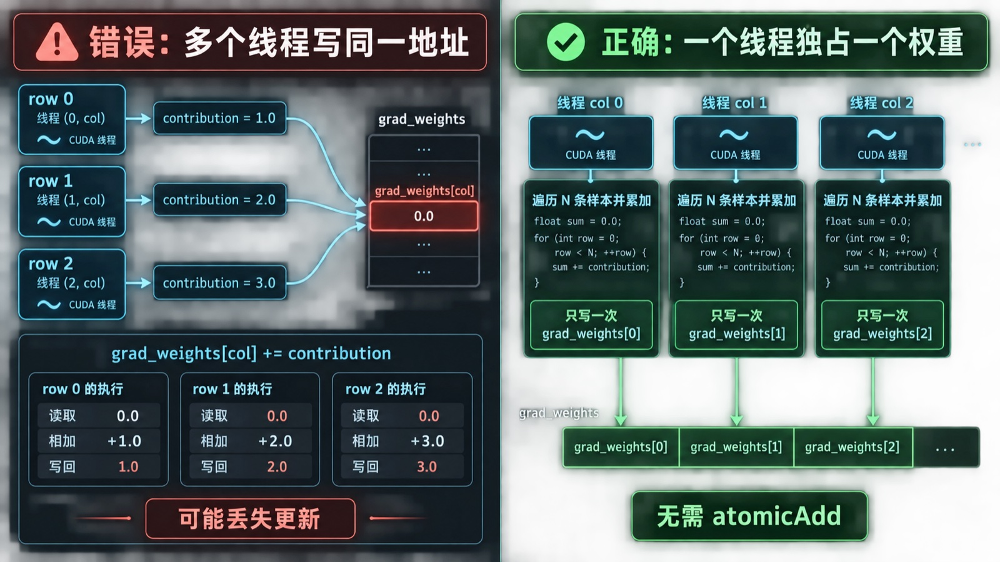

回到核算员的画面：所有线程都在更新同一套 `grad_weights`，相当于 1024 名核算员同时往同一页评分规则上改数字——后写的人会覆盖先写的人。所有样本线程都会执行：

```cpp
grad_weights[col] += input[row * M + col] * grad_input[row];
```

当多个线程同时更新同一个 `grad_weights[col]` 时，`+=` 并不是一个不可分割的动作。它大致包含：

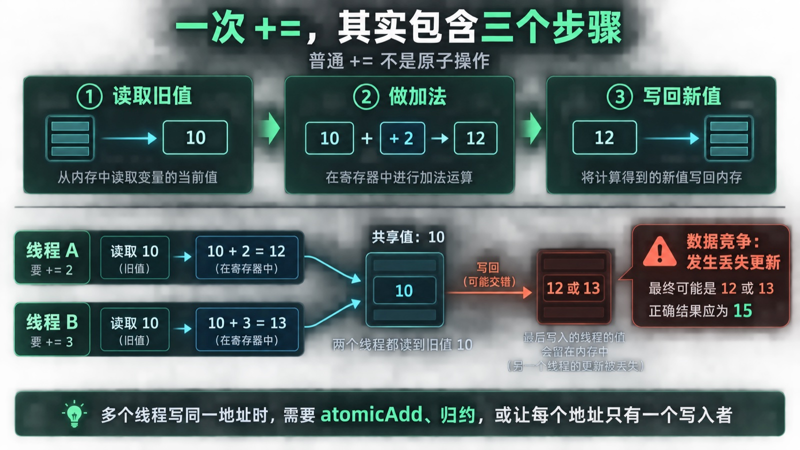

假设旧值是 10：

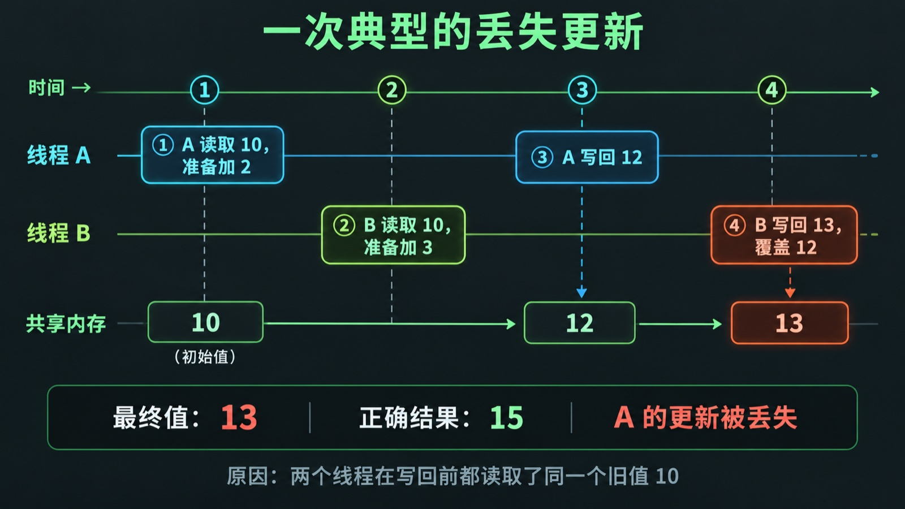

正确结果应该是 15，最终却可能只剩 12 或 13。这就是数据竞争，也叫丢失更新。

更麻烦的是：程序可能不崩溃，只是每次得到略有不同的错误答案。

#### `output` 参数没有被使用

反向内核接收了：

```cpp
float *output
```

但函数体里没有读取它。对纯线性层 $y=Xw$ 而言，计算 `dX` 和 `dw` 本来也不需要保存 `y`，所以这个参数可以删除。

---

### 正确的反向传播应该怎样并行

为了先讲清正确性，可以把反向传播拆成两个 Kernel。

#### Kernel 1：计算 `grad_input`

`grad_input` 有 `N × M` 个元素，可以让每个线程负责一个元素：

```cpp
__global__ void backward_input(
    const float *grad_output,
    const float *weights,
    float *grad_input,
    int N,
    int M)
{
    int idx = threadIdx.x + blockIdx.x * blockDim.x;
    int total = N * M;

    if (idx < total) {
        int row = idx / M;
        int col = idx % M;
        grad_input[idx] = grad_output[row] * weights[col];
    }
}
```

这里：

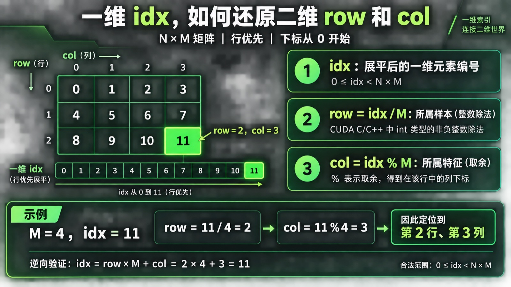

#### Kernel 2：计算 `grad_weights`

一种容易理解、没有写冲突的实现是：每个线程负责一个权重，并在该线程内部遍历所有样本。

```cpp
__global__ void backward_weights(
    const float *input,
    const float *grad_output,
    float *grad_weights,
    int N,
    int M)
{
    int col = threadIdx.x + blockIdx.x * blockDim.x;

    if (col < M) {
        float sum = 0.0f;

        for (int row = 0; row < N; row++) {
            sum += input[row * M + col] * grad_output[row];
        }

        grad_weights[col] = sum;
    }
}
```

因为线程 `col` 只写 `grad_weights[col]`，不同线程不会写同一个地址，所以无需 `atomicAdd`。

这两个 Kernel 的映射是：

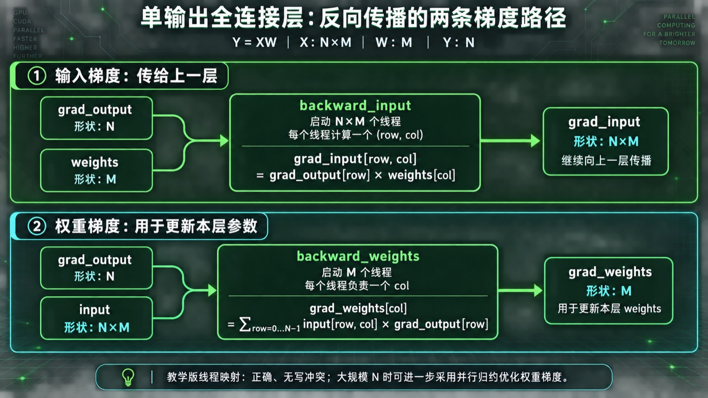

这是一份“正确性优先”的教学实现——它的目的就是演示怎样用“写入地址独占”消除竞态，不代表生产级权重梯度 Kernel。大规模场景下，`grad_weights` 通常会进一步使用分块归约、共享内存，或者直接交给 cuBLAS 完成；生产实践中，单输出权重梯度走 GEMV 或归约，多输出一般交给 GEMM，更深入的自研高性能内核则涉及 CUTLASS 等分层分块抽象。

---

这里的三个 NumPy 公式值得记住：

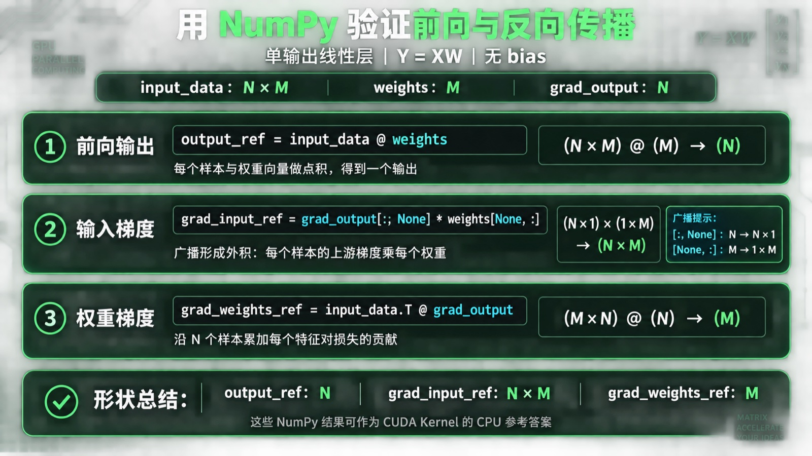

它们分别对应：

$$y=Xw$$

$$\frac{\partial L}{\partial X}=g\,w^T$$

$$\frac{\partial L}{\partial w}=X^Tg$$

---

### 为什么不用 `atomicAdd` 直接修补原代码

最小改动确实可以把：

```cpp
grad_weights[col] += contribution;
```

改成：

```cpp
atomicAdd(&grad_weights[col], contribution);
```

这样能避免丢失更新，但它不是这个例子最清晰的教学解法。

因为 `N` 个线程会反复竞争同一批 `M` 个地址。原子操作保证正确性，却可能把热点写入串行化。

还要认清 `atomicAdd` 的边界：它保证每一次更新都不丢失，但不保证浮点结果的逐位确定——线程执行顺序依旧不定，而浮点加法不满足结合律，所以不同运行之间可能只剩末位差异。教学示例里可以忽略，但要知道原子操作不是“确定性”的代名词。

更典型的优化路径是：

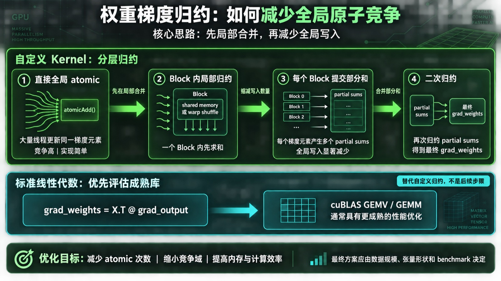

所以要区分两个问题：

- `atomicAdd` 能否修正数据竞争？能。
- `atomicAdd` 是否一定是最高效方案？不是。

---

### 原始前向 Kernel 正确，但并不高效

原始前向计算在数学上是正确的，但它的线程映射存在明显的性能局限。

同一个 Warp 中的线程在同一时刻访问：

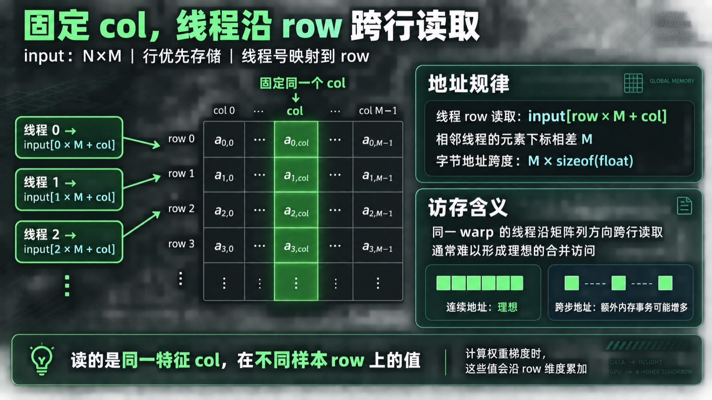

相邻线程之间相隔 `M` 个 `float`。当 `M=512` 时，地址跨度为：

```text
512 × 4 B = 2048 B
```

这不是理想的连续合并访问模式。代码对单线程来说在顺序读取一整行，但从 Warp 的同一条指令来看，32 个线程读的是相距很远的地址。

如果只是学习，这份实现足够直观；如果追求性能，可以考虑：

1. 让一个线程块协作计算一条或多条样本；
2. 使用共享内存或 Warp Reduction 完成点积归约；
3. 让线程访问方式更利于合并访存；
4. 实际工程中优先使用 cuBLAS 的 GEMV/GEMM；
5. 多输出全连接层常转化为矩阵乘法（GEMM）；在硬件架构、数据类型（FP16/BF16/TF32/FP8）、矩阵尺寸与库选核等条件满足时，cuBLAS/cuBLASLt 才会选用 Tensor Core 内核。

手写 Kernel 的价值主要是理解计算与并行映射；成熟库的价值是把分块、向量化、流水线和硬件特性做到更好。

不同阶段可以参考这条路线：


| 学习目标            | 推荐路径                    |
| --------------- | ----------------------- |
| 线程、索引、梯度的直觉     | 本文手写 PyCUDA Kernel      |
| 数组级 GPU 计算      | CuPy 等 GPU 数组工具         |
| 深度学习训练          | PyTorch / JAX 等框架       |
| 生产级线性代数         | cuBLAS / cuBLASLt       |
| 自定义高性能矩阵 Kernel | CUDA C++、CUTLASS、Triton |


---

### 原程序的计时为什么不是“纯 Kernel 耗时”

原代码大致是这个计时思路：

```python
start_time = time.time()
forward_kernel(...)
output_data_gpu.get(output_data)
end_time = time.time()
```

不过在谈计时之前，要先纠正一个会让原程序直接崩掉的 API 错误：`cuda.to_device()` 返回的是 `pycuda.driver.DeviceAllocation`，它没有 `.get()` 方法——`.get()` 是 `pycuda.gpuarray.GPUArray` 独有的。想用 `.get()` 回读，前面得改用 `gpuarray.to_gpu()`；要么就用 `cuda.memcpy_dtoh(dst, src)` 把结果拷回 CPU（附录 A 的修正版采用的就是后者）。

也就是说，原程序即便没有任何梯度问题，也会在这一行抛出 `AttributeError`，根本到不了“打印结果”。所以下面的计时讨论，默认已经修好了这一行。

CUDA Kernel 通常是异步发射的：CPU 把任务提交给 GPU 后，不必立刻等它执行完。

而无论用 `GPUArray.get()` 还是 `memcpy_dtoh()`，把结果拷回 CPU 的动作都会等待前面的 GPU 工作完成。因此这段时间更接近：

```text
Python 调用开销
+ Kernel 执行
+ GPU → CPU 拷贝
+ 同步等待
```

反向传播计时还包含两次结果回传，所以它与前向耗时也不能直接公平对比。

如果目标是测量设备端 Kernel，应使用 CUDA Event；如果目标是测量业务端端到端延迟，则应明确保留数据传输和同步。两种计时都合理，关键是不要混称。

另外提醒一句：单次 Event 只用来演示 API 用法，不是稳定的性能结论。`SourceModule` 的编译发生在 Event 计时之前，并不计入这里的 Kernel 时间；但首次调用仍可能受上下文初始化、模块加载、GPU 时钟与缓存状态影响，因此需要预热并重复测量。下面的预热与中位数写法适用于正式 benchmark；附录 A 的代码刻意保持单次 Event 演示，只为展示 API 用法、不作性能结论。可靠做法是先预热、再多次测量取中位数或 P95：

```python
# 预热：反复启动几次，让编译和驱动进入稳定状态
for _ in range(20):
    forward_kernel(...)

# 正式测量：多取几轮，用中位数代表稳定值
times = []
for _ in range(100):
    start.record()
    forward_kernel(...)
    end.record()
    end.synchronize()
    times.append(start.time_till(end))

median_ms = np.median(times)
```

---

### 小结：两个梯度分别流向哪里

把边界三、边界四与"三种梯度"表收拢成一句话：

> `grad_input` 是"责任"，继续向网络前方传递；`grad_weights` 是"调整方向"，交给优化器更新当前层参数。

补充三点：

- 方向由负梯度决定：$\partial L/\partial w$ 为正，则 $w$ 应减小；为负则增大；绝对值越大，损失对该权重越敏感。
- 最简单的更新是梯度下降 $w \leftarrow w-\eta\,\partial L/\partial w$；Adam 等现代优化器在此基础上维护动量和二阶统计，但输入始终离不开正确的 `grad_weights`。
- 执行顺序按边界三：先算完所有层的梯度，再统一更新，不在反向过程中边算边改。

---

### 怎样证明梯度真的正确：不要只看“能运行”

CUDA 程序没有报错，只能证明它没有触发可见的运行时故障，不能证明数学结果正确。

至少应做三层验证。

#### 第一层：与 NumPy 参考实现对照

```python
np.testing.assert_allclose(gpu_result, cpu_reference)
```

这是最直接、最必要的验证。

#### 第二层：检查形状

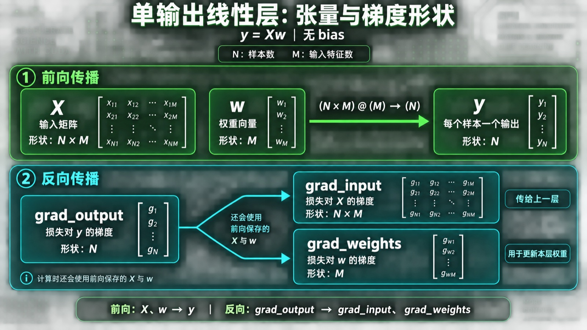

很多反向传播错误，在形状检查阶段就能发现。

#### 第三层：有限差分梯度检查

对某个权重 $w_m$ 加一个很小的扰动 $\varepsilon$：

$$\frac{\partial L}{\partial w_m} \approx \frac{L(w_m+\varepsilon)-L(w_m-\varepsilon)}{2\varepsilon}$$

再把数值梯度与 CUDA 反向传播结果对比。有限差分速度慢，但很适合验证新写的 Kernel。

---

### 这份程序最值得带走的 10 个结论

1. `row = blockIdx.x * blockDim.x + threadIdx.x` 把线程映射到样本。
2. `input[row * M + col]` 是二维行优先数组的一维寻址公式。
3. 原前向 Kernel 采用“一线程一条样本”，样本并行、特征串行。
4. 这是 `out_features=1`、`bias=False` 的线性层，是多输出全连接层的一个合法特例。
5. `grad_output` 是从后一层传回来的 $dL/dy$，不能与 `grad_input` 混用。
6. 真正的 `grad_input=dL/dX` 形状是 `N×M`，元素为 `grad_output[n] × weights[m]`。
7. `grad_weights=dL/dw` 要汇总所有样本，元素为 `Σ input[n,m] × grad_output[n]`。
8. 多线程执行普通 `+=` 更新同一地址会产生数据竞争；能打印数字不等于答案正确。
9. 当前 Kernel 只计算一层的局部梯度，不会自动调用前一层；`grad_input` 只有在被下一次 Kernel 调用当作前一层的 `grad_output` 时，才算真正完成层间梯度传递。
10. 本例没有损失函数、激活函数、优化器和多层编排，是梯度教学程序，不是完整训练程序。

---

### 结语：神经网络的“魔法”，最终会落到索引、乘加与同步

从 Python 看，全连接层可能只是一行：

```python
y = X @ w
```

从 GPU 看，它变成了四个具体问题：

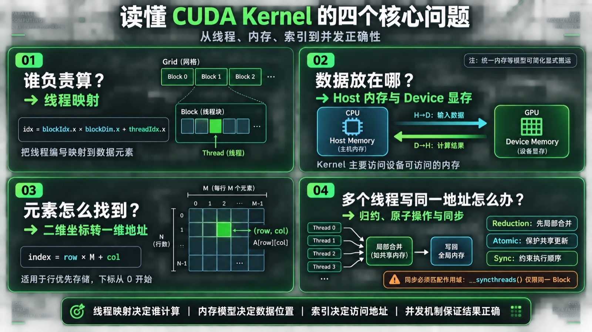

前向传播负责算出结果，反向传播负责回答“结果为什么错、每个输入和参数应承担多少责任”。

而 `grad_input` 与 `grad_weights` 的区别，正是理解反向传播的分水岭：一个把梯度继续传回前一层，一个把调整方向交给优化器。

当你能从形状、公式、线程和内存四个角度同时解释这段代码时，CUDA Kernel 就不再是一串难懂的下标，神经网络也不再是一只黑箱。

---

### 附录 A：修正版完整代码

下面这份代码保留原程序的整体结构，修正了变量语义、梯度形状、并发写冲突和计时方式，并给每个 Kernel 与关键调用加了注释，方便对照正文逐段核对。

```python
# 导入 PyCUDA 驱动模块，并使用 cuda 作为简短别名
import pycuda.driver as cuda

# 自动初始化 CUDA Driver、选择默认 GPU 并创建 CUDA 上下文
import pycuda.autoinit

# 导入 NumPy，用于在 CPU 端生成数组和计算参考答案
import numpy as np

# 导入 SourceModule，用于在运行时编译 CUDA C/C++ 源码字符串
from pycuda.compiler import SourceModule


# 使用原始字符串保存 CUDA C/C++ 源码，避免 Python 转义影响源码内容
kernel_code = r"""
// forward：计算单输出线性层 y = Xw
__global__ void forward(
    const float *input,   // 输入矩阵 X，形状为 N×M，只读
    const float *weights, // 权重向量 w，长度为 M，只读
    float *output,        // 输出向量 y，长度为 N，由 Kernel 写入
    int N,                // 样本数量，也就是输入矩阵的行数
    int M)                // 特征数量，也就是输入矩阵的列数
{
    // 计算当前线程在整个一维 Grid 中的全局编号，并把它作为样本行号
    int row = threadIdx.x + blockIdx.x * blockDim.x;

    // 只让拥有合法样本行号的线程继续执行，避免数组越界
    if (row < N) {
        // 使用寄存器中的局部变量保存当前样本点积的累加结果
        float sum = 0.0f;

        // 依次遍历当前样本的全部 M 个特征
        for (int col = 0; col < M; col++) {
            // 读取 X[row,col] 和 w[col]，完成一次乘法并累加到 sum
            sum += input[row * M + col] * weights[col];
        }

        // 当前线程把最终点积写入自己负责的输出位置
        output[row] = sum;
    }
}


// backward_input：计算输入梯度 dL/dX = grad_output × weights^T
__global__ void backward_input(
    const float *grad_output, // 上游梯度 dL/dy，长度为 N，只读
    const float *weights,     // 前向使用的权重向量 w，长度为 M，只读
    float *grad_input,        // 待写入的输入梯度 dL/dX，形状为 N×M
    int N,                    // 样本数量
    int M)                    // 特征数量
{
    // 为 N×M 个输入梯度元素建立一维全局编号
    int idx = threadIdx.x + blockIdx.x * blockDim.x;

    // 计算输入矩阵和输入梯度矩阵的元素总数
    int total = N * M;

    // 过滤向上取整后多启动的线程，避免越界
    if (idx < total) {
        // 用整数除法把一维编号还原为二维行号
        int row = idx / M;

        // 用取模运算把一维编号还原为二维列号
        int col = idx % M;

        // 根据链式法则计算 dL/dX[row,col] = dL/dy[row] × w[col]
        grad_input[idx] = grad_output[row] * weights[col];
    }
}


// backward_weights：计算权重梯度 dL/dw = X^T × grad_output
__global__ void backward_weights(
    const float *input,       // 前向输入矩阵 X，形状为 N×M，只读
    const float *grad_output, // 上游梯度 dL/dy，长度为 N，只读
    float *grad_weights,      // 待写入的权重梯度 dL/dw，长度为 M
    int N,                    // 样本数量
    int M)                    // 特征数量
{
    // 让每个线程负责一个特征列，也就是一个权重梯度元素
    int col = threadIdx.x + blockIdx.x * blockDim.x;

    // 只让列号位于 [0,M) 内的线程继续执行
    if (col < M) {
        // 在寄存器中保存当前权重收到的全部样本贡献
        float sum = 0.0f;

        // 遍历全部 N 条样本，完成当前列上的归约
        for (int row = 0; row < N; row++) {
            // 累加 X[row,col] × dL/dy[row]
            sum += input[row * M + col] * grad_output[row];
        }

        // 当前线程独占 grad_weights[col]，因此不会发生并发写冲突
        grad_weights[col] = sum;
    }
}
"""


# 调用 NVCC 编译 CUDA 源码，并把结果加载为 PyCUDA 模块
module = SourceModule(kernel_code)

# 从编译后的模块中取得名为 forward 的 Kernel 句柄
forward_kernel = module.get_function("forward")

# 从编译后的模块中取得计算输入梯度的 Kernel 句柄
backward_input_kernel = module.get_function("backward_input")

# 从编译后的模块中取得计算权重梯度的 Kernel 句柄
backward_weights_kernel = module.get_function("backward_weights")


# 设置样本数量：一共有 1024 条输入样本
N = 1024

# 设置特征数量：每条样本包含 512 个 float32 特征
M = 512

# 创建固定种子的随机数生成器，保证每次运行都能复现实验数据
rng = np.random.default_rng(42)

# 生成形状为 N×M 的 float32 输入矩阵 X
input_data = rng.random((N, M), dtype=np.float32)

# 生成长度为 M 的 float32 权重向量 w
weights = rng.standard_normal(M).astype(np.float32)

# 为长度为 N 的前向输出 y 分配 CPU 内存，内容稍后由 GPU 覆盖
output_data = np.empty(N, dtype=np.float32)

# 生成长度为 N 的上游梯度 dL/dy，它是反向传播的输入
grad_output = rng.standard_normal(N).astype(np.float32)

# 为真正的输入梯度 dL/dX 分配 N×M 的 CPU 数组
grad_input = np.empty((N, M), dtype=np.float32)

# 为权重梯度 dL/dw 分配长度为 M 的 CPU 数组
grad_weights = np.empty(M, dtype=np.float32)


# 在 GPU 上分配输入显存，并把 input_data 从 CPU 复制到 GPU
input_gpu = cuda.to_device(input_data)

# 在 GPU 上分配权重显存，并把 weights 从 CPU 复制到 GPU
weights_gpu = cuda.to_device(weights)

# 只为前向输出分配 GPU 显存，因为输出会被 Kernel 完整写入
output_gpu = cuda.mem_alloc(output_data.nbytes)

# 在 GPU 上分配上游梯度显存，并把 grad_output 从 CPU 复制到 GPU
grad_output_gpu = cuda.to_device(grad_output)

# 只为输入梯度分配 GPU 显存，因为全部元素会被 backward_input 写入
grad_input_gpu = cuda.mem_alloc(grad_input.nbytes)

# 只为权重梯度分配 GPU 显存，因为全部元素会被 backward_weights 写入
grad_weights_gpu = cuda.mem_alloc(grad_weights.nbytes)


# 设置每个一维线程块包含 256 个线程
block_size = 256

# PyCUDA 使用三元组描述 Block 的 x、y、z 三个维度
block = (block_size, 1, 1)

# 为 N 个前向任务计算一维 Grid 大小，并使用向上取整避免遗漏样本
grid_n = ((N + block_size - 1) // block_size, 1)

# 为 N×M 个输入梯度元素计算一维 Grid 大小
grid_nm = ((N * M + block_size - 1) // block_size, 1)

# 为 M 个权重梯度元素计算一维 Grid 大小
grid_m = ((M + block_size - 1) // block_size, 1)


# 创建记录 GPU 前向起始时刻的 CUDA Event
forward_start = cuda.Event()

# 创建记录 GPU 前向结束时刻的 CUDA Event
forward_end = cuda.Event()

# 把前向开始事件记录到当前 CUDA Stream
forward_start.record()

# 启动前向 Kernel：每个线程负责一条样本的点积
forward_kernel(
    input_gpu,             # 参数1：GPU 上的输入矩阵
    weights_gpu,           # 参数2：GPU 上的权重向量
    output_gpu,            # 参数3：GPU 上的输出数组
    np.int32(N),           # 参数4：以 int32 形式传入样本数量
    np.int32(M),           # 参数5：以 int32 形式传入特征数量
    block=block,           # 指定每个 Block 的线程组织
    grid=grid_n,           # 指定前向计算所需的 Block 数量
)

# 把前向结束事件排在 Kernel 之后
forward_end.record()

# 等待结束事件完成，确保前向 Kernel 已经执行完毕
forward_end.synchronize()

# 计算两个 Event 之间的设备端时间，单位为毫秒
forward_ms = forward_start.time_till(forward_end)


# 创建记录反向传播起始时刻的 CUDA Event
backward_start = cuda.Event()

# 创建记录反向传播结束时刻的 CUDA Event
backward_end = cuda.Event()

# 把反向开始事件记录到当前 CUDA Stream
backward_start.record()

# 启动输入梯度 Kernel：每个线程负责 dL/dX 中的一个元素
backward_input_kernel(
    grad_output_gpu,       # 参数1：GPU 上的上游梯度 dL/dy
    weights_gpu,           # 参数2：GPU 上的权重向量
    grad_input_gpu,        # 参数3：GPU 上待写入的输入梯度
    np.int32(N),           # 参数4：样本数量
    np.int32(M),           # 参数5：特征数量
    block=block,           # 指定每个 Block 的线程组织
    grid=grid_nm,          # 指定覆盖 N×M 个元素的 Grid
)

# 启动权重梯度 Kernel：每个线程负责一个权重梯度元素
backward_weights_kernel(
    input_gpu,             # 参数1：GPU 上的前向输入矩阵
    grad_output_gpu,       # 参数2：GPU 上的上游梯度 dL/dy
    grad_weights_gpu,      # 参数3：GPU 上待写入的权重梯度
    np.int32(N),           # 参数4：样本数量
    np.int32(M),           # 参数5：特征数量
    block=block,           # 指定每个 Block 的线程组织
    grid=grid_m,           # 指定覆盖 M 个权重的 Grid
)

# 把反向结束事件排在两个反向 Kernel 之后
backward_end.record()

# 等待反向结束事件完成，确保两个反向 Kernel 都执行完毕
backward_end.synchronize()

# 计算两个反向 Kernel 的设备端总耗时，单位为毫秒
backward_ms = backward_start.time_till(backward_end)


# 把 GPU 上的前向输出复制回 CPU 的 output_data
cuda.memcpy_dtoh(output_data, output_gpu)

# 把 GPU 上的输入梯度复制回 CPU 的 grad_input
cuda.memcpy_dtoh(grad_input, grad_input_gpu)

# 把 GPU 上的权重梯度复制回 CPU 的 grad_weights
cuda.memcpy_dtoh(grad_weights, grad_weights_gpu)


# 使用 NumPy 矩阵向量乘法计算前向传播参考答案 y = Xw
output_ref = input_data @ weights

# 利用广播计算输入梯度参考答案 dL/dX[n,m] = dL/dy[n] × w[m]
grad_input_ref = grad_output[:, None] * weights[None, :]

# 使用矩阵向量乘法计算权重梯度参考答案 dL/dw = X^T × dL/dy
grad_weights_ref = input_data.T @ grad_output


# 使用相对和绝对容差检查 GPU 前向输出是否接近 NumPy 结果
np.testing.assert_allclose(
    output_data,
    output_ref,
    rtol=1e-4,
    atol=1e-4,
)

# 检查 GPU 输入梯度是否接近 NumPy 广播计算结果
np.testing.assert_allclose(
    grad_input,
    grad_input_ref,
    rtol=1e-4,
    atol=1e-4,
)

# 检查 GPU 权重梯度是否接近 NumPy 矩阵向量乘法结果
np.testing.assert_allclose(
    grad_weights,
    grad_weights_ref,
    rtol=1e-4,
    atol=1e-4,
)


# 打印前向 Kernel 的设备端执行时间
print(f"前向 Kernel 执行时间: {forward_ms:.3f} ms")

# 打印两个反向 Kernel 的设备端总执行时间
print(f"反向 Kernels 执行时间: {backward_ms:.3f} ms")

# 明确告诉读者三组结果已经通过 CPU 参考实现验证
print("前向输出、输入梯度和权重梯度均通过 NumPy 对照验证")

# 打印第一条样本前 5 个输入特征对应的梯度
print("grad_input[0, :5] =", grad_input[0, :5])

# 打印前 5 个权重对应的梯度
print("grad_weights[:5] =", grad_weights[:5])
```

---

<a id="article-02"></a>

## 第 02 篇｜反向传播不是魔法：用 PyCUDA 拆开全连接层的 `dX`、`dW` 与 SGD

<!-- source: 02-pycuda-fully-connected-backprop-light-tech.md -->

> **副标题**：从一组矩阵公式，走到线程映射、合并访存、原地更新、数值校验与 kernel-only Benchmark
>
> **工程深度**：L2，可运行、可验证、可继续优化
>
> **关键词**：PyCUDA / CUDA Kernel / 全连接层 / Backpropagation / SGD / CUDA Event / Numerical Validation

---

### 开篇：一个看似合理的二维输入，为什么会让模型悄悄变样？

第一次手写全连接层反向传播时，人很容易把所有数据都做成二维矩阵：

```python
input_data = np.random.rand(M, N)
weights = np.random.rand(M, N)
```

然后在 CUDA 内核中写：

```cpp
input[i * N + j]
```

代码不越界，程序也可能正常运行。但它计算的已经不是通常意义上的单样本全连接层：

$$y_i=\sum_j W_{i,j}X_{i,j}$$

它让第 `i` 个输出使用第 `i` 行输入，本质是 `M` 组逐行点积。

标准单样本全连接层只有一份输入：

$$y_i=\sum_jW_{i,j}x_j$$

所有输出神经元共享同一个 `x[N]`，区别只在于各自使用不同的一行权重。

这一维之差，会继续影响 `dX`、`dW`、线程映射和验证代码。更麻烦的是，很多错误不会触发 CUDA 越界，只会让程序**稳定地算错另一个模型**。

所以反向传播真正的门坎不在公式，而在把公式翻译成执行事实：**谁读、谁写、什么时候读、什么时候写，以及怎么用证据证明它算对了**。形状 → 数学 → 线程所有权 → 读写冲突 → 访存模式 → CPU Reference → 可信计时 → Profiler 定性，这一整条链路才是本文的主线。

这篇文章不把反向传播当黑盒，而是沿着这条完整工程链路拆开它。需要提前说清的一点是：本文 kernel 把反向传播和第一步 SGD 参数更新**融合在同一个 kernel 里**——反传与参数更新的融合（backward + update fusion），这不是绕路，而是理解「权重原地更新为什么安全」的一把钥匙。


最终得到一份可以直接运行的 PyCUDA 示例，同时回答五个关键问题：

1. 为什么单样本输入是 `[N]`，而不是 `[M,N]`？
2. 为什么 `dX` 要遍历 `M` 个输出神经元？
3. 为什么权重梯度必须乘输入？
4. 原地更新权重时，如何保证 `dX` 使用的是旧权重？
5. 为什么一个看起来正确的 Benchmark，可能比较的是 `W20` 和 `W1`？

---

### 一、先把形状钉死：代码的第一道单元测试

设这一层有：

- `N` 个输入特征；
- `M` 个输出神经元；
- 一个输入样本。

那么张量形状应该是：

| 含义 | 数学符号 | 代码变量 | 形状 |
|---|---:|---|---:|
| 输入 | $x$ | `input` | `[N]` |
| 权重 | $W$ | `weights` | `[M,N]` |
| 输出 | $y$ | `output` | `[M]` |
| 输出梯度 | $dY$ | `grad_output` | `[M]` |
| 输入梯度 | $dX$ | `grad_input` | `[N]` |
| 权重梯度 | $dW$ | 内核中隐式计算 | `[M,N]` |

前向传播是：

$$\boxed{y=Wx}$$

展开第 `i` 个输出：

$$y_i=\sum_{j=0}^{N-1}W_{i,j}x_j$$

可以把它理解为：

```text
                         W[M,N]

                  x0    x1    x2   ...  xN-1
               ┌────────────────────────────┐
输出神经元 0   │ W00   W01   W02   ...     │ → y0
输出神经元 1   │ W10   W11   W12   ...     │ → y1
      ...      │ ...                        │
输出神经元 M-1 │ ...                 W(M-1) │ → yM-1
               └────────────────────────────┘

所有行都读取同一个 x[N]，每一行使用自己的权重。
```

#### `[M,N]` 输入到底代表什么？

`X[M,N]` 本身不是非法形状。问题不在形状，而在于同一个第一维被同时当成「输出神经元数量」和「样本数量」，两个语义挤在同一根轴上。

如果它表示批量输入，第一维应该命名为批大小 `B`：

```text
X[B,N] @ W[K,N]ᵀ → Y[B,K]
```

其中 `K` 才是输出神经元数量。批大小和输出维度是两个独立概念，不能都叫 `M`。

如果继续使用：

```text
X[M,N]
W[M,N]
Y[M]
```

并计算：

$$Y_i=\operatorname{dot}(X_{i,:},W_{i,:})$$

从纯数学角度，`sum_j X[i,j]*W[i,j]` 是一个完全合法的计算——它是 `M` 组逐行向量点积。但在**本文定义的单样本 Linear 语义下**，它不是同一个计算：所有输出神经元应该共享同一份输入 `x[N]`，而这里的第 `i` 个输出只拿到第 `i` 行输入。

因此本文选择最清晰的单样本模型：

```text
x[N] + W[M,N] → y[M]
```

---

### 二、反向传播从哪里开始？

假设后续网络或损失函数已经给出了：

$$dY=\frac{\partial L}{\partial y}$$

它在代码中叫 `grad_output`，因为它是“当前层输出对应的梯度”，不是前向输出 `y` 本身。

反向传播需要得到两样东西：

$$dX=\frac{\partial L}{\partial x}$$

用于继续传给上一层；以及：

$$dW=\frac{\partial L}{\partial W}$$

用于更新当前层参数。

整体关系如下：

```text
Forward

x[N] ─────────────→ Linear(W[M,N]) ─────────────→ y[M]


Backward

dX[N] ←──────────── Linear(W[M,N]) ←──────────── dY[M]
                           │
                           └────────────→ dW[M,N]
```

---

### 三、为什么 `dX = WᵀdY`？

从第 `i` 个输出开始：

$$y_i=\sum_jW_{i,j}x_j$$

要求第 `j` 个输入的梯度：

$$\frac{\partial L}{\partial x_j} = \sum_i \frac{\partial L}{\partial y_i} \frac{\partial y_i}{\partial x_j}$$

由于：

$$\frac{\partial y_i}{\partial x_j}=W_{i,j}$$

所以：

$$\boxed{dX_j=\sum_{i=0}^{M-1}W_{i,j}dY_i}$$

写成矩阵形式：

$$\boxed{dX=W^TdY}$$

这也解释了为什么计算一个 `dX[j]` 时必须遍历 `M` 个输出神经元：输入特征 `x[j]` 同时影响了全部 `M` 个输出，反向传播必须把这 `M` 条路径的贡献加起来。

注意，准确说法不是“输入梯度等于权重乘权重梯度”，而是：

> 输入梯度等于权重矩阵的转置乘输出梯度。

`dY` 与 `dW` 是两个完全不同的量。

---

### 四、为什么 `dW` 必须乘输入？

继续对权重 `W[i,j]` 求导：

$$\frac{\partial L}{\partial W_{i,j}} = \frac{\partial L}{\partial y_i} \frac{\partial y_i}{\partial W_{i,j}}$$

而：

$$\frac{\partial y_i}{\partial W_{i,j}}=x_j$$

因此：

$$\boxed{dW_{i,j}=dY_i x_j}$$

矩阵形式是一个外积：

$$\boxed{dW=dYx^T}$$

这就是权重更新里必须乘 `input[j]` 的原因：权重对当前输出的影响，与流过这条连接的输入值成正比。

如果 `x[j]=0`，这一权重对当前样本的输出没有贡献，因此当前样本产生的 `dW[i,j]` 也为零。

SGD 更新为：

$$\boxed{W_{i,j}\leftarrow W_{i,j}-\eta dY_i x_j}$$

对应 CUDA：

```cpp
weights[i * N + j] =
    old_weight - learning_rate * grad_output[i] * input[j];
```

#### 这不是纯 backward：它融合了参数更新

先做一个重要的边界定义。标准训练流程里，backward 和参数更新在时间上是分开的两步：

```text
标准训练流程：

Forward
    ↓
Backward
    ├── dX   （传给上一层）
    └── dW   （这一层自己的权重梯度）
          ↓
      Optimizer
          ↓
      W ← W - η·dW
```

而本文为了教学，把 **Backward + SGD Update 融合成一个 kernel**：

```text
              ┌───────────────┐
dY ──────────→│               │
x ───────────→│ fused kernel  │──→ dX
W ───────────→│               │
              └───────┬───────┘
                      │
                      ↓
                 updated W
```

因此有一个必须说清的定义：

> 本文 kernel 的输出不是传统意义上的 `(dX, dW)`，而是 `(dX, W_new)`。`dW` 只在数学推导中隐式存在，并没有单独写入显存——它被消费、应用进了 `W_new`。

这也是为什么文章开头强调「thread j 负责 `dX[j]` 以及整列 `W[:,j]` 的更新」：列归属既服务 `dX` 的累加，也服务权重更新。后面看代码时，请记住这个 kernel 同时扮演了 backward 和 optimizer 两个角色。

这里也要收敛一下边界：本文融合的是**最简单的 SGD（随机梯度下降）**更新 `W ← W − η·dW`。Momentum、Adam/AdamW 等优化器需要额外的 optimizer state（动量、一阶/二阶矩），不能直接用这一条公式替代——它们要么把这些 state 也搬进 kernel，要么让 backward 仍然显式输出 `dW`。

同理，`dW` 只存在于数学推导、不落显存，这个接口只适合「算完梯度立刻用它更新」的场景。如果上层训练框架还需要梯度裁剪、梯度累积、梯度检查、梯度通信，或者需要把 `dW` 保存下来，那么 fused kernel 的接口就不够用了，需要显式输出 `dW`，或把这些操作一起融合进 kernel。

再补一个小矩阵例子，把 `dW=dYx^T` 钉死。设：

```text
x  = [ x0  x1  x2 ]
dY = [ g0  g1 ]

W =
[ W00  W01  W02
  W10  W11  W12 ]
```

那么：

```text
dW = dY x^T =
[ g0*x0   g0*x1   g0*x2
  g1*x0   g1*x1   g1*x2 ]
```

对应到 kernel 里「一个线程拥有一列」：

```text
thread j=0：W00 ← W00 - lr*g0*x0      W10 ← W10 - lr*g1*x0
thread j=1：W01 ← W01 - lr*g0*x1      W11 ← W11 - lr*g1*x1
thread j=2：W02 ← W02 - lr*g0*x2      W12 ← W12 - lr*g1*x2
```

每个权重元素更新的缩放因子恰好是 `dY[i] * x[j]`——外积公式和线程所有权就这样对上了。

---

### 五、线程怎么分工：一个线程承包一列

本文选择：

$$\boxed{\text{thread }j\rightarrow dX_j+W_{:,j}\text{ 的更新}}$$

也就是：

```text
Thread 0 → dX[0] → 更新 W[0,0], W[1,0], ..., W[M-1,0]
Thread 1 → dX[1] → 更新 W[0,1], W[1,1], ..., W[M-1,1]
Thread 2 → dX[2] → 更新 W[0,2], W[1,2], ..., W[M-1,2]
...
```

不同线程拥有不同的列 `j`，因此不会写入同一个权重元素：

```text
                 W[M,N]

              列0       列1       列2
               │         │         │
               ▼         ▼         ▼
            Thread 0  Thread 1  Thread 2
               │         │         │
               ▼         ▼         ▼
             dX[0]     dX[1]     dX[2]
```

所以这个特定映射不需要：

```cpp
atomicAdd()
```

也不需要线程块内屏障：

```cpp
__syncthreads()
```

#### 为什么跨行循环仍能形成合并访问？

单个线程确实沿着一列访问：

```cpp
weights[i * N + j]
```

但 GPU 是否合并访存，要从 warp 的同一条指令看。

当某一轮 `i` 固定时：

```text
Thread 0  → W[i,0]
Thread 1  → W[i,1]
Thread 2  → W[i,2]
...
Thread 31 → W[i,31]
```

相邻线程读取相邻 `float`，因此这里的**合并结论有条件**：在 `N` 足够大（至少覆盖一个 warp）、线程沿 `j` 连续映射、数据布局为 C-order `[M,N]` 的前提下，每一轮 `i` 都会形成典型的连续 warp 访问；如果 `N` 小于 warp size（32），或 warp 恰好跨越行边界，事务数量与对齐方式就会变化。本文实验 `N=1024, BLOCK_SIZE=256` 正好落在前一种情况。

再收紧一层：具体到本文 `N=1024`、C-order `[M,N]`、线程沿 `j` 连续映射的条件下，**每一轮 `i`** 中，一个 warp 的 32 个 lane 读取连续 32 个 `float`，即 **128 字节的有效数据访问**——注意这里强调「每一轮 `i`」，因为合并访问的判定对象是某一条内存指令上 warp 的地址集合，而不是单个线程的整个生命周期。

对于满足对齐条件的典型场景，这组访问**通常由 4 个 32-byte global-memory transactions 服务**，而非一个 128-byte transaction。CUDA Programming Guide 对全局内存合并的表述正是以 32-byte transaction 为基础：一个 warp 的内存请求会被合并为满足其地址集合所需的一组 transaction。实际数量仍取决于地址分布、对齐、cache 路径与具体架构——所以 **合并访问 ≠ 「一个 warp 恒为一个 transaction」**。[NVIDIA：Global Memory Coalescing](https://docs.nvidia.com/cuda/cuda-c-best-practices-guide/index.html#coalesced-access-to-global-memory)

这里藏着一个很反直觉的点：单线程视角和 GPU 视角看到的是完全不同的图景。

```text
CPU 视角（逐线程看）：
Thread 0  → W[0,0], W[1,0], W[2,0], ...     一串同列
Thread 1  → W[0,1], W[1,1], W[2,1], ...     一串同列

GPU 视角（同一轮指令看）：
Thread 0  → W[i,0]
Thread 1  → W[i,1]
Thread 2  → W[i,2]
...        同一行、地址连续、32 个 lane 一起发射
```

GPU 不关心「一个线程历史上访问过哪些地址」，它只关心**一个 warp 在同一条内存指令上访问了哪些地址**。CUDA 合并访存的定义对象是 warp 的指令，不是单个线程的轨迹。

---

### 六、原地更新最大的陷阱：`dX` 必须使用旧权重

输入梯度的定义是：

$$dX=W_{old}^TdY$$

如果先更新权重，再读取它计算 `dX`，得到的会是：

$$W_{new}^TdY$$

这与反向传播公式不一致。

最直观的修复是分两个循环：第一个循环计算 `dX`，第二个循环更新权重。但这会让同一个线程再次读取整列权重。

实际上可以进一步合成一个循环：

```cpp
float old_weight = weights[index];

dx += old_weight * dy;

weights[index] = old_weight - learning_rate * dy * xj;
```

关键是先把当前权重读入 `old_weight`，用它累加 `dX`，再覆盖该位置。

`old_weight` 在这里不只是一个优化变量，而是**语义上的快照**：它把「梯度计算使用旧参数」和「参数更新产生新参数」两个时间点，在同一个线程里显式隔离开。读进来一个 `W_old`，`dX` 用 `W_old`，写回去的是 `W_new`——旧值没有在任何地方被覆盖，直到它的梯度贡献被消费完。

这个时机关系可以画成一张「旧权重 → dX / 新权重」的时间语义图：

```text
              W[i,j]
                │
                │ load
                ▼
         ┌────────────┐
         │ old_weight │
         └─────┬──────┘
               │
        ┌──────┴──────┐
        │             │
        ▼             ▼
old_weight × dY[i]   old_weight - lr × dY[i] × x[j]
        │             │
        ▼             ▼
      dX[j]        W_new[i,j]
```

关键不是「先算还是先写」这种表面顺序，而是：**`W_old` 必须在被 `dX` 消费完之后，才能被覆盖成 `W_new`**。这条依赖被 `old_weight` 这个局部变量显式保存，正是本 kernel 不需要 `__syncthreads()` 也能语义正确的原因。

为什么安全？

- 当前线程以后不会再次读取这个 `W[i,j]`；
- 其他线程负责不同的列，不会读取或写入这个元素；
- CUDA 线程内指令遵循程序定义的数据依赖。

这里一定要抓住真正的原因：**安全，不是因为「原地更新天然安全」，而是因为线程所有权**。这个 kernel 里每个权重元素 `W[i,j]` 恰好只被一个线程 `j` 拥有——读它、写它、更新它，全程没有第二个线程碰它。所以根本没有跨线程的数据竞争可担心。

把这一节抽象成一个可复用的判断：

```text
原地更新是否安全？
        │
        ├─ 是否存在其他线程读取/写入同一元素？
        │          │
        │          ├─ 是 → 不能直接这么做，
        │          │        需要锁/原子/或拆分读写阶段
        │          │
        │          └─ 否 → 继续问
        │
        └─ 一个元素是否只被一个线程拥有？
                   │
                   ├─ 是 → 当前模式可行（本文场景）
                   │
                   └─ 否 → 与上面合并判断：谁先读、谁后写？
```

有了这个框架，「能不能就地更新」就不再是对每个 kernel 重新猜一次，而是每次先回答一个问题：**这个元素有几个主人？**

于是一次循环同时完成：

```text
读取旧 W[i,j]
      │
      ├──→ 累加 dX[j]
      │
      └──→ 计算 dW[i,j] 并更新 W[i,j]
```

相比「先遍历一遍权重算 `dX`、再单独遍历一遍更新 `W`」的朴素双循环版本，融合后可以**避免第二次对权重矩阵的逻辑读取**，也让代码更接近真正的 kernel fusion。要强调“逻辑”——编译器、缓存、寄存器与生成指令都会影响硬件层面的 load / transaction / traffic，最终收益应以实测为准。

---

### 七、最容易被忽略的 Benchmark 错误：你测了 20 次，也更新了 20 次

如果内核会原地修改 `W`，下面这段循环并不是对同一个任务测量 20 次：

```python
for _ in range(20):
    gradient_update(...)
```

它实际执行的是：

```text
W0 → W1 → W2 → ... → W20
```

如果 CPU Reference 只计算了一次更新：

```text
W0 → W1
```

最后拿 GPU 的 `W20` 和 CPU 的 `W1` 比较，失败是必然的。

正确 Benchmark 应让每轮都从同一个初始状态开始：

```text
第 1 轮：W0 → kernel → W1
第 2 轮：W0 → kernel → W1
第 3 轮：W0 → kernel → W1
...
```

因此程序保留一份只读的 `W0_gpu`，每轮计时前执行设备到设备复制：

```python
cuda.memcpy_dtod(W_gpu, W0_gpu, W0.nbytes)
```

权重恢复放在 Event 区间之外，因此统计值只表示 kernel 执行时间，不包含状态重置成本。

所以要精确回答一个读者一定想问的问题：**这里到底测的是什么？** 答案是——**kernel-only timing**（kernel 本身的执行耗时）。真实的一次训练 step 长这样：

```text
H2D / 预处理
    ↓
Forward
    ↓
Backward
    ↓
Optimizer
    ↓
D2H / 下一 stage
```

本文的计时窗口刻意落在：

```text
W0_gpu ──D2D（不计时）──→ W_gpu
                              │
                            Event
                              ↓
                       kernel only（计时）
                              │
                              ▼
                            W1
```

因此它回答的是「**这个 kernel 单独跑一遍要多久**」，而不是「完成一次训练 step 要多久」——后者还包括前后两端的数据搬运、forward、optimizer，以及它们之间的调度间隙。更准确地说，本文把状态恢复排除在计时之外，是为了测量**固定初始状态（同一 `W0`）下的 kernel 执行成本**——这不是完整训练循环的端到端吞吐指标。这个边界和全文「证据链」的思想一致：把被测对象拆到最小、口径最干净，才能拿到可解释的数字。

再补充一条通用原则：**Benchmark 的问题不是「测几次」，而是「每一次测量是否代表同一个 workload」**。本文只测了一个 workload（`N=1024, M=512`），所以定位要诚实——它是单 workload 的 kernel-only benchmark，用于验证方法论；要回答「这个 kernel 在不同尺寸下表现如何」，还需要再跑一组尺寸扫描。

NVIDIA Best Practices Guide 将 CUDA Event 列为 GPU 端计时的标准机制之一；PyCUDA 的 `Event.record()`、`synchronize()` 和 `time_till()` 对应这一机制。[NVIDIA：CUDA Event Timing](https://docs.nvidia.com/cuda/cuda-c-best-practices-guide/index.html#using-cuda-gpu-timers) [PyCUDA：Event API](https://documen.tician.de/pycuda/driver.html#pycuda.driver.Event)

---

### 八、完整可运行代码

下面的代码完成：

- 单样本全连接层反向传播；
- `dX=WᵀdY`；
- 隐式计算 `dW=dYxᵀ`；
- 原地 SGD 更新；
- warmup；
- 每轮恢复初始权重的 CUDA Event Benchmark；
- NumPy CPU Reference；
- 最大绝对误差、相对误差和 `np.allclose()` 验证。

看代码之前，先把「为什么这样做是对的」钉死。这个 kernel 的正确性来自三个不变量：

```text
Invariant 1  每个 thread j 只写 dX[j] 与 W[0,j], W[1,j], ..., W[M-1,j]
Invariant 2  每个 W[i,j] 只被 thread j 写一次
Invariant 3  每个 W[i,j] 更新前先保存 old_weight：
             dX 使用 old_weight（W_old）
             更新结果使用 old_weight（W_old → W_new）
```

三条合起来的含义是：

```text
无 W 写冲突
        +
dX 使用 W_old
        +
W 得到 W_new
        ↓
kernel 与数学定义一致
```

第一、二条保证没有数据竞争，第三条保证「梯度算在旧参数上、更新落成新参数」——也就是上一节说的 `old_weight` 快照语义。读代码时你可以逐个核对这三个 Invariant 是否被严格守住。

Kernel 参数里的 `__restrict__` 先说明一下：它**不是一个「让内存更快」的开关**，而是一个**关于指针访问别名关系的编译器契约**——通过这四个指针发出的访问彼此不会违反 restrict contract，编译器因此可以做重排、公共子表达式消除等更激进的优化；违反契约的结果是未定义行为。

这里要分清两个独立概念：

- **线程所有权**回答的是「`W[i,j]` 被哪个线程写」——本文的列映射保证不同线程不会同时修改同一个元素；
- **`__restrict__`** 回答的是「`input`、`weights`、`grad_output`、`grad_input` 各自指向的访问区域是否可能重叠」。

线程映射再干净，`restrict` 契约也要单独兑现。只要调用方将来允许其中任意两个数组发生重叠，就不能随意加 `__restrict__`。比如若有人让 `grad_input` 与 `input` 指向同一块内存，编译器会基于「不别名」承诺做出激进重排，结果就是未定义行为。**本文代码假设四个 buffer 相互独立**——这个前提由调用方负责维护。

```python
import numpy as np

import pycuda.driver as cuda
import pycuda.autoinit  # noqa: F401：创建并持有默认 CUDA 上下文

from pycuda.compiler import SourceModule


# ============================================================
# 1. CUDA Kernel
#
# 单样本全连接层：
#
#   x   : [N]
#   W   : [M,N]
#   dY  : [M]
#   dX  : [N]
#
# 数学关系：
#
#   dX = W^T dY
#   dW = dY x^T
#   W  = W - learning_rate * dW
#
# 线程映射：
#
#   thread j -> dX[j] + W[:,j] update
# ============================================================

kernel_code = r"""
__global__ void gradient_update(
    const float* __restrict__ input,       // x[N]；__restrict__ 承诺该指针不与其余三个数组重叠
    float* __restrict__ weights,           // W[M,N]
    const float* __restrict__ grad_output, // dY[M]
    float* __restrict__ grad_input,        // dX[N]
    int N,
    int M,
    float learning_rate)
{
    // 一个线程负责一个输入特征 j
    int j = blockIdx.x * blockDim.x + threadIdx.x;

    if (j >= N) {
        return;
    }

    // 同一个线程在整列计算中反复使用 x[j]，
    // 显式读入局部变量，便于编译器保存在寄存器中。
    const float xj = input[j];

    // dX[j] 的累加器
    float dx = 0.0f;

    // 遍历 M 个输出神经元
    for (int i = 0; i < M; ++i) {
        const int index = i * N + j;

        // 先保存旧权重：dX 必须使用更新前的 W。
        const float old_weight = weights[index];
        const float dy = grad_output[i];

        // dX[j] += W_old[i,j] * dY[i]
        dx += old_weight * dy;

        // dW[i,j] = dY[i] * x[j]
        // W[i,j]  = W_old[i,j] - lr * dW[i,j]
        weights[index] =
            old_weight - learning_rate * dy * xj;
    }

    // 当前线程独占 grad_input[j]，不存在写冲突。
    grad_input[j] = dx;
}
"""


# 编译并获取 Kernel
module = SourceModule(
    kernel_code,
    options=["-O3"],
)

gradient_update = module.get_function("gradient_update")


# ============================================================
# 2. 实验参数
# ============================================================

N = 1024              # 输入特征数
M = 512               # 输出神经元数
BLOCK_SIZE = 256      # 合理起点，不宣称是所有 GPU 上的最优值
WARMUP = 5
ITERATIONS = 50
LEARNING_RATE = np.float32(0.01)

assert N > 0 and M > 0
assert BLOCK_SIZE > 0

# launch 配置是 device-dependent fact：同一 BLOCK_SIZE 在不同 GPU 上未必合法
dev = cuda.Context.get_device()
max_threads_per_block = dev.get_attribute(
    cuda.device_attribute.MAX_THREADS_PER_BLOCK
)
assert BLOCK_SIZE <= max_threads_per_block, (
    f"BLOCK_SIZE={BLOCK_SIZE} 超过该设备上限 {max_threads_per_block}"
)

grid_size = (N + BLOCK_SIZE - 1) // BLOCK_SIZE


# ============================================================
# 3. 构造输入
# ============================================================

rng = np.random.default_rng(42)

# 单样本输入 x[N]
x = rng.random(N, dtype=np.float32)

# 初始权重 W0[M,N]
W0 = rng.random((M, N), dtype=np.float32)

# 来自后一层或损失函数的输出梯度 dY[M]
dY = rng.random(M, dtype=np.float32)

assert x.shape == (N,)
assert W0.shape == (M, N)
assert dY.shape == (M,)
assert x.flags.c_contiguous
assert W0.flags.c_contiguous
assert dY.flags.c_contiguous
assert x.dtype == np.float32
assert W0.dtype == np.float32
assert dY.dtype == np.float32


# ============================================================
# 4. CPU Reference：只计算一次更新
# ============================================================

# dX = W0^T @ dY
expected_dX = (W0.T @ dY).astype(np.float32)

# dW = dY[:,None] * x[None,:]
expected_dW = (
    dY[:, np.newaxis] * x[np.newaxis, :]
).astype(np.float32)

# W1 = W0 - lr * dW
expected_W = (
    W0 - LEARNING_RATE * expected_dW
).astype(np.float32)


# ============================================================
# 5. Host -> Device
# ============================================================

x_gpu = cuda.to_device(x)
dY_gpu = cuda.to_device(dY)

# W_gpu 是内核原地修改的工作副本。
W_gpu = cuda.to_device(W0)

# W0_gpu 永远保留初始权重，用于每轮恢复状态。
W0_gpu = cuda.to_device(W0)

# mem_alloc 返回 DeviceAllocation，不是 GPUArray。
dX_gpu = cuda.mem_alloc(x.nbytes)


# ============================================================
# 6. Kernel Launch Helper
# ============================================================

def launch_gradient_update():
    gradient_update(
        x_gpu,
        W_gpu,
        dY_gpu,
        dX_gpu,
        np.int32(N),
        np.int32(M),
        LEARNING_RATE,
        block=(BLOCK_SIZE, 1, 1),
        grid=(grid_size, 1, 1),
    )


# ============================================================
# 7. Warmup
#
# Warmup 会修改 W_gpu。
# 正式 benchmark 的每一轮都会先恢复 W0_gpu，
# 因此 warmup 造成的状态不会进入正式测量。
# ============================================================

for _ in range(WARMUP):
    launch_gradient_update()

cuda.Context.synchronize()


# ============================================================
# 8. Benchmark
#
# 每轮：
#
#   reset W0（不计时） -> kernel（计时） -> W1
# ============================================================

times_ms = []
start_event = cuda.Event()
end_event = cuda.Event()

for _ in range(ITERATIONS):
    # 非异步 D2D 复制；恢复操作位于 Event 计时区间之外。
    cuda.memcpy_dtod(W_gpu, W0_gpu, W0.nbytes)

    start_event.record()
    launch_gradient_update()
    end_event.record()

    # time_till() 前必须确保结束事件已经到达。
    end_event.synchronize()

    times_ms.append(
        start_event.time_till(end_event)
    )

times_ms = np.asarray(times_ms, dtype=np.float64)


# ============================================================
# 9. 独立执行一次，用于 Correctness Validation
# ============================================================

cuda.memcpy_dtod(W_gpu, W0_gpu, W0.nbytes)
launch_gradient_update()
cuda.Context.synchronize()


# ============================================================
# 10. Device -> Host
#
# W_gpu 和 dX_gpu 是 Driver API 的 DeviceAllocation，
# 不是 pycuda.gpuarray.GPUArray，因此这里使用 cuda.memcpy_dtoh()。
# 如果改用 GPUArray，则可用其 .get() 方法取回数据。
# ============================================================

dX = np.empty_like(x)
W_result = np.empty_like(W0)

cuda.memcpy_dtoh(dX, dX_gpu)
cuda.memcpy_dtoh(W_result, W_gpu)


# ============================================================
# 11. 数值验证
# ============================================================

RTOL = 2e-5
ATOL = 2e-5

dx_ok = np.allclose(
    dX,
    expected_dX,
    rtol=RTOL,
    atol=ATOL,
)

w_ok = np.allclose(
    W_result,
    expected_W,
    rtol=RTOL,
    atol=ATOL,
)

dx_abs_error = np.max(np.abs(dX - expected_dX))
w_abs_error = np.max(np.abs(W_result - expected_W))

# 分母设置下限，避免参考值接近 0 时相对误差失真或除零。
dx_rel_error = np.max(
    np.abs(dX - expected_dX)
    / np.maximum(np.abs(expected_dX), np.float32(1e-6))
)

w_rel_error = np.max(
    np.abs(W_result - expected_W)
    / np.maximum(np.abs(expected_W), np.float32(1e-6))
)


# ============================================================
# 12. Benchmark 统计
# ============================================================

min_ms = float(np.min(times_ms))
median_ms = float(np.median(times_ms))
p95_ms = float(np.percentile(times_ms, 95))
max_ms = float(np.max(times_ms))


# ============================================================
# 13. 输出环境与结果
# ============================================================

device = cuda.Context.get_device()

print("=" * 72)
print("PyCUDA 单样本全连接层反向传播 + 原地 SGD")
print("=" * 72)
print(f"GPU               : {device.name()}")
print(f"Compute Capability: {device.compute_capability()}")
print(f"N                 : {N}")
print(f"M                 : {M}")
print(f"Block Size        : {BLOCK_SIZE}")
print(f"Grid Size         : {grid_size}")
print(f"Learning Rate     : {float(LEARNING_RATE)}")

print()
print("Tensor Shapes")
print("-" * 72)
print(f"x                 : {x.shape}")
print(f"W                 : {W0.shape}")
print(f"dY                : {dY.shape}")
print(f"dX                : {dX.shape}")

print()
print("Kernel Mapping")
print("-" * 72)
print("thread j -> dX[j] + W[:,j] update")

print()
print("Benchmark: kernel only, reset excluded")
print("-" * 72)
print(f"Warmup            : {WARMUP}")
print(f"Iterations        : {ITERATIONS}")
print(f"Min               : {min_ms:.6f} ms")
print(f"Median            : {median_ms:.6f} ms")
print(f"P95               : {p95_ms:.6f} ms")
print(f"Max               : {max_ms:.6f} ms")

print()
print("Correctness")
print("-" * 72)
print(f"dX                : {'PASS' if dx_ok else 'FAIL'}")
print(f"dX max abs error  : {dx_abs_error:.8e}")
print(f"dX max rel error  : {dx_rel_error:.8e}")
print(f"W update          : {'PASS' if w_ok else 'FAIL'}")
print(f"W max abs error   : {w_abs_error:.8e}")
print(f"W max rel error   : {w_rel_error:.8e}")

print()
print("Samples")
print("-" * 72)
print("dX[:5] =", dX[:5])
print("W_result[0, :5] =", W_result[0, :5])

if not (dx_ok and w_ok):
    raise RuntimeError(
        "CUDA result does not match the NumPy reference."
    )

print()
print("Validation: PASS")
```

#### 这版代码修复了什么？

| 问题 | 修复方式 |
|---|---|
| 把单样本输入误写成 `[M,N]` | 改为标准 `x[N]` |
| 把输出梯度误叫作权重梯度 | 使用 `grad_output[M]` |
| 使用 `grad_input[j] * input[...]` 更新权重 | 改为 `dY[i] * x[j]` |
| 先更新权重再计算 `dX` | 每个元素先读取 `old_weight` |
| 两次循环重复读取权重 | 合并为一次循环 |
| Benchmark 连续更新 20 次 | 每轮计时前恢复 `W0` |
| `DeviceAllocation.get()` | 改为 `cuda.memcpy_dtoh()` |
| CPU 墙钟只测到 launch | 使用 CUDA Event |
| 要求浮点结果完全相等 | 使用明确容差与误差报告 |

PyCUDA 文档明确指出，`mem_alloc()` 与 `to_device()` 返回的是 `DeviceAllocation`，不是 `GPUArray`；从这类线性设备内存回传数据，可以使用 `memcpy_dtoh()` 或 `from_device()`。如果改用 `pycuda.gpuarray.GPUArray`，则可以用 `.get()` 方法取回数据。[PyCUDA：Global Device Memory](https://documen.tician.de/pycuda/driver.html#global-device-memory) [PyCUDA：Memory Transfers](https://documen.tician.de/pycuda/driver.html#unstructured-memory-transfers)

---

### 九、为什么不能要求 CPU 与 GPU 逐 bit 相同？

CPU Reference 使用：

```python
W0.T @ dY
```

CUDA 内核使用循环累加：

```cpp
dx += old_weight * dy;
```

即使数学表达式相同，也可能因为以下原因产生末位差异：

- 浮点加法不满足结合律；
- CPU BLAS 与 CUDA 内核的累加顺序可能不同；
- 编译器可能生成融合乘加；
- 不同执行路径具有不同的舍入过程。

展开说其中最关键的一条「累加顺序」。本文 kernel 里 `dX[j]` 是串行 `M` 次累加：

```cpp
dx += old_weight * dy;   // 顺序固定，i 从小到大
```

而 CPU 侧 `W0.T @ dY` 走的是 BLAS 实现，它可能用分块（tiling）、SIMD 向量化、甚至并行归约把 `M` 项拆成多个部分和再合并。数学上两个结果相同，舍入路径却完全不同。再加上 FMA（融合乘加）会把「一次乘、一次加」融合为一次运算，中间结果不单独舍入，最终结果通常只经历一次舍入——这些差异叠加，最终表现为最后几位 bit 不同。

说人话就是：**GPU 没有义务按 CPU 的顺序加这几个浮点数**。数学公式相同，不代表最后几位 bit 也必须相同。NVIDIA Best Practices Guide 也明确提醒：并行化可能改变运算顺序，因此结果不一定与串行执行完全相同，应在相同精度下使用合适容差验证。[NVIDIA：Numerical Accuracy](https://docs.nvidia.com/cuda/cuda-c-best-practices-guide/index.html#numerical-accuracy-and-precision)

NumPy 的 `allclose(a, b)` 判定规则是：

$$|a-b|\leq atol+rtol\times|b|$$

它关注的是「按参考值缩放后的相对差」，而且以第二个参数 `b` 为参考，不是严格对称的；`atol` 也应该结合数据量级选择，而不是机械使用默认值。[NumPy：`allclose`](https://numpy.org/doc/stable/reference/generated/numpy.allclose.html)

这里的三个指标各管一件事，不要混为一谈：

```text
np.allclose()
    ↓  最终 PASS/FAIL 判定（atol + rtol*|b|）

np.max(abs(got - expected))
    ↓  绝对误差诊断（不缩放）

np.max(abs(got - expected) / max(|expected|, eps))
    ↓  尺度归一化诊断（本文自定义，非 NumPy allclose 口径）
```

后两个是诊断指标，只看量级是否可接受；`allclose` 才是「合不合格」的判定。

另外还有一个容易被忽略的事实：`dX[j]` 是 `M` 次 float 累加的结果。**`M` 越大，累加项越多，舍入误差的空间越大**。所以代码里的 `RTOL=2e-5, ATOL=2e-5` 不是「标准答案」，而是**本文参数规模下（`N=1024, M=512`）的示例容差**。实际项目要结合 dtype、归约长度、数据量级和 reference 实现重新选择容差——FP16 下同一套阈值就完全不适用。

---

### 十、`BLOCK_SIZE=256` 是答案，还是起点？

是起点，不是答案。

NVIDIA Best Practices Guide 将 warp-size 的整数倍作为重要启发式，并可将 128～256 个线程作为一个常见的初始实验范围；最终 block size 仍应根据具体 GPU、寄存器使用、shared memory、occupancy 和 workload 实测确定。[NVIDIA：Execution Configuration Optimizations](https://docs.nvidia.com/cuda/cuda-c-best-practices-guide/index.html#execution-configuration-optimizations)

可以继续测试：

```text
BLOCK_SIZE = 128
BLOCK_SIZE = 256
BLOCK_SIZE = 512
```

然后比较：

- Median 与 P95；
- Achieved Occupancy；
- DRAM/L2 吞吐；
- SM Throughput；
- 寄存器使用量；
- Warp Stall 原因。

但 occupancy 并非越高越快。它主要决定 GPU 隐藏延迟的能力，最终仍要结合内存与计算管线利用率判断。Nsight Compute 的 `SpeedOfLight`、`MemoryWorkloadAnalysis`、`LaunchStats` 和 `Occupancy` 分区正是为这些问题服务。[NVIDIA Nsight Compute：Profiling Guide](https://docs.nvidia.com/nsight-compute/ProfilingGuide/index.html)

还有一个容易被忽略的边界：**当 `N < BLOCK_SIZE` 时，一个 block 内部会出现大量 inactive threads**。本文 kernel 的并行度等于 `N`，grid 里的实际线程就是 `N` 个，多出的线程不能自己找活干。比如 `N=64, BLOCK_SIZE=256`：前 64 个 thread 干活，其余 192 个线程被空转地“占着位子”。这会让 `Achieved Occupancy`、`SM Efficiency` 等指标异常偏低，却**不代表 kernel 本身写得差**——纯粹是并行度不够。处理方式通常是缩小 `BLOCK_SIZE`（使其 ≤ `N`），或换一种线程映射让某些线程也能利用 `M` 方向的并行度。

---

### 十一、它到底在算，还是在搬？

每个权重元素执行的核心工作大致是：

```text
读取 old_weight
读取 dy
累加 old_weight * dy
计算 dy * xj
写回 new_weight
```

也就是说，单个元素上的浮点运算并不多，却必须读写权重矩阵。代码检查可以提示它具有较低算术强度、可能偏向带宽受限，但不能仅凭源码宣布“它就是 DRAM-bound”。

从「看到源码」到「说出瓶颈」，中间隔着四层证据，一层都不能跳：

```text
源码
 ↓
算法结构（算术强度低 → "可能"带宽受限）
 ↓
Nsight Compute（实际 memory / compute / occupancy 指标）
 ↓
真正的 bottleneck（DRAM？L2？指令发射？并行度？）
```

原因是实际流量还会受到：

- `dY` 的缓存命中；
- `x[j]` 是否保存在寄存器；
- L1/L2 行为；
- 内存事务合并；
- 写策略；
- 编译器生成指令；
- 问题规模是否足以占满 GPU。

严谨结论应该是：

> 从算法结构看，它具有内存密集倾向；是否真正受 DRAM、L2、指令发射或并行度限制，需要 Nsight Compute 证据。

这比直接拿“逻辑访问字节数”冒充“实际 DRAM 流量”更准确。

顺带说一个重要的工程事实：这个映射把**并行度绑死在 `N` 上**——`N` 决定线程数量，`M` 决定每个线程要串行执行的循环次数。

```text
N 大 + M 小 → 线程充足、每线程很闲
N 小 + M 大 → 线程稀疏、每线程拖着很长的串行循环
                     ↓
         GPU 并行度不足，SM 吃不饱
```

换句话说，同样的 kernel 在 `N=1024, M=512` 和 `N=32, M=65536` 上，瓶颈可能从「内存」变成「并行度不足」。这解释了为什么它**非常适合教学，但并不是所有矩阵尺寸下都好用**，也自然引出下一阶段的优化方向：换一种线程映射，把并行度从 `N` 上解放出来。

把数字摆出来会更直观。本文 `N=1024, M=512`：

```text
权重元素总数 = M × N = 512 × 1024 = 524,288
并行工作单元 =  N = 1024 个线程
平均每线程  =  M = 512 个 W 元素
```

也就是 **524,288 个权重元素被映射到 1,024 个逻辑线程，每线程串行处理 512 个元素**。注意这里是「逻辑线程数等于 `N`」，不是说 GPU 同时只能运行 1,024 个线程——这 1,024 个逻辑线程会组成 32 个 warp，由若干 SM 分时调度执行；真正的问题在于每个逻辑线程承担的串行工作太长。这就是当前 kernel 最大的结构性限制。对比生产级 GEMM：

```text
本文映射：

并行空间 = N 个线程
串行量   = 每线程 M 个 W 元素

生产级 GEMM：

并行工作空间 → 沿 M × N 输出维度充分展开
归约维度     → 在 tile / warp / thread 层级协作完成

              ↓

比「一个线程负责整列」的映射暴露更多并行度
```

所以后续优化的本质，是**把 `M × N` 个元素都变成并行工作单元**，而不是让少数线程去「扛」整列。这正是 Tiling → GEMM → Tensor Core 这一路演进要解决的问题。

---

### 十二、为什么不用 shared memory？

`dY[M]` 会被多个线程重复读取，看上去似乎适合搬入 shared memory。但“存在复用”只是必要条件之一，不是使用 shared memory 的充分条件。

先看一组容易被忽略的细节：固定某一轮 `i`，一个 warp 里 32 个线程读的是**同一个 `dY[i]`**：

```text
固定 i：

Thread 0  ─┐
Thread 1  ─┤
Thread 2  ─┤──→ dY[i]
...        │
Thread 31 ─┘

             同一个地址
```

这不是传统意义上「32 个线程 → 32 个不同的全局地址」，而是「32 个线程 → 同一个地址」。现代 GPU 的缓存与广播机制对这种「全部 lane 同地址」的访问很友善，不一定需要显式搬进 shared memory 去「救火」。换句话说：**「多个线程重复读取」并不自动等于「必须上 shared memory」**，先让 Profiler 告诉我们缓存到底处理得怎么样。

在本文规模下，`x` 和 `dY` 的工作集很小：

```text
dY：512 × 4 byte = 2 KiB
x ：1024 × 4 byte = 4 KiB
```

工作集小意味着**理论上具有较好的缓存复用潜力**；但实际命中情况不能仅从源码确定，应由 Nsight Compute 的 L1/L2 指标验证。即使命中率不错，是否值得为此引入 shared memory，还要权衡它带来的额外成本：

- 协作加载；
- 屏障；
- 代码复杂度；
- 每个 block 的资源占用；
- occupancy 约束。

NVIDIA Best Practices Guide 也指出，shared memory 可以帮助合并访问或消除冗余全局访问，但同时可能约束 occupancy。[NVIDIA：Shared Memory and Block Size](https://docs.nvidia.com/cuda/cuda-c-best-practices-guide/index.html#effects-of-shared-memory)

正确顺序不是：

```text
看到重复读取 → 立刻上 shared memory
```

而是：

```text
看到重复读取
      ↓
Profiler 判断缓存与带宽行为
      ↓
设计 shared-memory 版本
      ↓
重新验证正确性
      ↓
同口径 Benchmark
```

---

### 十三、为什么它不是生产级全连接层实现？

当前内核只有 `N` 个线程，每个线程串行循环 `M` 次。它非常适合讲清：

- 梯度公式；
- 张量形状；
- 线程所有权；
- 合并访问；
- 原地更新；
- kernel fusion；
- 数值验证；
- GPU 计时。

但生产训练还需要面对：**前向 `y=Wx` 演变成 batch 矩阵乘法，反向 `dX=dY·W` 与 `dW=dYᵀ·X` 同样变成两个 GEMM**，随后还有 bias 与 activation 的梯度、FP16/BF16/TF32 与混合精度缩放、Tensor Core、optimizer state、分布式梯度同步、stream/CUDA Graph 调度与更复杂的融合策略。

一旦加入 batch，本文的线程映射就失去了优势：

```text
本文 kernel：
N 个 thread × 每线程 M 次循环
        ↓
        O(MN)

batch 版本：
dX = dY · W
dW = dYᵀ · X
        ↓
        两个 GEMM，在 B×M×N 维度上天然并行
        ↓
        Tensor Core / cuBLAS / cuBLASLt
```

这里有一个值得记住的结论：**手写 CUDA kernel 把「形状、公式、线程所有权、合并访存、原地更新」讲透的能力极强，却几乎不可能替代生产级 Linear backward**——因为后者在 GEMM 维度上获得的数量级并行度，单线程串扫一列的结构天生给不了。教学的价值和生产的价值，在这里分道扬镳。

所以本文的准确定位是：

> 一个最小、可解释、可验证的单样本全连接层反向传播 Kernel，而不是 PyTorch backward 或高性能 GEMM 的替代品。

---

### 十四、从这个 Kernel 继续向前走

如果要把它发展成一条完整 CUDA 学习路线，可以按以下顺序推进：

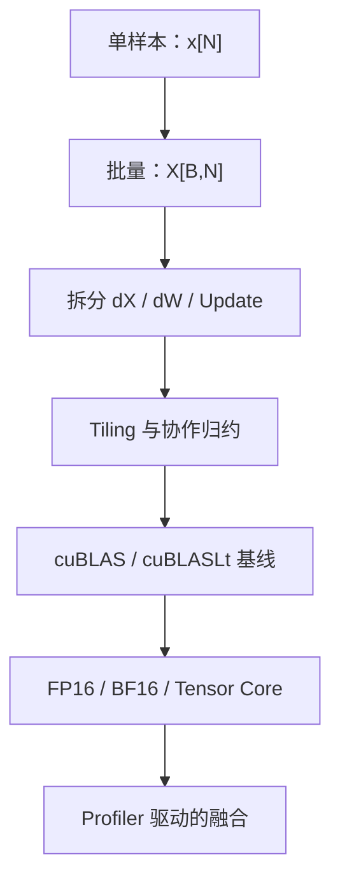

每一步都坚持同一个闭环：

```text
先定义形状
    ↓
推导公式
    ↓
确定线程所有权
    ↓
写 CPU Reference
    ↓
验证数值
    ↓
建立同口径、可复现的 Benchmark
    ↓
Profiler 找瓶颈
    ↓
再优化
```

把整篇文章串起来，其实只有一张图——两条梯度，一个线程所有权：

```text
                单样本 Linear

         x[N]                dY[M]
          │                    │
          │                    │
          ▼                    ▼
    ┌──────────────────────────────┐
    │           W[M,N]             │
    │                              │
    │  W[0,:] ─────────────→ y0    │   forward
    │  W[1,:] ─────────────→ y1    │
    │    ...                       │
    │  W[M-1,:] ───────────→ yM-1  │
    └──────────────────────────────┘
                │
                │ backward
                ▼

   thread j（拥有整列 W[:,j]）
       │
       ├── 读取 x[j]
       │
       ├── for i in [0, M)：
       │       old_w = W[i,j]
       │       dX[j] += old_w × dY[i]
       │       W[i,j] = old_w - lr × dY[i] × x[j]
       │
       └── 写回 dX[j]

双向梯度归到同一个线程列上，
dX 用旧权重、权重原地更新，都因此成立。
```

看完这张图再回到开头那句话：反向传播真正的门坎不是公式，而是**把公式翻译成谁读、谁写、什么时候读、什么时候写，并用证据证明它算对**。

---

### 十五、最后记住这四行

标准单样本全连接层：

$$
\boxed{
\begin{aligned}
y  &= Wx \\
dX &= W^TdY \\
dW &= dYx^T \\
W  &\leftarrow W-\eta dW
\end{aligned}}
$$

映射到 CUDA：

```text
thread j
   │
   ├── 读取 x[j]
   │
   ├── for i in [0, M)
   │      old_w = W[i,j]
   │      dX[j] += old_w * dY[i]
   │      W[i,j] = old_w - lr * dY[i] * x[j]
   │
   └── 写回 dX[j]
```

而真正的工程纪律是：

```text
形状先于代码
所有权先于并发
旧值语义先于原地更新
正确性先于性能
Benchmark 必须控制状态
优化必须由证据驱动
```

这六句话，比记住某个固定的 block size 更重要。它们正好对应这篇文章的推进顺序：先立形状，再用「每个元素的主人是哪个线程」回答问题，然后确认「旧值先被消费、再被覆盖」的快照语义，最后才谈正确性、受控计时与 Profiler 驱动的优化。

---

### 参考资料

1. NVIDIA, [CUDA C++ Programming Guide](https://docs.nvidia.com/cuda/cuda-programming-guide/)，CUDA 编程模型、执行模型与内存体系。
2. NVIDIA, [CUDA C++ Best Practices Guide](https://docs.nvidia.com/cuda/cuda-c-best-practices-guide/)，CUDA Event 计时、合并访存、浮点验证、线程块配置与性能方法论。
3. PyCUDA, [Device Interface](https://documen.tician.de/pycuda/driver.html)，`DeviceAllocation`、内存复制、Event、Stream 等 Driver API。
4. PyCUDA, [Just-in-time Compilation](https://documen.tician.de/pycuda/compiler.html)，`SourceModule` 与运行时编译接口。
5. NumPy, [`numpy.allclose`](https://numpy.org/doc/stable/reference/generated/numpy.allclose.html)，容差判定公式与适用边界。
6. NVIDIA, [Nsight Compute Profiling Guide](https://docs.nvidia.com/nsight-compute/ProfilingGuide/)，Memory Workload、Occupancy、Launch Statistics 与 Roofline 分析。

> **验证边界**：本文遵循当前 NVIDIA CUDA 官方文档（CUDA Programming Guide / Best Practices Guide）与 PyCUDA 文档所述的通用执行与内存模型来核验数学关系和 API 用法。这些核心知识是跨 CUDA 版本成立的，具体性能行为仍依赖 GPU Compute Capability、CUDA Toolkit、驱动与编译器生成代码；本文不预设任何“GPU 一定快多少”的结论，具体性能数字必须在实际 GPU、驱动、CUDA Toolkit、PyCUDA 版本及功耗/频率状态下实测。

---

<a id="article-03"></a>

## 第 03 篇｜GPU 明明很快，程序为什么还在等？一次讲透 CPU–GPU 协同计算

<!-- source: 03-cpu-gpu-heterogeneous-computing-light-tech.md -->

> **GPU 核函数快，不等于整个程序快。**真正的异构计算，不是“CPU 算一点、GPU 算一点”，而是让任务划分、数据移动和同步边界共同构成一条高效流水线。

---

### 一、GPU 很快，程序为什么不快

假设你刚写完一个矩阵乘法 CUDA 内核。

计时结果令人振奋：GPU 只用了很短时间。可是从输入数据到最终结果，整个程序依旧不快。

时间去哪了？

```text
读取数据 → CPU预处理 → 复制到GPU → GPU计算 → 复制回CPU → 校验与保存
            ↑            ↑                    ↑
         CPU时间       传输时间             传输时间
```

GPU 只加速了中间的一段。其余环节并不会因为换了一块更快的显卡而自动消失。

这就是 CPU–GPU 协同计算真正要回答的问题：

> 不只是让 GPU 跑得快，而是让 CPU、GPU 和数据通路尽量少等待。

为了更好地展开，我们把整条链路拆成三个问题：

- **任务怎么划分**：哪些工作给 CPU，哪些给 GPU？
- **数据怎么移动**：两端如何交换数据，代价有多大？
- **何时必须同步**：CPU 什么时候必须停下来等 GPU？

三者共同决定端到端性能。下面的实验会逐个把这三个问题放到代码里验证。

---

### 二、CPU 和 GPU 到底如何分工

一种流行但不够准确的说法是：

```text
CPU 擅长串行
GPU 擅长并行
```

这句话适合入门，却不能当作绝对边界。CPU 同样可以利用多核并行；GPU 也能够执行分支与控制代码。两者真正的差异，在于硬件资源如何分配，以及分别为哪类工作负载做了优化。

**CPU：少而强。**更强的单线程能力、更复杂的缓存与分支预测，适合操作系统与 I/O、任务调度与控制逻辑、分支较多的算法和不规则数据结构。

**GPU：多而密。**大量并行执行资源和较高显存带宽，适合矩阵乘法与卷积、图像视频处理、粒子模拟、深度学习张量运算等大量元素执行相似操作的任务。

把两者想成两种工位：

```text
CPU：少量“全能工位”，擅长复杂、多变、判断多的任务
GPU：大量“并行工位”，擅长结构相似、规模庞大的计算
```

协同不是把所有任务推给 GPU，而是把任务送到更适合它的处理器上。

#### 顺带纠正一个误区：线程池不是 OpenMP

有些 Python 教程用 `ThreadPoolExecutor` 跑一个双重循环，然后称其为“模拟 OpenMP”。这不准确：

1. `ThreadPoolExecutor` 是 Python 线程池，不是 OpenMP；
2. 如果只提交一个任务，线程池里根本没有拆分并行负载；
3. 普通 Python 数值循环还受解释器开销和 GIL 影响。

在 Python 里，我们可以用 Numba 编译 CPU 数值循环：

```python
from numba import njit, prange

@njit(parallel=True)
def matrix_addition_cpu(A, B, C):
    for row in prange(A.shape[0]):
        for col in range(A.shape[1]):
            C[row, col] = A[row, col] + B[row, col]
```

`njit` 会在函数第一次调用时，根据实际参数类型特化，并通过 LLVM JIT 编译为本地机器码。

> 第一次调用 = JIT 编译时间 + 执行时间；后续调用 ≈ 已编译机器码的执行时间。所以`njit`并不是“编译也更快”，优势体现在编译完成后的数值循环。

`parallel=True + prange` 表示 Numba 可用本地工作线程并行处理循环，但它不应被直接称为标准 OpenMP 代码。真正的 OpenMP 通常面向 C、C++ 或 Fortran：

```cpp
#pragma omp parallel for
for (int row = 0; row < N; ++row) {
    for (int col = 0; col < N; ++col) {
        C[row * N + col] = A[row * N + col] + B[row * N + col];
    }
}
```

> **旁注（前沿）**：OpenMP 6.0 已发布，标准本身也不再只面向 CPU 共享内存并行，包含设备卸载、统一共享内存等能力；但标准发布不等于所有编译器已完整实现，实际使用时仍须核对编译器支持矩阵。

本文的定位是：**使用 Numba CPU 并行与 Numba CUDA，理解 CPU–GPU 异构协同。**

---

### 三、线程如何找到矩阵元素

CUDA 启动的线程分两个层级：

```text
Grid
├── Block(0, 0)
│   ├── Thread(0, 0)
│   ├── Thread(1, 0)
│   └── ...
├── Block(1, 0)
└── Block(0, 1)
```

`threadIdx` 是线程在当前 Block 内的局部坐标；`blockIdx` 是 Block 在整个 Grid 中的坐标。在 Numba CUDA 中：

```python
col, row = cuda.grid(2)
```

拿到的是当前线程在整个二维 Grid 中的全局坐标，等价于：

```python
col = cuda.blockIdx.x * cuda.blockDim.x + cuda.threadIdx.x
row = cuda.blockIdx.y * cuda.blockDim.y + cuda.threadIdx.y
```

为什么让 `x` 对应列、`y` 对应行？因为 NumPy 和 C 风格二维数组是行优先存储，同一行相邻列的地址连续：

```text
C[0,0] C[0,1] C[0,2] C[0,3] ...
```

当相邻的 `x` 方向线程读取 `C[row, 0]`、`C[row, 1]`、`C[row, 2]`…时，访问的是连续地址，更有利于形成合并访存（coalesced memory access）。

```
线程坐标 → 矩阵元素 → 内存连续性
```

矩阵乘法中，每个线程负责输出矩阵的一个元素：

$$C_{row,col}=\sum_{k=0}^{N-1}A_{row,k}\cdot B_{k,col}$$

也就是用 A 的一行与 B 的一列做点积。

---

### 四、从串行等待到计算重叠

下面这个程序包含两项彼此独立的工作：

- CPU 多线程计算 `C_add = A + B`；
- GPU 计算 `C_multiply = A × B`。

正文只保留理解它所需的三段核心代码，完整可运行版本见附录 A。

#### 第一段：CPU 并行加法

```python
from numba import njit, prange

@njit(parallel=True)
def matrix_addition_cpu(A, B, C):
    for row in prange(A.shape[0]):     # prange 让行可并行执行
        for col in range(A.shape[1]):
            C[row, col] = A[row, col] + B[row, col]
```

#### 第二段：GPU 线程映射核心

每个线程负责一个输出元素：

```python
@cuda.jit
def matrix_multiply_kernel(A, B, C):
    col, row = cuda.grid(2)                # 全局线程坐标 → (列, 行)
    if row < C.shape[0] and col < C.shape[1]:
        value = float32(0.0)               # 线程私有累加器
        for k in range(A.shape[1]):
            value += A[row, k] * B[k, col]
        C[row, col] = value
```

#### 第三段：重叠调度核心

差异性在这三行：**先异步启动 GPU，再让 CPU 干自己的活**：

```python
# 提交 GPU 内核；完成 JIT 预热后，启动通常不会等待内核执行结束，
# 控制权随即返回给主机线程
matrix_multiply_kernel[blocks_per_grid, threads_per_block, stream](
    A_device, B_device, C_device)

# GPU 工作期间，CPU 同时执行矩阵加法
matrix_addition_cpu(A, B, C_add)

# 只有在确实需要 GPU 结果时才同步
stream.synchronize()
```

用时间线看两者的差别：

```text
串行版本：
时间 ───────────────────────────→
CPU：████████ 矩阵加法
GPU：        ████████████████ 矩阵乘法

重叠版本：
时间 ───────────────────────────→
CPU：  ████████ 矩阵加法
GPU：████████████████ 矩阵乘法
                          ↑
                     最后统一同步
```

把两种执行方式画在同一张时间轴上，差距更直观：

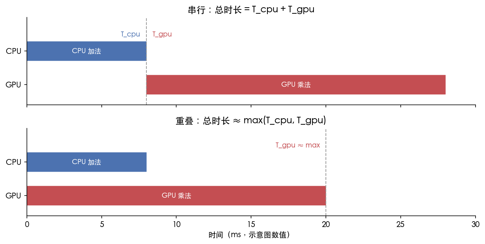

如上图所示，串行版本里 CPU 和 GPU 两段首尾相接，总时长是两段之和；重叠版本则让 GPU 段覆盖 CPU 段，总时长被较长的那一段主导。观察的重点是“总长度差”，这正是下一节重叠收益公式的图形直觉。

若 CPU 计算耗时为 $T_{CPU}$、GPU 计算耗时为 $T_{GPU}$，忽略调度开销：

$$T_{serial}\approx T_{CPU}+T_{GPU},\qquad T_{overlap}\approx\max(T_{CPU},T_{GPU})$$

因此理想加速比为：

$$S=\frac{T_{CPU}+T_{GPU}}{\max(T_{CPU},T_{GPU})}$$

这项任务完全独立且能完美重叠时，$S$ 的上限是 2。如果一边远短于另一边，收益会迅速逼近 1。

举例：CPU 加法约 1 ms、GPU 乘法约 20 ms，串行约 21 ms，理想重叠约 20 ms：

$$S=\frac{1+20}{20}=1.05$$

即使重叠完全成功，也只有约 5% 的收益。

> **关键洞察：能重叠，不代表重叠之后一定明显加速。**收益取决于两边工作量是否匹配。所以协同计算不仅要问“CPU 和 GPU 能否同时工作”，还要问“两边的工作量是否匹配，值得重叠”。

还有两个重要前提：

1. 两项任务必须相互独立——CPU 任务不能读取当前 GPU 内核尚未生成的结果；
2. 本例是一个最小化的“执行重叠实验”，用于隔离并观察 CPU–GPU 并发机制，还不是完整的生产协同流水线（第 6 章给出真实场景）。

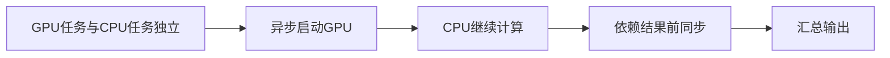

**关于 Stream 的澄清**：本例使用非默认 CUDA Stream，是为了明确表达异步任务边界。GPU 内核启动相对主机通常是异步的，CPU 提交内核后本就可以继续执行独立的主机工作——非默认 Stream 并不是“CPU 与 GPU 异步并行的唯一前提”。它的更大价值在别处：表达独立的设备任务序列、控制设备侧依赖、实现多 Stream 并发，以及配合页锁定内存实现传输与计算重叠。

---

### 五、一次可信的性能实验

看完代码，运行后只看四个指标，其余输出只是辅助：

```text
CPU 单独计算时间
GPU 单独计算时间（纯内核）
串行计算阶段时间
重叠计算阶段时间
```

预期关系：

```text
串行时间 ≈ CPU时间 + GPU时间
重叠时间 ≈ max(CPU时间, GPU时间)
```

带着这个预期去跑，才不会被一大堆打印淹没。

#### 先分清楚两个性能问题

很多人拿“CPU 加法和 GPU 乘法”比大小，然后得出结论。这不可比：加法 $O(N^2)$，朴素乘法 $O(N^3)$，不是同一个任务。

两个必须分开的问题：

| 问题 | 实验设计 |
|---|---|
| GPU 能否加速矩阵乘法？ | 比较 CPU 与 GPU 执行**同一个矩阵乘法** |
| CPU 和 GPU 能否协同？ | 比较两个独立任务**串行执行 vs 重叠执行** |

本文要验证的是第二行，不是第一行。不要用本文数据回答“GPU 比 CPU 快几倍”。

#### 别只测 Kernel：四种时间分开测

很多“GPU 加速几百倍”的结论，只测了核函数时间，把数据准备与传输成本排除在外。至少区分：

```text
T_H2D     CPU → GPU 输入传输
T_kernel  GPU 核函数执行
T_D2H     GPU → CPU 结果传输
T_e2e     从输入准备到结果可用的端到端时间
```

对一次简单任务：

$$T_{e2e}=T_{H2D}+T_{kernel}+T_{D2H}+T_{other}$$

如果输入和中间结果能长期驻留在 GPU，多个核函数共享同一份设备数据，传输成本就能被多次计算摊薄。这也是成熟 GPU 程序尽量避免“传一次 → 算一次 → 传回来”循环，而倾向于“一次传入 → 多个 GPU 阶段连续计算 → 最后一次传回”的原因。

#### 计时方法：主机计时器 vs CUDA Event

- **主机计时器**（`perf_counter` + `synchronize()`）适合测量端到端阶段与重叠实验——它反映主机观察到的完整阶段时间；
- **CUDA Event** 在设备端时间线上打点，适合测量纯 GPU 内核时间，不受主机调度噪声影响。

正文之外，我们还需要诚实对待计时本身：

1. **先预热**：Numba CPU 函数与 CUDA 内核第一次调用都会触发 JIT 编译，先各跑一遍再开始计时；
2. **多次采样取中位数**：GPU 功耗状态、CPU 调度、缓存和系统噪声都会影响单次结果。附录 A 中每个实验重复 $S=15$ 次取中位数，并交替执行串行与重叠版本，减少固定顺序偏差；
3. **容差不是固定模板**：附录用 `rtol=1e-3, atol=1e-2` 校验 GPU 乘法，这个阈值需要依据数据规模、数值范围和累加顺序确定。不要把它照抄到所有任务里，把较大的误差也判成正确。附录同时输出相对 Frobenius 误差，比单一 `True/False` 更有解释力。

#### 本机是 Apple Silicon，无法给出 GPU 实测数字

> 本文写作环境为 Apple Silicon，没有 NVIDIA GPU 及可用的 CUDA 驱动环境，因此无法执行 GPU 实测。所有 GPU 性能数字留作表格占位，发布前必须在 N 卡环境验证，并把实际中位数填入下表。

| 指标 | 占位（未实测） |
|---|---|
| 矩阵规模 N | 1024×1024 |
| CPU 单独计算（中位数） | — |
| GPU 单独计算·纯内核（Event，中位数） | — |
| H2D 输入传输（设备数组已预分配，仅纯复制） | — |
| D2H 结果传输 | — |
| 串行计算阶段（中位数） | — |
| 重叠计算阶段（中位数） | — |
| 重叠实际加速比 | — |
| 重叠理论上限 $\frac{T_{CPU}+T_{GPU}}{\max(T_{CPU},T_{GPU})}$ | — |

在 N 卡上跑通后，还应同时记录 CPU/GPU 型号、驱动与 CUDA 版本、Numba 版本、数据类型、预热方式与计时边界——缺失这些，任何性能数字都无法被他人复现。计算类指标（CPU/GPU/串行/重叠）多次采样取中位数；H2D/D2H 是固定大小的传输，单次即可，重负荷网络下如需更稳可同样取中位数。

---

### 六、真正的瓶颈可能是数据移动

前面验证的是 CPU 计算与 GPU 计算重叠。进一步优化时，还可以让**数据传输与 GPU 计算重叠**。

典型方法：

1. 把大数据拆成多个 Chunk；
2. 使用 `cuda.pinned_array()` 分配页锁定主机缓冲区，通过 `cuda.to_device(..., stream=stream)`、`copy_to_device(..., stream=stream)` 或 `copy_to_host(..., stream=stream)` 将传输排入指定 Stream，发起异步传输；
3. 将不同 Chunk 放在不同的非默认 CUDA Stream 中，形成流水线。

```text
时间 ─────────────────────────────────────────→
Stream 1：H2D块1 → 计算块1 → D2H块1
Stream 2：        H2D块2 → 计算块2 → D2H块2
Stream 3：                H2D块3 → 计算块3 → D2H块3
```

能不能真正重叠，取决于一组硬件与软件前提：主机缓冲区使用页锁定内存、使用合适的非默认 Stream 并正确设置依赖、设备支持并发复制与计算、复制引擎的数量足以并行调度，以及任务规模足以覆盖调度与同步开销。只有当这些条件同时成立时，阶梯式排布才能让复制引擎与计算单元减少互相等待。

把这些前提放在一边，先从逻辑上看它追求什么：**CPU 准备第 N+1 批数据，GPU 同时计算第 N 批**。

```text
第1批：CPU准备 → GPU计算
第2批：        CPU准备 → GPU计算
第3批：                 CPU准备 → GPU计算
```

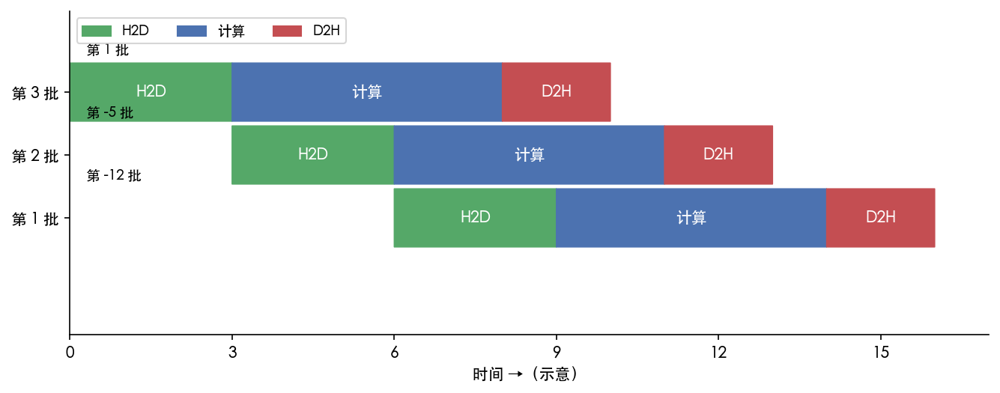

CPU 读取下一批、GPU 计算当前批、数据传输在前端交错——这才是深度学习、图像处理和科学计算里真正的 CPU–GPU 协同。前面“CPU 加法 + GPU 乘法”更像是显微镜下的机制切片。

不过技术上有两个边界：

- CUDA 官方文档强调：涉及 CPU 内存的异步传输要真正获得重叠能力，主机缓冲区需要使用页锁定内存；同时需确认设备支持并发复制与计算，并正确使用 Stream；
- 页锁定内存不是越多越好。它不能被操作系统随意换出，过量使用可能影响系统整体内存管理。正确做法仍是测量、验证、再决定。

---

### 七、从 Stream 到一致性内存

上一节用 Stream 把传输与计算错开重叠，那是**软件侧的并发编排**。这一节看硬件侧：设备边界如何被一步步拉近。

#### 统一内存并没有让传输“消失”

统一内存（Unified Memory）让 CPU 和 GPU 用更统一的地址模型访问数据，降低编程复杂度，但并没有消灭物理数据移动。在许多系统中，页面仍会按访问位置在 CPU 与 GPU 间迁移；访问模式不合理时，缺页和页面抖动照样拖慢程序。

```text
显式复制：程序员明确安排数据何时移动
统一内存：运行时帮助管理数据可见性与迁移
```

统一内存首先是一种编程与内存管理模型，不是“自动获得最高性能”的按钮。对可预测的工作负载，预取与数据放置策略仍然重要。

#### 硬件：从分离显存到一致性内存

CPU–GPU 硬件正在走向更紧密的内存协同：在 Grace Hopper、Grace Blackwell 等平台，CPU 与 GPU 通过 NVLink-C2C 获得更紧密的统一内存与硬件一致性能力，降低了传统分离内存的部分摩擦。但算法的数据局部性、带宽与同步成本依然存在。

#### 异构计算的三层演进

```text
第一层：任务卸载
CPU控制，GPU负责大规模并行计算

第二层：执行重叠
CPU计算、GPU计算、数据传输形成流水线

第三层：系统协同
一致性内存、更高速互连和运行时调度降低设备边界
```

无论硬件如何演进，一个事实不变：**性能取决于整条计算链路，而不是某个部件的峰值参数。**

---

### 八、从能运行到高性能

#### 朴素矩阵乘法为什么还不够快

当前内核的教学价值很高：一条线程负责一个输出元素，映射关系清楚。但它不是生产级高性能矩阵乘法。

```python
for k in range(A.shape[1]):
    value += A[row, k] * B[k, col]
```

每个线程都反复从全局显存读取 A 和 B。相邻线程之间本可以复用的数据，并没有被放入共享内存协作复用。更成熟的优化路线通常是：

```text
朴素全局内存实现
        ↓
shared memory 分块
        ↓
合并访存与减少 bank conflict
        ↓
寄存器分块 / 双缓冲 / 异步拷贝
        ↓
调用 cuBLAS 等高度优化库
```

教学时先手写内核理解线程映射；生产中优先考虑经过长期优化的库。“会写一个矩阵乘法内核”和“写出比 cuBLAS 更快的通用矩阵乘法”，是两件完全不同的事。

#### 协同最常见的五个错误

| 错误 | 简单版本 |
|---|---|
| 第一次运行就开始计时 | Numba CPU 函数和 CUDA 内核首次调用都可能触发 JIT 编译，先预热再测稳定阶段 |
| 内核启动后立刻停止计时 | 启动通常异步返回，没同步就结束，测到的可能只是提交时间 |
| 只打印前几个元素就宣布正确 | 打印只能辅助观察，应用 `np.allclose` 并查看最大绝对误差 |
| 网格大小用整除 | `blocks = N // threads` 会漏掉边缘元素，应向上取整并在内核里做边界判断 |
| 同步越多越安全 | 同步会重新串行化本可并发的任务，应在数据依赖真正需要的位置同步 |

正确原则是：**在数据依赖真正需要的位置同步，而不是每提交一个任务就同步。**

#### 更可靠的优化路线

不要一开始就堆叠所有高级技术：

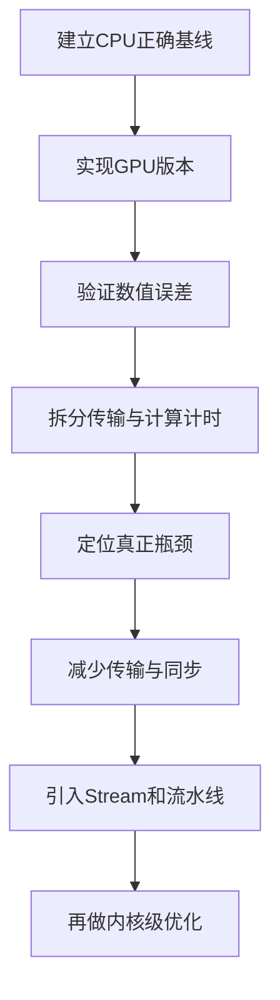

1. **先正确，再并行。**
2. **先测量，再优化。**
3. **先看端到端，再看局部峰值。**
4. **先减少不必要的数据移动，再追求更快的核函数。**
5. **优先使用成熟库，手写内核用于学习或明确的定制需求。**

#### 哪些场景真正适合 CPU–GPU 协同？

| 场景 | CPU 侧 | GPU 侧 | 关键点 |
|---|---|---|---|
| 深度学习训练与推理 | 数据读取、解码、任务编排 | 张量计算、优化器更新 | 输入流水线供给不足，GPU 利用率就会下降 |
| 科学计算与仿真 | 网格管理、边界条件、I/O | 大规模规则数值计算 | 时间步之间的依赖决定同步位置 |

图像/视频流水线、数据分析与特征工程遵循同样的思路：CPU 负责数据准备与流程控制，GPU 负责密集计算，设计重点都在于减少跨设备往返。

### 结语：最好的协同，是彼此少等一会儿

CPU–GPU 协同计算并不是一句“CPU 做控制、GPU 做计算”就能概括。它至少包含四层能力：

```text
任务放对地方
    ↓
数据少走弯路
    ↓
可以并发的工作真正重叠
    ↓
只在必要的位置同步
```

回顾本文最重要的几条结论：

- CPU 多线程并行不等于“线程池随便包一层”；
- `cuda.grid(2)` 获取的是线程在二维 Grid 中的全局坐标，它把线程映射到矩阵元素，再把连续地址交给了内存合并；
- GPU 核函数很快，不代表端到端程序很快——数据移动与同步往往才是瓶颈；
- 能重叠不等于一定明显加速，收益取决于两边工作负载是否匹配；
- 分别使用 CPU 和 GPU，不等于二者已经协同；真正的协同是任务、数据与时间线的共同设计。

当 CPU 不再等 GPU，GPU 也不再等数据，异构计算才真正开始。

#### 收藏：五条可以截图保存的优化清单

1. **预热后再计时**，JIT 编译和首次启动不进统计；
2. **至少测四段时间**：H2D、Kernel、D2H、端到端，并用中位数而不是单次结果；
3. **把数据留在 GPU**，避免“传一次算一次传回一次”的反复往返；
4. **依赖在哪，同步就在哪**，不要每提交一个任务就 `synchronize()`；
5. **先建 CPU 正确基线，再优化 GPU**，每个优化步骤都用数值对照验证。

最后留一个开放问题：你在实际项目中遇到过“GPU 忙、CPU 闲”或“数据搬运比计算还久”的情况吗？当时是怎么定位出瓶颈的？欢迎在评论区聊聊。

---

### 附录 A：可直接运行的完整代码

正文只保留了理解所需的三段核心代码。下面是包含关键修正（分配与计时分离、CPU/GPU 独立基线、多次采样中位数、CUDA Event 纯内核计时、相对误差输出）的完整可运行版本。

```python
# 导入高精度计时函数，用于测量各阶段运行时间
from time import perf_counter

# 导入 NumPy，用于创建矩阵、生成参考结果和验证数值正确性
import numpy as np

# cuda：编写和启动 GPU 核函数
# njit：将 CPU 数值函数 JIT 编译为本地机器码
# prange：表达可以并行执行的 CPU 循环
# get_num_threads：查询 Numba 当前使用的 CPU 工作线程数量
# float32：在 CUDA 内核中显式创建单精度累加器
from numba import cuda, njit, prange, get_num_threads, float32

# 每个实验重复取样的次数：多次采样取中位数，降低系统噪声
SAMPLES = 15


# 使用 Numba 将 CPU 矩阵加法编译为本地机器码
# parallel=True 允许 prange 循环由多个 CPU 工作线程执行
# cache=True 尝试缓存编译结果，减少后续启动时的编译成本
@njit(parallel=True, cache=True)
def matrix_addition_cpu(A, B, C):
    # 获取矩阵行数
    rows = A.shape[0]

    # 获取矩阵列数
    cols = A.shape[1]

    # 不同工作线程可以并行处理不同的矩阵行
    for row in prange(rows):
        # 遍历当前行中的所有列
        for col in range(cols):
            # 对应元素相加，并写入输出矩阵
            C[row, col] = A[row, col] + B[row, col]


# 使用 Numba CUDA 定义 GPU 矩阵乘法核函数
@cuda.jit
def matrix_multiply_kernel(A, B, C):
    # 获取当前线程在整个二维 Grid 中的全局坐标
    # x 方向映射到矩阵列，y 方向映射到矩阵行
    col, row = cuda.grid(2)

    # 获取输出矩阵的行数和列数
    rows_c = C.shape[0]
    cols_c = C.shape[1]

    # 网格采用向上取整，边缘线程可能越界，因此必须判断
    if row < rows_c and col < cols_c:
        # 创建线程私有的 float32 累加器
        value = float32(0.0)

        # A 的列数等于 B 的行数，即矩阵乘法的公共维度
        for k in range(A.shape[1]):
            # 计算 A 第 row 行与 B 第 col 列的点积
            value += A[row, k] * B[k, col]

        # 每个线程只写一个输出元素，不会发生写冲突
        C[row, col] = value


def main():
    # 设置固定随机种子，使实验可以复现
    np.random.seed(42)

    # 设置方阵维度；可根据显存和实验需求调整
    N = 1024

    # 创建两个 float32 随机输入矩阵
    A = np.random.rand(N, N).astype(np.float32)
    B = np.random.rand(N, N).astype(np.float32)

    # 为 CPU 矩阵加法分配输出数组
    C_add = np.empty_like(A)

    # 如果 CUDA 不可用，给出明确提示并结束程序
    if not cuda.is_available():
        print("CUDA 不可用，请检查 NVIDIA GPU、驱动和 CUDA 环境。")
        return

    # --------------------------------------------------------
    # 1. CPU JIT 预热
    # --------------------------------------------------------

    # 第一次调用触发类型推断和 JIT 编译，不计入正式测试
    matrix_addition_cpu(A, B, C_add)

    # --------------------------------------------------------
    # 2. 配置二维线程块和网格
    # --------------------------------------------------------

    # 每个 Block 包含 16×16=256 个线程
    threads_per_block = (16, 16)

    # x 方向覆盖矩阵列，采用向上取整
    blocks_x = (N + threads_per_block[0] - 1) // threads_per_block[0]

    # y 方向覆盖矩阵行，同样采用向上取整
    blocks_y = (N + threads_per_block[1] - 1) // threads_per_block[1]

    # 组成二维 Grid
    blocks_per_grid = (blocks_x, blocks_y)

    # 创建非默认 CUDA Stream，用于表达独立的异步任务序列
    stream = cuda.stream()

    # --------------------------------------------------------
    # 3. 预分配三个设备数组（不计入传输计时）
    # --------------------------------------------------------

    # 先为 A、B、C 在显存中分配空间
    # 分配是设备内存操作，统计进“输入传输时间”会高估纯复制成本
    A_device = cuda.device_array_like(A)
    B_device = cuda.device_array_like(B)
    C_device = cuda.device_array((N, N), dtype=np.float32)

    # 确保分配完成，让后续 H2D 计时起点干净
    cuda.synchronize()

    # --------------------------------------------------------
    # 4. 测量 H2D 输入传输时间（只包含纯复制）
    # --------------------------------------------------------

    # 记录主机到设备传输的开始时间
    h2d_start = perf_counter()

    # 将 A 和 B 从 CPU 主存复制到已分配的 GPU 显存
    A_device.copy_to_device(A)
    B_device.copy_to_device(B)

    # 确保前面的设备操作完成，使计时边界明确
    cuda.synchronize()

    # 记录主机到设备传输完成时间
    h2d_end = perf_counter()

    # --------------------------------------------------------
    # 5. GPU JIT 预热
    # --------------------------------------------------------

    # 第一次启动 GPU 内核会触发 CUDA JIT 编译
    matrix_multiply_kernel[
        blocks_per_grid,
        threads_per_block,
        stream
    ](A_device, B_device, C_device)

    # 等待预热任务完成，避免把编译开销计入正式结果
    stream.synchronize()

    # --------------------------------------------------------
    # 6. CPU 单独计算基线（多次采样取中位数）
    # --------------------------------------------------------

    # 存放每次 CPU 加法的耗时
    cpu_times = []

    for _ in range(SAMPLES):
        cpu_start = perf_counter()

        # CPU 多线程矩阵加法
        matrix_addition_cpu(A, B, C_add)

        cpu_times.append(perf_counter() - cpu_start)

    # 使用中位数而不是单次结果，降低系统噪声影响
    cpu_time = float(np.median(cpu_times))

    # --------------------------------------------------------
    # 7. GPU 单独计算基线（CUDA Event 测纯内核时间）
    # --------------------------------------------------------

    # 事件对象在循环外创建一次并重复记录，避免每轮新建对象
    # timing=True 显式声明该事件用于计时（也是默认行为）
    event_start = cuda.event(timing=True)
    event_end = cuda.event(timing=True)

    # 存放每次 GPU 纯内核耗时（秒）
    gpu_times = []

    for _ in range(SAMPLES):
        # 在设备端时间线打点：内核前的起点事件
        event_start.record(stream)

        # 被计时的内核
        matrix_multiply_kernel[
            blocks_per_grid,
            threads_per_block,
            stream
        ](A_device, B_device, C_device)

        # 内核后的终点事件
        event_end.record(stream)

        # 等待终点事件完成，再读取设备端耗时
        event_end.synchronize()

        # 官方计时接口 event_elapsed_time 返回毫秒，换算为秒
        gpu_times.append(cuda.event_elapsed_time(event_start, event_end) / 1000.0)

    # 使用中位数作为纯内核典型耗时
    gpu_time = float(np.median(gpu_times))

    # --------------------------------------------------------
    # 8. 串行 vs 重叠：交替采样取中位数
    # --------------------------------------------------------

    # 分别存放串行阶段和重叠阶段的耗时
    serial_times = []
    overlap_times = []

    for _ in range(SAMPLES):
        # --- 串行版本：先 CPU 加法，再 GPU 乘法 ---
        serial_start = perf_counter()

        # CPU 多线程矩阵加法
        matrix_addition_cpu(A, B, C_add)

        # GPU 矩阵乘法
        matrix_multiply_kernel[
            blocks_per_grid,
            threads_per_block,
            stream
        ](A_device, B_device, C_device)

        # 等待 GPU 计算完成
        stream.synchronize()

        serial_times.append(perf_counter() - serial_start)

        # --- 重叠版本：先提交 GPU，再让 CPU 干自己的活 ---
        overlap_start = perf_counter()

        # 提交 GPU 内核；完成 JIT 预热后，
        # 启动通常不会等待内核执行结束，控制权随即返回
        matrix_multiply_kernel[
            blocks_per_grid,
            threads_per_block,
            stream
        ](A_device, B_device, C_device)

        # GPU 工作期间，CPU 同时执行矩阵加法
        matrix_addition_cpu(A, B, C_add)

        # 只有在确实需要 GPU 结果时才同步
        stream.synchronize()

        overlap_times.append(perf_counter() - overlap_start)

    # 取中位数作为典型耗时
    serial_time = float(np.median(serial_times))
    overlap_time = float(np.median(overlap_times))

    # --------------------------------------------------------
    # 9. 将 GPU 结果复制回 CPU
    # --------------------------------------------------------

    # 在主机端分配接收数组
    C_multiply = np.empty((N, N), dtype=np.float32)

    # 记录设备到主机复制开始时间
    d2h_start = perf_counter()

    # 将 GPU 结果复制回 CPU（该 API 同步完成）
    C_device.copy_to_host(C_multiply)

    # 记录复制结束时间
    d2h_end = perf_counter()

    # --------------------------------------------------------
    # 10. 正确性验证
    # --------------------------------------------------------

    # 使用 NumPy 生成矩阵加法参考结果
    C_add_reference = A + B

    # 使用 NumPy/BLAS 生成矩阵乘法参考结果
    C_multiply_reference = A @ B

    # 检查 CPU 并行矩阵加法是否正确（加法误差很小，容差紧）
    add_correct = np.allclose(
        C_add,
        C_add_reference,
        rtol=1e-6,
        atol=1e-6
    )

    # 检查 GPU 矩阵乘法是否在允许的浮点误差范围内
    # 容差不是固定模板，应按数据规模、数值范围和累加顺序确定
    multiply_correct = np.allclose(
        C_multiply,
        C_multiply_reference,
        rtol=1e-3,
        atol=1e-2
    )

    # 计算 GPU 结果的最大绝对误差
    max_error = np.max(
        np.abs(C_multiply - C_multiply_reference)
    )

    # 计算相对 Frobenius 误差：整体误差水平的归一化度量
    relative_error = (
        np.linalg.norm(C_multiply - C_multiply_reference, ord="fro")
        / np.linalg.norm(C_multiply_reference, ord="fro")
    )

    # --------------------------------------------------------
    # 11. 输出测量结果
    # --------------------------------------------------------

    h2d_time = h2d_end - h2d_start
    d2h_time = d2h_end - d2h_start

    print(f"Numba CPU 工作线程数：{get_num_threads()}")
    print(f"H2D 输入传输时间：{h2d_time:.6f} 秒")
    print(f"D2H 结果传输时间：{d2h_time:.6f} 秒")
    print(f"CPU 单独计算时间：{cpu_time:.6f} 秒")
    print(f"GPU 单独计算时间：{gpu_time:.6f} 秒")
    print(f"串行计算阶段时间：{serial_time:.6f} 秒")
    print(f"重叠计算阶段时间：{overlap_time:.6f} 秒")

    # 验证理论关系：串行 ≈ CPU + GPU，重叠 ≈ max(CPU, GPU)
    print(f"[验证] CPU+GPU = {cpu_time + gpu_time:.6f} 秒 vs 串行 {serial_time:.6f} 秒")
    print(f"[验证] max(CPU,GPU) = {max(cpu_time, gpu_time):.6f} 秒 vs 重叠 {overlap_time:.6f} 秒")

    # 计算实际加速比与理论上限
    if overlap_time > 0.0:
        achieved = serial_time / overlap_time
        theoretical = (cpu_time + gpu_time) / max(cpu_time, gpu_time)
        print(f"重叠实际加速比：{achieved:.3f}x")
        print(f"重叠理论上限：{theoretical:.3f}x")

    print(f"CPU 加法结果正确：{add_correct}")
    print(f"GPU 乘法结果正确：{multiply_correct}")
    print(f"GPU 乘法最大绝对误差：{max_error:.6e}")
    print(f"GPU 乘法相对 Frobenius 误差：{relative_error:.6e}")

    # 展示结果矩阵左上角的小块区域，便于人工观察
    print("\n矩阵加法结果前 5 行、前 5 列：")
    print(C_add[:5, :5])

    print("\n矩阵乘法结果前 5 行、前 5 列：")
    print(C_multiply[:5, :5])


# 仅在直接运行当前脚本时调用 main
if __name__ == "__main__":
    main()
```

几个设计点说明：

- **设备分配与计时分离**：`A_device`/`B_device`/`C_device` 三个设备数组都在 H2D 计时开始前分配并用 `cuda.synchronize()` 收尾，`copy_to_device` 只负责把数据复制进已分配空间，不再把 `device_array` 的开销混进“输入传输时间”；
- **两组独立基线**：`CPU_T` 用主机计时器测 `matrix_addition_cpu` 反复执行的中位数；`GPU_T` 用 CUDA Event 测纯内核设备端耗时——前者是端到端主机视角，后者是设备时间线；
- **多次采样取中位数**：每个阶段重复 `SAMPLES=15` 次，串行与重叠在同一个循环里交替执行，避免固定顺序带来的偏差；
- **理论关系可复核**：程序直接打印 `CPU+GPU` 与 `串行` 的对照、`max(CPU,GPU)` 与 `重叠` 的对照，读者可以当场验证正文里的两个近似公式。

> **未实测**：本文写作环境为 Apple Silicon，没有 NVIDIA GPU 及可用的 CUDA 驱动环境，无法在本机运行附录 A。发布前需在 N 卡环境编译运行，将实际中位数回填第 5 章表格，并确认 GPU↔CPU 数值校验通过。注：Numba-CUDA 由 Python 侧发起编译，本文代码不直接调用 `nvcc`，但对 GPU 驱动、CUDA 运行时及相应编译组件仍有依赖。

---

### 参考资料

1. NVIDIA, *CUDA Programming Guide — Asynchronous Execution*  
   <https://docs.nvidia.com/cuda/cuda-programming-guide/02-basics/asynchronous-execution.html>

2. NVIDIA, *CUDA C++ Best Practices Guide*  
   <https://docs.nvidia.com/cuda/cuda-c-best-practices-guide/contents.html>

3. NVIDIA, *Numba-CUDA Installation*  
   <https://nvidia.github.io/numba-cuda/user/installation.html>

4. NVIDIA, *Numba-CUDA User Guide*  
   <https://nvidia.github.io/numba-cuda/user/>

5. OpenMP Architecture Review Board, *OpenMP API Specifications*  
   <https://www.openmp.org/specifications/>

6. NVIDIA, *CUDA Programming Guide — Unified and System Memory*  
   <https://docs.nvidia.com/cuda/cuda-programming-guide/02-basics/understanding-memory.html>

7. NVIDIA, *Numba-CUDA CUDA Host API*（`cuda.pinned_array()`、`cuda.event()`、`cuda.event_elapsed_time()` 等接口）  
   <https://nvidia.github.io/numba-cuda/reference/host.html>

8. NVIDIA, *Numba-CUDA Memory Management*（`cuda.device_array_like()`、`copy_to_device(..., stream=...)` 等接口）  
   <https://nvidia.github.io/numba-cuda/reference/memory.html>

---

> **实验提示**：不同 CPU、GPU、驱动、CUDA、Numba、BLAS 和功耗配置会产生不同结果。任何性能数字都应同时记录软硬件环境、矩阵规模、数据类型、预热方法和计时边界，避免将单机结果泛化为普遍结论。本文性能表格在写作时仍为占位，必须在 N 卡实测后回填。

---

<a id="article-04"></a>

## 第 04 篇｜Kernel 已经很快，GPU 为什么还在等？用 PyCUDA 搭建批量数据流水线

<!-- source: 04-pycuda-batch-input-pipeline-light-tech.md -->

> **副标题**：从页锁定内存、异步 H2D 到双缓冲——让数据传输与 GPU 预处理真正重叠  
> **工程深度**：L2 工程可用｜**预计阅读**：18 分钟  
> **适用读者**：掌握 Python/NumPy 基础，正在学习 CUDA、PyCUDA 或深度学习输入流水线的开发者

---

### 开场：0.3 毫秒的 Kernel，为什么救不了 20 毫秒的 Batch？

你已经把图像中心裁剪和归一化写进了一个 CUDA Kernel。

一次启动，32 张图片并行处理；没有 Python 循环，也没有裁剪结果在显存中来回落地。单看 Kernel，这段程序已经很像一次成功的 GPU 优化。

可一旦把它接到真实训练或推理任务里，GPU 利用率仍可能忽高忽低：算一会儿，停一会儿；显存里没有下一批数据，只能等 CPU 读取文件、解码图片、整理 Batch，再把数据搬过 PCIe。

问题不一定出在“算得慢”，而可能出在“送得慢”。

这也是 CUDA 性能优化里最容易被忽略的一层：

> **最快的 Kernel，也救不了一条不断断粮的数据流水线。**

本文在批量中心裁剪与归一化内核的基础上，继续向外走一层：不只研究一批数据怎样计算，还要研究下一批数据怎样在当前批次计算时提前到达。

但先钉死一个技术边界：本文构建的是一个 **PyCUDA 批量输入与预处理流水线原型**。示例用内存中的模拟数据代替文件读取和 JPEG 解码；它覆盖 Batch 组装、页锁定主机内存、异步 H2D、CUDA Stream、双缓冲和 GPU 预处理，但不是完整的生产级图像加载器。

---

### 一、别急着优化：先分清“加载、传输、预处理”

很多文章把下面几件事统称为“数据加载”：

| 阶段 | 发生了什么 | 常见执行位置 |
|---|---|---|
| 文件读取 | 从本地磁盘、对象存储或网络读取压缩字节 | CPU / 存储系统 |
| 图像解码 | 把 JPEG、PNG 等压缩格式还原为像素 | CPU、GPU 或专用硬件 |
| Batch 组装 | 将多个样本整理为连续内存 | CPU |
| H2D 传输 | 将主机内存复制到 GPU 显存 | DMA / CUDA Copy Engine |
| GPU 预处理 | 裁剪、缩放、归一化、布局转换 | GPU Kernel |
| 模型计算 | 前向、反向或推理 | GPU |

原始代码从 `np.random.rand()` 开始，意味着数据已经存在于 NumPy 内存中；`cuda.to_device()` 完成的是主机到设备的数据复制，而不是磁盘读取或图像解码。

所以，更准确的链路是：


这一区分不是咬文嚼字。因为不同阶段的瓶颈、测量方法和优化工具完全不同：

- 磁盘慢，要看存储吞吐、文件数量和缓存命中；
- 解码慢，要看 CPU 线程、nvJPEG 或 DALI；
- H2D 慢，要看传输大小、页锁定内存、PCIe/NVLink 和 Copy Engine；
- Kernel 慢，才轮到线程映射、内存访问和算术强度。

如果连瓶颈在哪一段都没有分清，优化就很容易变成“哪里有 CUDA，哪里就加 CUDA”。

---

### 二、原始版本做对了什么，又把时间花在了哪里？

原始内核采用三维 Grid：

- `x` 维负责裁剪图像的列；
- `y` 维负责裁剪图像的行；
- `z` 维负责 Batch 中的图片编号。

```text
blockIdx.z = 第几张图片
ty         = 输出像素所在行
tx         = 输出像素所在列
```

每个线程只完成一个输出像素：找到原图的中心裁剪坐标，读取像素，再执行归一化。

$$y = \frac{x-\mu}{\sigma}$$

相邻线程沿 `tx` 方向访问相邻像素，输入读取和输出写入都天然具有连续性。裁剪与归一化放进同一个 Kernel，也避免了中间裁剪结果再次写回、读取显存。

这部分设计是合理的。真正的问题在主机侧：

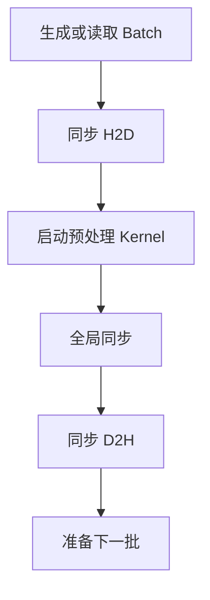

CPU 与 GPU 像两个人共用一只碗：一个人吃完，另一个人才开始盛下一碗。任何一个阶段变慢，后面的阶段都只能等待。

原始代码还藏着几个工程问题：

1. `crop_size // 16` 是向下取整，只在 `crop_size` 恰好能被 16 整除时正确；
2. 内核使用了 `batch_size` 参数，却没有检查 `b < batch_size`；
3. `cuda.to_device(output_data)` 把一块全零输出上传到 GPU，随后又被内核覆盖，这次 H2D 没有必要；
4. `cuda.to_device()` 返回 `DeviceAllocation`，回传应使用 `cuda.memcpy_dtoh()`；`.get()` 是 `GPUArray` 常用接口，不能混用两套抽象；
5. 计时从 H2D 之后开始、到 D2H 之后结束，既不是纯 Kernel 时间，也不是完整端到端时间；
6. 示例数据布局是 `[N,H,W]`，本质是单通道图像，不是常见的 RGB `[N,H,W,C]` 或 `[N,C,H,W]`。

这些问题不会让“224 ÷ 16”的演示立即报错，却会在尺寸变化、API 替换或真实数据接入后变成隐蔽故障。

---

### 三、第一步：把内核改到“尺寸变化也正确”

下面是修正后的裁剪归一化内核：

```cpp
__global__ void preprocess_batch(
    const float *__restrict__ input,
    float *__restrict__ output,
    int batch_size,
    int height,
    int width,
    int crop_size,
    float mean,
    float inv_std)
{
    // 当前线程负责的输出列坐标
    const int tx = threadIdx.x + blockIdx.x * blockDim.x;
    // 当前线程负责的输出行坐标
    const int ty = threadIdx.y + blockIdx.y * blockDim.y;
    // Grid 的 z 维映射到 Batch 中的图片编号
    const int b = blockIdx.z;

    // 同时检查图片编号和输出像素坐标，防止越界
    if (b >= batch_size || tx >= crop_size || ty >= crop_size) {
        return;
    }

    // 计算中心裁剪左上角在原图中的偏移
    const int offset_x = (width  - crop_size) / 2;
    const int offset_y = (height - crop_size) / 2;

    // 从输出坐标映射回原图坐标
    const int crop_x = offset_x + tx;
    const int crop_y = offset_y + ty;

    // 使用 size_t 计算线性下标，降低大尺寸 Batch 下整数溢出的风险
    const size_t input_idx =
        ((size_t)b * height + crop_y) * width + crop_x;
    const size_t output_idx =
        ((size_t)b * crop_size + ty) * crop_size + tx;

    // 预先传入标准差的倒数，用乘法替代每像素除法
    output[output_idx] = (input[input_idx] - mean) * inv_std;
}
```

Host 侧的 Grid 必须向上取整：

```python
grid_size = (
    (crop_size + block_size[0] - 1) // block_size[0],
    (crop_size + block_size[1] - 1) // block_size[1],
    batch_size,
)
```

边界线程会进入 Kernel，但会被条件判断安全地挡在有效区域之外。多启动少量线程的代价，通常远小于漏算边缘像素的代价。

在调用之前，还应验证：

```python
if crop_size > min(height, width):
    raise ValueError("crop_size 不能大于原图的高或宽")

if not np.isfinite(stddev) or stddev <= 0:
    raise ValueError("stddev 必须是有限的正数")
```

---

### 四、第二步：让主机内存真正支持异步传输

普通 NumPy 数组通常位于 **可分页内存**（pageable memory）。操作系统可以移动或换出这些页面；GPU 的 DMA 不能把它直接当成稳定的数据源长期使用。

于是，异步 H2D 需要另一类内存：**页锁定内存**（page-locked / pinned memory）。

PyCUDA 的官方接口文档明确要求：`memcpy_htod_async()` 的源缓冲区必须是页锁定内存，可由 `pagelocked_empty()` 分配。[PyCUDA Device Interface](https://documen.tician.de/pycuda/driver.html#pycuda.driver.memcpy_htod_async)

```python
host_input = cuda.pagelocked_empty(
    (batch_size, height, width),
    dtype=np.float32,
)
```

然后才能安全地发起异步传输：

```python
stream = cuda.Stream()
cuda.memcpy_htod_async(device_input, host_input, stream)
```

但“异步”不等于“必然重叠”。它只表示调用可以较早把控制权交还给 CPU。传输和 Kernel 是否真的同时运行，还取决于：

- GPU 是否支持 copy/compute 并发；
- 操作是否位于合适的非默认 Stream；
- 不同批次是否使用互不冲突的缓冲区；
- 任务之间是否存在必须等待的数据依赖；
- 主机内存是否为 pinned memory。

NVIDIA 的最佳实践文档指出，异步传输要求 pinned memory；传输与设备计算重叠还需要硬件具备 concurrent copy/compute 能力，并合理使用非默认 Stream。[CUDA C++ Best Practices Guide](https://docs.nvidia.com/cuda/cuda-c-best-practices-guide/index.html#asynchronous-and-overlapping-transfers-with-computation)

还有一条经常被忽略的限制：pinned memory 是稀缺资源。锁得太多会挤压系统可分页内存，频繁申请和释放本身也很重。因此正确做法不是“把所有数据都 pin 住”，而是预分配少量可复用缓冲区，并通过实测决定容量。

---

### 五、第三步：双缓冲，让“搬下一批”和“算这一批”同时发生

只有一个输入缓冲区时，CPU 不能在 GPU 尚未读完之前覆盖它。解决方法很朴素：准备两套缓冲区。

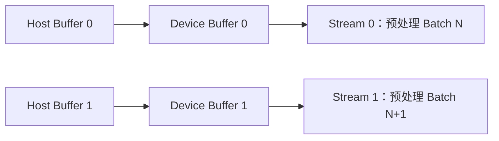

时间线上，它更像两条交错的传送带：

```mermaid
gantt
    title 双缓冲的稳态流水线（示意，非实测比例）
    dateFormat X
    axisFormat %L
    section CPU
    准备 Batch 0 :a0, 0, 3
    准备 Batch 1 :a1, 3, 3
    准备 Batch 2 :a2, 6, 3
    section Stream 0
    H2D 0 :b0, 3, 2
    预处理 0 :b1, 5, 3
    H2D 2 :b2, 9, 2
    section Stream 1
    H2D 1 :c0, 6, 2
    预处理 1 :c1, 8, 3
```

同一条 Stream 内仍然保持顺序：先 H2D，再执行依赖这批数据的 Kernel；不同 Stream 的独立任务则有机会被硬件交错或重叠。

这里的关键词是“有机会”。图中是机制示意，不是对任意 GPU 的性能承诺。

---

### 六、完整代码：PyCUDA 双缓冲批量输入与预处理

下面给出一个可运行的教学版原型。它使用随机数模拟“上游读取与解码后的 Batch”，重点演示 pinned memory、异步 H2D、非默认 Stream、双缓冲、正确的显存分配和结果校验。

> 环境要求：已正确安装 NVIDIA 驱动、CUDA Toolkit、NumPy 与 PyCUDA。本文不锁定具体版本，部署时应以 PyCUDA 与本机 CUDA/Python 的兼容矩阵为准。

```python
import time

import numpy as np
import pycuda.autoinit  # 创建并管理当前进程的 CUDA Context
import pycuda.driver as cuda
from pycuda.compiler import SourceModule


KERNEL_CODE = r"""
#include <stddef.h>

__global__ void preprocess_batch(
    const float *__restrict__ input,
    float *__restrict__ output,
    int batch_size,
    int height,
    int width,
    int crop_size,
    float mean,
    float inv_std)
{
    const int tx = threadIdx.x + blockIdx.x * blockDim.x;
    const int ty = threadIdx.y + blockIdx.y * blockDim.y;
    const int b = blockIdx.z;

    if (b >= batch_size || tx >= crop_size || ty >= crop_size) {
        return;
    }

    const int offset_x = (width  - crop_size) / 2;
    const int offset_y = (height - crop_size) / 2;
    const int crop_x = offset_x + tx;
    const int crop_y = offset_y + ty;

    const size_t input_idx =
        ((size_t)b * height + crop_y) * width + crop_x;
    const size_t output_idx =
        ((size_t)b * crop_size + ty) * crop_size + tx;

    output[output_idx] = (input[input_idx] - mean) * inv_std;
}
"""


def ceil_div(value, divisor):
    """整数向上取整，确保 Grid 覆盖全部输出像素。"""
    return (value + divisor - 1) // divisor


def fill_batch(destination, rng):
    """
    模拟真实的数据读取与解码阶段。

    生产环境可以把这里替换成：
    读取文件 -> 解码 -> resize/颜色转换 -> 写入 destination。
    关键是最终数据直接落入复用的 pinned buffer，避免额外中间副本。
    """
    rng.random(destination.shape, dtype=np.float32, out=destination)


def cpu_reference(input_batch, crop_size, mean, stddev):
    """使用 NumPy 生成同一数学定义下的参考结果。"""
    _, height, width = input_batch.shape
    offset_y = (height - crop_size) // 2
    offset_x = (width - crop_size) // 2
    cropped = input_batch[
        :,
        offset_y : offset_y + crop_size,
        offset_x : offset_x + crop_size,
    ]
    return (cropped - mean) / stddev


def main():
    # ------------------------- 参数与合法性检查 -------------------------
    batch_size = 32
    height, width = 256, 256
    crop_size = 224
    mean = np.float32(0.5)
    stddev = np.float32(0.25)
    inv_std = np.float32(1.0 / stddev)

    if crop_size > min(height, width):
        raise ValueError("crop_size 不能大于原图的高或宽")
    if not np.isfinite(stddev) or stddev <= 0:
        raise ValueError("stddev 必须是有限的正数")

    input_shape = (batch_size, height, width)
    output_shape = (batch_size, crop_size, crop_size)
    input_nbytes = int(np.prod(input_shape)) * np.dtype(np.float32).itemsize
    output_nbytes = int(np.prod(output_shape)) * np.dtype(np.float32).itemsize

    # ------------------------------ 编译内核 ------------------------------
    module = SourceModule(KERNEL_CODE)
    preprocess_batch = module.get_function("preprocess_batch")

    block = (16, 16, 1)
    grid = (
        ceil_div(crop_size, block[0]),
        ceil_div(crop_size, block[1]),
        batch_size,
    )

    # ------------------------------ 双缓冲 ------------------------------
    buffer_count = 2
    streams = [cuda.Stream() for _ in range(buffer_count)]

    # 两块页锁定主机内存：支持异步 H2D，并避免循环中反复申请
    host_inputs = [
        cuda.pagelocked_empty(input_shape, dtype=np.float32)
        for _ in range(buffer_count)
    ]

    # 两组独立设备输入/输出，防止不同 Stream 读写同一块缓冲区
    device_inputs = [
        cuda.mem_alloc(input_nbytes)
        for _ in range(buffer_count)
    ]
    device_outputs = [
        cuda.mem_alloc(output_nbytes)
        for _ in range(buffer_count)
    ]

    rng = np.random.default_rng(20260918)

    # ------------------------------ 预热 ------------------------------
    fill_batch(host_inputs[0], rng)
    cuda.memcpy_htod_async(device_inputs[0], host_inputs[0], streams[0])
    preprocess_batch(
        device_inputs[0],
        device_outputs[0],
        np.int32(batch_size),
        np.int32(height),
        np.int32(width),
        np.int32(crop_size),
        mean,
        inv_std,
        block=block,
        grid=grid,
        stream=streams[0],
    )
    streams[0].synchronize()

    # --------------------------- 流水线吞吐测试 ---------------------------
    num_batches = 100
    wall_start = time.perf_counter()

    for batch_id in range(num_batches):
        slot = batch_id % buffer_count
        stream = streams[slot]

        # 复用 slot 前，等待它上一次承担的任务完成。
        # 另一个 slot 仍可在 GPU 上工作。
        stream.synchronize()

        # 模拟准备当前 Batch；真实系统可替换为读取和解码。
        fill_batch(host_inputs[slot], rng)

        # 在同一 Stream 中先传输、再计算，数据依赖顺序由 Stream 保证。
        cuda.memcpy_htod_async(
            device_inputs[slot],
            host_inputs[slot],
            stream,
        )
        preprocess_batch(
            device_inputs[slot],
            device_outputs[slot],
            np.int32(batch_size),
            np.int32(height),
            np.int32(width),
            np.int32(crop_size),
            mean,
            inv_std,
            block=block,
            grid=grid,
            stream=stream,
        )

    # 等待所有仍在飞行中的 Batch 完成，端到端计时才闭合。
    for stream in streams:
        stream.synchronize()

    wall_seconds = time.perf_counter() - wall_start
    images_per_second = num_batches * batch_size / wall_seconds

    print(f"模拟端到端耗时: {wall_seconds:.6f} 秒")
    print(f"稳态吞吐量: {images_per_second:.2f} images/s")

    # --------------------------- 独立正确性校验 ---------------------------
    # 校验不混入上面的吞吐计时，也不要求每个生产 Batch 都回传 CPU。
    check_input = host_inputs[0]
    fill_batch(check_input, rng)
    expected = cpu_reference(check_input, crop_size, mean, stddev)
    actual = np.empty(output_shape, dtype=np.float32)

    cuda.memcpy_htod(device_inputs[0], check_input)
    preprocess_batch(
        device_inputs[0],
        device_outputs[0],
        np.int32(batch_size),
        np.int32(height),
        np.int32(width),
        np.int32(crop_size),
        mean,
        inv_std,
        block=block,
        grid=grid,
    )
    cuda.Context.synchronize()
    cuda.memcpy_dtoh(actual, device_outputs[0])

    np.testing.assert_allclose(actual, expected, rtol=1e-6, atol=1e-6)
    print("正确性校验通过：GPU 结果与 NumPy 参考结果一致。")


if __name__ == "__main__":
    main()
```

这段代码刻意把“性能测试”和“正确性校验”分开：

- 吞吐测试不把每批结果复制回 CPU，因为真实模型通常会在 GPU 上直接消费预处理结果；
- 校验阶段单独执行一次 D2H，并用 `assert_allclose()` 比较整个输出，而不是肉眼观察前 5 行 5 列；
- 第一次运行包含 Context 建立、JIT 编译和缓存预热，因此不计入稳态吞吐；
- `time.perf_counter()` 测的是这段模拟流水线的主机端端到端时间，不冒充纯 Kernel 时间。

---

### 七、为什么两条 Stream 不是“两倍加速按钮”？

双缓冲降低的是等待，不是凭空创造带宽。

把一批数据的主要阶段记为：

- CPU 准备时间：$T_{cpu}$
- H2D 传输时间：$T_{copy}$
- GPU 预处理时间：$T_{kernel}$

串行执行时，单批耗时近似为：

$$T_{serial} \approx T_{cpu}+T_{copy}+T_{kernel}$$

理想稳态流水线更接近：

$$T_{pipeline} \approx \max(T_{cpu},\ T_{copy},\ T_{kernel})$$

但这个公式只是上界直觉，不是性能承诺。真实结果还会受到以下因素影响：

- H2D 和 Kernel 是否能在硬件上并发；
- 数据传输与计算是否争用同一内存子系统；
- Batch 是否足够大，能摊薄提交和同步开销；
- CPU 是否能持续供给数据；
- Python 调度、文件系统和解码器是否成为新瓶颈；
- 后续模型是否需要同一输出缓冲区。

如果 `T_cpu` 占了 90%，优化 Kernel 几乎没有意义；如果 `T_copy` 极短，多一条 Stream 也未必可见；如果每提交一个异步操作就立即 `synchronize()`，所谓异步又会被写回串行。

因此，不要问“Stream 能加速多少倍”，而要问：

> **时间线上原本互相等待的阶段，究竟有没有被重叠？**

---

### 八、怎样测，才不会得到一个漂亮但错误的数字？

一篇可信的性能文章至少要给出四种指标：

| 指标 | 推荐工具 | 回答的问题 |
|---|---|---|
| Kernel 时间 | CUDA Event | 预处理计算本身用了多久 |
| H2D 时间 | CUDA Event | 数据跨主机与设备用了多久 |
| 端到端延迟 | `time.perf_counter()` | 用户提交一批到完成一批要多久 |
| 稳态吞吐 | images/s 或 batches/s | 流水线持续运行时每秒处理多少数据 |

CUDA Kernel 启动通常是异步的。只在调用前后各执行一次 `time.time()`，很可能测到的是“提交任务”的时间；若把 `Context.synchronize()`、D2H 和日志打印一股脑放进窗口，又会得到一个含义混杂的数字。

CUDA Event 更适合测设备时间。NVIDIA 最佳实践文档也将 Event API 作为 GPU 计时方式，并提醒 CPU-GPU 同步会造成流水线停顿，不应在热路径中滥用。[CUDA C++ Best Practices Guide：Timing](https://docs.nvidia.com/cuda/cuda-c-best-practices-guide/index.html#using-cuda-gpu-timers)

建议采用下面的基准矩阵，而不是只跑一次 `batch_size=32`：

| 变量 | 建议取值 |
|---|---|
| Batch Size | 1、8、32、64 |
| 输入尺寸 | 256²、512²、1024² |
| 主机内存 | Pageable、Pinned |
| 传输方式 | 同步、异步 |
| Stream 数 | 1、2、4 |
| 输出去向 | D2H、GPU 常驻并接模型 |
| 数据来源 | 随机内存、真实文件、缓存命中、冷缓存 |

每种组合都应：

1. 先预热；
2. 重复多轮；
3. 报告中位数和高分位，而不只报“最好的一次”；
4. 固定软件版本、GPU 型号、PCIe/NVLink 拓扑和电源状态；
5. 用 Nsight Systems 检查时间线，而不是只根据总耗时猜测发生了重叠。

本文没有提供一组虚构的“提升 3.7 倍”。因为在没有指定 GPU、驱动、CUDA、数据源与测试口径时，这种数字没有可迁移性。真正专业的结论应当来自读者自己的硬件与负载。

---

### 九、从教学原型走向真实图像流水线，还缺什么？

当前内核处理的是单通道 `float32 [N,H,W]` 数据。真实视觉任务更常见的输入可能是：

- JPEG/PNG 压缩字节；
- `uint8 [N,H,W,C]`；
- RGB/BGR 三通道；
- 模型期望的 `float16/float32 [N,C,H,W]`。

因此，生产版预处理通常还要融合：

1. 解码；
2. resize 或随机裁剪；
3. 通道顺序转换；
4. `uint8 → float16/float32` 类型转换；
5. 每通道 mean/std；
6. HWC → CHW 布局转换；
7. 数据增强；
8. 直接交给模型，避免无意义 D2H。

完整链路更像这样：

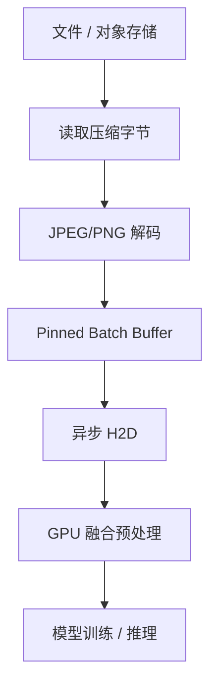

当工程目标从“理解 CUDA”变成“稳定生产吞吐”时，不应执着于所有部件都手写。NVIDIA DALI 已把读取、解码、裁剪、缩放和增强组织为多阶段输入流水线，并提供预取、并行执行和 Batch 处理；它尤其适合图像、视频和音频等密集数据。[NVIDIA DALI Documentation](https://docs.nvidia.com/deeplearning/dali/user-guide/docs/index.html)

DALI 的官方 FAQ 也把目标描述得很清楚：它面向深度学习数据处理，并尝试让预处理与网络前向/反向过程重叠。[NVIDIA DALI FAQ](https://docs.nvidia.com/deeplearning/dali/user-guide/docs/FAQ.html)

这不意味着 PyCUDA 方案没有价值。两者解决的问题层次不同：

| 场景 | 更合适的选择 |
|---|---|
| 学习线程映射、内存与 Stream | PyCUDA 原型 |
| 自定义算子、特殊数据格式 | PyCUDA / CUDA C++ |
| 标准视觉训练输入流水线 | 优先评估 DALI |
| 已在 PyTorch 生态内 | 先优化 DataLoader、pinned memory、prefetch，再决定是否引入 DALI |
| 极致存储到 GPU 路径 | 评估 GPUDirect Storage，但同时核算解码与文件系统瓶颈 |

GPUDirect Storage 能减少存储与 GPU 数据路径中不必要的 CPU bounce buffer，但它不会自动消除压缩格式解码、碎片化小文件或上游网络瓶颈。[NVIDIA GPUDirect Storage Documentation](https://docs.nvidia.com/gpudirect-storage/)

前沿技术不是把更多名词堆进架构图，而是知道每项技术具体消除了哪一次等待。

---

### 十、五个容易写错的结论

#### 误区一：`cuda.to_device()` 就是 CUDA 数据加载

它完成的是主机到设备的数据复制。上游文件读取、解码和 Batch 组装仍然可能是最大瓶颈。

#### 误区二：用了 `memcpy_htod_async()` 就一定异步重叠

没有 pinned memory、独立缓冲区、合适的 Stream 和硬件支持，调用名里有 `async` 也不代表时间线上必然重叠。

#### 误区三：Stream 越多越快

Stream 是调度与依赖表达工具，不是计算资源。过多 Stream 会增加管理成本，也可能加剧资源竞争。双缓冲通常是清晰的起点，最优数量必须实测。

#### 误区四：Pinned Memory 越多越好

页锁定内存是有限资源，过量使用会损害整个系统。应预分配、复用，并限制总量。

#### 误区五：GPU 结果必须先拷回 CPU 才能给模型

如果下一阶段仍在 GPU 上，最佳路径通常是让预处理输出继续留在显存，直接交给框架 Tensor 或下一个 Kernel。

---

### 十一、真正的优化顺序

当输入流水线变慢时，可以按下面的顺序排查：

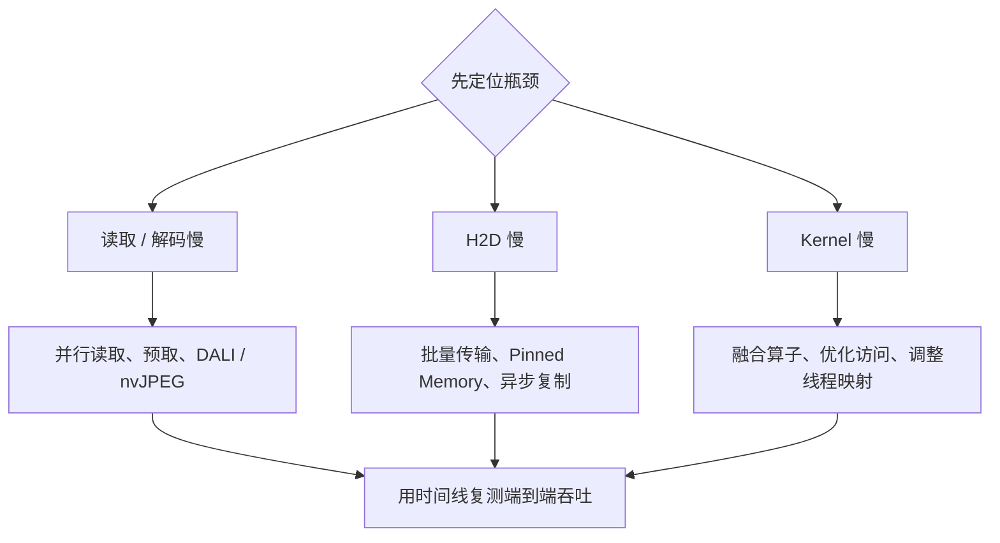

这张图最重要的不是工具，而是顺序：

> **先测量，再定位；先消除最大等待，再优化局部细节。**

NVIDIA 的最佳实践还强调，应尽量减少 Host 与 Device 之间的数据传输，并把多个小传输合并为更大的批量传输；中间数据最好在设备端创建、处理和销毁。[CUDA C++ Best Practices Guide：Data Transfer](https://docs.nvidia.com/cuda/cuda-c-best-practices-guide/index.html#data-transfer-between-host-and-device)

这正是 Batch、算子融合与 GPU 常驻数据能够产生价值的根本原因。

---

### 结语：别只盯着那一段绿色 Kernel

CUDA 优化最迷人的地方，是你很容易看见成千上万个线程同时工作；最容易误判的地方，也是你因此只看见 Kernel。

一条真实的数据链路里，GPU 计算只是其中一段：

```text
读取 → 解码 → 组 Batch → H2D → 预处理 → 模型
```

原始代码已经迈出了重要一步：用三维 Grid 把 32 张图片映射到 GPU，并把中心裁剪和归一化融合为一次 Kernel 启动。

下一步不再是把同一个 Kernel 写得更花哨，而是把它放进一条不会断粮的流水线：

- 用 pinned memory 建立可靠的异步传输入口；
- 用非默认 Stream 表达独立任务；
- 用双缓冲避免 CPU 与 GPU 争用同一块内存；
- 用正确计时区分传输、计算与端到端吞吐；
- 让预处理结果留在 GPU，直接流向模型；
- 当问题升级到读取和解码时，评估 DALI、nvJPEG 或更完整的输入系统。

最后记住一句话：

> **GPU 性能不是某个 Kernel 的速度，而是整条时间线上最慢、最难被隐藏的那一段。**

---

### 参考资料

1. [NVIDIA CUDA C++ Best Practices Guide](https://docs.nvidia.com/cuda/cuda-c-best-practices-guide/index.html)
2. [NVIDIA CUDA Programming Guide](https://docs.nvidia.com/cuda/cuda-programming-guide/index.html)
3. [PyCUDA Device Interface](https://documen.tician.de/pycuda/driver.html)
4. [PyCUDA Tutorial](https://documen.tician.de/pycuda/tutorial.html)
5. [NVIDIA DALI Documentation](https://docs.nvidia.com/deeplearning/dali/user-guide/docs/index.html)
6. [NVIDIA DALI FAQ](https://docs.nvidia.com/deeplearning/dali/user-guide/docs/FAQ.html)
7. [NVIDIA GPUDirect Storage Documentation](https://docs.nvidia.com/gpudirect-storage/)

---

### 发布摘要

一个 CUDA Kernel 只用几百微秒，GPU 却仍在等数据，问题可能根本不在计算。本文从一段 PyCUDA 批量中心裁剪与归一化代码出发，拆解“读取、解码、H2D 与预处理”的技术边界，并用页锁定内存、异步传输、CUDA Stream 和双缓冲搭建批量输入流水线。没有脱离环境的虚假倍数，只有能被验证的时间线、完整代码与工程边界。

### 推荐标签

`CUDA` `PyCUDA` `GPU性能优化` `Pinned Memory` `CUDA Stream` `异步传输` `双缓冲` `深度学习` `数据流水线` `图像预处理`

---

<a id="article-05"></a>

## 第 05 篇｜一个线程处理一个像素：用 PyCUDA 手写图像水平翻转

<!-- source: 05-cuda-horizontal-image-flip-pycuda-light-tech.md -->

> **副标题**：从二维坐标到一维显存：拆开一个最小但完整的 CUDA 图像内核  
> **工程深度**：L1→L2｜**预计阅读**：15 分钟  
> **关键词**：PyCUDA、图像水平翻转、二维线程映射、线性索引、合并访问、CUDA Event

---

### 一张图，为什么可以交给 GPU 上的海量线程

把一张图片左右翻转，用 NumPy 只要一行：

```python
flipped = np.fliplr(image)
```

但如果我们不调用现成函数，而是亲手把这件事交给 GPU，会立即撞上三个更底层的问题：

1. 一张二维图片，怎样分给成千上万个 CUDA 线程？
2. 图片明明有行和列，为什么这个最小 Kernel 里却可以只用一个 `float*`？
3. 水平翻转到底是在“搬整张图”，还是每个线程各自找一个像素？

答案比想象中简单：

> **让一个线程负责一个输出像素，再让它去输入图像中找到左右镜像位置。**

于是，翻转一张图不再是一场“大搬家”，而是大量互不依赖的小任务：每个线程只读一个值、写一个值。全文的主线可以提前压成一句话，后面每一个环节都是在为它服务：

> **先确定每个线程拥有哪个输出，再定义它为了生成这个输出应该读取哪里。**

这句话同样适用于卷积、缩放、旋转等几乎所有图像算子。

```text
输出像素 (x, y)
      │
      │ 计算镜像坐标
      ▼
输入像素 (width - 1 - x, y)
```

本文用 PyCUDA 完整实现这个过程。重点不是背代码，而是建立一个可以继续迁移到卷积、缩放、颜色变换和图像增强的坐标模型。

先把一个数字钉在心上：`4096 × 4096` 的图像意味着 16,777,216 个像素任务，程序确实会为每个像素启动一个逻辑线程；但 GPU 不会一次性把这 1677 万个线程全部驻留在 SM 上——这些线程组成的 Block 会被调度到数量有限的 SM 上分批执行。

> **逻辑线程数量 ≠ 同时驻留/执行的线程数量。** 这个区分在后面解释"什么时候才值得上 GPU"时会反复用到。

---

### 先看结果：水平翻转到底改变了什么

假设原图只有两行四列：

```text
输入：
1  2  3  4
5  6  7  8

水平翻转后：
4  3  2  1
8  7  6  5
```

行号没有变化，只有列号反向：

| 输出列 `x` | 对应输入列 `width - 1 - x` |
|---:|---:|
| 0 | 3 |
| 1 | 2 |
| 2 | 1 |
| 3 | 0 |

因此，宽度为 `width` 时，镜像坐标就是：

```cpp
int src_x = width - 1 - x;
```

注意，本文实现的是**左右翻转（horizontal flip / left-right flip）**，不是上下翻转，也不是旋转 180°。

---

### 第一层映射：一个线程对应一个输出像素

CUDA 把线程组织成 Thread、Block 和 Grid。`threadIdx`、`blockIdx` 与 `blockDim` 都是多分量坐标，因此可以用二维布局自然覆盖二维图像。CUDA 官方也把一维、二维和三维线程索引作为线程层次的基本表达方式，并明确说明多维 Block/Grid 主要为了把数据映射关系表达得更方便。[CUDA Programming Guide：Programming Model](https://docs.nvidia.com/cuda/cuda-programming-guide/01-introduction/programming-model.html#thread-blocks-and-grids)

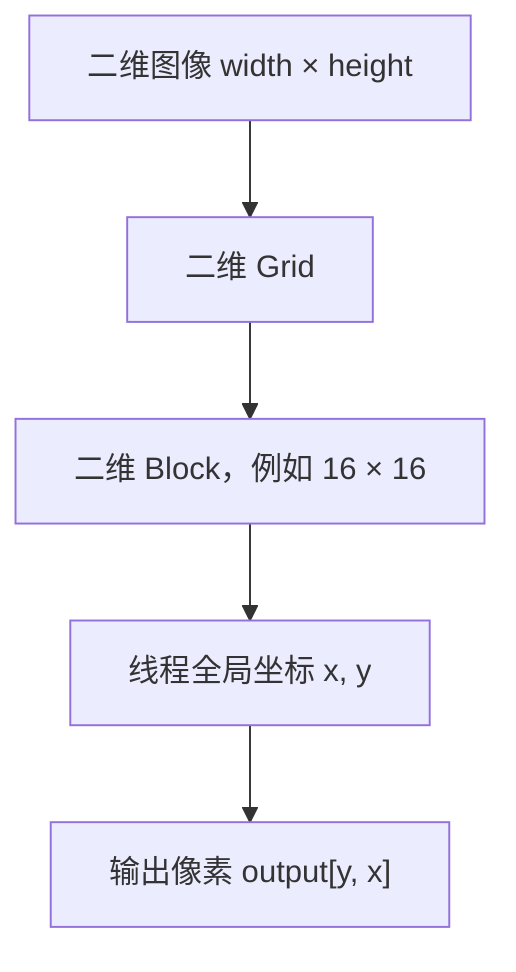

线程自己的全局坐标由下面两行得到：

```cpp
int x = blockIdx.x * blockDim.x + threadIdx.x;
int y = blockIdx.y * blockDim.y + threadIdx.y;
```

可以把它理解成：

```text
线程块的起点 + 线程在块内的偏移 = 线程在整张图中的位置
```

比如 Block 配置成 `16×16`：采用"一线程一像素"的映射时，256 个线程就分别负责一块 `16×16` 输出区域中的像素。注意，Block 与数据 Tile 的对应是**程序员选择的映射关系**，不是 CUDA 的硬性语义——没有任何硬件概念保证存在一个"二维像素块"。整张图片需要多少个 Block，不由 GPU 的 SM 数直接决定，而由图片尺寸是否被完整覆盖决定。

> `16×16`（256 线程/Block）是适合教学的起点，也满足 32 线程 Warp 的整倍数要求；它不是固定答案，实际 block size 仍应结合具体 GPU 与 workload 实测。

---

### 第二层映射：二维像素为什么变成一维地址

在 Python 中，我们习惯写：

```python
image[y, x]
```

但这个示例传给 CUDA 内核的是连续存放的 `float32` 数组。内核看到的是一段线性显存。严格说，CUDA 并没有“看见”一张二维图片——它看到的是一段连续的 device memory，**二维性来自你的索引约定**：

```text
图片是二维的
显存本质上是一维地址空间
二维只是我们对地址的一种解释方式
```

```cpp
const float *input;
float *output;
```

对于按行连续存储的二维数组，像素 `(x, y)` 的线性下标为：

```cpp
index = y * width + x;
```

以 `4×3` 图像为例：

```text
二维坐标：
(0,0) (1,0) (2,0) (3,0)
(0,1) (1,1) (2,1) (3,1)
(0,2) (1,2) (2,2) (3,2)

线性下标：
   0     1     2     3
   4     5     6     7
   8     9    10    11
```

于是水平翻转的读写关系可以压缩成一行：

```cpp
output[y * width + x] = input[y * width + (width - 1 - x)];
```

这也是全文最重要的公式。

---

### 完整 CUDA 内核：输出坐标不动，输入坐标反着找

```cpp
__global__ void flip_horizontal(
    const float *input,
    float *output,
    int width,
    int height)
{
    // 当前线程负责的输出像素列坐标
    int x = blockIdx.x * blockDim.x + threadIdx.x;

    // 当前线程负责的输出像素行坐标
    int y = blockIdx.y * blockDim.y + threadIdx.y;

    // Grid 通常向上取整，多出来的线程必须在这里退出
    if (x >= width || y >= height) {
        return;
    }

    // 当前输出列在输入图像中的左右镜像列
    int src_x = width - 1 - x;

    // 二维坐标转换为行优先的一维线性下标
    int dst_index = y * width + x;
    int src_index = y * width + src_x;

    // 每个线程读取一个输入像素，并写入一个输出像素
    output[dst_index] = input[src_index];
}
```

这里没有线程之间的数据依赖：每个线程写入唯一的 `dst_index`，所以不需要原子操作，也不需要 `__syncthreads()`。

#### 为什么不直接原地翻转

本文采用 out-of-place 翻转：输入与输出使用独立显存，每个线程只负责一个唯一的输出位置，不需要处理数据覆盖问题。原地翻转（交换两端像素）也可以做，但涉及线程间的同步与数据所有权，属于另一个主题。教学版本先用 out-of-place 把主线讲完。

---

### Grid 为什么要向上取整

假设图片宽度是 100，而 Block 的 x 方向有 16 个线程：

```text
100 // 16 = 6
6 × 16 = 96
```

如果直接使用整数除法，最后 4 列没有任何线程负责。正确做法是整数向上取整：

```python
def ceil_div(value, divisor):
    return (value + divisor - 1) // divisor
```

于是：

```text
ceil(100 / 16) = 7
7 × 16 = 112
```

多出来的 12 个线程由内核中的边界判断过滤。这里有一个常被混淆的因果关系：

> 边界判断能拦住多余线程，却不能补回从未启动的线程。

---

### 完整 PyCUDA 程序：运行、验证、Benchmark

下面的版本可直接运行：用 `SourceModule` 编译 CUDA C 内核，用显式 H2D/D2H 复制管理数据。PyCUDA 官方教程同样采用 `SourceModule → get_function → memcpy_htod/memcpy_dtoh` 这条基础路径。选择 PyCUDA，不是因为它代表 CUDA Python 生态唯一主流路线（还有 Numba、CuPy、PyTorch CUDA Extension），而是因为这条路线把 Python 与原生 CUDA C 内核之间的每一步边界都摊开在眼前。

计时口径先说清：内核时间用 CUDA Event、跑 warmup×5 + repeat×20、取 median 与 P95；端到端时间用主机时钟单独测。**这些数值只用于演示测量方法，不作为跨 GPU 的性能结论。**

```python
import time

import numpy as np
import pycuda.autoinit
import pycuda.driver as cuda
from pycuda.compiler import SourceModule


# CUDA C 内核：一个线程生成一个水平翻转后的输出像素
KERNEL_CODE = r"""
__global__ void flip_horizontal(
    const float *input,
    float *output,
    int width,
    int height)
{
    int x = blockIdx.x * blockDim.x + threadIdx.x;
    int y = blockIdx.y * blockDim.y + threadIdx.y;

    if (x >= width || y >= height) {
        return;
    }

    int src_x = width - 1 - x;
    int dst_index = y * width + x;
    int src_index = y * width + src_x;

    output[dst_index] = input[src_index];
}
"""


def ceil_div(value, divisor):
    """对正整数执行除法并向上取整。"""
    return (value + divisor - 1) // divisor


def benchmark_kernel(kernel, *args, block, grid, warmup=5, repeat=20):
    """非计时的预热 + 连续测量，返回 (median_ms, p95_ms)，单位毫秒。"""
    # warmup 全程不计时，避免把首次执行的额外开销混入正式测量
    for _ in range(warmup):
        kernel(*args, block=block, grid=grid)
    cuda.Context.synchronize()

    times = []
    start = cuda.Event()
    end = cuda.Event()
    for _ in range(repeat):
        start.record()
        kernel(*args, block=block, grid=grid)
        end.record()
        end.synchronize()
        times.append(start.time_till(end))

    return float(np.median(times)), float(np.percentile(times, 95))


# 编译 CUDA 代码并获取内核函数
module = SourceModule(KERNEL_CODE)
flip_kernel = module.get_function("flip_horizontal")

# 生成连续的 float32 灰度图像
width, height = 4096, 4096
rng = np.random.default_rng(42)
input_image = rng.random((height, width), dtype=np.float32)
gpu_result = np.empty_like(input_image)

# 分配输入、输出显存；分配本身不放入内核计时窗口
input_gpu = cuda.mem_alloc(input_image.nbytes)
output_gpu = cuda.mem_alloc(gpu_result.nbytes)

block = (16, 16, 1)
grid = (
    ceil_div(width, block[0]),
    ceil_div(height, block[1]),
)

# 统一的内核参数，预热与正式测量共用
kernel_args = (
    input_gpu,
    output_gpu,
    np.int32(width),
    np.int32(height),
)

# H2D 传输不属于内核计时；随后的 benchmark_kernel 自带 warmup×5 非计时运行，
# 首次执行相关运行时开销不会进入正式测量
cuda.memcpy_htod(input_gpu, input_image)

# CUDA Event 测量：warmup×5 + repeat×20，取 median 与 P95
median_ms, p95_ms = benchmark_kernel(
    flip_kernel,
    *kernel_args,
    block=block,
    grid=grid,
    warmup=5,
    repeat=20,
)

# 将 GPU 结果复制回主机
cuda.memcpy_dtoh(gpu_result, output_gpu)

# 使用 NumPy 作为参考实现
cpu_reference = np.fliplr(input_image)

# effective bandwidth：按逻辑读写字节数 / 内核时间，这不是 DRAM 带宽
bytes_moved = input_image.nbytes + gpu_result.nbytes
bandwidth_gbps = bytes_moved / (median_ms / 1000) / 1e9

print(f"Grid: {grid}, Block: {block}")
print(f"Kernel 时间（median / P95）: {median_ms:.3f} / {p95_ms:.3f} ms")
print(f"Effective bandwidth（逻辑字节）: {bandwidth_gbps:.2f} GB/s")
print("结果正确:", np.allclose(gpu_result, cpu_reference))

# 单独演示一次端到端计时：H2D + Kernel + D2H（主机时钟，仅作演示）
e2e_start = time.perf_counter()
cuda.memcpy_htod(input_gpu, input_image)
flip_kernel(*kernel_args, block=block, grid=grid)
cuda.memcpy_dtoh(gpu_result, output_gpu)
e2e_ms = (time.perf_counter() - e2e_start) * 1000

print(f"端到端时间（H2D + Kernel + D2H）: {e2e_ms:.3f} ms")
```

程序中的 `np.allclose()` 不是装饰。并行代码首先要证明“算对了”，才有资格讨论“跑快了”。

---

### Timing 不是一个数字，而是一个边界

CUDA 内核启动通常是异步的：CPU 发出任务后可能立即继续执行。因此，用 CPU 计时器包住一次 Kernel 调用，却不做同步，测到的往往只是提交开销。NVIDIA Best Practices Guide 明确提醒：使用 CPU 计时时，需要处理 CUDA API 的异步行为；测量 GPU 内核更适合使用 CUDA Event。

本文把两个问题分开：

| 指标 | 计时窗口 | 回答的问题 |
|---|---|---|
| Kernel 时间 | CUDA Event 包围 Kernel | 这个 Kernel 在 GPU 时间线上经过了多久？ |
| 端到端时间 | H2D + Kernel + D2H | 这次完整调用花了多久？ |

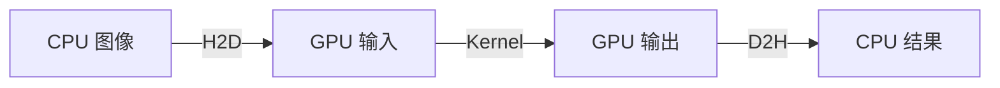

如果数据本来就由上一个 GPU 算子产生，并继续交给下一个 GPU 算子，H2D/D2H 可以不发生。两种对比一目了然：

```text
CPU → GPU → CPU    每处理一步都需要发生 Host ↔ Device 数据传输
GPU → GPU → GPU    数据持续驻留 Device Memory，可绕过传输墙
```

GPU 算子是否值得做，不能只看 Kernel 有多快，还要看数据是不是已经在 GPU 上。

---

### 这段内核快在哪里，又受限在哪里

每个像素只执行少量整数运算，并搬运一个 `float32`。它的算术强度很低，从工作量模型看更偏向 **memory-bound（内存带宽受限）**；是否真正受内存系统限制，最终仍以实测与 profiler 判断。

#### 写入模式

相邻线程写入：

```text
output[y, x]
output[y, x+1]
output[y, x+2]
...
```

相邻线程写入连续地址，因此形成典型的 coalesced global store 模式。注意“连续”不等于“必然最优”：实际事务数仍受地址对齐、元素大小、Warp 中参与线程和内存段影响，最终以 profiler 为准。

#### 读取模式：地址是反着读的，为什么仍然可以合并

相邻线程读取：

```text
input[y, width-1-x]
input[y, width-2-x]
input[y, width-3-x]
...
```

方向虽然相反，但线程访问的**地址集合**仍然是连续的：

```text
随机访问      ❌
跨大步长访问   ❌
反向连续访问   ✅
```

用一个 Warp 的例子落地：假设一个 Warp（32 个线程）负责同一行的一段，那么

```text
T0  → input[31]
T1  → input[30]
T2  → input[29]
...
T31 → input[0]
```

地址是递减的，但这 32 个线程访问的仍是一段连续的 `float32` 数据——合并访问不要求线程按地址递增。

原因在于：合并访问（coalesced access）关心的是一个 Warp 最终触及哪些对齐内存段，并不要求线程按地址递增排列——只要整个 Warp 请求的地址集合能由尽可能少的内存事务满足即可。不过，每行起点的对齐、元素大小和图像步长仍会影响实际事务数，最终应以 profiler 为准。

#### 一个公式看懂它为什么是“搬数据”内核

假设有 N 个 `float32` 像素，**理论逻辑读写量**为：

```text
读取：N × 4 bytes
写入：N × 4 bytes

理论逻辑数据量 ≈ 8N bytes
```

因此可以用 Kernel 时间估算有效带宽：

```text
Effective Bandwidth ≈ 8N / Kernel Time
```

以 `4096 × 4096` 为例：`8 × 16,777,216 ≈ 128 MiB`，结合上面测出的 Kernel 中位数即可算出有效带宽（下面的代码会直接打印）。这也是为什么水平翻转很适合作为第一个 memory-bound 内核：它几乎没有计算，主要工作就是把数据读出来、再写回去。

注意 **effective bandwidth（有效带宽）** 是按**逻辑读写字节数**算出的工程指标，不是 DRAM 带宽——后者是 profiler 报告的另一层数据。这和系列一贯原则一致：逻辑数据量 ≠ 硬件流量。

#### 为什么小图可能不如 NumPy

对于小尺寸、单张、只做一次的图像：

- 内核启动有固定成本；
- 主机与设备之间传输有成本；
- NumPy/OpenCV 的 CPU 实现可能已经使用 SIMD；
- 翻转本身计算量太小，GPU 很难“摊薄”上述成本。

所以更准确的说法不是“GPU 翻转一定更快”，而是：

> 当图像足够大、批量足够多，或者数据已经常驻显存时，像素级并行才更容易转化为端到端收益。

---

### 从灰度到彩色：索引多了一层

本文代码处理形状为 `height × width` 的单通道 `float32` 图像。若数据采用 HWC 布局：

```text
height × width × channels
```

像素与通道 `(x, y, c)` 的下标为：

```cpp
(y * width + x) * channels + c
```

灰度只有一层 `[y, x]`，彩色多了一层 `[y, x, c]`——坐标模型没有变，只是每个位置又多乘了一个 `channels`。

> **工程提醒**：真实图像通常不只是一个 `height × width` 的连续数组，还可能有 stride、pitch、ROI、padding，甚至 `uint8`/半精度。本文为了讲清线程映射，故意使用连续的 NumPy 数组；生产接口应显式传入 `stride` 或 `pitch`，不能把 `width` 默认当作每行实际跨度。

---

### 常见错误清单：四个最容易翻车的点

#### 1. Grid 使用向下取整

```python
# 错误：边缘像素可能永远没有线程处理
grid_x = width // block_x
```

#### 2. 没有边界判断

Grid 向上取整后，边缘 Block 中一定可能存在越界线程，没有 `if (x >= width ...)` 过滤就会写入越界地址。

#### 3. 把 CPU 墙钟时间叫作“纯内核时间”

必须说明是否包含同步、H2D、D2H、显存分配和首次编译；纯 Kernel 时间请用 CUDA Event。

#### 4. 宣布“算对了”却没有验证

只打印前几行就宣称正确是不够的。使用完整数组对比并给出容差策略：整数图像可以精确比较，浮点流水线通常使用 `allclose`。

---

### 再往前一步：这段代码能通向哪里

把整篇文章的认知叠起来，其实是五层，这也是以后分析任何 CUDA 算子时的视角：

```text
逻辑层   一个线程 → 一个输出像素
地址层   (x, y) → y * width + x
内存层   global load / global store
硬件层   warp → 内存事务 → cache → DRAM
测量层   CUDA Event → effective bandwidth → profiler
```

水平翻转是一个很小的内核，但它已经包含了 CUDA 图像处理的基本骨架：

```text
线程映射
   ↓
输出坐标
   ↓
输入坐标变换
   ↓
线性地址
   ↓
边界判断
   ↓
正确性与性能验证
```

沿着同一套模型，可以继续实现：

- 上下翻转：改变 `y`；
- 90° 旋转：交换坐标并处理输出尺寸；
- 最近邻缩放：输出坐标映射回输入坐标；
- 仿射变换：使用矩阵计算源坐标；
- 卷积：从一个输入坐标扩展为一个邻域；
- 批量数据增强：增加 batch 与 channel 维度。

真正值得带走的不是 `width - 1 - x`，而是这句话：

> **先确定每个线程拥有哪个输出，再定义它为了生成这个输出应该读取哪里。**

这条思路，比任何单个图像算子的代码都更耐用。最后回到这个例子本身——水平翻转只有一行：

```text
output[y, x] = input[y, width - 1 - x]
```

背后是一整套通用的判断链：

```text
输出坐标 → 输入坐标 → 线性地址 → 内存访问 → 性能测量
```

下次遇到 resize、rotate、normalize 或颜色变换，先问三件事：**这个线程负责哪个输出？这个输出要读哪个输入？这些读写对内存效率意味着什么？** 想清楚这三问，flip 就不再只是一个例子，而是一套可以复用到任何图像算子的 CUDA 思维方法。

---

### 参考资料

1. [NVIDIA CUDA C++ Programming Guide：Programming Model（Thread Blocks and Grids / Thread Hierarchy）](https://docs.nvidia.com/cuda/cuda-programming-guide/01-introduction/programming-model.html)
2. [NVIDIA CUDA C++ Programming Guide：Writing SIMT Kernels（合并访问与地址段语义）](https://docs.nvidia.com/cuda/cuda-programming-guide/02-basics/writing-cuda-kernels.html)
3. [NVIDIA CUDA Best Practices Guide：Coalesced Access、Effective Bandwidth 与 Thread Block Size](https://docs.nvidia.com/cuda/cuda-c-best-practices-guide/)
4. [PyCUDA 2026.1 Tutorial：初始化、SourceModule 与显式数据传输](https://documen.tician.de/pycuda/tutorial.html)
5. [PyCUDA Device Interface：Event、内存复制与驱动接口](https://documen.tician.de/pycuda/driver.html)

---

<a id="article-06"></a>

## 第 06 篇｜裁剪不是“切一刀”：用 PyCUDA 讲透 ROI 坐标映射

<!-- source: 06-cuda-image-cropping-pycuda-light-tech.md -->

> **副标题**：从局部坐标、原图坐标到 Grid 向上取整，手写一个正确的 CUDA 图像裁剪内核  
> **工程深度**：L1→L2｜**预计阅读**：16 分钟  
> **关键词**：PyCUDA、CUDA 图像裁剪、ROI、坐标映射、边界检查、Grid 向上取整

---

### 裁剪真正难的，不是复制像素

从一张 `512×512` 的图像中，取出左上角位于 `(100,100)`、大小为 `100×100` 的区域。用 NumPy 写，只有一行：

```python
crop = image[100:200, 100:200]
```

把它改写成 CUDA 内核后，问题突然多了起来：

- 线程坐标属于原图，还是属于裁剪结果？
- `crop_x` 与 `crop_y` 应该加在哪里？
- 裁剪区域贴着边缘甚至越界时，应该报错、截断还是补零？
- 为什么 `100×100` 的输出配上 `16×16` 的 Block，会悄悄漏掉最后 4 行和 4 列？

这些问题的共同根源是：**裁剪同时存在两套坐标系。**

```text
裁剪结果中的局部坐标：(tx, ty)
              │
              │ 加上 ROI 左上角
              ▼
原图中的绝对坐标：(crop_x + tx, crop_y + ty)
```

一旦两套坐标系分清，内核本身反而很短。

---

### 先定义 ROI：边界语义必须说清楚

本文采用与 Python/NumPy 切片一致的半开区间：

```text
x ∈ [crop_x, crop_x + crop_width)
y ∈ [crop_y, crop_y + crop_height)
```

左边界包含，右边界不包含。因此：

```python
image[
    crop_y:crop_y + crop_height,
    crop_x:crop_x + crop_width,
]
```

当 `crop_x=100`、`crop_width=100` 时，实际读取的列是 `100～199`，共 100 列，而不是 101 列。

这不是语法细节，而是 API 契约。如果调用方和内核对边界是否包含的理解不同，就会出现典型的 off-by-one 错误。

---

### 两套坐标系：输出从零开始，输入从 ROI 原点开始

裁剪输出是一张新图，它的左上角永远是 `(0,0)`。假设 ROI 在原图中的起点为 `(crop_x,crop_y)`：

| 输出坐标 | 原图坐标 |
|---|---|
| `(0,0)` | `(crop_x,crop_y)` |
| `(1,0)` | `(crop_x+1,crop_y)` |
| `(0,1)` | `(crop_x,crop_y+1)` |
| `(tx,ty)` | `(crop_x+tx,crop_y+ty)` |

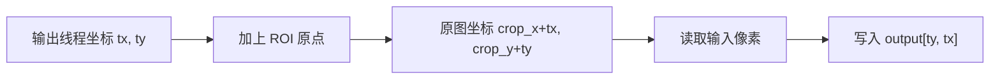

这也是裁剪和翻转最本质的区别：

```text
水平翻转：输出坐标 → 镜像输入坐标
图像裁剪：输出局部坐标 → 原图绝对坐标
```

---

### 从二维坐标落到线性显存

对于连续、行优先存储的单通道图像：

```cpp
input_index = input_y * width + input_x;
```

裁剪输出同样是连续数组：

```cpp
output_index = ty * crop_width + tx;
```

代入坐标映射：

```cpp
int input_x = crop_x + tx;
int input_y = crop_y + ty;

output[ty * crop_width + tx] =
    input[input_y * width + input_x];
```

一个线程仍然只做一件事：生成一个输出像素。

---

### 完整 CUDA 裁剪内核

```cpp
__global__ void crop_image(
    const float *input,
    float *output,
    int width,
    int height,
    int crop_x,
    int crop_y,
    int crop_width,
    int crop_height)
{
    // 线程坐标属于裁剪结果，不属于原图
    int tx = blockIdx.x * blockDim.x + threadIdx.x;
    int ty = blockIdx.y * blockDim.y + threadIdx.y;

    // 过滤 Grid 向上取整产生的多余线程
    if (tx >= crop_width || ty >= crop_height) {
        return;
    }

    // 把输出局部坐标映射到原图绝对坐标
    int input_x = crop_x + tx;
    int input_y = crop_y + ty;

    // 设备端安全兜底：即使参数异常，也不让线程访问非法地址
    if (input_x < 0 || input_x >= width ||
        input_y < 0 || input_y >= height) {
        return;
    }

    int input_index = input_y * width + input_x;
    int output_index = ty * crop_width + tx;

    output[output_index] = input[input_index];
}
```

这里有两层边界判断：

1. `tx/ty` 是否落在输出图像范围内；
2. 映射后的 `input_x/input_y` 是否落在原图范围内。

它们解决的是不同问题，不能互相替代。第 2 层在正常调用路径下不会触发，但仍应保留在 Kernel 中作为**设备端安全兜底**——这样即使调用方出现参数错误，Kernel 也不会把错误参数变成非法显存访问。

---

### 最隐蔽的 Bug：100×100 为什么只算了 96×96

原始写法如果使用：

```python
grid_x = crop_width // block_x
grid_y = crop_height // block_y
```

当 ROI 为 `100×100`、Block 为 `16×16` 时：

```text
grid_x = 100 // 16 = 6
grid_y = 100 // 16 = 6

实际覆盖：
6 × 16 = 96
```

最终结果右侧 4 列、底部 4 行没有任何线程处理。如果输出数组初始化为零，这个错误甚至不会崩溃，只会留下安静的零值边框。

正确写法是向上取整：

```python
grid_x = (crop_width + block_x - 1) // block_x
grid_y = (crop_height + block_y - 1) // block_y
```

本质上是图像类 Kernel 的通用模板：

```text
GridDim = ceil(OutputSize / BlockDim)
```

向上取整保证**至少覆盖**，多余线程由 Kernel 过滤；少算一个 Block 都无法靠边界判断补救。

```text
ceil(100 / 16) = 7
7 × 16 = 112
```

多启动线程没有问题，因为内核会过滤 `tx>=100` 或 `ty>=100` 的线程；少启动线程却无法由任何边界判断补救。

> **CUDA 覆盖原则：Grid 负责“至少覆盖”，Kernel 负责“严格收口”。**

到这里，「坐标系 → 地址 → 覆盖」这条链已经闭合，后面的每节都在给其中一环补细节：

```text
ROI 语义 → 输出局部坐标 → 输入绝对坐标 → 线性地址 → Grid 覆盖 → 边界安全 → Benchmark
```

---

### 越界 ROI 到底应该怎么处理

假设输入宽度为 512，却请求：

```text
crop_x = 480
crop_width = 100
```

ROI 会越过右边界。此时不存在唯一正确答案，只有不同的 API 语义。

#### 策略 A：严格拒绝

在 CPU 端校验，只接受完全位于原图内的 ROI：

```python
if (
    crop_x < 0
    or crop_y < 0
    or crop_x + crop_width > width
    or crop_y + crop_height > height
):
    raise ValueError("裁剪区域超出原图边界")
```

优点是结果尺寸和数据语义确定，最适合教学代码与大多数预处理流水线。

#### 策略 B：裁到交集

把 ROI 限制在原图范围内，输出尺寸随实际交集变化。这更像“安全截断”，但调用方必须接受动态尺寸。

#### 策略 C：保持尺寸并补零

输出始终是请求尺寸，越界位置写零或其他边界值。需要固定形状的输入张量、又不愿丢弃信息的场景会采用类似语义。

本文完整代码采用**策略 A**。一句话分工：**CPU 校验负责 API 契约（非法 ROI 直接拒绝），内核的输入边界检查负责设备端安全兜底（即使参数异常，线程也不会访问非法地址）**。另外注意：`return` 不会自动写零，未命中的输出像素可能保持未初始化值；如果选择补零语义，必须显式写零。

---

### 完整 PyCUDA 程序：严格 ROI、正确 Grid、CPU 验证

PyCUDA 官方教程展示了从 NumPy 主机数组到设备显存、运行 `SourceModule` 内核，再通过 `memcpy_dtoh` 取回结果的基本流程。下面沿用这条显式路径，让每一次内存移动都可见。

计时口径：Kernel 用 CUDA Event、端到端用主机时钟，都跑 warmup×5 + repeat×20，取 median 与 P95；环境信息一并打印，便于复现。**这些数值只用于演示测量方法，不作为跨 GPU 的性能结论。**

```python
import time

import numpy as np
import pycuda
import pycuda.autoinit
import pycuda.driver as cuda
from pycuda.compiler import SourceModule


KERNEL_CODE = r"""
__global__ void crop_image(
    const float *input,
    float *output,
    int width,
    int height,
    int crop_x,
    int crop_y,
    int crop_width,
    int crop_height)
{
    int tx = blockIdx.x * blockDim.x + threadIdx.x;
    int ty = blockIdx.y * blockDim.y + threadIdx.y;

    if (tx >= crop_width || ty >= crop_height) {
        return;
    }

    int input_x = crop_x + tx;
    int input_y = crop_y + ty;

    if (input_x < 0 || input_x >= width ||
        input_y < 0 || input_y >= height) {
        return;
    }

    int input_index = input_y * width + input_x;
    int output_index = ty * crop_width + tx;

    output[output_index] = input[input_index];
}
"""


def ceil_div(value, divisor):
    """整数除法向上取整。"""
    return (value + divisor - 1) // divisor


def kernel_median_p95(kernel, *args, block, grid, warmup=5, runs=20):
    """CUDA Event 测纯内核时间：warmup 不计时，repeat 取 median/P95。"""
    for _ in range(warmup):
        kernel(*args, block=block, grid=grid)
    cuda.Context.synchronize()

    times = []
    start = cuda.Event()
    end = cuda.Event()
    for _ in range(runs):
        start.record()
        kernel(*args, block=block, grid=grid)
        end.record()
        end.synchronize()
        times.append(start.time_till(end))

    return float(np.median(times)), float(np.percentile(times, 95))


def e2e_median_p95(host_input, host_output, device_input, device_output,
                   kernel, *args, block, grid, warmup=5, runs=20):
    """主机时钟测 H2D + Kernel + D2H 的完整调用窗口（显式同步，
    只用于展示完整调用成本，不作为高性能异步流水线的实现模板）。"""
    for _ in range(warmup):
        cuda.memcpy_htod(device_input, host_input)
        kernel(*args, block=block, grid=grid)
        cuda.memcpy_dtoh(host_output, device_output)
    cuda.Context.synchronize()

    times = []
    for _ in range(runs):
        # 显式同步：让 GPU 侧上个窗口收尾，计时边界明确
        cuda.Context.synchronize()
        t0 = time.perf_counter()
        cuda.memcpy_htod(device_input, host_input)
        kernel(*args, block=block, grid=grid)
        cuda.memcpy_dtoh(host_output, device_output)
        cuda.Context.synchronize()
        times.append((time.perf_counter() - t0) * 1000)

    return float(np.median(times)), float(np.percentile(times, 95))


def validate_roi(
    width,
    height,
    crop_x,
    crop_y,
    crop_width,
    crop_height,
):
    """采用严格语义：ROI 必须完整位于输入图像内。"""
    if crop_width <= 0 or crop_height <= 0:
        raise ValueError("裁剪宽度和高度必须大于 0")

    if (
        crop_x < 0
        or crop_y < 0
        or crop_x + crop_width > width
        or crop_y + crop_height > height
    ):
        raise ValueError("裁剪区域超出原始图像边界")


# 编译并获取 CUDA 内核
module = SourceModule(KERNEL_CODE)
crop_kernel = module.get_function("crop_image")

# 生成连续的 float32 单通道图像
width, height = 512, 512
rng = np.random.default_rng(42)
input_image = rng.random((height, width), dtype=np.float32)
assert input_image.flags["C_CONTIGUOUS"], "内核假设行优先连续存储"

# ROI 左上角与尺寸
crop_x, crop_y = 100, 100
crop_width, crop_height = 100, 100

validate_roi(
    width,
    height,
    crop_x,
    crop_y,
    crop_width,
    crop_height,
)

# 输出是独立、连续的 100×100 数组
gpu_crop = np.empty((crop_height, crop_width), dtype=np.float32)

# 显式分配设备内存并上传输入
input_gpu = cuda.mem_alloc(input_image.nbytes)
output_gpu = cuda.mem_alloc(gpu_crop.nbytes)
cuda.memcpy_htod(input_gpu, input_image)

# 256 线程/Block：二维映射直观、又是 32 的倍数；教学起点，而非所有 GPU 上的最优配置
block = (16, 16, 1)
grid = (
    ceil_div(crop_width, block[0]),
    ceil_div(crop_height, block[1]),
)

# 统一的内核参数，预热、Kernel 计时与 E2E 计时共用
kernel_args = (
    input_gpu,
    output_gpu,
    np.int32(width),
    np.int32(height),
    np.int32(crop_x),
    np.int32(crop_y),
    np.int32(crop_width),
    np.int32(crop_height),
)

# CUDA Event 测纯内核时间：warmup×5 + repeat×20，取 median 与 P95
kernel_median, kernel_p95 = kernel_median_p95(
    crop_kernel, *kernel_args, block=block, grid=grid
)

# 设备到主机复制
cuda.memcpy_dtoh(gpu_crop, output_gpu)

# NumPy 基准结果；copy() 明确物化为独立连续数组
cpu_crop = input_image[
    crop_y:crop_y + crop_height,
    crop_x:crop_x + crop_width,
].copy()

# 纯复制没有浮点计算，应逐字节一致；array_equal 比 allclose 语义更强
ok = np.array_equal(gpu_crop, cpu_crop)

# 打印环境信息，便于复现
device = cuda.Device(0)
print(f"GPU: {device.name()}")
print(f"PyCUDA: {pycuda.VERSION_TEXT}, NumPy: {np.__version__}")
print(
    f"dtype: {input_image.dtype}, Input: {width}x{height}, "
    f"ROI: {crop_width}x{crop_height} @ ({crop_x},{crop_y})"
)
print(f"Block: {block}, Grid: {grid}")
print(f"Kernel latency (median / P95): {kernel_median:.3f} / {kernel_p95:.3f} ms")
print("结果正确（逐字节一致）:", ok)
assert ok

# 端到端时间：H2D + Kernel + D2H（主机时钟，warmup×5 + repeat×20）
e2e_median, e2e_p95 = e2e_median_p95(
    input_image,
    gpu_crop,
    input_gpu,
    output_gpu,
    crop_kernel,
    *kernel_args,
    block=block,
    grid=grid,
)

print(f"End-to-end (H2D+Kernel+D2H, median / P95): {e2e_median:.3f} / {e2e_p95:.3f} ms")
```

这里使用 `cuda.memcpy_dtoh()`，因为 `cuda.to_device()` 或 `cuda.mem_alloc()` 得到的是驱动层设备内存对象；PyCUDA 官方基础示例也使用 `memcpy_dtoh` 把结果写回 NumPy 数组。

---

### NumPy 切片和 CUDA 裁剪，不一定是同一种工作

NumPy 的基本切片返回原数组的**视图**，通常并不复制像素（官方文档：基本 slicing 返回 view）：

```python
roi_view = input_image[100:200, 100:200]        # 视图：只有 shape/stride 元数据
cpu_crop = input_image[100:200, 100:200].copy() # 物化：独立连续数组
```

本文这个 CUDA Kernel 做的是后者——读取原图 ROI、复制像素，生成一块独立连续的输出显存。OpenCV 的 `cv::Mat` ROI 同样只是子矩阵头，`clone()` 才会产生独立数据。

> **“取得 ROI”与“物化一份连续 ROI 副本”是两个不同的性能问题。**

在 GPU 流水线里，如果下游算子能接收指针偏移和原图 stride，完全可以不启动裁剪 Kernel；只有下游要求紧凑、固定尺寸的连续输入时，物化裁剪结果才有意义。

---

### 为什么这个内核更偏向内存性能

每个线程只做：

- 两次坐标加法；
- 几次边界比较；
- 一次全局内存读取；
- 一次全局内存写入。

没有复杂浮点计算，算术强度很低。从工作量模型看，它属于低算术强度的内存访问型内核，性能通常更容易受内存访问效率和数据搬运成本影响——**最终是否真的受带宽限制，仍应以 Benchmark 和 profiler 实测为准，不要用性能模型代替实测**。

用一个 Warp 的视角看访问模式。假设一个 Warp（32 个线程）负责某一行内连续的一段：

```text
T0  → input[x + 0]     output[0]
T1  → input[x + 1]     output[1]
T2  → input[x + 2]     output[2]
...
T31 → input[x + 31]    output[31]
```

相邻线程访问相邻元素，因此这种访问模式天然适合合并访问（coalescing）。具体效率还要结合数据类型、地址分布和实际 GPU 测量判断。

但不要由此推出“裁剪一定适合单独用 GPU 加速”。小 ROI 的 Kernel 启动和传输成本可能高于复制本身。更现实的收益通常来自：

- 输入图像已经在 GPU；
- 一次处理很多 ROI；
- 裁剪与归一化、缩放、颜色变换融合进同一个 Kernel；
- 输出直接交给 GPU 推理，不再下载回 CPU。

---

### Timing：不要把一次 `time.time()` 当成性能结论

CUDA Kernel 启动通常是异步的。CPU 计时器若没有明确同步，可能只测到任务提交；如果紧接着执行同步 D2H，又会把数据传输算入同一个窗口。NVIDIA 的最佳实践文档建议明确计时边界，并可使用 CUDA Event 测量 GPU 工作。

建议把三个概念分开报告：

| 指标 | 含义 | 回答的问题 |
|---|---|---|
| Kernel latency | GPU 上这个 Kernel 的执行时间 | 这个 CUDA Kernel 本身多快？ |
| End-to-end latency | 本文 Benchmark 定义：H2D + Kernel + D2H | CPU↔GPU 一次调用多快？ |
| Pipeline impact | 该步骤在真实流水线中的综合影响（不止是时间） | 这一步是否值得存在？ |

第三个（Pipeline impact）最有工程价值：真正的优化有时候是**直接不做 crop**——让下游算子接受指针偏移和 stride，省掉一次 Kernel 启动和一次复制。

正式 Benchmark 还应具备：预热、重复取 median/P95、多尺寸扫描，以及环境信息（GPU/CUDA/PyCUDA/NumPy/dtype）与「数据是否常驻显存」的说明。

另外把「功能测试」和「性能测试」分开：功能测试用 `512×512` 原图裁 `100×100` ROI 验证正确性；性能测试建议换一张更大的原图（如 `2048×2048`），ROI 扫 `64² → 128² → 256² → 512² → 1024²`——注意性能测试的 ROI 同样必须通过 `validate_roi`，否则严格语义会直接拒绝。小 ROI 的启动与 Host↔Device 传输占比高，大 ROI 才更接近内核本身的显存吞吐特征。

---

### 从 width 到 stride：教学代码与真实图像的分界线

#### 1. 显式传入 stride，而不是默认连续

教学代码使用：

```cpp
input_y * width + input_x
```

它假设每行恰好有 `width` 个元素。真实图像可能包含行对齐、pitch 或来自更大图像的非连续视图，通用接口应使用：

```cpp
input_y * input_stride + input_x
```

stride 以元素还是字节为单位要统一约定。**这段分界线值得记住：一旦引入 stride，同样的代码就能处理对齐内存、子矩阵视图，而不只是“刚好一张连续图”。**

#### 2. 支持通道与数据类型

真实图像还会引入 channels、layout 与 dtype：HWC、CHW、NCHW 对线性地址的定义各不相同（灰度用 `input_y * width + input_x`，RGB 通常是 `(input_y * width + input_x) * channels + channel`），所以工程接口必须明确 layout，不能只增加一个 `channels` 参数。

#### 3. 批量 ROI，而不是逐个启动 Kernel

目标检测后经常要从一张图裁出多个候选框，逐 ROI 启动内核会放大启动开销：

```text
单 ROI → 批量 ROI（一个 Grid 覆盖多个框）→ +缩放 → +归一化 → 融合预处理
```

工程优化通常不是把一个 crop kernel 写得更复杂，而是**减少启动次数和中间结果**。这里点到为止，不展开成一个预处理流水线专题。

#### 4. 明确是否真的需要复制

如果下游支持原图指针、偏移和 stride，传递 ROI 描述可能比复制更便宜；如果下游要求固定尺寸连续张量，则裁剪或融合预处理更合适。

---

### 常见错误 + 一组必须测试的边界

先把最容易翻车的六点压成清单：

- **把 x 和 y 写反**：NumPy 访问顺序是 `[row, column]`（即 `[y, x]`），ROI 参数却常写成 `(x,y,width,height)`，命名必须明确。
- **Grid 按原图尺寸启动**：裁剪线程拥有的是输出像素，Grid 应按 `crop_width × crop_height` 计算。
- **使用向下取整**：会让边缘像素没有线程负责，而且程序未必报错。
- **越界线程直接 `return`，却把输出称为补零**：`return` 不写零，输出可能是未定义数据。
- **拿 NumPy view 与 CUDA copy 直接比速度**：比较对象不同，结论失真。
- **用随机抽样代替完整验证**：应对整个输出执行 `array_equal`/`allclose`，并补齐下面这些边界用例。

对应的边界测试，每个只回答「验证什么」：

| 用例 | 验证什么 |
|---|---|
| `100×100` ROI，`16×16` Block | 非整除尺寸不会漏算 |
| ROI 等于整张图 | 坐标映射退化为完整复制 |
| `1×1` ROI | 最小合法尺寸 |
| `0×0` / 负尺寸 | 参数契约拒绝非法尺寸 |
| ROI 紧贴右下角 | 半开区间与边界条件 |
| ROI 超出右边界 1 像素 | off-by-one |
| `crop_x=-1` | 严格模式拒绝负坐标 |
| 非连续或带 stride 输入 | 工程化索引接口 |

性能优化可以晚一点，边界测试不能晚。

---

### 裁剪内核真正教会我们的是什么

裁剪看起来只是复制一个矩形，实际却浓缩了 GPU 图像处理最常见的工程问题：

```text
先定义 ROI 语义
       ↓
线程拥有输出局部坐标
       ↓
映射到输入绝对坐标
       ↓
二维坐标转线性地址
       ↓
Grid 至少覆盖，Kernel 严格收口
       ↓
用 CPU 参考结果验证
       ↓
分开测 Kernel 与端到端成本
```

最值得记住的是两句话：

> **裁剪不是在原图上“切一刀”，而是在输出坐标系中重新生成一张图。**

> **Grid 决定有没有线程负责，边界判断决定线程能不能安全工作。**

理解这两个边界，后续再写 resize、warp、ROI Align、patch extraction 或融合预处理 Kernel，就不再只是照着公式抄代码。

---

### 参考资料

1. [NVIDIA CUDA C++ Programming Guide：Thread Hierarchy 与内存模型](https://docs.nvidia.com/cuda/cuda-c-programming-guide/)
2. [NVIDIA CUDA Best Practices Guide：CUDA Event 计时与合并内存访问](https://docs.nvidia.com/cuda/cuda-c-best-practices-guide/)
3. [PyCUDA 2026.1 Tutorial：SourceModule、显存分配与数据复制](https://documen.tician.de/pycuda/tutorial.html)
4. [PyCUDA Device Interface：Event 与 Driver API](https://documen.tician.de/pycuda/driver.html)
5. [NumPy Quickstart：基本切片返回 View](https://numpy.org/doc/stable/user/quickstart.html)
6. [OpenCV cv::Mat：ROI、Submatrix 与 Clone 语义](https://docs.opencv.org/4.x/d3/d63/classcv_1_1Mat.html)

---

<a id="article-07"></a>

## 第 07 篇｜Kernel 能编译，不代表它在算卷积：拆解 PyCUDA 二维卷积的三个反转

<!-- source: 07-pycuda-2d-convolution-correlation.md -->


### 一段能编译的代码，为什么和 SciPy 对不上？

输入是一张 `512×512` 的图像，卷积核是 `3×3`。每个 GPU 线程负责计算一个输出像素，代码能编译，内核（Kernel）能启动，输出尺寸也完全正确。

然后我把 GPU 结果交给 SciPy 验证：

```python
output_cpu = convolve2d(
    input_data,
    kernel,
    mode='same',
    boundary='fill',
    fillvalue=0
)
```

结果却对不上。不是差在最后几位，而是从方向到数值都可能不同。

更有意思的是，这段代码里的每一行看起来都很合理：

```cpp
value += input[y * input_width + x]
       * kernel[(i + half_k_height) * kernel_width + (j + half_k_width)];
```

输入坐标没越界，卷积核下标也在移动，为什么结果还是错的？

答案不是 GPU 算错了，而是这段名叫 `convolution_2d` 的代码，严格来说根本没有做卷积——它做的是二维互相关（cross-correlation）。

> **本文讨论范围**：单通道、单张图像、`stride=1`、`dilation=1`、奇数尺寸核、零填充（same 模式）。下述所有结论都只在范围内成立，不涉及批处理、多通道、分组卷积与反向传播。

这还只是第一个坑。这篇文章把这段代码反复"反转"三次，顺手拆掉另外四个容易翻车的地方。

---

### 一句话结论

这段 PyCUDA 代码建立了一个典型的 GPU 图像计算模型：

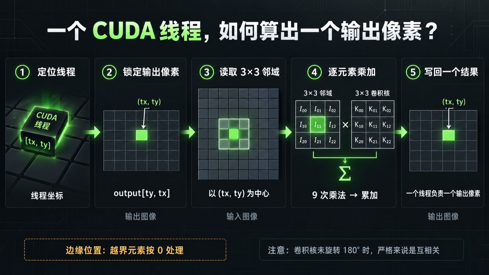

其中，卷积核的半宽、半高不是单纯为了"把尺寸除以二"，而是为了建立一个**以当前输出像素为中心的局部坐标系**。

但当前实现还有五个容易被忽略的问题：

1. 代码实现的是互相关，而 SciPy 验证使用的是真卷积；
2. 循环写法只适用于奇数尺寸卷积核；
3. Grid 使用向下取整，换成 `513×513` 可能漏算边缘；
4. PyCUDA 的 `DeviceAllocation` 与 `GPUArray` `.get()` 接口混用，程序会直接报错；
5. 当前计时包含结果回拷，并不等于纯 Kernel 时间。

理解这五点，才算真正看懂这段代码。

---

### 01 一个线程，到底在计算什么？

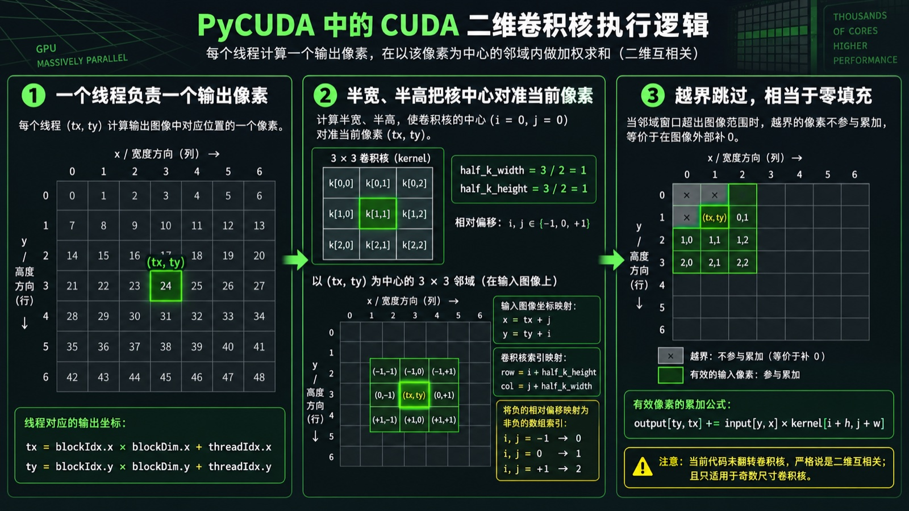

先看 Kernel 中最重要的两行：

```cpp
int tx = threadIdx.x + blockIdx.x * blockDim.x;
int ty = threadIdx.y + blockIdx.y * blockDim.y;
```

这里：

- `threadIdx`：线程在线程块（block）内部的位置；
- `blockIdx`：线程块在整个线程网格（grid）中的位置；
- `blockDim`：每个线程块包含多少线程。

三者组合起来，得到线程在整张图像上的全局坐标。

假设线程块大小为：

```python
block_size = (16, 16, 1)
```

那么一个 Block 中有 `16 × 16 = 256` 个线程，它们形成一个二维线程矩阵：

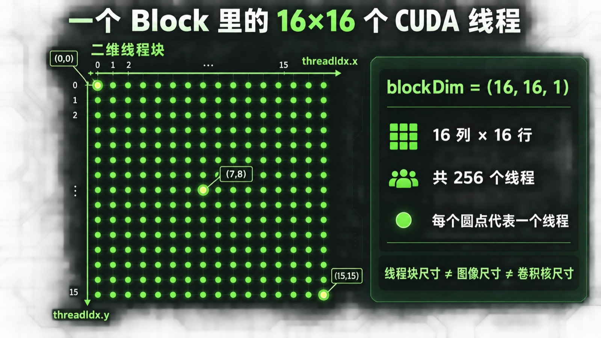

每个点都是一个 CUDA 线程。

但要注意：

> Block 的 `16×16` 不是输入图像大小，也不是卷积核大小，只是 GPU 调度线程的一种组织方式。多个 Block 拼在一起，才覆盖完整图像。

顺带说明一个常见的误会：图像有多少像素，不代表"就有多少线程同时跑"——程序启动的是**足以覆盖全部输出像素的线程**；Grid 向上取整时还会额外启动少量越界线程，再由 Kernel 的边界判断提前返回。GPU 根据流式多处理器（SM）数量和资源占用，把这些线程块并发或分批调度。线程块（block）是分配到 SM 的基本协作与资源组织单位；进入 SM 后，线程按 32 个线程组成的线程束（warp）被调度执行。NVIDIA 官方把 warp 定义为 CUDA 设备上最小的可执行并行单元（参见 CUDA C++ Best Practices Guide，链接见附录 B）。覆盖图像的其实是"索引公式"，不是 Block 本身。

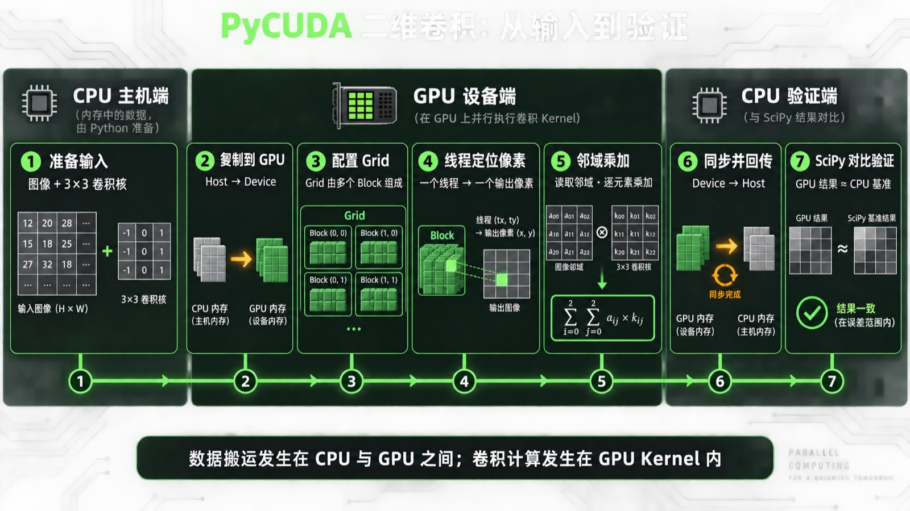

NVIDIA 的 CUDA 编程模型正是通过网格（grid）、线程块（block）和线程（thread）组织并行工作。根据 CUDA Programming Guide 的 execution model，可以把一个 Kernel 的启动理解为"向 GPU 提交一张调度清单，清单里按索引公式给每个线程分配任务"，线程并不负责"抢任务"，索引天然决定了线程与数据的一一对应关系。

---

### 02 为什么一个线程可以代表一个输出像素？

假设某个线程计算得到：

```text
tx = 24
ty = 16
```

它的任务不是处理整张图片，也不是负责卷积核中的某个权重，而是计算输出图像中 `output[16][24]` 这一个像素。

由于二维数组在内存中按行展开，所以：

```cpp
output[ty * input_width + tx]
```

等价于二维写法 `output[ty][tx]`。对于宽度为 `512` 的图像：

```text
output[16][24]
    ↓
output[16 × 512 + 24]
    ↓
output[8216]
```

于是，并行关系就建立起来了：

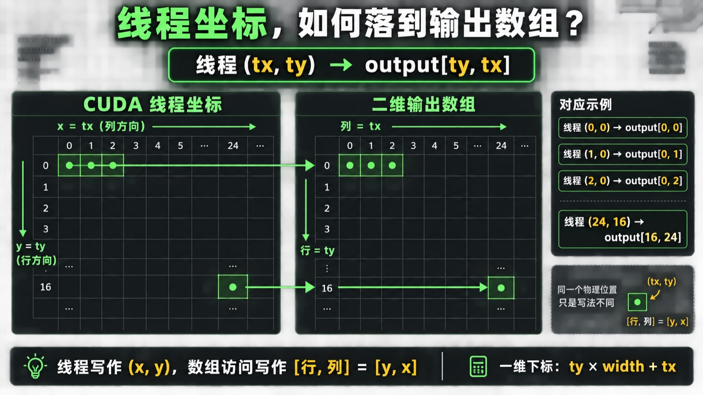

这就是这段程序最核心的并行拆分：

> 输出图像中有多少个像素，逻辑上就准备多少个线程；每个线程独立完成一个输出位置的计算。

不同线程读取的输入区域可能重叠，但它们写入的输出位置不同，因此不需要原子操作，也不需要线程间同步。这里顺便点一下：行号 `ty`、列号 `tx` 是谁，完全由索引公式确定；一个线程之所以"恰好"落在某个像素上，只是因为公式里写了 `blockIdx * blockDim + threadIdx`。

---

### 03 半宽、半高：给卷积窗口建立一套局部坐标

接下来是最容易"看懂代码、却没有建立直觉"的两行：

```cpp
int half_k_width = kernel_width / 2;
int half_k_height = kernel_height / 2;
```

对于一个 `3×3` 卷积核：

```text
kernel_width  = 3
kernel_height = 3
half_k_width  = 3 / 2 = 1
half_k_height = 3 / 2 = 1
```

这里的 `1` 是卷积核的中心到边缘的距离，也就是水平、垂直方向的**邻域半径**。

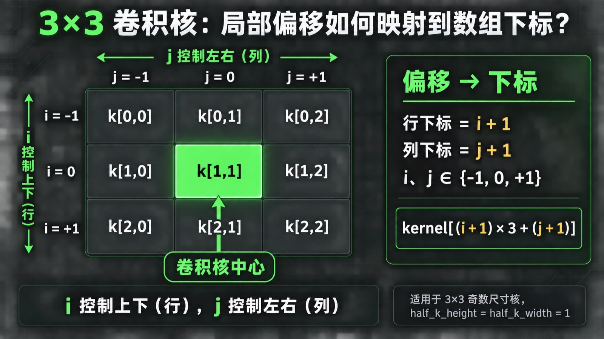

因此下面的循环：

```cpp
for (int i = -half_k_height; i <= half_k_height; i++) {
    for (int j = -half_k_width; j <= half_k_width; j++) {
```

对 `3×3` 卷积核会遍历 `i = -1、0、+1`，`j = -1、0、+1`，一共九个位置。

假设当前线程负责输出像素 `(tx, ty)`，输入坐标写成：

```cpp
int x = tx + j;
int y = ty + i;
```

也就是：

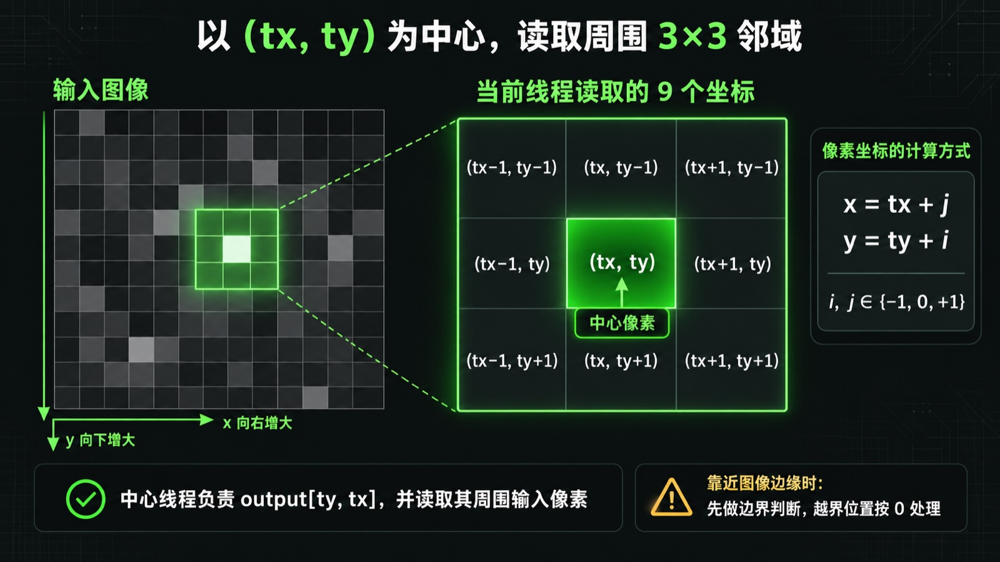

所以半宽、半高承担了第一个任务：确定卷积窗口需要以当前输出像素为中心、向四周移动多远。

#### 坐标转换：从中心原点回到数组下标

循环里的 `i` 和 `j` 可能是负数（`-1、0、+1`），但数组下标不能是负数。

因此代码又做了一次转换：

```cpp
i + half_k_height
j + half_k_width
```

对于 `3×3` 卷积核：

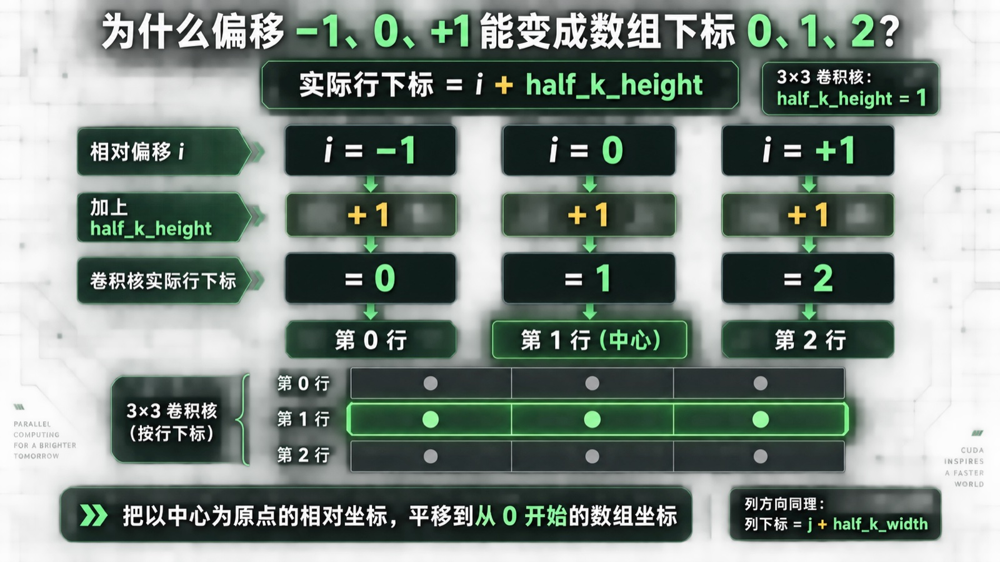

宽度方向同理：

```text
相对偏移 j：         -1    0    +1
卷积核实际列下标：     0    1     2
```

于是：

```cpp
kernel[(i + half_k_height) * kernel_width + (j + half_k_width)]
```

就能把"以中心为原点的相对坐标"转换成"从左上角开始的数组下标"。

这才是半宽、半高最重要的作用：

> 它建立了一座桥，把人更容易理解的中心坐标系，转换为计算机使用的数组坐标系。

换句话说：

```text
半宽、半高 ≠ 只是把卷积核尺寸除以 2
半宽、半高 = 邻域半径 + 坐标原点转换 + 卷积核中心定位
```

---

### 04 Same 模式：为什么跳过越界像素，就等于补零？

当卷积窗口移动到图像中间时，九个输入位置都有效。

但如果当前线程负责左上角（`tx = 0, ty = 0`），`3×3` 窗口的一部分会跑到图像外面：

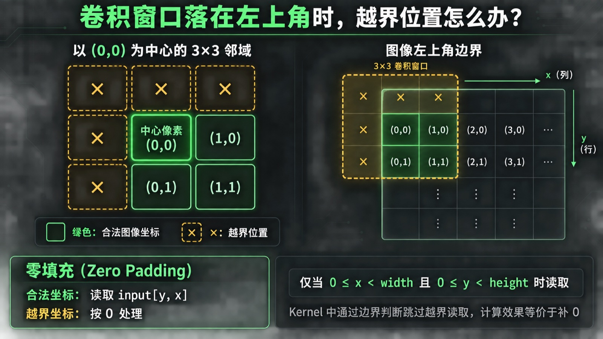

代码通过下面的条件过滤非法坐标：

```cpp
if (x >= 0 && x < input_width && y >= 0 && y < input_height) {
    value += ...;
}
```

图像外的像素没有参与累加，数学效果等价于把它们当成零：

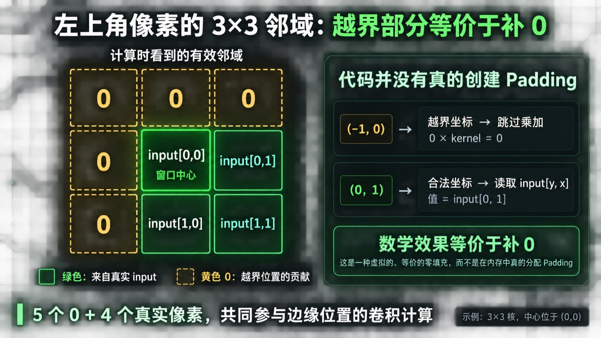

这就是零填充（zero padding）。

需要特别区分两个概念：

```text
same 模式：描述输出尺寸（与第一个输入一致）
零填充：描述边界外填什么
```

SciPy 的 `mode='same'` 表示输出尺寸与第一个输入一致；`boundary='fill', fillvalue=0` 才表示使用零填充。因此更准确的说法是：

> 这段 Kernel 通过"越界位置不参与累加"实现与零填充等价的边界行为；同时每个合法输入位置都产生一个输出，所以结果尺寸与输入一致。

---

### 05 第一次反转：这段代码其实不是卷积

现在回到开头的问题。

GPU Kernel 的核心计算是：

```cpp
value += input[y * input_width + x]
       * kernel[(i + half_k_height) * kernel_width + (j + half_k_width)];
```

卷积核被**原样**使用了。比如原始卷积核：

```text
1  2  3
4  5  6
7  8  9
```

当前 GPU 代码仍按这个方向与输入相乘。这种做法叫二维互相关（cross-correlation）：

```text
输入邻域  ×  原样卷积核
```

而数学意义上的二维卷积，计算前需要把卷积核上下、左右各翻转一次，等价于旋转 180°：

```text
翻转后的卷积核：
9  8  7
6  5  4
3  2  1

输入邻域  ×  翻转后的卷积核
```

两者的差别可以概括成一句话：

```text
互相关：直接滑动 Kernel
卷积：先把 Kernel 旋转 180°，再滑动
```

当卷积核恰好中心对称时（例如许多模糊核 `1 2 1 / 2 4 2 / 1 2 1`），翻转前后完全相同，卷积与互相关结果一致。但代码里的卷积核是 `np.random.rand(3, 3)` 生成的随机数，不对称是常态，两个结果自然对不上。

SciPy 正是把这两个操作分成了两个接口：

```python
scipy.signal.convolve2d    # 数学卷积（内部会翻转 Kernel）
scipy.signal.correlate2d   # 互相关（不翻转）
```

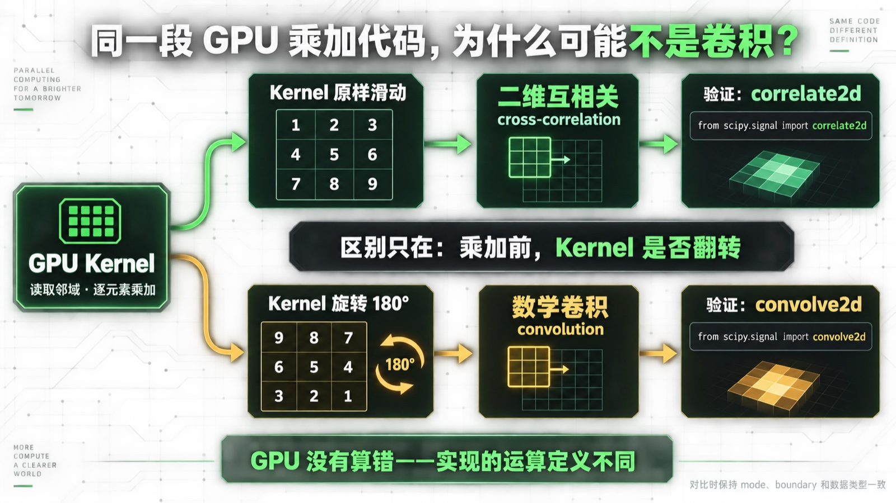

所以，验证当前 GPU 代码应该用 `correlate2d`：

```python
from scipy.signal import correlate2d

output_cpu = correlate2d(
    input_data,
    kernel,
    mode='same',
    boundary='fill',
    fillvalue=0
)
```

如果坚持使用 `convolve2d`，GPU 端就必须先翻转卷积核。

这里还有一层容易被忽略的等价性：`correlate2d` 的 same 模式用奇数核时，核中心与输出像素的对齐方式（中心对齐）和本文 Kernel 的 `tx + kx - half` 完全一致，这正是验证能通过的前提。若换成偶数核，两个库的"中心锚点"规则可能不一致，数值就会差出索引偏移——这一点在本文 §06 还会遇到。

最后补一句行业语境：深度学习框架里的"卷积层"（如 `torch.nn.Conv2d`）实现的其实是互相关，因为它不翻转核、只做交叉相关。术语如此使用在炼丹社区没问题，但做数值验证时不能只看名字，必须确认两边计算的是不是同一个数学操作。

---

### 06 第二次反转：3×3 能运行，不代表代码支持任意卷积核

原代码使用：

```cpp
int half_k_width = kernel_width / 2;
for (int j = -half_k_width; j <= half_k_width; j++) {
    // ...
}
```

对 `3×3`：`half = 1`，`j = -1、0、+1`，循环三次，没问题。

对 `5×5`：`half = 2`，`j = -2..+2`，循环五次，同样正确。

但换成 `4×4`：

```text
half = 4 / 2 = 2
j = -2、-1、0、+1、+2   ← 循环五次，列只有四列，下标越界
```

原因在于 `[-half, +half]` 是一个天然适合奇数尺寸、有唯一中心点的区间；偶数尺寸的卷积核没有唯一中心像素（4×4 的"中心"是四个位置，不是一个）。

所以教学代码最稳妥的做法是直接限制奇数核：

```python
if kernel_width % 2 == 0 or kernel_height % 2 == 0:
    raise ValueError("当前示例只支持奇数尺寸卷积核")
```

另一种做法是让循环直接遍历卷积核数组，循环次数与核尺寸严格一致：

```cpp
for (int ky = 0; ky < kernel_height; ++ky) {
    for (int kx = 0; kx < kernel_width; ++kx) {
        int y = ty + ky - half_k_height;
        int x = tx + kx - half_k_width;
        // 边界过滤后再相乘累加
    }
}
```

注意：换成遍历写法后用 `ty + ky - half` 重新定位输入坐标，奇数核结果与原来一致；但偶数核的 same 模式仍需明确中心锚点与输出对齐规则。SciPy 官方文档也特别提醒，在偶数长度核的 same 模式下，不同相关接口之间可能存在一个索引偏移。这不是哪一方"错"，而是"中心放哪"没有一致约定——所以教学版本先钉死在奇数核，回避整类歧义。

---

### 07 为什么 512×512 正常，513×513 却可能漏算？

原来的 Grid 计算方式是向下取整：

```python
grid_size = (
    input_width // block_size[0],
    input_height // block_size[1],
    1
)
```

对 `512×512`、Block `16×16`：

```text
512 / 16 = 32   →  32×32 个 Block，刚好覆盖
```

但如果图像宽度变成 `513`：

```text
513 // 16 = 32
32 × 16 = 512   →  最后一个像素没有线程负责
```

宽和高都是 `513` 时，最右侧一列和最下方一行都会整个漏算。

正确做法是向上取整：

```python
grid_size = (
    (input_width + block_size[0] - 1) // block_size[0],
    (input_height + block_size[1] - 1) // block_size[1],
    1
)
```

对 `513`：`(513 + 16 - 1) // 16 = 528 // 16 = 33`。第 33 个 Block 里只有部分线程有效，但 Kernel 内已有边界判断：

```cpp
if (tx < input_width && ty < input_height)
```

超出图像范围的线程不会写入结果。

于是：

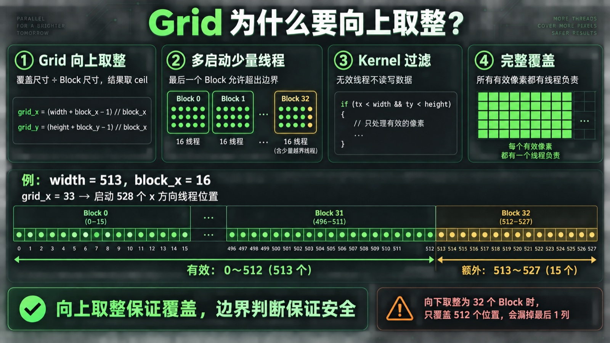

这是 CUDA 中非常常见的覆盖模式：用"与数据规模解耦的调度清单 + 线程内边界检查"替代"必须整除才安全的侥幸"。与此同源的坑在上一篇文章（线性层场景）里表现为"1024 条样本恰好整除 block"，这篇则是"图像尺寸恰好整除 16"——本质相同：不要让数据尺寸恰好落在整除巧合上。

### 08 第三次反转：能编译，不代表程序能跑

#### 8.1 `DeviceAllocation` 没有 `.get()`

原代码这样分配显存并回读结果：

```python
output_data_gpu = cuda.to_device(output_data)
output_data_gpu.get(output_data)     # ← 这里会抛 AttributeError
```

问题在于：`cuda.to_device()` 返回的是 `pycuda.driver.DeviceAllocation`，它没有 `.get()` 方法——`.get()` 是 `pycuda.gpuarray.GPUArray` 独有。PyCUDA 官方文档明确说明 `to_device()` 会分配设备内存、复制数据，并返回 `DeviceAllocation`。

两套接口二选一，不要混用：

```python
# 方案一：Driver API 风格，回拷用 memcpy_dtoh(dest, src)
cuda.memcpy_dtoh(output_data, output_data_gpu)

# 方案二：GPUArray 风格，回读用 .get()
output_gpu = gpuarray.zeros_like(input_gpu)   # 或 to_gpu/to_gunpy
output_data = output_gpu.get()
```

这个坑与"卷积还是互相关"无关，是 PyCUDA 两层 API 设计差异的必然结果：`cuda.to_device()` 返回 `DeviceAllocation`，回拷要使用 Driver API 的接口（`cuda.memcpy_dtoh`、`cuda.from_device`、`cuda.from_device_like` 等），`.get()` 属于 `GPUArray`，不能直接用于 `DeviceAllocation`。遇到 `AttributeError: 'DeviceAllocation' object has no attribute 'get'` 时，照上面对号入座即可。它的影响比前两个反转更直接——前两个反转只是"算错对象"，这里让程序连一个合法结果都拿不出来。但就算把 `.get()` 修好，代码也未必拿得到可信耗时——这正是 8.2 要讲的事。

#### 8.2 修好 `.get()`，原代码依然拿不到任何时间

原代码的计时范围是：

```python
start_time = time.time()
convolution_2d(...)
cuda.Context.synchronize()
output_data_gpu.get(output_data)
end_time = time.time()
```

严格来说，这段原代码**从未得到过任何计时结果**：程序在 `output_data_gpu.get(output_data)` 处抛 `AttributeError`，根本执行不到 `end_time = time.time()`。只有当 `.get()` 被修正为同步的 `cuda.memcpy_dtoh()`、且保持当前计时边界不变时，这个窗口才真正测得东西——它包含：Kernel 启动 + Kernel 执行 + 上下文同步 + 设备到主机（D2H）结果回拷 + 部分 Python 调用开销，既不是纯 Kernel 时间，也不是完整的端到端时间（输入数据早在计时开始之前就已复制到 GPU）。

#### 8.3 即使有数字，也未必是纯 Kernel 时间

要得到可信计时，先把测量口径分开：

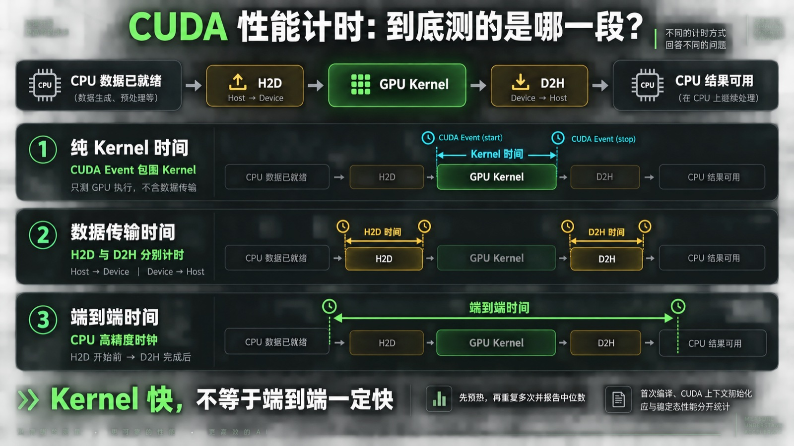

PyCUDA 官方文档把 Event 描述为流（stream）中的时间标记，用于测量两个事件之间的 GPU 工作，例如 Kernel 执行时间；`start.time_till(end)` 返回毫秒值。

顺带提醒：单次 Event 只用来演示 API 用法，不是稳定性能结论——Kernel 首次调用仍受上下文初始化、模块加载与缓存状态影响。正式 benchmark 应先预热、再多次测量取中位数或 P95；附录 A 刻意保持单次计时演示，只为展示正确写法，不产出性能数字。

---

### 09 修正后的 CUDA Kernel

保留当前代码的实际语义（互相关），把前文几个问题一起修掉。关键改动只有四处，其余都与原代码一样：

1. `const float *` 修饰输入与卷积核，向编译器和读者声明"只读"；
2. 输出边界判断改为**早返回**形式（`tx/ty` 越界提前 `return`），与 Grid 向上取整配套，让主计算路径更清晰；
3. 循环改成直接遍历卷积核数组，循环次数与核尺寸严格一致，不再依赖 `[-half, +half]` 的奇数假设；
4. 越界输入位置不参与累加（等价零填充），每个输出位置只写一次（天然契合"一个线程一个像素"，无需原子操作）。

核心片段：

```cpp
// Grid 向上取整后，边缘 Block 里会有多余线程，先过滤
if (tx >= input_width || ty >= input_height) {
    return;
}
// half 仍是奇数核下的邻域半径，用于把核坐标映射回输入坐标
for (int ky = 0; ky < kernel_height; ++ky) {
    for (int kx = 0; kx < kernel_width; ++kx) {
        int x = tx + kx - half_k_width;
        int y = ty + ky - half_k_height;
        if (x >= 0 && x < input_width &&
            y >= 0 && y < input_height) {
            value += input[y * input_width + x]
                   * kernel[ky * kernel_width + kx];
        }
    }
}
output[ty * input_width + tx] = value;
```

这段循环里再无负数下标：`kx` 从 `0` 到 `kernel_width-1`，`kernel[ky * kernel_width + kx]` 永远合法；输入坐标的"越界"交给与零填充等价的 `if` 过滤。凡是没有跑出这条逻辑的"改写"，都只是在重复原代码的隐患。

完整可运行版本见文末附录 A（含断言校验与验证状态）。

---

### 10 真正的卷积，只差一个索引

在本文限定的单通道、奇数核、`stride=1`、相同边界对齐场景里，从互相关改成数学卷积，核心差异收敛到一处：先把核旋转 180°（§05 已讲），再把旋转后的下标放进取核——其余乘加代码一字不改：

```cpp
// 互相关：直接取核
kernel[ky * kernel_width + kx]
// 数学卷积：旋转后取核
kernel[(kernel_height - 1 - ky) * kernel_width + (kernel_width - 1 - kx)]
```

不要因为只差一个索引就低估它。当卷积核不对称时，这个索引决定了边缘方向、梯度方向和最终数值——这正是开头"方向到数值都可能不同"的来源。

---

### 11 怎样验证这份代码：别只比较前 5×5

可信的验证分三步，缺一不可：

1. **选对参考实现**：正文语义是互相关，参考实现用 `correlate2d`（若是卷积语义则用 `convolve2d`），使用相同的 same 模式与零填充；
2. **全量比较，不抽前几行**：肉眼扫 `output_data[:5, :5]` "看起来像"没有任何说服力，用 `np.testing.assert_allclose(output_data, output_cpu, rtol=1e-5, atol=1e-5)` 检查所有元素，超限位置一目了然；
3. **先静态审阅，再上机实测**：本文写作环境（Apple Silicon，无 NVIDIA GPU）没有可运行 CUDA 的环境，附录 A 的代码目前通过静态审阅、尚未实测。发布前须在 NVIDIA GPU 环境补齐真实输出并填妥文末回填表，把"可运行"从承诺变成事实。

不要让我（或任何人）"看起来没问题"说服你：数值一致性只能用断言证明。

---

---

### 12 这段 Kernel 快吗？

它适合教学，但不能因为"跑在 GPU 上"就自称高性能卷积。

当前每个线程都从全局内存读取一个邻域。对 `3×3` 核，从源代码层面看，每个输出像素最多发起 9 次输入元素读取、9 次卷积核元素读取、9 次乘法、约 8 次累加；这些访问最终对应多少次真实显存事务，还会受到缓存命中、合并访问与编译器优化等因素影响。而相邻输出像素的输入窗口高度重叠——输出 A 与输出 B 读取的 3×3 区域可能有 6 个元素相同，朴素实现却让每个线程各自从全局内存重复加载。

合理的优化路线是：

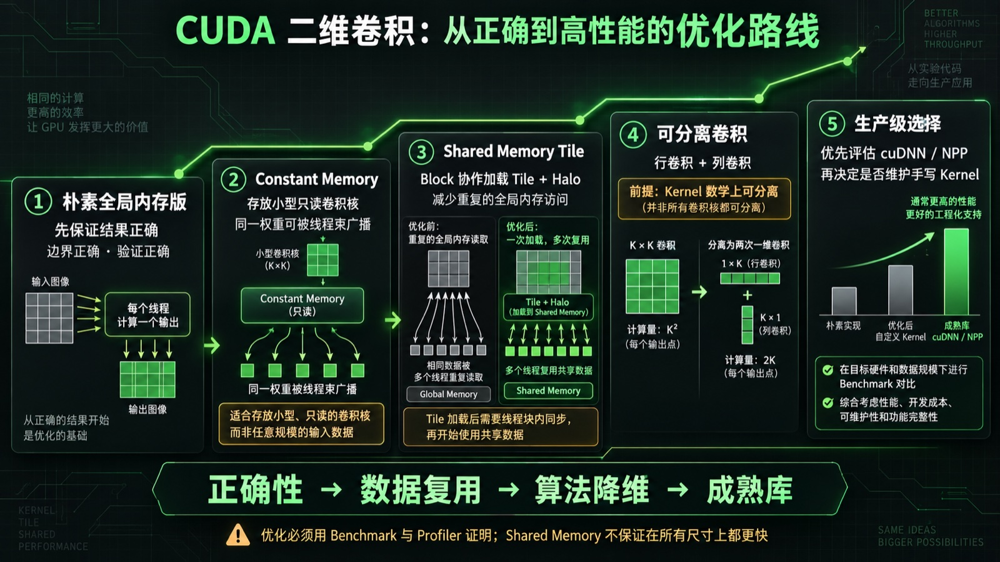

几个名词的适用边界：

- 常量内存适合存放较小、只读、且同一 Warp 在相同循环位置读取相同权重的卷积核；
- 共享内存分块（shared memory tiling）让一个 Block 内的线程复用重叠输入区域；
- 可分离卷积把一次二维计算拆成一次横向、一次纵向，复杂度从 O(n²) 降到 O(n)；
- 对复杂卷积、批处理、多通道与深度学习工作负载，优先评估成熟高性能库。

现代 CUDA Programming Guide 强调 Tile Kernel、异步复制与流水线（pipeline）等能力，但**不表示教学 Kernel 必须立即上它们**。同理，异步复制、流水线乃至更新架构上的 TMA（Tensor Memory Accelerator），也不是朴素 `3×3` Kernel 的默认答案；是否值得引入，应由 Nsight Compute 里的内存吞吐、缓存命中率、占用率与 Stall 指标来回答，而不是先上再说。本文只把 TMA 当作进一步演进方向，不暗示当前朴素 Kernel 能直接从它获益。正确的工程顺序永远是：

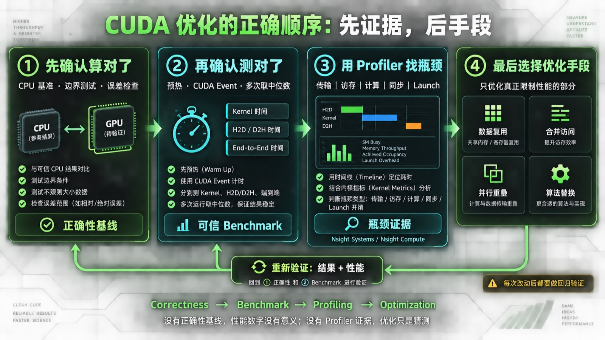

算法没验证、口径没对齐之前谈优化，等于在流沙上盖楼。

### 13 一张表看懂这段代码


| 代码                                           | 实际含义              |
| -------------------------------------------- | ----------------- |
| `tx = blockIdx.x * blockDim.x + threadIdx.x` | 当前线程负责的输出列        |
| `ty = blockIdx.y * blockDim.y + threadIdx.y` | 当前线程负责的输出行        |
| `half_k_width = kernel_width / 2`            | 水平方向的邻域半径         |
| `half_k_height = kernel_height / 2`          | 垂直方向的邻域半径         |
| `x = tx + kx - half_k_width`                 | 当前权重对应的输入列        |
| `y = ty + ky - half_k_height`                | 当前权重对应的输入行        |
| 直接遍历 `ky/kx` 而非 `[-half,+half]`              | 循环次数等于核尺寸，偶数核不再越界 |
| 越界位置不累加                                      | 等价于零填充            |
| 每线程写一个 `output`                              | 无共享写冲突，不需要原子操作    |
| `kx/ky` 从 0 起、不翻转                            | 语义是互相关            |
| `kernel[H-1-ky][W-1-kx]`                     | 旋转 180°，才是数学卷积    |
| Grid 向上取整                                    | 确保任意尺寸都被线程覆盖      |
| CUDA Event 包围 Kernel                         | 测量纯 GPU 时间窗口      |


---

### 14 最后：真正难的不是写出 Kernel，而是说清它算了什么

这段代码最有价值的地方，不是它完成了一次 `3×3` 图像计算，而是把 GPU 编程里几个最基础、也最容易混淆的问题集中到了一起：

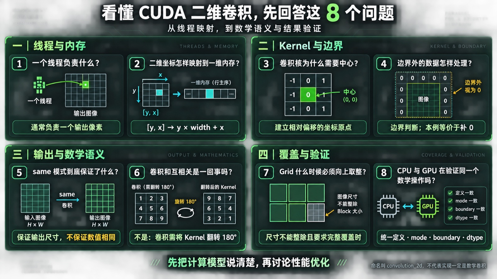

写出一个能启动的 CUDA Kernel 并不难。真正困难的是，当结果不一致时，你能否准确回答：这个线程读了什么、算了什么、写到了哪里？

半宽、半高只是两次整数除法，但它们背后连接着三套坐标：

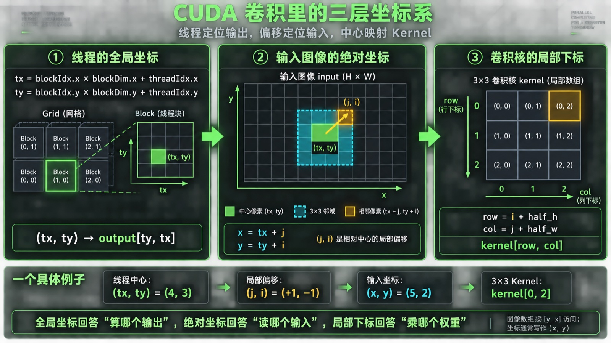

把这三套坐标真正对齐，二维卷积就不再是一段需要背诵的代码，而是一件非常具体的事：

> GPU 上成千上万个线程，各自站到一个输出像素上，把周围的一小块输入看一遍，完成乘加，然后把答案写回自己的位置。

这就是朴素二维卷积的全部逻辑，也是从"会调用 CUDA"走向"真正理解 CUDA"的第一步。

---

### 延伸：这一次换个战场

本文与线性层文章共享同一批硬课题：`DeviceAllocation.get()`、CUDA Event 口径、线程按索引一一定位输出，以及"先算对、再测对"。区别只在一维与二维：

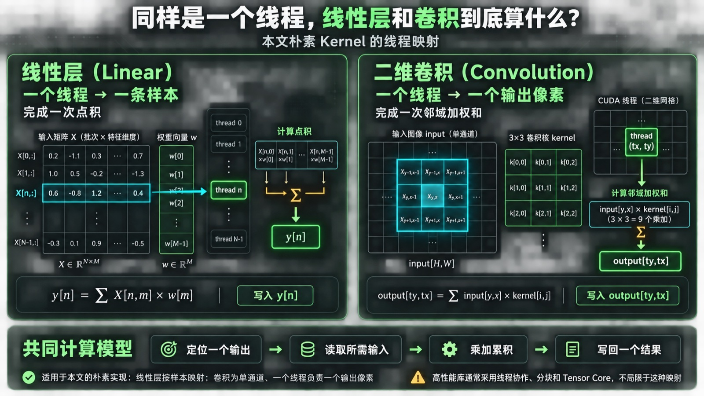

下一篇文章会走进共享内存与分块（tiling）：当"邻域重叠"成为真正的问题时，索引要让位给数据复用，而本篇的"三套坐标"正是理解分块的钥匙。

留一个开放问题（欢迎评论区讨论）：把附录 A 的验证从 `correlate2d` 换成 `convolve2d` 并保持图像 `513×513`，需要同时改哪一处？为什么只改一行代码是危险的？

---

### 附录 A：修正版完整代码

下面这份代码保留原程序语义（互相关），修正了验证对象、奇数核假设、Grid 覆盖、`.get()` 接口与计时口径，并给每个 Kernel 和关键调用加了中文注释，方便对照正文逐段核对。

```python
import numpy as np
import pycuda.autoinit
import pycuda.driver as cuda
from pycuda.compiler import SourceModule
from scipy.signal import correlate2d

kernel_code = r"""
__global__ void correlation_2d(
    const float *input,      // 输入图像（只读）
    const float *kernel,     // 卷积核（只读）
    float *output,           // 输出图像（每个线程只写一个像素）
    int input_width,
    int input_height,
    int kernel_width,
    int kernel_height)
{
    int tx = blockIdx.x * blockDim.x + threadIdx.x;
    int ty = blockIdx.y * blockDim.y + threadIdx.y;

    // Grid 向上取整后会多出无效线程，直接返回
    if (tx >= input_width || ty >= input_height) {
        return;
    }

    // 教学版约定奇数核，half 即邻域半径
    int half_k_width  = kernel_width / 2;
    int half_k_height = kernel_height / 2;

    float value = 0.0f;

    // 直接遍历卷积核数组：循环次数 = 核尺寸，下标永不越界
    for (int ky = 0; ky < kernel_height; ++ky) {
        for (int kx = 0; kx < kernel_width; ++kx) {
            // 核数组坐标 → 相对坐标 → 输入图像绝对坐标
            int x = tx + kx - half_k_width;
            int y = ty + ky - half_k_height;

            // 越界位置等价于零填充，不参与累加
            if (x >= 0 && x < input_width &&
                y >= 0 && y < input_height) {
                value += input[y * input_width + x]
                       * kernel[ky * kernel_width + kx];
            }
        }
    }

    // 一个线程只写一个输出位置：无写冲突，不需要原子操作
    output[ty * input_width + tx] = value;
}
"""

# 固定随机种子，保证实验可重复
rng = np.random.default_rng(42)

input_width = 513           # 故意避开 16 的整数倍，验证 Grid 向上取整
input_height = 513
kernel_width = 3
kernel_height = 3

if kernel_width % 2 == 0 or kernel_height % 2 == 0:
    raise ValueError("当前示例只支持奇数尺寸卷积核")

input_data = rng.random((input_height, input_width), dtype=np.float32)
kernel = rng.random((kernel_height, kernel_width), dtype=np.float32)
output_data = np.empty_like(input_data)

# 编译并获取 Kernel
mod = SourceModule(kernel_code)
correlation_2d = mod.get_function("correlation_2d")

# Host → Device
input_gpu = cuda.to_device(input_data)
kernel_gpu = cuda.to_device(kernel)
output_gpu = cuda.mem_alloc(output_data.nbytes)

block_size = (16, 16, 1)
grid_size = (
    (input_width + block_size[0] - 1) // block_size[0],
    (input_height + block_size[1] - 1) // block_size[1],
    1,
)

# CUDA Event 计时：只包围 Kernel，不含传输与回拷
start_event = cuda.Event()
end_event = cuda.Event()
start_event.record()
correlation_2d(
    input_gpu,
    kernel_gpu,
    output_gpu,
    np.int32(input_width),
    np.int32(input_height),
    np.int32(kernel_width),
    np.int32(kernel_height),
    block=block_size,
    grid=grid_size,
)
end_event.record()
end_event.synchronize()
kernel_time_ms = start_event.time_till(end_event)

# Device → Host
cuda.memcpy_dtoh(output_data, output_gpu)

# 参考实现：互相关用 correlate2d（不翻转核），same + 零填充
output_cpu = correlate2d(
    input_data, kernel, mode="same", boundary="fill", fillvalue=0
).astype(np.float32)

# 全量断言校验
np.testing.assert_allclose(output_data, output_cpu, rtol=1e-5, atol=1e-5)

# 误差量级展示（发回填时一并记录，让读者看到的不只是 PASS）
max_abs_error = float(np.max(np.abs(output_data - output_cpu)))
mean_abs_error = float(np.mean(np.abs(output_data - output_cpu)))

print(f"Kernel 执行时间：{kernel_time_ms:.3f} ms")
print(f"最大绝对误差：{max_abs_error:.8e}")
print(f"平均绝对误差：{mean_abs_error:.8e}")
print("GPU 结果与 SciPy correlate2d 一致")
print(output_data[:5, :5])
```

这段代码保持单次 Event 演示，只展示 API 用法、不产出性能数字；要拿真实耗时的稳定值，请按正文 §08.3 的方式先预热、再多次测量取中位数。

---

<a id="article-08"></a>

## 第 08 篇｜PyCUDA 手写 3D 卷积：26 万个输出线程，为什么同一批输入被反复访问？

<!-- source: 08-pycuda-3d-convolution-viral.md -->

> **一句话理解**：GPU 不会派一个线程把三维空间从头算到尾，而是把空间切成小格、让大量线程同时开工——程序会为每个输出体素启动一个逻辑线程；而相邻线程的邻域高度重叠，反复请求同一批输入。

回到普通二维图片，我们很容易想象卷积：一个小窗口在画面上滑动，每到一个位置就把周围像素加权求和。

但把输入从照片换成 CT 切片堆成的三维体数据，事情就变了。

窗口不再只看"上下左右"，还要看"前后"。一个 `3×3` 的小方格，变成了 `3×3×3` 的小立方体；一次加权求和，从 9 个数变成 27 个数。

更值得展开的是后面这件事：对一个 `64×64×64` 的输出，程序会启动 262,144 个逻辑线程，每个线程从头到尾只负责**一个输出体素**——它被派去遍历的，依然是一个完整的 `3×3×3` 邻域。这些线程不会同时驻留，而是以 Block 为单位分批调度到有限的 SM 上。而这种"一人做事"的简单分工，也让相邻线程反复请求同一批输入。

下面我们不动 PyTorch 的 `Conv3d`，也不躲进 cuDNN 黑盒，用 PyCUDA 手写一个最朴素的三维卷积核，把四个最容易被忽视的技术点一次讲清。

---

### 术语边界："3D 卷积"实际计算的是互相关

拿起一个随机卷积核，你几乎一定会错过一个术语陷阱：代码没有沿深度、高度和宽度三个空间轴反转卷积核，因此严格来说，计算的是**互相关（cross-correlation）**，而不是数学定义下的三维卷积。对形状为 `K_d × K_h × K_w` 的卷积核，数学卷积需要把索引从 `(k_z, k_y, k_x)` 映射为 `(K_d−1−k_z, K_h−1−k_y, K_w−1−k_x)`。

```text
工程名称：3D Convolution
实际运算：3D Cross-correlation
```

这不是哪个示例的偷懒。PyTorch 的 `Conv3d` 官方文档也白纸黑字把运算符称为有效三维互相关——深度学习框架沿用了"卷积层"这个名字，但干的是相关运算。[PyTorch Conv3d](https://docs.pytorch.org/docs/stable/generated/torch.nn.Conv3d.html)

为什么没人抱怨？因为对固定的非对称卷积核，数学卷积（先翻转核）和互相关（不翻转核）通常会得到明显不同的输出——核"小"或"随机"并不会让差异消失。深度学习框架沿用它叫"卷积层"，是因为训练过程直接学习符合互相关定义的权重，模型表达能力通常不受这个命名差异影响；但在固定权重推理、跨框架迁移和数值验证时，两种语义必须严格对齐。

> 验证时先问一句：目标参考实现算的是哪一个？两边对齐同一语义，别让翻转问题变成玄学。

---

### GPU 怎么分地：一个线程，一个体素

把数据看成三维空间后，CUDA 的线程组织天然支持三维：线程（thread）组成 Block，Block 再组成 Grid；而 Grid 可以包含远超硬件并发容量的线程与 Block，由调度器逐批映射到有限的 SM 上。[CUDA Programming Guide](https://docs.nvidia.com/cuda/cuda-programming-guide/01-introduction/programming-model.html#thread-blocks-and-grids) 最直观的映射是：

```text
CUDA x 轴 → 宽度  width
CUDA y 轴 → 高度  height
CUDA z 轴 → 深度  depth
```

每个线程用下面三行找到自己的全局坐标：

```cpp
int x = blockIdx.x * blockDim.x + threadIdx.x;   // 全局列号
int y = blockIdx.y * blockDim.y + threadIdx.y;   // 全局行号
int z = blockIdx.z * blockDim.z + threadIdx.z;   // 全局层号
```

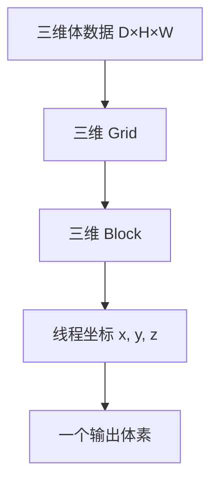

一个线程只写自己的输出点，不碰别人的结果。这让朴素版本拥有一个珍贵的教学特性：

> 每个输出地址只有一个写入者，不需要原子操作，也没有写冲突。

所以 `64×64×64` 的输入，`3×3×3` 的核，内部区域的每个输出体素只问三件事：我在哪、我周围那 27 个值是多少、结果写到哪里。

---

### Grid 少算一个 Block，边界数据就会失去线程

很多示例代码会这样算 Grid：

```python
grid_x = width // block_x
```

`width=64`、`block_x=8` 时恰好整除，跑得很正常。直到某天你的输入宽变成 65：

```text
65 // 8 = 8
8 × 8 = 64   ← 第 65 个元素无人认领
```

程序不报错，结果也不崩——只是最右边一列悄悄全是初始值。卷积就是这样静默失败、最难排查的坑之一。

通用写法必须向上取整：

```python
grid_x = (width + block_x - 1) // block_x
```

三个维度都这样做。代价是边缘 Block 会多出少量越界线程，于是 Kernel 里还要配一道守门：

```cpp
if (x >= width || y >= height || z >= depth) {
    return;   // 超出输入范围的线程在边界判断后直接返回
}
```

```text
Grid 向上取整，保证覆盖全部数据
                ↓
Kernel 检查边界，过滤多出来的线程
```

---

### 三维坐标如何落到线性显存

即使数组在 NumPy 里长着三维的样子 `input[z][y][x]`，GPU 全局内存（global memory）依然是一段线性地址。Kernel 拿到三个坐标，第一件事是把它们压成一个下标：

```cpp
index = (z * height + y) * width + x;
```

```text
index = z × height × width   // 跳过前面 z 层完整切片
      + y × width            // 跳过当前层里前面的完整行
      + x                    // 落到这一行的目标列
```

C-order 布局下 `x` 是连续存放的。这是一句很容易被忽略、却埋着性能伏笔的话：同一个线程束（warp）里的线程如果尽量沿 `x` 方向访问相邻地址，全局内存就能更好地合并访存（coalesced access）——把 32 个线程的访问合并成尽可能少的内存事务。以 32 个相邻的 `float32` 为例，在 Compute Capability 6.0 及以上的架构中，典型情况需要约四个 32 字节事务，而不是单一事务。[CUDA Best Practices：Coalesced Access](https://docs.nvidia.com/cuda/cuda-c-best-practices-guide/index.html#coalesced-access-to-global-memory)

这也是后面优化章节反复出现的主题：**线程的邻居关系，要顺着内存的邻居关系排**。

---

### 异步执行下，CPU 计时为什么会失真

Kernel 启动对 CPU 默认是异步的——Python 发出调用后就立刻返回，但那一刻 GPU 可能才刚开始干活。如果这样计时：

```python
start = time.time()
conv3d_kernel(...)   # 只是"提交"，不等它算完
end = time.time()
```

你测到的大概率是"CPU 把活递给 GPU 花了多久"，而不是 GPU 真正跑了多久。对一个小 `64³` 任务，这段计时主要反映主机侧的调用与提交开销，不能代表 Kernel 在 GPU 上的实际执行时间。

正确做法是用 CUDA Event，把时间戳记在 GPU 自己的时间线上：

```text
start_event
    ↓
重复执行 Kernel
    ↓
end_event
    ↓
等待 end_event 完成
    ↓
总时间 ÷ 重复次数
```

PyCUDA 里 `start.time_till(end)` 返回两个已完成事件之间的毫秒数——这也是 NVIDIA 官方推荐的 GPU 计时方式之一。[CUDA Best Practices：GPU Timers](https://docs.nvidia.com/cuda/cuda-c-best-practices-guide/index.html#using-cuda-gpu-timers) 发挥一下细节：先预热一轮避免首次调用开销污染，再重复多轮取平均；同时把**纯 Kernel 时间**和**端到端时间**（含 H2D、Kernel、D2H）当成两个指标分开报告——混淆这两者，是"宣称加速 N 倍"最常见的翻车方式。

> 别拿着一份单次计时去发布会："我 GPU 加了 100 倍"。先把几百万浮点运算的"提交时间"和"执行时间"分清楚。

---

### 相邻线程为什么反复请求同一批输入

朴素实现里，每个线程独立从全局内存读取自己的 `3×3×3` 邻域。问题很直接：**相邻输出体素的邻域高度重叠**。

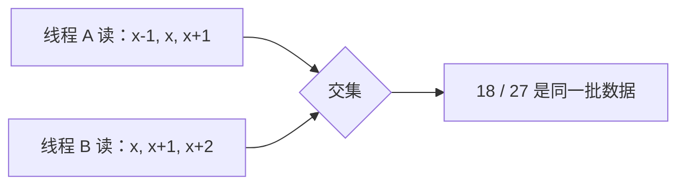

沿 `x`、`y`、`z` 任一方向相邻的两个输出体素，它们的 `3×3×3` 邻域都会重叠 18 个输入位置（`2×3×3`、`3×2×3`、`3×3×2`）。多个线程组成二维或三维输出块后，重叠会进一步累积。

这份重叠其实可以严谨地算出来。对于输入内部、无需处理零填充边界的 Block，在 `block = (8, 8, 4)` 与 `3×3×3` 卷积核的条件下，只看该 Block 的**第一个 Warp**（一个 Warp 固定为 32 个线程）：CUDA 线性化时 `x` 维变化最快，这 32 个线程恰好覆盖 `8×4×1` 个输出体素；每个体素发起 27 次邻域采样，合计 `32 × 27 = 864` 次请求；而这批线程联合需要覆盖的输入区域只有：

```text
(8 + 2) × (4 + 2) × (1 + 2) = 10 × 6 × 3 = 180 个不同位置
```

因此其**逻辑采样地址**的重叠比例为：

```text
1 − 180 / 864 ≈ 79.2%
```

但这是**逻辑采样地址**的重叠比例，不等于实际的 DRAM 流量减少空间。编译器优化、Warp 内访存合并、L1/L2 缓存都可能吸收一部分重复请求；真实的内存事务数、缓存命中率与 DRAM 吞吐量，可以借助 Nsight Compute 等性能分析工具验证。[Nsight Compute Profiling Guide](https://docs.nvidia.com/nsight-compute/ProfilingGuide/index.html) 所以正确的工程闭环是：

```text
理论重叠
    ↓
Nsight Compute 确认实际缓存与 DRAM 流量
    ↓
实现 Shared Memory Tile
    ↓
重新测量 Kernel 时间与内存指标
    ↓
确认收益后合入
```

重点观察五类指标：DRAM 实际读取量、L1/L2 命中率、全局 Load 合并效率、Shared Memory Bank Conflict、Achieved Occupancy 与 Warp Stall 原因。

GPU 的 L1/L2 缓存可能吸收一部分重复访问，但朴素 Kernel 没有显式组织 Block 内的数据复用，坐失良机。三条优化路线，按投入产出排序：

**第一步：把小卷积核塞进常量内存（constant memory）**
`3×3×3` 的 `float32` 权重只有 108 字节。内层循环里一个 Warp 的线程几乎总在读同一个系数，正好命中常量缓存的广播模式。对这份直接卷积 Kernel 而言，同一 Warp 中的活动线程在每轮循环里读取的是同一个卷积核系数，因此 Constant Memory 的广播机制具有潜在优势。但当权重规模增大、访问模式不再保持 Warp-uniform，或常量缓存容量与工作集不匹配时，收益可能下降。是否值得采用，仍需通过基准测试确认——不是"放进去就一定快"。

**第二步：用共享内存（shared memory）装瓦片和边界余量（Tile 与 Halo）**
一个 Block 先协作把输入小块连同边缘 Halo 搬进片上共享内存，线程再从共享内存反复取数；NVIDIA 也明确建议在多个线程重复使用同一批全局内存数据时用 Shared Memory 消除冗余传输，同时注意它可能限制 Occupancy。[CUDA Best Practices：Shared Memory](https://docs.nvidia.com/cuda/cuda-c-best-practices-guide/index.html#shared-memory) 算一笔账：输出 Tile 若为 `8×8×4`，半径 1，需要的输入区域是 `10×10×6=600` 个 float，约 2.34 KiB——完全可以接受。

```text
Global Memory
      ↓ 协作搬运一次
Shared Memory：Tile + Halo
      ↓ 邻域反复复用
每个线程算一个输出体素
```

代价也很诚实：Halo 协作负载、`__syncthreads()` 同步、存储体冲突（Bank Conflict）、共享内存容量占用，一个都不少。所以正确顺序是先建基线 → Benchmark 确认瓶颈确实是访存 → 再重写 Tile——而不是开局就秀 Shared Memory。

**第三步：把生产交给库**
完整 `Conv3d` 通常要处理 `N×Cin×D×H×W`、Cout、groups、bias、stride、dilation、混合精度……到了这一层，手写 Kernel 的价值是读懂索引与访存，而不是重复造一个通用卷积库。理解底层（让我们干）与生产造轮子（让 cuDNN 干），是两件事。

> 具体加速倍数必须在 N 卡机器上实测——作者环境无法运行 GPU，本篇只推导机制，不做数字承诺。这不是敷衍，是对数据负责。

> **继续向前**：更现代的路径里，Tile 搬运可以改用异步 Global-to-Shared Copy 与 Pipeline，把数据加载和计算重叠起来；在 Hopper 及后续支持 TMA 的架构上，还可以通过 TMA（Tensor Memory Accelerator）搬运多维数据块，进一步降低地址计算和数据搬运的指令负担。多通道生产级卷积则常转化为隐式 GEMM，依托 cuDNN、CUTLASS/CuTe 与 Tensor Core。[CUDA Programming Guide：Asynchronous Data Copies](https://docs.nvidia.com/cuda/cuda-programming-guide/04-special-topics/async-copies.html) 但对当前这个单通道、小卷积核示例而言，还没有证据表明引入这些机制能够带来净收益。

---

### 收藏这一节就够了：三段速查清单

**运行前，环境要齐**
```text
[ ] NVIDIA GPU + 驱动
[ ] CUDA Toolkit（含 nvcc）
[ ] 与 Python/CUDA 兼容的 PyCUDA + NumPy
[ ] SourceModule 运行时编译失败 → 先查 nvcc/驱动/编译器路径
```

**结果对不对，按这个查**
```text
[ ] 输入与卷积核均为 float32，NumPy 为 C-order 连续内存
[ ] kernel_size 强制正奇数
[ ] Grid 三个维度全部向上取整
[ ] Kernel 有输出坐标边界判断
[ ] CPU / GPU 采用同一语义（互相关 or 卷积，二选一）
[ ] 用 assert_allclose 而非逐位相等
```

**快不快，按这个查**
```text
[ ] 先预热再计时
[ ] Kernel 时间用 CUDA Event
[ ] 端到端时间单独统计
[ ] 重复多轮取中位数/平均值
[ ] 比较多个 Block 形状（别只看 8×8×8）
[ ] 记录 GPU 型号、驱动、CUDA、PyCUDA 版本
```

---

### 结尾：三维只是多了一个 z，坑却多了一整层

从二维走到三维，表面只是 `(y, x) → (z, y, x)`。真正增加的是整层工程复杂度：数据量按体积增长、邻域从平面变立方、边界更多、重复读取翻倍、Block 形状和内存布局的关系更微妙。

好在 CUDA 的思路没变：

> 把彼此独立的输出位置分给不同线程，让每个线程只回答一个小问题。

手写 CUDA Kernel 的最大价值，从来不是替代成熟库，而是看清成熟库替我们藏住了什么——顺带看清框架一行调用背后发生的机制。

**留个开放问题给你**：你手写过 3D 卷积吗？踩到的最难缠的坑是哪一个——术语边界、Grid 取整、地址展平，还是计时？欢迎在评论区补充，我们缺的可能不只是这几个点。

下一篇预告：同样是这个 `3×3×3` 核，用共享内存 Tile + Halo 改写后，在真实 GPU 上到底能省多少内存流量？届时会附上 Nsight Compute 实测对比。

如果你觉得这篇对你有用，建议收藏速查清单那段——上手写 Kernel 时直接对照打勾。

---

### 附录：在满足环境条件下可运行的完整代码

正文只拆机制，这节给一份完整实现，但它有明确边界：它基于 PyCUDA，需要在 NVIDIA 驱动、CUDA Toolkit 与 PyCUDA 兼容的环境下运行；本文已完成静态检查（语法、链接与接口语义），具体编译与性能结果仍需在目标 GPU 环境验证。它已经处理好那些"看起来对、跑起来才露馅"的细节——Grid 三维全部向上取整、`DeviceAllocation` 用 `memcpy_dtoh` 回传、奇数核显式校验、CUDA Event 计时、预热后再测、以及用 NumPy 参考实现做全量校验而不是打印几个数字。

先看清这份代码的能力边界，别把它当成生产级 `Conv3d`：

| 能力 | 当前代码 |
|---|---|
| Batch | 单样本 |
| 输入通道 | 单通道 |
| 输出通道 | 单通道 |
| Kernel | 立方体、正奇数边长 |
| Padding | 零填充 Same |
| Stride | 1 |
| Dilation | 1 |
| Groups | 不支持 |
| Bias | 不支持 |
| 数据类型 | FP32 |
| 计算语义 | 三维互相关 |

教学 Kernel 的有限边界不是缺点——它让这篇只讲一层的代码能把索引、访存与验证讲透；要承担多通道、多输出的生产负载，请交给 cuDNN。

```python
import time

import numpy as np
import pycuda.autoinit  # 自动初始化 CUDA 设备、上下文与清理流程
import pycuda.driver as cuda
from pycuda.compiler import SourceModule


KERNEL_CODE = r"""
__global__ void conv3d_same(
    const float *__restrict__ input,
    const float *__restrict__ kernel,
    float *__restrict__ output,
    int width,
    int height,
    int depth,
    int kernel_size)
{
    // 当前线程对应的输出体素坐标
    const int x = blockIdx.x * blockDim.x + threadIdx.x;
    const int y = blockIdx.y * blockDim.y + threadIdx.y;
    const int z = blockIdx.z * blockDim.z + threadIdx.z;

    // Grid 向上取整后，边缘 Block 可能包含越界线程
    if (x >= width || y >= height || z >= depth) {
        return;
    }

    const int radius = kernel_size / 2;
    float value = 0.0f;

    // 遍历卷积核的深度、高度和宽度
    for (int kz = 0; kz < kernel_size; ++kz) {
        const int iz = z + kz - radius;

        for (int ky = 0; ky < kernel_size; ++ky) {
            const int iy = y + ky - radius;

            for (int kx = 0; kx < kernel_size; ++kx) {
                const int ix = x + kx - radius;

                // 越界位置视为 0，即零填充
                if (ix >= 0 && ix < width &&
                    iy >= 0 && iy < height &&
                    iz >= 0 && iz < depth) {

                    const int input_index =
                        (iz * height + iy) * width + ix;

                    const int kernel_index =
                        (kz * kernel_size + ky) * kernel_size + kx;

                    value += input[input_index] * kernel[kernel_index];
                }
            }
        }
    }

    const int output_index = (z * height + y) * width + x;
    output[output_index] = value;
}
"""


def generate_data(width, height, depth, rng):
    """生成 C-order、float32 三维体数据，形状为 [D, H, W]。"""
    data = rng.random((depth, height, width), dtype=np.float32)
    return np.ascontiguousarray(data)


def generate_kernel(kernel_size, rng):
    """生成正奇数尺寸的三维卷积核。"""
    if kernel_size <= 0 or kernel_size % 2 == 0:
        raise ValueError("kernel_size 必须是正奇数")

    weights = rng.random(
        (kernel_size, kernel_size, kernel_size),
        dtype=np.float32,
    )

    # 归一化不是卷积的必要条件，只是让示例输出数值更平稳
    weights /= weights.sum(dtype=np.float32)
    return np.ascontiguousarray(weights)


def conv3d_reference(input_data, kernel):
    """NumPy 参考实现：零填充、步长 1、三维互相关。"""
    depth, height, width = input_data.shape
    kernel_size = kernel.shape[0]

    if kernel.shape != (kernel_size, kernel_size, kernel_size):
        raise ValueError("kernel 必须是立方体")
    if kernel_size % 2 == 0:
        raise ValueError("kernel_size 必须是奇数")

    radius = kernel_size // 2
    padded = np.pad(
        input_data,
        ((radius, radius), (radius, radius), (radius, radius)),
        mode="constant",
    )
    output = np.zeros_like(input_data)

    # 外层只遍历较小的卷积核，体数据计算交给 NumPy 切片
    for kz in range(kernel_size):
        for ky in range(kernel_size):
            for kx in range(kernel_size):
                output += (
                    padded[
                        kz:kz + depth,
                        ky:ky + height,
                        kx:kx + width,
                    ]
                    * kernel[kz, ky, kx]
                )

    return output


def main():
    width, height, depth = 64, 64, 64
    kernel_size = 3
    repeats = 100
    rng = np.random.default_rng(42)

    input_data = generate_data(width, height, depth, rng)
    kernel = generate_kernel(kernel_size, rng)
    output_gpu = np.empty_like(input_data)

    # 编译 CUDA C Kernel 并获取函数句柄
    module = SourceModule(KERNEL_CODE)
    conv3d_kernel = module.get_function("conv3d_same")

    # H2D：输入和权重复制到 GPU；输出只分配，不需要预先复制零值
    input_device = cuda.to_device(input_data)
    kernel_device = cuda.to_device(kernel)
    output_device = cuda.mem_alloc(output_gpu.nbytes)

    # 256 线程作为起始实验点；最佳形状需要基准测试确定
    block_size = (8, 8, 4)
    grid_size = (
        (width + block_size[0] - 1) // block_size[0],
        (height + block_size[1] - 1) // block_size[1],
        (depth + block_size[2] - 1) // block_size[2],
    )

    args = (
        input_device,
        kernel_device,
        output_device,
        np.int32(width),
        np.int32(height),
        np.int32(depth),
        np.int32(kernel_size),
    )

    # 预热：避免首次调用开销污染正式计时
    conv3d_kernel(*args, block=block_size, grid=grid_size)
    cuda.Context.synchronize()

    # CUDA Event 测量 GPU 时间
    start_event = cuda.Event()
    end_event = cuda.Event()

    start_event.record()
    for _ in range(repeats):
        conv3d_kernel(*args, block=block_size, grid=grid_size)
    end_event.record()
    end_event.synchronize()

    average_kernel_ms = start_event.time_till(end_event) / repeats

    # D2H：DeviceAllocation 使用 memcpy_dtoh 复制回 NumPy 数组
    cuda.memcpy_dtoh(output_gpu, output_device)

    # CPU 参考结果与耗时
    cpu_start = time.perf_counter()
    output_cpu = conv3d_reference(input_data, kernel)
    cpu_ms = (time.perf_counter() - cpu_start) * 1000.0

    # 浮点并行计算不应使用逐位相等判断
    np.testing.assert_allclose(
        output_gpu,
        output_cpu,
        rtol=1e-5,
        atol=1e-6,
    )

    max_abs_error = np.max(np.abs(output_gpu - output_cpu))

    print(f"输入形状[D,H,W]：{input_data.shape}")
    print(f"Block：{block_size}，Grid：{grid_size}")
    print(f"平均 Kernel 时间：{average_kernel_ms:.4f} ms")
    print(f"NumPy 参考实现时间：{cpu_ms:.4f} ms")
    print(f"最大绝对误差：{max_abs_error:.8e}")
    print("输出左上前方的 2×3×3 子区域：")
    print(output_gpu[:2, :3, :3])


if __name__ == "__main__":
    main()
```

**运行方式**：把上面的 `KERNEL_CODE` 中文注释去掉也不需要——注释在 CUDA C 字符串里不影响编译。直接在装有 PyCUDA 的 N 卡机器上 `python 本文件.py` 即可；`SourceModule` 会在运行时调用 `nvcc` 编译，若报错优先检查驱动、`nvcc --version` 和 CUDA/PyCUDA 版本匹配。

**两个提醒（都是踩过的人才懂的）**：
1. 这份代码的基准数字**必须在 N 卡实测**才有意义——本机没有独显，作者不给你一个假的加速倍数。
2. 它实现的是三维**互相关**（与 PyTorch Conv3d 同一语义），想验证"数学卷积"请自行翻转卷积核——对应正文"术语边界"一节等你。

---

### 参考资料

1. NVIDIA, [CUDA Programming Guide：Programming Model（Thread Blocks and Grids）](https://docs.nvidia.com/cuda/cuda-programming-guide/01-introduction/programming-model.html#thread-blocks-and-grids)
2. NVIDIA, [CUDA C++ Best Practices Guide：Coalesced Global Memory Access](https://docs.nvidia.com/cuda/cuda-c-best-practices-guide/index.html#coalesced-access-to-global-memory)
3. NVIDIA, [CUDA C++ Best Practices Guide：Using CUDA GPU Timers](https://docs.nvidia.com/cuda/cuda-c-best-practices-guide/index.html#using-cuda-gpu-timers)
4. NVIDIA, [CUDA C++ Best Practices Guide：Shared Memory](https://docs.nvidia.com/cuda/cuda-c-best-practices-guide/index.html#shared-memory)
5. NVIDIA, [CUDA Programming Guide：Asynchronous Data Copies](https://docs.nvidia.com/cuda/cuda-programming-guide/04-special-topics/async-copies.html)
6. [PyCUDA Tutorial](https://documen.tician.de/pycuda/tutorial.html)
7. [PyCUDA Driver API（Device Interface）](https://documen.tician.de/pycuda/driver.html)
8. PyTorch, [Conv3d Documentation](https://docs.pytorch.org/docs/stable/generated/torch.nn.Conv3d.html)
9. NVIDIA, [Nsight Compute Profiling Guide](https://docs.nvidia.com/nsight-compute/ProfilingGuide/index.html)

---

<a id="article-09"></a>

## 第 09 篇｜两个 Kernel，为什么可以合成一个？

<!-- source: 09-cuda-fused-batch-center-crop-normalize-light-tech.md -->

### 用 PyCUDA 讲透批量中心裁剪与归一化的 Kernel Fusion

> **一句话理解**：让每个线程直接负责最终输出像素，把“读取、裁剪、归一化、写回”压进一次 Kernel Launch，中间 Tensor 就不必绕一圈全局显存。  
> **工程深度**：L2 工程可用｜**预计阅读**：16 分钟  
> **关键词**：CUDA、PyCUDA、Kernel Fusion、GPU 图像预处理、数据布局、中心裁剪、归一化

---

### 一批图像，为什么要在显存里来回倒两次

模型推理前，我们经常做两件小事：

1. 从每张图片中央裁出一个固定大小的区域；
2. 对裁剪结果执行归一化：

$$y=\frac{x-\mu}{\sigma}$$

如果按功能拆分，最自然的 GPU 实现是两个 Kernel：

```text
Kernel A：中心裁剪
原图 → 中间裁剪图

Kernel B：归一化
中间裁剪图 → 模型输入
```

逻辑没有错，问题在于那张“中间裁剪图”。

它刚被 Kernel A 写进全局显存，紧接着又被 Kernel B 读出来。每个像素只为做一次减法和一次除法，却多经历了一次写入、一次读取，还多启动了一个 Kernel。

如果把两步融合：

```text
输入像素 → 找到中心裁剪坐标 → 立即归一化 → 写入最终输出
```

中间图就消失了。**这次融合真正消掉的不是计算，而是数据旅程。**

这篇文章要拆开的，正是这样一个很短、却很有代表性的 CUDA 内核：**批量中心裁剪 + 归一化融合预处理**。

它表面上只有几行索引计算，背后却同时涉及：

- 三维 Grid 如何映射 Batch、行与列；
- 中心裁剪为什么可能多出一个像素；
- Kernel Fusion 到底省了什么——以及它不省什么；
- 为什么融合的正确性，比融合本身更容易出错；
- 什么时候手写 Kernel 值得，什么时候应该交给成熟预处理库。

---

### 先把边界说清楚：这段代码处理的是什么

原始内核接收的输入布局是：

```text
[batch][height][width]
```

也就是一个单通道、连续存储的 `float32` 批量图像张量：

```text
N × H × W
```

输出布局是：

```text
[batch][crop_size][crop_size]
```

即：

```text
N × crop_size × crop_size
```

因此，这段代码目前不是完整的 RGB 预处理器。它没有通道维度，也没有完成 `uint8 → float32`、`0～255 → 0～1` 或 HWC/NCHW 布局转换。

这一点必须在文章开头钉死。否则一句“批量图像预处理”，很容易让读者误以为代码可以直接接收任意彩色图片。

---

### 真正的设计：一个线程负责一个输出像素

这段 Kernel 的并行单位不是“一张图”，而是“一张图里的一个裁剪后像素”。

线程需要回答三个问题：

```text
我处理第几张图？  → b
我处理输出的哪一列？→ tx
我处理输出的哪一行？→ ty
```

原代码使用：

```cpp
int tx = threadIdx.x + blockIdx.x * blockDim.x;
int ty = threadIdx.y + blockIdx.y * blockDim.y;
int b  = blockIdx.z;
```

于是三维 Grid 被赋予了非常自然的业务语义：

```text
Grid.z → Batch 中的图片编号
Grid.y → 裁剪结果的行方向
Grid.x → 裁剪结果的列方向
```


这里需要修正一句常见但不够准确的描述：

> `blockIdx.z=b` 不是“一个 Block 处理一张图”，而是“Grid 的第 b 个 z 切片处理第 b 张图”。

对于一张 `224×224` 的输出，如果 Block 是 `16×16`，单张图需要：

```text
ceil(224 / 16) × ceil(224 / 16)
= 14 × 14
= 196 个 Block
```

这一整层 `196` 个 Block 共享同一个 `blockIdx.z=b`，共同处理第 `b` 张图。

---

### 中心裁剪，不是“从中间切一下”

对于宽度为 `width`、裁剪边长为 `crop_size` 的图片，左上角横坐标为：

```cpp
int offset_x = (width - crop_size) / 2;
```

纵坐标同理：

```cpp
int offset_y = (height - crop_size) / 2;
```

当前线程负责裁剪结果中的 `(tx,ty)`，那么它在原图中的坐标就是：

```cpp
int crop_x = offset_x + tx;
int crop_y = offset_y + ty;
```


#### 当两侧不能平分时，多出来的像素去哪了

假设：

```text
width = 256
crop_size = 223
```

两者相差 33：

```text
offset_x = 33 / 2 = 16
```

整数除法向下取整，于是：

```text
左侧裁掉 16 像素
右侧裁掉 17 像素
```

也就是说，当差值为奇数时，这段代码把无法平分的那个像素留给右侧和下侧。**本文实现的是“整数除法向下取整”的中心裁剪约定，它不是宇宙中唯一的约定。**

如果输出必须逐像素对齐 Torchvision、OpenCV、ONNX Runtime 或某个训练流水线，**奇数差值的取整规则必须和训练框架一致**——不能只看函数名都叫 `CenterCrop`，而要核对具体实现，并用边界样例验证每个坐标。Torchvision 的官方文档将 `CenterCrop` 定义为从图像中心裁剪，并约定张量末两维为 `H,W`。

---

### Batch 张量如何变成一维显存

虽然我们把输入理解为三维张量：

```text
[b][y][x]
```

但传给内核的仍然是：

```cpp
const float *input
```

对于连续的 `[N,H,W]` 布局，线性索引为：

```cpp
input_index = b * height * width
            + crop_y * width
            + crop_x;
```

可以从三段距离理解：

```text
b * H * W       → 跳过前 b 张完整图片
crop_y * W      → 跳到当前图片的第 crop_y 行
crop_x          → 跳到这一行的第 crop_x 列
```

输出索引同理：

```cpp
output_index = b * crop_size * crop_size
             + ty * crop_size
             + tx;
```

更适合大张量的写法是使用 `size_t`：

```cpp
size_t input_index =
    ((size_t)b * height + crop_y) * width + crop_x;
```

原因不是代码更漂亮，而是多个 `int` 相乘可能先在 32 位整数范围内溢出，然后才被赋给更大的变量。把 `b` 显式转换为 `size_t`，可以让后续算术在足够宽的无符号类型中完成。

---

### 归一化不是“把值变到 0～1”

这段代码使用：

$$output=\frac{pixel-mean}{stddev}$$

它做的是按均值和标准差标准化，不等同于 Min-Max 缩放。

Torchvision 官方 `Normalize` 文档给出的逐通道定义也是：

$$output_c=\frac{input_c-mean_c}{std_c}$$

对于本文的单通道标量版本，`mean` 和 `stddev` 对整批图片、所有像素都相同。

这里有四个必须提前确定的问题——任何一个写错，结果都会“正常地”错，而且不会报错：

| 问题 | 必须确认 |
|---|---|
| 输入尺度 | 像素是 0～255 还是 0～1 |
| 参数尺度 | mean/std 是否与输入、训练阶段同尺度 |
| 多通道 | 是否需要逐通道 mean/std |
| stddev | 是否大于 0 且有限 |

例如同一份语义下，输入 `0～255` 对应 `mean=127.5, std=127.5`，输入 `0～1` 对应 `mean=0.5, std=0.5`。如果输入仍是 `0～255`，却使用针对 `0～1` 统计得到的参数，代码会稳定地产生错误结果，而且不会报错。

- `stddev=0` 会产生无穷大或 NaN，最好在 CPU 端启动 Kernel 前拒绝，而不是让每个 GPU 线程重复判断；
- RGB 模型通常是 `mean=[r,g,b]`、`std=[r,g,b]` 逐通道各自的参数，当前内核只有一个标量 `mean/stddev`，不能假装已经覆盖多通道预处理。

---

### 为什么要融合：少的不是数学，而是中间显存流量

假设裁剪后共有 `P` 个像素，只看程序语义上的全局内存元素访问。

#### 两个 Kernel

```text
裁剪：    读输入 P + 写中间结果 P
归一化：  读中间结果 P + 写最终输出 P

合计：4P 次元素读写
```

从 4P 到 2P，中间结果的一写一读被消除了，Kernel 启动也从两次变成一次。

> **注意：4P → 2P 是“逻辑内存访问”层面的变化，不是 DRAM 流量保证减半。** 逻辑访问量、memory transactions、L2 流量、DRAM 流量是四级不同的数字，Cache 本身也会吸收一部分中间访问。真实收益必须交给 Nsight Compute / Nsight Systems 和端到端 Benchmark 验证。


按字节数换一种更直观的算法：

```text
融合后，每个输出像素：
  读输入 float32   = 4 Bytes
  写输出 float32   = 4 Bytes
  合计             = 8 Bytes / 像素

分离实现还要多：
  写中间 Tensor 4B + 读中间 Tensor 4B
```

Fusion 的这一笔账等于：**少掉中间 Tensor 的一次写入、一次读取**。本例归一化只有一次减法和一次乘法，计算量极小；每个输出像素都绑定一次输入读取和一次输出写入，更接近一个 memory-bound（内存受限）的小算子。这正是为什么“少走一趟中间显存”，比“优化一两条算术指令”更值得关注。

但仍不能偷换成“性能一定翻倍”。原因包括：

- Kernel 启动开销占比随规模而变化；
- 实际瓶颈可能在 H2D、解码或后续推理；
- 融合后如果寄存器压力、分支或索引复杂度显著增加，也可能降低并发度；
- Cache 可能让少量短流程下的中间访问近乎免费。

更准确的结论是：

> **融合减少的是可证明的中间全局内存访问和一次 Kernel 启动；最终加速比例必须由 Benchmark 和 Profiler 给出。**

---

### 原始内核能跑，但还缺几道工程护栏

原始代码的主干逻辑正确，不过正式使用前至少应补上四点：

- **检查 `b < batch_size`**：Grid 的 `z` 维严格等于 `batch_size` 时 `blockIdx.z` 不会越界，但内核既然收了 `batch_size`，就应该用它做防御性判断，否则这个参数在原代码中实际上没有被使用；
- **主机端校验 `crop_size`**：必须满足 `0 < crop_size <= min(height, width)`，否则中心偏移会变成负数，访问输入数组之前的位置；
- **主机端校验 `stddev`**：至少确保 `stddev > 0` 且为有限数；
- **大数组索引用 `size_t`**：避免 `b*height*width` 在 32 位中间表达式中溢出（机制见上文 Batch 张量一节）。

---

### 更稳妥的融合内核

下面在原始设计上做了五个改动：

1. 输入指针声明为 `const`；
2. 加入 `__restrict__`，明确输入输出不别名；
3. 补充 batch 边界；
4. 使用 `size_t` 计算线性地址；
5. 主机预先计算 `inv_std=1/stddev`，像素线程用乘法代替重复除法。

第 2 点（`__restrict__`）值得单独说明：它是“输入输出指针互不别名”的额外契约，能给编译器更多优化空间，但不是“加上就一定更快”的性能开关——本例更接近内存受限，编译器能发挥的空间有限。

第 5 点同理：把不变的 `1/stddev` 提前算好，是一次低成本的小优化；真正的大头仍然是是否消除了中间 Tensor。别把这两点当成这篇文章的主要性能来源。

```cpp
extern "C" __global__ void preprocess_batch(
    const float *__restrict__ input,
    float *__restrict__ output,
    int batch_size,
    int height,
    int width,
    int crop_size,
    float mean,
    float inv_std)
{
    // 输出裁剪图中的列坐标
    int tx = blockIdx.x * blockDim.x + threadIdx.x;

    // 输出裁剪图中的行坐标
    int ty = blockIdx.y * blockDim.y + threadIdx.y;

    // Grid 的 z 切片对应 Batch 中的图片编号
    int b = blockIdx.z;

    // 同时保护 Batch、输出行和输出列
    if (b >= batch_size || tx >= crop_size || ty >= crop_size) {
        return;
    }

    // 中心裁剪区域左上角；奇数差值时额外像素位于右侧/下侧
    int offset_x = (width - crop_size) / 2;
    int offset_y = (height - crop_size) / 2;

    // 把输出局部坐标映射到原图绝对坐标
    int crop_x = offset_x + tx;
    int crop_y = offset_y + ty;

    // 使用 size_t，避免大 Batch/大图像下的 32 位索引溢出
    size_t input_index =
        ((size_t)b * height + crop_y) * width + crop_x;

    size_t output_index =
        ((size_t)b * crop_size + ty) * crop_size + tx;

    // 裁剪和归一化在一次读取、一次写入之间完成
    float pixel = input[input_index];
    output[output_index] = (pixel - mean) * inv_std;
}
```

为什么不在 Kernel 中检查 `stddev`？因为它对整次启动都是同一个标量。把非法参数在 CPU 端拦截，只需判断一次；在 Kernel 里判断则会让每个像素线程重复执行。

---

### Grid 怎么配：x/y 覆盖裁剪图，z 覆盖 Batch

使用 `16×16` 的二维 Block：

```cpp
dim3 block(16, 16, 1);

dim3 grid(
    (crop_size + block.x - 1) / block.x,
    (crop_size + block.y - 1) / block.y,
    batch_size
);
```

对应关系为：

```text
block.x × block.y = 256 个线程
grid.x             = 横向至少覆盖 crop_size
grid.y             = 纵向至少覆盖 crop_size
grid.z             = 覆盖 batch_size 张图片
```

Grid 的 x/y 必须向上取整。否则当 `crop_size` 不是 16 的整数倍时，右侧和底部像素没有任何线程负责。

三维 Grid 的各维上限属于设备能力，常规推理 Batch 远小于这些限制，无需为论文级规模预先设计任务展开方案。

PyCUDA 的 `Function.__call__()` 支持最多三维的 `grid` 元组，因此下面直接写 `(grid_x, grid_y, batch_size)` 即可启动。

---

### 完整 PyCUDA 示例：运行、计时、验收

下面给出一份独立可读的 PyCUDA 示例。它使用 `[N,H,W]` 连续 `float32` 输入，并通过 NumPy 参考结果验证 GPU 输出。

```python
import time

import numpy as np
import pycuda.autoinit
import pycuda.driver as cuda
from pycuda.compiler import SourceModule


KERNEL_CODE = r"""
extern "C" __global__ void preprocess_batch(
    const float *__restrict__ input,
    float *__restrict__ output,
    int batch_size,
    int height,
    int width,
    int crop_size,
    float mean,
    float inv_std)
{
    int tx = blockIdx.x * blockDim.x + threadIdx.x;
    int ty = blockIdx.y * blockDim.y + threadIdx.y;
    int b = blockIdx.z;

    if (b >= batch_size || tx >= crop_size || ty >= crop_size) {
        return;
    }

    int offset_x = (width - crop_size) / 2;
    int offset_y = (height - crop_size) / 2;
    int crop_x = offset_x + tx;
    int crop_y = offset_y + ty;

    size_t input_index =
        ((size_t)b * height + crop_y) * width + crop_x;

    size_t output_index =
        ((size_t)b * crop_size + ty) * crop_size + tx;

    float pixel = input[input_index];
    output[output_index] = (pixel - mean) * inv_std;
}
"""


def ceil_div(value, divisor):
    """整数除法向上取整。"""
    return (value + divisor - 1) // divisor


def validate_args(batch_size, height, width, crop_size, mean, stddev):
    """在启动 GPU 前统一校验标量参数。"""
    if batch_size <= 0:
        raise ValueError("batch_size 必须大于 0")

    if height <= 0 or width <= 0:
        raise ValueError("height 和 width 必须大于 0")

    if crop_size <= 0 or crop_size > min(height, width):
        raise ValueError("crop_size 必须位于 (0, min(height, width)]")

    if not np.isfinite(mean):
        raise ValueError("mean 必须是有限数")

    if not np.isfinite(stddev) or stddev <= 0:
        raise ValueError("stddev 必须是大于 0 的有限数")


# 示例参数：8 张 256×256 单通道 float32 图像，中心裁为 224×224
batch_size = 8
height, width = 256, 256
crop_size = 224
mean = 0.5
stddev = 0.25

validate_args(
    batch_size,
    height,
    width,
    crop_size,
    mean,
    stddev,
)

# 输入数据已经位于 0～1；mean/stddev 也基于相同尺度
rng = np.random.default_rng(42)
input_batch = rng.random(
    (batch_size, height, width),
    dtype=np.float32,
)

gpu_output = np.empty(
    (batch_size, crop_size, crop_size),
    dtype=np.float32,
)

# KERNEL_CODE 已显式声明 extern "C"，因此关闭 SourceModule 的自动包装
module = SourceModule(KERNEL_CODE, no_extern_c=True)
preprocess_kernel = module.get_function("preprocess_batch")

# 分配显存；显存分配不放入纯 Kernel 计时窗口
input_gpu = cuda.mem_alloc(input_batch.nbytes)
output_gpu = cuda.mem_alloc(gpu_output.nbytes)

block = (16, 16, 1)
grid = (
    ceil_div(crop_size, block[0]),
    ceil_div(crop_size, block[1]),
    batch_size,
)

inv_std = np.float32(1.0 / stddev)

# 上传输入
cuda.memcpy_htod(input_gpu, input_batch)

# 预热，避免首次启动开销污染正式测量
preprocess_kernel(
    input_gpu,
    output_gpu,
    np.int32(batch_size),
    np.int32(height),
    np.int32(width),
    np.int32(crop_size),
    np.float32(mean),
    inv_std,
    block=block,
    grid=grid,
)
cuda.Context.synchronize()

# 使用 CUDA Event 测量纯 GPU Kernel 时间
start_event = cuda.Event()
end_event = cuda.Event()

start_event.record()
preprocess_kernel(
    input_gpu,
    output_gpu,
    np.int32(batch_size),
    np.int32(height),
    np.int32(width),
    np.int32(crop_size),
    np.float32(mean),
    inv_std,
    block=block,
    grid=grid,
)
end_event.record()
end_event.synchronize()

kernel_ms = start_event.time_till(end_event)

# 下载最终输出
cuda.memcpy_dtoh(gpu_output, output_gpu)

# NumPy 参考实现：同样的中心偏移、同样的输入尺度
offset_x = (width - crop_size) // 2
offset_y = (height - crop_size) // 2

cpu_reference = input_batch[
    :,
    offset_y:offset_y + crop_size,
    offset_x:offset_x + crop_size,
]
cpu_reference = (cpu_reference - mean) / stddev

print(f"Block: {block}")
print(f"Grid:  {grid}")
print(f"Kernel 时间: {kernel_ms:.3f} ms")
print(
    "结果正确:",
    np.allclose(gpu_output, cpu_reference, rtol=1e-5, atol=1e-6),
)

# 端到端示例：H2D + Kernel + D2H
e2e_start = time.perf_counter()
cuda.memcpy_htod(input_gpu, input_batch)
preprocess_kernel(
    input_gpu,
    output_gpu,
    np.int32(batch_size),
    np.int32(height),
    np.int32(width),
    np.int32(crop_size),
    np.float32(mean),
    inv_std,
    block=block,
    grid=grid,
)
cuda.memcpy_dtoh(gpu_output, output_gpu)
e2e_ms = (time.perf_counter() - e2e_start) * 1000

print(f"端到端时间: {e2e_ms:.3f} ms")
```

PyCUDA 官方教程采用同样的基本路线：初始化 CUDA、使用 `SourceModule` 编译内核、显式把 NumPy 数据复制到设备、运行 Kernel，再把结果复制回主机。

---

### 为什么 `x` 放列方向，有利于显存访问

在 `[N,H,W]` 连续布局中，最内层 `W` 方向的像素地址连续。

当一个 warp 中相邻线程拥有连续的 `tx` 时，它们读取：

```text
input[b, crop_y, crop_x + 0]
input[b, crop_y, crop_x + 1]
input[b, crop_y, crop_x + 2]
...
```

同时写入：

```text
output[b, ty, tx + 0]
output[b, ty, tx + 1]
output[b, ty, tx + 2]
...
```

读写都沿连续列方向推进，符合全局内存合并访问的基本原则。NVIDIA Best Practices Guide 将合并全局内存访问列为 CUDA 性能的重要考虑因素。

这也解释了为什么线程映射通常让 `threadIdx.x` 对应内存中的连续维度。不是因为数学规定 x 必须是列，而是因为布局决定了哪一维最连续。

---

### 为什么这个 Kernel 反而不需要 Shared Memory

Shared Memory 最有价值的场景之一，是多个线程重复使用同一批输入数据，例如卷积、矩阵乘法和分块转置。

本内核中，每个输入像素只被一个输出线程读取一次：

```text
一个输入像素 → 一个输出像素
```

没有明显的块内复用，把像素先搬到 Shared Memory，反而会增加一次拷贝和一次同步。

因此，这个内核的第一优化方向不是“上共享内存”，而是：

1. 保持连续访问；
2. 消除中间缓冲区；
3. 减少 Kernel 启动；
4. 让数据尽量常驻 GPU；
5. 再用 profiler 判断瓶颈。

> **优化手段不是越高级越好，而是要匹配数据复用模式。**

---

### GPU 时间和端到端时间，是两个问题

CUDA Kernel 启动通常具有异步语义。只用 CPU 计时器包住 Kernel 调用，却不等待 GPU 完成，测到的可能主要是提交开销。NVIDIA Best Practices Guide 建议在 GPU 工作计时中使用 CUDA Event，或在 CPU 计时边界内做正确同步。

本文代码分别测量：

| 指标 | 包含内容 | 回答的问题 |
|---|---|---|
| Kernel 时间 | 融合内核本身 | GPU 上这段计算用了多久？ |
| 端到端时间 | H2D + Kernel + D2H | 单独调用这条预处理链是否划算？ |

融合 Kernel 消除的是设备端中间图和一次启动，不会自动消除：

- CPU 解码图片；
- CPU 到 GPU 的输入传输；
- GPU 到 CPU 的结果回传；
- 显存分配；
- 首次 CUDA Context 初始化；
- `SourceModule` 首次编译。

真正理想的推理路径往往是：

```text
解码/采集
   ↓
数据进入 GPU
   ↓
融合预处理
   ↓
模型推理
   ↓
后处理
```

如果预处理结果立刻下载回 CPU，随后又上传给 GPU 模型，前面省下的中间访问很容易被 PCIe 往返抵消。

---

### Benchmark 应该怎样设计，才不制造假结论

不要只运行一次，然后打印：

```text
GPU 比 CPU 快 100 倍
```

至少要控制以下变量。

#### 测试维度

| 维度 | 建议取值 |
|---|---|
| Batch | 1、8、32、64 |
| 原图尺寸 | 256²、512²、1024² |
| 裁剪尺寸 | 224²、384²、原图大小 |
| 数据位置 | CPU 起点 / GPU 常驻 |
| 对比实现 | NumPy、分离 CUDA、融合 CUDA |
| 指标 | Kernel、端到端、吞吐量（micro 重点看 median） |

#### 三组最有价值的对比

```text
A. CPU：切片 copy + Normalize
B. GPU：Crop Kernel + Normalize Kernel
C. GPU：Fused Crop + Normalize Kernel
```

两组比较各回答一个问题:

```text
A vs C　→　整个 GPU 方案值不值得？
B vs C　→　Fusion 值不值得？
```

只有 B 与 C 同样是 GPU、同样是连续输入，才测得 Fusion 的净收益。

关于统计口径：Kernel microbenchmark 重点看 median（P50），比单次运行稳定得多；P95 属于服务端尾延迟口径，小样本跑几次算出的 P95 很容易被偶发调度抖动支配，不要让它看起来像生产尾延迟。

还应记录：

- GPU 型号与计算能力；
- CUDA、驱动和 PyCUDA 版本；
- 是否预热；
- 是否包含编译、分配和数据传输；
- 输入是否连续；
- 时钟、功耗与其他 GPU 负载。

---

### 从单通道 Demo 走向真实模型，还差什么

上面这段 Kernel 只覆盖“单通道 float32、紧凑 `[N,H,W]`、标量参数”这一层。真实生产预处理至少还要处理：

- **布局**：NCHW 与 NHWC 的线性索引不同，线程映射和连续方向也不同，布局必须成为接口契约，不能靠注释猜测；
- **逐通道参数**：RGB 归一化通常是 `(pixel - mean[channel]) * inv_std[channel]`，三个通道参数很小，可经值传递或常量内存提供；
- **类型与尺度**：解码结果常为 `uint8`，更完整的预处理链是 `uint8 读取 → 中心裁剪 → 转换 float/half → 缩放 → 逐通道归一化`，这类融合比只合并两个简单 `float32` 算子更接近生产形态；
- **stride**：真实图像未必紧凑连续，摄像头缓冲或 ROI 视图带行对齐时，索引要按真实 stride 计算，而不是 `crop_y * width + crop_x`；
- **异步流水线**：批量吞吐会叠加 Pinned Host Memory、异步拷贝与 CUDA Stream，但异步不是“多加一个 Stream 参数”就完成，依赖与同步边界必须同时正确。

这些都属于下一层工程问题。理解本文这条主线——一次读取、一次计算、一次写入——之后再逐项补齐，方向就不会错。

---

### 什么时候不该手写这个 Kernel

手写 Kernel 很适合学习、验证数据流和构建特殊融合算子，但并不意味着所有项目都应该维护一份自定义预处理代码。

以下情况更适合优先评估成熟实现：

- 标准 Resize/Crop/Normalize 流程；
- 需要大量颜色空间和插值算法；
- 需要与框架 Autograd、动态 Shape 或多后端兼容；
- 团队缺少 CUDA 测试与性能回归基础设施；
- 现有推理框架已经支持预处理融合。

自定义 Kernel 是不是值得写，用一棵小决策树判断：

```text
数据已经常驻 GPU？
    ↓ 是
存在不必要的中间 Tensor？
    ↓ 是
Profiler 证明它是瓶颈？
    ↓ 是
值得考虑 Fusion
```

走到任何一格为“否”，就先不要动 Kernel。

工程上最稳妥的顺序是：

```text
先保证语义一致
      ↓
再建立可重复 Benchmark
      ↓
用 Profiler 确认瓶颈
      ↓
最后决定是否维护自定义 Kernel
```

如果整条预处理链会被高频重复执行，另一个可能的优化方向不是继续减少 Kernel 数量，而是用 CUDA Graph 把固定的 Kernel 序列预先组织起来，降低重复提交的 CPU 开销。今天的“两个 Kernel → 一个融合 Kernel”，也就自然衔接成“固定工作流 → CUDA Graph”。

---

### 上线前应该跑过的测试

| 测试 | 要验证的问题 |
|---|---|
| `batch_size=1` | 最小 Batch 是否正确 |
| `crop_size=width=height` | 无裁剪时是否退化为纯归一化 |
| 奇数尺寸差 | 中心取整是否与训练框架一致 |
| `crop_size>min(H,W)` | Host 是否拒绝非法参数 |
| `stddev=0` | 是否在启动 Kernel 前失败 |
| 非 16 整除裁剪尺寸 | Grid 向上取整是否覆盖边缘 |
| 多 Batch 随机输入 | `blockIdx.z` 映射是否串图 |
| 大尺寸索引 | 是否存在 32 位溢出 |
| NaN/Inf 输入 | 输出策略是否符合模型契约 |
| CPU 参考对比 | 全量结果是否在容差内一致 |

对于预处理 Kernel，最危险的错误往往不是崩溃，而是“数值看起来正常，但与训练阶段差一个坐标或一个尺度”。这种错误会直接侵蚀模型精度，却很难从运行日志中发现。

---

### 收束：这段短 Kernel，真正压缩了什么

再回头看整个流程：

```text
Batch 中第 b 张图
        ↓
Grid.z 选择图片
        ↓
Grid.x / Grid.y 覆盖裁剪输出
        ↓
局部坐标映射到原图中心区域
        ↓
读取一个输入像素
        ↓
立即执行归一化
        ↓
写入最终模型输入
```

它压缩的不是业务步骤，而是数据旅程：

```text
原图 → 中间裁剪图 → 归一化输出
```

被压成：

```text
原图 → 归一化输出
```

这正是 Kernel Fusion 最朴素也最重要的价值：

> **能在寄存器里接着算的结果，就不要急着写回全局显存。**

不过，融合从来不是免费的魔法。坐标约定、数据布局、输入尺度、数值参数、计时边界和框架一致性，任何一个环节不明确，都可能让“更快的预处理”变成“更快地产生错误结果”。

所以这篇文章最后留下的，不应只是一段可复制的代码，而是一条更可复用的工程判断：

> **先沿着数据流寻找不必要的中间结果，再用正确性测试和 Profiler 决定是否融合。**

---

### 参考资料

1. [NVIDIA CUDA C++ Programming Guide：Thread Hierarchy、Grid 与内存模型](https://docs.nvidia.com/cuda/cuda-c-programming-guide/)
2. [NVIDIA CUDA Best Practices Guide：合并访问、计时与性能验证](https://docs.nvidia.com/cuda/cuda-c-best-practices-guide/)
3. [NVIDIA Developer Blog：Global Memory Access 优化](https://developer.nvidia.com/blog/unlock-gpu-performance-global-memory-access-in-cuda/)
4. [PyCUDA 2026.1 Tutorial：SourceModule 与显式数据传输](https://documen.tician.de/pycuda/tutorial.html)
5. [PyCUDA Device Interface：Event 与 Kernel 调用接口](https://documen.tician.de/pycuda/driver.html)
6. [Torchvision CenterCrop 官方文档](https://docs.pytorch.org/vision/stable/generated/torchvision.transforms.CenterCrop.html)
7. [Torchvision Normalize 官方文档](https://docs.pytorch.org/vision/main/generated/torchvision.transforms.Normalize.html)

---

<a id="article-10"></a>

## 第 10 篇｜GPU 不只是“同时算”：为什么线程越多，归约和前缀和反而越难？

<!-- source: 10-pycuda-reduction-prefix-sum-light-tech.md -->

> **副标题**：从一个 Block 的局部协作，到跨 Block 的全局信息传播，用 PyCUDA 拆开 Reduction 与 Scan
>
> **工程深度**：L2，原理可验证、代码可运行、生产边界明确  
> **预计阅读**：22 分钟  
> **关键词**：PyCUDA、Parallel Reduction、Prefix Sum、Scan、Shared Memory、同步、CUDA Event

---

### 一个反直觉的问题：线程越多，为什么反而越难算？

把一百万个数分别乘以 2，很适合 GPU：每个线程拿一个元素，彼此不说话，各算各的。

可如果任务变成“把这一百万个数加起来”，事情突然变了。

线程越多，并不意味着答案会自动出现。它们需要先把局部结果合并，再把合并后的信息继续传向更大的范围。

注意麻烦的来源：不是线程数量本身，而是线程之间的**依赖**。线程越多，依赖关系越复杂，需要协调的范围也越大。

再往前一步，如果要求每个位置之前所有元素的和：

```text
输入：[1, 2, 3, 4]
输出：[1, 3, 6, 10]
```

问题就更进一步了：输出不但没有缩小，每个位置不仅依赖自己的输入，还依赖它前面的数据。

这篇文章真正想拆开的，不是两个求和 Kernel，而是 GPU 编程里反复出现的一个问题：

> **哪些信息可以局部解决？哪些信息必须全局传播？同步发生在哪里，又要付出什么代价？**

Reduction 把多个输入聚合成一个结果；Scan 则把聚合信息传播回多个位置。

一句话概括这篇想说的话：**GPU 并不怕依赖，怕的是你没有把依赖拆成合适的作用域。**

本文不用 CUB 隐藏过程，而是用 PyCUDA 手写一个教学版实现：先用 Shared Memory、Block 同步和多 Kernel 写出一个能够验证的版本，再把它与现代 CUDA 里的成熟 Primitive 对照，看看为什么“能跑”的算法和“跑得快”的算法之间，隔着同步、数据移动和工作量。

目标不是重新发明生产级 Scan，而是让你理解这些 Primitive 背后的计算结构。

---

### 1. 真正的问题：局部信息怎样变成全局信息？

本文的两个主角是 Reduction 与 Scan。先把它们放在一起看——它们是同一类依赖的两个方向。

#### 1.1 Reduction：很多输入，留下一个结果

以求和为例：

$$S = \sum_{i=0}^{N-1}x_i$$

串行程序有一条明显的依赖链：

```python
total = 0.0
for x in data:
    total += x
```

如果让所有 GPU 线程都对同一个 `total` 执行 `atomicAdd`，结果可以正确，但同一地址上的大量原子更新会被串行化。原子更新并非不能用，只是它的代价集中在“冲突域”上，我们在第 9 节再讨论。更典型的 GPU 解法是四个字：

> **先局部，后全局。**

```text
输入数据
  ├── Block 0 → partial_sum_0
  ├── Block 1 → partial_sum_1
  ├── Block 2 → partial_sum_2
  └── ...
                    ↓
              再归约 partial sums
                    ↓
                global_sum
```

#### 1.2 Scan：一个输入，保留所有前缀

Scan 不是只要总和，而是保留每一个中间聚合结果。

Inclusive Scan 包含当前位置：

$$y_i = \sum_{j=0}^{i}x_j$$

```text
input     : [1, 2, 3, 4]
inclusive : [1, 3, 6, 10]
```

Exclusive Scan 不包含当前位置：

$$y_i = \sum_{j=0}^{i-1}x_j$$

```text
input     : [1, 2, 3, 4]
exclusive : [0, 1, 3, 6]
```

本文实现的是 **Global Inclusive Prefix Sum**。

#### 1.3 两种算法，其实是同一件事的两个方向

Reduction 把“多”变成“少”，Scan 把“少”的信息重新摊回“多”。换成依赖的视角，就是：**Reduction 压缩依赖，Scan 传播依赖。**

把它们放在一起看，抽象会突然清晰：

```text
                同一个问题：
         局部信息如何变成全局信息？

                       │
             ┌─────────┴─────────┐
             │                   │
         Reduction              Scan
             │                   │
         局部聚合             局部前缀
             │                   │
       Block partial sum      Block sums
             │                   │
        继续聚合             Scan Block sums
             │                   │
          一个结果          Block offsets
                                 │
                           加回局部结果
                                 │
                            全局 Scan
```

这张图就是全文的主线。可以把它记成一句话：

> **Reduction 聚合信息，Scan 传播聚合信息。**

需要补一句限定：“Scan 是 Reduction 的反方向”只是帮助建立直觉的比喻，不是形式化定义。严格来说，Scan 是对序列的**每一个前缀**应用同一个满足结合律的运算；本文讨论的只是以加法为运算符的 inclusive prefix sum。之所以强调这一点，是因为后面所有的复杂度、补零语义和数值误差分析，都建立在“加法”这个具体算子上。

后面的代码，不过是这条主线在两种作用域（Block 内、跨 Block）上的两次落地。

---

### 2. 先看同步边界：为什么 `__syncthreads()` 管不了普通 Grid？

先说清楚边界：线程之间能直接协作的范围，到底有多大。

`__syncthreads()` 是 **Thread Block 级屏障**：它要求 Block 中参与该同步路径的线程到达同一屏障，并为屏障前的内存访问提供 Block 内的可见性保证。它不是普通 Kernel 中的全 Grid 同步机制。[CUDA Programming Guide](https://docs.nvidia.com/cuda/cuda-programming-guide/03-advanced/advanced-kernel-programming.html) 对线程作用域与 Block 同步有明确说明。

这里说“参与该同步路径的线程”，而不是笼统的“Block 内所有线程”，是因为屏障的正确性依赖控制流一致：如果一部分线程走了别的分支、永远到不了这个屏障，整个 Block 就会卡住。本文第 3 节“尾块线程不能提前 return”的根源，就在这条原则。

```text
Block 0 内：thread 0 ↔ thread 1 ↔ ...  可以用 __syncthreads()

Block 0 与 Block 1：普通 __syncthreads() 无法跨越这条边界
```

需要把这张图读准：`__syncthreads()` 只同步当前 Thread Block 内的线程。**普通 Kernel 没有可供任意 Grid 中所有 Block 直接使用的全局屏障**——需要跨 Block 的阶段依赖时，通常靠 Kernel 完成边界，或在满足条件时采用支持 Grid 协作的机制。

注意这里的措辞：不能说成“CUDA 无法做 Grid 同步”。是**普通 Kernel 的 `__syncthreads()` 不做这件事**，不是 CUDA 做不到。

这不是限制或缺陷，而是 CUDA 能够任意调度 Block、扩展到不同规模 GPU 的重要前提。

> **现代 CUDA 视角**
>
> 本文先使用经典的 Block 模型。现代 CUDA 还提供 Warp 级原语、Cooperative Groups、Thread Block Cluster（Compute Capability 9.0 及以上，含 Distributed Shared Memory）等更丰富的协作方式。
>
> 但它们各自有不同的支持条件、同步语义和性能约束，不能简单视为“普通 Block 同步的替代品”。本文的重点是看清同步边界本身，因此把这些机制放到第 10 节统一对照，这里不展开 API 细节。

跨 Block 依赖当然并非只有一种解法。Cooperative Groups 可以表达更大范围的协作，但全 Grid 同步要求 cooperative launch，也有驻留资源等约束。对于本文这种教学实现，最清楚、最稳妥的办法是用 Kernel 边界把阶段切开：

```text
Kernel A：产生局部结果
    ↓
Kernel B：处理局部结果
    ↓
Kernel C：把全局信息传播回去
```

同一 Stream 中的操作按入队顺序执行。因此，Kernel 边界既是执行阶段的边界，也是我们组织全局依赖的边界。PyCUDA 的 `Stream` 文档也将其定义为“按顺序执行操作的队列”。

---

### 3. Block 内归约：让 256 个数逐层汇成 1 个数

先看最小的一块拼图——一个 Block 内部的归约。

假设一个 Block 有 8 个线程，每个线程先把一个元素搬进 Shared Memory：

```text
第 0 轮：x0  x1  x2  x3  x4  x5  x6  x7
           ↘ ↙      ↘ ↙      ↘ ↙      ↘ ↙
第 1 轮： x0+x1    x2+x3    x4+x5    x6+x7
              ↘       ↙          ↘       ↙
第 2 轮：   sum(0..3)            sum(4..7)
                     ↘          ↙
第 3 轮：             sum(0..7)
```

每一轮把参与线程数减半，树的深度是 $O(\log_2 B)$，其中 `B` 是 Block 大小。

但注意一件事：**活跃计算线程数在减少，同步参与范围却没有缩小。** 第 1 轮有 $B/2$ 个线程做加法，第 2 轮只剩 $B/4$ 个，最后一轮只有 1 个；而每一轮的 `__syncthreads()` 仍然要求整个 Block 到场。也就是说，并行深度是对数级，但“到场人数”始终是 $B$。

这正是“线程越多反而越难算”在代码里的具体形状：多出来的线程没能继续加速计算，却仍要参与每一次同步。理解这一点，第 9 节的性能分析和第 10 节的 Warp 级优化方向才有落脚处。

```cpp
extern "C" __global__ void block_reduce_sum(
    const float* input,
    float* partial_sums,
    int n)
{
    extern __shared__ float sdata[];

    const unsigned int tid = threadIdx.x;
    const unsigned int index = blockIdx.x * blockDim.x + tid;

    // 尾块不足时补 0；所有线程仍须参加后续屏障。
    sdata[tid] = (index < n) ? input[index] : 0.0f;
    __syncthreads();

    // 折半树要求 blockDim.x 为 2 的幂。
    for (unsigned int stride = blockDim.x / 2;
         stride > 0;
         stride >>= 1)
    {
        if (tid < stride)
            sdata[tid] += sdata[tid + stride];

        __syncthreads();
    }

    if (tid == 0)
        partial_sums[blockIdx.x] = sdata[0];
}
```

这里有三个正确性条件：

1. 所有线程先写 Shared Memory，再进入第一轮归约；
2. 每一轮结束后必须同步，下一轮才能读取完整的新状态；
3. 尾块越界线程写 0，但不能提前退出，否则其他线程可能永远等不到它抵达屏障。

> **“2 的幂”是实现前提，不是通用规律**
>
> 这份折半树实现要求 `blockDim.x` 为 2 的幂，因为它每一轮都把步长减半。这是当前 Kernel 的约束，不代表所有 CUDA Reduction 算法都必须使用 2 的幂大小——补齐、谓词化或改变分段策略都能解除它。本文的 `validate_config()` 对这个前提做了显式检查。

补零是这套设计里最容易被忽略的一步。假设 `BLOCK_SIZE = 8`，但这一块只有 3 个真实元素：

```text
真实输入：[1, 2, 3]

补零后：  [1, 2, 3, 0, 0, 0, 0, 0]

归约结果：6
```

补进来的 `0` 是加法的单位元，既不会改变总和，又让每个线程都有确定的初始值。代价是所有线程必须一起走完整棵树——这正是上面第 3 条正确性条件的由来。

第一轮只能得到“每个 Block 一个和”。如果仍有多个局部和，就继续归约：

```text
N
↓
ceil(N / B)
↓
ceil(N / B²)
↓
...
↓
1
```

这就是多阶段 Global Reduction：先局部聚合，再对更少的局部结果继续聚合。

---

### 4. Block 内 Scan：为什么每个线程都需要“过去的信息”？

Reduction 只需要别人“汇总后的结果”，Scan 却要求每个线程都拿到“它左边的全部信息”。

为了便于观察，本文使用 Hillis–Steele 风格的 inclusive scan：每一轮，每个线程去读它左边固定距离的旧值，然后加到自己身上。

```text
初始          [1, 2, 3, 4]

stride = 1   [1, 3, 5, 7]

stride = 2   [1, 3, 6, 10]
```

第 1 轮看左边 1 个位置，第 2 轮看左边 2 个位置，第 3 轮看左边 4 个位置。经过 $\lceil\log_2 B\rceil$ 轮，每个线程就获得了自己的 Block 内前缀。

```cpp
extern "C" __global__ void block_inclusive_scan(
    const float* input,
    float* output,
    float* block_sums,
    int n)
{
    extern __shared__ float sdata[];

    const unsigned int tid = threadIdx.x;
    const unsigned int index = blockIdx.x * blockDim.x + tid;

    sdata[tid] = (index < n) ? input[index] : 0.0f;
    __syncthreads();

    // 倍增步长同样要求 blockDim.x 为 2 的幂。
    for (unsigned int stride = 1;
         stride < blockDim.x;
         stride <<= 1)
    {
        float left = 0.0f;

        // 先把本轮需要的旧值读进寄存器。
        if (tid >= stride)
            left = sdata[tid - stride];

        __syncthreads();

        if (tid >= stride)
            sdata[tid] += left;

        __syncthreads();
    }

    if (index < n)
        output[index] = sdata[tid];

    // 尾块以加法单位元 0 补齐，完整 inclusive scan 会把所有真实元素
    // 累积到最后一个槽位，因此它等于该 Block 的真实总和。
    if (tid == blockDim.x - 1)
        block_sums[blockIdx.x] = sdata[tid];
}
```

为什么要先读进 `left`？

因为一轮 Scan 必须统一读取“上一轮”的状态。如果一些线程已经写入、另一些线程才开始读，就会把同一轮的新旧数据混在一起。这里的两个屏障分别负责：

- 所有线程先完成旧值读取；
- 所有线程再完成新值写入。

第二个屏障不是为了“让代码看起来更安全”，而是为了挡住一种具体错误：如果省掉它，下一轮开始时部分线程已经写入新状态、部分线程还在读旧状态，两者一相加就是错的。

> **为什么 `sdata[blockDim.x - 1]` 可以当作 Block 总和**
>
> 这个结论**依赖两个前提**：尾部越界位置用加法单位元 `0` 填充，且算子是加法。
>
> ```text
> BLOCK_SIZE = 8
> 真实输入：[1, 2, 3]
> 补零后：  [1, 2, 3, 0, 0, 0, 0, 0]
> Inclusive scan：[1, 3, 6, 6, 6, 6, 6, 6]
> Block 总和 = 6
> ```
>
> 因为补齐的 0 不贡献数值，所有真实元素都会被累加进最后一个槽位。换成乘法 Scan 就不成立（单位元应为 1）；换成最大值 Scan 也不成立（单位元应为该类型最小值）。所以尾块不需要额外的 `valid_count`，是**加法 + 补零**这一组合带来的便利，而不是 Scan 的普遍性质。

> **复杂度要分层看**
>
> | 维度 | Hillis–Steele Block Scan |
> |---|---|
> | 单 Block 工作量 | $O(B\log B)$ |
> | 单 Block 并行深度 | $O(\log B)$ |
> | 同步方式 | 每轮需要协调“旧状态读取”与“新状态写入” |
> | 整个 Global Scan | 还要处理 Block sums 的递归与 offset 回填 |
>
> 两种 Scan 风格的取舍放在一起看更清楚：
>
> | Scan 风格 | 工作量 | 教学侧重点 |
> |---|---|---|
> | Hillis–Steele（本文） | $O(B\log B)$ | 信息传播路径最直观 |
> | Blelloch（upsweep/downsweep） | $O(B)$ | work-efficient 的分阶段结构 |
>
> 别把“并行深度低”读成“整体一定快”。$B=256$ 时 $\log_2 B = 8$，但这不意味着成本只有 8 次加法：每一轮仍有大量线程在读写 Shared Memory 并等待屏障，真正的开销藏在同步和访存里。
>
> 还要加一句限定：**工作量分析不直接决定设备级吞吐。** 实际性能还受访存模式、同步开销、寄存器、occupancy、Kernel 启动次数和具体架构影响。$O(B\log B)$ 与 $O(B)$ 是算法层面的比较，不是性能结论。
>
> 本文选 Hillis–Steele，是**教学取舍**——它的传播路径一目了然，便于把“前缀如何逐层扩散”讲清楚。Blelloch 的流程更复杂，适合作为下一篇的扩展阅读，而不是塞进本文。同时实现两种 Scan，只会把“看懂依赖”变成“同时读两套算法”。

---

### 5. 局部 Scan 为什么还不是全局 Scan？

> **本文实现边界**
>
> 本文采用**多阶段、分层**的 Global Inclusive Scan：每个 Block 先算局部前缀，再递归处理 Block sums，最后回填前序 Block 的偏移。
>
> 这个结构便于把跨 Block 依赖一步步拆开看，但它**不是 Global Scan 的唯一组织方式**。生产级实现会在单遍之内完成前缀传播，不按这种多次读写全局数据的方式组织。第 10 节会对照说明。

假设 `BLOCK_SIZE = 4`：

```text
输入：
[1, 2, 3, 4 | 5, 6, 7, 8]

两个 Block 各自 Scan：
[1, 3, 6, 10 | 5, 11, 18, 26]
```

后半段明显错了，因为 Block 1 不知道 Block 0 的总和是 10。

第一阶段除了局部 Scan，还会产生每个 Block 的总和：

```text
block_sums = [10, 26]
```

这里要小心语义：`block_sums[b]` 是**第 b 个 Block 自己的总和**，不含它前面的任何 Block。对它再做一次 inclusive scan，才得到“到第 b 个 Block 为止的累计和”：

```text
block_prefix = [10, 36]

block_prefix[0] = 10
block_prefix[1] = 10 + 26 = 36
```

于是第 `b` 个 Block 需要加上的偏移，是它**前面所有 Block 的总和**，也就是 `block_prefix[b-1]`：

$$
offset(b) =
\begin{cases}
0, & b=0 \\
block\_prefix[b-1], & b>0
\end{cases}
$$

```text
Block 0：[1, 3, 6, 10]  + 0
Block 1：[5, 11, 18, 26] + 10

最终结果：[1, 3, 6, 10, 15, 21, 28, 36]
```

这也解释了最后一层 Kernel 里的 `block_prefix[blockIdx.x - 1]`：它取的是**不含自己**的 inclusive 前缀的前一项。如果误用 `block_prefix[blockIdx.x]`，Block 0 之外的每个块都会多加一遍自己的总和。

如果 `block_sums` 自己也超过一个 Block，就递归做同样的事。

整条数据流里有三种容易混淆的量，先把它们标清楚：


- ① **inclusive local prefix**：Block 内包含当前元素的前缀和；
- ② **block total**：该 Block 自己的总和，不含前序 Block；
- ③ **exclusive block offset**：前序 Block 的累计和，正是要回填给 ① 的量。

搞混 ② 和 ③，最典型的后果就是多加一遍自己的总和——上面那句 `block_prefix[blockIdx.x - 1]` 防的就是这件事。

以 `N = 1 << 20`（1,048,576）、`BLOCK_SIZE = 256` 为例，递归计划展开成：

| 层级 | 输入长度 | Block 数量 | 作用 |
|---|---|---|---|
| Level 0 | 1,048,576 | 4,096 | 原始数据的局部 Scan，产出 ① 与 ② |
| Level 1 | 4,096 | 16 | 对 Level 0 的 block totals 做局部 Scan |
| Level 2 | 16 | 1 | 计算顶层 block prefix（这一层只占一个 Block） |
| 回填 | — | — | 每层用 ③ 修正该层的 ① |

这张表把“递归”变成可数的数据流，第 9 节讨论 Kernel 数量时直接引用它。

最后一步的 Kernel 很简单：

```cpp
extern "C" __global__ void add_block_offsets(
    float* output,
    const float* block_prefix,
    int n)
{
    const unsigned int index = blockIdx.x * blockDim.x + threadIdx.x;
    if (index >= n)
        return;

    if (blockIdx.x > 0)
        output[index] += block_prefix[blockIdx.x - 1];
}
```

每个线程只写自己的 `output[index]`，因此这里不需要 Block 内屏障。

> **复杂度的边界**
>
> 第 4 节说的 $O(B\log B)$ 只是**单个 Block 内 Scan 的工作量**。完整的 Global Scan 还包含对 Block sums 的递归处理，以及最后把偏移回填给每个元素；递归还会重复若干层。因此，不能用 Block 内的复杂度直接描述整条设备级流水线。

---

### 6. 完整 PyCUDA 实现：先跑对，再谈快

算法部分到这里就结束了。接下来**不再引入新的算法**，只依次回答三个工程问题：

1. 这份代码到底算没算对？（第 6～7 节）
2. 计时器测到的，是不是我们以为的那个对象？（第 8 节）
3. 为什么成熟实现会比它快？（第 9～10 节）

#### 6.1 运行前提

- **硬件/驱动**：一块可用的 NVIDIA GPU 与对应驱动；
- **工具链**：CUDA Toolkit 与 C/C++ 编译器——`SourceModule` 会在运行时把源码编译成设备代码；
- **Python 侧**：`numpy` 与 `pycuda`。

```bash
python -m pip install numpy pycuda
python reduction_scan.py                        # 最小入口：跑一次 Reduction 与 Scan
python verify_reduction_scan.py --test quick    # 先跑小规模，确认环境可用
python verify_reduction_scan.py --test full     # 再做完整回归
```

实现与验证被拆成两个文件：`reduction_scan.py` 是 §6.3 的 kernel 与启动路径，`verify_reduction_scan.py` 是附录 A 的正确性套件与计时工具。两个文件放在同一目录即可，后者从前者导入。

关于 `SourceModule(CUDA_SOURCE, options=["-O3"], no_extern_c=True)`：`no_extern_c=True` 表示 PyCUDA 不再额外把整段源码包裹进 `extern "C"`；这里 Kernel 自己已经用 `extern "C"` 声明，因此不会在名称修饰上产生歧义。`mem_alloc` 与 `to_device` 分别负责设备内存分配和 Host→Device 复制，具体接口见 [PyCUDA 官方文档](https://documen.tician.de/pycuda/driver.html)。不同 PyCUDA 版本对 `SourceModule` 参数与运行时编译的依赖略有差异，排错时请先固定版本。

#### 6.2 设计取舍

下面的版本有意保留教学算法，但补上了几个工程边界：

- 检查 `N >= 1`，并要求归约与 Scan 的 Block 大小都是 2 的幂；
- 使用动态 Shared Memory，不把数组长度写死为 256；
- 预先构建并持有 workspace，避免递归中间显存过早释放；
- Benchmark 复用 workspace，避免把 `mem_alloc` 混进 Kernel 流水线计时；
- 用 `float64` CPU 结果作为数值参照，而非要求浮点结果逐位相等；
- 把正确性套件写成可执行脚本（附录 A）真实运行，而不是只列一张测试清单；
- 区分 `quick` 与 `full` 两档测试，并覆盖多个 `block_size`。

> **关于显存检查：设备上限 ≠ 当前 Kernel 的可用上限**
>
> `validate_config()` 只对比设备报告的**默认**动态 Shared Memory 上限，这是必要条件，不是充分条件：
>
> - 设备支持的每 Block 最大 Shared Memory，和当前 Kernel 默认可用的上限，是两个不同的数；
> - 某些架构允许通过运行时配置申请超过默认上限的动态 Shared Memory，但那需要额外 opt-in，并且要单独验证；
> - 通过检查也不代表 Kernel 能拿到理想的 occupancy，还要看寄存器、线程数与实际资源占用。
>
> 具体的默认值与可选上限随架构、CUDA 版本和 Kernel 配置变化，以运行环境报告为准，不要背一个固定数字。

> **workspace 的边界**
>
> 预分配解决的是“本次教学 Benchmark 里反复分配”的问题，不等于所有业务都该永久保留同样大小的 workspace。真实工程还要考虑输入规模变化、显存占用、并发请求和资源复用策略——如果需要它，最好做成有上限的缓存池，而不是无限增长的常驻块。
>
> 本文用最轻的方案示意：每个用例结束后显式 `del` 掉这一轮的分配，把生命周期意图写清楚。它不保证立刻归还显存，但比完全依赖隐式回收更接近真实项目的做法；真要做成可复用的对象，就应该提供一个显式的 `free()` 并用 `try/finally` 包住使用点。

#### 6.3 代码

这里只放**实现本身**：三个 kernel 和它们的启动路径，存成 `reduction_scan.py`。末尾带一个最小 `main()`，保证这一节自己就能跑起来。

正确性套件与计时工具不在这里，它们被拆到**附录 A**（`verify_reduction_scan.py`）。理由很直接：第 7、8 节只需要它们的**结论**，不需要读者在正文里读三百行测试代码。实现和验证本来就是两件事，代码上也该是两件事。

```python
import numpy as np

import pycuda.autoinit  # 创建 CUDA Context
import pycuda.driver as cuda
from pycuda.compiler import SourceModule


CUDA_SOURCE = r"""
extern "C" __global__ void block_reduce_sum(
    const float* input,
    float* partial_sums,
    int n)
{
    extern __shared__ float sdata[];

    const unsigned int tid = threadIdx.x;
    const unsigned int index = blockIdx.x * blockDim.x + tid;

    // 尾块不足时补 0；所有线程仍须参加后续屏障。
    sdata[tid] = (index < n) ? input[index] : 0.0f;
    __syncthreads();

    // 折半树要求 blockDim.x 为 2 的幂。
    for (unsigned int stride = blockDim.x / 2;
         stride > 0;
         stride >>= 1)
    {
        if (tid < stride)
            sdata[tid] += sdata[tid + stride];

        __syncthreads();
    }

    if (tid == 0)
        partial_sums[blockIdx.x] = sdata[0];
}


extern "C" __global__ void block_inclusive_scan(
    const float* input,
    float* output,
    float* block_sums,
    int n)
{
    extern __shared__ float sdata[];

    const unsigned int tid = threadIdx.x;
    const unsigned int index = blockIdx.x * blockDim.x + tid;

    sdata[tid] = (index < n) ? input[index] : 0.0f;
    __syncthreads();

    // Hillis–Steele：每轮把可见范围扩大一倍，同样要求 2 的幂。
    for (unsigned int stride = 1;
         stride < blockDim.x;
         stride <<= 1)
    {
        float left = 0.0f;

        // 先把本轮需要的旧值读进寄存器，避免同轮读写混在一起。
        if (tid >= stride)
            left = sdata[tid - stride];

        __syncthreads();

        if (tid >= stride)
            sdata[tid] += left;

        __syncthreads();
    }

    if (index < n)
        output[index] = sdata[tid];

    // 依赖“补加法单位元 0”这一前提：完整 scan 会把它累加到最后一个槽位。
    if (tid == blockDim.x - 1)
        block_sums[blockIdx.x] = sdata[tid];
}


extern "C" __global__ void add_block_offsets(
    float* output,
    const float* block_prefix,
    int n)
{
    const unsigned int index = blockIdx.x * blockDim.x + threadIdx.x;

    if (index >= n)
        return;

    // block_prefix 是 inclusive 的：前序 Block 的累计和是 block_prefix[b-1]。
    if (blockIdx.x > 0)
        output[index] += block_prefix[blockIdx.x - 1];
}
"""


module = SourceModule(CUDA_SOURCE, options=["-O3"], no_extern_c=True)

block_reduce_sum = module.get_function("block_reduce_sum")
block_inclusive_scan = module.get_function("block_inclusive_scan")
add_block_offsets = module.get_function("add_block_offsets")

FLOAT_BYTES = np.dtype(np.float32).itemsize


def ceil_div(a, b):
    return (a + b - 1) // b


def validate_config(n, block_size):
    """检查本文实现的“配置级”前提。

    以下接口前提由调用者保证，本文不代为检查——它们属于 API 契约，
    而不是 Kernel 配置：
    - input 是一维、C-contiguous 的 float32 设备缓冲区；
    - 该缓冲区的实际容量不小于 n 个 float32；
    - block_size 同时满足设备线程上限与本文两个 Kernel 的资源需求。

    递归会产生 Σ ceil(n / B^k) 量级的中间缓冲区；n 很大时要一并考虑显存占用。
    """
    if n < 1:
        raise ValueError("n 必须大于等于 1")

    # 本文两个 Kernel 都依赖 2 的幂：归约的折半树、Scan 的倍增步长。
    if block_size < 1 or (block_size & (block_size - 1)) != 0:
        raise ValueError("本教学版的 reduction 与 scan 都要求 block_size 是 2 的幂")

    device = cuda.Context.get_device()
    max_threads = device.get_attribute(
        cuda.device_attribute.MAX_THREADS_PER_BLOCK
    )
    max_shared = device.get_attribute(
        cuda.device_attribute.MAX_SHARED_MEMORY_PER_BLOCK
    )

    if block_size > max_threads:
        raise ValueError(f"block_size 超过设备上限 {max_threads}")

    # 检查设备报告的每个 Block Shared Memory 上限。
    # 这不等于当前 Kernel 的全部资源约束：它没有算上静态 Shared Memory、
    # 寄存器与 occupancy 的影响。若要用远超默认值的动态 Shared Memory，
    # 还需按运行时要求做额外的 opt-in 配置并单独验证。
    if block_size * FLOAT_BYTES > max_shared:
        raise ValueError("动态 Shared Memory 超过设备报告的每 Block 上限")


# ---------- Reduction：预分配与执行分离 ----------

def build_reduction_workspace(n, block_size):
    """每一级保存一个 partial-sums 缓冲区。"""
    buffers = []
    current_n = n

    while current_n > 1:
        num_blocks = ceil_div(current_n, block_size)
        buffers.append(cuda.mem_alloc(num_blocks * FLOAT_BYTES))
        current_n = num_blocks

    return buffers


def launch_global_reduction(input_gpu, n, block_size, workspace):
    """提交归约 Kernel，返回含最终结果的设备缓冲区。

    注意返回值的语义：当 n > 1 时，返回 workspace 最后一级（只含 1 个元素）；
    当 n == 1 时没有任何归约级，直接返回 input_gpu。
    因此返回值**可能与输入缓冲区相同**，调用者不应假设它总是新分配的结果。
    workspace 必须由调用者持续持有，直到不再读取返回值为止。
    """
    current_input = input_gpu
    current_n = n

    for output_gpu in workspace:
        num_blocks = ceil_div(current_n, block_size)

        block_reduce_sum(
            current_input,
            output_gpu,
            np.int32(current_n),
            block=(block_size, 1, 1),
            grid=(num_blocks, 1, 1),
            shared=block_size * FLOAT_BYTES,
        )

        current_input = output_gpu
        current_n = num_blocks

    # n == 1 时 workspace 为空，直接返回输入指针。
    return current_input


# ---------- Scan：递归 workspace 树 ----------

def build_scan_plan(n, block_size):
    """构建并持有每一级 Scan 的输出、Block sums 和子计划。"""
    num_blocks = ceil_div(n, block_size)

    plan = {
        "n": n,
        "num_blocks": num_blocks,
        "output": cuda.mem_alloc(n * FLOAT_BYTES),
        "block_sums": cuda.mem_alloc(num_blocks * FLOAT_BYTES),
        "child": None,
    }

    if num_blocks > 1:
        plan["child"] = build_scan_plan(num_blocks, block_size)

    return plan


def launch_global_scan(input_gpu, block_size, plan):
    """递归提交：局部 Scan → Block sums Scan → 偏移回填。"""
    n = plan["n"]
    num_blocks = plan["num_blocks"]

    block_inclusive_scan(
        input_gpu,
        plan["output"],
        plan["block_sums"],
        np.int32(n),
        block=(block_size, 1, 1),
        grid=(num_blocks, 1, 1),
        shared=block_size * FLOAT_BYTES,
    )

    if plan["child"] is not None:
        block_prefix_gpu = launch_global_scan(
            plan["block_sums"],
            block_size,
            plan["child"],
        )

        add_block_offsets(
            plan["output"],
            block_prefix_gpu,
            np.int32(n),
            block=(block_size, 1, 1),
            grid=(num_blocks, 1, 1),
        )

    return plan["output"]


def main():
    """最小可运行入口：算一次 Reduction 与 Scan 并打印结果。

    完整的正确性套件与 Benchmark 见 verify_reduction_scan.py（附录 A）。
    """
    n = 1 << 20
    block_size = 256
    validate_config(n, block_size)

    rng = np.random.default_rng(42)
    host_input = rng.uniform(-1.0, 1.0, size=n).astype(np.float32)
    input_gpu = cuda.to_device(host_input)

    reduction_workspace = build_reduction_workspace(n, block_size)
    scan_plan = build_scan_plan(n, block_size)

    reduced_gpu = launch_global_reduction(
        input_gpu, n, block_size, reduction_workspace
    )
    scan_gpu = launch_global_scan(input_gpu, block_size, scan_plan)

    reduced_host = np.empty(1, dtype=np.float32)
    scan_host = np.empty(n, dtype=np.float32)
    cuda.memcpy_dtoh(reduced_host, reduced_gpu)
    cuda.memcpy_dtoh(scan_host, scan_gpu)

    print("GPU:", cuda.Context.get_device().name())
    print("N:", n, "block_size:", block_size)
    print("GPU reduction:", float(reduced_host[0]))
    print("FP64 reference:", float(np.sum(host_input, dtype=np.float64)))
    print("Scan head:", scan_host[:8])


if __name__ == "__main__":
    main()
```

跑通它只说明“能算”；至于“算得对不对”“计时测到了什么”，是下面三节和**附录 A** 的事。

#### 6.4 本文代码的验证状态

**附录 A** 的正确性套件会被真实执行，而不是只列一张清单；任何一条 `FAIL` 都会让程序在 Benchmark 之前停下来。`--test` 决定跑哪一档：`quick` 用于快速确认环境，`full` 用于发布前回归。

但需要明确：**文档不能替代实机证据**。请在目标环境运行后，按下面的模板记录结果，再对外引用性能数字。

```text
GPU 型号 / Compute Capability：
Driver / CUDA Toolkit：
PyCUDA / NumPy 版本：
block_size（以及是否有变体）：
正确性套件：quick / full，全部通过 / 失败用例列表
两项自检：N=1 不变量、Kernel 计数，是否通过
Pipeline cost：reduction_kernels / scan_kernels / 缓冲区个数
Reduction：warmup / iterations / median / P95 / min (ms)
Scan：warmup / iterations / median / P95 / min (ms)
CPU 基线：NumPy 版本，float32 与 float64 各一组
计时后抽查：是否复核过结果
环境状态：同一 Stream 是否空闲、有无其他 GPU 负载
```

在完成该环境实测之前，请勿把本文的性能或误差数字当作可复现结论。

---

### 7. 跑完了，不代表算对了：浮点结果同样需要被验证

这一节回答一个问题：**这份实现到底算得对不对，以及“对”是怎么被判定的？**

并行程序最危险的状态不是报错，而是：

> 没报错，也给出了一个看起来像答案的数字。

浮点加法在有限精度下不满足结合律：

$$(a+b)+c \neq a+(b+c)$$

树形归约、分层 Scan 与 NumPy 的串行累加顺序不同，因此不应要求 `float32` 逐位一致。CUDA 官方的[浮点计算说明](https://docs.nvidia.com/cuda/cuda-programming-guide/05-appendices/mathematical-functions.html)也强调，求值顺序会改变舍入误差的累积方式。

**先纠正一个常见误解：`float64` 参考值不是精确真值。** 它只是把参考端的舍入误差压低，仍然是有限精度计算。对本文的 `float32` 输入，这已经足够；但如果输入存在严重抵消、极端动态范围，或者业务精度要求更高，就需要更高精度的参考方法，甚至带误差界的算法，而不是默认 `float64` 就是“正确答案”。

正确的测试策略是：

- 用更高精度参考结果，并明确它只是**参考**；
- 同时报告绝对误差、相对误差与最大误差出现的位置；
- 根据数据规模、动态范围与业务误差预算设定容差；
- 对需要可复现性的场景，固定硬件、编译选项、线程配置与算法路径。

#### 7.1 误差不能只报一个数

附录 A 的定义里有这么一行：

```python
ERROR_TOL_SCALE = 5e-5
```

它只是本文示例工作负载下的教学校验参数，锚定在**结果尺度**上：`5e-5 × max(1, |ref|)`。而套件的 `error_metrics()` 会同时报告四件事：

| 指标 | 作用 |
|---|---|
| 最大绝对误差 | 最坏位置的数值偏差，决定“能不能接受” |
| 最大相对误差 | 按参考尺度归一，用来发现小量级位置被淹没 |
| 最大误差位置 | 误差出现在哪个下标，便于回查具体数据 |
| NaN / Inf 计数 | 普通数值用例里应当为 0，非 0 就说明语义出了问题 |

为什么要分开：如果只报“最大误差不超过某个数”，那么当 `ref` 接近 0 时相对误差会失去意义，当结果量级很大时绝对误差又失去约束，两种情况会被同一个数字掩盖。套件把两者并列输出，判断权交回给读结果的人。

还有一个更硬的边界：**抵消占主导的输入，任何相对容差都无法证明结果正确。** 如果大量正负相消、真值远小于中间部分和，`float32` 已经丢掉了有效位，此时放宽阈值只是让测试闭嘴。正确的做法是提高精度（`float64`、Kahan 求和或成对求和），而不是调大容差。

所以，真正的工程动作是：先明确业务能接受多大的误差，再据此反推数据类型与算法，而不是拿一个固定阈值去覆盖所有输入。

> **异常语义与数值误差是两套判据，不能混在一起**
>
> `NaN`、`Inf` 不是“精度差一点”，而是语义问题。它们必须用**期望序列**逐位置比对，而不是套容差——只判断“是不是 NaN / Inf”会漏掉两件事：`NaN` 是否在正确的位置开始传播，以及 `+Inf` 是否被错误地算成了 `-Inf`。
>
> 所以附录 A 把这两类测试完全分开：数值用例只走 `error_metrics()` 与容差；异常用例只走 `special_equal()` 与期望序列。两边不复用判据。异常用例覆盖五种情形：
>
> | 用例 | 期望 Scan 序列 |
> |---|---|
> | `NaN` 在首 | `[NaN, NaN, NaN, NaN]` |
> | `NaN` 在尾 | `[1, 3, 6, NaN]` |
> | 含 `+Inf` | `[1, +Inf, +Inf, +Inf]` |
> | 含 `-Inf` | `[1, -Inf, -Inf, -Inf]` |
> | `+Inf` 与 `-Inf` 相遇 | `[1, +Inf, NaN, NaN]` |
>
> 最后一行是刻意加的：它是浮点语义里最容易被忽略的一类结果——两个无穷相遇不是抵消成 0，而是产生 `NaN`。Reduction 与 Scan 的结果**分开报告**，避免一个合并结论掩盖其中一侧的失败。
>
> 还要说明一个边界：这里验证的是当前编译配置（`-O3` + 本文 kernel）下的传播行为。浮点异常的传播可能受运算顺序与编译器优化影响，不能推广成“所有优化级别、所有设备、所有重排方式都保证一致”。


#### 7.2 套件覆盖的维度

| 测试类型 | 取值 | 想抓住的问题 | quick | full |
|---|---|---|---|---|
| 最小边界 | `N = 1` | 递归与空 workspace 边界 | ✓ | ✓ |
| 小于一个 Block | `N = 7` | 补零与尾部线程 | ✓ | ✓ |
| 恰好整除 | `N = 256` | 常规路径 | ✓ | ✓ |
| 非整除 | `N = 257`、`1000` | 最后一个 Block | ✓ | ✓ |
| 多层递归 | `N = 65537`、`1 << 20` | Block sums 自身跨 Block | | ✓ |
| Block 配置 | `bs = 32 / 64 / 128 / 256`，各配 `bs-1`、`bs`、`bs+1`、`1000` | Block 大小对边界与递归的影响 | | ✓ |
| 数据分布 | 全零、全一、正负交替 | 累积与抵消 | ✓ | ✓ |
| 数值范围 | 大小量级混合 | 动态范围与容差选择 | ✓ | ✓ |
| 异常语义 | `NaN` 在首/在尾、`+Inf`、`-Inf`、`+Inf` 与 `-Inf` 相遇 | Scan 与 Reduction 的传播行为是否被定义 | | ✓ |

除上表之外，`full` 还跑两组**不依赖大规模数据**的自检：

| 自检 | 断言内容 |
|---|---|
| `N = 1` 不变量 | 归约 workspace 为空、返回值与输入是同一块缓冲区、输入未被改写、结果等于输入 |
| Kernel 计数 | `(N, block_size) → (reduction_kernels, scan_kernels)` 与 `describe_pipeline()` 一致 |

第二项值得单独说一句：它把“第 9 节要引用的 Kernel 数量”从正文里的手写结论变成了可执行断言。以后一旦调整递归策略，测试会先报警，而不是让文档与代码悄悄分叉。

`quick` 用来确认环境可用（编译、Kernel 启动、基本边界）；`full` 才是发布前的回归套件。第一次上手时先跑 `quick`，能省掉很多“到底是环境问题还是代码问题”的排查时间。

这两档测试的实现都在**附录 A**，正文只列出它们覆盖了什么。

---

### 8. Benchmark：你测到的是 GPU 时间，还是端到端延迟？

正确性讲完，接着讲计时。要弄清楚的是：计时器测到的数字，究竟代表什么。

直接这样测：

```python
t0 = time.time()
launch_kernel()
t1 = time.time()
```

通常只测到了 CPU 提交工作的时间，因为 Kernel Launch 对 Host 往往是异步的。

CUDA Event 是插入 Stream 的时间标记。PyCUDA 文档说明，Event 会在此前入队的任务完成后被记录，`start.time_till(end)` 返回两事件之间的毫秒数。因此本文使用：

```text
预分配 workspace
        ↓
warmup
        ↓
start Event
        ↓
多阶段 Kernel pipeline
        ↓
end Event + synchronize
```

#### 8.1 两个必须分开的计量口径

| 口径 | 说明 |
|---|---|
| GPU Event 经过时间 | 两个事件在相关 CUDA Stream 时间线上的间隔 |
| 端到端延迟 | 还可能包含 Python 调度、Kernel Launch、内存分配、数据传输等 Host 侧成本 |

更严谨的说法是：

> CUDA Event 测量的是两个事件在相关 CUDA Stream 时间线上的经过时间。本文的时间区间覆盖所提交的多阶段 Kernel 操作，但不包含计时区间之外的输入准备、显存分配与 Host→Device 数据传输。

请注意，这句话里有两个容易被忽略的限定：

- 事件在同一个默认 Stream 中，后续 Kernel 会按 Stream 顺序执行，所以区间内确实覆盖了整条流水线；
- 但 Host 侧的准备成本发生在 `start.record()` **之前**，因此仍然不在两个事件之间。

所以本文的计时不包含：

- 首次 JIT 编译；
- Host↔Device 传输；
- workspace 显存分配；
- Python 侧准备输入的时间。

#### 8.2 每段计时到底覆盖了什么

| 被测对象 | 计时覆盖范围 | 不包含 |
|---|---|---|
| 教学版 Reduction | 多阶段归约 Kernel 流水线（`N = 1 << 20`、`block_size = 256` 时按 `describe_pipeline()` 计为 3 次启动） | 输入准备、传输、分配 |
| 教学版 Scan | 局部 Scan + 递归 Block sums Scan + offset 回填（同一配置下计为 5 次启动） | 同上 |
| 端到端请求 | 数据准备 + 传输 + 计算 + 结果回传 | 首次编译（若已缓存） |
| CPU 基线（`float32`） | 仅 NumPy 的 `sum` / `cumsum`，与 GPU 侧同精度 | 任何 H2D / D2H |
| CPU 基线（`float64`） | 同上，但角色是数值参考 | 任何 H2D / D2H |

这张表是刻意加的：如果只有一个“Scan 耗时”数字，读者很容易把第 4 节的 Block Scan 性能和第 6 节的 Global Scan 性能混为一谈。**本文 Scan 的计时对象从来不是单个 `block_inclusive_scan`，而是整条设备级流水线。**

本文报告的所有时间数字，都由**附录 A** 的 `benchmark()` 产出；正文这一节只负责解释它的口径边界。

#### 8.3 CPU 基线为什么要分两组

如果直接用 NumPy 的 `float64` 结果去比 GPU 的 `float32` 耗时，得到的不是加速比——那是两个不同问题的耗时之比。更常见的错误是把它写成“GPU 比 CPU 快 N 倍”，而两边连精度都不一样。

所以附录 A 把基线分成两组：

- `float32`：与 GPU 侧同精度，是**性能对照**的合理起点；
- `float64`：与正确性检查用的参考序列同精度，属于**数值参考**。

两者都不包含 H2D / D2H。要报“端到端加速比”，就必须把传输、分配和编译缓存都算进去，并且保证两边口径一致。

#### 8.4 一份 Benchmark 要能自证有效

`benchmark()` 的返回值里带着判断有效性所需的元数据，而不是只给三个时间数字：

```text
warmup / iterations
median / P95 / min (ms)
reuses_input_buffer     是否复用同一块输入
includes_kernel_launch  是否覆盖 Kernel 提交与执行
includes_device_alloc   是否含显存分配
includes_d2h            是否含结果回传
```

这些字段的作用是：当结果被搬到别处引用时，口径不会在搬运途中丢失。

还有一件容易被省略的事：**计时之后再抽查一次结果。** 附录 A 在 Benchmark 结束后会再跑一次 `run_case`——如果输入缓冲区被反复复用、状态被污染，光看时间数字是发现不了的。跑得快但算错了，是并行程序里最坏的一种“通过”。

如果你的业务关心请求端到端延迟，就应另开一组计时，明确包含编译缓存、内存分配和数据传输。不要把两种口径混成一句“GPU 快了多少倍”。

一份可复现的性能记录至少应包括：

```text
GPU 型号 / Compute Capability
Driver / CUDA Toolkit / PyCUDA 版本
N / dtype / block_size
warmup / iterations
计时边界（GPU Event 区间 或 end-to-end）
同一 Stream 是否空闲、是否有其他 GPU 工作负载
median / P95 / min
CPU 基线及其精度（float32 / float64）
计时后是否复核过结果
```


---

### 9. 为什么这份代码“能跑”，却还不够快？

这一节回答一个问题：**既然已经算对了，性能到底损失在哪几个具体的地方？**

到这里，正确性问题已经解决。下一个问题不是“再加点什么”，而是“为什么它还不够快”。答案有四个，它们都指向同一个主题：**同步、数据移动和工作量**。

#### 9.1 一个线程只处理一个元素

生产级归约常让每个线程连续处理多个元素（grid-stride 或向量化），减少 Block 数量、提高每次 Launch 的有效工作量。本文为了把“一个线程一个元素”的映射讲清楚，主动放弃了这一优化。

#### 9.2 Reduction 全程使用 Shared Memory 与 Block 屏障

现代实现通常会在 Warp 内使用 shuffle 等原语，减少 Shared Memory 往返与全 Block 同步。需要注意的是，Volta 及之后支持独立线程调度，不能随意依赖旧式“隐式 Warp 同步”；CUDA 指南建议为 Warp 协作使用明确的同步语义。本文的折半树每一轮都要一次全 Block `__syncthreads()`，而设备其实能在 Warp 范围内用更便宜的机制完成同样的信息交换。

#### 9.3 Hillis–Steele Scan 不是 work-efficient

第 4 节已经算过这笔账：工作量 $O(B\log B)$，因为每个线程在每一轮都做一次加法，其中很多加法对最终前缀而言是重复的。生产实现会把它换成 work-efficient 的分段结构，把工作量压到 $O(B)$。

#### 9.4 全局 Scan 需要多次 Launch 与中间读写

本文采用“局部 Scan → Block sums Scan → 偏移回填”的清晰结构：它对每一层都完整读写一遍数据，层与层之间还有 Kernel Launch 的调度间隔。

这四个成本都不是定性的感觉，而是可以数的：**递归层数、Kernel 启动次数、中间缓冲区个数**。附录 A 里的 `describe_pipeline()` 干的就是这件事，而它的计数结果在第 7 节已经被 `check_pipeline_counts()` 断言固定住了——所以下面这些数字不是手写结论，是可执行断言。

对照第 5 节的层级表，`N = 1 << 20`、`block_size = 256` 时：Level 0/1/2 各一次局部 Scan（3 次），加上 Level 0 与 Level 1 之后的两次 offset 回填，正好 5 次。

```text
Reduction：3 次 Kernel 启动 / 3 个中间缓冲区
Scan：     5 次 Kernel 启动 / 6 个中间缓冲区
```

把 `block_size` 换成 64，两者都会再涨一层：

```text
Reduction：4 次 Kernel 启动 / 4 个中间缓冲区
Scan：     7 次 Kernel 启动 / 8 个中间缓冲区
```

它没有增加任何计算量，只是把“局部还是全局”这道题的答案变得可量化。这正是下一节要对照的东西。

> **另一个答案：全局原子更新**
>
> `atomicAdd` 是否合适，取决于更新地址的分布、原子的作用域、数据规模和整体工作负载。如果让所有元素都去更新同一个全局地址：
>
> ```text
> thread 0 ─┐
> thread 1 ─┤
> thread 2 ─┼── atomicAdd(global_sum)
> ...       ─┤
> thread N ─┘
> ```
>
> 这时冲突全部集中在同一个地址上，并行更新退化成排队。更常见的做法是先在 Warp 或 Block 内聚合，再让少量线程提交结果，把竞争范围缩小若干数量级。但对输入很小、或者聚合频率很低的任务，直接原子更新可能已经够简单——最终应通过 profiler 和基准测试判断它是否真的是瓶颈。

---

### 10. 现代 CUDA 怎么做？

最后对照生产实现：成熟版本和这份教学版，差的到底是哪几件事。

#### 10.1 先把 CUB 与 decoupled look-back 说准

不要一句“生产环境用 CUB”就带过。至少要分清三个层次：

| 层次 | 应该怎么表述 |
|---|---|
| 算法论文 | 介绍 decoupled look-back 的思想与论文中的复杂度/数据移动分析 |
| CUB 实现 | CUB `DeviceScan` 采用该算法，提供**单遍**的设备级 Scan |
| 实际 Benchmark | 需要实测才能判断特定 GPU、输入规模和配置的吞吐 |

关于它的性能也要精确。decoupled look-back 采用**单遍**设备级 Scan 的组织方式，通过有限的冗余工作重叠局部计算与前缀传播；官方文档给出了约 `2N` 数据移动的分析。但这个分析属于算法与实现层面：

- 它**不等于**本文多阶段实现的实际访存统计——两者是两种不同的组织方式；
- 它不能替代目标 GPU 上的 Benchmark；
- 更不该被读成“一定接近设备内存复制”的性能承诺。

[NVIDIA 技术报告](https://research.nvidia.com/publication/2016-03_single-pass-parallel-prefix-scan-decoupled-look-back)

#### 10.2 三层现代视角，位置就清楚了

CUB 本身就是按 Thread、Warp、Block、Device 的层级来组织算法的。把协作层级摊开，本文涉及的现代 CUDA 其实只有三层：

| 层级 | 主要解决的问题 | 典型机制 |
|---|---|---|
| ① 线程 / Warp / Block | 局部计算、Shared Memory、同步与 Shuffle | `__syncthreads()`、Warp shuffle、Block 级 primitive |
| ② 多 Block 的设备级算法 | 多阶段 Scan、Block sums、跨阶段依赖与数据移动 | 多 Kernel、Cooperative Groups（满足条件时） |
| ③ 成熟 Primitive | 设备级通用归约/Scan | CUB `DeviceReduce` / `DeviceScan` |

第 ① 层是第 3、4 节手写的内容；第 ② 层是第 5、9 节拆开的多阶段结构；第 ③ 层是生产环境默认应该先考虑的地方。

**Cluster 不在这个三层里，它是一条额外的协作层级。** Thread Block Cluster 是 Compute Capability 9.0 及以上设备上的可选分组机制，cluster 内的 Block 之间可以通信与同步（含 Distributed Shared Memory）。但它提供的是**受限范围内**的 Block 协作能力，并不会把任意规模的设备级 Scan 自动变成单次 Kernel 就能解决的问题。是否值得用，要结合设备能力、Cluster 配置、数据规模和算法结构一起判断——把它当成跨 Block 同步的万能替代品，是常见的误读。

CUDA 当前的 [Cooperative Groups](https://docs.nvidia.com/cuda/cuda-programming-guide/04-special-topics/cooperative-groups.html) 也提供组级 `reduce`、`inclusive_scan` 与 `exclusive_scan`；文档还说明，部分 4 字节类型的归约在 Compute Capability 8.0 及以上可使用硬件加速。


#### 10.3 成熟实现到底减少了哪些工作？

比记住“该用哪个库”更有信息量的，是看清它把工作从哪里搬到了哪里：

| 教学实现的成本 | 现代实现的优化方向 |
|---|---|
| 每个线程只处理一个元素 | 每线程处理多个元素，提升工作密度 |
| 每轮大量 Shared Memory 读写 | Warp Shuffle、寄存器内局部累积 |
| 每轮一次完整 Block 同步 | 减少同步次数，使用更细粒度的协作 |
| 多层 Kernel 边界与中间写回 | 减少全局阶段切换与临时存储 |
| Block sums 递归处理 | 更高效的全局前缀传播（如 decoupled look-back） |
| 固定的教学 Block 配置 | 针对架构、数据类型与负载调优 |

理解底层之后，使用成熟原语不是“偷懒”，而是把性能可移植性、边界处理和维护成本交给更合适的层。

#### 10.4 教学实现与生产实现对照

| 问题 | 教学版 | 生产级方向 |
|---|---|---|
| Block 内 Reduction | Shared Memory + `__syncthreads()` | Warp / Block 原语、CUB |
| Block 内 Scan | Hillis–Steele | work-efficient Scan、成熟 Primitive |
| Global Reduction | 多阶段局部归约 | CUB `DeviceReduce` 等 |
| Global Scan | 局部 Scan + Block sums + offset | CUB `DeviceScan`、decoupled look-back |
| 跨范围协作 | 多 Kernel 边界 | Cooperative Groups，适用时用 Cluster |
| 性能验证 | CUDA Event + 误差校验 | 加入基线、环境记录、Profiler 与回归对比 |

所以，教学版与生产版解决的是不同的目标：

| 目标 | 更合适的选择 |
|---|---|
| 看清算法、同步与跨 Block 传播 | 本文手写 PyCUDA 版本 |
| 在自定义 Kernel 内做组级归约/Scan | Cooperative Groups 或 CUB Block 原语 |
| 做设备级通用归约/Scan | CUB `DeviceReduce` / `DeviceScan` |
| Python 数组工作流快速落地 | 优先评估 CuPy 等成熟数组库 |

---

### 11. 最后，把心智模型带走

现在回头看第 1 节那张图，它已经不再抽象：

```text
Reduction                    Scan

很多数据                     很多数据
   ↓                            ↓
局部聚合                     局部聚合
   ↓                            ↓
更少的数据                   保留局部前缀
   ↓                            ↓
继续聚合                     传播 Block 前缀
   ↓                            ↓
一个结果                     每个位置都有结果
```

> **Reduction 聚合信息，Scan 传播聚合信息。**

而 Scan 之所以重要，是因为“前面有多少个”常常就是“当前位置应该写到哪里”。最直观的例子是 Stream Compaction（流压缩）：把满足条件的元素挑出来，紧凑地写进一段连续空间。

```text
values = [7, 0, 5, 0, 9]
flag   = [1, 0, 1, 0, 1]     # 1 表示保留

exclusive prefix(flag) = [0, 1, 1, 2, 2]

  下标 0 的 flag 是 1，写位置 0 → 7
  下标 2 的 flag 是 1，写位置 1 → 5
  下标 4 的 flag 是 1，写位置 2 → 9

输出 = [7, 5, 9]
```

规律只有一行：

```text
if flag[i] == 1:
    output[exclusive_scan(flag)[i]] = values[i]
```

这里没有任何“求和”的语义，但每个线程都靠前缀和知道自己该写到哪儿。这就是 Scan 作为基础原语的真正价值：**它不是把前缀和算出来，而是在为不规则数据分配输出位置。**

同样的结构还会出现在：

- Radix Sort：每个桶的元素从哪里开始；
- 稀疏矩阵：行偏移与压缩存储索引；
- 直方图与分桶：局部计数如何映射到全局位置；
- 图算法：前沿顶点及邻接边的输出分配；
- 动态内存分配与队列：每个线程获得哪段空间。

最后，把三条边界带走：

```text
第一条：数据形状
Reduction：N → 1
Scan：      N → N

第二条：协作作用域
Block 内协作：Shared Memory + Block 同步
跨 Block 协作：多 Kernel、Cooperative Groups 或设备级 Primitive

第三条：工程路径
学习路径：手写正确版本 → 验证 → 计时 → 定位瓶颈
生产路径：优先成熟 Primitive → 只在有证据时定制 Kernel
```

GPU 编程真正困难的地方，从来不是“把线程开得足够多”。

而是把依赖关系拆成合适的作用域：

> **能在局部解决的，就不要过早推向全局；必须全局传播的，就要明确它的同步边界、数据移动和代价。**

Reduction 负责把依赖压缩，Scan 负责把依赖传播。先局部解决，再组织全局传播——它既是本文两个算法的共同结构，也是理解许多并行算法的入口：排序、压缩、稀疏计算与不规则并行，都会一次次回到同一个问题。

---

### 附录 A：正确性套件与 Benchmark 工具

正文讲结论，工具放这里。

下面是 `reduction_scan.py` 的配套脚本 `verify_reduction_scan.py`：它复用 §6.3 的 kernel 与启动函数，把第 7 节的正确性套件和第 8 节的计时工具集中在一起。

```bash
python verify_reduction_scan.py --test quick   # 先跑小规模，确认环境可用
python verify_reduction_scan.py --test full    # 再做完整回归
```

```python
"""附录 A：正确性套件与 Benchmark 工具。

这是 reduction_scan.py 的配套脚本，复用其中的 kernel 与启动函数。
"""

import argparse
import time

import numpy as np

import pycuda.autoinit  # 创建 CUDA Context
import pycuda.driver as cuda

from reduction_scan import (
    build_reduction_workspace,
    build_scan_plan,
    ceil_div,
    launch_global_reduction,
    launch_global_scan,
    validate_config,
)

# 教学校验参数：只对本文示例负载有意义，不是通用误差界。
ERROR_TOL_SCALE = 5e-5


def error_metrics(actual, expected):
    """误差不是一个数：同时给出绝对误差、相对误差、最大误差位置与异常计数。

    - max_abs_err：最坏位置的数值偏差，决定“能不能接受”；
    - max_rel_err：按参考值尺度归一，用来发现小量级位置被淹没；
    - argmax_abs_err：最大误差出现在哪个下标，便于回查具体位置；
    - n_nan / n_inf：普通数值用例里应当为 0，一旦非 0 就说明语义出了问题。

    只报一个“最大误差”会把上面这些信息压扁，因此这里分开报告。
    """
    a = np.asarray(actual, dtype=np.float64)
    e = np.asarray(expected, dtype=np.float64)
    abs_err = np.abs(a - e)
    denom = np.maximum(np.abs(e), np.finfo(np.float64).tiny)
    return {
        "max_abs_err": float(abs_err.max()),
        "max_rel_err": float((abs_err / denom).max()),
        "argmax_abs_err": int(np.argmax(abs_err)),
        "n_nan": int(np.isnan(a).sum()),
        "n_inf": int(np.isinf(a).sum()),
    }


def tolerances(ref_sum, ref_scan):
    """教学校验参数：锚定结果尺度，不是所有输入的通用误差界。"""
    reduction_tol = ERROR_TOL_SCALE * max(1.0, abs(float(ref_sum)))
    scan_tol = ERROR_TOL_SCALE * max(1.0, float(np.max(np.abs(ref_scan))))
    return reduction_tol, scan_tol


# ---------- 正确性套件：真实执行，而不是只列清单 ----------

def run_case(host_input, block_size, label):
    n = int(host_input.size)
    validate_config(n, block_size)

    input_gpu = cuda.to_device(host_input)
    reduction_workspace = build_reduction_workspace(n, block_size)
    scan_plan = build_scan_plan(n, block_size)

    try:
        reduced_gpu = launch_global_reduction(
            input_gpu, n, block_size, reduction_workspace
        )
        scan_gpu = launch_global_scan(input_gpu, block_size, scan_plan)

        reduced_host = np.empty(1, dtype=np.float32)
        scan_host = np.empty(n, dtype=np.float32)
        cuda.memcpy_dtoh(reduced_host, reduced_gpu)
        cuda.memcpy_dtoh(scan_host, scan_gpu)

        # float64 参照降低的是“参考端”的舍入误差，它本身不是数学精确真值。
        ref_sum = float(np.sum(host_input, dtype=np.float64))
        ref_scan = np.cumsum(host_input, dtype=np.float64)
        reduction_tol, scan_tol = tolerances(ref_sum, ref_scan)

        red = error_metrics(reduced_host, np.array([ref_sum], dtype=np.float64))
        scn = error_metrics(scan_host, ref_scan)
        passed = (
            red["max_abs_err"] <= reduction_tol
            and scn["max_abs_err"] <= scan_tol
            and red["n_nan"] == 0 and red["n_inf"] == 0
            and scn["n_nan"] == 0 and scn["n_inf"] == 0
        )
    finally:
        # 显式表达资源生命周期：这一轮的设备缓冲区用完即弃，
        # 而不是完全依赖 Python 垃圾回收的隐式时机。
        del input_gpu, reduction_workspace, scan_plan

    print(
        f"[{'PASS' if passed else 'FAIL'}] {label:<14} N={n:<8} "
        f"abs={scn['max_abs_err']:.3e} rel={scn['max_rel_err']:.3e} "
        f"@idx={scn['argmax_abs_err']:<7} "
        f"reduce_abs={red['max_abs_err']:.3e}"
    )
    return passed


def special_equal(actual, expected):
    """NaN 与自身不相等，所以逐位置比较：同位置要么都是 NaN，要么完全相等。"""
    both_nan = np.isnan(actual) & np.isnan(expected)
    equal = ~np.isnan(actual) & ~np.isnan(expected) & (actual == expected)
    return bool((both_nan | equal).all())


def check_single_element_invariants(block_size):
    """N = 1 的边界：workspace 为空、返回值就是输入缓冲区、输入未被改写。"""
    value = np.float32(-3.5)
    host_input = np.array([value], dtype=np.float32)
    input_gpu = cuda.to_device(host_input)
    # n == 1 时不该产生任何归约级
    reduction_workspace = build_reduction_workspace(1, block_size)
    scan_plan = build_scan_plan(1, block_size)

    try:
        ok = len(reduction_workspace) == 0
        reduced_gpu = launch_global_reduction(
            input_gpu, 1, block_size, reduction_workspace
        )
        # 返回值与输入是同一块设备内存，调用者不能假设它总是新分配的
        ok = ok and reduced_gpu is input_gpu

        scan_gpu = launch_global_scan(input_gpu, block_size, scan_plan)
        reduced_host = np.empty(1, dtype=np.float32)
        scan_host = np.empty(1, dtype=np.float32)
        after = np.empty(1, dtype=np.float32)
        cuda.memcpy_dtoh(reduced_host, reduced_gpu)
        cuda.memcpy_dtoh(scan_host, scan_gpu)
        cuda.memcpy_dtoh(after, input_gpu)      # 输入缓冲区当前的内容
    finally:
        del input_gpu, reduction_workspace, scan_plan

    ok = ok and bool(after[0] == value)          # 输入未被改写
    ok = ok and bool(reduced_host[0] == value)   # 归约结果等于输入
    ok = ok and bool(scan_host[0] == value)      # Scan 结果等于输入
    print(
        f"[{'PASS' if ok else 'FAIL'}] N=1              "
        f"workspace 为空 / 返回输入缓冲区 / 输入未被改写"
    )
    return ok


def check_special_value_semantics(block_size):
    """异常值不是精度问题，而是语义问题：用明确的期望序列断言。

    这里验证的是当前编译配置（-O3 + 本文 kernel）下的传播行为。浮点异常的
    传播可能受运算顺序与编译器优化影响，不能推广为“所有优化级别、所有设备、
    所有重排方式都保证完全一致”。

    覆盖范围：Scan 与 Reduction 分开报告。异常语义与数值误差是两套判据，
    这里只用期望序列比对，不使用任何容差。
    """
    nan, inf = float("nan"), float("inf")
    # 每个用例给出完整期望前缀序列；最后一格同时就是 Reduction 的期望结果。
    checks = [
        ("NaN 在首", [nan, 2.0, 3.0, 4.0], [nan, nan, nan, nan]),
        ("NaN 在尾", [1.0, 2.0, 3.0, nan], [1.0, 3.0, 6.0, nan]),
        ("含 +Inf", [1.0, inf, 3.0, 4.0], [1.0, inf, inf, inf]),
        ("含 -Inf", [1.0, -inf, 3.0, 4.0], [1.0, -inf, -inf, -inf]),
        ("+Inf 与 -Inf 相遇", [1.0, inf, -inf, 4.0], [1.0, inf, nan, nan]),
    ]

    results = []
    for label, values, expected_values in checks:
        host_input = np.array(values, dtype=np.float32)
        expected = np.array(expected_values, dtype=np.float32)
        n = int(host_input.size)
        input_gpu = cuda.to_device(host_input)
        reduction_workspace = build_reduction_workspace(n, block_size)
        scan_plan = build_scan_plan(n, block_size)

        try:
            reduced_gpu = launch_global_reduction(
                input_gpu, n, block_size, reduction_workspace
            )
            scan_gpu = launch_global_scan(input_gpu, block_size, scan_plan)

            reduced_host = np.empty(1, dtype=np.float32)
            scan_host = np.empty(n, dtype=np.float32)
            cuda.memcpy_dtoh(reduced_host, reduced_gpu)
            cuda.memcpy_dtoh(scan_host, scan_gpu)
        finally:
            del input_gpu, reduction_workspace, scan_plan

        scan_ok = special_equal(scan_host, expected)
        # 期望值取 expected 的最后一格：它既是 inclusive scan 的终点，也是总和。
        reduce_ok = special_equal(reduced_host, expected[-1:].astype(np.float32))

        results.append(scan_ok and reduce_ok)
        print(
            f"[{'PASS' if scan_ok and reduce_ok else 'FAIL'}] {label:<16} "
            f"Scan={'PASS' if scan_ok else 'FAIL'} "
            f"Reduce={'PASS' if reduce_ok else 'FAIL'}"
        )

    return all(results)


# 快速套件：确认编译、Kernel 启动与基本边界可用
QUICK_SIZES = (1, 7, 256, 257, 1000)
# 完整回归：追加递归路径，以及多组 Block 配置
FULL_EXTRA_SIZES = (65537, 1 << 20)
FULL_BLOCK_SIZES = (32, 64, 128, 256)


def build_distribution_cases(rand):
    """与规模无关的分布用例：它们专门检查累积、抵消与动态范围。"""
    return [
        ("全零", np.zeros(1000, dtype=np.float32)),
        ("全一", np.ones(1000, dtype=np.float32)),
        (
            "正负交替",
            np.array(
                [1.0 if i % 2 == 0 else -1.0 for i in range(1000)],
                dtype=np.float32,
            ),
        ),
        (
            "大小量级混合",
            np.concatenate([rand(500, 1e6), rand(500, 1e-6)]).astype(np.float32),
        ),
    ]


def run_correctness_suite(block_size, mode="full"):
    """mode='quick' 只跑小规模；mode='full' 追加递归、多 block_size 与异常值。"""
    rng = np.random.default_rng(0)

    def rand(n, scale=1.0):
        return (rng.uniform(-1.0, 1.0, size=n) * scale).astype(np.float32)

    sizes = QUICK_SIZES if mode == "quick" else QUICK_SIZES + FULL_EXTRA_SIZES
    cases = [(f"N={n}", rand(n)) for n in sizes]
    cases += build_distribution_cases(rand)

    print(f"=== 正确性套件（{mode}）===")
    results = [run_case(host_input, block_size, label) for label, host_input in cases]

    if mode == "full":
        # Block 大小是本文的核心变量，同一批边界值换几种配置再跑一遍。
        for bs in FULL_BLOCK_SIZES:
            if bs == block_size:
                continue
            for n in (bs - 1, bs, bs + 1, 1000):
                results.append(run_case(rand(n), bs, f"bs={bs}"))
        results.append(check_single_element_invariants(block_size))
        results.append(check_special_value_semantics(block_size))
        results.append(check_pipeline_counts())

    passed = all(results)
    print("=== 套件结果:", "全部通过" if passed else "存在失败用例", "===")
    return passed


def describe_pipeline(n, block_size):
    """数一数教学实现到底启动了多少 Kernel、占了多少中间缓冲区。

    这张“成本清单”用于第 9 节：为什么教学版不够快，不是感觉，而是可数的。
    """
    reduction_levels = 0
    current_n = n
    while current_n > 1:
        reduction_levels += 1
        current_n = ceil_div(current_n, block_size)

    # Scan 的计划树：每一级一个计划，直到 num_blocks == 1。
    scan_levels = 1
    current_n = ceil_div(n, block_size)
    while current_n > 1:
        scan_levels += 1
        current_n = ceil_div(current_n, block_size)

    return {
        "reduction_kernels": reduction_levels,
        "reduction_buffers": reduction_levels,
        "scan_kernels": 2 * scan_levels - 1,   # 每级 1 次局部 Scan + 每级 1 次回填
        "scan_buffers": 2 * scan_levels,       # 每级 output + block_sums
    }


def check_pipeline_counts():
    """把 Kernel 计数规则固定成断言：以后改递归策略，这里会先报警。

    计数规则（与 describe_pipeline 一致）：
    - Reduction：每一级 1 个 Kernel；n == 1 时没有任何归约级，计 0；
    - Scan：每一级计划 1 个局部 Scan Kernel，最底层之外每级再加 1 个回填，
      因此 scan_levels 层对应 2 * scan_levels - 1 个 Kernel。n == 1 仍会
      有一个局部 Scan Kernel，计 1。
    """
    expected = (
        # (n, block_size, reduction_kernels, scan_kernels)
        (1, 256, 0, 1),
        (256, 256, 1, 1),
        (257, 256, 2, 3),
        (1 << 20, 256, 3, 5),
        (1 << 20, 64, 4, 7),
    )
    results = []
    for n, bs, exp_r, exp_s in expected:
        got = describe_pipeline(n, bs)
        good = got["reduction_kernels"] == exp_r and got["scan_kernels"] == exp_s
        results.append(good)
        print(
            f"[{'PASS' if good else 'FAIL'}] counts  n={n:<8} bs={bs:<4} "
            f"reduction={got['reduction_kernels']}(expect {exp_r}) "
            f"scan={got['scan_kernels']}(expect {exp_s})"
        )
    return all(results)


# ---------- Benchmark：GPU Event 时间 ----------

def benchmark(launch_fn, warmup=5, iterations=30):
    """CUDA Event：测量默认 Stream 中 launch_fn 提交的时间区间。

    注意口径：它反映的是 GPU Stream 时间线上的间隔，
    不等同于包含输入准备、显存分配与数据传输的端到端延迟。
    """
    for _ in range(warmup):
        launch_fn()

    cuda.Context.synchronize()
    times_ms = []

    for _ in range(iterations):
        start = cuda.Event()
        end = cuda.Event()

        start.record()
        launch_fn()
        end.record()
        end.synchronize()

        times_ms.append(start.time_till(end))

    times_ms = np.asarray(times_ms, dtype=np.float64)
    return {
        "warmup": warmup,
        "iterations": iterations,
        "median_ms": float(np.median(times_ms)),
        "p95_ms": float(np.percentile(times_ms, 95)),
        "min_ms": float(np.min(times_ms)),
        # 把计时口径写进返回值：避免结果被搬到别处后失去上下文
        "reuses_input_buffer": True,     # 重复使用同一块输入，不重新分配
        "includes_kernel_launch": True,  # 区间覆盖多阶段 Kernel 的提交与执行
        "includes_device_alloc": False,  # workspace 已预分配
        "includes_d2h": False,           # 结果不在计时区间内回传
    }


def benchmark_cpu_baseline(host_input, warmup=2, iterations=10):
    """CPU 基线分两组，别把“数值参考”和“性能参考”混为一谈。

    - float64：与正确性检查用的参考序列同精度，属于数值参考；
    - float32：与 GPU 侧同数据类型，才是性能对照的合理起点。

    两者都不包含 H2D / D2H 传输。把 GPU 的 float32 时间直接除以 CPU 的
    float64 时间，得到的不是加速比，只是两个不同问题的耗时之比。
    """
    def timeit(fn):
        for _ in range(warmup):
            fn()
        start = time.perf_counter()
        for _ in range(iterations):
            fn()
        return (time.perf_counter() - start) / iterations * 1e3

    return {
        "cpu_f32_sum_ms": timeit(lambda: np.sum(host_input, dtype=np.float32)),
        "cpu_f32_scan_ms": timeit(lambda: np.cumsum(host_input, dtype=np.float32)),
        "cpu_f64_sum_ms": timeit(lambda: np.sum(host_input, dtype=np.float64)),
        "cpu_f64_scan_ms": timeit(lambda: np.cumsum(host_input, dtype=np.float64)),
        "note": "NumPy, 不含 H2D/D2H；float32 才与 GPU 侧同精度",
    }


def main():
    parser = argparse.ArgumentParser(description="PyCUDA Reduction / Scan 教学实现")
    parser.add_argument(
        "--test",
        choices=("quick", "full"),
        default="full",
        help="quick: 小规模快速验证；full: 完整回归（默认）",
    )
    parser.add_argument("--block-size", type=int, default=256)
    args = parser.parse_args()

    block_size = args.block_size

    if not run_correctness_suite(block_size, mode=args.test):
        raise SystemExit("正确性套件未通过，停止 Benchmark")

    n = 1 << 20
    rng = np.random.default_rng(42)
    host_input = rng.uniform(-1.0, 1.0, size=n).astype(np.float32)
    input_gpu = cuda.to_device(host_input)

    # 先分配，后执行：计时阶段稳定复用这些缓冲区。
    reduction_workspace = build_reduction_workspace(n, block_size)
    scan_plan = build_scan_plan(n, block_size)

    # Scan 的计时对象是整条设备级流水线：局部 Scan → 递归 Block sums Scan
    # → offset 回填，而不是单个 block_inclusive_scan kernel。
    reduction_stats = benchmark(
        lambda: launch_global_reduction(
            input_gpu, n, block_size, reduction_workspace
        )
    )
    scan_stats = benchmark(
        lambda: launch_global_scan(input_gpu, block_size, scan_plan)
    )

    device = cuda.Context.get_device()
    print("GPU:", device.name())
    print("N:", n, "block_size:", block_size, "test:", args.test)
    print("Pipeline cost:", describe_pipeline(n, block_size))
    print("Reduction timing:", reduction_stats)
    print("Scan timing:", scan_stats)
    print("CPU baseline:", benchmark_cpu_baseline(host_input))

    # 计时之后再抽查一次结果：确保 Benchmark 没有在错误的缓冲区状态上
    # 跑出漂亮的数字。跑得快但算错了，是并行程序里最坏的一种“通过”。
    run_case(host_input, block_size, "计时后抽查")


if __name__ == "__main__":
    main()
```

---

### 参考资料

1. NVIDIA, [CUDA Programming Guide](https://docs.nvidia.com/cuda/cuda-programming-guide/index.html)
2. NVIDIA, [Advanced Kernel Programming](https://docs.nvidia.com/cuda/cuda-programming-guide/03-advanced/advanced-kernel-programming.html)
3. NVIDIA, [Cooperative Groups](https://docs.nvidia.com/cuda/cuda-programming-guide/04-special-topics/cooperative-groups.html)
4. NVIDIA, [Floating-Point Computation](https://docs.nvidia.com/cuda/cuda-programming-guide/05-appendices/mathematical-functions.html)
5. Duane Merrill, Michael Garland, [Single-pass Parallel Prefix Scan with Decoupled Look-back](https://research.nvidia.com/publication/2016-03_single-pass-parallel-prefix-scan-decoupled-look-back), 2016
6. PyCUDA, [Device Interface Documentation](https://documen.tician.de/pycuda/driver.html)
7. NVIDIA, [CCCL / CUB Documentation](https://nvidia.github.io/cccl/)

---

<a id="article-11"></a>


## Phase 2：性能优化入门（共享内存、归约、GEMM）

## 第 11 篇｜## 第 11 篇｜从局部乘加到共享内存复用：用 PyCUDA 拆开 GPU 矩阵乘法

<!-- source: 11-pycuda-tiled-matmul-shared-memory-light-tech.md -->

> **副标题**：从 K 维度分块、线程映射到共享内存复用，读懂一个教学级 CUDA GEMM 内核  
> **工程深度｜验证状态：** L2 工程｜静态复核 + CPU 对比验证（GPU 性能需上机实测）  
> **前置知识：** 第 10 篇（Reduction / Prefix Sum）、线程索引、2D 坐标映射。若想先理清“搬运”与“复用”的全局视角，建议先阅读第 13 篇。
>
> **工程深度**：L2，可运行、可验证、可继续延伸
>
> **关键词**：PyCUDA / 分块矩阵乘法 / 共享内存 / Tiling / `__syncthreads`
>
> **预计阅读**：20～25 分钟（正文）；动手跑通并读懂代码：另需 30～45 分钟
>
> **适合读者**：会 Python 与 NumPy，想真正看懂 CUDA 线程映射与共享内存的开发者
>
> **本文定位**：
>
> - 一个**教学级 SIMT / Tiling 内核**，不是生产级 GEMM 优化竞赛；刻意采用“一线程一个输出元素”，让 `row` / `col` / Tile / 局部乘加的关系可追踪
> - 代码逻辑可审查；**NVIDIA GPU 上的编译、运行与性能测量待验证，不提供任何未经实测的性能结论**
>
> **本文不实现什么**：非方阵（只支持 `N×N`）、独立 `BM/BN/BK`、一线程多输出、Warp/Register Tile、异步搬运与双缓冲、Tensor Core、与 cuBLAS 的性能对标——这些由第八节展开。

---

### 开篇：一条执行链，两个问题

矩阵乘法的公式本身很简单：

$$C_{i,j}=\sum_{k=0}^{K-1}A_{i,k}B_{k,j}$$

但把它写成 GPU 内核，麻烦立刻出现。**本文只追两个问题：**

1. **一个线程如何计算出它的那个 `C[i,j]`？**
2. **一个 Block 如何让多个线程复用同一份 A、B 数据？**

而全文想让你记住的，其实只有这一条链：

```text
一个线程
    ↓  负责一个 C[row, col]
Block 协作加载 A / B Tile
    ↓
共享内存中复用数据
    ↓
局部 K 维度乘加
    ↓
跨 Tile 累加
    ↓
写回 C[row, col]
```

示例统一使用：

```text
A、B、C：1024 × 1024
TILE_SIZE：16
Block：(16, 16, 1)  →  256 个线程
```

所以 K 方向需要：

$$\left\lceil \frac{1024}{16} \right\rceil = 64 \text{ 轮}$$

**这里的 64 来自 K 维度的分块数量，不来自线程数（256），也不来自输出 Block 数量（64 × 64 = 4096）。** 这三个数在本文里各不相同，正好避免混淆。

#### 读完本文，你应该能独立解释这六件事

- 为什么一个 `C[row, col]` 需要沿 K 维度循环
- 为什么 `As[ty][k]` 与 `Bs[k][tx]` 能拼出一个局部点积
- 为什么“加载完成”与“下一轮覆盖前”各需要一道 `__syncthreads()`
- 为什么非整除尺寸必须用向上取整
- 为什么逻辑加载量下降，不代表性能按同样比例提升
- 为什么一个算得对的教学 GEMM，离生产级 GEMM 仍然很远

#### 先给结论：七个机制，各管一件事

后面所有的推导，都在回答这张表：

| 机制 | 在本文中的作用 | **不应误解成** |
|---|---|---|
| K 维度分块 | 把完整点积拆成多个局部点积 | 不是额外增加的数学步骤 |
| 共享内存 | 在 Block 内保存并复用 A/B Tile | 不是自动保证性能提升 |
| `__syncthreads()` | 保证 Tile 加载、读取、覆盖之间的顺序 | 不是任意跨线程通信的万能替代 |
| `ceil(N / T)` | 覆盖非整除输入的尾部 K 区间 | 不能只用整除 `/` |
| CPU `float64` 参考 | 评估 GPU `float32` 结果误差 | 不是 GPU 执行路径的逐步复刻 |
| CUDA Event | 测量指定流上的 GPU 执行区间 | 不含未纳入计时的传输与分配成本 |
| `2N³ / T` | 源码层面**显式加载的逻辑元素数**模型 | 不是 DRAM 流量，也不是加速比 |

一句话版：

> **分块改变的是数据怎么组织，不是自动改变性能结果。**

---

### 一、从完整点积到 K 维度分块

矩阵乘法里，`M` 和 `N` 决定输出有多大，而 **`K` 决定每个输出元素要忙多久**。

原始公式是沿 K 维度的一次完整求和：

$$C_{i,j}=\sum_{k=0}^{K-1}A_{i,k}B_{k,j}$$

现在把 K 维度每 `BK` 个元素划成一段。本例 `K = 1024`、`BK = 16`，于是有 64 段：

$$[0,16),\ [16,32),\ \ldots,\ [1008,1024)$$

同一个结果就能改写成 64 个局部结果相加：

$$C_{i,j}=\sum_{m} P_m(i,j)$$

其中第 `m` 段的局部和是：

$$P_m(i,j)=\sum_{r=0}^{BK-1}A_{i,\,mBK+r}\,B_{mBK+r,\,j}$$

代入具体数值：

```text
K  = 1024
BK = 16

轮数 = ceil(1024 / 16) = 64
每轮处理 16 个 K 元素
```


**这就是这条主线的全部数学：分块不改变结果，只改变计算与数据搬运的组织方式。**

#### 为什么“拆”这一步关键

分块真正改变的是**数据的使用方式**：不拆时，每个输出元素要一口气读完 A 的整行与 B 的整列，读完即弃；拆开后，每段只有 16 个元素，可以整体搬进片上存储，被 Block 内多个线程反复取用。

**所以分块不只是把求和写短，而是把“一次性读完”改造成“分段读入、分段复用”。**

#### 一句提醒

这里用到的轮数公式是 `ceil(K / BK)`，不是 `K / BK`。两者的差别在第六节会用一个具体例子说明——它会让程序静默算错。

---

### 二、一个线程算哪个元素，一个 Block 覆盖哪块输出

先分清三个常被混为一谈的概念：

| 概念 | 在本文实现中的含义 | 本例取值 |
|---|---|---|
| Tile | 一块局部矩阵数据 | `16 × 16` |
| Block | 协作计算一个输出 Tile 的线程组 | `16 × 16` = 256 个线程 |
| Grid | 覆盖整个输出矩阵的 Block 集合 | `64 × 64` = 4096 个 Block |

它们分属三个独立维度：

```text
线程布局：16 × 16 = 256 threads / Block
输出覆盖：64 × 64 = 4096 Blocks
K 方向  ：1024 / 16 = 64 rounds
```

**这三个数在本文里各不相同**——正好说明它们互不派生。

#### 当前实现的三条固定契约

这是全文最容易被误读成“CUDA 通用规则”的地方。下面三条**只属于本文的简化实现**，不是 GEMM 的普遍要求：

| 条目 | 本文实现 | 是否通用规则 |
|---|---|---|
| 输出 Tile 高度 | `BM = TILE_SIZE` | ❌ 通用 GEMM 中 `BM` 独立可调 |
| 输出 Tile 宽度 | `BN = TILE_SIZE` | ❌ 通用 GEMM 中 `BN` 独立可调 |
| K Tile 长度 | `BK = TILE_SIZE` | ❌ 通用 GEMM 中 `BK` 独立可调 |
| Block 线程布局 | `blockDim = (T, T, 1)` | ❌ 可与 Tile 解耦 |
| 每线程输出元素数 | 1 | ❌ 生产实现常为多个 |

之所以本文让 `BM = BN = BK = TILE_SIZE` 且 Block 布局等于 Tile 形状，**只是为了让“一个线程 ↔ 一个输出元素”的对应关系在代码里看得见**：

> 在本文的简化实现中，输出 Tile 的形状、K Tile 的长度和 Block 的二维线程布局共用同一个 `TILE_SIZE`。**这不是通用 GEMM 的必要约束**——生产级实现通常把三者拆开，并让一个线程算多个输出元素。

#### 线程到输出坐标的映射

```text
row = blockIdx.y * TILE_SIZE + ty
col = blockIdx.x * TILE_SIZE + tx
```

也就是：**`blockIdx.y` 决定行方向的输出区域，`blockIdx.x` 决定列方向的输出区域，`ty`/`tx` 决定 Block 内部的位置。**

举个具体例子：当 `blockIdx.y = 1`、`blockIdx.x = 2` 时，这个 Block 覆盖 `C[16:32, 32:48]`，它需要 A 的第 `16:32` 行、B 的第 `32:48` 列。

下面这张图展示了 Grid、Block 与执行单元之间的关系：左侧是由大量 Thread Block 铺成的 Grid，右侧是真正执行它们的流多处理器（SM，Streaming Multiprocessor）。


> 观察重点：**Grid 是“待执行任务的集合”，SM 是“真正干活的地方”**，而 Block 到 SM 的映射由硬件调度决定，程序不能假设“第 n 个 Block 一定落在第 m 个 SM 上”。

#### 为什么默认 `16 × 16`，而不是 `32 × 32`

如果沿用同样的一线程一输出映射，把 `TILE_SIZE` 改成 32：

```text
TILE_SIZE = 32  →  Block = 32 × 32 = 1024 个线程
                   K 方向 = 1024 / 32 = 32 轮
```

**1024 恰好卡在许多设备每 Block 的线程数上限上**，属于边界配置。但更值得注意的是：**即使设备允许这个配置，也不等于它适合这个内核。**

`TILE_SIZE` 同时影响四件事：

```text
TILE_SIZE ↑
   ├── Block 线程数 = TILE_SIZE²        （32 → 1024，33 → 1089 直接报错）
   ├── 每 Block 共享内存 = 2 × T² × 4B  （16 → 2 KiB，32 → 8 KiB）
   ├── 每 Block 寄存器总需求 ≈ 线程数 × 每线程寄存器
   └── 同一 SM 上能驻留的 Block 数量
```

线程、共享内存与寄存器三者会共同限制 Block 的**驻留数量**。所以：

> 本文把 `16 × 16`（256 线程）作为教学默认值，是为了降低启动门槛，**并不意味着它在所有 GPU 上都更快**。真正的性能与最优 Tile 尺寸都要在目标 GPU 上实测。

#### 换设备前必须查，不能凭记忆写死

```python
import pycuda.driver as cuda

dev = cuda.Context.get_device()
attr = cuda.device_attribute
max_threads = dev.get_attribute(attr.MAX_THREADS_PER_BLOCK)
max_dim_x   = dev.get_attribute(attr.MAX_BLOCK_DIM_X)
max_dim_y   = dev.get_attribute(attr.MAX_BLOCK_DIM_Y)
max_dim_z   = dev.get_attribute(attr.MAX_BLOCK_DIM_Z)
max_shared  = dev.get_attribute(attr.MAX_SHARED_MEMORY_PER_BLOCK)

print(max_threads, max_dim_x, max_dim_y, max_dim_z, max_shared)

# 启动前显式拦截，而不是等内核报 Illegal configuration
threads_per_block = TILE_SIZE * TILE_SIZE
assert threads_per_block <= max_threads, "TILE_SIZE 超过设备的线程块上限"
assert TILE_SIZE <= max_dim_x and TILE_SIZE <= max_dim_y, "TILE_SIZE 超过 Block 维度限制"
assert 2 * TILE_SIZE * TILE_SIZE * 4 <= max_shared, "两块共享内存 Tile 超过设备上限"
```

但这组检查的**能力边界**要说清楚：

> ✅ 它能排除**明显的越界配置**。
> ❌ 它**不能保证**达到理想 Occupancy、寄存器不溢出、内核一定启动成功——真正的资源占用还取决于寄存器与其他 SM 资源，应以编译输出（如 `nvcc -Xptxas -v`）和 Nsight 的结果为准。

#### `TILE_SIZE` 只有一处配置源

早期版本在这里埋着一个坑：Python 端写一遍 `TILE_SIZE`，CUDA 源码里再写一遍 `#define`——**改一处忘另一处，代码照样编译运行，但已经不是你以为的那套参数了。**

解决办法是让 Python 成为**唯一配置源**，编译期宏由它注入：

```python
TILE_SIZE = 16
_KERNEL_TEMPLATE = r"""
#define TILE_SIZE @TILE_SIZE@
...   // 其余 CUDA 源码原样保留
"""
kernel_code = _KERNEL_TEMPLATE.replace("@TILE_SIZE@", str(TILE_SIZE))
```

> 这里用占位符替换而不是 f-string：f-string 会把 CUDA 源码里的每个 `{}` 当成占位符，必须写成 `{{}}`，可读性会明显变差。

另外还有一条固定契约，第四节代码里有 `assert` 守着它：

```text
blockDim.x == blockDim.y == TILE_SIZE
```

内核里 `row = blockIdx.y * TILE_SIZE + ty` 能成立，正是因为这条契约。

---

### 三、共享内存凭什么能复用 A、B 的数据

先看**不用**共享内存时会发生什么。每个线程独立算一个输出元素，直接向全局内存（Global Memory）取数：**同一批数据被重复需要，却各自发了一遍请求**。

用 4×4 的小 Tile 看清方向：**A 的元素沿输出 Tile 的“列方向”复用**（`A[0,0]` 服务 `C[0,0..3]`），**B 的元素沿“行方向”复用**（`B[0,0]` 服务 `C[0..3,0]`）。共享内存做的事，就是把这个复用关系落到片上：

```text
① 不用共享内存：同一批数据被各自读一遍
   线程 (0,0)(0,1)(0,2)(0,3) 都要 A[0, 0..31]   → 同一行读 4 遍
   线程 (0,0)(1,0)(2,0)(3,0) 都要 B[0..31, 0]   → 同一列读 4 遍

② 用共享内存：搬一次，Block 内共享
   Global Memory
        │  ① 协作加载（每个元素只搬一次）
        ▼
   Shared Memory
        │  ② 多个线程反复复用同一份数据
        ▼
   局部乘加  As[ty][k] × Bs[k][tx]
```

量化一下这次复用的规模：在一个 `T × T` 的 Tile 里，**A 的每个元素会被 `T` 个输出列需要，B 的每个元素会被 `T` 个输出行需要**。协作加载让每个元素只从全局内存搬一次，之后由这 `T` 个线程共享使用——复用的全部来源就在这里。

这里先只留一句提醒：**本节讨论的是数据组织层面的复用，不等于实际 DRAM 流量，更不等于性能加速比**——完整的边界放到第七节讲。

---

### 四、完整实现：naive 与 tiled 两个内核

代码之前，只需要知道四件事：

```text
输入形状：A、B、C 均为 N × N，N = 1024
线程配置：Block = (16, 16, 1) = 256 线程，Grid = ceil(N / TILE_SIZE) 的二维网格
配置来源：TILE_SIZE 只有 Python 这一处，编译期宏由它注入
教学目标：naive 建立基线，tiled 展示共享内存复用
```

> **两者的差异不止“有没有共享内存”。** 它们还同时改变了全局内存读取模式、缓存行为、同步开销、指令调度与寄存器分配。所以 naive 在这里的角色是**教学基线**——用来观察“显式 Tile 复用 + 共享内存加载 + 屏障”这一整套机制带来的整体差异，**而不是严格隔离单一因素的微基准，也不代表所有未分块 GEMM 的性能上限**。

```python
import numpy as np
import pycuda.autoinit          # 负责创建 CUDA Context
import pycuda.driver as cuda
from pycuda.compiler import SourceModule

N = 1024

# 默认使用 16 × 16 = 256 线程的线程块，降低不同设备上的启动门槛。
# 32 × 32 = 1024 线程是"接近资源上限"的扩展实验，不是推荐默认值。
TILE_SIZE = 16
BLOCK_SIZE = (TILE_SIZE, TILE_SIZE, 1)

# ✅ TILE_SIZE 只有这一个配置源：CUDA 源码里的 #define 由下面这行注入。
# 用占位符替换而不是 f-string，是为了避免把 CUDA 源码里的每个 {} 都写成 {{}}。
_KERNEL_TEMPLATE = r"""
#define TILE_SIZE @TILE_SIZE@

// v0：不分块，K 循环里直接读全局内存
__global__ void naive_matmul(
    const float* __restrict__ A,
    const float* __restrict__ B,
    float* __restrict__ C,
    int N
) {
    int col = blockIdx.x * blockDim.x + threadIdx.x;
    int row = blockIdx.y * blockDim.y + threadIdx.y;

    // 本内核没有 __syncthreads()，越界线程可以安全地提前 return
    if (row >= N || col >= N) return;

    float acc = 0.0f;
    for (int k = 0; k < N; ++k) {
        // 在本文的行主序布局 + Block=(T,T) + threadIdx.x 作为 warp 内
        // 变化最快维度的前提下：对固定的 row、k，A 的多个线程可能读到
        // 同一地址（是否广播由硬件的合并/缓存/广播机制决定）；B 的 col
        // 在 warp 内通常连续，有利于形成合并访问。
        // 结论依赖线程线性化方式与目标架构，不能脱离布局推广。
        acc += A[row * N + k] * B[k * N + col];
    }
    C[row * N + col] = acc;
}

// v1：分块 + 共享内存复用
__global__ void tiled_matmul(
    const float* __restrict__ A,
    const float* __restrict__ B,
    float* __restrict__ C,
    int N
) {
    // 两块静态共享内存：尺寸由编译期宏 TILE_SIZE 决定
    __shared__ float As[TILE_SIZE][TILE_SIZE];
    __shared__ float Bs[TILE_SIZE][TILE_SIZE];

    int tx = threadIdx.x;                 // Block 内的列位置
    int ty = threadIdx.y;                 // Block 内的行位置

    // 本实现的固定契约：blockDim.x == blockDim.y == TILE_SIZE。
    // 因此下面直接用 TILE_SIZE 换算输出坐标是成立的（见主机端 assert）。
    int row = blockIdx.y * TILE_SIZE + ty;
    int col = blockIdx.x * TILE_SIZE + tx;

    // 线程私有累加器。
    // 编译器通常会尝试把它分配到寄存器，实际分配结果需结合编译输出检查
    // （寄存器不足时可能发生局部内存溢出 spilling）。
    float Cvalue = 0.0f;

    // 沿 K 维度遍历所有 Tile
    // 向上取整，保证 N 不能被 TILE_SIZE 整除时也覆盖完整 K 维度
    for (int m = 0; m < (N + TILE_SIZE - 1) / TILE_SIZE; ++m) {

        int tile_start = m * TILE_SIZE;   // 本轮 K 起点
        int a_col = tile_start + tx;      // A Tile 的列游标
        int b_row = tile_start + ty;      // B Tile 的行游标

        // 每个线程加载一个 A 元素和一个 B 元素；越界位置填 0
        if (row < N && a_col < N) {
            As[ty][tx] = A[row * N + a_col];
        } else {
            As[ty][tx] = 0.0f;
        }

        if (b_row < N && col < N) {
            Bs[ty][tx] = B[b_row * N + col];
        } else {
            Bs[ty][tx] = 0.0f;
        }

        // 屏障位于所有线程都必经的循环路径上。边界外的线程不提前 return，
        // 而是靠“边界位置填 0 + 最终写回保护”处理。
        // 如果只有部分线程到达该屏障，可能造成挂起或非预期行为。
        __syncthreads();

        // 局部乘加：只读共享内存，不再访问全局内存
        for (int k = 0; k < TILE_SIZE; ++k) {
            Cvalue += As[ty][k] * Bs[k][tx];
        }

        // 第二道屏障：保证本轮对共享内存的**读取阶段结束**后，
        // 才允许进入下一轮并覆盖 As / Bs
        __syncthreads();
    }

    // 只有合法坐标才写回全局内存
    if (row < N && col < N) {
        C[row * N + col] = Cvalue;
    }
}
"""

kernel_code = _KERNEL_TEMPLATE.replace("@TILE_SIZE@", str(TILE_SIZE))

module = SourceModule(kernel_code, options=["-O3"])
naive_matmul = module.get_function("naive_matmul")
tiled_matmul = module.get_function("tiled_matmul")


# ============================================================
# 启动前配置校验
# ============================================================
def validate_launch_config(dev, tile_size, dtype=np.float32):
    """做一组"配置级"检查，排除明显的越界配置。

    能力边界（重要）：
      ✅ 能排除：线程总数、Block 各维度、静态共享内存超过设备上限
      ❌ 不能保证：达到理想 Occupancy、寄存器不溢出、内核一定启动成功
    真正的资源占用还取决于寄存器和其他 SM 资源，
    应以编译输出（如 nvcc -Xptxas -v）与 Nsight 的结果为准。
    """
    attr = cuda.device_attribute
    max_threads = dev.get_attribute(attr.MAX_THREADS_PER_BLOCK)
    max_x = dev.get_attribute(attr.MAX_BLOCK_DIM_X)
    max_y = dev.get_attribute(attr.MAX_BLOCK_DIM_Y)
    max_z = dev.get_attribute(attr.MAX_BLOCK_DIM_Z)
    max_shared = dev.get_attribute(attr.MAX_SHARED_MEMORY_PER_BLOCK)

    threads = tile_size * tile_size
    shared_bytes = 2 * tile_size * tile_size * np.dtype(dtype).itemsize

    if threads > max_threads:
        raise ValueError(f"线程总数 {threads} 超过设备上限 {max_threads}")
    if tile_size > max_x or tile_size > max_y:
        raise ValueError(f"Tile {tile_size} 超过 Block X/Y 维度上限 ({max_x}, {max_y})")
    if max_z < 1:
        raise ValueError("设备 Block Z 维度上限异常")
    if shared_bytes > max_shared:
        raise ValueError(f"静态共享内存 {shared_bytes}B 超过设备上限 {max_shared}B")

    print(f"config OK: {threads} threads/block, {shared_bytes}B shared/block")


# 契约：blockDim.x == blockDim.y == TILE_SIZE（内核用 TILE_SIZE 换算 row/col 的前提）
assert BLOCK_SIZE[0] == TILE_SIZE and BLOCK_SIZE[1] == TILE_SIZE, "Block 维度必须等于 TILE_SIZE"
validate_launch_config(cuda.Context.get_device(), TILE_SIZE)

# 输入契约：这是一个“有明确输入契约”的教学内核，不是自动支持任意矩阵的 API
if N <= 0:
    raise ValueError("N 必须为正整数")
if TILE_SIZE <= 0:
    raise ValueError("TILE_SIZE 必须为正整数")

# ---------- 准备数据 ----------
rng = np.random.default_rng(42)
A = rng.random((N, N), dtype=np.float32)      # 行主序，与 row * N + col 一致
B = rng.random((N, N), dtype=np.float32)

if A.dtype != np.float32 or B.dtype != np.float32:
    raise TypeError("当前内核只接受 float32 输入")
if A.shape != (N, N) or B.shape != (N, N):
    raise ValueError("当前示例只支持 N×N 方阵（非方阵会被明确拒绝）")
C_host = np.empty((N, N), dtype=np.float32)   # 主机端缓冲区

A_dev = cuda.mem_alloc(A.nbytes)              # 设备端显存
B_dev = cuda.mem_alloc(B.nbytes)
C_dev = cuda.mem_alloc(C_host.nbytes)
cuda.memcpy_htod(A_dev, A)
cuda.memcpy_htod(B_dev, B)

# ---------- Grid 尺寸 ----------
g = (N + TILE_SIZE - 1) // TILE_SIZE
GRID_SIZE = (g, g, 1)


def launch(kernel):
    # 不显式传 stream：内核与 Event 都使用 PyCUDA 当前的默认执行流，
    # 因此下面测到的是该内核在这条流上的执行区间。
    # 若改用显式 Stream，应让 Event 与被测内核使用同一条 Stream。
    kernel(A_dev, B_dev, C_dev, np.int32(N), block=BLOCK_SIZE, grid=GRID_SIZE)


def bench(kernel, warmup=5, iterations=20):
    """用 CUDA Event 测量内核耗时（毫秒）。

    测量口径：
      - 只含内核执行时间，不含 H2D/D2H 拷贝与内存分配；
      - 内核与 Event 同在默认执行流上；
      - 20 次采样可以算出一个经验 median / p95，但样本量小，
        统计稳定性有限。本文用它演示统计口径，不作为可靠的尾延迟结论。
    跨实现比较时必须保持口径一致。
    """
    for _ in range(warmup):
        launch(kernel)
    cuda.Context.synchronize()

    start, end = cuda.Event(), cuda.Event()
    samples = []
    for _ in range(iterations):
        start.record()
        launch(kernel)
        end.record()
        end.synchronize()
        samples.append(start.time_till(end))

    samples = np.asarray(samples, dtype=np.float64)
    return samples


# ============================================================
# 正确性校验：每个内核单独校验（先于 Benchmark）
# ============================================================
# 把原始 float32 输入转换为 float64 后在 CPU 上算一个较高精度的参考结果。
# 它用于衡量 GPU float32 结果的误差，但**不复刻 GPU 的累加顺序**，
# 也不等于数学意义上的精确结果。
# 注意：这一步会在主机端额外分配 A/B 的 float64 副本与一个
#      float64 结果矩阵（N=1024 时约 8 MB），并占用 CPU 时间。
#      它只担任“数值验收基准”，**不计入下面 CUDA Event 的 kernel-only 计时**，
#      也不应与 GPU 内核时间做端到端对比。
C_ref = A.astype(np.float64) @ B.astype(np.float64)

# 相对误差定义（全文统一）：
#   rel_err = max(|C_test - C_ref|) / max(|C_ref|)
ref_scale = float(np.max(np.abs(C_ref)))


def validate(kernel, name):
    """跑一次内核并将结果与 C_ref 逐元素比较。

    验收条件说明：
      - np.allclose(rtol=1e-3, atol=1e-3) 是**本文的教学验收条件**，
        不是通用的 GEMM 数值验收标准；
      - rtol 与 atol 叠加生效，结果量级在数百时允许的误差远大于 0.001；
      - 同时报告 max_abs_err / rms_err / rel_err 描述误差规模；
      - 正式工程的阈值应结合数据范围、精度模式与业务容忍度确定。
    """
    launch(kernel)
    cuda.Context.synchronize()

    cuda.memcpy_dtoh(C_host, C_dev)
    C64 = C_host.astype(np.float64)          # 升到 float64 再比较
    abs_err = np.abs(C64 - C_ref)
    max_abs_err = float(np.max(abs_err))
    rms_err = float(np.sqrt(np.mean(abs_err ** 2)))
    rel_err = max_abs_err / max(ref_scale, 1e-30)
    ok = np.allclose(C64, C_ref, rtol=1e-3, atol=1e-3)

    print(f"{name:<10} allclose={ok}  max_abs_err={max_abs_err:.3e}  "
          f"rms_err={rms_err:.3e}  rel_err={rel_err:.3e}")
    if not ok:
        raise RuntimeError(f"{name} 正确性校验失败，先排查正确性再谈性能。")
    return C_host.copy()


# 流程：编译 → 配置校验 → naive 校验 → tiled 校验 → warmup → Benchmark
out_naive = validate(naive_matmul, "naive")
out_tiled = validate(tiled_matmul, "tiled")

# 辅助诊断：两个内核算的是同一道题，结果理应接近。
# 但这不是必要的验收条件——两者的编译优化、FMA 生成与浮点执行路径
# 可能不同，都不必与对方逐位一致。各自的正确性以 C_ref 为准。
agree = np.allclose(out_naive.astype(np.float64), out_tiled.astype(np.float64),
                    rtol=1e-4, atol=1e-4)
print(f"naive vs tiled 近似一致（辅助诊断）: {agree}")

# ============================================================
# Benchmark：只测已验证过的内核
# ============================================================
s_v0 = bench(naive_matmul)
s_v1 = bench(tiled_matmul)

# GFLOPS 用标准 GEMM 工作量模型：每个输出元素 N 次乘加，每次乘加计 2 FLOPs。
# 它是**算法工作量模型**，不是硬件实际执行的指令数，
# 只能用于同一输入、同一精度、同一测量口径下的粗略对照。
flops = 2.0 * N ** 3
to_gflops = lambda ms: flops / (ms * 1e-3) / 1e9


def summarize(samples, name):
    med = float(np.median(samples))
    print(f"{name:<10}{med:>12.4f}{float(np.percentile(samples, 95)):>10.4f}"
          f"{float(samples.min()):>10.4f}{to_gflops(med):>10.1f}")
    return med


print(f"\nDevice: {cuda.Context.get_device().name()}")
print(f"N = {N}, TILE_SIZE = {TILE_SIZE}, FLOPs model = 2 * N^3 = {flops:.3e}")
print(f"{'版本':<10}{'median(ms)':>12}{'p95(ms)':>10}{'min(ms)':>10}{'GFLOPS':>10}")
med_v0 = summarize(s_v0, "v0 naive")
med_v1 = summarize(s_v1, "v1 tiled")
print(f"speedup (v0/v1) = {med_v0 / med_v1:.2f}x")
```

---

### 五、逐行拆解：索引、加载、同步、乘加

**① 线程索引。** 一个线程只负责一个输出元素，所以先把自己的 `(tx, ty)` 换算成全局坐标：

```cpp
int row = blockIdx.y * TILE_SIZE + ty;   // 决定算 C 的哪一行
int col = blockIdx.x * TILE_SIZE + tx;   // 决定算 C 的哪一列
float Cvalue = 0.0f;                     // 私有累加器，通常驻留寄存器
```

`Cvalue` 是整个 K 循环里唯一被反复更新的量——**它承载的正是那个“还没算完的 `C[i,j]`”**。

**② 加载 A、B Tile。** 每个线程在这一轮搬两个元素：

```cpp
As[ty][tx] = A[row * N + tile_start + tx];      // A 的一个元素
Bs[ty][tx] = B[(tile_start + ty) * N + col];    // B 的一个元素
```

注意两块 Tile 的索引参数**角色并不相同**：

> A 用 `ty` 定位**输出行**、`tx` 定位**局部 K**；B 用 `ty` 定位**局部 K**、`tx` 定位**输出列**。两者最终通过 `k` 对齐到同一个共同维度。

Block 有 256 个线程，每轮正好搬完两个 `16 × 16` 的 Tile——**这就是“协作加载”的具体含义**。

但这里要限定范围，否则容易过度理解：

> **“每个元素搬一次”只在一个输出 Tile、一个 K Tile 的加载过程中成立。** 不同输出 Block 之间，仍然可能重复加载相同的全局数据——横向相邻的两个 Block，就会各自把 B 的同一批行再搬一遍。

**③ 两道同步，各守一件事。** 线程之间的执行进度并不一致：线程 A 可能已经开始读 `As`，而线程 B 还没写完它。两道屏障分别拦在两端：

```cpp
__syncthreads();     // 屏障 1：等加载完成，才能读取
for (int k = 0; k < TILE_SIZE; ++k) {
    Cvalue += As[ty][k] * Bs[k][tx];
}
__syncthreads();     // 屏障 2：等读取完成，才能覆盖
```

一个必须点名的细节：

```cpp
// ⚠️ 错误写法
if (row < N && col < N) {
    __syncthreads();     // 只有部分线程会到达这个屏障
}
```

`__syncthreads()` 是**整个 Block 的集体动作**。一句话记住它的规则与必要性：

> **它可以出现在条件代码中，但条件必须对整个 Block 一致**；否则程序可能挂起或产生非预期行为。关键不在“分支里能不能放同步”，而在**屏障是否由整个参与 Block 一致到达**。
>
> 它的必要性取决于“谁写、谁读”：本实现的两道屏障分别保证“Tile 加载完成”与“下一轮覆盖前的读取完成”——它们保护的是这两段**特定的先后关系**，而不是“任何跨线程交换都要用同一种屏障”。

**④ 局部乘加。** 屏障之后，每个线程只在共享内存里做 `TILE_SIZE` 次乘加：

```cpp
for (int k = 0; k < TILE_SIZE; ++k) {
    Cvalue += As[ty][k] * Bs[k][tx];
}
```

**`k` 就是那个“对上号”的轴：A 的第 k 列，必须乘 B 的第 k 行。** 这 `TILE_SIZE` 项合起来，就是当前 K Tile 对 `C[row][col]` 的全部贡献。

把一轮的动作按顺序排开，就是这张表：

| 阶段 | 作用 |
|---|---|
| `tile_start = m * TILE_SIZE` | 定位当前 K Tile |
| 加载 | 将 A Tile、B Tile 放入共享内存（越界填 0） |
| 第一次 `__syncthreads()` | 保证加载完成 |
| 局部乘加 | 更新线程私有累加器 `Cvalue` |
| 第二次 `__syncthreads()` | 防止下一轮覆盖仍在被读取的数据 |

```mermaid
flowchart TD
    A["tile_start = m * TILE_SIZE"] --> B["加载 A/B Tile 到共享内存"]
    B --> C["__syncthreads()"]
    C --> D["局部乘加 k = 0..TILE_SIZE-1<br/>累加进 Cvalue"]
    D --> E["__syncthreads()"]
    E --> F{"还有下一个 K Tile？"}
    F -- 有 --> A
    F -- 没有 --> G["写回 C[row, col]"]
```

#### 轮次跑完之后，回到了最初的公式

```text
第 0 轮 ：Cvalue = P0
第 1 轮 ：Cvalue = P0 + P1
   ...
最后 1 轮：Cvalue = P0 + P1 + ... + P_last   ← 正是最初那个完整点积
```

一句话收束：**外层 `m` 循环遍历完整 K 维度，内层 `k` 循环处理当前 Tile；所有轮次累加之后，得到的仍是矩阵乘法定义里的同一个 `C[row, col]`。**

---

### 六、正确性边界：向上取整、越界填零、CPU 校验

**① K 轮数必须向上取整。** 写成 `m < N / TILE_SIZE` 在整除时恰好正确，但 `N = 1000` 时整数除法只给 31 轮，K 维度的最后一段 `[992, 1000)` **根本没参与计算**——结果悄悄算错，不报任何错。

```cpp
for (int m = 0; m < (N + TILE_SIZE - 1) / TILE_SIZE; ++m)   // ceil(N / TILE_SIZE)
```

对 `N = 1000`、`TILE_SIZE = 16` 得到 63 轮，**最后一轮只有一部分数据有效**。（验证脚本对此有专门的断言，见附录 A。）

**② 越界位置填 0。** `N = 1000` 时最后一轮的起点是 `992`，名义上覆盖 `[992, 1024)`，但有效数据只到 `1000`。索引 `1000 ~ 1023` 全部越界，代码在加载阶段把它们填成 0：

```cpp
if (row < N && a_col < N) {
    As[ty][tx] = A[row * N + a_col];
} else {
    As[ty][tx] = 0.0f;
}
```

填 0 之所以正确，是因为 **0 是加法的单位元**：越界位置贡献的乘积恒为 0，不影响有效结果。同时输出端也做同样的保护——**只有 `row < N && col < N` 的线程才写回 `C`**。

需要说明的是：**填 0 是本文选择的一种易读做法，并非唯一做法。** 在复杂布局下，也常见谓词加载（跳过越界写入）、乘加阶段的掩码置零，或把边界拆成专用内核。

**③ 校验要以 float64 为参考，并且放在计时之后。**

```python
C_ref = A.astype(np.float64) @ B.astype(np.float64)
ok = np.allclose(C_host.astype(np.float64), C_ref, rtol=1e-3, atol=1e-3)
```

三个要点：

- **不要用 `np.array_equal()`。** GPU 用 float32 累加、CPU 参考用 float64 乘法，两者**舍入路径不同**，逐位相等是不合理的要求。
- **`allclose` 的阈值是本文的教学验收条件，不是通用工程标准。** `rtol` 与 `atol` 是叠加判定的——结果量级在数百时，`rtol=1e-3` 允许的误差项远大于 `atol=1e-3`。所以**不要读成“误差必须小于 0.001”**。
- **不要预设一个跨设备稳定的误差数值。** 实际误差受架构、编译器优化、FMA 生成、CPU BLAS 实现、累加顺序与输入分布影响。本文只要求误差满足明确判定标准，并**记录实际误差**。
- **校验要放在计时之后。** 否则内核可能因为越界提前 `return` 而“快得离谱”却什么都没算。

正式工程里，阈值应结合数据范围、精度模式与业务容忍度确定——`rtol/atol = 1e-3` 只是一个宽松的教学门槛。

---

### 七、性能边界：复用比不是加速比

#### 先把“读取量”分成三层，别混着说

讨论“分块省了多少读取”时，最容易出错的地方是把三层概念当成一件事：

| 层次 | 说的是什么 | 本文能给出什么 |
|---|---|---|
| 算法需求 | 每个输出元素需要 `N` 个 A 元素和 `N` 个 B 元素 | 可以精确计算 |
| Kernel 的全局加载组织 | tiled 版本在每个输出 Tile 的每轮 K 分块中加载 `2T²` 个元素 | 可以精确计算 |
| 硬件实际流量 | 受合并访问、缓存命中、内存事务、写分配/回写影响 | **只能测量，不能靠公式断言** |

下面所有推导都只属于前两层。

#### 理想化模型：按源码统计的 A/B **逻辑加载元素数**

**前提**（缺一条，结论就要打折扣）：方阵 `M = N = K`、`TILE_SIZE = T`、尺寸能被 `T` 整除、每轮只做一次协作加载、不计边界浪费、只统计 A/B 加载。

在这个前提下，不分块模型里每个输出元素都要沿 K 读一整行 A 和一整列 B：

$$N^2 \times 2N = 2N^3$$

tiled 模型里，每个输出 Tile 要走 `N/T` 轮、每轮搬入 `2T²` 个元素，共 `(N/T)²` 个输出 Tile：

$$\frac{N^2}{T^2} \times \frac{N}{T} \times 2T^2 = \frac{2N^3}{T}$$

换成本例的具体数字（`N = 1024`、`T = 16`）看一遍：

```text
输出 Tile 数量   = (1024 / 16)² = 4096
每个输出 Tile 的 K 方向轮数 = 1024 / 16 = 64
每轮加载         = 16² 个 A 元素 + 16² 个 B 元素 = 512 个元素

tiled 逻辑加载元素总数 ≈ 4096 × 64 × 512 = 1.34 × 10⁸

不分块模型中，每个 C 元素要读 1024 + 1024 = 2048 个元素：
naive 逻辑加载元素总数 ≈ 1024² × 2048 = 2.15 × 10⁹

比值 ≈ 16 = T
```

两者相比得 `T`。所以准确的结论应该这样表述：

> **在本文的理想化模型中，统计的是“每个输出 Tile、每轮 K 分块”的 A/B 逻辑加载元素数。** 显式 Tile 复用使这个数量约变为原来的 `1/T`；本例 `T = 16`，对应约 16 倍的差异。
>
> **它不等价于 DRAM 实际流量，更不是 kernel 加速比。**

这个 `2N³ / T` 有三个明确的“不计入项”，请一并记住：

1. **不含 C 的写回**——只统计 A、B 的读取；
2. **不含边界 Tile 的无效加载**——前提里已假设尺寸整除；
3. **不等同于 load 指令数、memory transaction 数、L1/L2 流量或 DRAM 流量**。

还有一条容易过度推广：

> **“每个元素只搬一次”只在一个输出 Block 的某一轮 K Tile 内成立。** 不同输出 Block 之间仍会重复加载相同的 A/B 数据——横向相邻的两个 Block 就会各自把 B 的同一批行再搬一遍。

#### 为什么它不能直接变成加速比

四条限制，缺一不可：① 模型统计的是**逻辑元素数**，不是硬件流量；② **缓存可能已吸收部分重复访问**，不分块版本本来就没有那么慢；③ **共享内存有代价**（加载指令 + 两道屏障 + 每 Block 占用）；④ **瓶颈会转移**。

换句话说：**优化是把一个瓶颈换成下一个瓶颈的能力，不是把每个指标都乘 `T`。**

#### 进阶边界：哪些因素会把理论值拉走

如果你要继续往下挖，这几个方向值得关注，但每一个都应当**在目标 GPU 上测量**，而不是靠公式断言：

- **全局内存访问是否合并。** 当同一线程束（warp）内的线程访问连续且对齐良好的地址时，通常更容易形成高效的合并访问；具体的内存事务与缓存行为需要结合目标架构和性能分析工具确认。
- **共享内存是否发生存储体冲突（Bank Conflict）。** 对本文实现的典型 warp 访问模式而言，`As[ty][k]` 具有**广播式读取特征**（warp 内多个线程读同一个地址），`Bs[k][tx]` 在常见布局下表现为**连续读取**。它们**没有明显的典型 Bank Conflict 风险**——但“典型模式下的分析”不等于“已在目标架构上验证”，是否产生实际冲突以及对性能的影响，仍应通过该 GPU 上的共享内存相关指标确认。
- **寄存器与占用率。** 每个线程的寄存器用量与每 Block 的共享内存占用，共同决定了一个 SM 上能同时驻留多少 Block。

这三项合在一起说明一件事：**算法级分析与硬件级实测之间，隔着一整层实现细节。**

#### 性能验证清单

要让一个性能数字具备可比性，至少把这些字段记全：

```text
GPU 型号
CUDA Toolkit / Driver 版本
输入形状与数据类型
FLOPs 模型（本文：2 * N^3，算法工作量而非硬件指令数）
warmup / iterations 次数
Stream 归属（本文：默认流；Event 与 Kernel 必须同流）
CUDA Event 的测量范围（只测内核，还是含 H2D/D2H）
median / p95 / min
正确性误差（max_abs_err / rms_err / rel_err）
```

**没有测量口径的性能数字，等于没有数字。**

三处容易被忽略的口径细节：

- **Stream 归属**——本文内核与 Event 同在**默认流**；若改用非默认流，**Event 必须与 Kernel 同流**。
- **P95 需要足够采样**——`iterations = 20` 只够演示算法，不足以刻画可靠的尾延迟。
- **GFLOPS 是模型值**——`2 × N³` 是算法工作量，不是硬件指令数，不能无条件对比。

---

### 八、这份实现离生产级 GEMM 还有多远

本文的实现是刻意简化的：

| 本文教学实现 | 生产级 GEMM 常见方向 |
|---|---|
| 一线程一个输出元素 | 一线程多个输出元素（寄存器累加） |
| Block Tile 直接对应线程布局 | Threadblock / Warp / Register 多层 Tile |
| 同步加载 A/B Tile | 软件流水线、双缓冲 |
| 标量 FMA | 向量化指令、Tensor Core |
| 手写基础内核 | cuBLAS / cuBLASLt 等优化库 |

这里有一个容易被误读的地方需要澄清：

> 在当前“一线程对应一个输出元素”的映射下，`TILE_SIZE = 64` 会要求一个 Block 使用 `64 × 64 = 4096` 个线程，因此**不可行**。
>
> 但这**不意味着 `64 × 64` 的输出 Tile 本身不可行**——高性能实现通常让一个线程计算多个输出元素，或采用更复杂的线程块与寄存器 Tile 映射来实现更大的 Tile。

所以，Tile 大小同时影响 K 方向轮数、数据复用、线程数、共享内存容量、寄存器压力和 Block 驻留数量，**不能仅凭“轮数变少”就判断性能收益**。它只能在目标硬件上实测确定。

一句话收束这一节：

> **本文的目标是建立正确的执行模型，而不是与生产级 GEMM 库竞争性能。**

#### 再往下一层是什么

本文使用的是**标量 FMA + 显式共享内存**的基础实现。往下走是一条概念上的演进路线：

```text
本文      ：Block Tile + Shared Memory + 标量 FMA
   ↓
线程级    ：Register Tile（一线程算多个输出元素）
   ↓
Warp 级   ：Warp Tile / warp 内协作
   ↓
流水线    ：异步搬运 + 双缓冲，隐藏访存延迟
   ↓
矩阵指令  ：Tensor Core / MMA
   ↓
生产实现  ：cuBLAS / cuBLASLt / CUTLASS 等
```

两点必须一起说清楚，否则这张图会被误读：

> **这是一条概念上的演进路线，不代表所有生产级 GEMM 都按相同顺序实现，也不意味着后一级技术必然在所有输入规模上更快。** 每一级都会改变线程组织、数据布局和同步策略——它们**不是“在当前代码上加一个 API”就能拿到的**。

另外，共享内存也不是所有优化的必经终点：

> 共享内存是一种**可编程的数据复用手段**，不是独立于访问模式、缓存体系和线程布局之外的“性能开关”。某些内核可能依靠缓存、寄存器或其他数据路径获得更合适的性能。

本文先建立基础执行模型，把这些优化留作后续专题。

---

### 九、验证状态与下一步

#### 验证状态（分层说明）

诚实地把“验证”拆成四层，每一层的结论强度不同：

| 层级 | 状态 | 说明 |
|---|---|---|
| 索引与边界逻辑 | ✅ 已通过主机端模拟检查 | 用 NumPy 逐元素复刻内核逻辑，含向上取整与越界补零 |
| Python 侧流程 | ✅ 已检查 | Grid 计算、计时封装、校验分支 |
| CUDA 编译与 GPU 运行 | ⏳ **未实测** | 本文写作环境为 Apple Silicon，无 `nvcc` 与 NVIDIA GPU |
| GPU 性能数据 | ⏳ **未提供** | **本文不给出任何未经实测的性能数字** |

> **本文已完成主机端索引逻辑的设计与检查，但本文内核尚未在 NVIDIA GPU 上完成编译、运行与性能测量。除非附带实际运行日志，本文不把主机端模拟结果表述为“GPU 内核已验证”。** 完整的能力边界见附录 A 的“验证边界”框。

##### 误差定义（全文统一）

$$\text{rel\_err} = \frac{\left\| C_{\text{test}} - C_{\text{ref}} \right\|_\infty}{\max\left(\left\| C_{\text{ref}} \right\|_\infty,\ \epsilon\right)}$$

即**最大绝对误差 ÷ 参考矩阵的最大绝对值**。不同文章可能采用不同分母（如逐元素相对误差），所以必须写明定义才能复现同一个数字。

##### 主机端模拟覆盖的边界用例（代表性子集）

| 测试用例 | 覆盖的情形 | 轮数 | rel_err（向上取整） | rel_err（误用 `N//T`） |
|---|---|---:|---:|---:|
| `N=31, TILE=16` | 小于一个 Tile 且不整除 | 2 | 3.2e-16 | **5.53e-01** |
| `N=32, TILE=16` | 恰好一个完整 Tile | 2 | 3.8e-16 | 3.8e-16 |
| `N=33, TILE=16` | 刚超过一个 Tile | 3 | 3.0e-16 | 7.8e-02 |
| `N=63, TILE=16` | 末尾只缺一个元素 | 4 | 6.7e-16 | 3.5e-01 |
| `N=1000, TILE=16` | 较大非整除输入 | 63 | 4.0e-15 | **1.9e-02** |
| `N=33`（全 1 矩阵） | **确定性用例**，误差可手算 | 3 | 精确 33 | 精确 32（少 1） |

（完整 10 个用例与运行环境见 **附录 A**。）

这张表值得横着读两遍：

- **左半边**：只要用向上取整，误差都在 `1e-15` 量级——纯浮点舍入，索引与边界逻辑正确。
- **右半边**：写成 `N // TILE_SIZE`（整除时才碰巧正确）后，**非整除用例全部算错**，`N=31` 时误差达 `1.00e+00`——**结果几乎全错，而且不报任何错**。

其中 `31 / 32 / 33` 三个连续案例最有价值——它们共同卡住“小于一个 Tile / 刚好一个 Tile / 刚过一个 Tile”这条最容易写错的分界线。

##### 复现入口

```bash
# 1) 主机端索引逻辑验证（不需要 GPU，会打印上表并跑断言）
python validate_tiled_index.py          # 见附录 A

# 2) 在装有 CUDA Toolkit 与 NVIDIA GPU 的机器上
python tiled_matmul.py                  # 第四节完整代码
# 记录 Device、median / p95、GFLOPS、speedup、
# naive 与 tiled 各自的 allclose / max_abs_err / rms_err / rel_err
```

如果你跑出了有意思的结果，欢迎在评论区贴上 **GPU 型号 + 完整测量字段**——带上型号和口径的数字，才有讨论价值。

#### 下一步：三个方向

1. **用 Nsight Compute 解释差异。** CUDA Event 只回答“花了多久”。想回答“为什么”，再去观察内存吞吐、缓存命中、共享内存访问、寄存器使用和 Stall 原因。
2. **做一组可复现的 Tile 对照实验。** `TILE_SIZE = 8 / 16 / 32`，控制变量（同一份输入、同一设备、同一编译选项、同一测量范围），记录完整清单。
3. **往“算得更快”走。** 当访存不再是瓶颈，下一个问题是算术强度——从 CUDA Core 走向 Tensor Core，从 `float` 走向 `tf32` / `fp16` / `bf16`。这属于后续专题（下一篇先讲 Register Tile 与 Warp Tile，再单独讲异步搬运与 Tensor Core）。

#### 一句话速查卡

先说明符号边界：下面的 `BM / BK / BN` 是**通用分块的概念抽象**，本文代码**并没有**实现它们作为三个独立参数——本文里 `BM = BN = BK = TILE_SIZE`，且只支持方阵。

```text
本文实现的真实契约（仅属于本文，非通用 GEMM 规则）
  A、B、C     ：N × N（方阵；非方阵会被代码明确拒绝）
  数据类型      ：float32，行主序

  输出 Tile    ：BM × BN = T × T
  K Tile        ：BK = T
  Block 线程布局：blockDim = (T, T, 1)
  每线程输出   ：1 个 C 元素
  ∴ 本文中     ：BM = BN = BK = T   ← 为了让映射看得见，不是必然约束

  本例取值      ：N = 1024，T = 16
                   → 256 threads/Block，64 × 64 = 4096 Blocks，K 方向 64 轮
  K 分块轮数   ：ceil(N / T)
  线程输出     ：row = blockIdx.y * T + ty
                 col = blockIdx.x * T + tx
  每轮动作     ：加载 → __syncthreads() → k 循环乘加 → __syncthreads()
  局部乘加     ：Cvalue += As[ty][k] * Bs[k][tx]
  加载量模型   ：逻辑加载元素数 ≈ 2N³ / T（≠ DRAM 流量 ≠ 加速比）
  配置源       ：只有 Python 的 TILE_SIZE；CUDA #define 由它注入
```

---

### 附录 A：主机端索引验证脚本

**用途**：在**没有 NVIDIA GPU** 的机器上，验证 v1 内核的**索引、分块轮数与越界补零**逻辑。

> ### 验证边界（请先读这一框）
>
> **本脚本能验证**：
>
> - K 分块轮数是否使用了向上取整
> - 尾部 K 区间是否被覆盖
> - 越界位置是否按 0 处理
> - 分块后的数学结果是否与 CPU 参考一致
>
> **本脚本不验证**：
>
> - CUDA C 内核能否编译（无 `nvcc`）
> - GPU 线程同步是否正确
> - GPU 上的 `float32` 累加误差
> - 共享内存访问与并发行为
> - CUDA Event 的测量结果
>
> 它是**索引逻辑的参考实现**（逐元素复刻内核取数方式，不追求速度），在 `float64` 下运行。
> **`1e-15` 级误差是“索引正确”的标志，不是 GPU float32 内核应达到的误差水平。**

除了随机矩阵的回归测试，脚本还包含一个**确定性用例**（全 1 矩阵），它的误差可以手算，不依赖随机数据。

```python
"""validate_tiled_index.py —— 主机端索引与边界逻辑验证（无需 GPU）

职责边界：
  ✅ 验证索引映射、分块轮数（ceil vs floor）、越界补零
  ❌ 不验证 CUDA 编译 / GPU 运行 / float32 数值行为 / 性能

对应第 4 节 tiled_matmul 内核的取数逻辑：
  第 m 轮取 K 维度 [m*T, m*T+T)，
  As[ty][k] = A[row, m*T+k]，Bs[k][tx] = B[m*T+k, col]，
  越界位置填 0。
"""
import numpy as np

# 显式声明 float64：这里验证的是"索引逻辑"，不是 float32 的舍入行为
DTYPE = np.float64


def tiled_matmul_cpu(A, B, tile_size, rounds_mode="ceil"):
    n = A.shape[0]
    # 关键差异就在这一行：
    #   ceil  → (n + T - 1) // T，覆盖不整除的尾部
    #   floor → n // T，丢掉尾部（用来复现错误写法）
    rounds = (n + tile_size - 1) // tile_size if rounds_mode == "ceil" else n // tile_size

    C = np.zeros((n, n), dtype=DTYPE)
    for m in range(rounds):
        tile_start = m * tile_size
        a_tile = np.zeros((n, tile_size), dtype=DTYPE)          # 显式 dtype
        b_tile = np.zeros((tile_size, n), dtype=DTYPE)          # 显式 dtype
        for k in range(tile_size):
            kk = tile_start + k
            if kk < n:                       # 越界填 0（对应内核的 else 分支）
                a_tile[:, k] = A[:, kk]
                b_tile[k, :] = B[kk, :]
        C += a_tile @ b_tile                 # 本轮局部贡献，累加进结果
    return C


def rel_err(C_test, C_ref):
    """全文统一的相对误差定义：inf 范数下的最大绝对误差 / 参考最大绝对值。"""
    scale = max(np.max(np.abs(C_ref)), 1e-30)
    return float(np.max(np.abs(C_test - C_ref)) / scale)


CASES = [(31, 16), (32, 16), (33, 16), (63, 16), (65, 16),
         (257, 16), (1000, 16), (1024, 16), (1024, 8), (1, 16)]


def random_case(n, t):
    """每个用例使用独立 RNG，避免测试顺序影响输入数据。"""
    case_rng = np.random.default_rng(42 + n + t)
    A = case_rng.random((n, n), dtype=DTYPE)
    B = case_rng.random((n, n), dtype=DTYPE)
    return A, B, A @ B


if __name__ == "__main__":
    print(f"{'用例':<16}{'轮数':>5}{'rel_err(ceil)':>16}{'rel_err(floor)':>17}")
    print("-" * 56)
    for n, t in CASES:
        A, B, ref = random_case(n, t)
        rounds = (n + t - 1) // t
        e_ok = rel_err(tiled_matmul_cpu(A, B, t, "ceil"), ref)
        e_bad = rel_err(tiled_matmul_cpu(A, B, t, "floor"), ref)
        print(f"N={n:<5}T={t:<4}{rounds:>9}{e_ok:>16.2e}{e_bad:>17.2e}")

    # --- 断言 1：正确实现必须与参考一致（随机回归） ---
    for n, t in CASES:
        A, B, ref = random_case(n, t)
        assert rel_err(tiled_matmul_cpu(A, B, t, "ceil"), ref) < 1e-12, (n, t)

    # --- 断言 2：确定性用例，误差可手算，不依赖随机数据 ---
    # A、B 全为 1，N=33、T=16 时，C 的每个元素等于 K=33。
    #   ceil  → 3 轮（覆盖 k=0..31 与 k=32）   → 结果 33，正确
    #   floor → 2 轮（只覆盖 k=0..31，漏掉 k=32） → 结果 32，少 1
    n, t = 33, 16
    ones = np.ones((n, n), dtype=DTYPE)
    ref_ones = ones @ ones                                   # 精确等于 33
    got_ceil = tiled_matmul_cpu(ones, ones, t, "ceil")
    got_floor = tiled_matmul_cpu(ones, ones, t, "floor")
    assert np.all(ref_ones == 33.0), "参考值应为精确的 33"
    assert np.all(got_ceil == 33.0), "ceil 版本应为精确的 33"
    assert np.all(got_floor == 32.0), "floor 版本应为精确的 32（漏掉最后一个 K 元素）"
    print(f"\n确定性用例 N={n}, T={t}（全 1 矩阵）：")
    print(f"  参考值 = {ref_ones[0,0]:.1f}  ceil 版 = {got_ceil[0,0]:.1f}  "
          f"floor 版 = {got_floor[0,0]:.1f}  差 = {ref_ones[0,0] - got_floor[0,0]:.1f}")

    # --- 断言 3：错误写法在非整除用例上应暴露（回归护栏，非普适定理） ---
    # 不假设“误差必然超过某个固定阈值”（某些输入可能让被遗漏的尾部接近零），
    # 只断言“结果不再等于参考值”。真正的证明在上面的确定性全 1 用例。
    for n, t in CASES:
        if n % t == 0:
            continue          # 整除时 ceil 与 floor 等价，本用例无法区分
        A, B, ref = random_case(n, t)
        got = tiled_matmul_cpu(A, B, t, "floor")
        assert not np.allclose(got, ref, rtol=1e-12, atol=1e-12), (n, t)

    print("\n全部断言通过：向上取整正确；floor 在非整除用例上与参考不一致。")
```

#### 本机运行记录（需与本附录脚本版本、环境对应）

下面这段来自**本机实际运行**上述脚本（退出码 0）。它对应的是上面那份代码版本：如果你修改了 `CASES`、随机种子或误差定义，**请以你本机的实际输出为准**。

**运行环境**

| 项 | 值 |
|---|---|
| Python | 3.14.3 |
| NumPy | 2.4.2 |
| OS | macOS 26.5.1 (arm64) |
| 退出码 | 0（全部断言通过） |

**终端输出**

```text
用例                 轮数   rel_err(ceil)   rel_err(floor)
--------------------------------------------------------
N=31   T=16          2        3.23e-16         5.53e-01
N=32   T=16          2        3.78e-16         3.78e-16
N=33   T=16          3        2.96e-16         7.80e-02
N=63   T=16          4        6.71e-16         3.45e-01
N=65   T=16          5        6.52e-16         4.36e-02
N=257  T=16         17        1.62e-15         1.26e-02
N=1000 T=16         63        4.02e-15         1.90e-02
N=1024 T=16         64        3.68e-15         3.68e-15
N=1024 T=8         128        3.70e-15         3.70e-15
N=1    T=16          1        0.00e+00         1.00e+00

> **边界解读（必读）**  
> - `N < TILE_SIZE` 且非整除（如 `N=31`）时，必须用 `ceil(N/TILE_SIZE)` 覆盖 K 维全长。若用 `floor(N/TILE_SIZE)` 漏算分块会导致误差量级上升（`~5.53e-01`）。  
> - `N == TILE_SIZE`（`32`）整除时覆盖正确，误差正常。  
> - `N == TILE_SIZE+1`（`33`）需 3 轮才能覆盖，正确处理边界后收敛到机器精度。  
> - `N=1` 极端用例：循环计数与越界处理一旦用错，同样会产生 `1.00e+00` 量级误差。**边界正确性要用非整除用例专门验证，而不是只跑整除大矩阵。**

确定性用例 N=33, T=16（全 1 矩阵）：
  参考值 = 33.0  ceil 版 = 33.0  floor 版 = 32.0  差 = 1.0

全部断言通过：向上取整正确；floor 在非整除用例上与参考不一致。
```

> 说明：Python / NumPy / BLAS 版本不同时，`rel_err` 的末几位有效数字可能变化。本文关注的是两件事：**ceil 是否覆盖尾部**、**floor 在非整除输入下是否漏算**——而不是某个固定的末位数值。

#### 为什么 `N=1024, T=8` 这一行两边都对？

```text
N=1024 T=8         128        3.70e-15         3.70e-15     ← ceil 与 floor 相同
```

因为 `1024 % 8 == 0`——**当 `N` 能被 `T` 整除时，`ceil(N/T)` 与 `N//T` 结果相同**，两种写法跑出来的是同一份代码。（表中 `N=1024, T=16` 也属于这一类。）

> **这正是“整除时两种写法不分对错”的原因。** 它不能证明 `floor` 写法对非整除输入正确。

所以测试用例必须覆盖四类，缺一类就会漏掉这个 bug：

```text
N <  T          小于一个 Tile         →  N = 31
N == T          恰好一个 Tile         →  N = 32
N >  T 且不整除  跨 Tile 且有尾块      →  N = 33 / 63 / 65 / 257 / 1000
N %  T == 0     整除                 →  N = 1024
```

#### 为什么加一个“全 1 矩阵”用例

随机矩阵的误差只能说明“出错了”，但不方便解释**错在哪**。全 1 矩阵把这件事变成了可手算的算术：

```text
N = 33, T = 16     A、B 全为 1  →  C[i,j] = K = 33

ceil  (3 轮)：k = 0..31  +  k = 32        → 33  ✓
floor (2 轮)：k = 0..31  （漏掉 k = 32）   → 32  ✗ 少 1
```

断言直接写成 `ceil == 33.0` 与 `floor == 32.0`（**精确相等，不设阈值**），比“误差 > 1e-3”更能说明问题。

**关于随机用例的断言**：脚本里“floor 版本的相对误差 > 1e-3”这条，**只作为回归护栏**——它依赖具体输入数据，不构成“任何输入都必然超过某阈值”的证明。某些输入可能让被遗漏的尾部接近零，误差就会很小。这也是为什么确定性用例更有说服力。

#### 这项验证能证明什么、不能证明什么

| | 说明 |
|---|---|
| ✅ 能证明 | 索引映射、向上取整轮数、越界补零的逻辑是自洽的 |
| ❌ 不能证明 | 内核能被 `nvcc` 编译、能在 GPU 上运行、**float32 数值误差水平**、共享内存同步是否正确、性能如何 |

三个层次必须分开看，不要混用：

| 验证对象 | 用什么验证 | 数值类型 |
|---|---|---|
| 索引 / 轮数 / 补零逻辑 | 附录 A 主机端脚本 | `float64`（误差 `~1e-15` 是“索引正确”的标志） |
| GPU 结果的数值误差 | 第四节 `validate()` + float64 参考 | `float32` 累加 vs `float64` 参考，**误差以实际运行结果为准** |
| 性能 | CUDA Event（待 N 卡执行） | — |

**所以附录 A 是“索引逻辑验证”，不是“GPU 内核验证”，也不是“float32 精度验证”。**

---

### 参考资料

1. **NVIDIA CUDA C++ Programming Guide** — 线程层次结构、共享内存、`__syncthreads()` 的同步语义、经典矩阵分块示例、共享内存 Bank 结构与访问模式。本文关于同步语义、共享内存用途、Block 资源限制与分块示例的表述，均以该文档为核对依据。
2. **NVIDIA CUDA C++ Best Practices Guide** — 全局内存合并访问、缓存行为与共享内存复用，以及矩阵乘法作为分块优化的典型案例。它把共享内存的价值与“合并访问 + 缓存行为 + 数据复用”联系起来，而不是把算法中的读取次数直接等同于实际 DRAM 流量。
3. **NVIDIA CUDA Documentation** — 建议结合实际 CUDA Toolkit 版本与 GPU 架构，核对每 Block 线程上限、各维度最大线程数、共享内存容量与设备资源。
4. **cuBLAS / cuBLASLt 文档** — 生产级矩阵乘法的接口契约与性能预期，用于建立“手写内核 vs 库实现”的正确比较口径。

---

### 附：可复现清单

```text
□ 主机端脚本：附录 A 的 validate_tiled_index.py（无需 GPU，含确定性断言）
□ GPU 脚本  ：第四节完整代码，保存为 tiled_matmul.py
□ 误差定义  ：rel_err = max|C_test - C_ref| / max|C_ref|（全文统一，附录 A 与正文一致）
□ 必查字段  ：GPU 型号 / CUDA Toolkit / Driver / 输入规模 / FLOPs 模型
              / warmup / iterations / Stream 归属 / CUDA Event 测量范围
              / naive 与 tiled 各自的 allclose / max_abs_err / rms_err / rel_err
□ 层次区分  ：float64 索引验证 ≠ float32 GPU 误差验证 ≠ GPU 性能实测
□ 未完成项  ：NVIDIA GPU 上的编译、运行与性能测量（尚未进行）
```

---

<a id="article-12"></a>

## 第 12 篇｜一行 `SGEMM`，为什么藏着三套矩阵世界？

<!-- source: 12-cublas-sgemm-parameters-light-tech-v2.md -->

> **副标题**：从一句 `C = A @ B`，走到算子接口、内存布局与 GPU 分块——拆开 `cublasSgemm` 的参数模型
>
> **工程深度**：L2，可运行、可验证、可继续延伸
>
> **关键词**：cuBLAS / SGEMM / 行主序 / 列主序 / Leading Dimension / cuBLASLt
>
> **预计阅读**：15 分钟

---

### 开篇：一句话交给 GPU，为什么变成了一串参数？

你想让 GPU 做的事，看起来只有一句：**C = A × B**。

交给 cuBLAS 之后，却成了这样：

```python
# ⚠️ 教学伪代码：pycuda.driver 本身没有 cublasSgemm()，见下文第一节
driver.cublasSgemm(
    't', 't',      # 转置标志：op(A)=Aᵀ，op(B)=Bᵀ？
    N, N, N,       # m、n、k？同一个 N 写三遍？
    1.0,           # alpha
    A_gpu, N,      # A 的地址，后面怎么还跟个 N？
    B_gpu, N,      # B 的地址 + 一个 N
    0.0,           # beta
    C_gpu, N       # C 的地址 + 一个 N
)
```

几乎每个人都曾在原地卡住：两个 `'t'` 是什么？三个 `N` 能不能合成一个？矩阵地址后面跟的那个 `N`，是不是在重复声明矩阵大小？`1.0` 和 `0.0` 又在控制什么？

**而且这段代码即使不报错，也未必算出了你心里的那个 `A @ B`。**

问题不在矩阵乘法本身，而在三套「矩阵世界」没有对齐：

```mermaid
flowchart TD
    M["数学世界：C = A × B"] --> S["存储世界：行主序 / 列主序"]
    S --> I["接口世界：m·n·k、op、lda/ldb/ldc"]
    I --> G["GPU 执行层：分块并行、寄存器累加、写回"]
```

前三个是描述「矩阵长什么样」的三套世界；最后的 GPU 执行层，是把这三套描述兑现成算力的地方，不属于「矩阵世界」。本文就沿着这一行调用，把三套世界逐层拆开。

读完这条主线，你会得到一个可以复用的提问框架——遇到任何底层算子 API，都能先问「数学是什么、布局是什么、怎么寻址、怎么算」，而不是背参数。

---

### 一、先确认：这不是 `pycuda.driver` 的官方 API

动手之前，先钉死一个容易误导人的事实。

`pycuda.driver` 负责的是 CUDA Driver API、设备内存和 Kernel 启动，它的官方接口里**没有** `cublasSgemm()` 这个入口。当前 cuBLAS 的 C API 形如（首参必须是一个先创建好的句柄 `handle`）：

```c
cublasStatus_t cublasSgemm(
    cublasHandle_t handle,    // 必须先 cublasCreate 创建的句柄
    cublasOperation_t transa, // op(A)：'n' 不转 / 't' 转置 / 'c' 共轭转置
    cublasOperation_t transb, // op(B)：同上
    int m, int n, int k,      // (m×k)·(k×n) → (m×n)
    const float *alpha,       // 缩放系数
    const float *A, int lda,  // A 地址 + 主维度
    const float *B, int ldb,  // B 地址 + 主维度
    const float *beta,        // 旧输出系数
    float *C, int ldc         // C 地址 + 主维度
);
```

一共 **14 个参数**：`handle + transa + transb + m/n/k + alpha + A/lda + B/ldb + beta + C/ldc`。开头示例里的 `driver.cublasSgemm(...)` 少了句柄、也不在 `pycuda.driver` 官方范围内——它适合当作「问题现场」，但不能当作标准 PyCUDA 程序。Python 侧真实入口通常是 scikit-cuda 的 `skcuda.cublas.cublasSgemm(handle, ...)`，或 ctypes 直接调 cuBLAS 动态库。

Python 侧的场景结构其实分三层：

```text
Python 程序 → PyCUDA（CUDA Driver 绑定：上下文/内存/memcpy）
          → scikit-cuda（cuBLAS 的 Python 包装）
          → cuBLAS 库 → GPU 执行
```

先说清这个出身，再分解参数才有意义。顺便补一句背景：SGEMM 属于 BLAS（Basic Linear Algebra Subprograms，基础线性代数子程序）的 Level-3——一个把线性代数按操作对象分为向量级、矩阵-向量级、矩阵-矩阵级的标准接口；cuBLAS 就是 NVIDIA 把这套标准逐级针对 GPU 硬件优化后的实现。GEMM 所在的 Level-3 是算术强度最高的一类，天然适合 GPU 的大规模并行与数据复用。

SGEMM 这个名字本身也在回答「它在算什么」：

- `S`：Single precision，单精度，即 `float32`；
- `GE`：General，普通稠密矩阵；
- `MM`：Matrix-Matrix multiplication，矩阵乘矩阵。

直译成一句话：**单精度通用矩阵乘法**。

---

### 二、SGEMM 到底在描述什么？（α/β 与 m/n/k）

标准 GEMM 做的不是一次乘法，而是**一次调用合并了「缩放 + 乘法 + 累加」三个动作**：

$$C \leftarrow \alpha\cdot\operatorname{op}(A)\,\operatorname{op}(B)+\beta\cdot C$$

`alpha` 和 `beta` 是公式里仅有的两个浮点旋钮（小注：底层 C API 的 `alpha`/`beta` 实际是指向标量的指针 `const float*`，Python 封装层一般直接接收 Python 浮点数）。原代码传的是 `alpha=1.0`、`beta=0.0`：

- `alpha=1`：乘积原样保留；
- `beta=0`：结果不依赖旧的 `C`，因此调用前不需要为了 GEMM 语义额外执行一次 `cudaMemset` 清零——只要分配的缓冲区足够装下结果即可。

这也是「不收旧账」说法的来源：数学上它不读旧 `C`，所以通常不必刻意清零。注意这是**数学语义**的推论——不是说 GPU 一定会跳过对 `C` 的读取，后者是实现细节，不归 API 契约管。旋钮换一换，语义就不一样：

| 旋钮 | 传值 | 含义 | 常见用途 |
|---|---:|---|---|
| `alpha` | 1.0 | 乘积原样保留 | 标准矩阵乘法 |
| `alpha` | 0.5 | 乘积缩放一半 | 加权求和、动量混合 |
| `beta` | 0.0 | 旧 C 不参与，通常无需特意清零 | 首次写入输出 |
| `beta` | 1.0 | 新旧累加 | 累加器、梯度累加 |

接下来是三个维度 `m、n、k`，它们描述这次乘法的**形状**：

$$(m\times k)\;\cdot\;(k\times n)\;\rightarrow\;(m\times n)$$

| 参数 | 控制的维度 | 直观含义 |
|---|---:|---|
| `m` | 输出矩阵的行数 | 输出 `C` 有多少行 |
| `n` | 输出矩阵的列数 | 输出 `C` 有多少列 |
| `k` | 内积长度（reduction 维） | 每个输出元素要累加多少次 |

用非方阵最容易看清三者分工：

```text
A: 2×3        B: 3×4        C: 2×4
[ ▪▪▪ ]   ×   [ ▪▪▪▪ ]  =  [ ▪▪▪▪ ]
[ ▪▪▪ ]       [ ▪▪▪▪ ]     [ ▪▪▪▪ ]
               [ ▪▪▪▪ ]
m = 2（C 的行数）   n = 4（C 的列数）   k = 3（内积长度）
```

原代码里的 `N, N, N`，只是因为 A、B、C 恰好都是 `N×N` 方阵——**并不代表 GEMM 永远只需要一个边长参数**。这也正是教学示例最该小心的地方：`m/n` 都相等的方阵，会悄悄掩盖 `m/n` 写反、A/B 顺序颠倒、主维度设错等问题。程序照常运行，算出来的却是另一道题。

---

### 三、真正的坑：数学矩阵 ≠ 内存里的矩阵

`transa` 与 `transb` 决定 `op(A)` 与 `op(B)`：

| 标志 | 数学含义 | 说明 |
|---|---|---|
| `'n'` / `CUBLAS_OP_N` | `op(A)=A` | 不转置 |
| `'t'` / `CUBLAS_OP_T` | `op(A)=Aᵀ` | 转置 |
| `'c'` / `CUBLAS_OP_C` | `op(A)=Aᴴ` | 共轭转置；实数矩阵下与 `'t'` 等价 |

从纯数学接口看，`'t', 't'` 表示计算 `C=A^T B^T`。真正的坑不在这一层，而在下一层：**cuBLAS 默认按列主序（column-major）解释矩阵，NumPy 默认创建的数组通常是行主序（row-major）的 C 连续布局。**

列主序的意思是「同一列的元素在内存里相邻」，行主序则是「同一行的元素相邻」。同一段内存，两种读法得到完全不同的两张脸：

```text
同一段内存：1  2  3  4  5  6

NumPy 行主序读成：          cuBLAS 列主序读成：
┌───────┐                   ┌───────┐
│ 1 2 3 │                   │ 1 3 5 │
│ 4 5 6 │                   │ 2 4 6 │
└───────┘   2×3             └───────┘   2×3
```

同一个缓冲区，行主序是 `[[1,2,3],[4,5,6]]`，列主序却是 `[[1,3,5],[2,4,6]]`。奇妙的是，后者恰好是前者的转置：

$$A_{\text{cuBLAS 眼中的}}=A_{\text{NumPy 眼中的}}^T$$

也就是说，**把一个行主序的缓冲区交给列主序接口，cuBLAS 看到的就是这个矩阵的转置**。那 `'t', 't'` 在干什么？它是在「追加」两个转置，把被口述解读成转置的 A、B 再转回去，让计算阶段重新看到原始的 A 和 B。

可是事情还没结束：cuBLAS 写出的 `C` 也按列主序存放；NumPy 之后按行主序读取同一个缓冲区时，还会再看到一次转置。如果这串 `'t'`、指针顺序和输出读取方式没有成套设计，你最终得到的很可能是 $(AB)^T$，而不是期望的 $AB$——方阵每次都能「恰好」保住 `N×N` 的形状，却保不住数值方向。这就是布局错位最难排查的原因：不是式子错了，是**读法**错了。

#### 一种兼容行主序缓冲区的技巧：交换 A 和 B

转置有一条反直觉的规则：

$$(AB)^T=B^T A^T$$

利用它，可以让列主序的 cuBLAS 去算 $C_{col}=B_{col}A_{col}$。由于 $B_{col}=B_{row}^T$、$A_{col}=A_{row}^T$，于是 $C_{col}=(A_{row}B_{row})^T$，再按行主序读回来，恰好等于 `A_row @ B_row`：

```mermaid
flowchart TD
    A["NumPy 目标：C = A × B"] --> B["同一缓冲区被 cuBLAS 解读成转置"]
    B --> C["交换输入顺序：让 B 在前、A 在后"]
    C --> D["cuBLAS 计算 Bᵀ × Aᵀ"]
    D --> E["结果是用列主序写下的 (A × B)ᵀ"]
    E --> F["NumPy 按行主序读取后，得到 A × B ✅"]
```

**请注意，这只是一种技巧，不是主线。** 它数学上成立，工程上却极易出错——漏一次交换、写错一个维度，就会从「算对了的巧合」滑向「稳定地算错」。如果你的目标是搞懂 cuBLAS，而不只是让一个示例通过，更稳的路线有两条：

1. 显式创建 Fortran 连续（列主序）布局的数组，再按列主序规则直白调用，不做任何交换；
2. 用 cuBLASLt 的矩阵布局描述符显式声明行主序/列主序（第八节展开）。

---

### 四、`lda/ldb/ldc`：shape 告诉你「有多大」，lda 告诉你「下一列从哪开始」

`lda` 全称 leading dimension，中文常译作**主维度**或**领先维度**。在列主序布局下，可以把它直观理解为：**相邻两列起点之间的元素跨度。**

```text
列主序矩阵 A，lda = 4
第 0 列起点     第 1 列起点     第 2 列起点
   ↓              ↓              ↓
[a00 a10 a20 a30][a01 a11 a21 a31][a02 a12 a22 a32]
   └─── 相邻两列起点间跨 4 个元素 ───┘
```

对没有 padding、不截子矩阵的普通列主序矩阵，`lda` 恰好等于物理存储的行数。那为什么接口不能从 `m、n、k` 直接推导？因为真实程序要处理一堆「不规整」的情况：

- 带 padding 的对齐矩阵；
- 从大矩阵里切出的子矩阵（tile）；
- 非连续 / 带 padding 的物理布局（例如由带 pitch 的二维存储 `cudaMallocPitch` 产生）；
- 转置前后不同的物理形状。

所以原代码里每组「地址 + 数字」：

```python
A_gpu, N
B_gpu, N
C_gpu, N
```

地址后面的 `N` 不是在重复声明矩阵大小，而是在告诉 cuBLAS **怎么跳着跨列寻址**。方阵里三者恰好都等于 `N`，又一次盖住了真实含义——换成 `m≠n` 的矩阵，这个 `N` 立刻变成错的答案。

一句话记住 shape 和 stride 的分工：

> **shape 告诉你矩阵「有多大」，`lda` 告诉你「下一列从哪里开始」。**

---

### 五、把一次 GEMM 调用完整跑起来

用 PyCUDA + scikit-cuda 走一遍真实调用，故意用非方阵让 `m/n/k` 全部露出来：

```python
import numpy as np
import pycuda.driver as cuda
from skcuda import cublas

A = np.array([[1, 2, 3],
              [4, 5, 6]], dtype=np.float32)      # 行主序，2×3
B = np.array([[1, 0, 0, 0],
              [0, 1, 0, 0],
              [0, 0, 1, 0]], dtype=np.float32)   # 行主序，3×4
C = np.zeros((2, 4), dtype=np.float32)
# NumPy 的逻辑形状是 2×4；
# 同一块内存交给列主序 cuBLAS 后，被它看成 4×2 的输出

A_gpu = cuda.mem_alloc(A.nbytes)                 # 分配设备内存
B_gpu = cuda.mem_alloc(B.nbytes)
C_gpu = cuda.mem_alloc(C.nbytes)
cuda.memcpy_htod(A_gpu, A)                       # 主机 → 设备
cuda.memcpy_htod(B_gpu, B)

handle = cublas.cublasCreate()                   # 1. 创建句柄

# 2. 调用。回看第三节的技巧：行主序缓冲被列主序接口解读后 = Aᵀ/Bᵀ，
#    利用 (A@B)ᵀ = BᵀAᵀ，交换输入顺序（X=B，Y=A）。
m, k = A.shape                    # 原始逻辑形状
n = B.shape[1]                    # 输出列数
cublas.cublasSgemm(
    handle, 'n', 'n',                            # 不转置——转置已由“交换”吸收
    n, m, k,                                     # m'=n，n'=m，k'=k（交换后的形状）
    1.0,
    B_gpu, n,                                    # X=B（列主序 n×k），lda=n
    A_gpu, k,                                    # Y=A（列主序 k×m），ldb=k
    0.0,
    C_gpu, n                                     # 输出列主序 n×m，ldc=n
)

cuda.memcpy_dtoh(C, C_gpu)                       # 设备 → 主机（此处隐式同步）
cublas.cublasDestroy(handle)                     # 3. 销毁句柄

ref = A @ B                                          # NumPy golden：全量对账
ok = np.allclose(C, ref, rtol=1e-4, atol=1e-3)
print("一致？", ok, "| 最大绝对误差:", np.max(np.abs(C - ref)))
print("C =", C)
```

运行（需带 NVIDIA GPU 与 CUDA 的环境；发布前请在本机完成 N 卡实测并记入 `expected_output`）后，应得到：

```text
最大绝对误差: 0.0
C = [[1. 2. 3. 0.]
     [4. 5. 6. 0.]]
```

这里选恒等矩阵 B 是刻意为之——结果可心算复核，任何布局错位都会立刻显形。验证不要只停在它上面：请再换一组随机非方阵（如 `A=3×5`、`B=5×2`）重跑，`ok` 必须仍为 `True`。说明：本机无 NVIDIA GPU，本文代码按官方接口语义并结合 CPU 等价推演核对过（三类形状均与 `A@B` 一致），实机输出未实测后补入。

这段代码要传递三件事：**句柄三件套**（create → 调用 → destroy）一个都不能少；**逻辑形状与物理形状是两套坐标系**；最后，**输出必须交给一个「裁判」**——`np.allclose` + 最大绝对误差，而不是肉眼瞄一眼。这就是下一节方法论的最小样板。

---

### 六、GPU 为什么能把 GEMM 做得这么快？

一个输出元素，是 A 的一行与 B 的一列做点积：

$$C_{ij}=\sum_{p=0}^{k-1}A_{ip}B_{pj}$$

最直白的实现是「一个线程算一个输出元素」。但若每次乘加都去全局显存重新读 A 和 B，同一份数据会被反复取用成千上万次——计算单元反而在等数据，带宽成了真正的瓶颈。

所以高性能 GEMM 的第一性原则是**分块复用**：

```mermaid
flowchart TD
    A["把 A、B 的小块从全局显存载入共享内存/寄存器"] --> B["线程块内反复复用同一块数据"]
    B --> C["每个线程在寄存器里累计自己的局部结果"]
    C --> D{"K 方向还有未消耗的分块？"}
    D -- 是 --> A
    D -- 否 --> E["把结果块写回 C"]
```

可以把它想成搬砖：不是每砌一块墙都跑回仓库拿一块砖，而是先把一托盘砖搬到施工点，再由一组工人反复取用。货拉少了在仓库和工地之间跑断腿，货拉多了又占工位——tile 尺寸就是在算力和存储之间找平衡。

关于数量级，再压一个锚点。若把一次乘法 + 一次加法记作 2 次浮点运算（FLOPs），经典 GEMM 的理论工作量约为 $2mnk$ FLOPs——即每个输出元素做 `k` 次乘加。对 `1024³` 而言，大约是 21.5 亿次。这种「单点简单、总量巨大、天然可并行」的负载，正是 GPU 用武之地，也是前面说的 BLAS Level-3 的主业。

现代 cuBLAS 会根据数据类型、矩阵形状、内存对齐、GPU 架构以及计算模式，在内部算法库中做选择。对于支持 Tensor Core 的 GPU，cuBLAS 在合适的计算模式和问题条件下可以选择 Tensor Core 实现；**单精度 GEMM 也可以通过 TF32 Tensor Core 路径加速**（TF32 的有效精度略低于 FP32）。是否采用哪一条计算路径，由计算模式、GPU 架构、问题规模等共同决定——**不应把某条 Tensor Core 路径视为 `cublasSgemm` 的固定实现**：同一份代码在不同卡上可能走完全不同的路径，而具体 tile 与内核如何组织，都不属于 API 契约。

---

### 七、怎么证明它真的算对了、算得快

数值一致只是第一步。上一节的 `np.allclose` 证明格点上的数值对上了，但这类 14 参数调用最容易翻车的是三片隐性雷区：**m/n/k 与逻辑形状、转置与物理布局、`lda` 与寻址**。用一组**非方阵**把它们引爆：

```text
A: 2 × 3
B: 3 × 4
C: 2 × 4
```

非方阵像一面照妖镜，会让下面这些隐蔽问题立刻现形：`m/n/k` 填反、A/B 指针传反、转置标志与意图不符、`lda/ldb/ldc` 与物理布局不匹配、输出被当作转置矩阵读取。

再看速度。CUDA 调用通常是**异步提交**的：CPU 把任务丢给 GPU 就立刻返回。如果直接 `start = time.time(); cublas_call(); end = time.time()`，你量到的几乎是「提交动作」本身。反过来，如果在结束前强行同步并把 `C` 拷回主机再计时，又混进了「同步等待 + 设备到主机传输」。所以先分清三种时间，各回答各的问题：

| 指标 | 应该包含什么 | 适合回答的问题 |
|---|---|---|
| Kernel / GEMM 时间 | 仅设备侧那次矩阵乘法 | cuBLAS 本身算得多快 |
| GPU 阶段时间 | 设备侧计算 + 必要同步 | 一次 GPU 工作耗时多久 |
| 端到端时间 | H2D + 计算 + D2H 全链路 | 应用整体是否真的获益 |

设备侧时间用 **CUDA Event**（`cudaEventRecord` + `cudaEventElapsedTime`）测，并遵守一条简单的统计纪律：**预热 5 轮（丢弃，不计入结果）后正式计时 N 轮，报告中位数（median）或 P95**。单次最小值最容易被环境抖动骗到，中位数或 P95 才抗噪。和 NumPy 对比时，还要说明三件事：NumPy 背后用的是哪个 BLAS（OpenBLAS / MKL…）、单机用了几个线程、数据是否已经驻留 GPU——否则两边的数字没有可比性。

---

### 八、从 cuBLAS 到 cuBLASLt：布局从潜规则变成显式参数

行主序和列主序的纠葛，本质是「数学形状」与「物理布局」之间的信息要靠调用者脑补。现代接口正在把这一层**显式化**，顺着这条线可以看到三层演进：

```text
cublasSgemm（固定 FP32 + BLAS 参数） → cublasGemmEx（输入/输出/计算类型拆开）
→ cuBLASLt（layout + datatype + compute + epilogue + heuristic）→ 现代 GPU GEMM
```

`cublasGemmEx` 的进步在于：**它把「数据类型」拆成了三个独立维度——输入类型、输出类型、计算类型。** 例如 FP16/BF16 输入可以搭配 FP32 计算，而 INT8 GEMM 通常采用 INT32 累加（对应 `CUBLAS_COMPUTE_32I` 这类计算模式）。精确与显存的账，终于可以分开算了。

`cuBLASLt` 则更进一步：用矩阵布局描述符显式声明每个矩阵的 order（`CUBLASLT_ORDER_COL` 列主序 / `CUBLASLT_ORDER_ROW` 行主序），并与类型、stride、epilogue（例如可选地带上 ReLU、残差）、以及算法选择/启发式参数一起描述。于是调用者不必像传统 cuBLAS 示例那样，主要靠自己换算「行主序缓冲区配列主序接口」的对应关系。需要留意：`transpose` 仍然是 GEMM 操作语义的一部分，并不会因为布局描述符的存在而消失——被显式化的只是**物理布局**这一维。

这也就是 PyTorch 等框架在 NVIDIA GPU 上做 `Linear`/matmul 时，最终消费的那层能力——它们内部正是落在 cuBLAS / cuBLASLt 的这类例程上。所以理解了 `cublasSgemm` 的 14 个参数，你的钥匙就多了一把：往下，能看懂自己 Kernel 绕过了哪些布局假设；往上，混合精度、Tensor Core、cuBLASLt 都只是同一套「形状—布局—寻址—计算」命题的现代解。

再往下走，还有面向 device-level 的 cuBLASDx：它不替代 `cublasSgemm`，而是把 GEMM 能力进一步带进 CUDA kernel 内部。到这里，GEMM 就从「调用一个库函数」开始变成「组合进自己的 GPU 执行流程」——一句话带过，够知道有这个方向即可。

---

### 九、把一行调用收成一套方法论

说了这么多，真正要带走的不是「`'t','t'` 配交换」这个具体套路，而是一套读任何底层算子 API 的提问顺序。把它压成六问：

```text
第一问：数学公式是什么？
第二问：每个矩阵的逻辑形状是什么？（m、n、k）
第三问：数据的物理布局是什么？（行主序 / 列主序 / stride）
第四问：转置发生在「数学层」还是「存储解读层」？
第五问：leading dimension 是怎么寻址的，和形状对得上吗？
第六问：计算类型、输出类型，以及最终按什么布局读取？
```

这六问对齐一遍，14 个参数就再也骗不了你。浓缩成一张表，就是这篇真正想建立的模型：

| 维度 | 回答的参数 |
|---|---|
| Shape | m / n / k |
| Layout | 行主序 / 列主序 |
| Stride | lda / ldb / ldc |
| Compute | FP32 / TF32 / … |

从「一行调用」到「一个模型」，这就是轻科技文章该有的收法。

---

### 结尾：留一个想让你评论的问题

在你以前踩过的「GPU 结果像被转置了」的坑里，是 `'t'` 多了、少了，还是 A、B 顺序反了？欢迎在评论区留下一段你当年的翻车现场——同行多了，坑就浅了。顺手点个收藏，方便下次写 cuBLAS 时翻回这张「Shape / Layout / Stride / Compute」速查。

下一篇我们拿着这把钥匙，去拆 `cublasGemmEx` 与混合精度下的 Tensor Core GEMM——同样的三套世界，更野的算力。

---

### 附录：一次调用发布前的自查清单（避坑速查）

- [ ] 确认真实封装：scikit-cuda / ctypes / cuBLASLt？`pycuda.driver` 没有 `cublasSgemm`。
- [ ] 句柄三件套齐了吗：create → 调用 → destroy。
- [ ] 至少用一组**非方阵**验证 `m/n/k`。
- [ ] 明确每个数组是 C-order（行主序）还是 F-order（列主序）。
- [ ] 明确 `op(A)`、`op(B)` 的**逻辑形状**（是否被转置解读过）。
- [ ] `lda/ldb/ldc` 按物理存储填，不能机械地全部写成 N。
- [ ] 用 `np.allclose` 对比**完整结果**，报告容差与最大误差。
- [ ] 区分纯 GEMM 时间、GPU 阶段时间、端到端时间。
- [ ] 预热后多次重复，报告中位数或 P95，不用单次 `time.time()` 下结论。
- [ ] 不把某个固定 tile 或 Tensor Core 路径描述成所有设备上的必然实现。

---

### 参考资料

- [NVIDIA cuBLAS 文档：API 总览与数据布局（默认列主序）](https://docs.nvidia.com/cuda/cublas/index.html)
- [NVIDIA cuBLAS 文档：`cublas<t>gemm()` 接口](https://docs.nvidia.com/cuda/cublas/index.html#cublas-t-gemm)
- [NVIDIA cuBLAS 文档：`cublasGemmEx` 与计算类型（computeType）](https://docs.nvidia.com/cuda/cublas/index.html#cublasgemmex)
- [NVIDIA cuBLASLt 文档：Matmul 与矩阵布局描述符](https://docs.nvidia.com/cuda/cublas/index.html#cublaslt)
- [NVIDIA cuBLASDx 文档：device-level GEMM](https://docs.nvidia.com/cuda/cublasdx/using_cublasdx.html)
- [NVIDIA CUTLASS 文档：GEMM API（转置与操作数交换范式）](https://docs.nvidia.com/cutlass/latest/media/docs/cpp/gemm_api.html)
- [PyCUDA 官方文档：设备内存与数据传输](https://documen.tician.de/pycuda/driver.html)
- [scikit-cuda 文档：`cublasSgemm`](https://scikit-cuda.readthedocs.io/en/latest/generated/skcuda.cublas.cublasSgemm.html)

---

<a id="article-13"></a>

## 第 13 篇｜GPU 算得快，数据怎么搬也很关键：用 PyCUDA 拆解矩阵乘法的内存流（附完整代码）

<!-- source: 13-pycuda-memory-transfer-matmul.md -->

> 一次矩阵乘法，数据要走过几段路？为什么搬进 GPU 还不够，还要再搬进共享内存？顺着这段 PyCUDA 示例，把两笔"搬运账单"一笔笔算清。

### 开场：GPU 已经很快，为什么一次计算还是慢？

设想一个推荐系统在线服务：用户特征和商品特征进入模型，GPU 完成若干矩阵运算，结果却迟迟没有返回。

问题可能出在计算，也可能出在数据流：输入是否频繁从 CPU 搬到 GPU？中间结果是否不断回到 CPU？同一批数据是否被 GPU 线程反复从显存读取？

上一篇《模型训练完了，为什么上线推理还是很慢？》讲过，推理优化要从端到端测量入手。这篇就顺着数据路径，把最容易被混为一谈的两段"搬运"拆开单点看。以 1024×1024 的矩阵乘法为例，讲清三件事：

1. CPU 内存中的输入如何进入 GPU 显存，一次大概要搬多少数据；
2. 进入显存的数据，为什么还要再搬进共享内存；
3. 怎样分别测量传输时间、Kernel 时间和完整流程时间。

矩阵乘法是理解数据复用的教学例子，也对应深度学习中的常见计算。但这个示例本身不是完整模型推理，数字也不能直接外推成某个模型、某个服务的加速效果。

### 先画出数据的路线：两笔不同的搬运账单

```mermaid
flowchart TB
    H["CPU 主机内存"] -->|"memcpy_htod"| G["GPU 全局内存"]
    G -->|"加载 tile"| S["线程块共享内存"]
    S -->|"线程重复使用"| R["线程寄存器累加"]
    R --> G2["GPU 全局内存中的 C"]
    G2 -->|"memcpy_dtoh"| H2["CPU 主机内存中的结果"]
```

上面这张图里，有两段容易混为一谈的"搬运"：

- **主机到设备传输**：数据从 CPU 内存经过 PCIe 或其他互联进入 GPU 显存。代码中对应 H2D（Host to Device）和 D2H（Device to Host）拷贝。
- **GPU 内部的数据复用**：数据从 GPU 全局内存加载到线程块共享内存，供线程块中的多个线程重复使用。

先说结论：**这两笔账不应该混算。** 共享内存优化的是第二段（GPU 内部），它不会自动减少第一段（CPU 与 GPU 之间）的拷贝量。下面分别给这两笔账加上具体数字。

CUDA 编程指南说明，共享内存可供同一线程块中的线程共同访问；同步原语协调同一线程块内的线程，保证共享内存写入完成后再读取。[CUDA 编程指南：线程块同步](https://docs.nvidia.com/cuda/cuda-programming-guide/05-appendices/cpp-language-extensions.html)

### 第一笔账单：CPU 内存到 GPU 显存，一次大约要搬 12 MiB

#### 先分配，再传输

PyCUDA 用下面的调用分配设备内存并显式复制数据：

```python
# 在 GPU 上申请足够容纳 A 的设备内存
A_gpu = cuda.mem_alloc(A.nbytes)

# H2D：把 A 从 CPU 内存复制到 GPU 显存
cuda.memcpy_htod(A_gpu, A)
```

- **mem_alloc**：在 GPU 上申请足以容纳 A 的设备内存。
- **memcpy_htod**：把 A 从主机内存复制到设备内存。HtoD 是 Host to Device 的缩写。

输出结果通过相反方向复制：

```python
# 在 CPU 侧准备接收结果的数组
C_gpu_result = np.empty_like(A)

# D2H：把 GPU 上的 C 复制回 CPU 内存
cuda.memcpy_dtoh(C_gpu_result, C_gpu)
```

**memcpy_dtoh** 把 GPU 上的 C 复制回 CPU 内存，DtoH 是 Device to Host 的缩写。PyCUDA 的基础教程同样采用"设备分配、主机到设备复制、Kernel 执行、设备到主机复制"的流程。[PyCUDA Tutorial](https://documen.tician.de/pycuda/tutorial.html)

#### 这笔账有多大？一分钟心算

用文章示例的规模，数据量可以直接算出来：

| 项目 | 计算过程 | 大小 |
|---|---|---|
| 单个元素 | float32 | 4 字节 |
| 单个矩阵 A / B / C | 1024×1024 个元素 | 约 4 MiB |
| 一次 H2D（A 和 B） | 4 MiB × 2 | 约 8 MiB |
| 一次 D2H（C） | 4 MiB × 1 | 约 4 MiB |

一次完整流程，数据要跨过 PCIe 大约 **8 MiB 上行 + 4 MiB 下行 = 12 MiB**。把"数据搬运"从抽象概念换成这样的账单，才能判断它值不值得优化：如果输入只有几千字节，传输开销基本可以忽略；如果每帧是几十上百 MiB 的张量或图片，传输就会从幕后走到台前。

现代 PCIe 的理论带宽足以在几毫秒内搬完 12 MiB，但这是理论下限，不是实测结果。实际耗时受驱动、数据是否锁页、拷贝实现和系统负载影响，必须跑一次才知道——这正是后面计时要做的事。

#### 在线推理中的内存管理思路

示例程序运行时分配 A、B、C。在线服务往往会重复执行相似形状的计算，可以考虑在请求之间复用设备缓冲区，避免把分配和释放放在每次请求的热路径里。

PyCUDA 文档指出，频繁调用设备内存和锁页主机内存分配可能带来明显开销；对于反复使用相近大小缓冲区的程序，内存池可以复用已分配空间。[PyCUDA Utilities：Memory Pools](https://documen.tician.de/pycuda/util.html)

内存池会持有闲置内存，因此需要同时观察应用和设备的内存占用。"复用内存"不等于"内存没有成本"。

#### 更进一步能怎么改？先说清楚：这里测的是基线

当前示例使用普通 NumPy 数组和同步拷贝，便于看清显式数据流。**它测量的是基线，不是"主机传输优化之后"的结果。**后续可以对照评估这些方向：

- 使用锁页（pinned）主机内存配合异步拷贝；
- 使用 CUDA Stream，在依赖允许时重叠传输与计算；
- 把可留在 GPU 的中间结果留在 GPU，减少重复往返；
- 按批处理数据，摊薄每次请求的固定调度和传输成本。

锁页内存有助于提高主机与设备间的传输带宽，也是异步拷贝的重要条件；但它是有限资源，不适合大量、无控制地占用。异步传输也不意味着自动提速，只有传输和计算能有效重叠时才可能获益。[CUDA Best Practices Guide：Pinned Memory 与异步传输](https://docs.nvidia.com/cuda/cuda-c-best-practices-guide/index.html)

这些方向的收益，需要在同一台设备上分别实现并实测，而不是靠"听上去更快"的直觉判断。

### 第二笔账单：GPU 全局内存到共享内存，省的是重复读取

#### 为什么显存里还要再搬一次？

GPU 全局内存容量大，适合存放完整的 A、B、C；共享内存容量小，但可在线程块内被多个线程共同使用。

矩阵乘法中，一个输出元素要沿 K 维度做点积：

```text
C[row, col] = A[row, 0] × B[0, col]
            + A[row, 1] × B[1, col]
            + ...
            + A[row, N-1] × B[N-1, col]
```

若每个线程独自从全局内存读取 A 行和 B 列，不同线程会反复读取很多相同的数据。共享内存分块的思路是：一个线程块协作加载 A、B 的小块，多个线程用同一批数据计算各自的输出元素。

#### 一个 block 算一块输出，K 维度为什么仍然要循环？

这涉及两种不同的分块：

- **输出分块**：线程块根据 blockIdx 选择 C 的哪一块行列区域。
- **K 维分块**：线程块分几轮取数据，才能完成这块输出所需的点积。

线程块负责计算 C 的一个输出 tile，但该 tile 的每个元素都依赖 A、B 在整个 K 维度上的数据。每轮只加载一小段 K 数据，算出部分和并累加；循环结束时，输出 tile 才完整。

若 N=1024、BLOCK_SIZE=16，K 维度被分成 64 个 tile。**每个线程块循环 64 轮，逐步补齐同一块 C 的点积结果**——这 64 轮不会生成 64 块新的 C。

每个线程把 A、B 的元素搬进共享内存 tile 的关键代码如下：

```cuda
// 线程块内共享的 tile 缓存
__shared__ float As[BLOCK_SIZE][BLOCK_SIZE];
__shared__ float Bs[BLOCK_SIZE][BLOCK_SIZE];

// 当前线程负责输出 C[row, col]
int row = by * BLOCK_SIZE + ty;
int col = bx * BLOCK_SIZE + tx;
int a_col = tile_k_start + tx;   // 本轮 K 片段的起始列
int b_row = tile_k_start + ty;   // 本轮 K 片段的起始行

// 当前线程把 A、B 各一个元素写入共享内存
if (row < N && a_col < N) {
    As[ty][tx] = A[row * N + a_col];
} else {
    As[ty][tx] = 0.0f;   // 越界补 0，保证不完整 tile 也能安全计算
}
if (b_row < N && col < N) {
    Bs[ty][tx] = B[b_row * N + col];
} else {
    Bs[ty][tx] = 0.0f;
}
```

写入不是重点，重点在写入与读取之间那道护栏——`__syncthreads()`。它配合 K 维循环这样使用：

```cuda
for (int tile = 0; tile < num_tiles; ++tile) {
    // （本轮把 A、B 元素写进 As、Bs 的代码见上）

    __syncthreads();  // 等本线程块所有线程写完共享内存，才能开始读

    // 复用共享内存中的 tile，累加一段点积
    for (int k = 0; k < BLOCK_SIZE; ++k) {
        sum += As[ty][k] * Bs[k][tx];
    }

    __syncthreads();  // 等所有线程读完当前 tile，下一轮才能安全覆盖
}
```

两道 `__syncthreads()` 各有分工：第一道防"还没写完就读"，第二道防"上一轮还在读、就被下一轮覆盖"。少了任一道，共享内存都可能读到旧数据或半新半旧的数据，结果随机出错。

#### 省的是"重复的全局内存读取"，不是"显存流量"

共享内存不会减少矩阵乘法本身所需的乘加次数，它减少的是**重复的全局内存读取请求**。

拿一个 16×16 的线程块、每轮 K 维分块来对比：

- 分块方式：协作加载 A、B 各一个 16×16 tile，共约 512 个元素的全局读取；
- 直读方式：256 个线程各自从全局内存读 32 个元素（16 个 A + 16 个 B），约 8192 次读取请求。

两者在"读取请求"层面相差约 16 倍（等于 BLOCK_SIZE）。但这里要分清两个概念：

- **全局内存读取请求**：指令层面发起的访问次数；
- **实际显存流量（DRAM Throughput）**：经过 L2 缓存等命中后，真正落到显存的流量。

实际显存流量往往没有 16 倍差距，因为 L2 缓存可能已经缓存了部分重复读的元素。共享内存的意义在于把"同一份数据要不要反复走到全局内存"显式控制住：tile 尺寸、访问是否合并、缓存命中率、寄存器与共享内存占用都会叠加影响最终性能。**收益最终要用性能分析工具（如 Nsight）实测，而不是只看代码结构推断。** NVIDIA 的矩阵乘法示例同样用共享内存避免冗余的全局内存传输，并指出共享内存可用于减少冗余加载、改善访问模式和避免带宽浪费。[CUDA Best Practices Guide：矩阵乘法共享内存](https://docs.nvidia.com/cuda/cuda-c-best-practices-guide/index.html)

#### 两类同步别搞混

代码里出现了两个都叫"同步"的东西，作用完全不同：

| 同步函数 | 作用范围 | 谁在等谁 |
|---|---|---|
| `__syncthreads()` | GPU Kernel 内、单个线程块 | 块内线程互相等待，保证共享内存写完再读 |
| `cuda.Context.synchronize()` | 主机侧、整个上下文 | CPU 等待 GPU 上所有已提交工作完成 |

一句话记住：**`__syncthreads()` 等本线程块的线程；`cuda.Context.synchronize()` 让 CPU 等 GPU 工作完成。**

### 三类计时与"端到端"的边界

#### 三段耗时分别怎么测

完整程序（见附录 A）分别测量 H2D、Kernel、D2H 和完整流程，核心计时片段如下：

```python
# H2D：主机时钟测同步拷贝，多轮取平均
cuda.Context.synchronize()
start = time.perf_counter()
for _ in range(TRANSFER_REPEATS):
    cuda.memcpy_htod(A_gpu, A)
    cuda.memcpy_htod(B_gpu, B)
h2d_average = (time.perf_counter() - start) / TRANSFER_REPEATS

# Kernel：CUDA Event 测 GPU 时间线，先预热一轮再计时
matmul(A_gpu, B_gpu, C_gpu, np.int32(N), block=block, grid=grid)  # 预热
cuda.Context.synchronize()
start_event, end_event = cuda.Event(), cuda.Event()
start_event.record()
for _ in range(KERNEL_REPEATS):
    matmul(A_gpu, B_gpu, C_gpu, np.int32(N), block=block, grid=grid)
end_event.record()
end_event.synchronize()
kernel_average = start_event.time_till(end_event) / 1000.0 / KERNEL_REPEATS

# 完整流程：H2D + Kernel + D2H 一次往返
cuda.Context.synchronize()
start = time.perf_counter()
for _ in range(END_TO_END_REPEATS):
    cuda.memcpy_htod(A_gpu, A)
    cuda.memcpy_htod(B_gpu, B)
    matmul(A_gpu, B_gpu, C_gpu, np.int32(N), block=block, grid=grid)
    cuda.memcpy_dtoh(C_gpu_result, C_gpu)
flow_average = (time.perf_counter() - start) / END_TO_END_REPEATS
```

两个计时工具的分工：

- **time.perf_counter()**：主机时钟，适合测同步拷贝（H2D、D2H）和完整流程；
- **CUDA Event**：记在 GPU 时间线上，测 Kernel 在 GPU 上的真实执行时间，不受 CPU 侧提交时序的干扰。

#### "端到端"要加边界

把它统称"端到端耗时"，容易让读者误以为是完整推理服务的延迟。更准确的说法是：**H2D + Kernel + D2H 流程耗时**。

它的排除项要讲清楚：

- 不含矩阵生成（`rng.standard_normal`）；
- 不含显存分配（`cuda.mem_alloc`，分配发生在计时区间外，全程只需一次）；
- 不含 Kernel 编译（`SourceModule` 在运行前只编译一次）；
- 不含预处理、排队和后处理。

| 指标 | 包含什么 | 不包含什么 |
|---|---|---|
| H2D | A、B 从 CPU 复制到 GPU | 矩阵生成、分配、Kernel 编译 |
| Kernel | 仅 GPU 上执行矩阵乘法 | H2D / D2H、分配、编译 |
| D2H | C 从 GPU 复制回 CPU | 同上 |
| H2D + Kernel + D2H 流程 | 上述三者相加 | 矩阵生成、分配、编译、预处理、排队、后处理 |

它回答的是"**一次数据往返流程**实际花了多久"，不是"用户从发请求到拿到答案等了多久"。要测后者，必须把预处理、排队、后处理全部纳入计时区间。更不能把矩阵乘法微基准直接外推成完整模型的服务性能。

另外，H2D、D2H 的测量还包含 Python 循环和 API 调用开销，不是纯粹的 PCIe 物理传输时间。更严谨的分析需要预热、多轮统计和偏差处理，并用 Nsight Systems 等工具查看传输与 Kernel 在时间线上的位置。

### 这段程序能证明什么，不能证明什么？

它可以用来观察：

- 显式设备内存分配与主机/设备拷贝的代码路径；
- 共享内存 tile 如何被线程块复用；
- CUDA 结果是否与 NumPy 参考结果在容差范围内一致；
- 传输、Kernel 和完整流程耗时的区别。

它不能单独证明：

- GPU 一定比 CPU 快；
- 共享内存 Kernel 一定比其他实现快；
- 完整流程耗时等于深度学习模型的推理延迟；
- 锁页内存、统一内存或异步传输一定能提速。

比较性能结果时，至少要固定这几项：**数据规模、线程数、预热轮数、计时边界、设备型号。** NumPy 矩阵乘法通常调用优化过的 BLAS 实现；要比较 CPU 与 GPU，必须在相同输入、相同计时口径下报告上述条件。要证明"共享内存优化有效"，应另写一个边界处理一致、不走共享内存的朴素 GPU Kernel 作为对照组，在同一台设备上跑出两套数字再下结论。

### 从教学示例走向真实推理

真实模型服务的目标通常是缩短或隐藏整条数据链路中的等待：

1. **减少无效往返**：中间结果能留在 GPU 时，就不要每层都复制回 CPU。
2. **复用缓冲区**：请求形状稳定时，避免反复申请、释放同尺寸内存。
3. **合理批处理**：增加一次传输和一次 Kernel 启动处理的数据量，同时关注延迟要求。
4. **评估锁页内存与异步传输**：在数据量和硬件允许时，尝试让下一批数据传输与当前批次计算重叠。
5. **按完整链路测量**：包括预处理、H2D、Kernel、D2H 和后处理。

TensorRT、算子融合和计算图优化属于更高一层的推理优化。它们可以减少 Kernel 启动、合并操作或选择适合目标硬件的实现；这份 PyCUDA 示例的职责，是先把底层数据搬运和共享内存复用讲清楚。

### 结语：优化 GPU 程序，先问数据走了几趟

这次矩阵乘法展示了两笔不同的搬运账单：

- 输入和输出在 CPU 主机内存与 GPU 显存之间传输（示例中约 8 MiB 上行 + 4 MiB 下行）；
- A、B 的 tile 在 GPU 全局内存与线程块共享内存之间流动（减少重复读取，具体收益待实测）。

前一笔关系到数据是否频繁跨设备往返，后一笔关系到线程块是否反复读取相同数据。共享内存优化的是 GPU 内部的数据复用；复用显存、减少不必要的主机设备传输和测量完整流程耗时，则是应用层内存管理要解决的问题。

读 CUDA 性能代码时，沿着数据路径追踪：**数据在哪里分配、搬到哪里、被谁复用、何时同步、计时覆盖哪一段。**这比只盯着 Kernel 的乘加循环，更容易找到真正的性能瓶颈。

开放一个问题：你在实际服务里遇到过"计算看起来很快、整体却很慢"的情况吗？动手优化前，你测的是哪一段时间的"快"？欢迎留言对照。

下一篇会专门对比锁页内存、异步拷贝与 CUDA Stream 的实测差距，看第一笔账单还能怎么省。

### 附录 A：完整参考代码（可运行）

下面程序先在 CPU 上生成 A、B，再分配 GPU 显存并传入数据，运行共享内存分块 Kernel，最后把结果复制回 CPU 并与 NumPy 校验。它分别报告 H2D、Kernel、D2H 和"H2D + Kernel + D2H 流程"耗时，与正文各片段一一对应。

```python
import time

import numpy as np
import pycuda.autoinit
import pycuda.driver as cuda
from pycuda.compiler import SourceModule


# BLOCK_SIZE 会在 Python 端替换成编译期常量。
KERNEL_CODE = r"""
#define BLOCK_SIZE %(BLOCK_SIZE)s

__global__ void matrix_multiply_shared(
    const float *A,
    const float *B,
    float *C,
    int N
) {
    // 每个线程块协作缓存 A、B 的一个 tile。
    __shared__ float As[BLOCK_SIZE][BLOCK_SIZE];
    __shared__ float Bs[BLOCK_SIZE][BLOCK_SIZE];

    // block 选择 C 中的输出 tile。
    int bx = blockIdx.x;
    int by = blockIdx.y;

    // 当前线程在线程块内的位置。
    int tx = threadIdx.x;
    int ty = threadIdx.y;

    // 当前线程负责输出 C[row, col]。
    int row = by * BLOCK_SIZE + ty;
    int col = bx * BLOCK_SIZE + tx;

    // sum 在 K 维度的多轮循环中持续累加。
    float sum = 0.0f;

    // 沿 A 的列 / B 的行方向分块，也就是矩阵乘法的 K 维度。
    int num_tiles = (N + BLOCK_SIZE - 1) / BLOCK_SIZE;

    for (int tile = 0; tile < num_tiles; ++tile) {
        int tile_k_start = tile * BLOCK_SIZE;

        // 当前线程加载 A[row, tile_k_start + tx]。
        int a_col = tile_k_start + tx;
        if (row < N && a_col < N) {
            As[ty][tx] = A[row * N + a_col];
        } else {
            // 最后一个 tile 可能越过矩阵边界，越界元素补 0。
            As[ty][tx] = 0.0f;
        }

        // 当前线程加载 B[tile_k_start + ty, col]。
        int b_row = tile_k_start + ty;
        if (b_row < N && col < N) {
            Bs[ty][tx] = B[b_row * N + col];
        } else {
            // 越界位置补 0，使不完整 tile 也能安全计算。
            Bs[ty][tx] = 0.0f;
        }

        // 等待线程块内的加载完成，保证共享内存数据可读。
        __syncthreads();

        // 使用本轮 tile 计算一段点积，并加到当前线程的 sum。
        #pragma unroll
        for (int k = 0; k < BLOCK_SIZE; ++k) {
            sum += As[ty][k] * Bs[k][tx];
        }

        // 确保所有线程读完当前 tile，再允许下一轮覆盖共享内存。
        __syncthreads();
    }

    // 只写回合法的 C[row, col]。
    if (row < N && col < N) {
        C[row * N + col] = sum;
    }
}
"""


def average_seconds(elapsed, repeat_count):
    """把多次运行的总秒数换算成平均秒数。"""
    return elapsed / repeat_count


def main():
    # 矩阵维度；本示例实现 N×N 方阵。
    N = 1024

    # 一个线程块计算 C 的 16×16 区域。
    BLOCK_SIZE = 16

    # 分别测量传输和 Kernel 时的重复次数。
    TRANSFER_REPEATS = 10
    KERNEL_REPEATS = 20
    END_TO_END_REPEATS = 5

    if N <= 0 or BLOCK_SIZE <= 0:
        raise ValueError("N 和 BLOCK_SIZE 必须为正整数。")

    # 生成 float32 输入，与 CUDA Kernel 中的 float 类型一致。
    rng = np.random.default_rng(seed=42)
    A = rng.standard_normal((N, N)).astype(np.float32)
    B = rng.standard_normal((N, N)).astype(np.float32)

    # 把 BLOCK_SIZE 注入 CUDA 源码并编译 Kernel。
    source = KERNEL_CODE % {"BLOCK_SIZE": BLOCK_SIZE}
    module = SourceModule(source, options=["-O3"])
    matmul = module.get_function("matrix_multiply_shared")

    # 在 GPU 上为 A、B、C 分别申请显存。
    # 分配放在计时区间外，避免把分配开销混入传输或 Kernel 时间。
    A_gpu = cuda.mem_alloc(A.nbytes)
    B_gpu = cuda.mem_alloc(B.nbytes)
    C_gpu = cuda.mem_alloc(A.nbytes)

    # 一个 block 负责 C 的一个 BLOCK_SIZE×BLOCK_SIZE 输出区域。
    block = (BLOCK_SIZE, BLOCK_SIZE, 1)
    grid = (
        (N + BLOCK_SIZE - 1) // BLOCK_SIZE,
        (N + BLOCK_SIZE - 1) // BLOCK_SIZE,
        1,
    )

    # H2D：测量把 A、B 从 CPU 复制到 GPU 的主机端耗时。
    cuda.Context.synchronize()
    start = time.perf_counter()
    for _ in range(TRANSFER_REPEATS):
        cuda.memcpy_htod(A_gpu, A)
        cuda.memcpy_htod(B_gpu, B)
    h2d_total = time.perf_counter() - start
    h2d_average = average_seconds(h2d_total, TRANSFER_REPEATS)

    # 预热：首次启动及相关初始化不进入正式 Kernel 计时。
    matmul(A_gpu, B_gpu, C_gpu, np.int32(N), block=block, grid=grid)
    cuda.Context.synchronize()

    # 使用 CUDA Event 测量 GPU 时间线上的 Kernel 执行时间。
    # 这里不包括 H2D、D2H 和显存分配。
    start_event = cuda.Event()
    end_event = cuda.Event()

    start_event.record()
    for _ in range(KERNEL_REPEATS):
        matmul(A_gpu, B_gpu, C_gpu, np.int32(N), block=block, grid=grid)
    end_event.record()
    end_event.synchronize()

    # Event 时间以毫秒返回，除以 1000 转成秒。
    kernel_total = start_event.time_till(end_event) / 1000.0
    kernel_average = average_seconds(kernel_total, KERNEL_REPEATS)

    # 创建 CPU 输出数组，用于接收 GPU 上的 C。
    C_gpu_result = np.empty_like(A)

    # D2H：测量把 C 从 GPU 复制回 CPU 的主机端耗时。
    cuda.Context.synchronize()
    start = time.perf_counter()
    for _ in range(TRANSFER_REPEATS):
        cuda.memcpy_dtoh(C_gpu_result, C_gpu)
    d2h_total = time.perf_counter() - start
    d2h_average = average_seconds(d2h_total, TRANSFER_REPEATS)

    # 完整流程：计入输入拷贝、Kernel、输出拷贝。
    # 设备缓冲区仍在计时区间外申请并复用。
    # 同步 D2H 拷贝会等待此前的 Kernel 完成。
    cuda.Context.synchronize()
    start = time.perf_counter()
    for _ in range(END_TO_END_REPEATS):
        cuda.memcpy_htod(A_gpu, A)
        cuda.memcpy_htod(B_gpu, B)
        matmul(A_gpu, B_gpu, C_gpu, np.int32(N), block=block, grid=grid)
        cuda.memcpy_dtoh(C_gpu_result, C_gpu)
    flow_total = time.perf_counter() - start
    flow_average = average_seconds(flow_total, END_TO_END_REPEATS)

    # NumPy 矩阵乘法作为正确性参考。
    C_numpy = A @ B
    is_close = np.allclose(
        C_gpu_result,
        C_numpy,
        rtol=1e-3,
        atol=1e-3,
    )
    max_abs_error = np.max(np.abs(C_gpu_result - C_numpy))

    # 输出本机实测值。不同设备、驱动、系统负载下耗时都会变化。
    print(f"矩阵规模：{N}×{N}")
    print(f"线程块：{BLOCK_SIZE}×{BLOCK_SIZE}")
    print(f"H2D 平均耗时（A 和 B）：{h2d_average:.6f} 秒")
    print(f"Kernel 平均耗时：{kernel_average:.6f} 秒")
    print(f"D2H 平均耗时（C）：{d2h_average:.6f} 秒")
    print(f"H2D + Kernel + D2H 流程平均耗时：{flow_average:.6f} 秒")
    print(f"结果校验：{'通过' if is_close else '失败'}")
    print(f"最大绝对误差：{max_abs_error:.6e}")

    if not is_close:
        raise AssertionError("CUDA 计算结果与 NumPy 参考结果不一致。")


if __name__ == "__main__":
    main()
```

### 附录 B：运行说明与结果登记

#### 环境依赖

- 一块 NVIDIA GPU 及对应驱动，本示例需要可用的 CUDA 运行时；
- Python 3，安装 PyCUDA 与 NumPy：`pip install pycuda numpy`。

#### 运行方式

把附录 A 的代码保存为 `pycuda_memory_transfer_matmul.py`，运行：

```bash
python pycuda_memory_transfer_matmul.py
```

程序会打印类似下面的结构（具体数值取决于你的 GPU、驱动和系统负载，请以本机实测为准；N 卡上跑通后欢迎把输出贴到评论区做对照）：

```text
矩阵规模：1024×1024
线程块：16×16
H2D 平均耗时（A 和 B）：<实测值> 秒
Kernel 平均耗时：<实测值> 秒
D2H 平均耗时（C）：<实测值> 秒
H2D + Kernel + D2H 流程平均耗时：<实测值> 秒
结果校验：通过
最大绝对误差：<实测值>
```

一次性观察两个比例的常见问题：H2D + Kernel + D2H 流程耗时明显大于 Kernel 耗时，说明数据搬运占了不可忽略的份额；Kernel 耗时远小于流程耗时，说明计时边界是正确的（没有把编译、分配算进去）。

#### 常见问题

- **SourceModule 编译慢**：第一次调用会触发 nvcc 在后台编译，耗时是正常的。Kernel 编译发生在所有计时之前，不属于任何一段计时。
- **输出校验失败**：float32 的累加误差与矩阵规模、数据分布相关。若你改了 N 或 BLOCK_SIZE，`rtol` / `atol` 容差可能需要重新标定。
- **计时被污染**：测 Kernel 前先 `cuda.Context.synchronize()`，避免把前一段 H2D 尚未完成的时间混进 Kernel 计时；这行在附录代码中已放置。

### 参考资料

1. [PyCUDA Tutorial：显式分配、数据传输与 Kernel 调用](https://documen.tician.de/pycuda/tutorial.html)
2. [PyCUDA Utilities：内存池与分配开销](https://documen.tician.de/pycuda/util.html)
3. [NVIDIA CUDA C++ Best Practices Guide：主机设备传输、锁页内存和共享内存矩阵乘法](https://docs.nvidia.com/cuda/cuda-c-best-practices-guide/index.html)
4. [NVIDIA CUDA Programming Guide：线程块同步](https://docs.nvidia.com/cuda/cuda-programming-guide/05-appendices/cpp-language-extensions.html)

---

<a id="article-14"></a>

## 第 14 篇｜1024 个数，为什么这份朴素 CUDA 实现要启动 55 次 Kernel？

<!-- source: 14-cuda-bitonic-sort-light-tech.md -->

<!-- mode: light-tech -->


> **副标题：** 从 XOR 配对、升降序网络到跨 Block 同步，拆开全局 Bitonic Sort，理解 GPU 排序为什么不是“一个元素交给一个线程”那么简单。
>
> **工程深度：** L2｜原理可验证、代码可运行、结果可校验
>
> **预计阅读：** 正文约 22 分钟｜含附录 A 完整代码与附录 B 工程边界约 30 分钟
>
> **关键词：** CUDA、PyCUDA、Bitonic Sort、排序网络、XOR、Kernel Launch、CUDA Stream、CUDA Event

---

### 一排线程同时动手，为什么数组还是没有排好？

第一次在 GPU 上写排序，最容易产生一种直觉：

```text
一个元素 → 一个线程 → 同时比较 → 同时交换 → 排序完成
```

这个想法只对了一半。

GPU 的确擅长让成千上万个线程同时工作。但排序不是矩阵加法：计算 `C[i] = A[i] + B[i]` 时，每个线程只需照顾自己的输出；排序中的一次交换，却会改变另一个线程下一步要读取的值。

假设 1024 个数已经进入显存。即使 1024 个线程同时完成一轮比较，也只会得到一批“局部正确”的元素对。下一轮该比较谁、按升序还是降序比较、上一轮是否已经全部完成，这些都必须由算法明确规定。

真正的问题不是：

> 怎样让更多线程参加比较？

而是：

> 怎样让所有线程沿着同一张比较网络，按正确顺序走完所有阶段？

Bitonic Sort——双调排序——正适合用来回答这个问题。它不一定是通用排序中最快的选择，却像一台透明的 GPU 教具：XOR 配对、线程分工、Block 边界、全局同步和 Kernel 启动开销，都能在几十行代码里看见。

先记住全文最重要的一句话：

> GPU 排序的难点，不是把比较拆给线程，而是让每一轮比较在正确的全局阶段发生。

---

### 30 秒讲懂 Bitonic Sort

Bitonic Sort 可以先记成两个动作：

```text
第一步：一升一降，构造双调序列
第二步：从远到近，对半比较合并
```

假设一组数据被整理成：

```text
先上升，再下降

1 → 3 → 7 → 9 → 8 → 6 → 2 → 0
```

这就是一种双调序列。它还没有完全有序，但已经具备一种很重要的结构：可以先比较前后两半中相距最远的对应元素，把较小值送入前半区、较大值送入后半区，再分别处理两个更小的子序列。

比较距离会这样缩短：

```text
N/2 → N/4 → N/8 → ... → 1
```

映射到代码，只需要记住：

> **k 管段，j 管距；XOR 找伙伴，位与定方向。**

```text
k 不断翻倍：当前处理的序列越来越长
j 不断减半：当前比较的两个元素越来越近
i ^ j      ：找到本轮比较伙伴
i & k      ：决定当前区域升序还是降序
```

后文所有循环、索引与 Kernel Launch，都是在实现这两步。

---

### 01｜先纠正名字：XOR 配对不是 Merge Sort

不少教学代码会把一个使用 XOR、共享内存和 `__syncthreads()` 的 Kernel 命名为 `parallel_merge_sort`。但名字不能只看“最后都在排序”。

| 算法 | 核心动作 | 典型特征 |
| --- | --- | --- |
| Merge Sort | 合并两个已有序区间 | 双指针、辅助输出区间 |
| Bitonic Sort | 按固定网络执行比较交换 | XOR 配对、升降序阶段 |
| Odd-Even Merge Sort | 按奇偶归并网络比较交换 | 固定比较器拓扑 |
| Radix Sort | 按位或数字分配、重排 | 不依赖通用比较器 |

如果代码通过 `i ^ j` 寻找比较伙伴，并按多个固定阶段推进，它更接近 Bitonic Sort，而不是传统 Merge Sort。

准确命名并非咬文嚼字。算法名称会直接决定我们如何判断它是否正确、复杂度如何计算，以及应当拿什么生产方案与它对比。

---

### 02｜排序不是一轮比较，而是一张“比较网络”

从最小的问题开始。要把 `[7, 2]` 排成升序，只需一次比较交换：

```python
if a > b:
    a, b = b, a
```

四个元素时，可以先并行处理两组互不重叠的元素：

```text
[7, 2]  [6, 3]
   ↓        ↓
[2, 7]  [3, 6]
```

这一轮没有写冲突，但结果 `[2, 7, 3, 6]` 仍未全局有序。下一轮还要比较更远的元素，并且必须等上一轮完成。

Bitonic Sort 的做法，是预先规定每个阶段的比较对象和方向。它不根据数据临时决定“下一步找谁”，而是让数据穿过一张结构固定的比较网络。

```mermaid
flowchart TD
    A[局部升序段] --> C[组成双调序列]
    B[局部降序段] --> C
    C --> D[按距离分层比较交换]
    D --> E[更大的有序段]
    E --> F[全局有序]
```

这也是它适合并行硬件的一面：控制结构规律、比较对可预先计算，同一阶段内的大量比较可以并行执行。

#### 什么是“双调”？

最直观的双调序列，是先升后降：

```text
[1, 3, 7, 9, 8, 6, 2, 0]
```

也可以先降后升：

```text
[9, 7, 3, 1, 0, 2, 6, 8]
```

它还不是最终的全局升序结果，而是下一轮合并所需的中间结构。

这解释了一个常见误判：看到某个中间阶段“有一半在降序”，不代表算法错了。降序段是比较网络主动构造的材料。

补一句限定，先消除一个容易产生的误解：双调序列的严格定义确实允许“先升后降”及其循环移位，但它**不是调用者的输入前置条件**。本文的排序网络接受任意输入，从 `k=2` 开始逐层自行构造出标准方向的双调子序列；循环移位那一半只是帮助理解数学概念，完整定义见附录 B。

#### 为什么偏偏要构造双调序列？

因为双调结构能够被规则地“对半拆开”。

设一个双调序列长度为 `N`。第一次比较时，让前半区的每个元素与后半区对应位置的元素比较，也就是比较距离为 `N/2`：

```text
索引 0       ↔ 索引 N/2
索引 1       ↔ 索引 N/2 + 1
索引 2       ↔ 索引 N/2 + 2
...
```

升序合并时，每一对都把较小值放到前半区、较大值放到后半区。完成后会得到两个关键结果：

1. 最终较小的那一半候选值被推向前半区，较大的候选值被推向后半区；
2. 前后两个半区仍保留双调结构，可以继续用同样方法处理。

于是一个大问题可以递归地缩小：

```mermaid
flowchart TD
    A[长度 N 的双调序列] --> B[距离 N/2 的比较交换]
    B --> C[前半区：较小候选值]
    B --> D[后半区：较大候选值]
    C --> E[继续按 N/4、N/8 比较]
    D --> E
    E --> F[完全有序]
```

这就是 `j` 必须不断减半的根本原因：每完成一层比较，待处理的双调子序列规模也缩小一半。

> Bitonic Sort 不是碰巧用“远、近、再近”的顺序比较；它是在不断把一个双调问题拆成两个更小的双调问题。

---

### 03｜两个数字控制整张网络：`k` 与 `j`

经典实现中有两层循环：

```python
k = 2
while k <= N:
    j = k // 2
    while j > 0:
        bitonic_sort_step(..., j, k, N)
        j //= 2
    k *= 2
```

它们分工明确：

- `k`：当前要构造或合并的序列长度；
- `j`：当前阶段的比较距离。

对于 `N = 8`，调度顺序是：

```text
k=2 : j=1
k=4 : j=2, 1
k=8 : j=4, 2, 1
```

也就是 6 个全局阶段。

先不要急着看复杂度。下面让同一个数组真正走完这 6 个阶段。

#### 8 个元素如何一步步变得有序？

假设输入是：

```text
[3, 7, 4, 8, 6, 2, 1, 5]
```

##### 第一层：构造长度为 2 的升降序段

此时：

```text
k = 2, j = 1
```

相邻元素两两比较，但方向交替变化：

```text
[3, 7]  升序，保持不变
[4, 8]  降序，变成 [8, 4]
[6, 2]  升序，变成 [2, 6]
[1, 5]  降序，变成 [5, 1]
```

得到：

```text
[3, 7, 8, 4, 2, 6, 5, 1]
```

这里看起来甚至比原数组更“不整齐”，但算法已经构造出四个方向交替的长度为 2 的有序段。

##### 第二层：合并成长度为 4 的升降序段

先比较距离为 2 的伙伴：

```text
k = 4, j = 2

[3, 7, 8, 4, 2, 6, 5, 1]
              ↓
[3, 4, 8, 7, 5, 6, 2, 1]
```

再比较相邻伙伴：

```text
k = 4, j = 1

[3, 4, 8, 7, 5, 6, 2, 1]
              ↓
[3, 4, 7, 8, 6, 5, 2, 1]
```

现在数组被组织成：

```text
[3, 4, 7, 8]  升序
[6, 5, 2, 1]  降序
```

把它们连起来看：

```text
3 → 4 → 7 → 8 → 6 → 5 → 2 → 1
```

这正是一个“先升后降”的长度为 8 的双调序列。

##### 第三层：把长度为 8 的双调序列合并为升序

先做最远的跨半区比较：

```text
k = 8, j = 4

比较：0↔4、1↔5、2↔6、3↔7

0↔4：3 与 6 → 保持
1↔5：4 与 5 → 保持
2↔6：7 与 2 → 交换
3↔7：8 与 1 → 交换

[3, 4, 7, 8, 6, 5, 2, 1]
              ↓
[3, 4, 2, 1, 6, 5, 7, 8]
```

同一阶段内的四对比较互不重叠，可以真正同时发生；一对里谁和谁比，也是由索引唯一确定的。这正是“比较网络”的含义——后面每一轮都遵循同样的规则，只是距离不同。

可以看到，小值开始集中到前半区，大值进入后半区。

继续把比较距离减半：

```text
k = 8, j = 2

[3, 4, 2, 1, 6, 5, 7, 8]
              ↓
[2, 1, 3, 4, 6, 5, 7, 8]
```

最后比较相邻元素：

```text
k = 8, j = 1

[2, 1, 3, 4, 6, 5, 7, 8]
              ↓
[1, 2, 3, 4, 5, 6, 7, 8]
```

完整过程可以压缩成一张阶段表：

| 阶段 | `k` | `j` | 这一轮在做什么 | 结果 |
| ---: | ---: | ---: | --- | --- |
| 1 | 2 | 1 | 构造长度 2 的升降序段 | `[3,7,8,4,2,6,5,1]` |
| 2 | 4 | 2 | 合并长度 4，先比远处 | `[3,4,8,7,5,6,2,1]` |
| 3 | 4 | 1 | 合并长度 4，再比近处 | `[3,4,7,8,6,5,2,1]` |
| 4 | 8 | 4 | 全局合并，跨半区比较 | `[3,4,2,1,6,5,7,8]` |
| 5 | 8 | 2 | 在子序列内继续减半 | `[2,1,3,4,6,5,7,8]` |
| 6 | 8 | 1 | 相邻比较，完成归位 | `[1,2,3,4,5,6,7,8]` |

现在再回头看两层循环，它不再只是代码模板：

```text
k 翻倍：2 → 4 → 8
        把短序列合成更长的序列

j 减半：k/2 → ... → 1
        在当前序列中从远到近完成归位
```

记忆时不必背六轮结果，抓住两层循环各自的任务就够了：

> **`k` 决定这一次要处理多长的序列，`j` 决定这一轮把比较距离收到多近。**

`k` 从小到大，序列越合越长；`j` 从 `k/2` 递减到 1，每一层的比较距离减半。六个阶段做完，数组只剩一种可能——全局升序。

如果 `N = 2^p`，排序网络的**逻辑阶段数**（也就是依赖深度）为：

$$1 + 2 + \cdots + p = \frac{p(p+1)}{2}$$

于是有下面这组数字：

| N | $p=\log_2 N$ | 逻辑阶段（网络深度） | 本文朴素实现 Launch 次数 | 比较交换对总数 |
| ---: | ---: | ---: | ---: | ---: |
| 8 | 3 | 6 | 6 | 24 |
| 1,024 | 10 | 55 | 55 | 28,160 |
| 1,048,576 | 20 | 210 | 210 | 110,100,480 |

比较交换对总数 = 每阶段的比较对数量 × 阶段数：

$$\frac{N}{2}\times\frac{p(p+1)}{2}=\frac{N}{4}\,p(p+1)$$

对 $N=1024$：

$$\frac{1024}{4}\times 10\times 11 = 28160$$

这里必须把两个数字彻底分开：

```text
55       —— 依赖阶段数：必须一层接一层地跨过，不能并行跳过
28,160   —— 比较交换对的总工作量：绝大部分可以同时执行
```

这正是 GPU 排序的核心张力：**工作量很大，但并行度更高**。55 回答的是“最少要等多少轮”，28,160 回答的是“一共要干多少活”。

还要补一句限定：55 不是 Bitonic Sort 的硬件定律，而是**这份实现的结构**。

> 排序网络的逻辑深度是 55 层；本文恰好把每一层映射为一次 Kernel Launch。阶段融合后，Launch 次数可以少于 55，但逻辑依赖不会凭空消失。

这也是标题里要写“这份朴素实现”的原因——换成共享内存融合、线程束（warp）shuffle 或其他调度设计后，Launch 次数未必仍是 55。

这张表揭示了 Bitonic Sort 的两面：

- 每个阶段可以并行处理大约 `N/2` 对元素；
- 阶段深度却是 $O(\log^2 N)$，朴素实现会产生许多 Kernel Launch 和多轮全局内存访问。

它的总比较工作量为 $O(N\log^2N)$，并行深度为 $O(\log^2N)$。这也是为什么“结构很适合教学”和“通用大规模排序未必最优”可以同时成立。

---

### 04｜XOR：每个线程如何找到自己的比较伙伴？

CUDA 线程先得到全局索引：

```cpp
const int i = blockIdx.x * blockDim.x + threadIdx.x;
```

然后用一行代码找到伙伴：

```cpp
const int ixj = i ^ j;
```

这里的 `^` 是按位异或，不是乘方。

#### 当 `j = 1`

XOR 会翻转最低位：

```text
0(000) ↔ 1(001)
2(010) ↔ 3(011)
4(100) ↔ 5(101)
6(110) ↔ 7(111)
```

#### 当 `j = 2`

它会翻转下一位：

```text
0(000) ↔ 2(010)
1(001) ↔ 3(011)
4(100) ↔ 6(110)
5(101) ↔ 7(111)
```

#### 当 `j = 4`

比较距离继续扩大：

```text
0 ↔ 4
1 ↔ 5
2 ↔ 6
3 ↔ 7
```

把 `N = 8` 的六个阶段全部展开，就是一张完整的比较网络：

| 阶段 | `k` | `j` | `i ^ j` 生成的比较对 | 对数 |
| ---: | ---: | ---: | --- | ---: |
| 1 | 2 | 1 | (0,1) (2,3) (4,5) (6,7) | 4 |
| 2 | 4 | 2 | (0,2) (1,3) (4,6) (5,7) | 4 |
| 3 | 4 | 1 | (0,1) (2,3) (4,5) (6,7) | 4 |
| 4 | 8 | 4 | (0,4) (1,5) (2,6) (3,7) | 4 |
| 5 | 8 | 2 | (0,2) (1,3) (4,6) (5,7) | 4 |
| 6 | 8 | 1 | (0,1) (2,3) (4,5) (6,7) | 4 |

六个阶段、每阶段 4 对，合计 24 对——正好对上前面那条公式：$\frac{8}{4}\times 3\times 4 = 24$。网络本身是一张固定的表：比较谁、按什么方向比较，完全由 `(k, j)` 决定，不依赖数据本身——这也是它特别适合硬件并行的原因。

所以，`i ^ j` 不是“随便找另一个线程”，而是在索引的二进制空间中翻转指定比特，生成当前阶段固定的比较对。

把前面的口诀拆成两半，这一行负责的是「XOR 找伙伴」：

```text
i ^ j       决定“和谁比较”
(i & k)==0  决定“按什么方向比较”
```

方向判断写成一行代码：

```cpp
const bool ascending = ((i & k) == 0);
```

#### `i & k` 为什么能决定方向？

这是全文最容易被跳过去的一行，也是口诀里「位与定方向」的完整答案。

`k` 永远是 2 的幂，二进制里只有一位是 1。以 `N = 8` 为例，把每个阶段的索引铺开：

| `k` | `k` 的二进制 | 索引 `i` | `i & k` | 方向 |
| --: | :---: | :--- | ---: | :--- |
| 2 | 0010 | 0, 1 | 0 | 升序 |
| 2 | 0010 | 2, 3 | 非 0 | 降序 |
| 2 | 0010 | 4, 5 | 0 | 升序 |
| 2 | 0010 | 6, 7 | 非 0 | 降序 |
| 4 | 0100 | 0 ~ 3 | 0 | 升序 |
| 4 | 0100 | 4 ~ 7 | 非 0 | 降序 |
| 8 | 1000 | 0 ~ 7 | 0 | 最终升序 |

从上往下读，规律很整齐：

- **`i & k` 检查的，是索引里“第几个长度为 `k` 的区域”的那一位。** 在连续的 `k` 个索引内，这一位保持不变，于是同一个区域内部方向完全一致；
- 相邻区域的这一位刚好相反，所以升降序天然交替——不需要任何额外判断，也不需要查表；
- 到了 `k = N`，所有 `i < N` 都有 `i & k == 0`，最后一个大阶段必然是升序。排序的收敛方向由此被钉死。

同一对元素为什么会得到同一个方向？因为伙伴 `i ^ j` 里 `j < k`，翻转的只是 `k` 这一位以下的比特，`i & k` 不会变——一对元素必然同升或同降。

升序区域里，`a > b` 才交换；降序区域里，`a < b` 才交换：

```cpp
const bool should_swap = ascending ? (a > b) : (a < b);
```

#### 为什么还要判断 `ixj > i`？

XOR 配对是对称的：`0 ^ 1 = 1`，同时 `1 ^ 1 = 0`。如果两侧线程都动手，同一对元素会被处理两次，并形成写冲突。

```cpp
if (ixj > i && ixj < N) {
    // 只让索引较小的一侧负责这一对
}
```

在一个固定的 `(k, j)` 阶段，每个有效元素只属于一个比较对；再加上 `ixj > i`，每对只有一个线程写回。因此这个阶段不需要原子操作。

#### 一个常被忽略的代价：一半线程其实在空转

`ixj > i` 消掉的不只是写冲突，还消掉了大约一半线程的活。

```text
启动线程数          ≈ N
真正执行比较交换的   ≈ N/2
算完索引直接退出的   ≈ N/2
```

对 `N = 1024` 来说，每个阶段只有约 512 个线程在做比较交换，另外约 512 个线程算完 `ixj` 就直接返回。

这不是写法错误，而是为可读性做的取舍：

> “一个元素一个线程，再让一半线程退出”是最好读的映射，但不是利用率最高的映射。更紧凑的实现可以直接启动 `N/2` 个比较器线程，再从比较器编号反推两个元素下标——令 `p` 为比较器编号，``i = (p / j) * (2 * j) + (p % j)`，两个待比较元素就是 `i` 与 `partner = i + j`。公式不难，但读者要先算清索引才能看懂它在比较谁。

（提前退出的线程仍会占用寄存器与调度资源，只是不再产生内存事务。真实收益要用 Nsight 和目标 GPU 上的 Benchmark 验证，不能凭直觉判断。）

---

### 05｜共享内存很快，却不能把四个 Block 变成一个 Block

假设：

```text
N = 1024
block_size = 256
```

Grid 会包含四个 Block：

```text
Block 0：索引   0 ~ 255
Block 1：索引 256 ~ 511
Block 2：索引 512 ~ 767
Block 3：索引 768 ~ 1023
```

如果 Kernel 中声明：

```cpp
__shared__ float sdata[256];
```

并不是四个 Block 共享同一块 `sdata`，而是每个 Block 各有一份。于是它最多自然地完成：

```text
Block 0 局部有序
Block 1 局部有序
Block 2 局部有序
Block 3 局部有序
```

这不等于整个数组有序。

```text
局部有序 ≠ 全局有序
```

同理，`__syncthreads()` 是 Thread Block 内屏障。它可以协调同一 Block 的线程，却不能让普通 Grid 中的所有 Block 在同一个 Kernel 中可靠地会合。CUDA 的 Block 必须能够独立调度；算法不能偷偷假设“Block 0 一定先于 Block 1 完成”。这一点来自 CUDA 编程模型本身，而不是某一代 GPU 的偶然行为。[CUDA Programming Guide](https://docs.nvidia.com/cuda/cuda-programming-guide/index.html)

#### 把同步范围列成一张表

CUDA 里能“让线程等一等”的机制不止一种，它们的**同步域**差别很大。把这张表记住，比记住任何一段代码都有用：

| 机制 | 同步范围 | 能否直接完成本文的全局阶段 |
| --- | --- | --- |
| `__syncwarp()` / warp shuffle | 一个 warp | 只能处理 warp 内部伙伴 |
| `__syncthreads()` | 一个 Block | 不能同步四个 Block |
| `cluster.sync()`（Thread Block Cluster） | 一个 Cluster 内的若干 Block | 取决于 Cluster 范围与架构，且不等于任意 Grid 屏障 |
| Cooperative Groups Grid Sync | 协作式启动的整个 Grid | 可以，但有协作启动与驻留约束 |
| Kernel 边界 + 同一 Stream | 相邻两个 Kernel 之间的整个 Grid | 本文采用，最清晰通用 |

本文选择 Kernel 边界，是因为它适用于普通 Grid、不要求协作式驻留条件；其余机制的约束见附录 B。

---

### 06｜全局阶段边界：这份实现为什么选择多个 Kernel

到了 `(k=1024, j=512)`，比较对会变成：

```text
0   ↔ 512
1   ↔ 513
2   ↔ 514
...
511 ↔ 1023
```

伙伴已经跨越 Block 边界，共享内存无法直接覆盖它们。教学实现因此改用全局内存，并让一个 `(k, j)` 对应一次 Kernel Launch：

```mermaid
flowchart TD
    A[Kernel: k=2, j=1] --> B[Kernel: k=4, j=2]
    B --> C[Kernel: k=4, j=1]
    C --> D[继续扩大 k]
    D --> E[最终全局升序]
```

当这些操作提交到同一个 CUDA Stream 时，会按队列顺序执行。PyCUDA 也将 `Stream` 定义为按顺序执行操作的队列。[PyCUDA Stream 文档](https://documen.tician.de/pycuda/driver.html#concurrency-and-streams)

这里有一个很重要的工程区分：

- Kernel 与 Kernel 之间需要设备端阶段顺序；
- CPU 不需要在每一阶段调用 `Context.synchronize()`；
- 只需把所有阶段提交到同一 Stream，在最终取结果或计时结束时等待。

如果每轮都让 CPU 同步一次，正确性仍可能成立，但会把不必要的主机等待塞进调度路径。

#### “多个 Kernel”不是唯一答案，却是最清晰的答案

把跨 Block 同步写成“只能拆成多个 Kernel”并不准确。现代 CUDA 至少还有三条路：协作式 Kernel（Cooperative Groups）的 `grid.sync()`、Thread Block Cluster 的 `cluster.sync()`、以及自维护阶段进度的 Persistent Kernel。

它们都没有免费午餐：协作式启动要求 Grid 内的 Block 能被同时驻留，Cluster 的同步域仅限于该 Cluster，Persistent Kernel 则必须自己解决跨 Block 阶段同步——**如果驻留 Block 数不足以覆盖整个 Grid，让已驻留的 Block 自旋等待尚未被调度的 Block，会直接死锁**。各自的完整约束见附录 B。

对普通 Grid 和这份可移植教学实现来说，**最清晰的全局阶段边界就是结束当前 Kernel、再启动下一个**：语义简单、不依赖设备是否支持协作启动、也不限制 Grid 大小。

换句话说，Kernel 边界是用“多几次启动开销”换“确定性与可移植性”。这个取舍值不值，取决于阶段有多重——本文每个阶段只做一轮比较，所以才需要认真评估启动开销（第 10 节会展开）。

---

### 07｜核心 Kernel 与启动循环

先只盯住排序本身。下面这段 Kernel 完成一个 `(k, j)` 阶段，前文讲过的每条规则都能在这里找到对应的一行：

```cpp
__global__ void bitonic_sort_step(float* data, int j, int k, int n) {
    const int i = blockIdx.x * blockDim.x + threadIdx.x;
    if (i >= n) {
        return;
    }

    // XOR 翻转 j 对应的索引位，得到本阶段比较伙伴。
    const int ixj = i ^ j;

    // 一对元素只由索引较小的一侧处理。
    if (ixj <= i || ixj >= n) {
        return;
    }

    // k 决定当前区域构建升序段还是降序段。
    const bool ascending = ((i & k) == 0);

    const float a = data[i];
    const float b = data[ixj];
    const bool should_swap = ascending ? (a > b) : (a < b);

    if (should_swap) {
        data[i] = b;
        data[ixj] = a;
    }
}
```

四行判断，对应四条规则：

| 代码 | 作用 |
| --- | --- |
| `i ^ j` | 找到本阶段的比较伙伴 |
| `ixj <= i` 或 `ixj >= n` | 每对只留一个 owner，同时消除写冲突与越界 |
| `(i & k) == 0` | 决定当前区域升序还是降序 |
| `should_swap` | 按方向决定这一对要不要交换 |

真正把整张网络串起来的，是外面那两层循环：

```python
def launch_bitonic_sort(data_gpu, n, stream, block_size=256):
    if not is_power_of_two(n):
        raise ValueError("n must be a power of two")
    if block_size <= 0:
        raise ValueError("block_size must be positive")

    # 设备上限校验：超过 MAX_THREADS_PER_BLOCK 的启动会直接失败。
    device = cuda.Context.get_device()
    max_threads = device.get_attribute(
        cuda.device_attribute.MAX_THREADS_PER_BLOCK
    )
    if block_size > max_threads:
        raise ValueError(f"block_size must be <= {max_threads}")

    grid_size = (n + block_size - 1) // block_size

    k = 2
    while k <= n:
        j = k // 2
        while j > 0:
            BITONIC_STEP(
                data_gpu,
                np.int32(j),
                np.int32(k),
                np.int32(n),
                block=(block_size, 1, 1),
                grid=(grid_size, 1, 1),
                stream=stream,
            )
            j //= 2
        k *= 2
```

外层 `k` 翻倍，内层 `j` 减半，**内层每转一圈就是一次 Kernel Launch**。数一数就知道 55 从哪来：

```text
k=2   : j=1                        → 1 次
k=4   : j=2, 1                     → 2 次
k=8   : j=4, 2, 1                  → 3 次
...
k=1024: j=512, 256, ..., 1         → 10 次

总计：1 + 2 + ... + 10 = 55 次
```

这段代码里有三处容易被跳过、却必须交代的细节：

- `block_size` 不只要大于 0，还不能超过设备的 `MAX_THREADS_PER_BLOCK`，否则启动会直接失败。教学代码既然要谈“工程可用”，参数契约就得写完整；
- 每次 `BITONIC_STEP(...)` 都提交到同一个 `stream`，CPU 不等待、不轮询、不同步。阶段之间的顺序由 Stream 保证，而不是由主机代码保证。
- 上面这两段是片段：`BITONIC_STEP`、`is_power_of_two` 与 `cuda` 均定义在附录 A 的完整程序中，正文只保留与算法结构直接相关的部分。

#### 计时口径：测的是 Kernel，还是端到端？

完整程序（见附录 A）用 CUDA Event 包住整个 Kernel 序列。CUDA Event 是插入 Stream 的时间标记，事件时间要等排在它之前的操作执行到该位置才被记录；PyCUDA 文档也明确要求，计算两个 Event 的时间前应确保结束事件已经到达。[PyCUDA Event 文档](https://documen.tician.de/pycuda/driver.html#pycuda.driver.Event)

所以这段 Benchmark 测到的是：

```text
第一个排序 Kernel
        ↓
全部 (k, j) 阶段
        ↓
最后一个排序 Kernel
```

它**不包含**主机到设备（Host to Device, H2D）拷贝、设备到主机（Device to Host, D2H）拷贝和显存分配。这个口径适合观察算法本身，但不能冒充端到端延迟——两个数字回答的是不同问题。

---


### 08｜为什么校验不能只看“是否单调”？

一种常见检查是：

```python
np.all(actual[:-1] <= actual[1:])
```

它只能证明输出没有下降，却不能证明元素集合没有被破坏。例如，错误结果：

```text
输入： [1, 2, 3, 4]
输出： [1, 2, 2, 4]
```

依然单调，但元素 `3` 已经丢失。

更可靠的教学验证应当同时做两件事：

1. 用原始输入生成独立的 `np.sort` Reference；
2. 用 `np.array_equal` 逐元素比较完整输出。

此外还应覆盖：

- 随机输入；
- 已排序和逆序输入；
- 大量重复值；
- 最小规模 `N=1/2`；
- 多个不同的 2 次幂规模。

对于浮点业务数据，还必须先回答 NaN、`+0.0/-0.0`、正负无穷和稳定排序的语义。本文为避免掩盖这一问题，直接拒绝非有限值。

---

### 09｜不是 2 的幂怎么办？“补到 2 的幂”也有契约

排序网络通常按 2 的幂展开。若原始长度不是 2 的幂，可以补到下一次幂，但不能随便补零。

例如升序排列正数时补零：

```text
原始：[7, 2, 6]
补零：[7, 2, 6, 0]
排序：[0, 2, 6, 7]
```

最后不能靠“截取前三个”恢复原数组的排序结果。

升序有限浮点数常见做法是补 `+inf`，排序后再裁掉尾部；降序则可考虑 `-inf`。但如果真实输入允许无穷值、需要携带 value、要求稳定性，哨兵策略就必须扩展为显式有效位或键值对契约。

#### 哨兵是内部约定，不是外部输入契约

这里有一个很容易踩的矛盾点：附录 A 的 `validate_input()` 明确拒绝 NaN 和 `+inf`，而上一段又说“补 `+inf`”。两者其实作用在不同阶段，并不冲突：

```text
用户输入
    ↓  先验证：必须全部有限
计算 padded_length
    ↓
内部追加 +inf 哨兵
    ↓
执行排序
    ↓
按 original_length 裁剪
```

`+inf` 是**内部 padding 哨兵**，不属于用户输入契约。正确的顺序是：先校验原始输入，再在内部完成填充；把填充后的数组重新交回“只允许有限值”的校验器，只会被自己拒绝。这也是为什么这段逻辑应该封装在排序入口内部，而不是让调用方自己补数组再传进来。

这也是工程实现与课堂演示的区别：输入约束不是注释，而是算法接口的一部分。

---

### 10｜这段代码为什么“能跑”，却还不是生产级排序器？

#### 1. Kernel Launch 太多

在本文这份实现里，`N=1024` 已需 55 次启动，`N=2^20` 则需 210 次。每次 Kernel 都很短时，启动和调度开销会变得显眼。

可优化方向包括：

- 在 Block 内用共享内存融合多个小阶段；
- 用 warp shuffle 处理 warp 内比较；
- 把固定启动序列捕获为 CUDA Graph，降低重复提交开销；
- 重新设计全局阶段的数据访问与批处理方式。

但这些优化会增加复杂度，必须用 Nsight Systems、Nsight Compute 和目标 GPU 上的 Benchmark 来证明收益。

三条路径的边界也要分清，否则很容易产生错误期待：

```text
阶段融合（共享内存）
    → 把若干逻辑阶段压进一个 Kernel
    → 真正减少 Launch 次数与全局内存往返

warp shuffle
    → 只适用于 j < warpSize、且伙伴仍在同一 warp 的情况
    → 伙伴跨 warp、跨 Block 时，仍要回到共享内存、Kernel 边界或更大范围协作

CUDA Graph
    → 降低重复提交 55 个节点时的 CPU / Driver 开销
    ≠ 把 55 个逻辑依赖阶段变成 1 个阶段
    ≠ 消除多轮全局内存访问
```

换句话说：只有前两条可能改变算法结构与内存流量的形状；CUDA Graph 优化的是“提交”，不是“排序”。

#### 2. 每个全局阶段都反复读写显存

朴素版本每轮从全局内存读取并写回。Bitonic 网络的规则整齐，不代表它自动拥有最佳内存效率。

#### 3. 它不是稳定排序

键相等时，原始相对次序没有稳定性承诺。若业务需要稳定排序，应选择明确提供该语义的实现或附加原始位置作为次键。

#### 4. 浮点“大小”不是一句 `a > b` 就结束

NaN 不满足普通全序直觉。即使没有 NaN，业务也可能关心 `-0.0`、无穷值和位级可复现性。必须先定义顺序，再选择比较器或键变换。

#### 5. 生产环境优先使用成熟库

若目标是高性能通用排序，而不是学习排序网络，先按需求选型：

| 需求 | 首选 |
| --- | --- |
| 学习排序网络 | 手写 Bitonic Sort（本文） |
| 小型、固定长度、批量子序列 | Block / warp 内融合阶段的 Bitonic，需实测 |
| 整数 / 浮点大规模吞吐 | CUB `DeviceRadixSort` |
| 需要自定义比较器 | Thrust `sort` |
| 需要稳定性 | Thrust `stable_sort`，或显式构造复合键 |
| 数据已在框架中 | 优先框架原生算子（CuPy / PyTorch） |

CUB 与 Thrust 现由 NVIDIA 统一维护在 CCCL 项目中，接口与实现可在官方文档与源码中核对：[CCCL 官方文档](https://nvidia.github.io/cccl/)｜[CUB DeviceRadixSort 源码](https://github.com/NVIDIA/cccl/blob/main/cub/cub/device/device_radix_sort.cuh)。

想要一份可直接对照的官方网络型排序实现，可以看 CUDA Samples 里的 `sortingNetworks`，其中包含 `bitonicSort.cu` 与 `oddEvenMergeSort.cu`。[CUDA Samples：sortingNetworks](https://github.com/NVIDIA/cuda-samples/tree/master/cpp/2_Concepts_and_Techniques/sortingNetworks)

---

### 11｜到底什么时候值得使用 Bitonic Sort？

| 场景 | 是否合适 | 原因 |
| --- | --- | --- |
| 学习 CUDA 同步与索引 | 很合适 | 网络固定，线程关系透明 |
| 小型、固定长度、批量子序列 | 可能合适 | 可在 Block/warp 内融合阶段 |
| 需要固定的比较网络与可预测的阶段结构 | 可能合适 | 比较器拓扑与比较地址对不依赖输入值 |
| 大规模通用键排序 | 通常不首选 | $O(N\log^2N)$，阶段和流量较多 |
| 整数/浮点键高吞吐排序 | 优先比较 CUB Radix Sort | 成熟、专门优化 |
| 需要稳定排序 | 需另选实现或重构键 | 本文版本无稳定性保证 |

第三行需要说得更严谨：固定拓扑不等于严格常量时间——`if (should_swap)` 的实际写回行为仍然取决于数据，详见附录 B。

最值得带走的，不是“以后所有排序都写 Bitonic”，而是下面这套判断方法：

```text
比较对会不会写冲突？
        ↓
阶段之间是否存在全局依赖？
        ↓
依赖能否留在 Block / warp 内？
        ↓
跨 Block 时用什么建立阶段边界？
        ↓
测到的是 Kernel，还是端到端时间？
        ↓
自研实现是否真的优于成熟库？
```

---

### 结语：并行不是“同时做”，而是“有序地同时做”

如果读完全文只记住一幅画面，可以记住：

```text
一升一降，先造出一座山
从远到近，再把山层层劈开
```

如果只记住一句代码口诀，则是：

> **k 管段，j 管距；XOR 找伙伴，位与定方向。**

Bitonic Sort 最有价值的地方，不是让我们记住两层循环，而是把 GPU 并行的边界暴露得足够清楚：

- XOR 负责生成比较伙伴；
- `k` 负责决定升降序区域；
- `ixj > i` 负责消除重复处理与写冲突；
- `__syncthreads()` 只能解决 Block 内协作；
- 同一 Stream 中的多个 Kernel 建立全局阶段顺序；
- CUDA Event 给出清晰的设备端计时边界；
- CPU Reference 负责证明结果，而不是证明性能；
- CUB、Thrust 等成熟库负责回答生产环境的吞吐与维护问题。

GPU 真正擅长的，从来不是让所有线程毫无约束地一起动手。

它擅长的是：

> 把足够多的独立工作放进同一阶段，再用明确的边界连接这些阶段。

当你能分清“同一阶段的并行”和“阶段之间的顺序”，就不只读懂了 Bitonic Sort，也开始真正读懂 CUDA 算法。

---

### 参考资料

1. [NVIDIA CUDA Programming Guide](https://docs.nvidia.com/cuda/cuda-programming-guide/index.html)
2. [PyCUDA 2026.1 Device Interface：Streams 与 Events](https://documen.tician.de/pycuda/driver.html)
3. [NVIDIA CUDA Samples：sortingNetworks 示例目录](https://github.com/NVIDIA/cuda-samples/tree/master/cpp/2_Concepts_and_Techniques/sortingNetworks)
4. [NVIDIA CCCL：CUB DeviceRadixSort 源码与接口](https://github.com/NVIDIA/cccl/blob/main/cub/cub/device/device_radix_sort.cuh)
5. K. E. Batcher, [*Sorting Networks and Their Applications*](https://doi.org/10.1145/1468075.1468121), AFIPS Spring Joint Computer Conference, 1968 —— 双调排序网络的原始论文。
6. [NVIDIA/cccl 仓库](https://github.com/NVIDIA/cccl) —— CUB 与 Thrust 的统一维护入口。

### 附录 A｜完整可运行代码

下面这版代码刻意保持“透明”：一个 Kernel 只完成一个 `(k, j)` 阶段，便于观察比较网络。它需要已安装 PyCUDA 的环境，并且必须在一台有 NVIDIA GPU 的机器上运行。

它的边界也写得很清楚：

- 输入是一维 `float32`；
- 长度必须是 2 的幂；
- 示例输入只含有限数，不定义 NaN 的全序语义；
- 排序原地完成；
- 用独立 CPU Reference 校验；
- Benchmark 复用显存，CUDA Event 只包围 GPU 排序阶段。

```python
import numpy as np

import pycuda.autoinit
import pycuda.driver as cuda
from pycuda.compiler import SourceModule


KERNEL_CODE = r"""
__global__ void bitonic_sort_step(
    float* data,
    int j,
    int k,
    int n
) {
    const int i = blockIdx.x * blockDim.x + threadIdx.x;
    if (i >= n) {
        return;
    }

    // XOR 翻转 j 对应的索引位，得到本阶段比较伙伴。
    const int ixj = i ^ j;

    // 一对元素只由索引较小的一侧处理。
    if (ixj <= i || ixj >= n) {
        return;
    }

    // k 决定当前区域构建升序段还是降序段。
    const bool ascending = ((i & k) == 0);

    const float a = data[i];
    const float b = data[ixj];
    const bool should_swap = ascending ? (a > b) : (a < b);

    if (should_swap) {
        data[i] = b;
        data[ixj] = a;
    }
}
"""


MODULE = SourceModule(KERNEL_CODE, options=["-O3"])
BITONIC_STEP = MODULE.get_function("bitonic_sort_step")


def is_power_of_two(n: int) -> bool:
    return n > 0 and (n & (n - 1)) == 0


def validate_input(data: np.ndarray) -> None:
    if data.ndim != 1:
        raise ValueError("input must be a 1D array")
    if data.dtype != np.float32:
        raise ValueError("input dtype must be float32")
    if not is_power_of_two(data.size):
        raise ValueError("input length must be a power of two")
    if not np.all(np.isfinite(data)):
        raise ValueError("this demo requires finite values; NaN/Inf are rejected")


def stage_count(n: int) -> int:
    if not is_power_of_two(n):
        raise ValueError("n must be a power of two")

    p = n.bit_length() - 1
    return p * (p + 1) // 2


def launch_bitonic_sort(
    data_gpu,
    n: int,
    stream: cuda.Stream,
    block_size: int = 256,
) -> None:
    if not is_power_of_two(n):
        raise ValueError("n must be a power of two")
    if block_size <= 0:
        raise ValueError("block_size must be positive")

    # 设备上限校验：超过 MAX_THREADS_PER_BLOCK 的启动会直接失败。
    device = cuda.Context.get_device()
    max_threads = device.get_attribute(
        cuda.device_attribute.MAX_THREADS_PER_BLOCK
    )
    if block_size > max_threads:
        raise ValueError(f"block_size must be <= {max_threads}")

    grid_size = (n + block_size - 1) // block_size

    k = 2
    while k <= n:
        j = k // 2
        while j > 0:
            BITONIC_STEP(
                data_gpu,
                np.int32(j),
                np.int32(k),
                np.int32(n),
                block=(block_size, 1, 1),
                grid=(grid_size, 1, 1),
                stream=stream,
            )
            j //= 2
        k *= 2


def validate_result(actual: np.ndarray, expected: np.ndarray) -> None:
    if not np.array_equal(actual, expected):
        mismatch = np.flatnonzero(actual != expected)
        first = int(mismatch[0]) if mismatch.size else -1
        raise AssertionError(
            f"GPU result differs from CPU reference at index {first}"
        )

    if actual.size > 1 and not np.all(actual[:-1] <= actual[1:]):
        raise AssertionError("GPU result is not monotonic")


def benchmark_sort(
    original: np.ndarray,
    block_size: int = 256,
    warmup: int = 5,
    iterations: int = 50,
) -> dict:
    """只测 GPU 排序阶段；不包含 H2D、D2H 与显存分配。"""
    n = original.size
    stream = cuda.Stream()
    data_gpu = cuda.mem_alloc(original.nbytes)

    # 预热：复用同一块显存，每轮恢复输入。
    for _ in range(warmup):
        cuda.memcpy_htod(data_gpu, original)
        launch_bitonic_sort(data_gpu, n, stream, block_size)
        stream.synchronize()

    elapsed_ms = []

    # Event 可以复用：每轮已等待 end 到达，下一轮重新 record 即可。
    start = cuda.Event()
    end = cuda.Event()

    for _ in range(iterations):
        # 同步 H2D 在计时区间之外完成。
        cuda.memcpy_htod(data_gpu, original)

        start.record(stream)
        launch_bitonic_sort(data_gpu, n, stream, block_size)
        end.record(stream)
        end.synchronize()

        elapsed_ms.append(float(start.time_till(end)))

    samples = np.asarray(elapsed_ms, dtype=np.float64)
    return {
        "p50_ms": float(np.percentile(samples, 50)),
        "p95_ms": float(np.percentile(samples, 95)),
        "min_ms": float(np.min(samples)),
        "max_ms": float(np.max(samples)),
    }


def run_tests(block_size: int = 256) -> int:
    """多规模、多输入形态的正确性回归；golden 仍是 CPU 侧 np.sort。"""
    stream = cuda.Stream()
    cases = {
        "random": lambda n, rng: rng.random(n, dtype=np.float32),
        "sorted": lambda n, rng: np.sort(rng.random(n, dtype=np.float32)),
        "reversed": lambda n, rng: np.sort(
            rng.random(n, dtype=np.float32)
        )[::-1].copy(),
        "duplicates": lambda n, rng: rng.integers(
            0, 3, size=n
        ).astype(np.float32),
        "all_equal": lambda n, rng: np.full(n, 1.5, dtype=np.float32),
    }

    checked = 0
    seed = 0
    for n in (1, 2, 4, 8, 32, 256, 1024):
        for make_case in cases.values():
            seed += 1
            host = np.ascontiguousarray(
                make_case(n, np.random.default_rng(seed)), dtype=np.float32
            )

            gpu = cuda.mem_alloc(host.nbytes)
            cuda.memcpy_htod(gpu, host)
            launch_bitonic_sort(gpu, n, stream, block_size)
            stream.synchronize()

            out = np.empty_like(host)
            cuda.memcpy_dtoh(out, gpu)
            gpu.free()

            validate_result(out, np.sort(host.copy()))
            checked += 1

    return checked


def main() -> None:
    n = 1024
    block_size = 256
    rng = np.random.default_rng(42)
    original = rng.random(n, dtype=np.float32)

    validate_input(original)
    expected = np.sort(original.copy())

    stream = cuda.Stream()
    data_gpu = cuda.mem_alloc(original.nbytes)
    cuda.memcpy_htod(data_gpu, original)

    launch_bitonic_sort(data_gpu, n, stream, block_size)
    stream.synchronize()

    actual = np.empty_like(original)
    cuda.memcpy_dtoh(actual, data_gpu)
    validate_result(actual, expected)

    print("Correctness: PASS")
    print("Input size:", n)
    print("Kernel stages:", stage_count(n))
    print("First 10 values:", actual[:10])

    checked = run_tests(block_size)
    print(f"Regression: PASS ({checked} cases)")

    stats = benchmark_sort(
        original,
        block_size=block_size,
        warmup=5,
        iterations=50,
    )

    print("Benchmark: kernel sequence only")
    print(f"P50: {stats['p50_ms']:.4f} ms")
    print(f"P95: {stats['p95_ms']:.4f} ms")
    print(f"Min: {stats['min_ms']:.4f} ms")
    print(f"Max: {stats['max_ms']:.4f} ms")


if __name__ == "__main__":
    main()
```

把它保存为 `bitonic_sort.py`，用一条命令运行即可：

```bash
python bitonic_sort.py
```

程序会先打印 `Correctness: PASS`、输入规模、Kernel 阶段数和前 10 个元素；然后跑一遍多规模回归（7 种规模 × 5 种输入形态 = 35 个用例），印出 `Regression: PASS`；最后给出只包含 Kernel 序列的 P50/P95/Min/Max 时间。计时口径的详细解释见第 07 节——它**不包含** H2D、D2H 与显存分配。

---

### 附录 B｜概念补充与同步机制的完整约束

#### B.1 双调序列的严格定义

双调序列（bitonic sequence）是指：序列先单调不降、再单调不增，**或者它的某个循环移位满足这一形式**。

例如 `[9,7,3,1,0,2,6,8]` 循环移位后得到 `[0,2,6,8,9,7,3,1]`，后者恰好先升后降，所以前者也是双调序列。

这个定义在 Batcher 1968 的原始论文里用来描述排序网络的中间产物长什么样，而不是对调用者的输入要求。本文程序接受任意输入，从 `k=2` 开始逐层构造出标准方向的双调子序列。

#### B.2 其他全局阶段同步机制的完整约束

根据 CUDA Programming Guide 的 execution model 与 Cooperative Groups 章节，可以把这三条路的前提条件列成一张表：

| 机制 | 启用方式 | 同步域 | 主要约束 |
| --- | --- | --- | --- |
| 协作式 Kernel（Cooperative Groups） | 用 `cudaLaunchCooperativeKernel` 替代 `<<<>>>` | 整个 Grid | Grid 内所有 Block 必须能同时驻留，Grid 大小因此受设备资源限制；实践上先查询 `cudaDevAttrCooperativeLaunch` 确认设备支持 |
| Thread Block Cluster | 编译期 `__cluster_dims__` 或启动时 `cudaLaunchKernelEx` | 一个 Cluster | compute capability 9.0 以上；可移植上限 8 个 Block；Cluster 内 Block 保证同时驻留在同一个 GPC；同步域不等于整个 Grid |
| Persistent Kernel | 自行设计 | 由实现决定 | 必须自己解决跨 Block 阶段同步：协作式启动、受控的常驻 Block 数量，或经过严格设计的原子计数加内存栅栏 |

**为什么 Persistent Kernel 不是免费的全局同步：**若 Grid 大于可同时驻留的 Block 数量，先被调度的 Block 会在自旋屏障处等待尚未获得执行资源的 Block，而那些 Block 又永远等不到空闲 SM——双方互等，程序挂死。实现上常见的做法是把常驻 Block 数量限制在 `cudaOccupancyMaxActiveBlocksPerMultiprocessor` 算出的范围内，再用原子计数做阶段同步。

#### B.3 “固定拓扑”不等于“常量时间”

Bitonic Sort 的**比较器拓扑与比较地址对**不依赖输入值，这一点是成立的；但 `if (should_swap)` 决定了是否发生写回，写回行为仍然取决于数据。所以：

- 固定的控制流结构 ≠ 严格常量时间实现；
- 也不自动等于无侧信道（side-channel）实现。

如果业务真的需要与数据无关的执行时间，需要把比较交换改成无分支写回（无条件写入 min/max），并单独评估其代价；这属于另一个话题，本文不展开。

---

> **版本与口径说明：** 本文于 2026 年 9 月依据 NVIDIA CUDA Programming Guide、CUDA Samples、CCCL 与 PyCUDA 2026.1 文档核验。文中代码是用于理解全局排序阶段的教学实现；未给出未经目标 GPU 实测的性能数字，也不将其描述为对 CUB/Thrust 的性能替代。

---

<a id="article-15"></a>

## 第 15 篇｜把声音拆成频率，究竟发生了什么？

<!-- source: 15-gpu-naive-dft-fourier-light-tech.md -->

> **副标题：从傅里叶变换、4 点手算，到 PyCUDA 朴素 DFT——讲清 GPU 为什么并行了，计算量仍是 $O(N^2)$**
>
> **预计阅读：** 25 分钟  
> **关键词：** 傅里叶变换、DFT、FFT、频谱、复数、CUDA、PyCUDA、Shared Memory

---

一段声音，在示波器上只是一条随时间起伏的曲线。

可音乐软件却能告诉你：这里有 440 Hz 的主音，也有 880 Hz、1320 Hz 的泛音；降噪算法还能从人声中找到稳定的嗡声，再把它压下去。

它们究竟看见了什么？

答案并不是“声音里藏着一张频率表”，而是：**同一段数据，可以换一套坐标来描述。**

在时域里，我们逐时刻记录信号有多大；在频域里，我们改问：

> 如果拿许多不同转速的“旋转尺子”去测这段信号，哪一把最合拍？

这就是傅里叶变换最重要的直觉。

本文不从一串公式突然开始。我们会依次拆开五件事：

1. 傅里叶变换到底在变什么；
2. 为什么公式里会出现复数和旋转；
3. 朴素 DFT 如何一项一项算出频谱；
4. GPU 为什么能加速它，却没有改变 $O(N^2)$ 的总工作量；
5. FFT 又怎样从算法结构上真正减少计算。

读完后，你不只会调用 `np.fft.fft()`，还会知道它在替你完成什么。

> **30 秒讲懂**：DFT 拿 N 把不同转速的"旋转尺子"，逐把测量信号在哪个频率上最合拍。朴素实现每个输出都要扫完 N 个输入，总工作是 $O(N^2)$；GPU 让多个输出并行测量，但每个桶照样要扫完 N 个输入，总工作没有变；FFT 复用重复结构，才真正降到 $O(N\log N)$。

> **阅读路线**：只想理解 DFT，读 01～06；想看 CUDA 朴素实现，继续读 07～10；关心 FFT 与生产选型，读 11～14；完整参考实现与运行说明放在文末「附录 A」。

---

### 01｜先建立直觉：傅里叶变换不是“创造频率”

假设我们录到一秒钟的声音，波形看起来很复杂：

```text
振幅
  ↑       ╭╮    ╭──╮  ╭╮
  │  ╭╮  ╭╯╰╮╭──╯  ╰──╯╰╮
──┼──╯╰──╯  ╰╯            ╰──→ 时间
  │
```

这条曲线告诉我们“每个时刻的振幅”，却很难直接回答“里面有哪些音高”。

傅里叶分析做的事情，是尝试用许多简单的周期波去解释它：

```text
复杂信号
   ≈
低频正弦波
 + 中频正弦波
 + 高频正弦波
 + ……
```

更准确地说，傅里叶分析把信号投影到一组正交的周期基函数上。它并没有凭空生成频率，而是在回答：

> **每个候选频率，要用多大的幅度、怎样的相位，才能共同重建原信号？**

这像描述地图上的一点。你可以用经纬度，也可以说“从某地向东多少、向北多少”。对象没变，坐标系变了。

```mermaid
flowchart LR
    A["同一段信号"] --> B["时域：每个时刻多大"]
    A --> C["频域：各频率贡献多少"]
    B --> D["傅里叶变换"]
    D --> C
    C --> E["傅里叶逆变换"]
    E --> B
```

#### 四个名字，别混在一起

| 名称 | 输入 | 输出 | 典型场景 |
|---|---|---|---|
| 傅里叶级数 | 连续、周期信号 | 离散频率系数 | 描述周期函数 |
| 连续傅里叶变换（FT） | 连续、非周期信号 | 连续频谱 | 理论分析 |
| 离散时间傅里叶变换（DTFT） | 离散时间序列 | 连续且周期的频谱 | 数字信号理论 |
| 离散傅里叶变换（DFT） | 有限个离散样本 | 有限个离散频点 | 计算机实际计算 |

本文真正要实现的是最后一个：**DFT**。

---

### 02｜为什么公式里偏偏要用复数？

看到 DFT 公式时，很多人首先被这一项劝退：

$$e^{-j\theta}$$

其实它没有看起来那么神秘。欧拉公式告诉我们：

$$e^{-j\theta}=\cos\theta-j\sin\theta$$

它可以被理解为复平面上一根长度为 1、顺时针旋转了 $\theta$ 的指针：

```text
虚轴 Im
  ↑
  │       • e^(jθ)
  │      ╱
  │     ╱ θ
──┼────╱────────→ 实轴 Re
  │
```

正弦和余弦本来就描述周期运动；复数只是把它们打包在同一个旋转对象里：

```text
实部 ←→ 余弦方向
虚部 ←→ 正弦方向
```

因此，DFT 输出的一个复数

$$X[k]=a+jb$$

同时保存了两类信息：

- 模长 $|X[k]|=\sqrt{a^2+b^2}$：这个频率成分有多强；
- 相位 $\arg X[k]=\operatorname{atan2}(b,a)$：它从周期的哪个位置开始。

只保留实部，就像记录一支箭头的水平投影，却丢掉垂直投影；结果不再是完整的 DFT。

---

### 03｜DFT 的本质：拿 N 把旋转尺子逐一比对

长度为 $N$ 的序列 $x[n]$，其前向 DFT 通常写作：

$$X[k]=\sum_{n=0}^{N-1}x[n]e^{-j2\pi kn/N},\qquad k=0,1,\ldots,N-1$$

先不要背。逐个看变量：

| 符号 | 含义 |
|---|---|
| $n$ | 输入样本下标，也就是“正在看第几个时刻” |
| $k$ | 输出频率桶（frequency bin）下标 |
| $x[n]$ | 第 $n$ 个输入样本 |
| $e^{-j2\pi kn/N}$ | 第 $k$ 把旋转尺子在第 $n$ 个位置的方向 |
| $X[k]$ | 所有样本与第 $k$ 个频率匹配后的复数总和 |

把复指数展开：

$$X[k] =\sum_{n=0}^{N-1}x[n]\cos\left(\frac{2\pi kn}{N}\right) -j\sum_{n=0}^{N-1}x[n]\sin\left(\frac{2\pi kn}{N}\right)$$

它做的其实很朴素：

```text
选定频率 k
   ↓
让参考指针按 k 对应的速度旋转
   ↓
每个样本 x[n] 乘上当时的指针方向
   ↓
把 N 个结果相加
   ↓
得到 X[k]：该频率的强度与相位
```

如果信号里确实含有这个频率，各个旋转后的向量会大体同向，相加后留下较大的合力；如果频率不匹配，向量会散向圆周各处，彼此抵消。

这就是“检测某个频率”的几何直觉。

---

### 04｜亲手算一次：4 个数字怎样变成频谱？

取一个只有 4 个样本的信号：

$$x=[1,0,-1,0]$$

它正好是余弦波 $\cos(\pi n/2)$ 的四个采样点。

令

$$W_4=e^{-j2\pi/4}=e^{-j\pi/2}=-j$$

则 DFT 也可写成：

$$X[k]=\sum_{n=0}^{3}x[n]W_4^{kn}$$

#### k=0：零频，也就是直流分量

$$X[0]=1+0-1+0=0$$

它等于所有样本之和。这个信号正负抵消，所以没有直流偏置。

#### k=1：每 4 个样本转一圈

$$
\begin{aligned}
X[1]
&=1\cdot1+0\cdot(-j)+(-1)\cdot(-1)+0\cdot j\\
&=2
\end{aligned}
$$

#### k=2：每 2 个样本转一圈

$$X[2]=1+0-1+0=0$$

#### k=3：对应负频率一侧

$$
\begin{aligned}
X[3]
&=x[0]W_4^0+x[1]W_4^3+x[2]W_4^6+x[3]W_4^9\\
&=1\cdot1+0\cdot j+(-1)\cdot(-1)+0\cdot(-j)\\
&=2
\end{aligned}
$$

其中 $W_4^3=e^{-j3\pi/2}=j$、$W_4^6=-1$、$W_4^9=e^{-j\pi/2}=-j$。

注意 $k=3$：它相当于"每 4 个样本反向转一圈"的负频率，在 4 点 DFT 里它与 $k=-1$ 是同一个桶。这一步先记住，下面解释为什么它恰好等于 $X[1]$。

最终得到：

$$X=[0,2,0,2]$$

为什么一个余弦波出现两个峰？因为

$$\cos\theta=\frac{e^{j\theta}+e^{-j\theta}}{2}$$

实数余弦可以看成一对方向相反的复旋转。因此实信号的频谱具有共轭对称性：

$$X[k]=X^*[N-k],\qquad k=1,2,\ldots,N-1$$

严格写是 $X[k]=X^*[(-k)\bmod N]$——因为当 $k=0$ 时，$X[N-k]$ 会走到 $X[N]$，超出数组。还要补充两句：直流桶 $X[0]$ 与自身共轭；偶数长度下的 Nyquist 桶 $X[N/2]$ 同样与自身共轭。实信号时这两个桶都应为实数（忽略浮点误差）。

所以 $X=[0,2,0,2]$ 里的两个 2 不是"重复算错了"，而是实信号频谱的结构。

**声音的频率，怎么可能是负的？** 正负频率不是"每秒振动了负数次"。它们表示复平面上两个相反的旋转方向：正频率向一个方向转，负频率向另一个方向转。实数正弦或余弦可以表示为一对方向相反、互为共轭的复指数（$e^{j\theta}$ 与 $e^{-j\theta}$）；两者相加，虚部相互抵消，得到只有实数的信号。

---

### 05｜频率桶到底是多少 Hz？

DFT 下标 $k$ 不是天然的 Hz。若采样率为 $f_s$，样本数为 $N$，相邻频率桶间隔为：

$$\Delta f=\frac{f_s}{N}$$

第 $k$ 个正频率桶对应：

$$f_k=k\frac{f_s}{N}$$

例如：

```text
采样率 fs = 8 000 Hz
样本数 N = 1 000

频率桶间距 Δf = 8 Hz
X[0]   → 0 Hz
X[1]   → 8 Hz
X[55]  → 440 Hz
```

> **桶间距 ≠ 真实分辨力**：$\Delta f=f_s/N=1/T$（$T=N/f_s$ 就是观察时长）只是相邻频率桶的间隔，它回答"相邻频率桶间隔多宽"，不回答"能不能把两个真实频率分辨开"。观察时间越长、桶越密，越有机会区分相近频率；但真正能否分辨，还受窗函数主瓣宽度、信噪比与两个峰幅度差的影响。"桶更密"本身不等于"分辨必然更高"——第 14 节对补零的回答与这里呼应。

标准 DFT 输出按数组下标顺序排列，下标与频率的对应关系是：

```text
数组下标：       [ 0, 1, ..., N/2,   N/2+1, ..., N-1 ]
对应频率：       [ 0, 1, ..., N/2-1, Nyquist, -(N/2-1), ..., -1 ] × fs/N
```

偶数长度下，下标 $k=N/2$ 对应的采样频率正好是 $f_s/2$。这个桶同时代表 $+f_s/2$ 与 $-f_s/2$——采样后的离散信号无法区分二者。不同的接口只是符号约定不同：`np.fft.fftfreq()` 把它记为负值，`np.fft.rfftfreq()` 把它记为正值，底层是同一个数学事实。

$f_s/2$ 也就是奈奎斯特频率。超过它的模拟频率若未在采样前滤除，会折叠成较低频率，这就是混叠。

#### 为什么峰值会落在多个桶里？

DFT 默认把这 $N$ 个样本视为某个周期的一段。如果窗口首尾接不上，周期拼接处会出现跳变，能量便会泄到邻近频率桶。这叫**频谱泄漏**。工程上常使用 Hann 等窗函数缓解，但代价是主瓣变宽、幅度标定也需要相应处理。

所以，看到一个频谱峰值前至少要问三件事：

```text
采样率是多少？
观察了多长时间？
是否使用了窗函数？
```

---

### 06｜朴素 DFT 为什么是 O(N²)？

直接把公式翻译成代码，会得到两个循环：

```python
for k in range(N):               # N 个频率桶
    real_sum = 0.0
    imag_sum = 0.0

    for n in range(N):           # 每个桶检查 N 个样本
        angle = -2 * np.pi * k * n / N
        real_sum += x[n] * np.cos(angle)
        imag_sum += x[n] * np.sin(angle)

    real_output[k] = real_sum
    imag_output[k] = imag_sum
```

计算关系可以看成一张 $N\times N$ 的表：

```text
             输入样本 n
           0   1   2   ... N-1
频率 k  0  ×   ×   ×   ...  ×
        1  ×   ×   ×   ...  ×
        2  ×   ×   ×   ...  ×
        ...
      N-1  ×   ×   ×   ...  ×
```

每个格子至少包含一次权重计算与乘加。总格子数是：

$$N\times N=N^2$$

因此朴素 DFT 的工作复杂度是：

$$\boxed{O(N^2)}$$

也可以把 DFT 看成复数矩阵乘法：

$$\mathbf X=\mathbf W_N\mathbf x$$

其中 $\mathbf W_N$ 是一个 $N\times N$ 的稠密矩阵。直接做这次矩阵—向量乘法，同样要处理 $N^2$ 个矩阵元素。

---

### 07｜GPU 并行了，为什么还是 O(N²)？

最自然的 CUDA 映射是：**一个线程负责一个输出频率桶。**

```text
Thread 0  → X[0]  → 遍历全部 N 个输入
Thread 1  → X[1]  → 遍历全部 N 个输入
Thread 2  → X[2]  → 遍历全部 N 个输入
...
Thread N-1→ X[N-1]→ 遍历全部 N 个输入
```

它把 CPU 外层循环拆给了 GPU：

```cpp
int k = blockIdx.x * blockDim.x + threadIdx.x;
```

但每个线程内部依旧有：

```cpp
for (int n = 0; n < N; ++n) {
    // 复数乘加
}
```

因此，所有线程合计仍完成 $N^2$ 次“输入—频率”配对。

这里需要区分两个概念：

| 观察角度 | 结论 |
|---|---|
| 总工作量 | 仍是 $O(N^2)$ |
| 本文映射下每线程的工作量 | 「一个输出桶一线程」时，每个线程串行做 $O(N)$ 求和 |
| 更细粒度的并行 | 桶内求和也可以继续拆成归约，但会增加中间存储、同步与归约开销 |
| 实际墙钟时间 | 取决于 GPU 核心数、占用率、访存、三角函数吞吐与规模 |

所以严谨的说法是：

> **GPU 能压缩执行时间，但这份朴素实现没有减少算法要完成的总工作。**

硬件并行与算法复杂度是两条不同的轴。

---

### 08｜先保证正确：不能一边读输入，一边原地覆盖

一种诱人的写法是让 `data` 同时充当输入和输出：

```cpp
float x = data[n];
// ...
data[k] = real_sum;
```

这会埋下数据竞争。

Thread 0 写回 `data[0] = X[0]` 时，其他线程可能还需要读取原始 `x[0]`。它们最终读到旧值还是新值，取决于调度时序，结果不再可靠。

```text
原始 x[0]
   ├── Thread 0 读取后覆盖为 X[0]
   ├── Thread 1 仍准备读取 x[0]
   └── Thread 2 仍准备读取 x[0]
```

普通 Kernel 内的 `__syncthreads()` 只能同步同一 Thread Block，也无法给所有 Block 建立一个安全的全局原地更新阶段。

教学版最清晰的做法是输入输出分离：

```text
input[N] ──→ DFT Kernel ──┬──→ real_output[N]
                          └──→ imag_output[N]
```

此外，输出必须同时保存实部与虚部。只比较 `expected.real` 通过，并不意味着 DFT 正确。

---

### 09｜Shared Memory 能优化什么，不能优化什么？

同一个 Block 内的线程计算不同的 $X[k]$，却都会反复读取相同的输入序列。于是可以把输入分 Tile 搬进 Shared Memory：

```text
Global Memory
┌──────────┬──────────┬──────────┬─────┐
│ Tile 0   │ Tile 1   │ Tile 2   │ ... │
└────┬─────┴──────────┴──────────┴─────┘
     │ 协作加载一次
     ▼
Shared Memory: input_tile[]
     │
     ├── Block 内 Thread 0 复用
     ├── Block 内 Thread 1 复用
     └── Block 内其他线程复用
```

每个 Tile 需要两次屏障：

1. 加载后同步，确保所有元素都已就绪；
2. 使用后同步，确保没有线程仍在读，才允许下一轮覆盖。

```cpp
input_tile[threadIdx.x] = ...;
__syncthreads();       // Tile 已加载

// 读取 input_tile 并累加

__syncthreads();       // Tile 已使用完
```

一个经典错误是在屏障之前让越界线程提前 `return`：

```cpp
if (k >= N) return;    // 后面若还有 __syncthreads()，可能死锁
```

最后一个 Block 往往并不满。若部分线程退出、其余线程却在等待整个 Block 到达屏障，Kernel 的行为将是未定义的。

正确方式是让全部线程参与协作与同步，只用布尔值控制哪些线程最终计算和写回：

```cpp
const bool valid_output = (k < N);
```

但必须准确理解这项优化的边界：

- 它减少的是 Block 内重复的全局内存加载；
- 它没有减少 $N^2$ 次权重计算与乘加；
- 现代 GPU 缓存也可能吸收一部分重复读取，因此实际收益必须测量；
- `sincosf()` 等特殊函数和循环本身可能才是瓶颈；
- 要不要保留 Tile，用 Nsight Compute 实测比推理可靠：看 DRAM bytes、L1/L2 hit rate、shared load transactions、barrier stall 与 special function utilization。若实测 DRAM 流量没有明显下降，反而是 barrier 或特殊函数占着时间，Tile 就只是增加了代码复杂度。

换言之：

$$\boxed{\text{优化数据移动}\neq\text{改变算法复杂度}}$$

---

### 10｜核心 Kernel：每个线程测量一个频率桶

下面这份 Kernel 是整篇实现的"发动机"。教学上先读懂它，Host 端组装放到文末「附录 A」。

它的边界是：

- 输入为一维实数 `float32`；
- 输出实部和虚部分离；
- 一个线程计算一个频率桶；
- Shared Memory 按 Tile 复用输入；
- 所有线程都经过块级屏障，没有线程提前退出。

```cpp
#include <math_constants.h>

__global__ void dft_real_to_complex_tiled(
    const float* __restrict__ input,
    float* __restrict__ real_output,
    float* __restrict__ imag_output,
    int N
) {
    // 一个线程负责一个输出频率桶 k。
    const int k = blockIdx.x * blockDim.x + threadIdx.x;
    const bool valid_output = (k < N);

    float real_sum = 0.0f;
    float imag_sum = 0.0f;

    // Host 启动 Kernel 时传入 block_size * sizeof(float) 字节。
    extern __shared__ float input_tile[];

    // 每轮让整个 Block 协作搬运一个输入 Tile。
    for (int tile_start = 0;
         tile_start < N;
         tile_start += blockDim.x) {

        const int load_n = tile_start + threadIdx.x;
        input_tile[threadIdx.x] =
            (load_n < N) ? input[load_n] : 0.0f;

        // 所有线程必须到达：当前 Tile 才可安全读取。
        __syncthreads();

        if (valid_output) {
            const int remaining = N - tile_start;
            const int tile_count =
                remaining < blockDim.x ? remaining : blockDim.x;

            for (int local_n = 0; local_n < tile_count; ++local_n) {
                const int n = tile_start + local_n;
                const float angle =
                    -2.0f * CUDART_PI_F * (float)k * (float)n / (float)N;

                float sin_value;
                float cos_value;
                sincosf(angle, &sin_value, &cos_value);

                const float x = input_tile[local_n];
                real_sum += x * cos_value;
                imag_sum += x * sin_value;
            }
        }

        // 防止下一轮提前覆盖仍在被读取的 Tile。
        __syncthreads();
    }

    if (valid_output) {
        real_output[k] = real_sum;
        imag_output[k] = imag_sum;
    }
}
```

这份 Kernel 值得逐行读懂四个点：

1. **线程映射**：`k = blockIdx.x * blockDim.x + threadIdx.x`——一个线程负责一个输出桶，正是第 07 节的"并行输出、每个桶串行扫完整段输入"。
2. **`valid_output`**：最后一个 Block 往往不满（$N$ 不整除块大小时亦然），用布尔值收口而不是提前 `return`——保证所有线程都到达两次 `__syncthreads()`，否则屏障语义是未定义行为。
3. **Tile 双屏障**：加载后一次屏障让数据就绪；使用结束后再一次屏障，防止下一轮覆盖仍在被读取的元素。
4. **`sincosf`**：一次调用同时得到正弦和余弦，通常能复用角度范围归约等中间计算，比分别调用 `sinf`、`cosf` 更经济；实际节省多少取决于编译器、目标 GPU 与是否启用快速数学，发布前应在目标环境用 Profiling 确认。

> 完整可运行程序（Host 端分配、`np.fft.fft()` 数值参考、正确性校验、Kernel-only 计时、环境信息打印）见文末「附录 A」。附录里的 `np.fft.fft()` 只作为数值参考——它算的是同一个 DFT，只是内部用快速算法，不做同算法性能对照。

**适用规模声明**：Kernel 的角度用 `float32` 计算 `k*n/N`。$N$ 较小时没有问题；随着 $N$ 增大，`k*n` 的浮点表示精度下降、大角度的三角函数归约误差会变大，$O(N^2)$ 本身也迅速失去实用性。这份代码面向小到中等规模的教学验证，不应外推到大规模高精度 DFT。

---

### 11｜Benchmark：至少把三种时间分开

一句“GPU 耗时 0.2 ms”常常没有意义，因为它可能只测了 Kernel，也可能包含数据拷贝、首次编译和上下文初始化。

建议至少区分：

| 指标 | 包含什么 | 回答的问题 |
|---|---|---|
| Kernel-only | 仅 GPU Kernel | 内核本身执行多快 |
| Device pipeline | 已有显存上的多个 Kernel/库调用 | GPU 计算链路多快 |
| End-to-end | H2D + Kernel + D2H，必要时含分配 | 应用真实请求多快 |

同时记录：

```text
GPU 型号与 Compute Capability
CUDA / Driver / PyCUDA 版本
N、dtype、block_size
warmup 次数、iterations
P50、P95，而不只是单次最小值
是否包含编译、分配与数据传输
```

对于小 $N$，Kernel 启动、数据传输和 Python 调用开销可能超过计算本身；对于大 $N$，朴素 DFT 的二次增长会迅速压倒一切。因此不能从某一个规模推出“GPU 朴素 DFT 总比 CPU FFT 快”。这本来就不是公平的算法对比。

进入 FFT 之前，先把全篇的方法放进一张表，它是理解后面的认知中枢：

| 方案 | 数学结果 | 总工作量 | 主要收益 |
|---|---|---|---|
| CPU 朴素 DFT | DFT 系数 | $O(N^2)$ | 实现简单 |
| GPU 朴素 DFT | 相同 DFT 系数 | $O(N^2)$ | 并行压缩墙钟时间 |
| GPU + Shared Memory | 相同 DFT 系数 | $O(N^2)$ | 减少部分数据搬运 |
| FFT | 相同 DFT 系数 | $O(N\log N)$ | 复用重复结构 |
| cuFFT | 相同 DFT 系数 | 通常 $O(N\log N)$ | 成熟优化与生产能力 |

> 读这张表只需抓住一件事：前三行改的是常数与墙钟时间，第四行才真正改变增长阶。Shared Memory 优化的是「同一批数据被读多少次」；GPU 并行压缩的是墙钟时间；FFT 降低的是总工作量本身。

---

### 12｜FFT 到底快在哪里？不是“多开线程”

DFT 公式里存在大量可复用的结构。以偶数长度、Radix-2 的思路为例，把输入按偶数下标和奇数下标拆开：

$$
\begin{aligned}
X[k]
&=\sum_{m=0}^{N/2-1}x[2m]W_N^{2mk}
+\sum_{m=0}^{N/2-1}x[2m+1]W_N^{(2m+1)k}\\
&=E[k]+W_N^kO[k]
\end{aligned}
$$

其中：

- $E[k]$ 是偶数下标序列的 $N/2$ 点 DFT；
- $O[k]$ 是奇数下标序列的 $N/2$ 点 DFT；
- $W_N^k=e^{-j2\pi k/N}$ 是旋转因子（twiddle factor）。

更关键的是，另一半输出不需要重算：

$$X[k+N/2]=E[k]-W_N^kO[k]$$

于是同一组 $E[k]$、$O[k]$ 可以通过一次加法和一次减法，组合出两个输出。这就是“蝶形”运算：

```text
E[k] ───────────┬── (+) ──→ X[k]
                │
O[k] ── ×Wₙᵏ ──┴── (-) ──→ X[k+N/2]
```

再把两个 $N/2$ 点 DFT 继续拆成 $N/4$、$N/8$……若 $N=2^p$，一共只有 $\log_2N$ 层，每层处理 $O(N)$ 个数据：

$$\boxed{O(N\log N)}$$

```mermaid
flowchart TD
    A["N 点 DFT"] --> B["偶数下标：N/2 点 DFT"]
    A --> C["奇数下标：N/2 点 DFT"]
    B --> D["继续递归分解"]
    C --> D
    D --> E["蝶形复用中间结果"]
    E --> F["得到同一组 DFT 输出"]
```

所以必须牢记：

> **FFT 不是另一种变换，而是一族快速计算 DFT 的算法。**

朴素 DFT 和 FFT 在相同约定下应得到同样的数学结果；不同的是计算路径。

#### 一个直观的数量级对比

忽略常数，只看增长趋势：

| $N$ | 朴素 DFT：$N^2$ | FFT：$N\log_2N$ | 粗略比值 |
|---:|---:|---:|---:|
| 1,024 | 1,048,576 | 10,240 | 约 102 倍 |
| 65,536 | 4,294,967,296 | 1,048,576 | 约 4096 倍 |
| 1,048,576 | 1.10×10¹² | 20,971,520 | 约 52,429 倍 |

这不是实际运行时间倍数，因为常数、访存和硬件并行都会介入；但它准确展示了为什么规模一大，算法结构比“再多开一些线程”更重要。

---

### 13｜生产环境为什么应优先用 cuFFT？

手写朴素 DFT 很适合教学、结果验证和极小固定尺寸的特殊融合场景；但常规生产 FFT 通常应使用成熟库。

NVIDIA 的 cuFFT 当前支持实数与复数变换、一维到三维、批处理、流式执行、原地/非原地布局以及多 GPU 等能力，并会针对变换配置生成执行计划。官方文档也明确说明，它为不同输入规模选择相应算法；由小质因数构成的长度通常更利于优化。

先看一张现代 GPU FFT 技术地图，别把下面这些当成可以互相替换的同义词：

| 技术 | 适合场景 | 核心价值 |
|---|---|---|
| cuFFT | 通用单机 GPU FFT | 成熟 Plan、批处理、布局与多精度 |
| cuFFTDx | FFT 嵌入自定义 CUDA Kernel | 与前后算子融合，减少中间数据往返 |
| cuFFTMp | 多节点、多 GPU 大规模 FFT | 分布式数据交换与大规模变换 |
| nvmath-python | Python GPU 数值计算 | 更直接的生产调用路径 |
| 手写朴素 DFT（本文） | 教学或特殊小规模融合 | 完整控制计算与数据路径 |

定位差异必须说清：cuFFTDx 是把 FFT 步骤融进你自己的 Kernel，不是 cuFFT 的简化版；cuFFTMp 面向多 GPU 规模，通常不该单独手写。这张表只用于选型认知，不展开成原理主线。

> 当生产链路由多个固定的 GPU 操作反复组成时，还可以评估 CUDA Graph 来降低重复的 Kernel 提交开销；但它只省调度时间，不改变朴素 DFT 的 $O(N^2)$。对本文这个算子，它不是核心优化方向。

选择可以很简单：

```text
为了理解公式、学习 CUDA
    → 手写朴素 DFT

需要生产级 FFT 性能和完整类型/布局
    → cuFFT / 成熟 FFT 库

需要特殊数据布局、算子融合、极小固定尺寸
    → 先测成熟库，再评估自定义 Kernel 或 cuFFTDx
```

“能写出来”与“值得维护”是两回事。

---

### 14｜六个最容易混淆的问题

#### 1. DFT 和 FFT 有什么区别？

DFT 是数学变换；FFT 是快速计算 DFT 的算法。`fft()` 函数名强调算法，但返回的是 DFT 系数。

#### 2. 为什么频谱是复数？

因为一个周期分量不仅有强度，还有相位。复数用实部和虚部一起编码二维旋转，能紧凑表示两者。

#### 3. 为什么实信号会有正负两个频率峰？

实数正弦/余弦等价于一对相反方向的复指数，频谱因此共轭对称。若只关心实信号的非负频率，可使用 `rfft` 一类接口减少存储和计算。

#### 4. |X[k]| 就是原信号振幅吗？

不一定。它还受 DFT 归一化约定、单双边频谱、窗口增益以及频率是否正好落桶影响。对无窗、落桶、实数正弦的单边谱，常见标定是内部频点乘 $2/N$，DC 与 Nyquist 不翻倍。

#### 5. 补零会提高真实频率分辨率吗？

不会增加观测时间，也不会创造新信息。补零会让离散频谱采样更密，看起来更平滑，便于估计峰的位置；真正的分辨能力主要来自更长的有效观测时间和合适的窗。

#### 6. Shared Memory 一定会让朴素 DFT 更快吗？

不一定。它降低一类访存成本，却增加搬运和同步；现代缓存、问题规模、Block 大小和三角函数成本都会改变结果。没有基准测试，就只能说“理论上具备复用机会”。

---

### 15｜把整篇文章压缩成一张路线图

```text
现实世界的连续信号
        ↓ 采样
有限离散序列 x[n]
        ↓ DFT：逐个频率做复数相关
离散频谱 X[k]
        │
        ├── 朴素计算：N 个输出 × N 个输入 → O(N²)
        │       ↓
        │   GPU 可并行输出、复用数据，但总工作量未变
        │
        └── FFT：分解偶数/奇数、复用蝶形结果 → O(N log N)
```

傅里叶变换真正迷人的地方，并不是那条公式，而是它提供了一种新的观察方式：

> 时域里纠缠在一起的波动，换到频域后，可能变成几根清晰的峰。

而这篇朴素 DFT 的价值，也不是试图替代 FFT。它让我们第一次把“频率分析”拆到每一次旋转、每一次乘加、每一个线程：

```text
数学上：每个频率究竟如何被测量？
算法上：为什么直接做需要 N² 次工作？
并行上：哪些输出能同时算，哪些循环仍然存在？
工程上：数据放在哪里，谁能覆盖它，何时必须同步？
```

当这四层同时清楚，傅里叶变换就不再是一段需要背诵的公式，CUDA 也不再只是“把循环搬到 GPU”。

你开始真正设计计算。

---

### 附录 A｜完整参考实现（待 NVIDIA 环境验证）

下面的 Python 文件构成完整的参考实现，其中的 Kernel 与第 10 节逐字一致。代码已完成静态审查，但尚未在 NVIDIA GPU 上完成编译、数值与性能验证；请在目标环境运行后，把真实输出回填到文末「本机的验证边界」小节，再据此解读 Benchmark。

**运行条件**：NVIDIA GPU + CUDA Toolkit + `pip install pycuda numpy`。默认运行打印 GPU 型号、Compute Capability 与库版本（对应第 11 节的复现要求）；加参数 `--self-test` 跑「随机 / 落桶 / 非落桶+加窗」三类输入 × 四个规模的一致性矩阵。

**计时口径**：`benchmark_kernel()` 只用 CUDA Event 测 Kernel-only，不含 H2D、D2H 与分配；小规模下这些开销常超过 Kernel 本身。

```python
import sys

import numpy as np

import pycuda.autoinit
import pycuda.driver as cuda
from pycuda.compiler import SourceModule


KERNEL_CODE = r"""
#include <math_constants.h>

__global__ void dft_real_to_complex_tiled(
    const float* __restrict__ input,
    float* __restrict__ real_output,
    float* __restrict__ imag_output,
    int N
) {
    // 一个线程负责一个输出频率桶 k。
    const int k = blockIdx.x * blockDim.x + threadIdx.x;
    const bool valid_output = (k < N);

    float real_sum = 0.0f;
    float imag_sum = 0.0f;

    // Host 启动 Kernel 时传入 block_size * sizeof(float) 字节。
    extern __shared__ float input_tile[];

    // 每轮让整个 Block 协作搬运一个输入 Tile。
    for (int tile_start = 0;
         tile_start < N;
         tile_start += blockDim.x) {

        const int load_n = tile_start + threadIdx.x;
        input_tile[threadIdx.x] =
            (load_n < N) ? input[load_n] : 0.0f;

        // 所有线程必须到达：当前 Tile 才可安全读取。
        __syncthreads();

        if (valid_output) {
            const int remaining = N - tile_start;
            const int tile_count =
                remaining < blockDim.x ? remaining : blockDim.x;

            for (int local_n = 0; local_n < tile_count; ++local_n) {
                const int n = tile_start + local_n;
                const float angle =
                    -2.0f * CUDART_PI_F * (float)k * (float)n / (float)N;

                float sin_value;
                float cos_value;
                sincosf(angle, &sin_value, &cos_value);

                const float x = input_tile[local_n];
                real_sum += x * cos_value;
                imag_sum += x * sin_value;
            }
        }

        // 防止下一轮提前覆盖仍在被读取的 Tile。
        __syncthreads();
    }

    if (valid_output) {
        real_output[k] = real_sum;
        imag_output[k] = imag_sum;
    }
}
"""


MODULE = SourceModule(KERNEL_CODE, options=["-O3"])
DFT_KERNEL = MODULE.get_function("dft_real_to_complex_tiled")


def launch_dft(input_gpu, real_gpu, imag_gpu, n, block_size=256):
    if n <= 0:
        raise ValueError("n must be positive")
    if block_size <= 0:
        raise ValueError("block_size must be positive")

    grid_size = (n + block_size - 1) // block_size
    shared_bytes = block_size * np.dtype(np.float32).itemsize

    DFT_KERNEL(
        input_gpu,
        real_gpu,
        imag_gpu,
        np.int32(n),
        block=(block_size, 1, 1),
        grid=(grid_size, 1, 1),
        shared=shared_bytes,
    )


def gpu_dft(x, block_size=256):
    x = np.ascontiguousarray(x, dtype=np.float32)
    if x.ndim != 1 or x.size == 0:
        raise ValueError("x must be a non-empty 1D array")

    n = x.size
    item_bytes = np.dtype(np.float32).itemsize

    input_gpu = cuda.to_device(x)
    real_gpu = cuda.mem_alloc(n * item_bytes)
    imag_gpu = cuda.mem_alloc(n * item_bytes)

    launch_dft(input_gpu, real_gpu, imag_gpu, n, block_size)
    cuda.Context.synchronize()

    real = np.empty(n, dtype=np.float32)
    imag = np.empty(n, dtype=np.float32)
    cuda.memcpy_dtoh(real, real_gpu)
    cuda.memcpy_dtoh(imag, imag_gpu)

    return real.astype(np.float64) + 1j * imag.astype(np.float64)


def validate_result(actual, expected, x, rtol=5e-4):
    """容差按输入幅度标定，而不是全局固定值。

    朴素 DFT 的 float32 误差近似正比于「输入 L1 范数 × eps × 累加层级数」，
    所以 atol 取 64 * eps * max(1, sum(abs(x)))。sum(abs(x)) 是唯一的规模因子：
    频谱峰值已经由输入决定，不应再用 max(abs(expected)) 把 N 重复放大一次——
    那会得到约 16*eps*N^2 的容差（N=1024 时约 2.0），足以放过显而易见的错误。
    系数 64 是工程安全系数，不是数学定理；更换规模、输入分布或数学库后应重新标定。
    rtol 覆盖接近零值附近的相对误差。除通过判定外，还返回最大绝对误差、
    相对 L2 误差与 atol，便于解释误差来源。
    """
    if actual.shape != expected.shape:
        raise AssertionError(
            f"shape mismatch: actual={actual.shape}, expected={expected.shape}"
        )

    eps = np.finfo(np.float32).eps
    input_l1 = float(np.sum(np.abs(x), dtype=np.float64))
    atol = 64.0 * eps * max(1.0, input_l1)

    abs_error = np.abs(actual - expected)
    denom = max(float(np.linalg.norm(expected)), np.finfo(np.float64).tiny)
    relative_l2 = float(np.linalg.norm(actual - expected) / denom)

    if not np.allclose(actual, expected, rtol=rtol, atol=atol):
        index = int(np.argmax(abs_error))
        raise AssertionError(
            "DFT validation failed: "
            f"index={index}, max_abs_error={abs_error[index]:.6e}, "
            f"actual={actual[index]}, expected={expected[index]}, "
            f"atol={atol:.6e}"
        )

    return {
        "max_abs_error": float(np.max(abs_error)),
        "relative_l2_error": relative_l2,
        "atol": float(atol),
    }


def benchmark_kernel(x, block_size=256, warmup=5, iterations=50):
    """只测 Kernel，不包含 H2D、D2H 和显存分配。"""
    x = np.ascontiguousarray(x, dtype=np.float32)
    n = x.size
    item_bytes = np.dtype(np.float32).itemsize

    input_gpu = cuda.to_device(x)
    real_gpu = cuda.mem_alloc(n * item_bytes)
    imag_gpu = cuda.mem_alloc(n * item_bytes)

    for _ in range(warmup):
        launch_dft(input_gpu, real_gpu, imag_gpu, n, block_size)
    cuda.Context.synchronize()

    elapsed_ms = []
    start = cuda.Event()
    end = cuda.Event()

    for _ in range(iterations):
        start.record()
        launch_dft(input_gpu, real_gpu, imag_gpu, n, block_size)
        end.record()
        end.synchronize()
        elapsed_ms.append(float(start.time_till(end)))

    times = np.asarray(elapsed_ms, dtype=np.float64)
    return {
        "p50_ms": float(np.percentile(times, 50)),
        "p95_ms": float(np.percentile(times, 95)),
        "min_ms": float(np.min(times)),
        "max_ms": float(np.max(times)),
    }


def self_test(sample_rate=8192.0, n_values=(64, 256, 1024, 4096)):
    """三类输入 × 四个规模，验证 Kernel 与参考实现的一致性。

    - random：随机输入，最容易暴露符号或公式错误；
    - on-bin-tones：落桶双音（440 / 1000 Hz），与正文示例同型；
    - off-bin-windowed：443 Hz 非落桶音 + Hann 窗，覆盖频谱泄漏场景。
    """
    all_pass = True
    print("self-test (4 sizes × 3 cases, all must PASS):")
    for n in n_values:
        t = np.arange(n, dtype=np.float32) / np.float32(sample_rate)
        window = (
            0.5
            - 0.5
            * np.cos(
                2.0 * np.pi * np.arange(n, dtype=np.float32) / np.float32(n)
            )
        ).astype(np.float32)
        cases = {
            "random": np.random.default_rng(0)
            .standard_normal(n)
            .astype(np.float32),
            "on-bin-tones": (
                np.sin(2.0 * np.pi * 440.0 * t)
                + 0.35 * np.sin(2.0 * np.pi * 1000.0 * t + 0.4)
            ).astype(np.float32),
            "off-bin-windowed": (
                np.sin(2.0 * np.pi * 443.0 * t) * window
            ).astype(np.float32),
        }
        for name, x in cases.items():
            actual = gpu_dft(x)
            expected = np.fft.fft(x)
            metrics = validate_result(actual, expected, x)
            print(
                f"  N={n:<5} {name:<18} PASS  "
                f"max_abs={metrics['max_abs_error']:.3e}  "
                f"rel_l2={metrics['relative_l2_error']:.3e}  "
                f"atol={metrics['atol']:.3e}"
            )
    return all_pass


def main():
    n = 1024
    sample_rate = 8192.0
    block_size = 256

    # 打印运行环境，便于复现（对应第 11 节的记录项）。
    device = cuda.Device(0)
    print(f"GPU: {device.name()}  Compute Capability: {device.compute_capability()}")
    print(f"PyCUDA: {pycuda.VERSION_TEXT}, NumPy: {np.__version__}")

    # 构造 440 Hz 与 1000 Hz 的双音信号。
    t = np.arange(n, dtype=np.float32) / np.float32(sample_rate)
    x = (
        1.0 * np.sin(2.0 * np.pi * 440.0 * t)
        + 0.35 * np.sin(2.0 * np.pi * 1000.0 * t + 0.4)
    ).astype(np.float32)

    actual = gpu_dft(x, block_size=block_size)
    expected = np.fft.fft(x)
    metrics = validate_result(actual, expected, x)

    # 只查看非负频率一侧；幅度采用 2/N 标定。
    positive_count = n // 2 + 1
    freqs = np.fft.rfftfreq(n, d=1.0 / sample_rate)
    amplitude = 2.0 * np.abs(actual[:positive_count]) / n
    amplitude[0] *= 0.5
    if n % 2 == 0:
        amplitude[-1] *= 0.5

    peak_indices = np.argsort(amplitude)[-5:][::-1]

    print("Correctness: PASS")
    print(
        f"max_abs_error={metrics['max_abs_error']:.3e}, "
        f"relative_l2_error={metrics['relative_l2_error']:.3e}, "
        f"atol={metrics['atol']:.3e}"
    )
    print(f"frequency bin spacing: {sample_rate / n:.3f} Hz")
    print("top positive-frequency bins:")
    for index in peak_indices:
        print(f"  {freqs[index]:8.2f} Hz  amplitude={amplitude[index]:.6f}")

    stats = benchmark_kernel(
        x,
        block_size=block_size,
        warmup=5,
        iterations=50,
    )
    print("kernel-only benchmark:", stats)


if __name__ == "__main__":
    if "--self-test" in sys.argv[1:]:
        self_test()
        sys.exit(0)
    main()
```

#### 为什么示例峰值可能不正好落在 440 Hz？

这里 $f_s=8192$，$N=1024$，所以频率桶间距是：

$$\Delta f=8\ \text{Hz}$$

440 Hz 正好对应第 55 个频率桶，因此能对齐；1000 Hz 对应第 125 个桶，也恰好对齐。若把频率改成 443 Hz，能量便会分散到邻近桶中。此时不要急着怀疑 DFT，先检查频率是否落在桶中心、是否加窗以及观察长度是否足够。

#### 为什么容差不是零？

GPU Kernel 使用 `float32`，而 NumPy 的 FFT 参考通常返回更高精度复数；两者求和顺序与三角函数实现也不同，浮点运算不满足严格结合律。`validate_result` 的 `atol` 按「输入 L1 范数 × eps」标定并以 64 为工程安全系数，`rtol` 覆盖接近零值附近的相对误差，同时输出最大绝对误差与相对 L2 误差供人工判断。要求逐位相等会误报；容差过宽则会放过真错误——早期版本用「峰值 × 样本数 × eps」近似会在 $N=1024$ 时把容差放到约 2.0，足以放过虚部符号写反这类错误。更换输入分布或数学库后，应重新标定系数 64。

#### 本机的验证边界

作者环境是 Apple Silicon，没有 NVIDIA GPU 与 `nvcc`，无法在本机编译运行这份代码。因此上面的输出格式只是预期结构，不是实测结果。请在 N 卡机器上运行后把真实输出回填到本节，再据此解读 Benchmark——不要用本文的任何数字代替实测。

---

### 参考资料

1. [NumPy：Discrete Fourier Transform](https://numpy.org/doc/stable/reference/routines.fft.html)——DFT 定义、输出顺序、幅度/相位与逆变换约定。
2. [NVIDIA cuFFT Documentation](https://docs.nvidia.com/cuda/cufft/index.html)——cuFFT 的变换类型、计划机制、布局与当前支持能力。
3. [NVIDIA CUDA Programming Guide](https://docs.nvidia.com/cuda/cuda-programming-guide/index.html)——CUDA 线程模型、Tile Kernel、Shared Memory 与同步机制。
4. James W. Cooley, John W. Tukey, [An Algorithm for the Machine Calculation of Complex Fourier Series](https://doi.org/10.1090/S0025-5718-1965-0178586-1), *Mathematics of Computation*, 1965.

> **说明：** 本文代码是教学型朴素 DFT，不是生产级 FFT；文中的复杂度数字用于解释增长趋势，不代表任何特定 GPU 的实测性能。

---

<a id="article-16"></a>

## 第 16 篇｜FFT 卷积：不再让卷积核一格一格滑，真的会更快吗？

<!-- source: 16-fft-convolution-light-tech.md -->


如果让你计算一张图像的卷积，最自然的做法是什么？

把卷积核放到图像左上角，乘一遍、加起来；再向右挪一格，重新乘一遍、加起来；走到行尾，再换到下一行。

这很像拿着一枚印章，在整张图上一个位置一个位置地盖过去。

卷积核只有 `3×3` 时，这种方法简单直接，往往也很快。但当卷积核越来越大，或者信号长到几十万、几百万个采样点时，问题开始出现：**同一批数据被反复读取，同一种乘加被重复执行，滑动窗口逐渐变成计算负担。**

FFT 卷积选择了一条完全不同的路：

> **既然在空间域里“滑动”很贵，那就换一个坐标系，让卷积变成对应位置相乘。**

这就是本文要讲清楚的事。

---

### 一句话理解 FFT 卷积

FFT 卷积的核心只有一条公式：

$$x * k = \mathcal{F}^{-1}\left(\mathcal{F}(x)\odot\mathcal{F}(k)\right)$$

其中：

- $x$ 是输入图像或信号；
- $k$ 是卷积核；
- $*$ 表示卷积；
- $\mathcal{F}$ 表示傅里叶变换；
- $\odot$ 表示频域中对应元素相乘；
- $\mathcal{F}^{-1}$ 表示逆傅里叶变换。

> **这个等式有一个隐含前提**：输入与卷积核必须已经补零到足够长（至少 $H+K_h-1$ 与 $W+K_w-1$）。对有限长度数组，如果补零不足，DFT 频域乘法对应的是循环卷积，而不是你想要的线性卷积。原因在第 二 节展开。

翻译成人话就是：


注意，这里的“对应元素相乘”不是矩阵乘法。频谱中同一个位置的两个复数相乘，得到输出频谱中同一位置的复数。

NumPy 官方文档也把它概括为：空间域卷积等价于频域逐点乘法，因此 FFT 可以成为计算大规模卷积的更快路径。[NumPy DFT 文档](https://numpy.org/doc/stable/reference/routines.fft.html)

---

### 一、直接卷积为什么会越来越重？

假设输入图像尺寸为：

$$H\times W$$

卷积核尺寸为：

$$K_h\times K_w$$

直接卷积需要为每个输出位置执行约 $K_hK_w$ 次乘加，总计算量可以粗略写成：

$$O(HWK_hK_w)$$

如果卷积核是 `3×3`，每个输出像素只需要处理 9 个权重，这并不吓人；但如果卷积核变成 `101×101`，单个输出点就要处理 10201 个权重。

FFT 路线先把输入与卷积核变换到频域。若补零后的二维尺寸为 $P\times Q$，其主要复杂度约为：

$$O(PQ\log(PQ))$$

它没有消灭计算，而是用“两次正向 FFT、一次逆 FFT和一次频域乘法”，替换了大量重复的空间域乘加。

这也是第一个必须钉死的判断：

> **FFT 卷积擅长大卷积与长序列，不等于在任何尺寸、任何实现下都更快。**

直觉上，对于 `3×3`、`5×5` 这样的小核，FFT 的变换、复数中间结果和额外内存开销，很可能比省下的乘法更贵。但"很可能"不是"一定"：实测还得看**具体实现**。SciPy 的 `convolve` 会估算直接法和 FFT 法谁更合适，而不是永远选择 FFT；其文档也明确提示，`fftconvolve` 面向较大数组更有优势，但小任务或只需要少量输出时可能更慢。[SciPy `fftconvolve`](https://docs.scipy.org/doc/scipy/reference/generated/scipy.signal.fftconvolve.html)

第 九 节会贴一组本机真实跑出来的数据——结论里既有"符合直觉"的部分，也有"反直觉"的部分。

---

### 二、为什么必须先补零？

FFT 天生计算的是**循环卷积**。

可以把循环卷积想象成一条首尾相接的跑道：数据从右边跑出去，会从左边重新出现；从底部越界，也会绕回顶部。


图像滤波通常需要的是线性卷积，而不是这种“越界后从另一侧回来”的结果。解决方法就是给输入和卷积核补足够多的 0，让回绕发生在有效数据之外。

对于二维输入：

```text
输入尺寸：H × W
核尺寸  ：Kh × Kw
```

完整线性卷积的尺寸是：

$$P=H+K_h-1$$

$$Q=W+K_w-1$$

因此，两者都应该补零或直接按下面的目标尺寸做 FFT：

$$(H+K_h-1)\times(W+K_w-1)$$

补零不是为了让图像“看起来更大”，而是为了在周期化的 FFT 世界里，给线性卷积留出不会相互污染的空间。

---

### 三、`rfft2` 到底做了什么？

输入图像与常见卷积核通常都是实数。实数信号的频谱具有共轭对称性：负频率的一半可以由正频率的一半推导出来。

因此，NumPy 提供了：

```python
np.fft.rfft2(x)
```

它不是把结果继续存成一个同尺寸的实数矩阵，而是返回一个**复数半谱**。

如果输入尺寸是：

```text
P × Q
```

那么 `rfft2` 作用于最后两个轴、目标尺寸为 $P\times Q$ 时，输出形状精确是：

```text
P × (Q // 2 + 1)
```

最后一个维度只保留非冗余频率，因此比完整的 `fft2` 更省空间。NumPy 文档说明，实数 FFT 会利用 Hermitian 共轭对称性，只计算非冗余的一半频率分量。[NumPy `rfft2`](https://numpy.org/doc/stable/reference/generated/numpy.fft.rfft2.html)

这里还有一个容易被忽略的细节：**频域元素是复数。**

一个频率分量可以写成：

$$F(u,v)=a+bi$$

它同时包含：

- 幅值：这一频率成分有多强；
- 相位：这一频率成分在什么位置对齐。

所以频域乘法不是“只把两个亮度值相乘”，而是在同时组合幅值与相位信息。

---

### 四、整段代码其实只做了五件事

下面是一个更稳健、也更紧凑的 NumPy 实现：

```python
import numpy as np


def fft_convolution_same(input_data, kernel):
    """返回与输入同尺寸的 Same 数学卷积。

    不强制最终 dtype：NumPy FFT 内部会把输入提升到更高精度
    （float32→float64、complex64→complex128），返回的实数结果
    与原输入保持一致的数值类型，而不是无条件压回 float32。
    """
    input_data = np.asarray(input_data)
    kernel = np.asarray(kernel)

    if input_data.ndim != 2 or kernel.ndim != 2:
        raise ValueError("input_data 和 kernel 必须都是二维数组")

    in_height, in_width = input_data.shape
    k_height, k_width = kernel.shape

    # 1. 完整线性卷积所需尺寸
    full_shape = (
        in_height + k_height - 1,
        in_width + k_width - 1,
    )

    # 2. 按 full_shape 补零并进入频域
    freq_input = np.fft.rfft2(input_data, s=full_shape)
    freq_kernel = np.fft.rfft2(kernel, s=full_shape)

    # 3. 频域对应元素复数相乘
    freq_output = freq_input * freq_kernel

    # 4. 回到空间域；显式传入尺寸，避免奇数宽度推断歧义
    full_output = np.fft.irfft2(freq_output, s=full_shape)

    # 5. 从 Full 结果中心裁出与输入同尺寸的 Same 结果
    start_y = (k_height - 1) // 2
    start_x = (k_width - 1) // 2
    same_output = full_output[
        start_y:start_y + in_height,
        start_x:start_x + in_width,
    ]

    return same_output
```

把它拆开看，只有五步：


#### 第一步：确定 Full 尺寸

```python
full_shape = (
    in_height + k_height - 1,
    in_width + k_width - 1,
)
```

这是避免循环回绕污染的关键。

#### 第二步：把两份数据送入同一个频域坐标系

```python
freq_input = np.fft.rfft2(input_data, s=full_shape)
freq_kernel = np.fft.rfft2(kernel, s=full_shape)
```

两者必须使用相同的 FFT 尺寸，否则频率坐标无法一一对应。

#### 第三步：对应元素相乘

```python
freq_output = freq_input * freq_kernel
```

NumPy 的 `*` 是逐元素乘法，不是 `@` 所代表的矩阵乘法。

#### 第四步：逆变换

```python
full_output = np.fft.irfft2(freq_output, s=full_shape)
```

`irfft2` 是 `rfft2` 的逆过程。显式传入 `s=full_shape` 很重要：如果不传，逆变换需要从半谱宽度猜测原始宽度，而奇数长度与偶数长度可能对应相同的半谱长度。NumPy 官方接口也把 `s` 定义为逆变换所需的实数输出形状。[NumPy `irfft2`](https://numpy.org/doc/stable/reference/generated/numpy.fft.irfft2.html)

#### 第五步：从 Full 裁出 Same

Full 卷积比输入更大，Same 只是从中间取出与输入相同大小的一块：

```python
start_y = (k_height - 1) // 2
start_x = (k_width - 1) // 2
```

这里使用 `(K - 1) // 2`，可以与 SciPy 的“相对于 Full 结果居中”语义对齐。直接写 `K // 2` 只在奇数卷积核下等价；对于偶数卷积核，两者会相差一个位置。

---

### 五、三个最容易写错的地方

#### 误区一：不补零也能做普通卷积

不补零时，FFT 路线得到的是循环卷积。只有当你的业务本来就需要周期边界，例如某些周期信号处理任务，这才可能是正确语义。

普通图像零边界卷积，应至少补到：

$$(H+K_h-1)\times(W+K_w-1)$$

#### 误区二：卷积和互相关是一回事

数学卷积会翻转卷积核：

$$y[m,n]=\sum_i\sum_j x[i,j]k[m-i,n-j]$$

而互相关不翻转核。很多深度学习框架的 `Conv2D` 实际计算的是互相关，只是沿用了“卷积”这个名字。

本文的 FFT 写法直接计算数学卷积，其 Same 裁剪锚点与 `convolve2d(mode="same")` 对齐。如果你要复现一个“不翻核”的滑窗内核，对 `3×3`、`5×5` 这类**奇数卷积核**，可以先翻转一次核，再送入 FFT 卷积：

```python
correlation_result = fft_convolution_same(
    input_data,
    kernel[::-1, ::-1],
)
```

但**偶数卷积核**（如 `4×4`、`3×4`）没有唯一的“自然中心”：`convolve2d` 的中心锚在 `(K - 1) // 2` 一侧，而 `correlate2d(mode="same")` 的实际锚点在 `K // 2` 一侧，两者对 `4×4` 核相差一格（本机 SciPy 1.17 实测）。所以不能只翻转卷积核，就默认与 `correlate2d` 完全等价；必须先确认目标库的锚点约定，再决定沿用 `(K - 1) // 2` 还是改成 `K // 2`。

一句话记忆：

```text
数学卷积：核在定义中翻转
互相关  ：核保持原方向
```

#### 误区三：输入是 `float32`，FFT 全程就是单精度

不是。

NumPy 官方文档说明，`numpy.fft` 会把 `float32` 提升为 `float64`，把 `complex64` 提升为 `complex128`。这有助于数值精度，但也会增加内存和带宽成本。[NumPy FFT 类型提升](https://numpy.org/doc/stable/reference/routines.fft.html#type-promotion)

因此，如果你需要在接口里显式降回单精度（例如约定返回 `float32`），也要知道它只发生在最后一步：

```python
return same_output.astype(np.float32)
```

它只是把最终结果转回单精度，不代表 FFT 中间过程一直是单精度。上面的 `fft_convolution_same` 默认保留与输入一致的数值类型，只有接口确实需要时，才在返回处显式转换。

如果你需要保持单精度、使用多线程 FFT，或者精确控制后端，应进一步评估 `scipy.fft`、FFTW、MKL、CuPy/cuFFT 等实现。

---

### 六、怎样验证结果真的正确？

不要只打印左上角 `5×5`，而要与可信参考实现做全量比较。

```python
import numpy as np
from scipy.signal import convolve2d

rng = np.random.default_rng(42)
input_data = rng.random((512, 512), dtype=np.float32)
kernel = rng.random((3, 3), dtype=np.float32)

fft_result = fft_convolution_same(input_data, kernel)
reference = convolve2d(
    input_data,
    kernel,
    mode="same",
    boundary="fill",
    fillvalue=0,
)

np.testing.assert_allclose(
    fft_result,
    reference,
    rtol=1e-5,
    atol=1e-5,
)
```

建议至少覆盖这些测试：


| 测试维度  | 建议用例        | 要验证的问题            |
| ----- | ----------- | ----------------- |
| 输入尺寸  | 奇数宽、偶数宽     | `irfft2` 输出尺寸是否正确 |
| 卷积核尺寸 | `3×3`、`4×4` | Same 裁剪是否偏移       |
| 特殊卷积核 | 单位脉冲核       | 输出是否保持原输入         |
| 边界    | 角点非零        | 零填充语义是否正确         |
| 随机数据  | 多组固定种子      | 数值误差是否稳定          |
| 语义    | 非对称卷积核      | 是否混淆卷积与互相关        |


非对称核尤其重要。对称核翻不翻都一样，很容易把语义错误藏起来。

---

### 七、FFT 卷积什么时候值得用？

没有一个脱离硬件、尺寸和实现的万能分界线，但可以先按下面的方向判断。

#### 更适合直接卷积

- 卷积核很小，例如 `3×3`、`5×5`（前提是直接法有专门优化，如 Winograd、隐式 GEMM、GPU 直接卷积；SciPy 的通用 `convolve2d` 并不在列，见第 九 节实测）；
- 只计算少量输出位置；
- 数据规模小，函数调用与变换开销占主导；
- GPU 上已有高度优化的直接卷积、隐式 GEMM 或 Winograd 实现；
- 对临时内存非常敏感。

#### 更适合 FFT 卷积

- 卷积核较大；
- 一维长序列使用长滤波器；
- 同一个卷积核会处理很多输入，可以预计算并缓存核频谱；
- 需要完整输出，而不是几个局部值；
- 频域中还要继续执行滤波、反卷积或频谱分析。

#### 输入特别长、核相对短怎么办？

不要急着把整段信号一次性变换。

可以使用 Overlap-Add：把长信号分块，每块分别做 FFT 卷积，再把重叠输出相加。SciPy 的 `oaconvolve` 就实现了这条路线，其文档指出，当一个输入远大于另一个输入时，它通常比整块 `fftconvolve` 更合适。[SciPy `oaconvolve`](https://docs.scipy.org/doc/scipy/reference/generated/scipy.signal.oaconvolve.html)


这是一种很典型的工程思路：**算法没变，执行粒度变了。**

---

### 八、到了 GPU，FFT 就一定赢吗？

仍然不是。

GPU 能并行执行 FFT，也有 NVIDIA cuFFT 这样的高性能库；cuFFT 提供 1D、2D、3D 与批量（batched）变换，以及实数/复数等多类 FFT 接口。[NVIDIA cuFFT 文档](https://docs.nvidia.com/cuda/cufft/)

但“能在 GPU 上做”与“在 GPU 上一定最快”是两件事。

FFT 卷积在加速器上的实际性能还取决于：

- FFT 长度是否友好；
- 复数中间结果带来的显存流量；
- 是否反复读写全局显存；
- 核频谱能否缓存复用；
- 是否能把 FFT、乘法、逆 FFT 融合；
- 直接卷积、Winograd 或矩阵乘单元是否更适合当前形状。

先解释第一项“长度友好”：cuFFT 对由 2、3、5、7 等小质因子组成的尺寸有专门优化，通常 2 的幂性能最好；大质数尺寸会退化到较慢的通用算法，并需要更多临时空间。

CPU/SciPy 路线同样如此，用 `next_fast_len` 可以把补零尺寸抬到友好长度：

```python
from scipy.fft import next_fast_len

full_shape = (in_height + k_height - 1, in_width + k_width - 1)
fft_shape = (
    next_fast_len(full_shape[0], real=True),
    next_fast_len(full_shape[1], real=True),
)
```

本机实测（512×512 输入，Apple Silicon M4，NumPy 2.4.2 / SciPy 1.17.1）：


| 卷积核       | 最小补零尺寸    | next_fast_len | 朴素耗时    | 友好耗时   | 加速   |
| --------- | --------- | ------------- | ------- | ------ | ---- |
| `15×15`   | `526×526` | `540×540`     | 32.6 ms | 3.9 ms | 8.4× |
| `31×31`   | `542×542` | `576×576`     | 37.8 ms | 4.1 ms | 9.3× |
| `63×63`   | `574×574` | `576×576`     | 10.1 ms | 4.1 ms | 2.5× |
| `127×127` | `638×638` | `640×640`     | 11.8 ms | 5.2 ms | 2.3× |


注意 `63×63`、`127×127` 的“最小补零尺寸”其实离友好长度已经只差 2，所以提升不如 `15×15`、`31×31` 那么夸张。这句话值得记住：

> **最小补零尺寸保证正确性，Fast Length 决定性能；FFT 尺寸不一定越小越快，多补几个 0 反而可能更快。**

这也是 FFT 卷积今天仍在演进的原因。

以长序列模型为例，FlashFFTConv 关注的就不只是 $O(N\log N)$，而是怎样让 FFT 更好地利用矩阵乘单元、减少内存层级之间的 I/O，并进行算子融合。论文指出，FFT 的渐近复杂度很漂亮，但传统实现可能无法充分利用现代加速器；性能竞争已经从“少算几次”进入“少搬几次、能否融合、是否匹配硬件”的阶段。[FlashFFTConv 论文](https://arxiv.org/abs/2311.05908)

这条前沿路线给普通工程一个很有价值的提醒：

> **复杂度决定上限，数据搬运和硬件映射决定你能否接近上限。**

#### 前沿补充：FFT 卷积还在往哪里走

如果只停留在“调用一次库函数”，就看不清硬件侧的变化。三个值得留意的方向：

- **cuFFTDx：把 FFT 放进 Kernel 内部**。NVIDIA 的 cuFFTDx 允许在 CUDA Kernel 内执行实数/复数 FFT，并给出 FFT 卷积示例。它的价值不是改变 $O(N\log N)$ 的复杂度，而是把 FFT、频域乘法和逆 FFT 融合进同一份 Kernel，避免中间复数结果反复写回全局显存。[cuFFTDx 示例](https://docs.nvidia.com/cuda/cufftdx/examples.html)
- **cuFFT LTO Callback：在数据进出的那一刻处理**。cuFFT 支持在 FFT 的加载与保存阶段插入前后处理，减少单独的预处理/后处理 Kernel；LTO Callback 是官方推荐的替代路线，与本文“少搬几次”的观察一致。[cuFFT 文档](https://docs.nvidia.com/cuda/cufft/)
- **SciPy 的 Array API 后端（实验性）**。SciPy 正通过 Array API 接入 CuPy、PyTorch、JAX 等设备数组；未来同一套 `rfft2` 语义可能直接落在 GPU 上，届时 FFT 长度、显存流量与数据搬运又会成为新的焦点——这正是本文从头到尾关心的问题。

---

### 九、性能测试应该怎么做？

不要只运行一次，也不要把 CPU FFT 与 GPU Kernel 的裸执行时间直接放在一起比较。

一个可信的测试至少要统一以下口径：

1. **统一设备**：CPU 对 CPU，GPU 对 GPU；
2. **统一范围**：明确是否包含主机与设备之间的数据传输；
3. **先预热**：排除首次初始化、缓存与编译影响；
4. **重复多轮**：报告中位数或分位数，而不是单次最小值；
5. **先验正确性**：性能测试前用参考实现验证结果；
6. **覆盖多个尺寸**：同时改变输入尺寸和卷积核尺寸；
7. **记录临时内存**：速度不是唯一成本；
8. **区分一次性与复用**：核频谱是否预计算会显著改变结论。

以上是纪律。工具层面，也可以借用 SciPy 的自动选择做交叉验证：`method="auto"` 是估算，要在当前硬件上得到更可靠的结论，用 `choose_conv_method(..., measure=True)` 让库先实际计时再给建议。[SciPy `choose_conv_method`](https://docs.scipy.org/doc/scipy/reference/generated/scipy.signal.choose_conv_method.html)

下面是一组真实的测量：Apple Silicon M4、Python 3.14.3、NumPy 2.4.2、SciPy 1.17.1，预热 2 次后取 5 次运行的中位数；直接法为 `convolve2d`，FFT 法为 `fftconvolve`，两者都是 `mode="same"`、固定随机种子输入。


| 输入尺寸        | 卷积核       | 直接卷积     | FFT 卷积  | FFT / 直接 |
| ----------- | --------- | -------- | ------- | -------- |
| `512×512`   | `3×3`     | 6.2 ms   | 3.9 ms  | 0.63×    |
| `512×512`   | `15×15`   | 67.5 ms  | 3.8 ms  | 0.06×    |
| `512×512`   | `31×31`   | 267.6 ms | 4.8 ms  | 0.02×    |
| `512×512`   | `63×63`   | 1.37 s   | 4.5 ms  | 0.003×   |
| `512×512`   | `127×127` | 5.19 s   | 5.9 ms  | 0.001×   |
| `1024×1024` | `3×3`     | 23.8 ms  | 17.7 ms | 0.74×    |
| `1024×1024` | `15×15`   | 307.9 ms | 18.2 ms | 0.06×    |
| `1024×1024` | `31×31`   | 1.18 s   | 18.1 ms | 0.02×    |
| `1024×1024` | `63×63`   | 5.75 s   | 23.5 ms | 0.004×   |
| `1024×1024` | `127×127` | 19.9 s   | 20.8 ms | 0.001×   |


FFT / 直接 小于 1 表示 FFT 更快。三个值得注意的结论：

1. **FFT 的优势随卷积核增大呈数量级放大**。从 `15×15` 起已经拉开约 16 倍，`31×31` 之后直接法的时间按接近平方规律膨胀（算术量 $\propto HWK^2$），FFT 却几乎只在长度友好尺寸上小幅波动。到 `127×127`，FFT 比通用直接实现快 500 至 2000 倍。
2. **反直觉：在 SciPy 生态里，即使 `3×3`，FFT 也未必更慢**。这里的 `convolve2d` 是通用实现，`3×3` 也要把整幅图像按 9 个权重分别移位叠加；真正能体现“小核直接法优势”的，是 Winograd、im2col、隐式 GEMM，以及 GPU 上专门优化的直接卷积实现。
3. **交叉点不是常数**。`512×512` 与 `1024×1024` 的交叉位置不同；换 CPU、换库版本、换“是否预计算核频谱”，结论都会动。所以本文不给你一个“核大于多少就用 FFT”的魔数——第 七、八 节的选型清单加上这一节的方法，才是可以迁移的东西。

这就是把“算法交叉曲线”从概念变成证据的方式：不画一根假设的斜线，而是让读者自己看数据在哪一列开始翻转。交叉点在哪个尺寸，取决于你的硬件、库和任务，但“直接法增长快、FFT 增长慢”这个形状是稳定的。

---

### 十、把整件事重新串起来

FFT 卷积看起来像一次数学魔法，其实是一套非常清楚的工程转换。完整的链路（补零 → `rfft2` → 频域逐元素相乘 → `irfft2` → 从 Full 裁剪出 Same）在第 四 节已经逐段拆过，这里不再重复，只押在四句结论上：

真正应该记住的不是“FFT 更快”，而是下面四句话：

1. **卷积定理把空间域卷积变成频域逐点乘法。**
2. **补零决定你得到线性卷积还是循环卷积。**
3. **直接与 FFT 的取舍取决于实现与场景**：大核与长序列几乎总是 FFT 占优，小核则要看是否专用的优化实现。
4. **现代性能优化不仅看计算量，还看数据搬运、临时内存和硬件利用率。**

当你下一次看到：

```python
freq_out = np.fft.rfft2(x) * np.fft.rfft2(k)
```

不要只把它理解成“调用了两个 FFT”。

它真正做的，是把一个需要不断移动窗口的问题，换到了一个不需要滑动窗口的世界里。

这就是 FFT 卷积最迷人的地方：

> **它没有更努力地滑动，而是换了一个空间，让滑动本身消失。**

---

### 参考资料

- [NumPy：Discrete Fourier Transform](https://numpy.org/doc/stable/reference/routines.fft.html)
- [NumPy：`rfft2`](https://numpy.org/doc/stable/reference/generated/numpy.fft.rfft2.html)
- [NumPy：`irfft2`](https://numpy.org/doc/stable/reference/generated/numpy.fft.irfft2.html)
- [SciPy：`fftconvolve`](https://docs.scipy.org/doc/scipy/reference/generated/scipy.signal.fftconvolve.html)
- [SciPy：`oaconvolve`](https://docs.scipy.org/doc/scipy/reference/generated/scipy.signal.oaconvolve.html)
- [SciPy：`convolve2d` / `correlate2d`](https://docs.scipy.org/doc/scipy/reference/generated/scipy.signal.correlate2d.html)
- [SciPy：`choose_conv_method`](https://docs.scipy.org/doc/scipy/reference/generated/scipy.signal.choose_conv_method.html)
- [SciPy：`next_fast_len`](https://docs.scipy.org/doc/scipy/reference/generated/scipy.fft.next_fast_len.html)
- [NVIDIA：cuFFT Documentation](https://docs.nvidia.com/cuda/cufft/)
- [NVIDIA：cuFFTDx Examples](https://docs.nvidia.com/cuda/cufftdx/examples.html)
- [Fu et al.：FlashFFTConv](https://arxiv.org/abs/2311.05908)

---

<a id="article-17"></a>

## 第 17 篇｜1024 个 CUDA 线程一起模拟引力，为什么算出的"宇宙"可能是错的？

<!-- source: 17-pycuda-nbody-light-tech.md -->

> **从一线程一粒子、朴素 N-body，到数据竞争、共享内存与 Barnes–Hut。** 这篇文章不只让粒子动起来，还要讲清楚：它们为什么这样动，GPU 为什么适合算，以及一段"能运行"的并行代码为什么仍可能算错。
>
> **预计阅读：** 25 分钟
> **关键词：** N-body、万有引力、PyCUDA、数据竞争、`__syncthreads`、Shared Memory、Barnes–Hut

---

> **30 秒讲懂**：把 1024 个粒子丢进显卡，每个线程负责一个粒子，而每个粒子都要反复查看其他所有粒子的位置——一步就发生约 105 万次相互作用。真正的坑不是"算不过来"，而是"同一个时间步里，有人还在读旧位置，有人已经写下了新位置"，结果混出两代坐标。修复办法：把"看世界"和"改变世界"拆成两个 Kernel。

> **阅读路线**：想直奔最值钱的那个并发陷阱，直接读第四章和第五章；想先补线程怎么映射，按顺序读；全文可运行代码在「附录 A」。

---

### 开篇：1024 个线程，造出了一个错误的宇宙？

想象一片没有边界的黑暗空间。

我们随机放入 1024 个粒子。每个粒子都在吸引其他粒子：近处拉得强，远处拉得弱。随后时间向前走一小步，所有粒子根据受到的合力改变速度，再移动到新的位置。

如果只看一个粒子，事情并不复杂：

```text
查看其他粒子的位置
        ↓
计算每一份吸引力
        ↓
把这些力累加起来
        ↓
更新速度
        ↓
更新位置
```

真正的问题在于：**每个粒子都要看其他所有粒子。**

1024 个粒子，一步就要检查大约：

$$1024\times 1023\approx 105\text{ 万次相互作用}$$

粒子数量翻倍，工作量接近变成四倍。这就是朴素 N-body 的 $O(N^2)$。

它计算量大，却又天生适合并行：在同一个时间切片里，每个粒子都可以独立计算自己受到的合力。

于是，一个自然的想法出现了：

> **让一个 CUDA 线程，负责一个粒子。**

但这句话只回答了"谁来算"。接下来要回答更难的两个问题：

1. **怎样算得对**——一段"能运行"的 GPU 代码，为什么可能悄悄算出一个混着两代坐标的错误宇宙；
2. **怎样算得快**——Shared Memory 能把 $O(N^2)$ 跑得更快，为什么终究消灭不了它。

---

### 一、每个粒子到底在算什么？

N-body，直译就是"N 个物体"。它研究的问题是：当很多物体彼此作用时，整个系统接下来会怎样变化。

天体之间的引力是最经典的例子，但 N-body 的思想并不只属于宇宙——分子动力学、带电粒子、群体行为里都能看到类似结构。

为了把核心原理讲清楚，本文采用一个简化模型：

- 所有粒子的质量均为 1；
- 相互作用常数取 1；
- 不考虑碰撞、阻尼和空间边界；
- 用软化项避免两个粒子几乎重合时数值爆炸；
- 使用单精度浮点数演示 CUDA 计算。

#### 1. 一个粒子如何"感觉"到另一个粒子

假设粒子 $i$ 在 $\mathbf r_i$，粒子 $j$ 在 $\mathbf r_j$。从 $i$ 指向 $j$ 的位移是：

$$\mathbf d_{ij}=\mathbf r_j-\mathbf r_i$$

若采用单位质量、单位相互作用常数的软化引力模型，粒子 $j$ 对粒子 $i$ 产生的加速度可写为：

$$\mathbf a_{ij} = \frac{\mathbf d_{ij}} {\left(\|\mathbf d_{ij}\|^2+\varepsilon^2\right)^{3/2}}$$

这里的 $\varepsilon^2$ 是软化项（softening squared）。它的作用不是让物理规律"更真实"，而是避免两个粒子几乎重合时分母趋近零、产生极大加速度甚至 `inf`、`NaN`。

**初学者最容易卡住的地方：公式明明说"平方反比"，代码为什么在算三次方？**

> 标量引力大小与 $1/r^2$ 成正比；再乘上方向单位向量 $\mathbf d/\|\mathbf d\|$，向量形式就合并成：
>
> ```text
> 加速度 = 方向单位向量 × 力的大小
>        = (d / r) × (1 / r²)      ← 平方反比
>        = d / r³
> ```
>
> 代码里的 `inv_r3 = inv_r * inv_r * inv_r`，正是在算"方向归一化 × 平方反比"的合并结果。

粒子 $i$ 的总加速度，就是其他粒子贡献的总和：

$$\mathbf a_i = \sum_{j\ne i} \frac{\mathbf r_j-\mathbf r_i} {\left(\|\mathbf r_j-\mathbf r_i\|^2+\varepsilon^2\right)^{3/2}}$$

公式看起来有些长，但程序做的其实只有三件事：

```text
两点相减，得到方向
平方求和，得到距离
按距离衰减，再累加到合力
```

---

### 二、一线程一粒子的并行映射

CPU 更像少量能力很强的工程师，擅长处理复杂分支与串行任务；GPU 更像一座拥有大量轻量工位的计算工厂，适合让很多线程执行相似的工作。

N-body 的朴素映射非常自然：

```text
CUDA Grid
├── Block 0：线程 0 ... 255   → 粒子 0 ... 255
├── Block 1：线程 0 ... 255   → 粒子 256 ... 511
├── Block 2：线程 0 ... 255   → 粒子 512 ... 767
└── Block 3：线程 0 ... 255   → 粒子 768 ... 1023
```

线程的全局编号：

```cpp
int idx = blockIdx.x * blockDim.x + threadIdx.x;
```

当 `blockDim.x = 256` 时：

```text
blockIdx.x = 2
threadIdx.x = 10

idx = 2 × 256 + 10 = 522
```

于是这个线程负责第 522 个粒子。

```mermaid
flowchart LR
    A["当前粒子位置"] --> B["线程 0 算粒子 0"]
    A --> C["线程 1 算粒子 1"]
    A --> D["线程 2 算粒子 2"]
    A --> E["……"]
    B -.-> F["每个线程都读同一片世界"]
    C -.-> F
    D -.-> F
```

注意，这个映射只回答了"谁来算"，还没回答"算得对不对、算得快不快"。下面先把 $O(N^2)$ 的来龙去脉看透，再把最容易写错的并发细节单独拎出来。

---

### 三、O(N²) 如何在 GPU 上展开？

对粒子 0，要查看其余 $N-1$ 个粒子；对粒子 1，也要查看其余 $N-1$ 个；一直重复到粒子 $N-1$。总工作量近似为：

$$N(N-1)\approx N^2$$

| 粒子数 N | 一步中的有向相互作用数 N(N−1) |
|---:|---:|
| 1,024 | 1,047,552 |
| 4,096 | 16,773,120 |
| 16,384 | 268,419,072 |
| 65,536 | 4,294,901,760 |

细心的人会问：一对粒子 $i$、$j$ 之间的相互作用，物理上明明只有一个，为什么这里对着算了两次？

> 唯一物理粒子对的数量是 $N(N-1)/2$；而当前 GPU 计算项是 $N(N-1)$。因为线程 $i$ 要算 $j$ 对自己的作用，线程 $j$ 还会再算 $i$ 对自己的作用——同一个相互作用，被两个方向各自计算了一遍。

一个直接的想法是：作用力是相互的，能不能用牛顿第三定律减半？

理论上可以，但代价在并发：

```text
同时更新两个粒子的加速度
        ↓
两个线程要写入对方的累加结果  ← 并发写
        ↓
需要原子操作，或分两个阶段归约
```

**重复计算一部分相互作用，有时比引入新的同步和原子操作更适合 GPU。** 这是并行计算里非常经典的权衡：算法上"浪费"一点，换来的是并发结构更简单。

最后记住这张表背后的事实：

> **GPU 可以把大量相互作用并行计算，却不会自动把 $O(N^2)$ 变成 $O(N\log N)$。硬件并行降低的是时间常数，算法决定的增长趋势仍然存在。**

---

### 四、最隐蔽的错误：读写混在同一个时间步

很多入门实现会在同一个 Kernel 里完成全部工作：

1. 读取所有粒子的当前位置；
2. 累计当前粒子的合力；
3. 更新当前粒子的速度；
4. 原地更新当前粒子的位置。

它看起来很合理：每个线程只写自己的 `positions[idx]`，不存在两个线程同时写同一位置的"写—写冲突"。

但并发问题不只有"多人同时写"，还可能是：**一个线程正在读，另一个线程已经开始写。**

```text
线程 A                              线程 B
  │                                  │
  ├─ 读取粒子 B 的旧位置              │
  │                                  ├─ 完成受力计算
  │                                  ├─ 写入粒子 B 的新位置
  ├─ 稍后再次读取其他粒子             │
  │                                  │
```

CUDA 不保证不同线程块按某个固定顺序推进。于是在同一个仿真步里：

- 某些计算可能读到时刻 $t$ 的位置；
- 某些计算可能读到已经被更新的 $t+\Delta t$ 位置；
- 结果失去了统一的"时间快照"。

我们真正想计算的是：

$$(X_t,V_t)\longrightarrow(X_{t+1},V_{t+1})$$

而不是让一个时间步里混入两代位置。

**为什么 `__syncthreads()` 救不了这段代码？** 因为它只协调同一个线程块内的线程；对由多个 Block 组成的整个 Grid，不存在对普通 Kernel 生效的"全 Grid 屏障"。根据 CUDA Programming Guide 对执行层次的说明：线程块是"可以被屏障协同的线程集合"，而 Grid 的行为边界只落在 Kernel 结束处。

| 同步手段 | 作用范围 | 能否修复本问题 |
|---|---|---|
| `__syncthreads()` | 单 Block 内所有线程 | 否，跨 Block 管不到 |
| 独立 Kernel 的边界 | 全 Grid（前一 Kernel 完成后才进下一个） | 能 |
| 原子操作 | 单次读改写 | 不能保证整个时间步的快照顺序 |

把这一节提炼成一句可以迁移的规律：

> **"每个线程只写自己的结果"只排除了写—写冲突；还必须检查这份结果是否正被其他线程读取。**

---

### 五、双 Kernel 如何恢复时间快照

修复办法是：把"看世界"和"改变世界"分开，用两个 Kernel 执行。

```text
阶段 1：所有线程只读 positions_t
        计算 accelerations_t

              Kernel 边界
        （前一阶段完成后再进入下一阶段）

阶段 2：读取 accelerations_t
        更新 velocities_t+1 与 positions_t+1
```

```mermaid
flowchart TD
    A["CPU 生成初始位置与速度"] --> B["复制到 GPU"]
    B --> C["Kernel 1：每线程计算一个粒子的加速度（只读位置）"]
    C --> D["Kernel 2：更新速度与位置"]
    D --> E{"继续下一步？"}
    E -- 是 --> C
    E -- 否 --> F["按需复制结果回 CPU"]
```

在**同一个 CUDA Stream、按提交顺序提交**的前提下，两个 Kernel 依次执行：第二个 Kernel 开始前，第一个 Kernel 已完成，因此所有粒子计算本轮加速度时看到的是同一份位置快照。

如果一定要把计算与积分融合进一个 Kernel，也应采用 `positions_old` / `positions_new` 双缓冲：本轮只读旧数组、只写新数组，下一轮再交换指针，而不是原地更新。

#### 5.1 时间是怎样向前走的：半隐式 Euler

本文先更新速度：

$$\mathbf v_{t+1}=\mathbf v_t+\mathbf a_t\Delta t$$

再用新速度更新位置：

$$\mathbf x_{t+1}=\mathbf x_t+\mathbf v_{t+1}\Delta t$$

这种顺序通常称为半隐式 Euler（Symplectic Euler）。对位置相关的保守力系统，它通常比普通显式 Euler 展现出更合适的长期相空间行为；**但它仍是一阶积分器**，不能替代时间步长与守恒量验证。时间步长过大、粒子距离过近或模拟时间过长，仍会导致能量漂移和轨迹失真。

可以把时间积分理解成看动画：

```text
dt 太大：一次跨过很多帧，运动可能突然跳跃甚至失控
dt 较小：帧与帧更连续，但需要计算更多次
```

因此 `dt = 0.01` 不是放之四海皆准的答案，必须和初始位置尺度、速度尺度、软化项以及稳定性验证一起考虑。

#### 5.2 双 Kernel 的核心逻辑（完整代码见附录 A）

计算加速度的 Kernel 只有三件关键事：

```cpp
// 每个线程负责一个粒子
int idx = blockIdx.x * blockDim.x + threadIdx.x;
if (idx >= n) return;

float px = positions[3 * idx];      // 自己当前位置
// ax、ay、az 从 0 开始累加

for (int j = 0; j < n; ++j) {
    float dx = positions[3 * j] - px;          // 方向
    float r2 = dx * dx + dy * dy + dz * dz + softening2;
    float inv_r = rsqrtf(r2);
    float inv_r3 = inv_r * inv_r * inv_r;      // 1/r³
    ax += dx * inv_r3;                          // 按 r³ 衰减并累加
}
```

`rsqrtf(r2)` 直接算 $1/\sqrt{r^2}$，再推得 $1/r^3$。这是常见写法，但有没有实际收益、误差能否接受，应在目标 GPU 上用真实数据验证。

积分 Kernel 只更新自己负责的那一个粒子：

```cpp
float vx = velocities[base]     + accelerations[base]     * dt;
velocities[base]     = vx;
positions[base]     += vx * dt;
```

第二个 Kernel 里每个线程只读写自己的粒子。此时其他线程已经不再读取旧位置，因此不会破坏本轮加速度计算的快照。

需要把定位说准确：我们建立的是**消除已知数据竞争、可以对照验证的教学基线**，而不是物理、数值、工程层面都已充分证明的"正确实现"。它还没有验证长期能量漂移、跨 GPU 稳定性、不同参数下的容差（见附录 A 的边界说明）。

#### 5.3 为什么校验比"成功打印结果"更重要

CUDA Kernel 能编译、能启动、能输出数字，只能说明程序没有以明显方式失败，不能证明数学结果正确。

正确的验证关系应该是：

```text
同一份初始数据
   ├── CPU Reference ──→ reference_positions
   └── GPU Kernel ─────→ gpu_positions
                              │
                              ▼
                   allclose + 最大误差
```

由于浮点加法不满足结合律，并行与串行求和的顺序可能不同，不应机械地要求逐位相等。根据 CUDA C++ Best Practices Guide 的建议，应建立已知正确的参考输出，并在合理误差范围内比较。

使用这份校验时，有两个容易误用的前提要写明：

1. **这里的 CPU Reference 用于验证数学结果，不是经过优化的 CPU 性能基线。** 它外层是 Python 循环、内层用 NumPy，只适合对照结果；拿它宣称"GPU 比 CPU 快多少倍"是类别不同的对比。
2. **`allclose` 的容差是当前冒烟测试的阈值，不是放之四海皆准的标准。** 它针对固定的粒子数、固定的 `dt` 与软化项、单步计算；换成更大 N、`--use_fast_math` 或更长模拟时间，都必须重新评估。

---

### 六、正确之后再谈快：计时、共享内存与布局

上一章解决"算得对"，这一章全部围绕"测得准、跑得快"。

#### 6.1 别被一行"执行时间"骗了

GPU 性能测量至少有三个不同的问题：

| 指标 | 包含什么 | 回答的问题 |
|---|---|---|
| Kernel-only | 两个 Kernel 的设备执行时间 | GPU 计算本身多快？ |
| GPU 流程 | Kernel、必要同步及设备端工作 | 一轮 GPU 工作多快？ |
| 端到端 | H2D、Kernel、D2H | 用户从输入到结果等多久？ |

如果在 Kernel 前调用 `time.time()`、在结果复制回 CPU 后结束，得到的是混合时间，不能直接标成"Kernel 执行时间"。

更适合测量设备执行时间的是 CUDA Event：

```python
start = cuda.Event()
end = cuda.Event()

start.record()
for _ in range(steps):
    compute_acceleration(...)
    integrate(...)
end.record()
end.synchronize()

elapsed_ms = start.time_till(end)
```

测量时还应注意：先预热，减少首次启动等一次性开销；多次重复，报告中位数；CPU 与 GPU 使用相同的数学模型与精度；多测几个 $N$；同时报告 Kernel-only 与端到端时间；不要把一次偶然测量包装成普遍结论。

#### 6.2 Shared Memory 分块：让数据被复用，但有边界

在朴素实现里，一个线程要遍历全部粒子；一个 Block 内的许多线程会同时读同一批粒子位置。这意味着：**相同的数据被反复请求。**

Shared Memory Tiling 的思路是：每次把一小块粒子搬进共享内存，让整个 Block 反复使用。

```text
全局内存中的全部粒子
[ tile 0 ][ tile 1 ][ tile 2 ] ...
     │
     ▼
 共享内存载入一个 tile
     │
     ├── Block 内线程 0 使用
     ├── Block 内线程 1 使用
     └── ...共同复用
     │
     ▼
 载入下一个 tile
```

核心结构大致如下，这里用的是**一条完整的 active-thread 约定**：

```cpp
extern __shared__ float tile[];

bool active = idx < n;   // 决定"要不要累计/写回"，而不是提前退出

for (int tile_start = 0; tile_start < n; tile_start += blockDim.x) {
    int source = tile_start + threadIdx.x;

    // cooperative load：进入 __syncthreads() 前，所有线程都必须先走到这里
    if (source < n) {
        tile[3 * threadIdx.x]     = positions[3 * source];
        tile[3 * threadIdx.x + 1] = positions[3 * source + 1];
        tile[3 * threadIdx.x + 2] = positions[3 * source + 2];
    } else {
        tile[3 * threadIdx.x]     = 0.0f;
        tile[3 * threadIdx.x + 1] = 0.0f;
        tile[3 * threadIdx.x + 2] = 0.0f;
    }

    __syncthreads();   // 等本 Block 全部线程都写完 tile

    int count = min(blockDim.x, n - tile_start);
    if (active) {      // 只有 active 线程累计自己的结果
        for (int k = 0; k < count; ++k) {
            // 使用 tile 中的粒子位置累计加速度
        }
    }

    __syncthreads();   // 防止下一轮覆盖写入时还有人正在读
}

if (active) {
    // 写回自己粒子的加速度
}
```

这里有两个容易踩的坑，第一个最常见：

- **进入包含 Block 级屏障的循环后，不能沿用朴素版"不满员就直接 `return`"的写法。** `__syncthreads()` 要求同一 Block 内所有线程都到达；一旦 `if (idx >= n) return;` 让部分线程提前退出，剩下的人会永远等不到伙伴。判断"是否参与计算"用 `active` 标记，判断"是否退出"只能基于整块 Block 一致的条件。
- Shared Memory 减少的是重复的全局内存访问，**不会改变 $O(N^2)$ 的计算复杂度**。

官方文档把 Shared Memory、合并访问与数据复用列为重要优化手段，同时强调：优化应由测量驱动，而不是"用了共享内存就一定更快"。

#### 6.3 AoS 还是 SoA？不要只背结论

当前数据布局是 AoS 风格：

```text
[x0 y0 z0][x1 y1 z1][x2 y2 z2]...
```

另一种是 SoA：

```text
x0 x1 x2 ...
y0 y1 y2 ...
z0 z1 z2 ...
```

SoA 往往更容易让相邻线程访问连续的同一分量；使用 16 字节对齐的 `float4` 也常见于 N-body 实现。但当前内层循环里，一个 Warp 的线程会同时读**同一个**源粒子，这又受缓存和广播行为支配。

所以工程结论不是"永远用 SoA"，而是：根据实际访问模式设计布局，再用 Nsight Compute 和基准测试确认吞吐、缓存命中与内存事务是否真的改善了。

---

### 七、GPU 再快，也逃不开算法复杂度

Shared Memory 能让朴素算法更快，但粒子数量持续增长时，$N^2$ 终究会成为一堵墙。

Barnes–Hut 的关键思想只有一句：

> 离得很远的一群粒子，不必逐个精确计算；可以把它们近似成一个整体。

例如观察远处一片星团时，我们未必需要知道其中每颗星的细微位置。只要这个星团相对足够远，就可以用它的总质量和质心近似它的影响。

```mermaid
flowchart TD
    A["为粒子建立空间树"] --> B{"某个节点足够远？"}
    B -- 是 --> C["把整组粒子近似为一个质心"]
    B -- 否 --> D["继续访问子节点"]
    C --> E["累计近似作用力"]
    D --> E
```

判断"足够远"的经典标准是 **opening criterion**：当节点的包围盒宽度 $s$ 与它到粒子距离 $d$ 满足 $s/d<\theta$（$\theta$ 常取 0.5~1.0）时，就把该节点当成一个质心；否则继续下钻。$\theta$ 越小越精确，也越慢。

经典 Barnes–Hut 方法使用层次空间划分，把典型计算复杂度降低到约 $O(N\log N)$，用可控的近似误差换取规模能力，适合比教学版 all-pairs 更大的系统。该方法由 Josh Barnes 和 Piet Hut 在 1986 年的论文中系统提出：[A hierarchical O(N log N) force-calculation algorithm](https://doi.org/10.1038/324446a0)。

因此优化路线应分成两个层次，不要混为一谈：

```text
实现层优化
  朴素 O(N²)
      ↓ Shared Memory / 数据布局 / 指令优化
  更快的 O(N²)

算法层优化
  All-Pairs
      ↓ Barnes–Hut / Fast Multipole Method
  O(N log N) 或面向特定条件的更优复杂度
```

先改善访存，解决"同一算法怎样跑得更快"；再改变算法，解决"规模增长后为什么不被平方复杂度拖垮"。两者不是一回事。

#### 7.1 今天还能怎样演进（进阶地图）

下面几条路线不必在本文展开，但值得作为下一步的方向：

```text
重复执行双 Kernel   → CUDA Graphs：降低大量重复启动的 CPU 开销
Shared Memory 分块  → 异步数据复制与流水线：尝试隐藏 tile 搬运延迟
单个 GPU           → 多 GPU 空间划分与通信
All-Pairs          → GPU Barnes–Hut / FMM / 专用近似算法
```

适用条件要心里有数：小规模、短 Kernel 才更容易受启动开销影响；异步复制是否有效必须经过 profiling；TMA 等特性与 GPU 代际相关；大规模模拟最终仍需要算法与空间划分共同演进。

---

### 结尾：比任何一行代码更值得带走的判断方法

N-body 最迷人的地方，不只是它能画出一团会运动的粒子，而是把 GPU 的世界压缩进了一个足够直观的问题里：

- 一个线程负责一个粒子；
- 每个粒子读取同一片世界；
- 大量线程同时计算；
- 一个错误的写入时机，就可能破坏整个时间切片；
- 一块共享内存，可以让数据被反复复用；
- 再多硬件，也无法永久逃离平方复杂度。

由此它串起了 GPU 编程层层递进的五件事：**并行映射 → 数据寻址 → 并发正确 → 性能结构 → 算法上限**。Shared Memory 能优化 $O(N^2)$，却不能消除 $O(N^2)$，正是这条链的终点。

这条顺序本身就是一套判断方法：

> **先保证数学模型正确，再保证并发正确；先测量瓶颈，再优化实现；当实现优化触顶，再考虑改变算法。**

下次你拿到任何一段并行代码，都可以按这五个问题过一遍：

```text
线程映射是否合理？
        ↓
读写关系是否正确？
        ↓
结果是否经过 Reference 验证？
        ↓
性能数字测量的到底是什么？
        ↓
瓶颈在实现，还是在算法复杂度？
```

当你能独立回答这五个问题时，你写下的就不再只是一个"能运行的 CUDA Demo"，而是一个可以继续演进的并行计算程序。

---

### 附录 A：可运行的完整 PyCUDA 基线代码

> 环境需要可用的 NVIDIA 驱动、CUDA Toolkit、NumPy 与 PyCUDA。不同 CUDA、驱动和 PyCUDA 版本的兼容关系请以各自官方文档为准。PyCUDA 官方教程展示了上下文初始化、主机—设备复制、`SourceModule` 编译和 Kernel 调用的基本流程：[PyCUDA Tutorial](https://documen.tician.de/pycuda/tutorial.html)。
>
> 编写环境（Apple Silicon / 无 N 卡）无法编译运行 PyCUDA，因此本文出现的所有性能输出一律以「未实测」为准；在装有 NVIDIA GPU 的机器上跑通后，请把结果回填到「附录 B」的实测表。

```python
import time

import numpy as np
import pycuda.autoinit
import pycuda.driver as cuda
from pycuda.compiler import SourceModule


KERNEL_CODE = r"""
__global__ void compute_acceleration(
    const float *positions,
    float *accelerations,
    int n,
    float softening2)
{
    int idx = blockIdx.x * blockDim.x + threadIdx.x;
    if (idx >= n) return;

    int base = 3 * idx;
    float px = positions[base];
    float py = positions[base + 1];
    float pz = positions[base + 2];

    float ax = 0.0f;
    float ay = 0.0f;
    float az = 0.0f;

    for (int j = 0; j < n; ++j) {
        int source = 3 * j;
        float dx = positions[source]     - px;
        float dy = positions[source + 1] - py;
        float dz = positions[source + 2] - pz;

        float r2 = dx * dx + dy * dy + dz * dz + softening2;
        float inv_r = rsqrtf(r2);
        float inv_r3 = inv_r * inv_r * inv_r;

        ax += dx * inv_r3;
        ay += dy * inv_r3;
        az += dz * inv_r3;
    }

    accelerations[base]     = ax;
    accelerations[base + 1] = ay;
    accelerations[base + 2] = az;
}


__global__ void integrate(
    float *positions,
    float *velocities,
    const float *accelerations,
    int n,
    float dt)
{
    int idx = blockIdx.x * blockDim.x + threadIdx.x;
    if (idx >= n) return;

    int base = 3 * idx;

    float vx = velocities[base]     + accelerations[base]     * dt;
    float vy = velocities[base + 1] + accelerations[base + 1] * dt;
    float vz = velocities[base + 2] + accelerations[base + 2] * dt;

    velocities[base]     = vx;
    velocities[base + 1] = vy;
    velocities[base + 2] = vz;

    positions[base]     += vx * dt;
    positions[base + 1] += vy * dt;
    positions[base + 2] += vz * dt;
}
"""


module = SourceModule(KERNEL_CODE, options=["-O3"])
compute_acceleration = module.get_function("compute_acceleration")
integrate = module.get_function("integrate")


def cpu_step(positions, velocities, dt, softening2):
    """小规模 CPU Reference：执行一个半隐式 Euler 时间步。

    只用于验证数学结果，不作为经过优化的 CPU 性能基线；
    它外层是 Python 循环 + NumPy，不适合与 GPU 比较毫秒数。
    """
    positions = positions.copy()
    velocities = velocities.copy()
    accelerations = np.zeros_like(positions)

    for i in range(positions.shape[0]):
        delta = positions - positions[i]
        r2 = np.einsum("ij,ij->i", delta, delta) + softening2
        inv_r3 = 1.0 / np.power(r2, 1.5)

        # 自作用的 delta 为 0，贡献本来就是 0；显式置零更易读。
        inv_r3[i] = 0.0
        accelerations[i] = np.sum(delta * inv_r3[:, None], axis=0)

    velocities += accelerations * dt
    positions += velocities * dt
    return positions.astype(np.float32), velocities.astype(np.float32)


def gpu_simulate(initial_positions, initial_velocities, steps, dt, softening2,
                 warmup=True):
    """数据常驻 GPU，连续执行多个时间步。"""
    positions = np.ascontiguousarray(initial_positions, dtype=np.float32)
    velocities = np.ascontiguousarray(initial_velocities, dtype=np.float32)

    n = positions.shape[0]
    accelerations = np.empty_like(positions)

    positions_gpu = cuda.mem_alloc(positions.nbytes)
    velocities_gpu = cuda.mem_alloc(velocities.nbytes)
    accelerations_gpu = cuda.mem_alloc(accelerations.nbytes)

    cuda.memcpy_htod(positions_gpu, positions)
    cuda.memcpy_htod(velocities_gpu, velocities)

    block_size = 256
    grid_size = (n + block_size - 1) // block_size
    launch = {
        "block": (block_size, 1, 1),
        "grid": (grid_size, 1, 1),
    }

    def one_step():
        compute_acceleration(
            positions_gpu,
            accelerations_gpu,
            np.int32(n),
            np.float32(softening2),
            **launch,
        )
        integrate(
            positions_gpu,
            velocities_gpu,
            accelerations_gpu,
            np.int32(n),
            np.float32(dt),
            **launch,
        )

    if warmup:
        one_step()
        cuda.Context.synchronize()

        # 预热会改变状态，因此恢复完全相同的初始数据。
        cuda.memcpy_htod(positions_gpu, positions)
        cuda.memcpy_htod(velocities_gpu, velocities)

    start = cuda.Event()
    end = cuda.Event()

    start.record()
    for _ in range(steps):
        one_step()
    end.record()
    end.synchronize()

    kernel_ms = start.time_till(end)

    result_positions = np.empty_like(positions)
    result_velocities = np.empty_like(velocities)
    cuda.memcpy_dtoh(result_positions, positions_gpu)
    cuda.memcpy_dtoh(result_velocities, velocities_gpu)

    return result_positions, result_velocities, kernel_ms


def verify_one_step():
    """使用较小数据集比较 CPU 与 GPU 的一步结果。

    注意：下面的 rtol/atol 只作为当前一步冒烟测试的阈值（固定 N、固定
    dt 与软化项），不是放之四海皆准的容差标准。
    """
    rng = np.random.default_rng(7)
    n = 128
    dt = np.float32(1e-3)
    softening2 = np.float32(1e-4)

    positions = rng.uniform(-1.0, 1.0, size=(n, 3)).astype(np.float32)
    velocities = np.zeros((n, 3), dtype=np.float32)

    cpu_positions, cpu_velocities = cpu_step(
        positions, velocities, dt, softening2
    )
    gpu_positions, gpu_velocities, _ = gpu_simulate(
        positions, velocities, steps=1, dt=dt,
        softening2=softening2, warmup=False
    )

    position_error = np.max(np.abs(cpu_positions - gpu_positions))
    velocity_error = np.max(np.abs(cpu_velocities - gpu_velocities))

    print(f"一步位置最大绝对误差: {position_error:.6e}")
    print(f"一步速度最大绝对误差: {velocity_error:.6e}")

    np.testing.assert_allclose(
        gpu_positions, cpu_positions, rtol=2e-4, atol=2e-5
    )
    np.testing.assert_allclose(
        gpu_velocities, cpu_velocities, rtol=2e-4, atol=2e-5
    )
    print("CPU Reference 与 GPU 结果在容差内一致。")


def main():
    verify_one_step()

    rng = np.random.default_rng(42)
    n = 1024
    steps = 100
    dt = np.float32(1e-3)
    softening2 = np.float32(1e-4)

    positions = rng.uniform(-1.0, 1.0, size=(n, 3)).astype(np.float32)
    velocities = np.zeros((n, 3), dtype=np.float32)

    wall_start = time.perf_counter()
    result_positions, result_velocities, kernel_ms = gpu_simulate(
        positions,
        velocities,
        steps=steps,
        dt=dt,
        softening2=softening2,
        warmup=True,
    )
    wall_ms = (time.perf_counter() - wall_start) * 1000.0

    print(f"{steps} 步 Kernel 总时间: {kernel_ms:.3f} ms")
    print(f"函数端到端时间: {wall_ms:.3f} ms")
    print("前 5 个粒子的位置：")
    print(result_positions[:5])
    print("前 5 个粒子的速度：")
    print(result_velocities[:5])


if __name__ == "__main__":
    main()
```

#### 代码边界说明

这份代码的目标是建立一个**消除已知数据竞争、可对照验证、便于继续优化的教学基线**，不是生产级天体物理模拟器。它尚未包含：

- 粒子质量与真实引力常数；
- 周期性或反射边界；
- 碰撞处理；
- 能量、动量与角动量守恒监控；
- 自适应时间步长；
- 高阶积分器；
- Shared Memory Tiling 完整实现；
- 多 GPU 空间划分；
- Barnes–Hut 或 Fast Multipole Method。

对应地，本篇只验证了三件事：一步 CPU/GPU 数值接近；消除了已知的位置读写竞争；使用了简化物理模型。尚未验证长期能量漂移、跨 GPU 稳定性、不同参数下的容差——因此"通过冒烟测试"不等于"物理上精确"。

这些缺失不是"代码失败"，而是教学边界。明确边界，比假装几十行代码已经模拟了宇宙更重要。

---

### 附录 B：建议的实验清单与实测记录模板

正文里每一处性能声明，都应该来自你自己的测量。下面是最值得做的几组实验，以及发布/自检时要回填的表格（本机无 N 卡，当前统一标注「未实测」）。

#### 实验 1：验证复杂度

分别测试 `N = 256 / 512 / 1024 / 2048 / 4096`，绘制横轴为 $N$、纵轴为每步 Kernel 时间的曲线。观察 $N$ 足够大后，时间是否接近平方增长。

| N | 每步 Kernel 时间（ms） | 归一化于 N=256 |
|---:|---:|---:|
| 256 | 未实测 | 1.0 |
| 512 | 未实测 | 未实测 |
| 1,024 | 未实测 | 未实测 |
| 2,048 | 未实测 | 未实测 |
| 4,096 | 未实测 | 未实测 |

上报性能时请同时标注：GPU 型号、驱动版本、CUDA 版本、PyCUDA 版本、Block Size、计时口径、重复次数与统计量（中位数还是均值）。

#### 实验 2：一步正确性快照

| 项目 | 结果 |
|---|---:|
| N | 128 |
| 最大位置绝对误差 | 未实测 |
| 最大速度绝对误差 | 未实测 |
| 是否通过 `allclose`（rtol=2e-4, atol=2e-5） | 未实测 |

#### 实验 3：比较错误版与正确版

在相同初始条件下运行：单 Kernel 原地更新版、双 Kernel 快照版、CPU Reference，比较一步误差、多步轨迹与重复运行的一致性。

#### 实验 4：观察时间步长与守恒量

比较 `dt = 1e-2 / 5e-3 / 1e-3 / 5e-4`。不要只看动画好不好看，还应记录总能量随时间的变化：健康的 Symplectic Euler 应只出现缓慢而有界的能量振荡；如果能量单调发散，说明 `dt` 或软化项需要调整。

#### 实验 5：Shared Memory 是否真的更快

实现分块版后，比较 Kernel 时间、achieved occupancy、DRAM 吞吐、L1/L2 命中、每秒完成的相互作用数。只有测量结果改善，优化才算成立。

#### 实验 6：让读者"看见"粒子

在 N 卡机器上导出 Step 0 / 25 / 50 / 100 四个关键帧（或一段 GIF），放入 `img/` 目录并在正文引用。频繁 D2H 会让动画卡顿，采样频率按需降低即可。

---

### 参考资料

1. NVIDIA, [CUDA Programming Guide](https://docs.nvidia.com/cuda/cuda-programming-guide/index.html).
2. NVIDIA, [CUDA C++ Best Practices Guide](https://docs.nvidia.com/cuda/cuda-c-best-practices-guide/index.html).
3. NVIDIA, [CUDA Samples: N-body simulation](https://github.com/NVIDIA/cuda-samples/tree/master/Samples/5_Domain_Specific/nbody).
4. Lars Nyland, Mark Harris, Jan Prins, [Fast N-Body Simulation with CUDA, GPU Gems 3, Chapter 31](https://developer.nvidia.com/gpugems/gpugems3/part-v-physics-simulation/chapter-31-mapping-all-pairs-n-body-simulation-cuda).
5. PyCUDA Documentation, [Tutorial](https://documen.tician.de/pycuda/tutorial.html).
6. Josh Barnes, Piet Hut, [A hierarchical O(N log N) force-calculation algorithm](https://doi.org/10.1038/324446a0), Nature 324, 446–449, 1986.

---

<a id="article-18"></a>

## 第 18 篇｜GPU 算了 1000 次，温度为什么只前进了一步？

<!-- source: 18-pycuda-heat-equation-light-tech.md -->

> **从一条服务器散热板出发，讲清热传导方程、有限差分、CUDA 线程映射、双缓冲与数值稳定性。**

凌晨 2 点 17 分，监控系统报出一条并不刺眼、却足够让值班工程师清醒的告警：

```text
GPU 节点局部温度持续升高，热点正在扩大。
```

温度传感器只能告诉我们“此刻哪里热”，工程师更关心的是下一步：

- 这团热会以多快的速度向周围扩散？
- 过几秒钟，散热板上哪些位置会超过阈值？
- 如果把空间切得更细，CPU 还能否及时算完？
- GPU 上千个线程，应该怎样接手这项工作？

真实服务器散热涉及导热、对流、辐射、风道和复杂几何，远比一段代码复杂。为了看清最核心的计算结构，我们先截取均匀金属散热板上的一条窄线，把它近似成一根一维导热杆：材料均匀、两端保持环境温度，初始时中央出现一个热点，暂时忽略空气对流和持续热源。

这个被刻意简化的模型，恰好能回答一个很有意思的问题：

> 一条偏微分方程，怎样被拆成成千上万个可以同时执行的 CUDA 线程？

但故事还有另一面。一段看似合理的 PyCUDA 热传导代码，如果没有正确交换 GPU 缓冲区，哪怕循环了 1000 次，物理时间也可能只向前走了一步。

这篇文章就从这个陷阱开始。

---

### 一、先别急着上 GPU：热量到底在做什么？

想象一条温度并不均匀的金属杆：中央很热，两侧较冷。

热量不会凭空消失，也不会突然跳到远处。它会先流向紧邻的低温区域，再继续向外扩散。宏观上看，尖锐的温度峰会越来越矮、越来越宽：

```text
初始时刻                 稍后                     更晚

温度                     温度                     温度
 │        █                │       ▆▆               │      ▄▄▄▄
 │        █                │      ▆  ▆              │    ▄      ▄
 │        █                │    ▅      ▅            │  ▃          ▃
 └────────────位置         └────────────位置         └────────────位置
```

描述这种现象的经典模型是一维热传导方程：

$$\frac{\partial T}{\partial t} = \alpha\frac{\partial^2T}{\partial x^2}$$

其中：

- $T(x,t)$：位置 $x$ 在时刻 $t$ 的温度；
- $\alpha$：热扩散率，表示材料摊平温差的能力；
- $\partial T/\partial t$：温度随时间变化的速度；
- $\partial^2T/\partial x^2$：温度曲线在当前位置的弯曲程度。

最后一项最容易把读者挡在门外。其实它表达的直觉很简单：

> 如果一个点比左右邻居高很多，它就应该降温；如果它比左右邻居低很多，它就应该升温。

热传导方程不是在问“这个点有多热”，而是在问“它和邻居相比有多不协调”。

---

### 二、计算机不认识导数，它只认识相邻的三个格子

连续的金属杆上有无数个位置，计算机不可能全部保存。第一步是把空间切成有限个网格点：

```text
      左邻居           当前点           右邻居
         │                │                │
         ▼                ▼                ▼
...  T[i-1]  ── dx ──  T[i]  ── dx ──  T[i+1]  ...
```

对于内部网格点 $i$，二阶空间导数可用中心差分近似：

$$\frac{\partial^2T}{\partial x^2} \approx \frac{T_{i+1}^{n}-2T_i^{n}+T_{i-1}^{n}}{\Delta x^2}$$

时间方向再使用显式欧拉方法：

$$\frac{T_i^{n+1}-T_i^n}{\Delta t} \approx \alpha \frac{T_{i+1}^{n}-2T_i^{n}+T_{i-1}^{n}}{\Delta x^2}$$

整理后得到真正交给计算机的更新公式：

$$T_i^{n+1} = T_i^n+ \frac{\alpha\Delta t}{\Delta x^2} \left(T_{i-1}^{n}-2T_i^n+T_{i+1}^{n}\right)$$

定义一个无量纲参数：

$$r=\frac{\alpha\Delta t}{\Delta x^2}$$

公式就变成：

$$T_i^{n+1} = T_i^n+r\left(T_{i-1}^{n}-2T_i^n+T_{i+1}^{n}\right)$$

这一步很关键。原本抽象的偏微分方程，现在只剩下一件重复的工作：

> 读取左、中、右三个旧温度，算出一个新温度。

每个内部网格点都执行同一套规则，而且在同一个时间步内彼此独立——这正是 GPU 喜欢的计算形状。

根据标准有限差分分析，这种“时间前向、空间中心”的显式格式具有时间一阶、空间二阶精度，并且是**条件稳定**的。相关推导和参考实现可见 [Finite Difference Computing with PDEs](https://hplgit.github.io/fdm-book/doc/pub/book/html/._decay-book009.html)。

---

### 三、一个比公式更直观的稳定性解释

把更新公式再整理一次：

$$T_i^{n+1} = rT_{i-1}^{n} +(1-2r)T_i^{n} +rT_{i+1}^{n}$$

现在不要把它看成微分方程，而把它看成一次“温度投票”：

| 旧温度 | 对新温度的权重 |
|---|---:|
| 左邻居 $T_{i-1}^{n}$ | $r$ |
| 当前点 $T_i^n$ | $1-2r$ |
| 右邻居 $T_{i+1}^{n}$ | $r$ |

三个权重之和始终为 1。只要：

$$0\le r\le\frac{1}{2}$$

三个权重就都不会是负数。新温度相当于邻域旧温度的加权平均，不会无缘无故高过最高点，也不会低过最低点。

可是一旦 $r>1/2$，中间权重 $1-2r$ 就变成负数。此时算法不再只是“平均”，而是在用负权重抵消当前温度，数值振荡和发散便有了入口。

这给出一维显式热传导格式常用的稳定性限制：

$$\boxed{\frac{\alpha\Delta t}{\Delta x^2}\le\frac{1}{2}}$$

也就是：

$$\boxed{\Delta t\le\frac{\Delta x^2}{2\alpha}}$$

这里藏着一个反直觉事实：

> 空间网格缩小一半，允许的时间步长不是缩小一半，而是缩小到四分之一。

所以“网格更细”意味着更高的空间分辨率，也意味着更多网格点和更多时间步。GPU 能提高吞吐，却不能取消数值方法本身的稳定性约束。

---

### 四、从网格点到 CUDA 线程

在一维 CUDA 网格中，每个线程先算出自己的全局编号：

```cpp
int idx = threadIdx.x + blockIdx.x * blockDim.x;
```

如果每个线程负责一个空间点，那么映射关系非常直接：

```text
CUDA线程 0  → 温度网格点 0
CUDA线程 1  → 温度网格点 1
CUDA线程 2  → 温度网格点 2
...
CUDA线程 i  → 温度网格点 i
```

完整计算流程可以压缩成一张图：

```mermaid
flowchart TD
    A["连续金属散热板"] --> B["离散为 N 个网格点"]
    B --> C["一个线程负责一个网格点"]
    C --> D["读取左、中、右旧温度"]
    D --> E["写入下一时刻温度"]
    E --> F["交换两个GPU缓冲区"]
    F --> G{"达到目标时间？"}
    G -- "否" --> C
    G -- "是" --> H["回传最终温度场"]
```

相邻线程访问相邻的数组元素，也符合 CUDA 偏好的连续内存访问模式。不过，这个三点 stencil 每个点只做少量算术，主要工作是读写内存，因此它通常更接近**内存带宽受限**，而不是计算能力受限。

这意味着优化时不应只盯着“浮点运算峰值”，还要关注：

- 数据是否反复在 CPU 和 GPU 之间搬运；
- 全局内存访问是否连续；
- kernel 是否过小、启动次数是否过多；
- 缓存是否已经复用了相邻线程的重叠读取；
- 使用共享内存后，收益是否真的超过同步和装载成本。

NVIDIA 的最佳实践也强调：适合 GPU 的任务通常需要大量并行数据元素，并应尽量让连续 kernel 使用的数据留在设备端。[CUDA C++ Best Practices Guide](https://docs.nvidia.com/cuda/cuda-c-best-practices-guide/index.html)

---

### 五、为什么必须有两块温度数组？

假设线程 $i$ 已经算出新温度，并直接覆盖 `temperature[i]`。与此同时，线程 $i+1$ 可能还没来得及读取旧的 `temperature[i]`。

这样，同一个时间步就会混入两个时代的数据：

```text
线程 i   读取旧数据 → 写回新数据
线程 i+1            → 可能读到线程 i 的新数据
```

结果取决于线程执行顺序，而 GPU 并不承诺所有线程按照空间坐标依次运行。

正确做法是使用两块显存：

```text
current：只读，保存第 n 时刻
next   ：只写，保存第 n+1 时刻
```

每完成一个时间步，只交换两个指针：

```text
时间步 0：current=A，next=B  →  A 读，B 写
交换后 ：current=B，next=A
时间步 1：current=B，next=A  →  B 读，A 写
交换后 ：current=A，next=B
```

这个动作叫 ping-pong buffer，也常被称为双缓冲。

注意，真正需要交换的是 GPU 指针：

```python
current_gpu, next_gpu = next_gpu, current_gpu
```

仅仅交换 CPU 上的 NumPy 数组，并不会让已经分配好的 GPU 显存改变角色。

---

### 六、原始实现里，1000 次循环为什么可能只算了一步？

原始代码每一轮都执行：

```python
heat_conduction(temperature_gpu, new_temperature_gpu, ...)
```

但从未交换这两个 GPU 指针。于是实际发生的是：

```text
初始温度 → 第一步结果
初始温度 → 第一步结果
初始温度 → 第一步结果
……重复 1000 次
```

而不是：

```text
初始温度 → 第一步 → 第二步 → 第三步 → …… → 第1000步
```

除此之外，还有几处容易被注释掩盖的问题。

#### 1. `cuda.to_device()`返回的不是 `GPUArray`

底层 `cuda.to_device()`返回设备内存分配对象。将它复制回主机，应使用：

```python
cuda.memcpy_dtoh(host_array, device_pointer)
```

`.get()`通常属于 `pycuda.gpuarray.GPUArray` 的使用方式，不能混用两套抽象。接口定义可查阅 [PyCUDA Device Interface](https://documen.tician.de/pycuda/driver.html)。

#### 2. 边界“固定”不能只写在注释里

如果内核跳过首尾两个点，却没有保证输出缓冲区的边界值正确，那么交换缓冲区后，边界可能来自未初始化或过期数据。

本例使用 Dirichlet 边界条件：两端相对环境温度恒为 0，并在每一轮显式写入。

#### 3. 每轮同步会制造不必要的等待

CUDA kernel 启动对主机通常是异步的；但同一流中的操作会按顺序执行。因此，下一时间步自然会在上一时间步之后运行，不必每轮都让 CPU 调用全局同步。官方计时指南也提醒：使用 CPU 计时器测量 CUDA 时，必须理解异步行为并在正确的位置同步。[CUDA Best Practices：Timing](https://docs.nvidia.com/cuda/cuda-c-best-practices-guide/index.html#timing)

#### 4. 每轮把结果搬回 CPU，会抹掉 GPU 的意义

如果只是求最终温度，正确的数据路线应该是：

```text
CPU初始数据 ──H2D一次──> GPU连续推进全部时间步 ──D2H一次──> CPU最终结果
```

而不是每一步都跨越 PCIe 往返。

---

### 七、完整修正版：从正确性到计时一次跑通

下面的代码使用“相对环境温度”建模：

- `0.0` 表示与环境同温；
- `1.0` 表示归一化热点；
- 两端始终保持 `0.0`；
- 中央一小段区域在初始时刻被加热；
- `r=0.4`，满足一维显式格式的稳定性条件。

它同时提供：

- NumPy CPU 参考实现；
- PyCUDA GPU 实现；
- GPU 双缓冲；
- CUDA Event 内核计时；
- 端到端计时；
- CPU/GPU 结果校验；
- 初始与最终温度曲线绘图。

> 运行环境需要 NVIDIA GPU、正确安装的驱动与 CUDA Toolkit，以及与环境匹配的 PyCUDA。PyCUDA 提供 Python 风格的 CUDA Driver API 访问方式，官方入口见 [PyCUDA Documentation](https://documen.tician.de/pycuda/)。

```python
import time

import matplotlib.pyplot as plt
import numpy as np
import pycuda.autoinit  # 自动创建CUDA上下文
import pycuda.driver as cuda
from pycuda.compiler import SourceModule


# ============================================================
# 1. CUDA内核：一维热传导显式有限差分
# ============================================================
KERNEL_CODE = r"""
__global__ void heat_step(
    const float *current,
    float *next,
    int n,
    float r)
{
    // 当前CUDA线程负责的全局网格点
    int idx = threadIdx.x + blockIdx.x * blockDim.x;

    // 向上取整的grid可能产生多余线程，必须先做越界保护
    if (idx >= n) {
        return;
    }

    // Dirichlet边界：两端始终保持环境相对温度0
    if (idx == 0 || idx == n - 1) {
        next[idx] = 0.0f;
        return;
    }

    // FTCS更新：读取第n时刻，写入第n+1时刻
    next[idx] = current[idx]
              + r * (current[idx - 1]
                   - 2.0f * current[idx]
                   + current[idx + 1]);
}
"""


# JIT编译发生在计时区域之外，避免把首次编译成本算进迭代时间
module = SourceModule(KERNEL_CODE, options=["-O3"])
heat_step = module.get_function("heat_step")


# ============================================================
# 2. 初始温度：中央出现一段局部热点
# ============================================================
def make_initial_temperature(n: int) -> np.ndarray:
    temperature = np.zeros(n, dtype=np.float32)

    center = n // 2
    half_width = max(32, n // 4096)
    temperature[center - half_width:center + half_width] = 1.0

    # 与内核边界条件保持一致
    temperature[0] = 0.0
    temperature[-1] = 0.0
    return temperature


# ============================================================
# 3. CPU参考实现：用于正确性验证，不假装是最优CPU版本
# ============================================================
def solve_cpu(initial: np.ndarray, r: float, timesteps: int):
    current = initial.copy()
    next_temperature = np.empty_like(current)

    start = time.perf_counter()

    for _ in range(timesteps):
        next_temperature[0] = 0.0
        next_temperature[-1] = 0.0

        next_temperature[1:-1] = (
            current[1:-1]
            + r
            * (
                current[:-2]
                - 2.0 * current[1:-1]
                + current[2:]
            )
        )

        # CPU端同样采用双缓冲
        current, next_temperature = next_temperature, current

    elapsed_s = time.perf_counter() - start
    return current, elapsed_s


# ============================================================
# 4. GPU预热：排除首次运行的一次性开销干扰
# ============================================================
def warm_up_gpu(r: float, block_size: int):
    warm_host = np.zeros(block_size, dtype=np.float32)
    warm_current = cuda.to_device(warm_host)
    warm_next = cuda.mem_alloc(warm_host.nbytes)

    heat_step(
        warm_current,
        warm_next,
        np.int32(warm_host.size),
        np.float32(r),
        block=(block_size, 1, 1),
        grid=(1, 1, 1),
    )
    cuda.Context.synchronize()


# ============================================================
# 5. GPU实现：显存驻留、双缓冲、一次回传
# ============================================================
def solve_gpu(
    initial: np.ndarray,
    r: float,
    timesteps: int,
    block_size: int = 256,
):
    n = initial.size
    grid_size = (n + block_size - 1) // block_size

    # 端到端计时：包含显存分配、H2D、迭代和D2H，不包含JIT编译
    e2e_start = time.perf_counter()

    current_gpu = cuda.to_device(initial)
    next_gpu = cuda.mem_alloc(initial.nbytes)

    start_event = cuda.Event()
    end_event = cuda.Event()

    start_event.record()

    for _ in range(timesteps):
        heat_step(
            current_gpu,
            next_gpu,
            np.int32(n),
            np.float32(r),
            block=(block_size, 1, 1),
            grid=(grid_size, 1, 1),
        )

        # 核心：本轮输出成为下一轮输入
        current_gpu, next_gpu = next_gpu, current_gpu

    end_event.record()
    end_event.synchronize()

    # PyCUDA Event返回毫秒
    kernel_ms = start_event.time_till(end_event)

    result = np.empty_like(initial)
    cuda.memcpy_dtoh(result, current_gpu)

    e2e_s = time.perf_counter() - e2e_start
    return result, kernel_ms / 1000.0, e2e_s


def main():
    # N可逐步改为2^10、2^12、...、2^20，观察规模拐点
    n = 1 << 16
    timesteps = 2000
    r = 0.4
    block_size = 256

    if not (0.0 < r <= 0.5):
        raise ValueError(
            f"显式一维热传导格式要求0 < r <= 0.5，当前r={r}"
        )

    initial = make_initial_temperature(n)

    warm_up_gpu(r, block_size)

    cpu_result, cpu_s = solve_cpu(initial, r, timesteps)
    gpu_result, kernel_s, e2e_s = solve_gpu(
        initial,
        r,
        timesteps,
        block_size,
    )

    # 正确性优先：先比较结果，再谈速度
    np.testing.assert_allclose(
        gpu_result,
        cpu_result,
        rtol=1e-5,
        atol=1e-5,
    )

    if not np.all(np.isfinite(gpu_result)):
        raise RuntimeError("结果中出现NaN或Inf")

    # 稳定且无热源时，不应无缘无故超过初始极值
    tolerance = 1e-5
    if gpu_result.min() < -tolerance or gpu_result.max() > 1.0 + tolerance:
        raise RuntimeError("结果违反预期的温度范围，请检查稳定性或边界条件")

    max_abs_error = np.max(np.abs(cpu_result - gpu_result))

    print(f"网格点数              : {n:,}")
    print(f"时间步数              : {timesteps:,}")
    print(f"扩散参数r             : {r}")
    print(f"CPU参考实现            : {cpu_s:.6f} s")
    print(f"GPU Kernel             : {kernel_s:.6f} s")
    print(f"GPU端到端              : {e2e_s:.6f} s")
    print(f"CPU/GPU端到端加速比    : {cpu_s / e2e_s:.2f}x")
    print(f"CPU/GPU最大绝对误差    : {max_abs_error:.8e}")

    # 可视化归一化位置与相对环境温度
    x = np.linspace(0.0, 1.0, n, dtype=np.float32)

    plt.figure(figsize=(10, 5))
    plt.plot(x, initial, label="初始热点", linewidth=1.6)
    plt.plot(x, gpu_result, label="扩散后", linewidth=2.0)
    plt.xlabel("归一化位置 x")
    plt.ylabel("相对环境温度")
    plt.title("一维热传导：局部热点随时间扩散")
    plt.grid(alpha=0.25)
    plt.legend()
    plt.tight_layout()
    plt.show()


if __name__ == "__main__":
    main()
```

---

### 八、这段代码真正做对了什么？

#### 1. 用 `const` 表达本轮只读输入

```cpp
const float *current
```

这既表达算法意图，也防止内核不小心修改当前时间层。

#### 2. 把 r 在 CPU 端提前计算

原始公式包含：

```cpp
alpha * dt / (dx * dx)
```

这个值在整个仿真中不变，没有必要让每个线程、每个时间步重复计算。把它预先化为 `r` 后，内核更短，稳定性检查也更直接。

#### 3. 边界由代码明确执行

```cpp
if (idx == 0 || idx == n - 1) {
    next[idx] = 0.0f;
    return;
}
```

“两端恒温”不再是一句注释，而成为每个时间步都满足的约束。

#### 4. 中间状态留在 GPU

2000 个时间步全部在显存中完成，只有初始状态上传一次、最终状态下载一次。这与 NVIDIA 关于尽量减少主机—设备传输、延长数据设备驻留时间的建议一致。

#### 5. 区分 Kernel 时间与端到端时间

`cuda.Event`测量 GPU 时间线中两个事件之间的间隔。PyCUDA 文档规定，应在读取事件间隔前确保结束事件已经到达，代码因此调用：

```python
end_event.synchronize()
kernel_ms = start_event.time_till(end_event)
```

对应接口见 [PyCUDA Event.time_till](https://documen.tician.de/pycuda/driver.html#pycuda.driver.Event.time_till)。

但用户实际等待的时间不只有 kernel，所以代码还用 `time.perf_counter()`测量：

```text
显存分配 + H2D + 全部kernel + D2H
```

只有把这两个数字同时给出，性能结论才不会偷换概念。

---

### 九、先证明算对，再讨论算快

科学计算最危险的失败，不是程序崩溃，而是程序安静地给出一个看起来很像答案的数组。

因此验证至少需要三层。

#### 第一层：与 CPU Reference 对照

```python
np.testing.assert_allclose(
    gpu_result,
    cpu_result,
    rtol=1e-5,
    atol=1e-5,
)
```

CPU 和 GPU 的浮点运算顺序、融合乘加及编译优化可能带来细小差异，所以一般不应要求逐位相等，而应使用与精度目标匹配的容差。

#### 第二层：检查有限值

```python
np.all(np.isfinite(gpu_result))
```

这能发现 `NaN` 和无穷大，却不能证明物理正确。

#### 第三层：检查物理或数值不变量

本例无内部热源、初始相对温度位于 `[0,1]`，并采用稳定的凸组合更新。数值结果不应无缘无故低于 0 或高于 1。

真实工程中，还可以继续检查：

- 对称初始条件是否保持对称；
- 网格加密后误差是否按预期收敛；
- 绝热边界下总热量是否近似守恒；
- Dirichlet 边界是否在每一步都满足；
- 与已知解析解或成熟求解器是否一致。

这套思路比“打印前五个数看起来差不多”可靠得多。

---

### 十、GPU 一定更快吗？不一定

如果只有 1024 个网格点、一个时间步只启动 4 个包含 256 线程的 block，那么问题对现代 GPU 来说太小了。

GPU 每轮要承担固定成本：

- Python 调用进入 CUDA Driver；
- kernel launch；
- 调度线程块；
- 最终的数据传输与同步。

而三点差分每个网格点只执行少量运算。小规模下，CPU 凭借低延迟和缓存，完全可能更快。

因此不能只测一个 `N`，更不能拿 kernel-only 时间去对比 CPU 的端到端时间。建议至少做一组规模扫描：

| 网格规模 | CPU时间 | GPU Kernel | GPU端到端 | CPU/GPU端到端 |
|---:|---:|---:|---:|---:|
| $2^{10}$ | 实测 | 实测 | 实测 | 计算 |
| $2^{12}$ | 实测 | 实测 | 实测 | 计算 |
| $2^{14}$ | 实测 | 实测 | 实测 | 计算 |
| $2^{16}$ | 实测 | 实测 | 实测 | 计算 |
| $2^{18}$ | 实测 | 实测 | 实测 | 计算 |
| $2^{20}$ | 实测 | 实测 | 实测 | 计算 |

通常会看到一条“规模曲线”，而不是一句永远成立的“GPU 更快”：

```text
问题很小：启动开销占主导，CPU可能更快
问题变大：GPU逐渐填满，双方接近
问题足够大：并行吞吐和显存带宽开始发挥作用
```

NVIDIA 的性能指南也建议使用真实工作负载评估热点和扩展性，而不是在不现实的规模上得出普遍结论。[CUDA Best Practices Guide](https://docs.nvidia.com/cuda/cuda-c-best-practices-guide/index.html)

---

### 十一、如果还要优化，应该从哪里开始？

优化顺序应当是：

```mermaid
flowchart TD
    A["结果正确"] --> B["测量Kernel与端到端时间"]
    B --> C["定位启动、传输或带宽瓶颈"]
    C --> D["扩大问题或批量处理"]
    D --> E["尝试缓存、共享内存或时空分块"]
    E --> F["重新验证精度与性能"]
```

#### 路线一：一次模拟多根“导热杆”

单根一维杆可能不够大，但工程中常常需要同时计算：

- 多个初始热点方案；
- 多种材料参数；
- 多组边界条件；
- 参数扫描或不确定性分析。

把批次维度加入网格，比勉强优化一个很小的数组更容易发挥 GPU 吞吐优势。

#### 路线二：共享内存 stencil

相邻线程读取的数据高度重叠。理论上可以让一个 block 把一段温度和左右 halo 装入共享内存，再从共享内存完成更新。

但“用了共享内存”不等于“必然更快”。现代 GPU 的缓存可能已经吸收了部分重复读取，而共享内存会引入：

- halo 装载；
- block 内同步；
- 更多代码和资源占用。

是否采用，必须由 profiler 和 benchmark 决定。

#### 路线三：减少大量短 kernel 的启动成本

时间推进存在跨步依赖，不能把 2000 个时间步简单并行展开。但可以考虑：

- CUDA Graphs：降低重复 launch 工作流的主机开销；
- temporal blocking：在处理 halo 的前提下，让一个 block 暂时推进多个局部时间步；
- cooperative groups：在满足设备与网格驻留条件时进行网格级同步；
- 更高层的 CuPy、Numba CUDA、JAX 或领域求解框架：减少手写调度成本。

这些属于进阶路线。NVIDIA 当前 CUDA Programming Guide 已将异步执行、CUDA Graphs、Cooperative Groups 等作为完整特性分别说明，可按瓶颈选择，而不应全部堆进第一个版本。[CUDA Programming Guide](https://docs.nvidia.com/cuda/cuda-programming-guide/index.html)

#### 路线四：换数值方法，而不只优化内核

显式方法的限制是 $\Delta t=O(\Delta x^2)$。网格越细，需要的时间步越多。面对长时间、大规模扩散问题，可以评估：

- Backward Euler；
- Crank–Nicolson；
- 适合线性系统的三对角或稀疏求解器；
- 多重网格方法；
- 面向复杂几何的有限体积或有限元方法。

隐式方法每一步更贵，却允许更大的时间步。工程优化的对象应该是“达到目标物理时间所需的总成本”，而不是某一个 kernel 的纳秒数。

---

### 十二、从教学模型回到真实机柜

本文的一维模型能解释导热核心，却不能直接充当数据中心热仿真软件。

真实 GPU 服务器还需要考虑：

| 现实因素 | 一维模型中的处理 |
|---|---|
| 三维散热器与机箱几何 | 被压缩为一条直线 |
| 风扇与冷却气流 | 忽略 |
| 芯片持续发热 | 只设置初始热点，没有源项 |
| 材料不均匀 | 假设 $\alpha$ 为常数 |
| 对流与辐射 | 忽略 |
| 接触热阻 | 忽略 |
| 传感器误差 | 忽略 |

要进一步接近真实问题，方程可能扩展为：

$$\rho c_p\frac{\partial T}{\partial t} = \nabla\cdot(k\nabla T)+Q$$

其中 $Q$ 表示内部热源；如果再加入空气运动，就会进入流体与传热耦合问题。

但这并不削弱一维模型的价值。恰恰相反，它把复杂系统中最基础的计算骨架暴露出来了：

```text
连续物理规律
    ↓
空间与时间离散
    ↓
局部邻域更新
    ↓
并行线程映射
    ↓
边界、稳定性与误差验证
    ↓
性能测量与工程优化
```

这条路径不仅属于热传导，也会反复出现在扩散方程、图像模糊、地下水模拟、污染物扩散和许多 stencil 类科学计算中。

---

### 十三、真正应该记住的五件事

第一，GPU 不理解偏微分方程。它执行的是离散以后，每个网格点上的局部更新规则。

第二，同一时间步必须读取完整的旧状态、写入完整的新状态，所以需要双缓冲；交换 CPU 数组不能代替交换 GPU 指针。

第三，显式热传导格式必须满足：

$$\frac{\alpha\Delta t}{\Delta x^2}\le\frac{1}{2}$$

GPU 只会更快地执行你的算法，不会自动修复不稳定的数值格式。

第四，中间结果应尽量留在 GPU。每步同步、每步回传，会把并行计算重新拖回主机等待与数据搬运。

第五，性能之前是正确性。CPU Reference、容差比较、边界检查、极值检查和收敛实验，才是科学计算代码可信的起点。

当监控系统再次报告“局部热点正在扩大”时，我们看到的不再只是一条温度曲线。

它背后是一整条计算链：物理规律被写成方程，方程被切成网格，网格被交给线程，而每一次看似简单的数组交换，都决定着时间究竟有没有真正向前走。

---

### 参考资料

1. NVIDIA, [CUDA Programming Guide](https://docs.nvidia.com/cuda/cuda-programming-guide/index.html)：CUDA 执行模型、异步执行、CUDA Graphs、Cooperative Groups 等。
2. NVIDIA, [CUDA C++ Best Practices Guide](https://docs.nvidia.com/cuda/cuda-c-best-practices-guide/index.html)：数据传输、工作负载规模、性能测量与优化方法。
3. PyCUDA, [Official Documentation](https://documen.tician.de/pycuda/)：PyCUDA 的定位、安装与各类接口入口。
4. PyCUDA, [Device Interface](https://documen.tician.de/pycuda/driver.html)：设备内存复制、Stream、Event 与计时接口。
5. Hans Petter Langtangen et al., [Finite Difference Computing with Partial Differential Equations](https://hplgit.github.io/fdm-book/doc/pub/book/html/._decay-book009.html)：扩散方程的显式、隐式离散、边界处理与稳定性分析。

> **实验建议**：将 `r` 从 `0.4` 改为 `0.51`，把时间步增加到足以观察变化，再比较温度最小值和最大值。不要在生产代码中这样做——这只是为了亲眼看见“稳定性条件被破坏”意味着什么。

---

<a id="article-19"></a>

## 第 19 篇｜26 万个 CUDA 线程，如何推动一滴墨水？

<!-- source: 19-pycuda-fluid-grid-light-tech.md -->

> **从 `velocity_x[0, 0]` 到二维流场：用 PyCUDA 看懂网格、速度、显存索引、双缓冲与 GPU 并行。**
>
> **预计阅读：** 约 20 分钟（附录另计，按需查阅）
> **关键词：** 流体网格、Stencil、双缓冲、半拉格朗日平流、双线性插值、PyCUDA

> **30 秒讲懂**：GPU 眼里没有"水"，只有一张 `512 × 512` 的表格：每个格子存一个染料浓度和两个速度分量，一个 CUDA 线程负责一个格子，从旧表格读自己的上下左右四个邻域，算出下一时刻，写进新表格，再交换两个缓冲区，重复几百次。真正的难点有两个：平流时要"倒着找"——从一个回溯位置插值浓度；以及绝不能"边读边写"——同一个时间步里，不能有人还在读旧值，有人已经写下了新值。

> **阅读路线**：想直奔数据竞争与双缓冲，直接读第四章和第五章；想先搞懂"二维数组怎么变成显存里的一条线"，按顺序读；完整可运行代码在「附录 A」，不需要 GPU 的 CPU 对照版本在「附录 B」。

---

### 1. GPU 看到的不是水，而是一张状态表

想象一只透明方盒，里面装着静止的水。我们在盒子右侧滴入一滴绿色墨水，再让它流动起来。

人看到的是墨水舒展、卷曲，最后拉成一条旋涡状的细丝；计算机看到的却完全不同：

```text
一片连续的水
      ↓ 划格子
N × N 个离散位置
      ↓ 每个位置保存状态
x 方向速度、y 方向速度、染料浓度
      ↓ 交给 GPU
一个 CUDA 线程负责更新一个位置
```

如果网格大小是 `512 × 512`，就有：

$$512\times512=262\,144$$

个网格点。

一个完整时间步由两个 Kernel 组成（先平流、后扩散），每个 Kernel Launch 都会创建约 26 万个逻辑线程、一个线程认领一个网格点。每个线程不需要理解整片流体，只需要回答一个局部问题：

> 我负责的这个格子，下一瞬间应该变成什么状态？

这正是流体网格计算与 GPU 相遇的地方。

**补一句精确的表述：** 26 万是"一次 Kernel Launch 创建的逻辑线程数"，不是"同一时刻全部在芯片上执行"。GPU 会把 32 个线程组织成线程束（warp），再由各计算单元（SM）按寄存器、共享内存与占用率分批调度。由于每个时间步启动两次 Kernel（平流 + 扩散），一个完整时间步实际产生约 52 万个线程实例（2 × 262144），它们同样由 SM 分批调度。"26 万"对应的是单次 Kernel Launch 覆盖的网格点数——标题里的数字因此成立。

不过，开始之前必须澄清一件事：网上常见的几十行"CUDA 流体仿真"代码，很多只是二维数组更新示例，并没有真正求解 Navier–Stokes 方程。本文不会用一个能运行的程序冒充完整流体求解器，而是从一段简化代码出发，逐层修正它，最后得到一个**物理含义明确、并行读写正确、可以产生旋涡效果的染料平流—扩散教学模型**。

#### 先看一眼：我们最终要得到什么

在进入公式之前，先用 CPU 把整条管线跑起来，看看目标画面长什么样。下图是**与 GPU 采用同一套离散公式与边界规则的 CPU NumPy 向量化参考实现**（CPU 用 `float64`，GPU 用 `float32`）在本机（Apple Silicon）运行得到的演化序列，四个时刻从上到下依次是初始、100 步、200 步、300 步：


你应该会观察到三件事：墨滴质心绕中心**逆时针旋转**；不同半径转速不同，墨滴被**拉伸成一条弧**而不是保持圆形整体刚转；浓度峰值随时间下降、轮廓被扩散磨钝。这是"差异旋转 + 数值耗散"共同作用的结果。

请记住这张画面——后面所有代码的使命，就是把它从 CPU 挪到 GPU，并且保证搬到 GPU 之后，结果仍能和 CPU 逐点对照。

---

### 2. velocity_x[0, 0] 究竟是什么？

假设我们创建了两个数组：

```python
velocity_x = np.zeros((N, N), dtype=np.float32)
velocity_y = np.zeros((N, N), dtype=np.float32)
```

它们不是保存两个物体的速度，而是共同描述整片二维区域的速度场。

对于网格位置 `(y, x)`：

```python
velocity_x[y, x]  # 该位置沿 x 方向的速度分量
velocity_y[y, x]  # 该位置沿 y 方向的速度分量
```

因此：

```python
velocity_x[0, 0] = 0.2
velocity_y[0, 0] = -0.1
```

表示网格左上角位置的完整速度向量为：

$$\mathbf{u}(0,0)=(0.2,-0.1)$$

它不是"第一个流体粒子的速度"，也不是整片水的平均速度，而是**速度场在一个空间采样点上的值**。

在读下一段之前，请先把这个观念钉死：当数字按数组下标组织的世界，和按坐标组织空间的世界，第一次发生碰撞时，人最容易把"下标"和"粒子编号"混为一谈。对比一下就清楚了：

| 方法 | 数组下标含义 | CUDA 线程通常负责 |
|---|---|---|
| 粒子法 | 粒子编号（第几个粒子） | 一个粒子 |
| 网格法 | 空间位置（哪个格子） | 一个网格点 |
| 本文 | `dye[y, x]` 是位置 `(x, y)` 的染料浓度 | 一个网格点 |

#### 为什么每个速度分量都是 `N × N`？

因为二维区域中有 `N × N` 个位置，每个位置都需要一个 x 方向速度和一个 y 方向速度：

```text
velocity_x：N × N 个水平速度分量
velocity_y：N × N 个垂直速度分量
dye：       N × N 个染料浓度（示踪标量）
```

注意这里用的是 **dye（染料）**，对应数值上是一个"浓度标量场"；它跟计算流体的质量密度不是一回事。避免把染料浓度与 Navier–Stokes 方程里的质量密度 $\rho$ 混用，是全文的措辞纪律，后面会再强调一次。

把不同物理量拆成独立连续数组的布局，也便于 CUDA 线程连续读取相邻的 `float` 数据。

---

### 3. 一个线程如何找到自己的网格点？

NumPy 中的数组看起来是二维的：

```python
velocity_x[y, x]
```

但数组在内存中仍然是一段连续字节。对于按行优先（C-order）存放的 `N × N` 数组，第 `(y, x)` 个元素的线性索引是：

$$i=y\times N+x$$

例如 `N = 4`：

```text
二维坐标                   一维显存索引

(0,0) (0,1) (0,2) (0,3)      0   1   2   3
(1,0) (1,1) (1,2) (1,3)  →   4   5   6   7
(2,0) (2,1) (2,2) (2,3)      8   9  10  11
(3,0) (3,1) (3,2) (3,3)     12  13  14  15
```

于是 CUDA 内核中会出现：

```cpp
int x = blockIdx.x * blockDim.x + threadIdx.x;
int y = blockIdx.y * blockDim.y + threadIdx.y;
int i = y * N + x;
```

CUDA 编程模型允许线程块和网格使用一维、二维或三维索引。二维并不会改变显存的线性本质，却能让"线程坐标"和"空间坐标"自然对齐。

```mermaid
flowchart TD
    A["CUDA 线程坐标 (x,y)"] --> B["二维网格点 (x,y)"]
    B --> C["线性索引 i = y×N+x"]
    C --> D["读取速度与染料浓度"]
    D --> E["计算下一时间步"]
```

这条映射关系，是全文最重要的一把钥匙。

#### 一个格子，离不开邻居

如果每个格子的下一状态只取决于自己，GPU 编程并不困难。流体、热传导、卷积和偏微分方程真正有意思的地方在于：**当前点的变化通常取决于周围邻居。**

以二维扩散为例：

$$\frac{\partial c}{\partial t}=D\nabla^2c$$

其中 $c$ 是染料浓度，$D$ 是扩散系数，$\nabla^2c$ 是拉普拉斯算子，描述当前点与周围区域的差异。

在规则网格上，若 $x$、$y$ 方向的网格间距同为 $h$，五点差分写成：

$$\nabla^2c_{i,j}\approx
\frac{c_{i-1,j}+c_{i+1,j}+c_{i,j-1}+c_{i,j+1}-4c_{i,j}}{h^2}$$

**注意分母里的 $h^2$ 不能省。** 本文全程采用无量纲网格坐标（一个格子边长记为 $1$，即 $h=1$），所以后面的代码里不出现分母；但你把它套到任意"物理网格"前，一定要回到这个完整公式。

五点差分的几何含义就是字面意思：

```text
                  上
                  │
                  ▼
            ┌────┬────┬────┐
            │    │ ↑  │    │
            ├────┼────┼────┤
      左 ←  │ ←  │当前│  → │  → 右
            ├────┼────┼────┤
            │    │ ↓  │    │
            └────┴────┴────┘
                  │
                  ▼
                  下
```

这种"每个线程读取一个局部邻域、写出一个结果"的计算模式，称为 **Stencil（模板计算）**。热传导、有限差分、图像滤波和很多科学计算都属于这一家族。

---

### 4. 原始代码能运行，却有四个错误

网上流传的一段原始内核里有类似计算：

```cpp
float pressure_gradient =
    (pressure[i] - pressure[i + 1]) / viscosity;
```

它至少隐藏着四个问题。

#### 问题一：`i + 1` 不一定是右侧邻居

当线程位于一行的最后一列时，`i + 1` 会跳到下一行第一列：

```text
本来想访问：同一行右边的格子
实际访问：  下一行开头的格子
```

二维邻居必须用二维坐标构造：

```cpp
int right = y * N + (x + 1);   // 并且先确认 x + 1 < N
```

#### 问题二：最后一个元素会越界

当 `i = N * N - 1` 时，`i + 1 = N * N` 已经超出合法索引范围（合法最大是 `N * N - 1`）。

CUDA 越界不一定立即让 Python 报出清晰的异常；它可能表现为错误结果，也可能在之后的同步或数据复制时才暴露。

#### 问题三：压力梯度和黏度放错了位置

不可压缩流体动量方程常写成：

$$\frac{\partial \mathbf{u}}{\partial t}+(\mathbf{u}\cdot\nabla)\mathbf{u}
=-\frac{1}{\rho}\nabla p+\nu\nabla^2\mathbf{u}+\mathbf{f}$$

注意这里的 $\rho$ 是流体质量密度。方程里：

- 压力通过 $-\nabla p/\rho$ 影响速度；
- 黏度系数 $\nu$ 乘在速度的拉普拉斯项上；
- 它**不是**压力差的分母。

因此，原公式可以作为"读取邻居并更新数组"的演示，却不能被称为正确的 Navier–Stokes 离散。

#### 问题四：原地更新会制造数据竞争

假设线程 A 正在执行：

```cpp
new_value = dye[i] - dye[i + 1];
```

与此同时，线程 B 可能正在改写 `dye[i + 1]`。线程 A 读到的是旧值还是新值，取决于不可依赖的执行时序。

这四个错误正好对应四类检查：**索引正确、边界安全、物理无意义、并发正确**。第一、二条能由 memcheck 类工具撞出来，第三、四条必须靠人理解离散公式和读写顺序。验证层的对应关系，我们放到第九章和附录 C。

---

### 5. 双缓冲：为什么不能边读边写

问题四值得单独放一章，因为"每个线程只写自己的格子"并不能自动排除数据竞争。

正确做法是双缓冲：

```text
当前时间步 old：所有线程只读
           │
           ▼
       CUDA Kernel
           │
           ▼
下一时间步 new：每个线程只写自己的位置

一轮结束后，交换 old 与 new 的角色
```

双缓冲的本质不是"多申请一块显存"，而是明确时间边界：

> 第 $t+1$ 步的任何值，都只能由第 $t$ 步的完整状态计算出来。

把三种并发读写关系列成一张表，规则立刻清晰：

| 情形 | 结果 |
|---|---|
| 多个线程读同一个旧值 | 允许 |
| 多个线程写同一个新位置 | 冲突（样例：两个旧格子都想把染料写进同一个新格子） |
| 多个线程各写自己负责的新位置 | 安全（本模型采用） |

这也解释了为什么本文不需要 `atomicAdd`：半拉格朗日平流采用"每个新格子自己倒推来源"的写法，天然避免了"多人抢写一个格子"。反过来的前向写法才会制造冲突。

**关于"内核结束就是全局边界"要说得再准确一些：** 在同一 CUDA Stream 中，后一个 Kernel 会在前一个 Kernel 完成后执行，所以连续两次 Kernel Launch 之间自然形成一个时间步的边界；但这**不等于**单个 Kernel 内部拥有跨 Block 的全局屏障——`__syncthreads()` 只协调同一个 Block 内的线程，对由多个 Block 组成的整个 Grid，没有对普通 Kernel 生效的"全 Grid 屏障"。

---

### 6. 平流为什么要沿速度反向追踪？

只做扩散，墨水只会像热量一样向四周摊开，成不了旋涡。要让它"流动"，需要给网格预先设置一个速度场。

#### 6.1 用差异旋转速度场，而不是单一角速度

一种想当然的写法是让整个流场以同一个角速度 $\omega$ 绕中心旋转：

$$u=-\omega(y-c_y),\qquad v=\omega(x-c_x)$$

这是刚体旋转：一团墨水会绕中心转，但因为内外圈转得一样快，不会被拉伸，最多随扩散逐渐变糊，很难出现"卷曲成旋涡细丝"的视觉效果。

为了让染料真正被剪切、拉长，应改用**随半径变化的角速度**：

$$\omega(r)=\omega_0\,e^{-r^2/R^2},\qquad r=\sqrt{(x-c_x)^2+(y-c_y)^2}$$

$$u(x,y)=-\omega(r)(y-c_y),\qquad v(x,y)=\omega(r)(x-c_x)$$

它仍然是无散速度场（$\nabla\cdot\mathbf{u}=0$），数学上干净；而内外圈转速不同，位于外侧的染料会被不断拉伸，形成旋涡状细丝——这正是第 1 章开头那个画面。

下图画出了这个速度场的**方向与速率分布**，箭头越接近中部环形带越暖、越长，代表那里转速最快（$\omega_0 R/\sqrt{2e}$ 处的速率峰值约 27 格/单位时间）；中心与角落的箭头都很短，转速接近零。墨滴恰好落在最外面的环形剪切区，才会被拉成细丝：


作为数值口径的旁证：该场最大速率约 27 格/单位时间，取 $\Delta t=0.02$ 时，单个时间步的最大位移约 $0.54$ 格（小于 1 格），半拉格朗日回溯的插值因此始终落在可插值区域内——这是稳定性之外的另一条安全线。

#### 6.2 前向推有麻烦，改成倒着找

如果从旧位置向前推：

```text
旧格子中的染料 → 应该流到哪里？
```

多个旧格子可能抢着写同一个新格子，也可能留下没人写的空洞。

半拉格朗日方法换了一个问题：

```text
新格子里的这个值 ← 上一时刻来自哪里？
```

对于目标位置 `(x, y)`，沿速度反方向回溯：

$$x_s=x-u(x,y)\Delta t,\qquad y_s=y-v(x,y)\Delta t$$

再从旧浓度场的 $(x_s,y_s)$ 处做双线性插值。这里强调一个单位问题：

> 本文采用无量纲网格坐标，速度单位为"网格单元/单位时间"，因此回溯式中不需要再除以网格间距 $h$。如果换成米/秒的物理速度，回溯应写成 $x_s=x-u\Delta t/h$。

一个一维数值例子足以看穿这个方法：

```text
目标位置：x = 10
速度：u = 2 格/单位时间（沿 +x 流动）
时间步：dt = 0.25

回溯位置：
xs = 10 - 2 × 0.25 = 9.5
```

也就是说：新位置 10 的浓度，应该来自旧场上位置 9 和 10 之间的插值（更确切地说，来自 9.5 这个"半格"位置）。

```mermaid
flowchart LR
    A["目标格子 (x,y)"] --> B["沿速度反向回溯"]
    B --> C["旧位置 (xs,ys)"]
    C --> D["读取周围 4 个旧值"]
    D --> E["双线性插值"]
    E --> F["写入新浓度场"]
```

这样每个线程仍然只写一个确定的位置，不需要原子操作。需要知道代价：半拉格朗日平流以稳定、易实现著称，但线性插值会引入数值耗散，细小旋涡和尖锐边界会逐渐变模糊——所以"会转"和"高保真"是两回事，教学与视觉演示选前者。

---

### 7. 一个数值例子看懂双线性插值

承接上一节的 `xs = 9.5`：回溯点不在任何网格点上，它落在旧场两格之间。

先看一维。位置 `9.5` 的权重分配是：

```text
c_new(10) = (1 - 0.5) × c_old(9) + 0.5 × c_old(10)
          = 0.5 × c_old(9) + 0.5 × c_old(10)
```

推广到二维，回溯点 `(xs, ys) = (9.5, 3.25)` 被 4 个旧网格点包围：

```text
(9, 3)  ?    (10, 3)
   \              /
    \    (9.5, 3.25)
   /              \
(9, 4)  ?    (10, 4)

x 方向权重：距 9 为 0.5，距 10 为 0.5
y 方向权重：距 3 为 0.75，距 4 为 0.25
```

先沿 x 分别插出上下两行的值，再沿 y 合并成一个数。整个过程用到的坐标与权重都来自同一份定义，GPU 上每个线程独立完成，彼此不通信——这就是它能并行又不需要原子操作的原因。

#### 7.1 显式扩散的稳定性来自数值方法，不是 GPU

扩散项的离散用五点 Laplacian。实际出现在代码里的不是物理扩散系数 $D$，而是无量纲组合：

$$\alpha=\frac{D\Delta t}{h^2}$$

因此代码里的变量名用 `alpha` 而不是容易误读的 `diffusion`。二维均匀正方形网格、$h_x=h_y=h$、Forward Euler、标准五点 Laplace 的显式扩散有一个常见稳定性条件：

$$\alpha=\frac{D\Delta t}{h^2}\le\frac{1}{4}$$

这一条值得多说一句，因为初学者最容易颠倒因果：

> **这是显式差分方法的稳定性限制，不是 CUDA 硬件限制。** GPU 只能更快地执行离散公式，不能替数值方法取消稳定性条件；与平流组合后，整体时间步仍应通过收敛实验验证。

#### 7.2 平流与扩散：两个内核，一阶分裂

有些实现把平流和扩散"融合"进一个内核，在一个算式里做完两种效应。这不是最清晰的表达。本文把两步拆成两个 Kernel：

```text
dye_old
   ↓ advect kernel（半拉格朗日 + 双线性插值）
dye_advected
   ↓ diffuse kernel（五点 Laplacian + alpha）
dye_new
```

这套"先平流、再扩散"的串行分解属于**一阶顺序算子分裂**（Lie splitting / Lie–Trotter splitting）：先让平流算子单独推进一个时间步，再让扩散算子接续推进：

$$c^{*}=A_{\Delta t}(c^n),\qquad c^{n+1}=D_{\Delta t}(c^{*})$$

这是教学上最常用的分裂，因为它让每个 Kernel 对应一个数学算子、可以独立校对与计时；代价是**一阶全局时间精度**，局部分裂误差通常为 $O(\Delta t^2)$、累积到全局约为 $O(\Delta t)$。若需要更高的组合精度，可以换 Strang 二阶分裂（先跑半个步长的扩散、再跑整步平流、再跑半个步长的扩散）或干脆采用整体耦合格式。

拆开的好处很实在：每个 Kernel 对应一个数学算子，能单独写 CPU Reference、单独计时、也能讲清误差来自平流还是扩散。附录 A 就是按这个结构组织的。

---

### 8. 完整实验：染料旋转与扩散

#### 8.1 两个内核，各做一件事

平流内核只做三件事：回溯、钳制、插值。

```cpp
// advect：dye_old -> dye_advected
int x = blockIdx.x * blockDim.x + threadIdx.x;
int y = blockIdx.y * blockDim.y + threadIdx.y;
if (x >= N || y >= N) return;
int i = y * N + x;

if (x == 0 || x == N - 1 || y == 0 || y == N - 1) {
    dye_advected[i] = 0.0f;   // 固定零边界
    return;
}

// 沿速度反方向回溯，并把回溯点钳制在可插值区域内
float sx = (float)x - dt * velocity_x[i];
float sy = (float)y - dt * velocity_y[i];
sx = fminf(fmaxf(sx, 0.0f), (float)(N - 1) - 1e-4f);
sy = fminf(fmaxf(sy, 0.0f), (float)(N - 1) - 1e-4f);

// 找到包围回溯点的四个旧网格点，双线性插值
int x0 = (int)floorf(sx);
int y0 = (int)floorf(sy);
int x1 = min(x0 + 1, N - 1);
int y1 = min(y0 + 1, N - 1);
float fx = sx - (float)x0;
float fy = sy - (float)y0;

float q00 = dye_old[y0 * N + x0];
float q10 = dye_old[y0 * N + x1];
float q01 = dye_old[y1 * N + x0];
float q11 = dye_old[y1 * N + x1];
float top    = q00 * (1.0f - fx) + q10 * fx;
float bottom = q01 * (1.0f - fx) + q11 * fx;
dye_advected[i] = top * (1.0f - fy) + bottom * fy;
```

扩散内核只做一件事：读平流结果的五点 Laplacian，乘 `alpha`，写回。

```cpp
// diffuse：dye_advected -> dye_new
float center = dye_advected[i];
float left   = dye_advected[y * N + (x - 1)];
float right  = dye_advected[y * N + (x + 1)];
float up     = dye_advected[(y - 1) * N + x];
float down   = dye_advected[(y + 1) * N + x];
float laplacian = left + right + up + down - 4.0f * center;

float result = center + alpha * laplacian;
dye_new[i] = fmaxf(result, 0.0f);
```

最后一行的 `fmaxf(result, 0.0f)` 是非负裁剪，主要目的是不让缺陷导致负浓度爆进图像。但对它的性质要说准确：

> 在本文参数与非负初值下，平流和扩散其实都会保持非负：双线性插值是非负权重的凸组合，五点显式更新（满足 $\alpha\le1/4$）同样是凸组合。因此 `fmaxf` **正常情况下不会触发**，它只是防御性保护，不是数值格式成立的必要组成部分——CPU Reference 实测 300 步中裁剪零触发。若它真实触发，通常意味着上游输入已异常、`alpha` 越界或存在实现缺陷，应该去查根因，而不是把裁剪当成"守恒修补"。本实验总浓度下降的主要来源是：**半拉格朗日插值不严格守恒、固定零边界允许染料"流出"系统、浮点舍入**。

裁剪是保护性措施而非守恒机制。本文因此不把染料总量守恒作为模型性质；若目标是守恒输运，应改用守恒型有限体积格式或带限制器的方法。

> 正文展示的是"最小可理解的版本"片段；完整可运行版（双缓冲循环、计时、`run_gpu` 对拍入口）在附录 A。

#### 8.2 线程、块与网格

- 一个 Block：`(16, 16)` = 256 个线程，是线程束大小 32 的整数倍；
- 一个 Grid：`32 × 32` = 1024 个 Block；
- 总逻辑线程数：`256 × 1024 = 262144`，正好覆盖一张 `512 × 512` 的网格。

`(16, 16)` 是二维网格和图像处理里常用的起点，但最优 Block 形状取决于架构、寄存器、共享内存、邻域宽度与真实瓶颈；附录 C 给出了实验方法，结论必须来自测量。

每一步在主机端这样推进（数据常驻 GPU，两轮之间只交换句柄，不搬数据）：

```python
for _ in range(steps):
    advect(dye_a, dye_b, vx, vy, np.int32(N), dt,
           block=block, grid=grid)   # a 读 -> b 写
    diffuse(dye_b, dye_a, np.int32(N), alpha,
            block=block, grid=grid)  # b 读 -> a 写（a 保存本轮结果）
```

每轮从 `dye_a` 出发、回到 `dye_a`，缓冲区角色在两步之间自然轮换，全程只有两张底色。

#### 8.3 结果：不同半径转速不同，才会"卷出"旋涡

用差异旋转速度场（见第六章），一团偏心的高斯墨滴会在 300 步内被剪切、拉长成一条旋涡状弧线，同时被扩散逐渐磨钝轮廓。下面是 CPU Reference 在 `512 × 512` 网格上跑 300 步得到的"初始 vs 最终"对比：


结果用三行就能说清：

- **旋转**：墨滴质心绕中心逆时针转过约 75°；
- **拉伸**：差异旋转把它从圆形墨斑拉成一条螺旋状弧线；
- **质量变化**：总浓度降到初始的约 99.7%（来源：插值不严格守恒、固定零边界、浮点舍入，`fmaxf` 零触发）。

演化序列图已经在第 1 章展示过，那里同样来自 CPU Reference；GPU 版本的最终浓度图请在 N 卡机器上运行附录 A 代码后回填到本节——安装环境为 Apple Silicon 的本机没有 NVIDIA GPU，无法给出该设备的实测图，相关输出统一以「未实测」标记，不虚构。

---

### 9. 结果是否正确，GPU 是否真的更快？

一幅漂亮的旋涡图不能证明程序正确。科学计算至少需要四层验证，顺序不能倒。

#### 9.1 内存正确性：四把工具各管一段

NVIDIA Compute Sanitizer 提供了四把工具，用途必须分清：

- `memcheck`：全局、局部与共享内存的越界 / 未对齐访问；
- `initcheck`：未初始化的设备全局内存读取；
- `racecheck`：**片上的共享内存**访问冲突（注意下面的纠正）；
- `synccheck`：`__syncthreads` / `__syncwarp` 等同步原语的错误使用。

每条对应一条命令行，见附录 C.1（`compute-sanitizer --tool <工具名> python fluid_demo.py`），这里不再重复粘贴。

这里要纠正一个常见表述：

> `racecheck` 目前主要检测**片上共享内存**的数据访问冲突，不能当作通用 global memory 数据竞争探测器（那是 Compute Sanitizer 官方文档明确声明的适用范围）。

因此，对全局显存的读写冲突，仍要通过读写所有权设计、代码审查、CPU Reference、重复运行一致性和算法验证来排除，不能指望 `racecheck` 自动发现。

#### 9.2 数值正确性：和 CPU Reference 对拍

在较小网格上，用相同离散公式写一个 CPU 版本，对**单个时间步**进行比较。附录 A 把 GPU 主流程封装成了可传任意步数的 `run_gpu`，因此对拍可以真正跑起来（GPU 侧需 N 卡）：

```python
gpu_after_one_step = run_gpu(
    velocity_x, velocity_y, dye_initial, dt, alpha, steps=1,
)[0]                                # 只推进一个时间步
cpu_after_one_step = one_step(
    dye_initial.astype(np.float64),
    velocity_x.astype(np.float64),
    velocity_y.astype(np.float64),
    float(dt), float(alpha), N,
)
np.testing.assert_allclose(
    gpu_after_one_step,
    cpu_after_one_step,
    rtol=1e-5, atol=1e-6,           # GPU 用 float32、CPU 用 float64，允许预期舍入误差
)
```

直接比较运行 300 步后的数组不是好做法：浮点误差和插值误差会一路累积，不利于定位第一处偏差。`steps=1` 的逐点一致通过后，再逐步增加步数观察误差累积是否合理。附录 B 提供了完整的 CPU Reference，它只用 NumPy，任何机器都能跑。

#### 9.3 数值性质与模型边界

数值性质检查清单：

- 是否出现 `NaN` 或 `Inf`；
- 浓度是否出现不应有的大量负值；
- 最大值是否异常爆炸；
- 调小 `dt`、加密网格后，结果是否趋于稳定；
- 不同 Block 形状是否得到相容结果。

最后才问模型本身：本文速度场是人工给定的差异旋转，并没有由压力、黏度和外力求解出来，所以它能演示"染料被流场搬运"，却不能预测真实水流。

```text
代码能运行
   ≠ 没有越界
   ≠ 没有数据竞争
   ≠ 数值离散正确
   ≠ 物理模型正确
```

这是全文最重要的工程边界。

#### 9.4 性能：先分清三种时间

GPU 计时最容易犯的错误，是只用 `time.time()` 包住内核：

```python
start = time.time()
kernel(...)
end = time.time()   # 测到的主要是提交开销，不是 GPU 执行时间
```

CUDA 内核启动相对主机是异步的，CPU 墙钟很容易只测到"把任务丢给 GPU"的时间。至少应该分三种口径：

| 指标 | 测量方式 | 包含内容 |
|---|---|---|
| GPU Kernel Time | CUDA Event | 排入同一流的 GPU 工作时间 |
| End-to-End Time | CPU 墙钟 + 同步 | Python 循环、内核、同步和最终 D2H |
| 完整应用时间 | 墙钟 | 上下文初始化、首次编译、H2D、多步内核、D2H、可视化 |

CUDA Event 记录的是设备时间线上的时间戳，比墙钟更适合衡量内核本身：

```python
start_event.record()
for _ in range(steps):
    advect(dye_a, dye_b, ...)
    diffuse(dye_b, dye_a, ...)
end_event.record()
end_event.synchronize()
kernel_ms = start_event.time_till(end_event)
```

#### 9.5 不要编造加速比

同一段代码在不同 GPU、驱动、CUDA Toolkit、功耗状态和网格规模下会得到不同结果。严谨记录性能时至少要注明：

```text
GPU型号：       （未实测）
驱动版本：      （未实测）
CUDA版本：      （未实测）
PyCUDA版本：    （未实测）
网格规模 / 步数：
预热轮次：
统计口径：     中位数（多次重复）
是否含 H2D/D2H：
```

尤其要说破一层：小规模问题上，GPU 甚至可能更慢，因为启动和传输开销还没有被足够的并行计算摊薄。附录 C 附有可回填的对比表骨架，供 N 卡实测使用。

---

### 10. 从教学模型到真实流体，还差什么？

完整的不可压缩流体求解通常不是一个内核就能完成，而是多个算子组成的流水线：

```mermaid
flowchart TD
    A["施加外力"] --> B["速度平流"]
    B --> C["黏性扩散"]
    C --> D["计算速度散度"]
    D --> E["求解压力泊松方程"]
    E --> F["减去压力梯度"]
    F --> G["得到近似无散速度场"]
    G --> H["搬运染料或温度"]
```

其中最关键的一步是压力投影：先把暂态速度算出来，再求解压力泊松方程，从暂态速度中减去压力梯度，让速度场回到近似无散（$\nabla\cdot\mathbf{u}\approx 0$）。压力求解可用 Jacobi、Gauss–Seidel、共轭梯度、多重网格或 FFT，它们在收敛速度、实现复杂度、边界处理和 GPU 并行性上各有权衡。

本文完整代码位于这条进阶路径的前半段：

```text
二维线程映射
    ↓
邻域 Stencil
    ↓
双缓冲时间推进
    ↓
给定速度场下的平流—扩散      ← 本文
    ↓
速度自身的平流与黏性扩散
    ↓
压力泊松方程与投影
    ↓
不可压缩 Navier–Stokes 求解器
    ↓
更高阶格式 / 自适应网格 / 多 GPU
```

现代工具链可以补强这一路的工程能力，各有适用场景，一张表看清取舍：

| 目标 | 工具或方法 |
|---|---|
| 降低回环里大量重复 Kernel Launch 的 CPU 提交开销 | CUDA Graphs |
| 查看 Kernel、同步、传输的时间线 | Nsight Systems |
| 分析带宽、占用率与 warp stall | Nsight Compute |
| 降低 Stencil 中相邻线程的重复邻域读取 | Shared-memory Tile + Halo |
| 利用硬件插值处理规则采样 | Texture sampling |
| 加速压力泊松方程收敛 | 多重网格 |
| 降低半拉格朗日的数值耗散、保住细丝 | MacCormack / BFECC |
| 更轻量的 Python CUDA 入口做对照 | CuPy RawKernel |

它们大多只适合在对应瓶颈出现时引入——把线程块集群（Thread Block Clusters）之类的新特性硬塞进这种基础二维 Stencil，往往只是"前沿名词展示"，跟真实瓶颈没有直接关系。

---

### 结尾：GPU 到底怎样推动一滴墨水？

它并不是启动一个巨大线程从头扫到尾，也不是给每滴水分配一个永不消失的线程。

真正发生的是：

```text
把连续空间离散成网格
          ↓
把速度与浓度保存为数组
          ↓
让一个线程认领一个网格点
          ↓
从旧状态读取自身与四邻域
          ↓
平流（反追踪 + 插值）+ 扩散（五点 Laplacian）
          ↓
把结果写入新状态，交换缓冲
          ↓
重复数百次
```

`velocity_x[0, 0]` 看似只是一个普通数组元素，背后却连接着四个世界：

```text
物理世界：一个位置的水平速度
数学世界：向量场的一个离散采样
内存世界：线性数组中的第 0 个 float
CUDA 世界：线程 (0, 0) 负责的数据
```

理解这四层映射，远比背下一段"流体仿真代码"更重要。同样的思路还会出现在热传导、图像卷积、波动方程、反应扩散、天气模型和大量科学计算程序中。

GPU 并不理解水，也不理解墨水。它只是让成千上万个线程，认真完成各自那一小格的工作。而宏观世界里的旋涡，正从这些局部计算中浮现出来。

**收藏时值得带走的，是一张检索表**，下次拿到任何一段并行网格代码都可以过一遍：

```text
① 下标是"第几个粒子"还是"哪个格子"？
② 内存里是二维还是一维，i = y × N + x 成立吗？
③ 边界的邻居是否会越界 / 跨行？
④ 旧值只读、新值只写，时间快照成立吗？
⑤ 稳定性条件满足了吗？alpha 来自 D·dt/h² 吗？
⑥ 你报告的"时间"到底测量了什么？
```

一个问题留给你：**你第一次发现自己写的并行代码有数据竞争，是在什么场景下暴露的？** 欢迎在评论区分享你的"翻车现场"——真实教训比任何教程都管用。下一篇我们继续沿这条路线往前：让速度场自己流动，而不是被我们事先设定。

---

### 附录 A：完整可运行的 PyCUDA 代码

> 环境需要 NVIDIA 驱动、CUDA Toolkit、NumPy、PyCUDA 与 matplotlib；版本兼容关系以各自官方文档为准。编写环境（Apple Silicon / 无 N 卡）无法运行 PyCUDA，因此本附录的 GPU 输出统一以「未实测」为准；运行前建议先跑附录 B 的 CPU Reference 建立预期。主流程封装在 `run_gpu(..., steps)` 中，附录 B 的对拍脚本会用 `steps=1` 做单步逐点对比。

```python
import time

import matplotlib.pyplot as plt
import numpy as np
import pycuda.autoinit
import pycuda.driver as cuda
from pycuda.compiler import SourceModule


# ================================================================
# 1. CUDA 内核：平流与扩散（两个 Kernel，对应第 7 章的一阶算子分裂）
# ================================================================

kernel_code = r"""
__global__ void advect(
    const float *dye_old,       // 当前时间步浓度场：只读
    float *dye_advected,        // 平流结果：只写
    const float *velocity_x,    // x 方向速度场：只读
    const float *velocity_y,    // y 方向速度场：只读
    int N,
    float dt)
{
    int x = blockIdx.x * blockDim.x + threadIdx.x;
    int y = blockIdx.y * blockDim.y + threadIdx.y;
    if (x >= N || y >= N) {      // 向上取整启动 Grid 的多余线程
        return;
    }
    int i = y * N + x;

    // 固定零边界：避免访问网格外部，也满足下一轮邻域读取的一致性
    if (x == 0 || x == N - 1 || y == 0 || y == N - 1) {
        dye_advected[i] = 0.0f;
        return;
    }

    // 半拉格朗日：沿速度反方向回溯一个时间步（无量纲网格坐标，无
    // 需再除以网格间距 h）
    float sx = (float)x - dt * velocity_x[i];
    float sy = (float)y - dt * velocity_y[i];

    // 钳制到可插值区域内；上界留 1e-4，保证 x1/y1 不越界
    sx = fminf(fmaxf(sx, 0.0f), (float)(N - 1) - 1e-4f);
    sy = fminf(fmaxf(sy, 0.0f), (float)(N - 1) - 1e-4f);

    int x0 = (int)floorf(sx);
    int y0 = (int)floorf(sy);
    int x1 = min(x0 + 1, N - 1);
    int y1 = min(y0 + 1, N - 1);
    float fx = sx - (float)x0;
    float fy = sy - (float)y0;

    // 包围回溯点的四个旧网格点
    float q00 = dye_old[y0 * N + x0];
    float q10 = dye_old[y0 * N + x1];
    float q01 = dye_old[y1 * N + x0];
    float q11 = dye_old[y1 * N + x1];

    // 双线性插值：先沿 x，再沿 y
    float top    = q00 * (1.0f - fx) + q10 * fx;
    float bottom = q01 * (1.0f - fx) + q11 * fx;
    dye_advected[i] = top * (1.0f - fy) + bottom * fy;
}


__global__ void diffuse(
    const float *dye_advected,  // 平流结果：只读
    float *dye_new,             // 本轮最终浓度：只写
    int N,
    float alpha)                // alpha = D*dt/h^2，无量纲
{
    int x = blockIdx.x * blockDim.x + threadIdx.x;
    int y = blockIdx.y * blockDim.y + threadIdx.y;
    if (x >= N || y >= N) {
        return;
    }
    int i = y * N + x;

    if (x == 0 || x == N - 1 || y == 0 || y == N - 1) {
        dye_new[i] = 0.0f;
        return;
    }

    // 五点 Laplacian，h = 1
    float center = dye_advected[i];
    float left   = dye_advected[y * N + (x - 1)];
    float right  = dye_advected[y * N + (x + 1)];
    float up     = dye_advected[(y - 1) * N + x];
    float down   = dye_advected[(y + 1) * N + x];
    float laplacian = left + right + up + down - 4.0f * center;

    // 非负裁剪：教学演示友好，但会破坏严格守恒（见正文第 8.1 节说明）
    dye_new[i] = fmaxf(center + alpha * laplacian, 0.0f);
}
"""


module = SourceModule(kernel_code, options=["-O3"])
advect = module.get_function("advect")
diffuse = module.get_function("diffuse")


# ================================================================
# 2. 差异旋转速度场与初始染料（第 6.1 节）
# ================================================================

def create_initial_fields(N, omega0=0.35, R_ratio=0.35):
    """差异旋转：omega(r)=omega0*exp(-r^2/R^2)，内外圈转速不同。"""

    y, x = np.mgrid[0:N, 0:N].astype(np.float32)
    center_x = np.float32((N - 1) / 2.0)
    center_y = np.float32((N - 1) / 2.0)

    dx = x - center_x
    dy = y - center_y
    R = np.float32(N * R_ratio)
    omega = omega0 * np.exp(-(dx * dx + dy * dy) / (R * R))

    velocity_x = (-omega * dy).astype(np.float32)
    velocity_y = ( omega * dx).astype(np.float32)

    # 在中心右侧放一团高斯墨滴，便于观察它绕中心旋转、被拉伸成弧
    blob_x = center_x + np.float32(N * 0.22)
    blob_y = center_y
    sigma = np.float32(N * 0.055)

    dye = np.exp(
        -((x - blob_x) ** 2 + (y - blob_y) ** 2) / (2.0 * sigma ** 2)
    ).astype(np.float32)

    # 固定零边界
    dye[0, :] = 0.0
    dye[-1, :] = 0.0
    dye[:, 0] = 0.0
    dye[:, -1] = 0.0

    return velocity_x, velocity_y, dye


# ================================================================
# 3. 主流程封装：run_gpu 可传任意步数（steps=1 用于与 CPU 对拍）
# ================================================================

def run_gpu(velocity_x, velocity_y, dye_initial, dt, alpha, steps,
            block=(16, 16, 1)):
    """在 GPU 上推进 steps 步平流+扩散，返回
    (dye_final, kernel_ms, wall_ms, d2h_ms)。"""
    # 输入统一为 float32 且 C 连续（内核按 const float* 解释显存），
    # 避免调用方传入 float64 时被逐字节误读
    dye_initial = np.ascontiguousarray(dye_initial, dtype=np.float32)
    velocity_x = np.ascontiguousarray(velocity_x, dtype=np.float32)
    velocity_y = np.ascontiguousarray(velocity_y, dtype=np.float32)

    assert dye_initial.ndim == 2
    assert dye_initial.shape[0] == dye_initial.shape[1]
    assert velocity_x.shape == dye_initial.shape
    assert velocity_y.shape == dye_initial.shape
    assert 0.0 <= float(alpha) <= 0.25, "显式扩散稳定性：alpha 必须落在 [0, 0.25]"
    assert steps >= 0

    N = dye_initial.shape[0]

    # 双缓冲：dye_a 保存本轮状态，dye_b 作为平流中转，两步间角色轮换
    dye_a = cuda.to_device(dye_initial)
    dye_b = cuda.mem_alloc(dye_initial.nbytes)

    # 速度场全程不变，只上传一次
    velocity_x_gpu = cuda.to_device(velocity_x)
    velocity_y_gpu = cuda.to_device(velocity_y)

    grid = (
        (N + block[0] - 1) // block[0],
        (N + block[1] - 1) // block[1],
        1,
    )

    # CUDA Event 只测 Kernel 累计时间；墙钟测端到端（含最后一步 D2H）
    start_event = cuda.Event()
    end_event = cuda.Event()
    wall_start = time.perf_counter()
    start_event.record()

    for _ in range(steps):
        # 平流：dye_a(旧) -> dye_b(平流结果)
        advect(
            dye_a, dye_b, velocity_x_gpu, velocity_y_gpu,
            np.int32(N), dt, block=block, grid=grid,
        )
        # 扩散：dye_b(平流结果) -> dye_a(本轮最终值)
        diffuse(
            dye_b, dye_a, np.int32(N), alpha, block=block, grid=grid,
        )

    end_event.record()
    end_event.synchronize()
    kernel_ms = start_event.time_till(end_event)

    # 最终结果位于 dye_a；D2H 计入端到端墙钟
    dye_final = np.empty_like(dye_initial)
    t0_d2h = time.perf_counter()
    cuda.memcpy_dtoh(dye_final, dye_a)
    d2h_ms = (time.perf_counter() - t0_d2h) * 1000.0
    wall_ms = (time.perf_counter() - wall_start) * 1000.0

    return dye_final, kernel_ms, wall_ms, d2h_ms


# ================================================================
# 4. 演示运行：512 × 512、300 步（脚本被直接执行时触发）
# ================================================================

if __name__ == "__main__":
    from pathlib import Path

    N, steps = 512, 300
    dt = np.float32(0.02)
    alpha = np.float32(0.02)   # alpha = D*dt/h^2，无量纲，<= 0.25 才稳定
    velocity_x, velocity_y, dye_initial = create_initial_fields(N)

    dye_final, kernel_ms, wall_ms, d2h_ms = run_gpu(
        velocity_x, velocity_y, dye_initial, dt, alpha, steps,
    )

    # 基本数值检查
    assert np.isfinite(dye_final).all(), "结果中出现 NaN 或 Inf"
    assert dye_final.min() >= -1e-6, "浓度出现明显负值"

    print(f"网格：{N} × {N}")
    print(f"时间步：{steps}")
    print(f"累计 GPU 内核时间：{kernel_ms:.3f} ms")
    print(f"平均每步内核时间：{kernel_ms / steps:.6f} ms")
    print(f"最终 D2H 下载时间：{d2h_ms:.3f} ms")
    print(f"仿真循环端到端时间（含最终 D2H；不含上下文初始化/编译/显存分配/初始上传）：{wall_ms:.3f} ms")
    print(f"最终浓度范围：[{dye_final.min():.6f}, {dye_final.max():.6f}]")
    print(f"总浓度比（最终/初始）：{dye_final.sum() / dye_initial.sum():.4f}")
    print("（总浓度略降来自半拉格朗日插值不严格守恒 + 固定零边界 + 浮点舍入；fmaxf 裁剪在本参数下不触发，见正文 8.1）")

    # 可视化初始与最终浓度
    fig, axes = plt.subplots(1, 2, figsize=(12, 5), constrained_layout=True)
    images = [dye_initial, dye_final]
    titles = ["初始染料浓度", f"经过 {steps} 个时间步"]

    for ax, image, title in zip(axes, images, titles):
        im = ax.imshow(
            image,
            origin="lower",
            cmap="viridis",
            vmin=0.0,
            vmax=float(dye_initial.max()),
        )
        ax.set_title(title)
        ax.set_xlabel("x / 网格列")
        ax.set_ylabel("y / 网格行")
        fig.colorbar(im, ax=ax, fraction=0.046, pad=0.04)

    Path("img").mkdir(parents=True, exist_ok=True)
    plt.savefig("img/figure-dye-gpu-512.png", dpi=180)
    plt.show()
```

#### 代码边界说明

这份代码的目标是建立**消除已知数据竞争、可对照验证、便于继续优化的教学基线**，不是可用于工程 CFD 预测的求解器。它尚未包含：

- 速度场的自演化（自平流、黏性、外力）；
- 压力泊松方程与散度投影；
- 粒子质量、真实流体密度 $\rho$ 与黏度；
- 周期、反射或无通量边界；
- 高阶时间积分与高阶插值；
- 共享内存 Tile、异步流水等性能结构。

对应地，本文只验证：单步平流/扩散公式的 CPU/GPU 一致、消除了同一步的读写竞争、简化模型的数值有限。真实的流体动力学预测需要完整 Navier–Stokes 流水线并在相应尺度上做收敛性验证。

---

### 附录 B：CPU Reference（纯 NumPy，任何机器可跑）

这份对照实现与 GPU 采用**相同的离散公式与边界规则**，但浮点精度不同：这里用 `float64` 作为高精度参考，GPU 用 `float32`。把它和附录 A 的 `run_gpu(steps=1)` 用于"一个时间步"的逐点对比（允许预期舍入误差），是验证 GPU 结果的正确姿势。

```python
# fluid_cpu_ref.py —— CPU Reference（只依赖 NumPy）
import numpy as np


def build_field(N, omega0=0.35, R_ratio=0.35):
    """差异旋转速度场 + 中心右侧的高斯墨滴；固定零边界。"""
    y, x = np.mgrid[0:N, 0:N].astype(np.float64)
    center_x = (N - 1) / 2.0
    center_y = (N - 1) / 2.0
    dx = x - center_x
    dy = y - center_y
    R = N * R_ratio
    omega = omega0 * np.exp(-(dx * dx + dy * dy) / (R * R))
    velocity_x = -omega * dy
    velocity_y = omega * dx

    blob_x = center_x + N * 0.22
    blob_y = center_y
    sigma = N * 0.055
    dye = np.exp(
        -((x - blob_x) ** 2 + (y - blob_y) ** 2) / (2.0 * sigma ** 2)
    )
    dye[0, :] = dye[-1, :] = dye[:, 0] = dye[:, -1] = 0.0
    return velocity_x, velocity_y, dye


def advect(src, velocity_x, velocity_y, dt, N):
    """半拉格朗日平流（反向回溯 + 双线性插值），边界保持 0。"""
    dst = np.zeros_like(src)
    iy, ix = np.indices((N, N))
    sx = np.clip(ix - velocity_x * dt, 0.0, N - 1 - 1e-4)
    sy = np.clip(iy - velocity_y * dt, 0.0, N - 1 - 1e-4)
    x0 = np.floor(sx).astype(np.int64)
    y0 = np.floor(sy).astype(np.int64)
    x1 = np.minimum(x0 + 1, N - 1)
    y1 = np.minimum(y0 + 1, N - 1)
    fx = sx - x0
    fy = sy - y0
    top = src[y0, x0] * (1 - fx) + src[y0, x1] * fx
    bottom = src[y1, x0] * (1 - fx) + src[y1, x1] * fx
    dst[1:-1, 1:-1] = (top * (1 - fy) + bottom * fy)[1:-1, 1:-1]
    return dst


def diffuse(src, alpha, N):
    """五点 Laplacian 显式扩散，非负裁剪，边界保持 0。"""
    dst = np.zeros_like(src)
    inner = src[1:-1, 1:-1]
    lap = (
        src[0:-2, 1:-1] + src[2:, 1:-1]
        + src[1:-1, 0:-2] + src[1:-1, 2:]
        - 4 * inner
    )
    dst[1:-1, 1:-1] = np.clip(inner + alpha * lap, 0.0, None)
    return dst


def one_step(dye, velocity_x, velocity_y, dt, alpha, N):
    """一个时间步 = 先平流、再扩散（与 GPU 两个 Kernel 完全对应）。"""
    return diffuse(advect(dye, velocity_x, velocity_y, dt, N), alpha, N)


if __name__ == "__main__":
    N, steps, dt, alpha = 64, 300, 0.02, 0.02
    vx, vy, dye = build_field(N)
    total0 = dye.sum()
    for k in range(steps):
        dye = one_step(dye, vx, vy, dt, alpha, N)
        assert np.isfinite(dye).all(), f"step {k}: 出现 NaN/Inf"
        assert dye.min() >= -1e-12, f"step {k}: 负浓度 {dye.min()}"
    print(f"N={N} 步数={steps}：有限性与非负检查通过")
    print(f"总浓度：初始 {total0:.4f} → 最终 {dye.sum():.4f}（非严格守恒，见正文 8.1）")
```

与 GPU 对拍脚本（需 N 卡 + PyCUDA）。把附录 A 存为 `fluid_gpu.py`、本脚本存为 `fluid_cpu_ref.py`，并排放置后运行，即可一键验证单步一致性：

```python
# 对拍脚本（本文件部分）——只比较一个时间步
# 先把附录 A 保存为同目录下的 fluid_gpu.py（N 卡环境执行）
import numpy as np

from fluid_cpu_ref import build_field, one_step
from fluid_gpu import create_initial_fields, run_gpu

N = 64
dt = 0.02
alpha = 0.02

# CPU 用 float64（高精度参考）；GPU 内部用 float32
vx, vy, dye = [a.astype(np.float64) for a in build_field(N)]
vx_gpu, vy_gpu, dye_gpu = create_initial_fields(N)   # float32 版本

gpu_after_one_step = run_gpu(
    vx_gpu, vy_gpu, dye_gpu,
    np.float32(dt), np.float32(alpha), steps=1,
)[0]                                            # 只推进一个时间步

cpu_after_one_step = one_step(dye, vx, vy, float(dt), float(alpha), N)

np.testing.assert_allclose(
    gpu_after_one_step.astype(np.float64),
    cpu_after_one_step,
    rtol=1e-5, atol=1e-6,     # float32 vs float64 的预期舍入误差
)
print("单步一致性验证通过")
```

#### 本机自检记录（Apple Silicon，CPU NumPy 向量化 Reference，非 GPU 结果）

| 项目 | 结果 |
|---|---|
| N=64、300 步：有限性 / 非负检查 | 通过（未出现 NaN / Inf / 负浓度） |
| N=64：总浓度 初始 → 最终 | 77.85 → 75.44（约降 3%；来源：插值不严格守恒 + 固定零边界 + 浮点舍入） |
| N=64/512、300 步：`fmaxf` 裁剪触发 | 实测零触发（α=0.02 时五点更新是非负凸组合，见正文 8.1） |
| N=512、300 步：总浓度损失 | 约 0.34%（差异旋转把墨滴拉细后，插值与零边界的耗散占比更高） |
| N=512：单步耗时（NumPy 向量化） | 约 5.3 ms（**非优化基线，不与 GPU 直接对比**） |
| N=512、300 步：墨滴质心角位移 | 0° → 约 75°（逆时针，差异旋转证据） |
| N=512、300 步：最终峰值浓度 | 约 0.905（初始约 1.0，因扩散摊平） |

所有这些数字都来自**同一套离散公式、CPU 端用 float64 的参考实现**，用于在拿到 GPU 之前建立预期与教学对照；GPU 版本的真实输出、逐点误差与 `allclose` 结果，仍需在 N 卡机器上回填。

---

### 附录 C：Compute Sanitizer 与性能测试

#### C.1 内存检查命令（四种工具，各管一段）

```bash
# 全局 / 局部 / 共享内存越界、未对齐访问
compute-sanitizer --tool memcheck python fluid_demo.py

# 未初始化的设备全局内存读取
compute-sanitizer --tool initcheck python fluid_demo.py

# 引入共享内存 Tile 后：共享内存数据竞争（不检测 global 竞争）
compute-sanitizer --tool racecheck python fluid_demo.py

# 使用 __syncthreads / __syncwarp 后：同步错误
compute-sanitizer --tool synccheck python fluid_demo.py
```

#### C.2 性能对比表（GPU 侧未实测回填）

| 网格 | CPU 单步（NumPy 向量化 Reference） | GPU Kernel 单步 | GPU 端到端 | 加速比 |
|---:|---:|---:|---:|---:|
| 128² | 待补充 | 未实测 | 未实测 | 未实测 |
| 256² | 待补充 | 未实测 | 未实测 | 未实测 |
| 512² | ≈ 5.3 ms（附录 B 实测） | 未实测 | 未实测 | 未实测 |
| 1024² | 待补充 | 未实测 | 未实测 | 未实测 |

CPU 一列是 **NumPy 向量化参考实现（非优化基线）**——它用切片运算统一处理整块数组、会生成多个临时数组，并不是"一行行标量循环"；即便如此，把它当成可与 GPU 直接比较的基线，并声称"GPU 比 CPU 快 N 倍"，仍是口径错误。所有 GPU 数字必须同一套环境、预热后多次重复取中位数。

#### C.3 Block 形状实验

同一个 GPU 上，把 `block` 扫一遍再决定；基础扫描先避开每 Block 最大线程数的上限：

```python
device = cuda.Context.get_device()
max_threads = device.get_attribute(
    cuda.device_attribute.MAX_THREADS_PER_BLOCK,
)
print("每 Block 最大线程数：", max_threads)

for block_shape in [(16, 16), (32, 8), (8, 32)]:
    # 用 CUDA Event 测相同 steps 的 Kernel 时间，记录中位数与波动
    ...
```

`(32, 32)` 是 1024 个线程，通常正好碰触现代 GPU 每 Block 线程上限，且过大 Block 可能因寄存器限制压低占用率——只在确认设备上限后作为附加档测试。`256`（16×16）是线程束大小 32 的整数倍，是安全的起点；是否更优取决于架构、寄存器与共享内存占用、邻域宽度以及瓶颈在计算还是带宽，一律以 Nsight Compute 或实测为准。

#### C.4 性能记录模板

发布任何时间数字时，至少附带：

```text
GPU 型号 / 驱动版本 / CUDA 版本 / PyCUDA 版本
网格规模 / 时间步数 / 预热轮次 / 重复次数
统计口径（中位数 / 均值 / P95）
是否包含 H2D 上传与 D2H 下载
```

---

### 参考资料

1. NVIDIA, [CUDA Programming Guide：线程、线程块与网格索引](https://docs.nvidia.com/cuda/cuda-programming-guide/02-basics/intro-to-cuda-cpp.html).
2. NVIDIA, [CUDA C++ Best Practices Guide：计时、带宽与合并访存](https://docs.nvidia.com/cuda/cuda-c-best-practices-guide/).
3. Mark J. Harris, [GPU Gems Chapter 38: Fast Fluid Dynamics Simulation on the GPU](https://developer.nvidia.com/gpugems/gpugems/part-vi-beyond-triangles/chapter-38-fast-fluid-dynamics-simulation-gpu).
4. Jos Stam, *Stable Fluids*, SIGGRAPH 1999——半拉格朗日平流与算子分裂的经典来源。
5. PyCUDA Documentation, [Tutorial：数据传输、SourceModule 与 Kernel 调用](https://documen.tician.de/pycuda/tutorial.html).
6. NVIDIA, [Compute Sanitizer 文档](https://docs.nvidia.com/compute-sanitizer/ComputeSanitizer/index.html).

> 本文代码用于理解二维网格、平流—扩散和 CUDA 并行，不用于工程 CFD 预测。进入工程计算前，应进一步验证边界条件、离散误差、稳定性、守恒性和网格收敛性。

---

<a id="article-20"></a>


## Phase 3：模型压缩、剪枝、稀疏

## 第 20 篇｜## 第 20 篇｜模型压缩全景图：参数少了、FLOPs 降了，为什么模型不一定跑得更快？

<!-- source: 20-model-compression-panorama-light-tech.md -->

> **模型变小，只是优化的开始。真正困难的是：如何让少掉的参数、降低的精度和出现的稀疏，最终变成用户能感知的低延迟、低功耗与高吞吐。**

---

假设一款 200 MB 的图像识别模型准备装进手机。

工程团队先把模型压缩到 50 MB，又将理论计算量削减了近一半（这是用来说明思路的假设场景，并非某个具体模型的实测）。看起来，一切都在变好。

但测试结果却让人困惑：

- 安装包确实变小了；
- 峰值内存有所下降；
- 推理速度只提高了一点；
- 某些机型甚至比原来更慢。

如果“模型更小”就等于“模型更快”，这种结果不应该发生。

问题恰恰在这里：**模型大小、计算量和真实运行速度，本来就不是同一个指标。**

模型压缩减少的是某些成本；运行时、算子实现和硬件，决定这些成本能否真正转化为性能收益。

这一篇不急着写量化公式，也不急着展示 CUDA 内核。我们先建立一张完整地图：模型到底在消耗什么，量化、蒸馏、剪枝分别改变了什么，以及为什么一些“漂亮的压缩率”最终没有变成更低的延迟。

---

### 一、模型真正消耗的，不只是磁盘空间

很多人第一次接触模型压缩，关注的是模型文件大小。

这当然重要，但一个模型从磁盘走到输出结果，中间至少要经过以下过程：

```mermaid
flowchart TD
    A["模型文件"] --> B["加载到内存或显存"]
    B --> C["读取权重与激活"]
    C --> D["执行算子"]
    D --> E["产生中间张量"]
    E --> F["输出结果"]
```

因此，部署成本至少包含五个维度。

| 成本 | 它回答的问题 | 常见指标 |
|---|---|---|
| 存储成本 | 模型文件有多大？ | MB、GB、参数量 |
| 运行时内存 | 执行时要占多少内存或显存？ | Peak Memory、KV Cache、Workspace |
| 计算成本 | 理论上要做多少运算？ | FLOPs、MACs |
| 数据搬运成本 | 权重和激活要移动多少次？ | 内存带宽、读写字节数 |
| 时间与能源成本 | 用户究竟要等多久、设备耗多少电？ | Latency、Throughput、Energy |

这五个维度彼此相关，却不能相互替代。

> 指标速记：Peak Memory（峰值内存，一次推理中最高占用）、KV Cache（大语言模型保存历史注意力键和值的缓存）、Workspace（推理引擎执行算子所需的临时空间）、FLOPs（浮点运算次数）、MACs（乘加运算次数）。

例如，将 FP32 权重压缩为 INT8，单个权重从 4 字节降为 1 字节，模型文件通常会明显缩小，权重搬运量也可能下降。但是，如果目标硬件没有高效的 INT8 指令，或者中间频繁发生量化与反量化，推理速度就未必按比例提高。

再比如，剪掉一半权重后，权重矩阵里可能出现大量零。如果底层内核仍把它当作稠密矩阵计算，那么 GPU 依然会认真完成大量“乘以零”的工作。

所以，模型优化不能只问：

> 压缩率是多少？

还要继续问：

> 少掉的东西，运行时真的不再存、不再搬、不再算了吗？

---

### 二、先分清三个经常被混用的概念

#### 1. 模型压缩：改变模型本身

模型压缩主要试图减少模型的表示成本或结构冗余，例如：

- 降低权重和激活的数值精度；
- 删除不重要的权重、通道或层；
- 用较小的学生模型承接大模型能力；
- 将大矩阵分解为多个较小矩阵。

它关注的是：**怎样让模型以更低成本表达相近的能力。**

#### 2. 计算图优化：改变模型的执行方式

计算图优化通常不改变模型要表达的函数，而是重写执行过程，例如：

- 将卷积、偏置和激活融合；
- 提前计算常量表达式；
- 删除不影响输出的节点；
- 调整算子顺序或张量布局；
- 为目标硬件选择更合适的内核。

它关注的是：**同一件事，能否少启动几次内核、少产生一些中间结果、少搬几次数据。**

#### 3. 硬件加速：让优化后的模型匹配真实机器

GPU、NPU、TPU、CPU 向量指令和专用加速器，并不是压缩算法，但会决定压缩结果能否被有效执行。

例如，同样是 2:4 结构化稀疏：

- 模型必须形成符合要求的稀疏模式；
- 推理框架必须识别这种模式；
- 算子必须存在稀疏实现；
- 硬件必须支持相应执行路径；
- 具体形状下，稀疏内核还必须比稠密内核更划算。

少一环，理论收益都可能停留在报告里。

可以把三者理解成三层系统：

```mermaid
flowchart TB
    A["模型层：减少要表达的内容"] --> B["图与运行时层：减少执行开销"]
    B --> C["硬件层：用合适指令真正执行"]
    C --> D["真实收益：延迟、吞吐、内存、能耗"]
```

模型压缩提供“可以更快”的条件；运行时和硬件负责把条件兑现。

用四个词概括这条链路，就是本文的主线：

> **少存、少搬、少算、能执行。**

- 量化主要帮助**少存、少搬**；
- 剪枝和低秩分解尝试**少算**；
- 蒸馏直接换一个更小的模型；
- 编译器、运行时和硬件负责**能执行**。

下面的主图把这条链路画完整——前面三步在模型层创造机会，后面三步在系统层兑现收益：

```mermaid
flowchart TD
    A["模型压缩"] --> B["创造“少存、少搬、少算”的机会"]
    B --> C["计算图与运行时识别机会"]
    C --> D["选择匹配的低精度或稀疏内核"]
    D --> E["硬件高效执行"]
    E --> F["真实延迟、吞吐和能耗改善"]
```

---

### 三、四条主要路线：它们到底改变了什么？

接下来要展开的内容较多，先用一张极简地图记下四个方向：

| 方法 | 一句话理解 |
|---|---|
| 量化 | 让每个数字占得更少 |
| 蒸馏 | 重新训练一个更小的学生 |
| 剪枝 | 删除不重要的权重或结构 |
| 低秩分解 | 用两个小矩阵近似一个大矩阵 |

#### 路线一：量化——让每个数字变得更轻

神经网络的权重和激活通常由浮点数表示。量化的核心思想，是用更低精度的数值类型近似原来的数值。

最容易理解的例子是：

```text
FP32：每个数通常占 32 bit
INT8：每个数通常占  8 bit
```

如果只看权重存储，位宽从 32 bit 降到 8 bit，理论体积可以降至约四分之一。但实际模型文件还包含量化参数（如 Scale、Zero Point）、打包与对齐开销、算子元数据，以及未必同步量化的层，因此通常不会严格达到 4 倍压缩。量化真正有价值的地方不只在“文件变小”，还包括：

- 降低权重与激活的内存占用；
- 减少内存或显存带宽压力；
- 在支持低精度计算的硬件上提高吞吐；
- 降低边缘设备和数据中心推理的能耗与成本。

今天的量化也早已不只是“FP32 转 INT8”。现代推理系统还会使用 FP8、INT4、FP4，以及逐张量、逐通道、逐组或分块量化。TensorRT 当前文档已经覆盖 INT8、FP8、INT4、FP4 等低精度类型和多种量化粒度（[TensorRT: Quantization Schemes](https://docs.nvidia.com/deeplearning/tensorrt/latest/inference-library/quantized-types-schemes.html)）。需要注意的是，不同格式支持的量化对象并不相同：例如 INT4 通常用于权重量化，FP4 往往依赖分块缩放；具体算子、量化粒度和硬件支持应以目标版本的兼容矩阵为准。

> **前沿观察：低精度正在从“统一降位宽”走向“精细化分工”**
>
> 现代量化不再要求所有张量采用同一种格式。实际系统可能采用权重 INT4、激活 FP8、累加 FP16 或 FP32，并对不同层选择不同量化粒度。低精度的核心已经从“位数越少越好”，转向“精度、带宽、内核与硬件能力共同匹配”。

不过，位宽越低，可表示的数值就越有限。最直观的两类量化误差是舍入误差和截断误差：

- **舍入误差**：原始数值无法被低精度格式精确表示；
- **截断误差**：超出表示范围的数值被压到边界。

在完整模型中，量化粒度过粗、异常值拉大动态范围、缩放因子估计偏差、中间累加精度，以及不同算子之间的误差传播，也会影响最终结果。

因此，量化的工程问题不是简单地“少用几位”，而是：

> 哪些张量可以降低精度？采用什么量化粒度？如何选择缩放因子？精度损失是否在可接受范围内？目标硬件能否高效执行？

这些问题将在下一篇量化实战中展开。

---

#### 路线二：知识蒸馏——不是压缩大模型，而是重新训练一个小模型

知识蒸馏常被描述成“大模型教小模型”。

教师模型能力强但成本高，学生模型结构更小、推理更便宜。训练时，学生不仅学习数据集里的硬标签，还可以学习教师输出的概率分布、隐藏层表示、注意力关系，甚至更复杂的行为信息。

例如，一张图片的硬标签只告诉学生：

```text
这是一只猫。
```

教师模型的输出可能还包含：

```text
猫：0.82
狐狸：0.09
狗：0.06
其他：0.03
```

这些概率揭示了类别之间的相似关系。学生学到的不只是“正确答案”，还包括教师如何理解边界。

蒸馏与量化、剪枝有一个重要区别：

> 量化和剪枝通常从已有模型出发改变其表示；蒸馏则通过训练过程，把能力迁移到另一个模型中。

学生模型究竟能小到什么程度，取决于任务复杂度、模型结构、训练数据和蒸馏目标。蒸馏并不保证小模型复制教师的全部能力，但它常用于提高轻量模型在有限容量下的表现。

值得注意的是，蒸馏通常不会直接修改教师模型，而是用教师的知识训练出一个更小的学生模型——被压缩的是最终部署模型，而不是教师本身。同时，蒸馏本身不会让一个固定结构的学生模型在前向传播时“突然跑得更快”。[PyTorch 官方知识蒸馏教程](https://docs.pytorch.org/tutorials/beginner/knowledge_distillation_tutorial.html)也明确指出，其实验改善的是轻量模型的权重和准确率，而学生模型既有的前向计算成本并未因此改变。真正的推理收益，来自我们选择了更小的学生结构。

---

#### 路线三：剪枝——删掉不重要的部分

剪枝的直觉很自然：神经网络中并不是每个权重、通道和层都同样重要。如果能删除贡献较小的部分，就有机会减少模型规模和计算成本。

但“删什么”决定了硬件是否真的受益。

##### 非结构化剪枝

非结构化剪枝可以删除单个权重：

```text
剪枝前：[0.73, 0.01, -0.52, 0.02]
剪枝后：[0.73, 0.00, -0.52, 0.00]
```

它比较灵活，往往能获得较高稀疏率；问题是零值位置不规则。GPU 要高效利用这种不规则稀疏，需要专门的数据格式、索引和稀疏内核，否则额外的索引与调度开销可能吞掉收益。

如果追问一句“权重都变成零了，GPU 为什么不直接跳过？”，答案是：稠密矩阵内核按固定位置批量执行乘加，并不会逐个检查权重是否为零；只有模型采用受支持的稀疏格式，并调用相应的稀疏内核，零值才有机会被跳过。

##### 结构化剪枝

结构化剪枝删除完整的通道、卷积核、注意力头、块甚至层。它对模型结构影响更大，但产生的形状通常更适合现有稠密算子。

##### 半结构化剪枝

半结构化稀疏在规则性和自由度之间折中。以 NVIDIA 支持的 2:4 半结构化稀疏为例（[PyTorch 半结构化稀疏教程](https://docs.pytorch.org/tutorials/advanced/semi_structured_sparse.html)），需要沿算子规定的压缩维度分组：矩阵乘法通常沿归约维度 K，每连续 4 个元素中至少有 2 个为零；卷积则需要满足相应输入通道维度上的稀疏约束。NVIDIA Ampere 及后续部分架构可以利用这种模式，但还需要框架、精度模式和具体算子共同支持。

更关键的是：**满足稀疏条件，也不等于运行时一定选择稀疏内核。** TensorRT会根据实际性能选择执行策略；在某些张量形状下，稠密实现仍可能更快。

因此，剪枝后不能只报告“稀疏率达到80%”，还要测量：

- 模型文件是否真的缩小；
- 推理引擎是否识别稀疏结构；
- 稀疏内核是否被实际选择；
- 端到端延迟和吞吐是否改善；
- 微调后精度是否恢复。

---

#### 路线四：低秩分解——把一块大计算拆成两块小计算

许多神经网络层的核心是矩阵乘法。如果一个大权重矩阵 $W_{m\times n}$（$m$ 行 $n$ 列）可以用两个较小矩阵近似表示：

$$W_{m\times n}\approx U_{m\times r}V_{r\times n},\qquad r\ll m,n$$

那么原来的计算 $y=Wx$ 可以改写为 $y\approx U(Vx)$。

原本需要保存 $mn$ 个参数，现在近似为 $r(m+n)$ 个参数。当中间秩 $r$ 远小于 $m$ 和 $n$ 时，参数规模明显下降。

低秩分解能够减少参数和部分计算，但同样要警惕两个问题：近似会带来精度损失；一次大算子变成两次小算子后，额外的中间结果和内核启动未必总是划算。

这再次说明：理论计算量只是性能的一部分。

到这里可以发现，四条路线看起来不同，却都面临同一道关：**模型层省下来的成本，运行时是否真的能够识别并利用？**

---

### 四、两张表看懂四种技术

先看每种技术改变了什么、主要能带来什么收益：

| 技术 | 改变对象 | 主要收益 |
|---|---|---|
| 量化 | 权重或激活的数值表示 | 更小存储、更低带宽、低精度计算 |
| 蒸馏 | 学生模型的学习过程 | 用更小模型保留更多能力 |
| 剪枝 | 单个权重，或通道/头/块/层 | 减少参数或结构，改善稀疏率 |
| 低秩分解 | 权重矩阵的表示形式 | 减少参数与部分乘加 |

再看需要付出的代价：

| 技术 | 主要风险 | 是否需要训练或微调 | 是否必然加速 |
|---|---|---|---|
| 量化 | 舍入与截断导致精度下降 | PTQ 通常不需要完整训练，但静态量化往往需要具有代表性的校准数据；QAT 需要训练 | 否 |
| 蒸馏 | 学生容量不足、训练目标不合适 | 是 | 否，收益来自学生结构 |
| 剪枝 | 不规则稀疏难以被利用、删除粒度大 | 通常需要微调 | 否 |
| 低秩分解 | 近似误差、算子拆分开销 | 经常需要微调 | 否 |

术语速记：**PTQ** 是训练后量化（Post-Training Quantization，用少量校准数据统计数值范围）；**QAT** 是量化感知训练（Quantization-Aware Training，把量化误差纳入训练过程）。

这两张表中最值得注意的是“是否必然加速”这一列：**没有一种方法可以脱离具体硬件和运行时，承诺必然加速。**

---

### 五、为什么“FLOPs 降了一半”，延迟可能只降 10%？

为了理解这个问题，可以把推理时间粗略拆成：

$$T_{\text{total}}\approx T_{\text{compute}}+T_{\text{memory}}+T_{\text{launch}}+T_{\text{sync}}+T_{\text{pre/post}}$$

其中包括计算、数据访问、内核启动、同步和前后处理等成本。

> 这是用于定位瓶颈的简化心智模型，并非严格的 GPU 时间分解公式；真实执行中，计算、访存和数据传输可能部分重叠。

#### 原因一：模型可能受内存带宽限制

如果大量时间花在读取权重和激活，而不是算术运算，那么只减少 FLOPs、却没有减少数据搬运，收益就会很有限。

#### 原因二：小算子可能让 GPU 吃不饱

剪枝或分解后，算子规模变小，但 GPU 并行度和占用率也可能下降。理论运算少了，硬件利用率却更低了。

#### 原因三：格式转换会产生额外开销

低精度计算前后如果频繁执行 Quantize（量化）、Dequantize（反量化）、Cast（类型转换）或布局转换，节省的计算可能被转换成本抵消。类似运输：把货物装进更小的箱子确实能减少运输量，但如果每到一个仓库都要重新拆箱、换箱，包装节省的时间就可能被转换过程抵消。

#### 原因四：端到端瓶颈不在模型主体

图像解码、分词、数据传输、后处理、动态批处理和排队，都可能比某个卷积层更影响用户等待时间。

#### 原因五：框架没有采用预期内核

模型“具备”INT8、FP8或稀疏条件，并不代表每个算子都采用相应实现。算子支持、形状约束、数据类型、融合机会和性能策略都会影响最终执行计划。

所以，一个更接近现实的因果链是：

```mermaid
flowchart TD
    A["参数量或位宽下降"] --> B["存储、访存或运算机会下降"]
    B --> C["编译器识别并重写计算图"]
    C --> D["运行时选中合适内核"]
    D --> E["硬件高效执行"]
    E --> F["端到端指标改善"]
```

从 A 到 F，没有一步可以凭空省略。

---

### 六、压缩技术可以组合，但不是简单叠加

实际工程中，经常会同时使用多种技术：

```text
教师模型
   ↓ 蒸馏
轻量学生模型
   ↓ 剪枝与微调
更小的结构或稀疏模型
   ↓ 量化
低精度部署模型
   ↓ 图优化与内核选择
推理引擎
```

这个顺序看起来合理，却不能被当作唯一答案。

原因在于，不同压缩方法会相互影响：

- 剪枝改变权重分布，可能影响后续量化；
- 量化误差可能放大剪枝后的精度损失；
- 蒸馏可以帮助小模型或压缩模型恢复性能；
- 训练时形成的稀疏模式，未必符合部署硬件要求；
- 不同组合顺序可能得到不同结果。

因此，组合压缩应该通过消融实验回答，而不是依靠口号：

| 实验组 | 蒸馏 | 剪枝 | 量化 | 用途 |
|---|---:|---:|---:|---|
| Baseline | 否 | 否 | 否 | 原始基线 |
| A | 是 | 否 | 否 | 测量蒸馏贡献 |
| B | 否 | 是 | 否 | 测量剪枝贡献 |
| C | 否 | 否 | 是 | 测量量化贡献 |
| D | 是 | 是 | 是 | 测量组合结果 |

如果没有单项基线，就很难知道最终收益来自哪一种技术，也无法定位精度为什么下降。

---

### 七、真正可靠的评测，至少要同时看六项指标

一份只报告“压缩率”的结果是不完整的。

建议至少记录以下指标：

1. **任务质量**：Accuracy、F1、mAP、Perplexity或业务指标；
2. **模型大小**：磁盘文件与序列化权重大小；
3. **峰值内存**：主机内存、显存与运行时Workspace；
4. **真实延迟**：P50、P95、P99，而不只是一次运行。P50 指 50% 的请求延迟不超过该值（中位数），P95 指 95% 的请求延迟不超过该值；分位数越高，越能反映尾部慢请求，而尾延迟恰恰最影响实际体验。
5. **吞吐量**：固定并发和批大小下的samples/s或tokens/s；
6. **能源与成本**：功耗、每千次推理成本或每百万Token成本。

测试时还要固定：

- 硬件型号与功耗模式；
- CUDA、驱动、框架和推理引擎版本；
- 输入形状、序列长度与批大小；
- 预热次数和正式测试次数；
- 是否包含数据传输及前后处理；
- 使用的精度、算子和稀疏策略。

否则，“快了两倍”很可能只是在不同测试条件下比较出来的数字。

---

### 八、如何为自己的模型选择压缩路线？

不要从“哪种技术最先进”开始，而要从瓶颈开始。

```mermaid
flowchart TD
    A{"当前主要瓶颈是什么？"}
    A -->|"模型太大或带宽压力高"| B["优先评估量化"]
    A -->|"模型结构本身过重"| C["优先评估蒸馏或结构化剪枝"]
    A -->|"权重矩阵存在低秩特征"| D["评估低秩分解"]
    A -->|"算子碎片化、启动和访存开销高"| E["优先评估图优化与算子融合"]
    B --> F["在目标硬件上验证"]
    C --> F
    D --> F
    E --> F
```

还可以用下面的五问法快速筛选：

#### 第一问：你想优化什么？

是安装包、显存、首Token延迟、单请求延迟、吞吐，还是能耗？目标不同，方案就不同。

#### 第二问：瓶颈在哪里？

先用Profiler确认是计算受限、带宽受限、内核启动受限，还是前后处理受限。

#### 第三问：目标硬件支持什么？

不要只看模型能否导出，还要确认目标GPU、CPU或NPU支持哪些数据类型、稀疏模式和算子。

#### 第四问：允许损失多少精度？

“基本不掉点”和“可以下降2个百分点”对应的压缩空间完全不同。必须先定义业务容忍线。

#### 第五问：如何验收？

同时设置质量、延迟、吞吐、内存和成本门槛。只达成其中一项，不代表压缩成功。

---

### 九、关于“混合精度”，需要单独说清楚

混合精度训练经常与模型压缩放在一起讨论，因为它们都使用低精度数值。但两者的目标并不完全相同。

- **混合精度训练**主要希望降低训练显存占用并提高训练速度，同时在必要位置保留较高精度；
- **部署量化**主要关注推理阶段的权重、激活、算子和硬件执行格式。

使用 FP16 或 BF16 完成训练，不代表最终模型已经完成 INT8、INT4 或 FP4 部署量化；反过来，模型也可以先以高精度训练，再通过训练后量化进入低精度推理。

概念上的相似，不能代替流程上的区分。

---

### 十、本篇最重要的结论

如果只记住一句话，请记住：

> **模型压缩制造优化机会，计算图、运行时和硬件决定机会能否变成真实收益。**

再展开一点，就是下面四条：

1. 参数量、FLOPs、模型文件和真实延迟是不同指标；
2. 量化减少数值表示成本，蒸馏迁移能力，剪枝删除冗余，低秩分解改变矩阵表示；
3. 非结构化稀疏和低位宽模型都不保证自动加速；
4. 所有方案最终都必须在目标硬件上，用端到端指标验证。

把全文浓缩成八个字：**少存、少搬、少算、能执行**——前三步创造机会，最后一步兑现收益。

模型压缩不是一场“把数字做小”的比赛，而是一项跨越模型、编译器、运行时和硬件的系统工程。

后续几篇将用统一的评测框架动手验证，而不是继续停留在概念上。每一篇都会同时报告下面这组指标：

```text
模型大小
准确率
峰值显存
内核延迟
端到端延迟
吞吐量
```

这样不同压缩技术之间才有可比性，也方便你带着同一把尺子阅读整个系列。

下一篇，我们将沿着其中最常见的一条路线继续深入：

> **从 FP32 到 INT8，量化究竟如何把连续实数映射到有限整数？Scale、Zero Point、PTQ与QAT分别解决什么问题？CUDA硬件又如何兑现低精度计算的收益？**

---

### 参考资料

1. NVIDIA, [TensorRT: Working with Quantized Types](https://docs.nvidia.com/deeplearning/tensorrt/latest/inference-library/work-with-quantized-types.html)
2. NVIDIA, [TensorRT: Quantization Schemes](https://docs.nvidia.com/deeplearning/tensorrt/latest/inference-library/quantized-types-schemes.html)
3. NVIDIA, [TensorRT: Data Formats and Tensors / Structured Sparsity](https://docs.nvidia.com/deeplearning/tensorrt/latest/inference-library/data-formats-tensors.html)
4. NVIDIA, [TensorRT: Accuracy Considerations](https://docs.nvidia.com/deeplearning/tensorrt/latest/inference-library/accuracy-considerations.html)
5. PyTorch, [Knowledge Distillation Tutorial](https://docs.pytorch.org/tutorials/beginner/knowledge_distillation_tutorial.html)
6. PyTorch, [Pruning Tutorial](https://docs.pytorch.org/tutorials/intermediate/pruning_tutorial.html)
7. PyTorch, [Accelerating BERT with Semi-Structured 2:4 Sparsity](https://docs.pytorch.org/tutorials/advanced/semi_structured_sparse.html)
8. Geoffrey Hinton, Oriol Vinyals, Jeff Dean, [Distilling the Knowledge in a Neural Network](https://arxiv.org/abs/1503.02531)
9. Song Han, Huizi Mao, William J. Dally, [Deep Compression](https://arxiv.org/abs/1510.00149)

> 注：不同框架、版本、模型与硬件对低精度和稀疏执行的支持范围不同。文章中的压缩比例和性能关系用于解释原理，正式部署应以目标环境中的兼容性文档与基准测试为准。

---

<a id="article-21"></a>

## 第 21 篇｜模型缩小近 4 倍，推理也会快 4 倍吗？

<!-- source: 21-模型缩小四倍推理也会快四倍吗_轻科技博文.md -->

> 从一个 CIFAR-10 小模型出发，亲手走过权重量化、CUDA 并行编码、文件保存和恢复推理。看懂量化拿到的收益，也看清它**还没**拿到的收益。

一次真实运行的输出摆在我面前：同一份测试集上，这个 CIFAR-10 小模型的准确率从 **65.43%** 掉到 **64.89%**，只下降了 **0.54 个百分点**。量化听起来“几乎无损”。

可如果有人在报告末尾补一句“参数量从 12,345 压缩到 1,234，压缩了 10 倍”，这句话就已经算错了——**参数是一个一个的数，改成 8 位存储，不会让任何一个参数消失**。“缩了 10 倍”成立的前提，是把参数个数误当成存储字节数。

更常见的是下一句顺水推舟的推论：“文件小了四倍，推理也该快四倍。”这又是一笔没理清的账：量化改的是权重**存**的方式，推理还停在**算**的路径上。要看清这只箱子到底压了什么，得把四本账分开：

| 指标 | 量化作用在什么地方 | 本实验应记的口径 |
|---|---|---|
| 参数个数 | 不改变，一个都不少 | 268,650 → 268,650 |
| 张量理论载荷 | 权重 4 字节 → 1 字节 | 1,074,600 → 269,208 字节（≈3.99×） |
| 磁盘文件大小 | 部分改变（含序列化与元数据开销） | 以两个 `.pth` 文件的实际字节数为准 |
| 推理耗时 | 本实验不加速 | 未测量，不能推断 |

> 四个指标口径不同，谁也替代不了谁：参数个数回答“有多少个数”，张量载荷回答“按类型算需要几个字节”，文件大小回答“磁盘上占多大”，推理耗时回答“运行时快不快”。凡是把其中任何两个画等号的说法，都先打个问号。

我们手里正好有一份可拆解的完整实验：用 PyTorch 训练一个识别 CIFAR-10 的小 CNN，借助 Numba CUDA 核函数把卷积层和全连接层的权重编码为 `uint8` 保存；需要推理时，再把权重恢复成 `float32`，装回同样结构的模型。它像一次完整的“打包、寄出、拆包”：**箱子可以更小，拆包后机器做的运算未必改变**。

### 先看模型：究竟压的是哪一部分

输入是一批 `32×32` 的 RGB 图片。两次卷积和池化之后，特征图由 `3×32×32` 变为 `32×8×8`；展平成 2048 个数，交给全连接层做分类。

```mermaid
flowchart TD
    A["图片：3×32×32"] --> B["卷积 + 池化：16×16×16"]
    B --> C["卷积 + 池化：32×8×8"]
    C --> D["展平：2048"]
    D --> E["全连接：128 → 10 类"]
```

这里有个容易被忽略的数字：整个模型一共 **268,650 个参数**（268,464 个权重 + 186 个偏置）。仅第一个全连接层 `fc1` 就占 `2048×128＝262,144` 个权重，约为全部权重的 **97.6%**。因此，四个层都被量化了，主要体积收益却来自 `fc1`。这是按代码结构计算的结果，与训练准确率无关。

要特别记住：**量化前后，这 268,650 个参数一个都不少**。权重的存储类型从 `float32` 变成 `uint8`，但每个权重依然存在——“参数量压缩”在本实验里不成立，压缩的是这些参数的**存储字节数**，不是参数本身。

原脚本只量化 `Conv2d` 与 `Linear` 的 `weight`，偏置仍保留 `float32`。这也解释了为什么“每个权重从 4 字节变成 1 字节”不意味着整个文件恰好缩为四分之一。

### 一个权重，怎样住进一个 8 位整数

把量化想成给一把刻度尺重新编号。浮点数可以落在两个刻度之间；`uint8` 只提供从 `0` 到 `255` 的 256 个格子。代码为**每一个权重张量**计算一把尺子的两个参数：

- `scale`：相邻整数格子对应多少浮点值。
- `zero_point`：浮点零对应哪个整数编号。

编码和解码的核心关系是：

$$q=\operatorname{clip}\!\left(\left\lfloor\frac{w}{s}+0.5\right\rfloor+z,\;0,\;255\right), \qquad \hat w=s(q-z)$$

其中 $w$ 是原权重，$s$ 是 `scale`，$z$ 是整数 `zero_point`，$q$ 是存下来的 `uint8`，$\hat w$ 是恢复值。`clip` 把结果限定在合法区间。这里的 `floor(x+0.5)` 明确规定**恰好半格时向较大的整数取整**，与 Python `round()` 对某些半格值的规则不同；复现实验时必须保持同一舍入约定。

用一把便于心算的尺子演示：假设 `scale=0.1`，`zero_point=128`，要保存权重 `0.26`。那么 `0.26÷0.1=2.6`，舍入得到 `3`，编码为 `131`；恢复后是 `(131−128)×0.1=0.3`。**差掉的 `0.04`，就是有限刻度造成的误差。** 实际脚本会根据每层权重的范围计算 `scale` 和 `zero_point`，这里的数值只用于解释公式。

为什么要给零留位置？权重可能同时有正有负，而 `uint8` 没有负数。以 `128` 为零点时，比它小的整数可表示负值，比它大的整数可表示正值。代码计算范围时显式纳入浮点零；若整层权重全为零，则用 `scale=1`、`zero_point=0` 处理退化情形。它还拒绝空张量及含 `NaN`、无穷大的权重，防止生成无意义的量化参数。

> **记住一件事：** `uint8` 单独不是权重。只有同时保存 `q`、`scale` 和 `zero_point`，才能按约定把浮点值恢复出来。

### CUDA 在这里做了什么

选好一层的 `scale` 和 `zero_point` 后，每个权重的编码都相互独立。这很适合让 GPU 上的大量线程分工：**一个线程处理一个权重元素**。

```python
@cuda.jit
def quantize_kernel(weights, output, scale, zero_point):
    idx = cuda.grid(1)  # 当前线程在整个一维网格中的编号
    if idx < weights.size:  # 最后一个 block 可能有多余线程
        q = math.floor(weights[idx] / scale + 0.5) + zero_point
        if q < 0:
            q = 0
        elif q > 255:
            q = 255
        output[idx] = q
```

`cuda.grid(1)` 可以展开为 `cuda.blockIdx.x × cuda.blockDim.x + cuda.threadIdx.x`。假设每个 block 有 256 个线程，第二个 block 中编号为 7 的线程，负责数组下标 `1×256+7=263` 的权重。`1` 表示取**一维网格**上的全局编号，不表示使用第 1 张 GPU。线程数通常向上凑成整块，所以 `idx < weights.size` 是必须保留的边界检查。[Numba CUDA 核函数参考][numba-grid]

反量化核函数同样是逐元素工作：从 `uint8` 值减去零点，乘 `scale`，写入一个 `float32` 输出数组。这里没有线程争抢同一输出位置，也无须原子操作。

CUDA 内核本身很短，内核外的旅程却更长。以量化阶段为例：

```mermaid
flowchart TD
    A["PyTorch 权重"] --> B["转到 CPU 并整理为连续 float32 数组"]
    B --> C["上传到 GPU"]
    C --> D["CUDA 线程逐元素量化"]
    D --> E["下载 uint8 数组"]
    E --> F["恢复原形状并保存"]
```

代码中的 `weights.detach().to('cpu').numpy()` 脱离梯度计算，并取得 CPU 端的 NumPy 数组；`np.ascontiguousarray(..., dtype=np.float32)` 保证输入具有预期类型和连续布局。接着 `cuda.to_device()` 上传数据，`cuda.device_array()` 分配输出，核函数运行后 `copy_to_host()` 下载结果。这个过程有数据搬运和首次 JIT 编译成本。**“把量化步骤交给 GPU”不能单凭代码就推出“整个打包过程更快”。**

### 文件变小，到底该怎么算

量化前，权重和偏置都按 `float32` 计；量化后，权重按 `uint8` 计，偏置仍按 `float32` 计。按照这份 CNN 的结构，可直接算出张量的理论载荷：

| 对象 | 权重 | 偏置 | 理论张量载荷 |
|---|---:|---:|---:|
| 原始模型 | 268,464 × 4 字节 | 186 × 4 字节 | 1,074,600 字节 |
| 量化包 | 268,464 × 1 字节 | 186 × 4 字节 | 269,208 字节 |

两者之比约为 **3.99:1**。注意：这只是*按数据类型推算的张量载荷*，量化包还保存了各层 `scale`、`zero_point`，实际 `.pth` 文件还含序列化开销。脚本用 `os.path.getsize()` 分别读取两个生成文件的真实字节数，最终文章中的“文件缩小多少”应以运行结果为准。

所以严谨的说法是：**这个实验把张量理论载荷压缩到约 3.99∶1；参数个数没有任何变化；真实文件比例与推理速度都不能从这个 3.99 推出。** 一份可信的报告应当把开篇那四个数字分别列出，而不是用一句“缩小 10 倍”带过。

保存时还有两件事不能漏：其一，量化前铺平的卷积核必须恢复原形状，否则无法装回模型；其二，量化参数必须与 `uint8` 张量一起保存。脚本把它们装进同一个检查点，再**从磁盘读回**并重建模型，避免出现“内存里的结果能用，交付的文件却无法恢复”的假成功。

### 真正的悬念：推理会快吗

这份代码加载量化包后，执行的次序是：

```mermaid
flowchart TD
    A["读取 uint8 权重和量化参数"] --> B["反量化成 float32 权重"]
    B --> C["加载到普通 PyTorch CNN"]
    C --> D["执行普通浮点推理"]
```

所以，**它验证了权重的存储压缩与恢复后预测，尚未实现整数卷积或整数矩阵乘。** 量化包在磁盘上占用较少空间；恢复后权重重新以 `float32` 装入模型，不能把磁盘压缩比例写成运行时显存节省比例，更不能写成推理加速比例。**本实验尚未测得任何推理加速**——这句话应当写进量化报告的结论，而不是留给读者去猜。

这也不代表量化与推理速度无关。支持量化权重的推理实现可以在运行时按自己的方式读取、解码和计算，收益取决于算子、批量大小、硬件，以及任务更受**内存带宽**还是**计算**限制。PyTorch 的 TorchAO 文档提供了权重量化及动态量化等配置；其 GPU 教程指出，权重量化更适合从减少权重读取中获益的场景，转换开销也可能抵消部分收益。[TorchAO 权重量化配置][torchao-intx] [PyTorch GPU 量化教程][torchao-gpu] 这些是下一步工程选型的依据，不能当成当前手写 CNN 已经提速的实测结果。

### 怎样把这个实验做扎实

跑实验时，先训练**一次**浮点模型，再从同一份训练完成的权重分出两条评估路径。不要分别训练两个模型后把准确率差归因于量化；训练随机性会混入比较。

| 要回答的问题 | 应记录的指标 | 比较方式 |
|---|---|---|
| 文件是否更小 | 两个 `.pth` 文件的实际字节数 | 同一训练后模型；同时列出理论载荷 |
| 分类是否受影响 | 同一 CIFAR-10 测试集的 top-1 准确率 | 原模型与反量化模型使用相同样本和预处理 |
| 发生了哪些预测变化 | 预测类别不同的样本数 | 比只看整体准确率更容易发现抵消现象 |
| 打包是否省时 | CPU 转换、上传、内核、下载、保存各段耗时 | 首次 JIT 编译与后续运行分开记录 |
| 交付后启动是否更快 | 读取文件、反量化、加载模型分别计时 | 包含磁盘与设备差异，重复测量 |
| 热态推理是否更快 | 相同硬件和 batch 下的推理耗时 | 预热后计时，GPU 计时要正确同步 |

**先追 0.54 个百分点的下落。** 总准确率只告诉我们变差了多少，没说差在哪。更细的做法是逐张比较两次预测：把“原模型对、恢复模型错”和“原模型错、恢复模型对”分别计数——两者很可能都比 54 大，说明有大量样本在量化后被“纠正”回来，整体损失被抵消了。接着做单层对照：`fc1` 占全部权重的 97.6%，先只量化 `fc1`、其余保持浮点，再逐层累加量化，看清误差由哪一层主导；然后把每层的一组全局 `scale/zero_point` 换成按输出通道的细粒度量化。粒度越细、精度通常越接近浮点，但元数据变多、文件缩小幅度收窄——收益与代价要一起报，不能预先承诺收益。

**再分清这次下降是“训练问题”还是“量化问题”。** 如果模型本身的验证准确率就上不去，0.54 个百分点里可能有一大半来自训练欠拟合、过拟合或数据增强不当，而不是量化误差。判断方法：记录每个 epoch 的**完整训练集平均损失**与验证集准确率，而不是只拍几个批次的损失曲线；所有量化对比都从**同一个训练完成的检查点**出发，把重新训练的随机波动隔离在量化评估之外。

**另起一条实验线：结构压缩。** `fc1` 的 2048 维输入来自展平；若在第二次池化后改用全局平均池化（Global Average Pooling），展平输入会从 2048 变成 32，`fc1` 的权重从 262,144 骤降到 4,096——这才是真正改变参数个数的压缩。它与“原结构做 8 位量化”互不排斥，但两者答案不同，应当分开呈现，而不是合在一个“压缩 10 倍”里。

以上是**实验清单，不是已经测得的成绩**。目前这份教学代码输出实际文件大小与两种模型的准确率，尚未实现分阶段计时、预测差异统计或可靠的推理基准；发表任何相关速度数字之前，需要补实验。尤其不要用第一次执行 Numba 内核的耗时代表稳态核函数时间。

### 从教学代码走向真实部署

这段实现有意保持简单：每个权重张量共用一组量化参数，使用 8 位无符号仿射量化，保留偏置浮点存储，推理前一次性恢复原精度。它足以教会我们刻度、零点、误差、线程映射，以及“文件格式”和“运行算子”的区别。

如果业务目标转向实际推理性能，就要进一步比较更细的量化粒度、激活值处理、支持的算子和目标设备，而不是把这份 Numba 编码核直接称为量化推理引擎。当前 TorchAO 的相关配置已包含按通道或分组的权重量化，具体支持范围与表现应以所用版本、层类型和硬件实测为准。[TorchAO API][torchao-intx] [TorchAO 推理工作流][torchao-inference]

回到开头：**模型文件可以因权重量化而显著变小；推理是否更快，取决于模型加载后是否继续利用量化表示，以及整条执行路径的实际成本。** 一行 `uint8`，解决的是怎样存；让推理变快，还要回答怎样算。

---

### 附录： 
```python
"""CIFAR-10 CNN 权重 uint8 存储量化示例。

运行依赖：兼容的 PyTorch、TorchVision、Numba、NumPy 版本，以及可供 Numba 使用的 CUDA GPU/驱动。
运行方式：python cifar10_numba_weight_quantization_中文详注.py
说明：只在保存时压缩卷积层/全连接层权重；推理前反量化为 float32，仍使用浮点算子。
"""

# math 提供向下取整，用于实现本示例约定的“恰好半格时向上取整”。
import math
# os 提供文件大小查询，以区分理论权重字节数和实际磁盘文件大小。
import os

# NumPy 保存 Numba CUDA 内核输入和输出所需的连续数组。
import numpy as np
# PyTorch 提供张量计算、模型保存与加载。
import torch
# nn 提供卷积、池化、线性层和交叉熵损失。
from torch import nn
# optim 提供 Adam 优化器。
from torch import optim
# DataLoader 按批读取 CIFAR-10 数据。
from torch.utils.data import DataLoader
# TorchVision 提供 CIFAR-10 数据集及图像预处理。
from torchvision import datasets, transforms
# Numba cuda 提供 JIT CUDA 核函数、设备数组和显存拷贝。
from numba import cuda


# ===================== 网络结构 =====================
class SimpleCNN(nn.Module):
    """接受 N×3×32×32 图像，返回 N×10 类别 logits。"""

    def __init__(self):
        # 初始化父类，让所有子层注册为模型参数。
        super().__init__()
        # padding=1 保持 32×32 的空间尺寸，通道从 3 变为 16。
        self.conv1 = nn.Conv2d(3, 16, kernel_size=3, padding=1)
        # 每次池化将空间尺寸缩小一半。
        self.pool = nn.MaxPool2d(kernel_size=2, stride=2)
        # 第二层卷积保持 16×16，通道从 16 变为 32。
        self.conv2 = nn.Conv2d(16, 32, kernel_size=3, padding=1)
        # 两次池化后特征形状为 N×32×8×8，展平维度为 2048。
        self.fc1 = nn.Linear(32 * 8 * 8, 128)
        # CIFAR-10 有 10 类，输出未经过 softmax 的分类 logits。
        self.fc2 = nn.Linear(128, 10)

    def forward(self, x):
        # 第一层：卷积、ReLU、池化；形状 N×3×32×32 → N×16×16×16。
        x = self.pool(torch.relu(self.conv1(x)))
        # 第二层：卷积、ReLU、池化；形状 → N×32×8×8。
        x = self.pool(torch.relu(self.conv2(x)))
        # 从第 1 维开始展平，每张图独立保留为一行；形状 → N×2048。
        x = torch.flatten(x, start_dim=1)
        # 映射到 128 维隐藏表示并激活。
        x = torch.relu(self.fc1(x))
        # 输出 N×10 logits；交叉熵损失内部自行处理 log-softmax。
        return self.fc2(x)


# ===================== CUDA 核函数 =====================
@cuda.jit
def quantize_kernel(weights, output, scale, zero_point):
    """逐元素执行 uint8 仿射量化：clip(floor(w / s + 0.5) + z, 0, 255)。"""
    # 求一维 CUDA 网格中当前线程对应的数组下标。
    idx = cuda.grid(1)
    # 最后一个 block 可能有多余线程，必须检查边界。
    if idx < weights.size:
        # 零点已经是整数，按约定的半格向上舍入，再加零点。
        q = math.floor(weights[idx] / scale + 0.5) + zero_point
        # 饱和裁剪到无符号八位整数的合法区间。
        if q < 0:
            q = 0
        elif q > 255:
            q = 255
        # 输出数组类型是 uint8；裁剪后赋值不会发生整数溢出。
        output[idx] = q


@cuda.jit
def dequantize_kernel(quantized, output, scale, zero_point):
    """逐元素反量化：w_hat = (q - z) * s。"""
    # 求当前线程负责的一维数组下标。
    idx = cuda.grid(1)
    # 防止尾部线程访问越界。
    if idx < quantized.size:
        # 从整数编码扣除零点，再乘缩放因子，结果写入 float32 数组。
        output[idx] = (int(quantized[idx]) - zero_point) * scale


# ===================== 单个张量的量化 / 反量化 =====================
def quantize_weights_cuda(weights):
    """输入 CPU/GPU 上的 float32 张量，返回同形状 CPU uint8 张量和标量元数据。"""
    # 明确从计算图分离并传到 CPU；Numba 使用独立的主机输入数组。
    weights_cpu = np.ascontiguousarray(weights.detach().to('cpu').numpy(), dtype=np.float32)
    # 空张量无法确定最小值/最大值，明确拒绝。
    if weights_cpu.size == 0:
        raise ValueError('不支持量化空权重张量')
    # NaN 或无穷大会破坏范围/零点计算，提前给出明确错误。
    if not np.isfinite(weights_cpu).all():
        raise ValueError('权重中包含 NaN 或无穷大')

    # 将真实最小值和 0 一并纳入表示范围，使浮点零能由合法整数零点表示。
    real_min = min(float(weights_cpu.min()), 0.0)
    # 将真实最大值和 0 一并纳入表示范围。
    real_max = max(float(weights_cpu.max()), 0.0)
    # 唯一退化情况：整个张量都是零；任意正尺度都能无损表示零。
    scale = 1.0 if real_max == real_min else (real_max - real_min) / 255.0
    # 先按相同舍入规则计算零点，再限制为 uint8 合法编码。
    zero_point = int(math.floor(-real_min / scale + 0.5))
    # 浮点误差可能使理论边界差 1；裁剪保证零点始终合法。
    zero_point = max(0, min(255, zero_point))

    # 将多维权重铺平供一维 CUDA 网格处理，并保持 C 连续存储。
    flat_weights = weights_cpu.ravel()
    # 上传 float32 权重到 GPU；这是一次主机到设备拷贝。
    device_weights = cuda.to_device(flat_weights)
    # 在 GPU 上分配 uint8 输出；无需从 CPU 上传一份全零数组。
    device_quantized = cuda.device_array(flat_weights.size, dtype=np.uint8)
    # 每个 CUDA block 使用 256 个线程。
    threads_per_block = 256
    # 向上取整，覆盖全部元素；核函数自身处理尾部线程。
    blocks_per_grid = (flat_weights.size + threads_per_block - 1) // threads_per_block
    # 启动 CUDA 核函数；第一次启动还会触发 Numba JIT 编译。
    quantize_kernel[blocks_per_grid, threads_per_block](
        device_weights, device_quantized, scale, zero_point
    )
    # 设备到主机的拷贝会等待默认流中的内核计算完成。
    quantized_cpu = device_quantized.copy_to_host()
    # 恢复卷积核/矩阵原始形状，供后续保存与模型加载。
    quantized_tensor = torch.from_numpy(quantized_cpu.reshape(weights_cpu.shape).copy())
    # 元数据随模型一起保存，否则量化权重无法正确反量化。
    return quantized_tensor, {'scale': float(scale), 'zero_point': int(zero_point)}


def dequantize_weights_cuda(quantized, scale, zero_point):
    """把 CPU uint8 张量反量化成相同形状的 CPU float32 张量。"""
    # 检查文件中的元数据与张量类型，避免静默得到错误结果。
    if quantized.dtype != torch.uint8 or quantized.numel() == 0:
        raise ValueError('量化权重必须是非空的 torch.uint8 张量')
    # 强制转为 Python 标量，以便安全传递给 Numba 内核。
    scale = float(scale)
    zero_point = int(zero_point)
    # 缩放因子必须为有限正数；零点必须是 uint8 合法整数。
    if not math.isfinite(scale) or scale <= 0 or not 0 <= zero_point <= 255:
        raise ValueError('量化元数据 scale 或 zero_point 非法')
    # 将输入搬到 CPU、铺平并变为 C 连续数组。
    quantized_cpu = np.ascontiguousarray(quantized.detach().to('cpu').numpy()).ravel()
    # 将整数数据上传到 GPU。
    device_quantized = cuda.to_device(quantized_cpu)
    # 在 GPU 上分配同样元素数的 float32 数组。
    device_output = cuda.device_array(quantized_cpu.size, dtype=np.float32)
    # 配置一维 CUDA 网格。
    threads_per_block = 256
    blocks_per_grid = (quantized_cpu.size + threads_per_block - 1) // threads_per_block
    # 逐元素反量化并写入 float32 输出。
    dequantize_kernel[blocks_per_grid, threads_per_block](
        device_quantized, device_output, scale, zero_point
    )
    # 下载结果，恢复原张量形状，获得可加载到原模型的 float32 权重。
    return torch.from_numpy(device_output.copy_to_host().reshape(tuple(quantized.shape)).copy())


# ===================== 模型权重打包 / 恢复 =====================
def quantize_model_weights(model):
    """只压缩卷积/全连接权重；偏置以 float32 保留。"""
    # 取得已训练模型的命名参数和缓冲区视图。
    original_state = model.state_dict()
    # 保存量化权重与未量化的偏置/缓冲区。
    packed_state = {}
    # 按每个权重张量分别保存 scale 与 zero_point。
    qparams = {}
    # 遍历模型结构中声明的卷积层与线性层，避免仅凭名字包含 weight 误选其他层。
    quantized_names = {
        f'{module_name}.weight'
        for module_name, module in model.named_modules()
        if module_name and isinstance(module, (nn.Conv2d, nn.Linear))
    }
    # 按 state_dict 的键名处理，方便后续严格按名称加载模型。
    for name, tensor in original_state.items():
        # 对目标层的权重分别使用一组量化参数。
        if name in quantized_names:
            print(f'正在量化: {name}, 形状={tuple(tensor.shape)}')
            packed_state[name], qparams[name] = quantize_weights_cuda(tensor)
        else:
            # 转到 CPU 并克隆，令结果独立于后续模型移动或参数更新。
            packed_state[name] = tensor.detach().cpu().clone()
    # 统一打包格式，避免只保存 uint8 数据却丢失量化参数。
    return {'state_dict': packed_state, 'qparams': qparams}


def restore_model_weights(checkpoint, model):
    """用量化包恢复 float32 权重，再严格加载到相同结构的模型。"""
    # 读取之前随文件保存的张量和量化元数据。
    packed_state = checkpoint['state_dict']
    qparams = checkpoint['qparams']
    # 新的 state_dict 将全部是模型需要的原始形状与 dtype。
    restored_state = {}
    # 遍历每个模型参数/缓冲区。
    for name, tensor in packed_state.items():
        # 仅处理有元数据的权重；其他参数直接沿用浮点值。
        if name in qparams:
            # 各层的 scale 与 zero_point 不可混用。
            params = qparams[name]
            restored_state[name] = dequantize_weights_cuda(
                tensor, params['scale'], params['zero_point']
            )
        else:
            # 偏置仍保留在 CPU float32 中。
            restored_state[name] = tensor
    # 严格校验全部键名及形状，出现不匹配立即抛错。
    model.load_state_dict(restored_state, strict=True)
    # 返回加载完毕、仍使用 float32 算子执行推理的模型。
    return model


# ===================== 训练与评估 =====================
def train_model(model, loader, device, epochs=5):
    # 将模型放到训练设备，先于创建优化器执行。
    model.to(device)
    # 设置训练模式，适用于以后增添 BN / Dropout 的情况。
    model.train()
    # 多分类任务以 logits 和整数类别计算交叉熵。
    criterion = nn.CrossEntropyLoss()
    # 在模型确定设备后创建 Adam，管理当前模型的参数。
    optimizer = optim.Adam(model.parameters(), lr=0.001)
    # 从第 1 个 epoch 开始循环。
    for epoch in range(1, epochs + 1):
        # 汇总本轮所有样本的损失，计算真正按样本加权的平均值。
        loss_sum = 0.0
        # 累计处理的图像数量。
        sample_count = 0
        # 从训练集逐批取得图像和标签。
        for images, labels in loader:
            # 把图像与标签搬到同一设备；标签保持整型类别编号。
            images, labels = images.to(device), labels.to(device)
            # 清空上一批产生的梯度，避免跨 batch 累积。
            optimizer.zero_grad(set_to_none=True)
            # 前向计算当前批次的分类 logits。
            logits = model(images)
            # 计算当前批次的平均交叉熵。
            loss = criterion(logits, labels)
            # 反向传播计算各参数梯度。
            loss.backward()
            # 由 Adam 使用梯度更新参数。
            optimizer.step()
            # 乘以 batch 大小，末批不足时也能正确统计全轮均值。
            loss_sum += loss.item() * labels.size(0)
            # 记录本批样本数。
            sample_count += labels.size(0)
        # 输出全轮每样本平均损失。
        print(f'Epoch {epoch}/{epochs}，平均损失: {loss_sum / sample_count:.4f}')


def test_model(model, loader, device):
    # 将待测模型搬到指定设备。
    model.to(device)
    # 启用推理模式；如果将来加入 BN/Dropout，它们会采用评估行为。
    model.eval()
    # 初始化预测正确数量与总样本数。
    correct, total = 0, 0
    # 关闭 autograd 记录，减少推理期间的额外内存和开销。
    with torch.inference_mode():
        # 遍历测试集的所有批次。
        for images, labels in loader:
            # 让数据与模型位于同一设备。
            images, labels = images.to(device), labels.to(device)
            # 计算每张图的 10 维分类 logits。
            logits = model(images)
            # 沿类别维取最大值位置，得到预测类别索引。
            predicted = logits.argmax(dim=1)
            # 累计本批标签数与正确预测数。
            total += labels.size(0)
            correct += (predicted == labels).sum().item()
    # 返回 [0, 1] 的准确率，供外部比较。
    return correct / total


# ===================== 主程序 =====================
def main():
    # 本脚本的量化核函数依赖 CUDA，即使网络训练可在 CPU 上执行也必须先检查。
    if not torch.cuda.is_available() or not cuda.is_available():
        raise RuntimeError('本示例需要 PyTorch 和 Numba 均可访问的 CUDA GPU；请检查安装与驱动')
    # 使用第一张 GPU 训练和测试；量化数据会单独经过 CPU↔GPU 拷贝。
    device = torch.device('cuda:0')
    # 令 Numba 切换至第一张 CUDA 设备，避免多卡时设备选择不一致。
    cuda.select_device(0)
    # CIFAR-10 原图就是 32×32 RGB，无须再次 Resize。
    transform = transforms.Compose([
        # 将 PIL 图像转为 C×H×W 的 float32 张量，像素缩放至 [0, 1]。
        transforms.ToTensor(),
        # 三个通道均执行 (x - 0.5) / 0.5，结果约在 [-1, 1]。
        transforms.Normalize((0.5, 0.5, 0.5), (0.5, 0.5, 0.5)),
    ])
    # 首次运行需联网下载 CIFAR-10；后续复用本地缓存。
    trainset = datasets.CIFAR10(root='./data', train=True, download=True, transform=transform)
    # 测试集只用于评估，不参与优化器更新。
    testset = datasets.CIFAR10(root='./data', train=False, download=True, transform=transform)
    # num_workers=0 更适合跨平台教学脚本，避免部分平台的子进程入口问题。
    trainloader = DataLoader(trainset, batch_size=128, shuffle=True, num_workers=0)
    # 评估时无需打乱样本顺序。
    testloader = DataLoader(testset, batch_size=100, shuffle=False, num_workers=0)

    # 新建原始 float32 CNN。
    model = SimpleCNN()
    # 在训练集上训练五轮；本示例不承诺某个固定准确率。
    train_model(model, trainloader, device, epochs=5)
    # 测量浮点模型的测试集分类准确率。
    original_accuracy = test_model(model, testloader, device)
    print(f'原始模型准确率: {original_accuracy:.2%}')
    # 把权重转至 CPU 后再保存，方便在不同设备环境加载。
    original_state_cpu = {k: v.detach().cpu().clone() for k, v in model.state_dict().items()}
    # 保存原始模型权重；同名文件会被覆盖。
    torch.save(original_state_cpu, 'original_model.pth')

    # 在 GPU 上逐层量化 float32 权重，打包 uint8 权重、偏置和元数据。
    checkpoint = quantize_model_weights(model)
    # 把完整量化包写到磁盘；仅保存权重而不保存 qparams 将无法恢复。
    torch.save(checkpoint, 'quantized_model.pth')
    # 实际从磁盘读回一次，验证保存文件包含可恢复的全部信息。
    checkpoint_loaded = torch.load('quantized_model.pth', map_location='cpu', weights_only=True)
    # 创建结构完全相同的新模型，反量化后严格加载原形状权重。
    restored_model = restore_model_weights(checkpoint_loaded, SimpleCNN())
    # 验证恢复模型可以完成推理，并测量量化引入的准确率变化。
    restored_accuracy = test_model(restored_model, testloader, device)
    print(f'反量化后模型准确率: {restored_accuracy:.2%}')
    # 统计全部浮点模型参数在理论上的字节数，不含容器/元数据开销。
    original_payload_bytes = sum(t.numel() * t.element_size() for t in original_state_cpu.values())
    # 分别统计量化权重与未量化偏置；qparams 的标量开销未计入理论载荷。
    packed_payload_bytes = sum(
        t.numel() * t.element_size() for t in checkpoint_loaded['state_dict'].values()
    )
    # 输出实际写入文件的大小，它包含序列化元数据、容器开销等。
    original_file_bytes = os.path.getsize('original_model.pth')
    # 量化文件还会包含每层 scale、zero_point 的序列化开销。
    packed_file_bytes = os.path.getsize('quantized_model.pth')
    # 理论载荷比较按字节数计算，不再用“参数个数”误称压缩率。
    print(f'理论张量载荷: {original_payload_bytes} → {packed_payload_bytes} 字节，'
          f'比例 {original_payload_bytes / packed_payload_bytes:.2f}×')
    # 文件比较才反映本示例实际保存出来的体积。
    print(f'实际文件大小: {original_file_bytes} → {packed_file_bytes} 字节，'
          f'比例 {original_file_bytes / packed_file_bytes:.2f}×')
    # 说明此程序只演示 uint8 存储压缩，分类运算依然是 float32。
    print('推理说明：加载后已反量化；本示例没有 INT8 卷积/矩阵乘加速。')


# 仅直接运行当前脚本时执行主程序；被其他模块导入时不会自动下载或训练。
if __name__ == '__main__':
    main()

```

---

<a id="article-22"></a>

## 第 22 篇｜Loss 在下降，学生却没学到老师？一篇讲透知识蒸馏

<!-- source: 22-knowledge-distillation-cuda-to-llm.md -->

> **从 Softmax、KL 和梯度断路，讲到闭源大模型的行为蒸馏。**
>
> 老师的答案出现在 Loss 里，不代表老师真的教到了学生。本文从一段写错的 CUDA 蒸馏代码出发，讲清知识蒸馏到底在传递什么，以及怎么用一个可复现的小实验，回答“老师究竟有没有教到学生”。

<!-- more -->

### 01｜Loss 在下降，老师却可能没起作用

想象一个课堂场景。

你要把图像识别模型放进一台算力有限的设备。服务器上的大模型效果不错，可部署时，延迟、内存和成本都变得紧张。于是你训练一个小模型，希望它向大模型取经。

程序看起来很完整：Teacher、Student、交叉熵、KL 散度，甚至还有手写 CUDA Kernel。

结果，训练刚进入第一个 batch，就卡在这一行：

```python
student_logits.cpu().numpy()
```

搜索一下报错，你加了一个 `detach()`。

程序终于能往下走。如果观察到 Loss 下降，你很容易松一口气：蒸馏开始生效了。

**可真正的陷阱，恰恰可能从这里开始。**

原代码里的交叉熵仍能训练学生；而被转成 NumPy、交给外部 CUDA Kernel 计算的 KL 数值，已经没有通往学生参数的反向传播路径。

这意味着：即使 Loss 变化，也不能据此证明学生学到了教师知识。

以下按代码分析这条故障路径，尚未完成训练实测；完整验证状态见文末“代码与复现说明”。

接下来，本文围绕三个问题展开：**教什么（第 02～04 节）→ 怎么教进去（第 05～06 节）→ 怎么证明学会了（第 07 节）**，最后把同一套判断标准延伸到闭源大模型（第 08 节）。

### 02｜老师比标签多教了什么

先看一张猫的照片。

真实标签告诉模型：这是一只猫。用交叉熵训练，学生会被鼓励提高“猫”的预测概率。

教师还能提供另一种信息：这张图有点像狗，但几乎不像卡车。

这里的价值，是**不同候选类别之间的相对关系**。一张模糊的猫脸和一张清晰的猫脸，虽然真实标签一样，教师给出的概率分布可能很不同。

这种软目标（soft target），是经典知识蒸馏的重要监督信号。Hinton、Vinyals 和 Dean 的蒸馏工作讨论了如何把大模型或模型集成的行为迁移到更适合部署的模型中。[1]

不过，教师提供的关系不一定都正确。它也可能带着数据偏差、错误判断和过度自信。因此，本例保留真实标签监督，让学生同时参考两种信号：

- **真实标签：**这道题的标准答案是什么。
- **教师分布：**老师如何区分这些候选答案。

```mermaid
flowchart TD
    X["同一批图片"] --> T["训练好的 Teacher"]
    X --> S["待训练的 Student"]
    T --> P["教师软目标"]
    S --> Q["学生 logits"]
    P --> KD["KL 蒸馏损失"]
    Q --> KD
    Q --> CE["标签交叉熵"]
    Y["真实标签"] --> CE
    KD --> L["组合损失"]
    CE --> L
    L --> U["反向传播，只更新 Student"]
```

上图是整条训练链路的总览：左边是同一批图片分别送进教师和学生，中间两类损失汇合成一个总损失，最后只有学生的参数会被更新。推理部署时只留下 Student，Teacher 的工作发生在训练阶段。

还有一个容易忽略的区别：**蒸馏本身不会自动减少 Student 的层数或参数。**本例先设计一个较小网络，再尝试用教师监督改善它的权重。和相同结构、只用标签训练的学生相比，蒸馏学生的理论前向计算量并没有因为“学过老师”而减少。[2] 这个网络到底小在哪、值不值，第 07 节用数字回答。

### 03｜把分数变成概率：logits、Softmax 与温度

#### logits 是分数，还不是概率

模型最后输出的十个数叫 logits。它们可以是正数，也可以是负数，既不要求落在 0 到 1 之间，也不要求加起来等于 1。

Softmax 把这些分数变成一个概率分布：

$$
p_i(T)=\frac{\exp(z_i/T)}{\sum_{j=1}^{C}\exp(z_j/T)}
$$

这里，`C` 是类别数，`T` 是温度。

看不熟公式也没关系：**先把每个分数转换成正数，再除以这一行的总和。**这样，一张图片对应的所有类别概率才会加起来等于 1。

#### 温度调的是分布的“尖锐程度”

用一个独立的三分类小例子说明。假设猫、狗、卡车的 logits 分别是 `[4, 2, 0]`，直接代入上式：

| 类别 | 原始 logit | T=1 | T=4 |
|---|---:|---:|---:|
| 猫 | 4 | 86.68% | 50.65% |
| 狗 | 2 | 11.73% | 30.72% |
| 卡车 | 0 | 1.59% | 18.63% |

这是公式计算示例，不是 CIFAR-10 十分类模型的预测记录。

温度升高后，顺序没有改变，但概率差距缩小了。原先被压得很低的候选类别，更容易影响训练。

#### 温度的边界：分布变均匀，不等于监督信号消失

不过，温度不是越高越好。对有限 logits 来说，温度足够高时，分布会趋近均匀，类别差异也会越来越弱。

这里要补一层限定：**高温会缩小概率差距，但不能仅凭分布看起来更均匀，就判断训练信号已经消失。**在相应高温近似下，配合 `T²` 缩放，软目标对学生 logits 的梯度仍与两个分布的差值直接相关（第 04 节会给出这条式子）；原始论文对此有明确推导。[1]

因此，温度不能单独凭“分布看起来平不平”来定，还要结合损失缩放方式、教师输出的置信度和学生容量一起判断，最终应通过验证集选择，而不是把某个固定值视作通用答案。

#### CUDA Kernel 漏掉的，恰好是分母

原代码写的是：

```python
exp_teacher = math.exp(teacher_logits[idx] / temperature)
soft_teacher = exp_teacher
```

这一步只算出了指数值，**没有除以同一张图片所有类别的指数和**。

随后计算：

```python
soft_teacher * (math.log(soft_teacher) - math.log(soft_student))
```

并不能补回缺失的归一化。变量叫 `soft_teacher`，不意味着它已经是 Softmax 概率。

这个错误还可以用一个很直观的方法识别：给教师所有 logits 同时加上一个常数，正确 Softmax 应保持不变；单独的 `exp(logit/T)` 却会整体变大。模型分类的相对判断没有变化，所谓“KL”却改变了，这就暴露了数学定义的问题。第 06 节会看到，在 GPU 上重写这个计算时，最容易漏掉的恰好也是这一步。

### 04｜学生怎样跟老师靠近：KL 散度与组合损失

记教师分布为 `p_t`，学生分布为 `p_s`，本例使用：

$$
D_{KL}(p_t\parallel p_s)=\sum_i p_{t,i}\log\frac{p_{t,i}}{p_{s,i}}
$$

它衡量学生分布和教师分布的差异。方向不能随便交换：一般来说，`KL(teacher || student)` 与反过来的结果不同。

实现中一个容易误读的细节是：

```python
F.kl_div(student_log_probs, teacher_probs)
```

虽然学生放在第一个参数，数学方向仍是 **教师分布到学生分布**。PyTorch 的第一个输入使用对数概率，第二个输入默认使用普通概率。[3]

本例采用的总损失为：

$$
L=\alpha L_{CE}+(1-\alpha)T^2
\frac{1}{B}\sum_{b=1}^{B}D_{KL}(p_t^{(b)}\parallel p_s^{(b)})
$$

其中，`B` 是 batch size；本文约定 `alpha` 为真实标签损失的权重。

```python
ce = F.cross_entropy(student_logits, labels)

kd = F.kl_div(
    F.log_softmax(student_logits / temperature, dim=1),
    F.softmax(teacher_logits.detach() / temperature, dim=1),
    reduction="batchmean",
) * temperature**2

loss = alpha * ce + (1 - alpha) * kd
```

读这段代码，只要记住三件事：

1. 交叉熵直接接收原始 logits，不提前做 Softmax。
2. 对 `[B,C]` 分类输出，`batchmean` 等价于先求和再除以 `B`，不要重复平均。
3. 这里采用经典温度补偿，**乘 `T²`**；原代码的除法方向与这一定义相反。

#### 为什么需要 T²？

温度提高时，软目标损失对学生 logits 的梯度尺度会变化。经典蒸馏用 `T²` 补偿这种缩小趋势；这不是任何温度、任何分布下都能完全消除温度影响的恒等式。[1]

对于本例经过 `T²` 缩放、按 batch 平均的 KD 项，可以直接求得：

$$
\frac{\partial L_{KD}}{\partial z_{s,b,i}}
=\frac{T}{B}(p_{s,b,i}-p_{t,b,i})
$$

这条式子还有一个工程用途：**它能检查实现给出的梯度到底对不对**——第 05 节的自检就以它为基准。

### 05｜数字算出来了，梯度却断了

#### 先用四句话说清“梯度”和“计算图”

后面所有结论都依赖几个词，先把它们说明白：

- **Loss**：当前表现有多差的一个数值。
- **梯度（gradient）**：告诉优化器，每个参数应该朝哪个方向调整、走多大一步。
- **计算图（computation graph）**：从参数到 Loss 的每一步计算关系，会被框架自动记录下来。
- **反向传播（backpropagation）**：沿着这张图从 Loss 往回走，逐层算出每个参数的梯度。

PyTorch 里参与自动求导的 Tensor 通常带 `requires_grad=True` 标记，其中最“源头”的那些（比如模型权重）叫叶子节点（leaf tensor）。`detach()` 做的事很具体：把一个 Tensor 从这张计算图上摘下来——数值还在，依赖关系没了。

明白了这一点，原程序的问题就能分三层看，而不能混成一句“NumPy 切断梯度”。

#### 第一层：原样运行，会先报错

学生输出参与自动求导，通常带有 `requires_grad=True`。

`.cpu()` 本身不会自动解除这种关系。继续调用默认的 `.numpy()`，PyTorch 会拒绝转换这个需要梯度的 Tensor。[4]

因此，在依赖、数据和设备正常的前提下，这份代码会在第一个 batch 计算损失时中断。

#### 第二层：加 detach，只解决了转换

如果改成：

```python
student_logits.detach().cpu().numpy()
```

外部 CUDA Kernel 就有机会拿到数据。但这个分支已经离开 PyTorch 的计算图。

Numba 算完后返回一个 NumPy 标量，PyTorch 不知道这个数字怎样依赖学生参数。总损失的数值可以包含它，反向传播却只能通过仍连接着的交叉熵分支。

这里说“KL 是常量”，指的是**在当前这次自动求导中被当作常量**。下一个 batch 或学生权重改变后，它的数值仍可能变化。这也是只看 Loss 曲线容易误判的原因。

一个必须讲清楚的边界：**此时学生仍可能从真实标签中学习，只是当前自动求导没有利用教师项更新它。**“没有完成蒸馏”不等于“学生完全没有训练”——这正是“Loss 里有老师，梯度里没有老师”这句话的准确含义。

#### 第三层：重新包装成 Tensor，仍接不回旧计算图

下面这种补丁也无效：

```python
kl = torch.tensor(kl_number, device=device, requires_grad=True)
```

它创建了一个新的可求导叶子节点，但没有建立它与 Student 参数之间的函数关系。

正确选择是保持 PyTorch 运算链，或者为外部算子明确实现并注册反向传播。PyTorch 的自定义 Autograd 接口允许对接外部实现，关键在于提供正确的梯度规则。[5]

#### 验证链：公式对、梯度对、网络真的连上了

把 `alpha` 暂时设为 0，让损失只保留 KD，就能逐级验证。附录的 `--smoke-test` 做两件事，正好构成三级证据：

| 层级 | 检查什么 | 对应检查 |
|---|---|---|
| 公式正确 | KD 损失有限，梯度与 `T/B × (p_s-p_t)` 一致 | 损失函数梯度自检 |
| 梯度正确 | 学生 logits 梯度非零且有限，教师 logits 没有梯度 | 损失函数梯度自检 |
| 网络连接正确 | 仅用 KD 时，学生**参数**梯度非零、一步更新后参数改变、教师参数不变 | 网络级自检 |

第一级证明“损失函数算对了”；第二级进一步说明“这个梯度确实流进了学生网络的参数，并真的会改变它”。这比观察一次 `loss.backward()` 没报错，更能说明蒸馏链路是否接通。

需要说明的是，这仍然只是梯度链路的正确性检查，不等于训练效果的证据——效果要靠第 07 节的对照实验回答。

### 06｜CUDA 真正需要做什么：线程、归约、原子操作

原代码的线程映射其实很清楚：

```python
idx = cuda.grid(1)
if idx < num_elements:
    ...
```

在一维启动配置下，`cuda.grid(1)` 给线程一个全局编号。越界判断负责拦住多启动出来的线程。

例如 `B=128、C=10` 时，共有 1280 个 logits。每个 block 放 256 个线程，启动 5 个 block 就能覆盖全部元素。**完整原代码使用 `size(0)*size(1)`，这一点是正确的。**

问题出在接下来：每个线程只有自己的一个 logit，Softmax 却需要同一张图片整行类别的信息。

继续用开头的课堂场景：每个学生只负责一个类别的分数，但要算出各类别的占比，就必须先把**这张答卷的全部分数**加起来得到总分。这一步就是归约（reduction）。缺了它，就是第 03 节说的“漏掉分母”。

对每一行，一个稳定实现要考虑：

| 步骤 | 计算内容 | 为什么需要 |
|---|---|---|
| 行内最大值 | `m = max(z/T)` | 降低指数溢出风险 |
| 指数 | `exp(z/T - m)` | 转成非负权重 |
| 行内求和 | `sum(exp(...))` | 得到归一化分母 |
| 概率或对数概率 | 除以分母，或使用 log-sum-exp | 得到合法分布表示 |
| KL 归约 | 类别求和、批次平均 | 得到本例需要的标量损失 |

具体实现可以使用 warp 协作、寄存器、共享内存或分块策略，取决于行宽和硬件，不必机械地要求“一行一定对应一个 block”。对于 CIFAR-10，每行只有十个类别，启动和调度开销也值得注意。

#### atomicAdd 能保证什么？

```python
cuda.atomic.add(kl_div, 0, kl)
```

它解决多个线程同时累加同一地址时的更新冲突。

但它不会替你计算 Softmax 分母，也不会建立 Autograd，更不是所有线程的通用同步屏障。浮点加法还受累加顺序影响，原子操作不意味着结果逐位可重复。

本例让所有线程争用一个标量地址；规模增大时，这可能成为性能瓶颈。常见优化思路是先局部归约，再合并少量结果。

#### 一个能用于训练的自定义 Kernel，还缺什么？

除了正确前向，至少还要处理反向传播、上游梯度、设备与 dtype、连续性与步幅，以及 CUDA stream 和数据生命周期。即使实现了共享显存的零拷贝交换，也不自动获得 Autograd 关系。[5]

这些工作有价值，但应建立在经过验证的参考实现之上。

#### 把 KL 搬到 GPU，不等于训练一定更快

原封装在每次计算时安排了这样的数据路线：PyTorch GPU Tensor 拷贝到 CPU，转换成 NumPy，再复制到 Numba 的设备数组；计算结束，又把标量带回 CPU。

只看 `B=128、C=10`，每份 FP32 logits 只有 5120 字节，约 5 KiB。两份输入数据并不大，却伴随着复制、同步、设备内存分配与 Kernel 启动。

对这样的小任务，**固定开销可能比想优化的计算本身更显眼**。实际影响必须测量，不能凭这段分析直接报出一个减速或加速倍数。

NVIDIA 的 CUDA 优化指南也把减少 Host 与 Device 间数据搬运列为重要原则。[6]

修正版使用 PyTorch 原生算子。Tensor 在 CUDA 设备上时，这些运算仍由 GPU 执行；同时，框架管理其自动求导关系。

后续优化应先看 profiler：瓶颈究竟在教师前向、学生反向、数据加载，还是 KL？只有 KL 占据足够多时间时，手写或融合这个算子才更可能改善端到端训练。

另外，蒸馏通常增加训练阶段的教师前向开销。它希望改善的是部署阶段的成本与效果，不承诺训练更便宜。

### 07｜小模型是否更快、更好：参数、性能与对照实验

#### 这个“小模型”到底小在哪

本文使用 CIFAR-10：输入为 `3×32×32` 的 RGB 图片，输出十个类别的分数。

| 项目 | Teacher | Student |
|---|---|---|
| 卷积通道 | 3 → 64 → 128 → 256 | 3 → 32 → 64 |
| 池化次数 | 3 次 | 2 次 |
| 最后特征图 | 256×4×4 | 64×8×8 |
| 展平长度 | 4096 | 4096 |
| 全连接隐藏层 | 1024 | 512 |
| 输出长度 | 10 | 10 |
| 参数总量，含偏置 | 4,576,394 | 2,122,186 |

这些参数量由代码中的层配置直接计算，属于结构统计，不是训练实测。

注意表格里那个相同的 **4096**。

Student 卷积通道减少了，但少做了一次池化，留下了更大的空间尺寸。最终，两者送入分类器的向量长度竟然相同。

仅 Student 的第一层全连接，权重就有：

$$
4096\times512=2,097,152
$$

再算上偏置和最后的分类层，**Student 约 99.09% 的参数集中在全连接分类器里**。

因此，这个例子适合教学，但不能只凭“少了一层卷积”就称它为极致轻量模型。参数量大约减少到教师的 46.37%，实际延迟却未必按同样比例下降；卷积计算、算子形状、显存访问和硬件利用率都会影响速度。

如果下一步要优化架构，可以实验全局平均池化等设计。但它会改变空间信息的处理方式，准确率需要重新验证，不能直接拿来替换后宣称效果不变。

#### 蒸馏前，先修一个更朴素的问题

原代码还有一个很朴素的问题：加载教师权重的语句被注释掉了。

```python
teacher_model = TeacherCNN()
# teacher_model.load_state_dict(...)
```

随机初始化的网络没有学过这项任务。把它设成 `eval()`，不会让它凭空获得知识。

附录提供两条路径：没有教师权重就先监督训练 Teacher；已有权重则显式加载。随后固定 Teacher，蒸馏 Student。

教师与学生必须使用相同的类别含义和顺序。预处理也必须与教师训练时保持一致。名字同叫“CIFAR-10 模型”，并不能保证随便一个 checkpoint 都兼容。

#### 三组对照，脚本一键跑

效果评估至少需要三组：

| 对象 | 训练信号 | 回答的问题 |
|---|---|---|
| Teacher | 真实标签 | 老师本身表现如何？ |
| Student-CE 基线 | 真实标签 | 小模型独立训练能到什么程度？ |
| Student-KD 蒸馏版 | 真实标签 + Teacher | 教师监督是否带来增益？ |

只比较 Teacher 与蒸馏 Student，会漏掉最关键的问题：**不请老师，这个学生本来能考多少分？**

附录脚本用 `--mode` 直接支持这组对照：

| 模式 | 用途 |
|---|---|
| `teacher` | 只获取训练好的教师 |
| `ce` | 相同学生结构，仅使用标签的基线 |
| `kd` | 相同初始权重，使用标签与教师的蒸馏版 |
| `compare`（默认） | 依次跑完上面三组，输出统一结果表 |

实现上特别注意两个公平性细节：

- **直接复制同一份 Student 初始权重**，而不是只靠在不同位置调用同一个随机种子——训练教师会消耗全局随机状态，两次创建的网络未必拥有相同初值。
- **为两组学生分别创建相同种子的 DataLoader**。训练教师会消耗训练 DataLoader 的随机状态；复用同一实例，不能保证后续实验的数据顺序一致。

日志也按分支拆开打印 `CE / KD / Total / Val Accuracy`，便于观察每个组成部分的变化。但要记住：**KD 数值下降不是梯度连接正确的充分证据**，梯度链路的证据来自第 05 节的自检。

其中两个 Student 应从相同初始权重出发，尽量固定数据顺序、训练预算和优化设置；用验证集选超参数，用独立测试集作最后比较。多次随机种子运行有助于判断小幅增益是否稳定。

#### 部署指标也要分开测

- **准确率：**测试集 Top-1，以及关注类别的错误情况。
- **延迟：**固定设备、batch size、精度和预热，正确同步 CUDA。
- **内存：**区分权重体积、峰值显存和运行时开销。
- **成本：**把额外教师训练、教师推理和样本制作成本算进去。

本文保留原来的简单 CNN 和训练思路，没有做完整超参数搜索，也不保证蒸馏学生一定胜过同结构基线。蒸馏是一种可验证的训练方法，效果要由对照实验回答——本文当前给出的是原理与排错路径，实测结果待在 N 卡环境跑完 `--mode compare` 后补入。

### 08｜没有 logits 的老师，还能怎么教

前面的例子能直接调用教师，取得十个类别的 logits。这让我们很自然地用概率分布指导训练。

面对闭源大模型 API，通常无法取得权重，也通常没有每一步完整词表上的 logits。某些接口提供有限的 token 概率信息，但这不等于能照搬本例的完整分布 KL。

更准确的划分是：**你能获得什么训练信号？**访问教师权重并不是所有分布蒸馏的必要条件；如果服务完整暴露所需概率，也可能构建相应目标。反过来，即使拥有权重，也可以选择只用生成文本蒸馏。

#### 第一种：学习教师的回答

设想要训练一个处理 Kubernetes 排障工单的小模型。

输入是一段 Pod 状态、事件和已脱敏的日志；Teacher 生成结构化诊断。经人工抽检、规则校验或可执行验证后，保存为输入与回答样本，再对 Student 做监督微调。

这里的重点是：训练数据必须包含诊断所需上下文。只有“Pod 为什么 Pending”这句话，不能让模型学习真实故障的证据与结论之间的关系。

| 样本部分 | 示例 |
|---|---|
| 输入证据 | Pod 为 Pending；事件显示调度失败；包含相关节点资源信息 |
| 教师输出 | 原因分类、支持证据、建议检查步骤 |
| 质量校验 | 结论与事件一致，命令和建议经过检查 |
| Student 目标 | 根据输入学习生成核验后的回答 |

这种 Response Distillation 常以 SFT 实现：对教师生成的目标序列，训练学生逐 token 预测。它仍在训练概率模型，但无需取得 Teacher 的完整概率分布。Teacher 与 Student 也可以使用不同 tokenizer，文本会按学生的 tokenizer 重新编码。

生成序列作为蒸馏目标并非最近才出现；2016 年的 Sequence-Level Knowledge Distillation 就研究过这一方向。[7] 大模型时代让它的应用范围进一步扩大。

例如，DeepSeek-R1 官方资料介绍了使用其生成数据微调 Qwen、Llama 系列底座，构建蒸馏模型的做法。[8] 这是输出数据驱动训练的实例，不意味着可以把任意大模型的全部能力无损复制给小模型。

#### 第二种：学习教师的偏好

另一个任务是让 Student 先给出候选回答，再由 Teacher 对候选进行比较，构造 `chosen/rejected` 配对。

这些数据可以进入 DPO 等偏好优化流程。DPO 的输入组织与训练目标有其具体定义，不能把“收集了评分”直接说成“完成了强化学习”；标准 DPO 也不要求显式训练一个奖励模型。[9]

教师评审本身仍可能有偏差。例如偏爱更长、更像标准答案的文字，却没发现技术错误。能用单元测试、执行结果或结构化规则判断的任务，应尽量引入这些独立证据。

#### 第三种：学习可观察的步骤与工具轨迹

对工具型 Agent，最终回答可能只是最后一小部分。

学生还需要学习何时查日志、何时取指标、如何填写工具参数，以及如何根据返回结果调整下一步操作。因而，输入、工具调用、工具结果与最终答案，可以共同构成训练轨迹。

但必须区分：**模型公开输出的步骤或解释，不保证等于其内部完整推理过程。**文章和数据集都应如实描述来源，不能把 API 可见文本写成“提取到了模型内部思维链”。

这三类信号也不是互斥的算法清单。回答与轨迹可以进入 SFT，偏好可以支持偏好优化，验证结果可以用于筛选样本或其他训练过程；关键是弄清每条信号怎样进入目标函数。

#### 学生只看老师的标准答案，遇到自己的错误怎么办？

大模型蒸馏还带来一个 CNN 例子没有的新问题。自回归生成时，训练阶段学生看到的前缀是**教师写出的答案**，推理阶段接在前面的却可能是**学生自己生成的、带错误的内容**。训练和推理的输入分布对不上，学生就可能在自己的错误上越走越偏。

针对这个问题已经有一类研究方向：让学生先自己生成序列，再用教师在这些序列上提供的反馈来训练，也就是 on-policy 蒸馏（on-policy distillation）的思路。GKD（Generative Knowledge Distillation）等工作明确讨论了这种训练与推理分布不匹配的问题。[10] 这是已有的研究方向，不是新发明；它通常需要教师对新生成的序列给出反馈（如逐 token 差异或标量评分），这与“让文本 API 给回答打个分再筛数据”并不是同一件事，不能混为一谈。

这段内容想说明的是：**蒸馏不仅要决定“向谁学”，还要决定“在哪些输入和生成路径上学”。**

#### 技术路线成立，具体数据使用仍有边界

调用 API 得到输出，与获准用输出训练某个模型，是两个需要分别确认的问题。例如 Anthropic 商业条款对利用服务构建竞争产品、训练竞争 AI 模型等用途作了限制；具体业务需要核对适用条款和合同授权。[11] 平台产品的可用状态则随时间变化，统一放在文末“资料时效说明”，不让方法论文章变成平台状态介绍。

从工程上看，这一段与 CNN 蒸馏其实遥相呼应：

- CNN 要检查概率是否正确、梯度是否接通。
- API Teacher 要检查样本是否可信、训练信号是否有效、用途是否获得许可。
- 两者最后都要回到独立评测，确认 Student 在目标任务上学到了什么。

### 写在最后｜从一个数字，到一次真正的学习

重新看这段代码，你会发现知识蒸馏要跨过好几道门：

Teacher 得先掌握任务；输出得成为合法的监督信号；损失得和学生参数建立正确关系；训练结果还得经得起对照实验。

CUDA 的线程数、归约和原子操作很重要，但它们无法替代这些前提。

到了大模型时代，知识载体可以从类别分布扩展为回答、偏好和工具轨迹，问题也从“向谁学”延伸到“在哪些路径上学”。方法变丰富了，判断标准仍然具体：学生在新问题上做得怎样，为此付出了多少成本。

**一个 Loss 数值，只说明你算出了一个数。只有正确的训练信号真正改变了学生，并通过独立评估，知识迁移才算有了证据。**

---

### 附录｜代码与复现说明

以下代码保留原 Teacher/Student 网络结构，使用 PyTorch 完成可微蒸馏。Tensor 位于 CUDA 设备时，相应算子在 GPU 上执行；没有 CUDA 时可使用 CPU。

准备相互兼容的 PyTorch、torchvision，保存下面代码为 `cifar10_distillation_fixed.py`。CUDA 安装方式请按 [PyTorch 官方安装页面](https://pytorch.org/get-started/locally/)选择适合本机的平台与构建版本。

```bash
# 第一步：不下载数据，跑损失函数梯度自检 + 网络级梯度自检
python cifar10_distillation_fixed.py --smoke-test

# 第二步：完整对照（默认模式）——教师 → 学生 CE 基线 → 学生蒸馏 → 统一结果表
python cifar10_distillation_fixed.py

# 只跑其中一组
python cifar10_distillation_fixed.py --mode teacher
python cifar10_distillation_fixed.py --mode ce
python cifar10_distillation_fixed.py --mode kd \
  --teacher-checkpoint ./checkpoints/teacher_best.pth

# CPU 环境，或希望关闭多进程数据加载
python cifar10_distillation_fixed.py --device cpu --workers 0
```

默认从 CIFAR-10 训练集中划出 5000 张验证图像，剩余 45000 张参与训练；测试集只用于末尾报告。指定输出目录下的同名权重文件会被新运行覆盖。固定随机种子有助于复现，不等于跨硬件、跨版本逐位一致。

教师权重必须与本脚本的网络、类别顺序、`mean=0.5/std=0.5` 预处理匹配。加载外部教师时还要确认它没有使用本次验证集或测试集做过模型选择，否则相应评估会失去独立性。

**验证状态：代码通过 Python 语法检查；当前制作环境未安装 PyTorch，未执行所附自检或完整训练，“未实测”。默认 20 个 epoch 是可调整的示例配置，不是效果保证；文中所有准确率、延迟与加速比结论均待实测补入。**

```python
"""CIFAR-10 知识蒸馏：Teacher → Student-CE 基线 → Student-KD → 对照结果表。

依赖：相互兼容的 PyTorch 与 torchvision；不需要 Numba。
首次运行会下载 CIFAR-10。已有教师权重必须使用相同网络、类别顺序和预处理。
对比组（ce 与 kd）沿用同一份初始权重、各自新建同种子 DataLoader，保证公平性。
本文件保存的 checkpoint 包含 model_state_dict；也支持加载原始 state_dict。
"""
import argparse
import math
import random
import time
from pathlib import Path

import torch
import torch.nn as nn
import torch.nn.functional as F
from torch.utils.data import DataLoader, Subset
from torchvision import datasets, transforms


class TeacherCNN(nn.Module):
    def __init__(self):
        super().__init__()
        self.features = nn.Sequential(
            nn.Conv2d(3, 64, 3, padding=1), nn.ReLU(inplace=True),
            nn.MaxPool2d(2),  # [B, 64, 16, 16]
            nn.Conv2d(64, 128, 3, padding=1), nn.ReLU(inplace=True),
            nn.MaxPool2d(2),  # [B, 128, 8, 8]
            nn.Conv2d(128, 256, 3, padding=1), nn.ReLU(inplace=True),
            nn.MaxPool2d(2),  # [B, 256, 4, 4]
        )
        self.classifier = nn.Sequential(
            nn.Linear(256 * 4 * 4, 1024), nn.ReLU(inplace=True),
            nn.Linear(1024, 10),
        )

    def forward(self, x):
        return self.classifier(self.features(x).flatten(1))


class StudentCNN(nn.Module):
    def __init__(self):
        super().__init__()
        self.features = nn.Sequential(
            nn.Conv2d(3, 32, 3, padding=1), nn.ReLU(inplace=True),
            nn.MaxPool2d(2),  # [B, 32, 16, 16]
            nn.Conv2d(32, 64, 3, padding=1), nn.ReLU(inplace=True),
            nn.MaxPool2d(2),  # [B, 64, 8, 8]
        )
        self.classifier = nn.Sequential(
            nn.Linear(64 * 8 * 8, 512), nn.ReLU(inplace=True),
            nn.Linear(512, 10),
        )

    def forward(self, x):
        return self.classifier(self.features(x).flatten(1))


def kd_terms(student_logits, teacher_logits, labels, temperature, alpha):
    """返回 (交叉熵, 缩放后的 KL, 组合损失)。

    此处 KL 方向是 KL(P_teacher || P_student)：教师概率是基准。
    两个学生/教师分支都在这里集中处理，便于 fit() 与自检复用。
    """
    t = temperature
    ce = F.cross_entropy(student_logits, labels)
    kd = F.kl_div(
        F.log_softmax(student_logits / t, dim=1),
        F.softmax(teacher_logits.detach() / t, dim=1),
        reduction='batchmean',  # 类别维求和，batch 维求平均
    ) * (t * t)  # 乘 T²；不要再次除以 batch_size 或 T²
    return ce, kd, alpha * ce + (1 - alpha) * kd


class DistillationLoss(nn.Module):
    def __init__(self, temperature=2.0, alpha=0.7):
        super().__init__()
        if not math.isfinite(temperature) or temperature <= 0:
            raise ValueError('temperature 必须是有限正数')
        if not 0 <= alpha <= 1:
            raise ValueError('alpha 必须位于 [0, 1]，表示硬标签 CE 权重')
        self.temperature, self.alpha = temperature, alpha

    def forward(self, student_logits, teacher_logits, labels):
        # Student 保留梯度；Teacher 在外部 no_grad，内部再 detach 防误用。
        _, _, total = kd_terms(student_logits, teacher_logits, labels,
                               self.temperature, self.alpha)
        return total


def make_loaders(args, device):
    # Normalize 的第二个参数是标准差，不是方差。
    transform = transforms.Compose([
        transforms.ToTensor(),
        transforms.Normalize((0.5,) * 3, (0.5,) * 3),
    ])
    # CIFAR-10 本身就是 32×32，无需 Resize。
    full_train = datasets.CIFAR10(args.data_dir, train=True,
                                  download=True, transform=transform)
    test = datasets.CIFAR10(args.data_dir, train=False,
                            download=True, transform=transform)
    indices = torch.randperm(len(full_train),
                             generator=torch.Generator().manual_seed(args.seed)).tolist()
    # 从训练集划分验证集；不使用测试集选 epoch/权重。
    train = Subset(full_train, indices[5000:])
    val = Subset(full_train, indices[:5000])
    options = dict(batch_size=args.batch_size, num_workers=args.workers,
                   pin_memory=(device.type == 'cuda'))
    return (
        DataLoader(train, shuffle=True,
                   generator=torch.Generator().manual_seed(args.seed), **options),
        DataLoader(val, shuffle=False, **options),
        DataLoader(test, shuffle=False, **options),
    )


@torch.no_grad()
def evaluate(model, loader, device):
    model.eval()
    correct = total = 0
    for images, labels in loader:
        images = images.to(device, non_blocking=True)
        labels = labels.to(device, non_blocking=True)
        correct += (model(images).argmax(dim=1) == labels).sum().item()
        total += labels.size(0)
    return 100.0 * correct / total


def fit(model, train_loader, val_loader, device, epochs, lr, teacher=None,
        temperature=2.0, alpha=0.7, tag=''):
    optimizer = torch.optim.Adam(model.parameters(), lr=lr)
    best_acc, best_state = -1.0, None
    if teacher is not None:
        teacher.eval()
        teacher.requires_grad_(False)

    for epoch in range(1, epochs + 1):
        model.train()  # evaluate 会切到 eval，每个 epoch 要切回 train。
        ce_sum = kd_sum = total_sum = 0.0
        count = 0
        for images, labels in train_loader:
            images = images.to(device, non_blocking=True)
            labels = labels.to(device, non_blocking=True)
            optimizer.zero_grad(set_to_none=True)
            logits = model(images)
            if teacher is None:
                # 教师或基线：只有真实标签监督。
                loss = F.cross_entropy(logits, labels)
                ce_sum += loss.item() * labels.size(0)
            else:
                with torch.no_grad():
                    teacher_logits = teacher(images)
                ce, kd, loss = kd_terms(logits, teacher_logits, labels,
                                        temperature, alpha)
                ce_sum += ce.item() * labels.size(0)
                kd_sum += kd.item() * labels.size(0)
            loss.backward()
            optimizer.step()
            total_sum += loss.item() * labels.size(0)
            count += labels.size(0)

        accuracy = evaluate(model, val_loader, device)
        message = f'{tag}Epoch {epoch:02d}/{epochs}' \
                  f' | CE={ce_sum / count:.4f}'
        if teacher is not None:
            message += f' | KD={kd_sum / count:.4f}'
        message += f' | Total={total_sum / count:.4f}' \
                   f' | val_acc={accuracy:.2f}%'
        print(message)
        if accuracy > best_acc:
            best_acc = accuracy
            # clone 避免后续参数更新改变已记录的最优权重。
            best_state = {k: v.detach().cpu().clone()
                          for k, v in model.state_dict().items()}
    model.load_state_dict(best_state)
    return best_acc


def smoke_test(device):
    """损失函数梯度自检：不下载数据，验证纯 KL 确实产生正确的 Student 梯度。"""
    s = torch.randn(4, 10, device=device, requires_grad=True)
    teacher_logits = torch.randn(4, 10, device=device, requires_grad=True)
    labels = torch.zeros(4, dtype=torch.long, device=device)
    t = 2.0
    loss = DistillationLoss(t, alpha=0.0)(s, teacher_logits, labels)
    loss.backward()
    expected = t / s.size(0) * (
        F.softmax(s.detach() / t, dim=1)
        - F.softmax(teacher_logits.detach() / t, dim=1)
    )
    torch.testing.assert_close(s.grad, expected, rtol=1e-4, atol=1e-6)
    assert teacher_logits.grad is None
    assert torch.isfinite(loss) and s.grad.abs().sum() > 0
    # 验证原始两种 CNN 在 CIFAR-10 输入上的输出形状。
    with torch.no_grad():
        x = torch.randn(2, 3, 32, 32, device=device)
        for cls in (TeacherCNN, StudentCNN):
            assert cls().to(device)(x).shape == (2, 10)
    print('损失函数梯度自检通过：KL 梯度与解析式一致、Teacher 无梯度、输出形状正确。')


def network_grad_test(device):
    """网络级梯度自检：仅用 KD（alpha=0），验证梯度真正流进 Student 参数。"""
    torch.manual_seed(0)
    teacher = TeacherCNN().to(device)
    student = StudentCNN().to(device)
    teacher.eval()
    teacher.requires_grad_(False)  # 教师冻结，梯度必须始终为 None
    x = torch.randn(8, 3, 32, 32, device=device)
    labels = torch.zeros(8, dtype=torch.long, device=device)

    before = {k: v.detach().clone() for k, v in student.state_dict().items()}
    with torch.no_grad():
        teacher_logits = teacher(x)
    student_logits = student(x)
    _, kd, _ = kd_terms(student_logits, teacher_logits, labels, 2.0, 0.0)
    kd.backward()

    # 1) 学生参数确实收到非零、有限的梯度
    grads = [p.grad for p in student.parameters() if p.grad is not None]
    assert grads and all(torch.isfinite(g).all() for g in grads)
    assert sum(g.abs().sum().item() for g in grads) > 0
    # 2) 教师参数没有梯度（requires_grad_(False) 下 grad 恒为 None）
    assert all(p.grad is None for p in teacher.parameters())

    # 3) 执行一步更新后，学生参数确实改变
    optimizer = torch.optim.SGD(student.parameters(), lr=0.1)
    optimizer.step()
    after = student.state_dict()
    assert any(not torch.equal(before[k], after[k]) for k in before)
    print('网络级梯度自检通过：KD 梯度流入 Student 参数并完成一步更新，Teacher 未受影响。')


def main():
    parser = argparse.ArgumentParser(description='CIFAR-10 知识蒸馏对照实验')
    parser.add_argument('--mode',
                        choices=['teacher', 'ce', 'kd', 'compare'],
                        default='compare',
                        help='teacher=只训练教师；ce=仅标签基线；'
                             'kd=蒸馏；compare=完整对照（默认）')
    parser.add_argument('--data-dir', default='./data')
    parser.add_argument('--output-dir', default='./checkpoints')
    parser.add_argument('--teacher-checkpoint', default=None)
    parser.add_argument('--teacher-epochs', type=int, default=20)
    parser.add_argument('--student-epochs', type=int, default=20)
    parser.add_argument('--batch-size', type=int, default=128)
    parser.add_argument('--workers', type=int, default=2)
    parser.add_argument('--lr', type=float, default=1e-3)
    parser.add_argument('--temperature', type=float, default=2.0)
    parser.add_argument('--alpha', type=float, default=0.7)
    parser.add_argument('--seed', type=int, default=42)
    parser.add_argument('--device', choices=['auto', 'cpu', 'cuda'], default='auto')
    parser.add_argument('--smoke-test', action='store_true')
    args = parser.parse_args()
    if min(args.teacher_epochs, args.student_epochs, args.batch_size) <= 0:
        parser.error('epochs 和 batch-size 必须大于 0')
    if args.workers < 0 or not math.isfinite(args.lr) or args.lr <= 0:
        parser.error('workers 必须非负，lr 必须是有限正数')
    DistillationLoss(args.temperature, args.alpha)  # 提前校验超参数
    random.seed(args.seed)
    torch.manual_seed(args.seed)
    if args.device == 'cuda' and not torch.cuda.is_available():
        parser.error('指定了 CUDA，但当前 PyTorch 无可用 CUDA 设备')
    device = torch.device(('cuda' if torch.cuda.is_available() else 'cpu')
                          if args.device == 'auto' else args.device)
    print(f'使用设备：{device}')
    if args.smoke_test:
        smoke_test(device)
        network_grad_test(device)
        return
    if args.teacher_checkpoint and not Path(args.teacher_checkpoint).is_file():
        parser.error('指定的教师权重文件不存在')

    # ---- 数据与共享初始权重 ----
    # 训练 DataLoader 会被各轮训练各自消耗随机状态，因此每组实验都新建独立实例；
    # create 时使用同一个 seed，保证学生 CE / KD 两组的数据顺序一致。
    _, val_loader, test_loader = make_loaders(args, device)
    # 用独立的一份 Student 初值作为两组学生的共同起点。
    init_state = {k: v.detach().cpu().clone()
                  for k, v in StudentCNN().state_dict().items()}
    output = Path(args.output_dir)
    output.mkdir(parents=True, exist_ok=True)
    models, results = {}, {}

    # ---- 1. 教师：加载或监督训练 ----
    teacher = None
    if args.mode in ('teacher', 'kd', 'compare'):
        teacher = TeacherCNN().to(device)
        if args.teacher_checkpoint:
            checkpoint = torch.load(args.teacher_checkpoint, map_location='cpu',
                                    weights_only=True)
            teacher.load_state_dict(checkpoint.get('model_state_dict', checkpoint))
            print('已加载教师权重；请确认其训练预处理与本脚本一致。')
        else:
            print('开始监督训练 Teacher')
            train_loader, _, _ = make_loaders(args, device)
            fit(teacher, train_loader, val_loader, device,
                args.teacher_epochs, args.lr, tag='[Teacher] ')
            torch.save({'model_state_dict': teacher.state_dict(),
                        'val_accuracy': evaluate(teacher, val_loader, device),
                        'config': vars(args)}, output / 'teacher_best.pth')
        models['Teacher'] = teacher
        results['Teacher'] = evaluate(teacher, val_loader, device)
        print(f'Teacher 验证准确率：{results["Teacher"]:.2f}%')
        if args.mode == 'teacher':
            print(f'权重已保存至：{output.resolve()}')
            return

    # ---- 2. 学生基线：相同初始权重，仅使用标签 ----
    if args.mode in ('ce', 'compare'):
        print('\n开始训练 Student-CE（相同初始权重，仅使用标签）')
        student_ce = StudentCNN().to(device)
        student_ce.load_state_dict(init_state)
        train_loader, _, _ = make_loaders(args, device)
        val_acc = fit(student_ce, train_loader, val_loader, device,
                      args.student_epochs, args.lr, tag='[CE] ')
        torch.save({'model_state_dict': student_ce.state_dict(),
                    'val_accuracy': val_acc, 'config': vars(args)},
                   output / 'student_ce_best.pth')
        models['Student-CE'] = student_ce
        results['Student-CE'] = val_acc

    # ---- 3. 学生蒸馏：相同初始权重，标签 + 教师软目标 ----
    if args.mode in ('kd', 'compare'):
        if teacher is None:
            parser.error('--mode kd 需要先提供教师（--teacher-checkpoint 或先跑 teacher）')
        print('\n开始蒸馏 Student-KD（相同初始权重，标签 + 教师）')
        student_kd = StudentCNN().to(device)
        student_kd.load_state_dict(init_state)
        train_loader, _, _ = make_loaders(args, device)
        if device.type == 'cuda':
            torch.cuda.synchronize(device)
        start = time.perf_counter()
        val_acc = fit(student_kd, train_loader, val_loader, device,
                      args.student_epochs, args.lr, teacher,
                      args.temperature, args.alpha, tag='[KD] ')
        if device.type == 'cuda':
            torch.cuda.synchronize(device)
        print(f'蒸馏耗时（含每轮验证）：{time.perf_counter() - start:.2f} 秒')
        torch.save({'model_state_dict': student_kd.state_dict(),
                    'val_accuracy': val_acc, 'config': vars(args)},
                   output / 'student_kd_best.pth')
        models['Student-KD'] = student_kd
        results['Student-KD'] = val_acc

    # ---- 4. 统一结果表（验证集 + 独立测试集） ----
    print('\n==== 对照结果（同一初始权重、同一数据顺序）====')
    for name, val_acc in results.items():
        test_acc = evaluate(models[name], test_loader, device)
        print(f'{name:<12} val_acc={val_acc:6.2f}%  test_acc={test_acc:6.2f}%')
    print(f'\n权重已保存至：{output.resolve()}')


if __name__ == '__main__':
    main()
```

### 资料时效说明

资料核查日期：2026-10-03。下列平台状态随时可能变化，点击时以官方页面为准：

- OpenAI 在 2024 年介绍过平台内的 Model Distillation 工作流，把输出收集、评测和小模型微调连接起来。[12] 截至本文核查日，其模型优化文档说明微调平台正在收缩，新用户已无法访问；不能把历史产品介绍当作当前对所有账号开放的承诺，也不能理解为对任何训练用途的普遍许可。[13]
- 模型与平台资料用于说明机制或历史实例，不代表本文已复现其性能结果。

### 参考资料

1. Hinton, Vinyals, Dean. [Distilling the Knowledge in a Neural Network](https://arxiv.org/html/1503.02531v1). 2015.
2. PyTorch. [Knowledge Distillation Tutorial](https://docs.pytorch.org/tutorials/beginner/knowledge_distillation_tutorial.html).
3. PyTorch. [KLDivLoss：参数顺序与 reduction 定义](https://docs.pytorch.org/docs/2.14/generated/torch.nn.KLDivLoss.html).
4. PyTorch. [Tensor.numpy：转换条件](https://docs.pytorch.org/docs/2.14/generated/torch.Tensor.numpy.html).
5. PyTorch. [Extending PyTorch：自定义自动求导](https://docs.pytorch.org/docs/2.14/notes/extending.html).
6. NVIDIA. [CUDA C++ Best Practices Guide](https://docs.nvidia.com/cuda/cuda-c-best-practices-guide/).
7. Kim, Rush. [Sequence-Level Knowledge Distillation](https://arxiv.org/abs/1606.07947). 2016.
8. DeepSeek. [DeepSeek-R1 官方仓库](https://github.com/deepseek-ai/DeepSeek-R1)；[技术报告](https://arxiv.org/abs/2501.12948). 2025.
9. Rafailov et al. [Direct Preference Optimization](https://arxiv.org/abs/2305.18290). 2023.
10. Agarwal, Vieillard, et al. [On-Policy Distillation of Language Models: Learning from Self-Generated Mistakes (GKD)](https://arxiv.org/abs/2306.13649). 2023.
11. Anthropic. [Commercial Terms of Service，D.4](https://www.anthropic.com/legal/commercial-terms).
12. OpenAI. [Model Distillation in the API](https://openai.com/index/api-model-distillation/). 2024 年产品介绍。
13. OpenAI. [Model optimization](https://developers.openai.com/api/docs/guides/model-optimization). 平台可用性以当前文档和实际账户为准。

---

<a id="article-23"></a>

## 第 23 篇｜参数缩到原来的 1/106，计算量却只少了 27%：小模型到底小在哪？

<!-- source: 23-small-cnn-gap-distillation.md -->

> 一个只有两层卷积的学生网络，约 99% 的参数挤在分类器里。把分类头换成全局平均池化：参数量降到约 1/106，主要乘加次数却只减少约 27%。这台离线终端的真实延迟是多少，还得用设备说话。

<!-- more -->

### 01｜模型明明不深，怎么还是装得这么“重”？

设想你在开发一台放在教室里的离线图片识别终端。

孩子把一张图片放到摄像头前，它要判断画面里的主体属于哪个类别。设备不能每次都把图片发到服务器，模型需要在本地运行。原型阶段，你先用 CIFAR-10 的十分类任务验证训练流程；这只是教学代理任务，并不代表它已经适用于真实摄像头画面。

服务器上的教师网络比较大。于是，你设计了一个只有两层卷积的学生，又让它向教师学习。

上一篇《Loss 在下降，学生却没学到老师？》已经解决了训练链路的问题：教师要训练好，损失要可微，梯度要真正流进学生。

这一次，产品同事问了另一个问题：

“训练先放一边。这个学生，究竟小在哪儿？”

你打开网络定义，看见两个卷积层，后面接了两层全连接。结构很短，应该不重吧？

把参数数出来，答案有点反直觉：

**两层卷积一共只有 19,392 个参数，后面的分类器却有 2,102,794 个。**

约 99.09% 的参数，都集中在分类器里。

真正值得动手的地方，就这样暴露了。

开始深挖之前，先亮出本文算清的两笔账，以及还差的那一笔：

| 指标 | 改造结果 |
|---|---|
| 参数量 | 约 212 万 → 约 2 万（约 1/106） |
| 卷积与线性层 MACs | 约 771 万 → 约 560 万（减少约 27%） |
| 实际准确率与延迟 | 尚待训练和设备测试 |

前两行是结构计算出来的确定结论，第三行必须由实验回答。本文的目标是把这本“账”读清楚，而不是提前替设备下结论。

> 本文的参数量和乘加次数由网络结构直接计算，并用独立算术脚本核对；不是训练或性能实测。本文不报告未经验证的准确率、延迟或加速比。

### 02｜参数为什么会在这里突然膨胀？

先跟着一张图片走一遍。

输入是三个颜色通道、宽高各 32 的图片。经过两次卷积和池化后，学生得到 64 张 `8×8` 的特征图：

| 位置 | 单张图片的特征形状 |
|---|---|
| 输入 | `3×32×32` |
| 第一次卷积与池化后 | `32×16×16` |
| 第二次卷积与池化后 | `64×8×8` |
| 展平后 | `4096` |
| 全连接隐藏层 | `512` |
| 分类输出 | `10` |

问题出现在这一行：

```python
nn.Linear(64 * 8 * 8, 512)
```

展平之后，每个样本有 4096 个数。全连接层让这 4096 个输入分别连接到 512 个输出，每条连接都有一个可学习权重。

所以，仅权重就有：

$$
4096\times512=2,097,152
$$

再加 512 个偏置，这一层就是 2,097,664 个参数。

**`Flatten` 自己没有参数，但它把空间网格全部铺开，使后面的全连接层变得昂贵。**

以这份代码为例，参数账本如下。所有层均计入偏置，卷积使用默认的 `groups=1`。

| 模块 | 计算方式 | 参数量 |
|---|---|---:|
| 第一层卷积 | `32×(3×3×3+1)` | 896 |
| 第二层卷积 | `64×(32×3×3+1)` | 18,496 |
| 第一层全连接 | `4096×512+512` | 2,097,664 |
| 输出层 | `512×10+10` | 5,130 |
| **合计** | | **2,122,186** |

为什么卷积参数这么少？因为同一组卷积权重会在不同空间位置重复使用。全连接层则为展平后的不同位置分别分配连接权重。

这不是说全连接层没有价值。它能够利用具体位置及位置之间的组合关系。只是这种表达能力，需要付出参数代价。

### 03｜换一种汇报方式：从“每个位置都上报”到“每个通道交一份摘要”

把 64 张特征图想象成 64 份观察记录。

每份记录都有 `8×8=64` 个位置，记录网络在不同区域对某种特征的响应。为了理解，可以把其中一些响应想象为边缘或纹理；真实学习到的通道不一定能被人类准确命名，也不是每个通道都对应一个类别。

原分类头把全部 4096 个位置响应交给全连接层。

另一种做法是：**每张特征图先取一个平均值，再把 64 个平均值交给分类器。**

这就是全局平均池化，Global Average Pooling，简称 GAP。

假设一个通道的特征图只有 `2×2`，数值如下：

| | 左列 | 右列 |
|---|---:|---:|
| 上行 | 1 | 3 |
| 下行 | 5 | 7 |

池化后只剩一个数：

$$
(1+3+5+7)/4=4
$$

对真实的 `64×8×8` 特征，逐通道执行同样的操作，就得到 64 个数。它不会把不同通道混在一起，也不会把不同图片混在一起。[1]

分类器拿到的是 64 份“摘要”：**GAP 把“哪些位置出现了响应”汇总成“这个通道整体响应有多强”**，但平均值是压缩过的，不能从它还原原来的空间分布。

平均值同时受两项因素影响：响应强度和覆盖范围。同样的强响应，出现在很多位置，和只出现在一个位置，得到的平均值可能不同——小范围强信号会被平均稀释。所以不要把它简化成“只判断特征有没有出现”。这一点在第 06 节会看到实际例子。

```mermaid
flowchart TD
    X["卷积特征：64×8×8"] --> A["原方案：展平为 4096 维"]
    X --> B["新方案：每个通道取平均"]
    A --> C["全连接：4096 → 512 → 10"]
    B --> D["64 维摘要"]
    D --> E["线性分类：64 → 10"]
```

对应到 PyTorch：

```python
self.classifier = nn.Sequential(
    nn.AdaptiveAvgPool2d(1),  # [B, 64, 8, 8] → [B, 64, 1, 1]
    nn.Flatten(1),           # [B, 64, 1, 1] → [B, 64]
    nn.Linear(64, 10),       # [B, 64] → [B, 10]，输出 logits
)
```

这里的 `1` 指输出空间尺寸为 `1×1`，不是把通道数变成 1。

还有一个实现细节：**池化要发生在展平之前。** 如果仍沿用旧版 `forward()`，先把特征变成 `[B,4096]` 再传给这个分类头，二维空间池化就接不到预期的特征图了。

GAP 不需要学习权重，最后的线性层只需要：

$$
64\times10+10=650
$$

个参数。

这也不是刚出现的新技巧。Network In Network 在 2013 年发布的论文中就讨论了以全局平均池化替代传统全连接分类层的设计。[2] 本文采用的是“GAP 后接可学习线性分类器”，并不意味着它与论文中的具体网络完全相同。

### 04｜一换分类头，参数量真的降到了约 1/106

卷积部分保持不变，我们重新记账：

| 项目 | 原学生：全连接头 | 新学生：GAP 头 |
|---|---:|---:|
| 卷积部分参数 | 19,392 | 19,392 |
| 分类头参数 | 2,102,794 | 650 |
| **整个模型参数** | **2,122,186** | **20,042** |
| 仅 FP32 参数原始字节 | 8,488,744 B | 80,168 B |
| 换算后的参数存储 | 约 8.10 MiB | 约 78.29 KiB |

整个模型的参数量比值是：

$$
\frac{2,122,186}{20,042}\approx105.89
$$

也就是说，新模型参数量约为原模型的 **1/106**，减少约 **99.06%**。

请留意比较对象：这是**原学生与改造后的学生**，不是教师与学生。

存储数字的口径也很明确：按每个 FP32 参数 4 字节计算，不含文件封装、运行时、激活、算子工作区、梯度或优化器状态。它不能直接当作整个模型文件大小，更不能当作应用峰值内存。

到这里，我们得到了一个确定结论：参数确实少了很多。

但设备会快多少，还没有答案。

### 05｜反转来了：参数缩到 1/106，主要乘加次数却只少了约 27%

卷积有一个容易让人误判的特点：**权重少，不代表使用次数少。**

先完整展开第一层：

```python
nn.Conv2d(3, 32, kernel_size=3, padding=1)
```

一张图片经过它：

- 输出有 `32×32×32` 个数（32 个输出通道，每个通道一张 `32×32` 特征图）；
- 每个输出需要对 `3×3×3=27` 个输入值做加权求和（3 个输入通道，每个通道一个 `3×3` 邻域）；
- 所以按本文口径，这一层的乘加次数为：

$$
32\times32\times32\times27=884,736
$$

这一层只有 864 个卷积权重（`32×(3×3×3)=864`），但每个权重会在不同输出位置反复使用。**参数统计“有多少个权重”，计算量统计“这些权重被用了多少次”。** 这一组对应关系是全文的关键一档：全连接层的权重很多，却没有这种空间上的重复应用。

因此，我们还得算另一笔账：处理一张图片，需要多少次乘加？

这里把一次乘法和累加记为一个 MAC，仅统计卷积与线性层的常规直接计算量，不统计偏置加法、ReLU、池化、内存访问等开销。MAC 也不要与不同统计口径的 FLOPs 混用。

**卷积与线性层 MACs 对照（不含池化等操作）**

| 模块 | 原学生 MACs | GAP 学生 MACs |
|---|---:|---:|
| 第一层卷积 | 884,736 | 884,736 |
| 第二层卷积 | 4,718,592 | 4,718,592 |
| 分类头线性层 | 2,102,272 | 640 |
| **上述项目合计** | **7,705,600** | **5,603,968** |

卷积部分的计算没有减少，仍然要完成约 560 万次乘加。

因此，表内 MACs 的降幅只有：

$$
1-\frac{5,603,968}{7,705,600}\approx27.3\%
$$

这一刻，三个概念终于分开了：

| 指标 | 回答的问题 |
|---|---|
| 参数量 | 有多少需要存储的可学习数值？ |
| 计算量 | 为一个输入做多少算术操作？ |
| 实际延迟 | 目标设备完成一次推理要多久？ |

参数量的变化，不能直接替后两者作答。

甚至 MACs 比值约为 1.38，也不是实测加速比或速度上限。减少权重读取可能改善缓存和带宽压力；另一方面，算子启动、并行度和运行时开销也可能限制收益。实际结果必须在目标设备测量。

回到那台离线终端：这次改造可能先解决模型存储问题，响应速度是否足够好，还要另测。

### 06｜取个平均数，真的不会丢掉重要信息吗？

会。它确实改变了模型能直接使用的信息。

看下面两个假想的单通道特征图：

| 行 | 特征图 A | 特征图 B |
|---|---|---|
| 第一行 | `8, 0` | `0, 0` |
| 第二行 | `0, 0` | `0, 8` |

一个响应在左上角，一个在右下角。两者平均值都是 2。

GAP 之后，下游线性层仅凭这个通道的平均值，无法区分它们。

如果任务更关心某种特征是否广泛出现，而不太关心精确位置，这种汇总方式可能合适。若任务依赖“左边还是右边”“两个部件怎样排列”，直接平均就可能损失有用线索。

这不意味着整张网络完全不懂位置。前面的卷积能编码局部结构，边界、步长和特征分布也会影响结果。但 **GAP 不会保留每个空间位置供分类头自由使用**，不能把它描述成无损压缩或保证严格平移不变。

我们的学生还只有两层卷积。原先那个宽大的全连接层，也许承担了不少特征组合工作。把它移除，等于要求卷积部分提供更适合直接分类的摘要。

所以，改完结构必须重新训练、重新评估。它不是对训练好的权重做一次等价变换。

如果准确率下降，也不必立刻恢复到两百万参数。可以先试一个中间方案：

```python
nn.AdaptiveAvgPool2d((2, 2)),  # 每个通道保留四个区域的平均响应
nn.Flatten(1),                # 64×2×2 = 256 维
nn.Linear(256, 10),           # 分类头有 256×10+10 = 2570 个参数
```

它保留粗粒度空间布局，整个网络为 21,962 个参数。是否值得用，仍要看验证结果，而不是“比 GAP 多留一点信息”就必然更好。

还要提醒一点：这次“换分类头”其实同时做了两件事——把展平改成空间平均，并**删除了 512 维隐藏层及其非线性变换**。之后如果观察到准确率变化，不能把账全部算在 GAP 头上。

如果要进一步判断性能变化究竟来自空间平均，还是隐藏层的删除，可以增加一个中间方案：`GAP → Linear(64,512) → ReLU → Linear(512,10)`。它保留隐藏层，只替换展平部分，总参数量为：

$$
19,392+(64\times512+512)+(512\times10+10)=57,802
$$

这个方案不必进入正文主实验，作为“进一步研究”提示即可，避免把四组实验扩成难以完成的大工程。

### 07｜这时候再请老师：蒸馏能帮助更小的学生吗？

现在，蒸馏有了一个具体任务：帮助经过结构改造的学生学习。

真实标签继续告诉它正确类别；教师输出提供额外的类别关系。沿用前文的训练方法即可，无须再次改变损失定义。[3]

为了避免系列代码中的权重约定混淆，这里统一把软损失权重叫作 `kd_weight`：

```python
loss = (1 - kd_weight) * ce + kd_weight * scaled_kl
```

这次最值得记住的是：

**参数变少来自架构改造；蒸馏是否改善准确率，需要单独验证。**

蒸馏不会凭空给 GAP 增加空间坐标，也不能保证容量很小的学生学会教师的所有判断。它可以通过训练影响前面的卷积特征，但仍受学生结构和任务条件约束。

因此，不要只比较“旧学生直接训练”和“新学生加入蒸馏”。两个变量同时改变，结果很难解释。

应该做四组：

| 组别 | 分类头 | 训练信号 | 参数量 |
|---|---|---|---:|
| A | 原全连接头 | 真实标签 CE | 2,122,186 |
| B | 原全连接头 | CE＋蒸馏 | 2,122,186 |
| C | GAP 头 | 真实标签 CE | 20,042 |
| D | GAP 头 | CE＋蒸馏 | 20,042 |

这张表让每个比较都有明确含义：

- **B 对 A**：蒸馏对原结构有没有帮助？
- **D 对 C**：蒸馏对 GAP 结构有没有帮助？
- **C 对 A**：同样直接训练，换分类头付出了什么代价或得到了什么收益？
- **D 对 B**：同样使用蒸馏，两个学生怎样取舍？

同一结构内的 CE/KD 两组复制相同初始权重，并各自重建相同种子的数据加载器；不同结构的卷积部分共享初值。所有组使用一致的数据划分与评估方式，测试集留作最终报告。

第一轮可以先固定训练轮数与优化器，获得受控比较；但需要注意，**相同训练轮数不代表相同训练耗时**，蒸馏多了教师前向。多种子、调参预算与数据顺序的细节见附录 B[实验与测量记录规范]。

除了总准确率，再看看错误样本丢在哪些类别或空间关系上，它提示下一步该改分类头、加强特征提取，还是调整训练。

### 08｜延迟怎么测，才能不把自己“测赢”？

假设模型已经训练好。把它放到实际终端，至少分开测两段时间：

| 测量层次 | 包含什么 | 用途 |
|---|---|---|
| 模型前向 | 输入张量已就位后的网络推理 | 比较网络本身 |
| 应用端到端 | 图像解码、预处理、传输、推理、后处理 | 判断用户等待时间 |

摄像头采集等待是否算入端到端，也要明确，不能一组算、一组不算。

交互式终端通常先看 batch size 为 1 的表现。批处理服务则应使用其真实批大小，另报吞吐量。把大批量的每张平均耗时拿来宣传单张响应速度，会产生误导。

还有一个很有用的自检：B 与 A、D 与 C 的网络结构分别相同，权重形状和常规前向算子相同。在相同密集执行方式下，不能仅凭“经过蒸馏”期待它们自然获得结构性加速。若差异很大，先检查计时和运行条件。

统一的测量口径——设备、预热、同步、线程与编译选项——见附录 B[实验与测量记录规范]，正式微基准可以 PyTorch Benchmark 作为起点。[4]

### 09｜这个老技巧，为什么今天仍值得学？

GAP 的年份不新。它有价值的地方，在于让我们理解了轻量模型设计的一条基本思路：**不要让高分辨率空间维度无意间放大分类头。**

这一思路并未停留在教学网络里。当前 torchvision 的 MobileNetV3 实现也先使用 `AdaptiveAvgPool2d(1)`，再进入分类器；不过成熟轻量网络会**共同设计特征提取与分类器**，它后面仍保留带非线性变换的全连接层，而不是简单删掉所有全连接。[5] 所以合理的讨论不是“全连接一定不好”，而是：在怎样的特征表示之后，安排多大容量的分类器？[6]

本文的两层 CNN 是一块容易看清结构的练习板，不应因为参数只有两万，就被包装成优于成熟轻量网络的通用方案。它让你练习的是一套可以带走的判断方法：找到参数大户，检查计算大户，再用实验观察修改后的代价。算术账本是起点，目标设备的表现才决定能否部署。

### 10｜回到终端：下一步该做什么？

现在，你可以给产品同事一个比“模型只有两层卷积”更可靠的回答：

模型的大部分参数原来藏在分类头里。换一种空间汇总方式，参数可降至原来的约 1/106；但前面的卷积没有消失，主要乘加次数只减少约 27.3%。准确率和终端延迟，需要通过四组对照与设备测试确认。

也许 GAP 版本已经满足需求。也许它在位置敏感的图片上退步，需要保留 `2×2` 的粗布局。也许蒸馏能帮助它，也许收益不足以抵偿训练成本。

这些结果都值得记录。

**一个值得部署的小模型，不只是参数表里小；它要在你的设备上跑得动，在你的任务上做得对。**

---

### 附录 A｜完整结构检查代码

下面脚本只依赖 PyTorch，不下载数据，不训练教师。它用于核对两种学生的输出形状、参数量与权重字节数，不会输出准确率，也不会伪装成性能测试。**四组训练、计时与准确率不在此脚本内，属于正文第 07 节提出的验证方案，需要另行执行。**

保存为 `inspect_student_heads.py` 后运行即可。本文制作环境未安装 PyTorch，代码已做语法检查，前向和断言尚待在具备 PyTorch 的环境执行。

```python
import copy
import torch
import torch.nn as nn


class StudentCNN(nn.Module):
    """同一卷积主体，切换 FC 或 GAP 分类头。"""

    def __init__(self, head="fc"):
        super().__init__()
        self.features = nn.Sequential(
            nn.Conv2d(3, 32, 3, padding=1),  # [B, 32, 32, 32]
            nn.ReLU(inplace=True),
            nn.MaxPool2d(2),                # [B, 32, 16, 16]
            nn.Conv2d(32, 64, 3, padding=1), # [B, 64, 16, 16]
            nn.ReLU(inplace=True),
            nn.MaxPool2d(2),                # [B, 64, 8, 8]
        )
        if head == "fc":
            self.classifier = nn.Sequential(
                nn.Flatten(1),             # 将每个样本展开为 4096 维
                nn.Linear(64 * 8 * 8, 512),
                nn.ReLU(inplace=True),
                nn.Linear(512, 10),
            )
        elif head == "gap":
            self.classifier = nn.Sequential(
                nn.AdaptiveAvgPool2d(1),   # 每个通道的空间维取平均
                nn.Flatten(1),             # 保留 batch，得到 [B, 64]
                nn.Linear(64, 10),         # 返回 logits，不加 softmax
            )
        else:
            raise ValueError("head 必须为 'fc' 或 'gap'")

    def forward(self, x):
        # 不在这里提前 flatten，空间池化需要完整的四维特征。
        return self.classifier(self.features(x))


def count_params(module):
    return sum(p.numel() for p in module.parameters())


def main():
    torch.manual_seed(42)
    original = StudentCNN("fc")
    compact = StudentCNN("gap")

    # 两种结构使用相同卷积初值；不同分类头无法逐参数共享初值。
    compact.features.load_state_dict(original.features.state_dict())

    # 同一结构内复制整个模型，作为 CE/KD 两组的共同起点。
    models = {
        "FC-CE": original,
        "FC-KD": copy.deepcopy(original),
        "GAP-CE": compact,
        "GAP-KD": copy.deepcopy(compact),
    }
    expected = {"FC-CE": 2122186, "FC-KD": 2122186,
                "GAP-CE": 20042, "GAP-KD": 20042}
    x = torch.randn(2, 3, 32, 32)  # 两张随机图片，仅供形状检查

    with torch.inference_mode():
        for name, model in models.items():
            model.eval()
            output = model(x)
            total = count_params(model)
            # 按当前实际 dtype 计算参数字节数，不统计激活和运行时。
            nbytes = sum(p.numel() * p.element_size()
                         for p in model.parameters())
            assert output.shape == (2, 10)
            assert total == expected[name]
            print(f"{name:6s} | total={total:,} | "
                  f"head={count_params(model.classifier):,} | "
                  f"parameter_bytes={nbytes:,} | shape={tuple(output.shape)}")

    # 验证 GAP 确实等价于对每个通道的空间维取平均。
    feature = torch.randn(2, 64, 8, 8)
    actual = nn.AdaptiveAvgPool2d(1)(feature)
    reference = feature.mean(dim=(2, 3), keepdim=True)
    torch.testing.assert_close(actual, reference)

    print("参数量比值：", count_params(original) / count_params(compact))
    print("以上只是结构检查，不代表训练效果或实际加速比。")


if __name__ == "__main__":
    main()
```

### 附录 B｜实验与测量记录规范

参数量已由结构确定；准确率与延迟必须由本轮实验填写，不要把“待测”替换成参考论文或别人的网络结果。执行四组对照时，至少记录：

- **随机种子：**至少尝试多个种子，报告每次差值及均值±标准差；小幅改善不能仅凭一次运行宣布成功。
- **调参口径：**温度、`kd_weight`、训练轮数用验证集选择，测试集只作最终报告；比较各结构的最佳可达效果时，给它们相当的验证集调参预算。
- **数据顺序：**训练教师会消耗训练 DataLoader 的随机状态，CE/KD 组应各自重建相同种子的数据加载器，保证数据顺序一致。
- **训练预算：**固定训练轮数不等于相同训练耗时（蒸馏多了教师前向）；记录训练耗时是否包含验证和教师预训练。
- **设备与软件：**设备型号、驱动与 CUDA 版本、PyTorch/torchvision 版本、输入尺寸与图像预处理。
- **测量口径：**batch size、精度、运行后端与编译选项、重复次数、预热轮数、CUDA 同步；单张响应速度与设计批吞吐分别报告，端到端延迟（含解码、预处理、传输与后处理）是否并入摄像头采集等待需注明。
- **结果维度：**测试准确率、目标设备前向延迟、训练耗时；若报告应用体验，再单列端到端延迟及其统计口径。

四组学生接入前文训练脚本时，同一结构的 CE/KD 组分别使用附录 A 生成的独立模型副本和独立优化器，并重建相同种子的数据加载器。先将模型移动到设备，再创建优化器；教师沿用同一份训练好的权重，保持冻结。

原 FC 分类头权重不能直接加载到 GAP 分类头。可以显式加载兼容的卷积部分，但这属于另一种初始化方案，比较组需要一致记录。

### 参考资料

资料核查日期：2026-10-08。本文使用经典方法及现行官方实现说明工程原理，不将其包装为新发布算法。

1. PyTorch：[AdaptiveAvgPool2d](https://docs.pytorch.org/docs/stable/generated/torch.nn.modules.pooling.AdaptiveAvgPool2d.html)。输出尺寸与通道维行为。
2. Lin, Chen, Yan：[Network In Network](https://arxiv.org/abs/1312.4400)，2013 年首次发布。全局平均池化的经典网络设计背景。
3. PyTorch：[Knowledge Distillation Tutorial](https://docs.pytorch.org/tutorials/beginner/knowledge_distillation_tutorial.html)。教师监督与学生训练的参考实现。
4. PyTorch：[Benchmark](https://docs.pytorch.org/tutorials/recipes/recipes/benchmark.html)。预热、线程设置、同步与微基准测量。
5. torchvision：[MobileNetV3 源码](https://docs.pytorch.org/vision/main/_modules/torchvision/models/mobilenetv3.html)。GAP 与分类器的实际组合。
6. Howard et al.：[Searching for MobileNetV3](https://arxiv.org/abs/1905.02244)，2019。硬件感知的模型设计背景。

---

<a id="article-24"></a>

## 第 24 篇｜权重剪掉一半，模型就能快一倍？用 CUDA 算一笔账

<!-- source: 24-cnn-pruning-csr-cuda.md -->

> 想让模型变快，先得让机器真正少做事。第一步通常是只保存非零权重。但刚算存储账，就遇到了意外：索引把省下的空间吃回去了。继续写 CUDA，又遇到第二道关：乘法少了，线程却没铺开。

假设你负责一个图片自动归档服务。用户上传一张图片，系统给它贴上“汽车”“猫”“船”等标签。

功能已经跑通，接下来要省资源、降延迟。你看到一个很诱人的方案：把模型里不重要的权重剪掉一半。

直觉很自然：少一半参数，内存应该少一半；少一半乘法，推理应该快一倍。

**严格说，这里减少的是非零权重数量，权重张量仍然保留原来的形状和元素个数。**

然而，把第一层全连接权重换成 CSR 稀疏格式后，一笔确定的账摆在眼前：

| 权重表示 | 占用字节数 |
| --- | ---: |
| 原来的 FP32 稠密矩阵 | 1,048,576 |
| 50% 非零的 FP32 + int32 CSR | 1,049,092 |

在这个第一层全连接中，使用 FP32 数值和 int32 索引，**50% 非零的 CSR 权重载荷比稠密表示多 516 字节**。实际模型文件还涉及序列化、压缩和其他层，不能直接由这张表推断。

原因藏在“位置”里：零可以不存，留下来的数却必须知道自己原来在哪。

这篇文章就从这个小意外出发，沿着一张图片的推理过程，把三笔账算清楚：**模型剪掉了多少、存储省下了多少、实际运行快了多少。**

本文以教学程序解析原理，空间数据为精确计算；速度以读者实际运行结果为准。文中的网络和 CUDA 内核来自一份 CNN 剪枝教学程序。场景用于帮助理解；空间数字由矩阵尺寸直接推导；已有准确率与耗时摘录会明确标注证据边界。本文没有新跑 GPU 实验，也不把未经核实的“4 倍加速”当作结论。

### 01｜先跟着一张图片，走到真正要优化的地方

为了把问题缩小，程序使用 CIFAR-10 的 32×32 RGB 图片和一个小型 CNN。这个网络用于教学，不代表生产图片服务的完整方案。

网络分成两部分：前半段提取特征，后半段根据特征分类。

```python
self.features = nn.Sequential(
    nn.Conv2d(3, 16, 3, padding=1),
    nn.ReLU(),
    nn.MaxPool2d(2),
    nn.Conv2d(16, 32, 3, padding=1),
    nn.ReLU(),
    nn.MaxPool2d(2),
)

self.classifier = nn.Sequential(
    nn.Linear(32 * 8 * 8, 128),
    nn.ReLU(),
    nn.Linear(128, 10),
)
```

可以把卷积特征理解为一份“图片观察记录”：不同位置、不同通道记录不同的响应。它们未必与人类命名的“耳朵”“车轮”一一对应，但能被后续层组合，用于分类。

| 处理位置 | 单张图片的张量形状 | 发生了什么 |
| --- | --- | --- |
| 原始输入 | `[1,3,32,32]` | 三个颜色通道 |
| 第一次卷积、激活、池化后 | `[1,16,16,16]` | 提取特征并缩小空间尺寸 |
| 第二次卷积、激活、池化后 | `[1,32,8,8]` | 得到更深一层的特征 |
| 展平后 | `[1,2048]` | 每张图片整理出 2048 个数 |
| 第一层全连接、ReLU 后 | `[1,128]` | 组合成 128 维中间特征 |
| 第二层全连接后 | `[1,10]` | 得到 10 个类别分数 |

第一层全连接的权重矩阵是 `W1:[128,2048]`。每一行对应一个输出，每一列对应一个输入特征。

单个输出的计算是：

$$
h_i=\max\left(0,\sum_{j=0}^{2047}W_{1,i,j}x_j+b_{1,i}\right)
$$

不必被求和符号吓住。它只是说：**把 2048 个输入分别乘上相应权重，加起来，加偏置，再把负数变成零。**

第二层继续计算：

$$
z=W_2h+b_2
$$

得到的 10 个数叫 logits，也就是未经概率归一化的类别分数。预测类别取最大分数的下标即可。

这里的输入 `x` 有明确来源：它是卷积提取的特征，不是临时生成的随机数。单样本写成 `W @ x + b`；PyTorch 把一批样本放在矩阵的各行，因此批量写法是 `X @ W.T + b`。

### 02｜剪枝之后，零出现了，矩阵并没有变小

程序这样剪枝：

```python
def apply_pruning(model, amount):
    for module in model.modules():
        if isinstance(module, (nn.Conv2d, nn.Linear)):
            prune.l1_unstructured(module, name="weight", amount=amount)
```

`model.modules()` 会递归遍历内部模块，所以**两个卷积层和两个全连接层都会被处理**。ReLU 和池化没有这里需要剪掉的权重；偏置也没有被这段代码剪枝。

当 `amount=0.5` 时，每个选中层分别按权重绝对值排序，剪掉约一半较小的权重。它没有把全模型权重合在一起统一排序。

例如：

```python
原始权重 = [0.02, -0.80, 0.01, 0.60]
掩码     = [0,     1,    0,    1]
有效权重 = [0,    -0.80, 0,    0.60]
```

这种做法叫非结构化剪枝：零可能出现在任意位置。这里的 L1 指按绝对值衡量大小，不是在损失函数里额外加入 L1 正则项。小权重是一个简单的重要性近似，不保证每条被剪连接都无关紧要。

PyTorch 的实现会保存原始参数 `weight_orig` 和掩码 `weight_mask`，通过前向 hook 得到有效权重：[1]

$$
W_{\mathrm{effective}}=W_{\mathrm{orig}}\odot M
$$

其中，\(\odot\) 是逐元素相乘。

微调时保留掩码，被剪位置的有效权重就持续为零，剩余连接有机会适应变化。微调后调用 `prune.remove()`，会把当前有效权重固化成普通 `weight`，去掉掩码和 hook；它不会恢复原来的非零值。移除掩码后再继续普通训练，零值仍可能重新被更新为非零。[1]

关键在这里：第一层权重原来是 `[128,2048]`，剪枝后还是 `[128,2048]`。

可以把它想成一张有 262144 个格子的表。你把一半格子填成了零，表的行数、列数都没有改变。普通稠密数组仍为这些位置留着空间，普通稠密算子也通常按完整形状工作。

所以，“剪枝完成”只说明数值发生了变化。要获得存储和计算收益，还得继续改变数据表示和执行方式。

### 03｜CSR：把空格删掉，就得补上一份地址簿

CSR，全称 Compressed Sparse Row，按行压缩稀疏矩阵。它用非零值、列索引、行偏移三个数组共同表示矩阵。[2]

先把 128×2048 的矩阵缩成一个能手算的例子：

$$
W=\begin{bmatrix}
0&2&0&3\\
0&0&0&0\\
4&0&5&0
\end{bmatrix}
$$

按行收集非零值：

```python
data    = [2, 3, 4, 5]  # 保存什么数
col_ind = [1, 3, 0, 2]  # 原来位于哪一列
row_ptr = [0, 2, 2, 4]  # 每一行从哪里开始、到哪里结束
```

`data` 与 `col_ind` 一一对应。数值 `3` 的列号是 `3`，数值 `4` 的列号是 `0`。这些索引均从零开始。

第 `i` 行的非零元素范围是：

```python
range(row_ptr[i], row_ptr[i + 1])
```

| 行号 | 压缩数组区间 | 含义 |
| --- | --- | --- |
| 0 | `[0,2)` | 使用 `data[0]`、`data[1]` |
| 1 | `[2,2)` | 没有非零元素，是空行 |
| 2 | `[2,4)` | 使用 `data[2]`、`data[3]` |

**全零行没有消失，它由两个相等的行边界表示。** M 行需要 M+1 个边界，最后一个边界等于总非零数 `nnz`。

代码里用每行计数的前缀和生成这些边界：

```python
rows, cols = np.nonzero(weight)
data = weight[rows, cols]
col_ind = cols.astype(np.int32)

counts = np.bincount(rows, minlength=weight.shape[0])
row_ptr = np.zeros(weight.shape[0] + 1, dtype=np.int32)
row_ptr[1:] = np.cumsum(counts, dtype=np.int64)
```

在这个例子里，`counts=[2,0,2]`，累计计数为 `[2,2,4]`，前面补上起点零就得到 `row_ptr`。正式实现还要检查数值、内存连续性和 int32 索引范围；矩阵形状也应保存，尤其不能靠非零列号推断末尾全零列的数量。

#### 为什么“第几列”决定乘输入中的“第几个数”？

因为矩阵的列与输入特征按位置对应。

令：

```python
x    = [1, 4, 5, 6]
bias = [1, -2, 3]
```

第一行的权重 `2` 对应输入 `x[1]`，权重 `3` 对应输入 `x[3]`：

$$
y_0=2\times4+3\times6+1=27
$$

第二行没有非零权重，但还有偏置：

$$
y_1=-2
$$

第三行：

$$
y_2=4\times1+5\times5+3=32
$$

最终输出 `[27,-2,32]`；如果再执行 ReLU，则变成 `[27,0,32]`。

这就解释了内核里最重要的一行：

```python
acc += data[k] * x[col_ind[k]]
```

`k` 是压缩数组里的位置，`col_ind[k]` 才是原始特征的编号。省掉这次索引，就无法把权重和正确的输入对齐。

### CSR 索引追踪：看清 `k` 如何映射

用前面的 3×4 示例，拆解各个非零位置的映射关系：

| `k` | `data[k]` | `col_ind[k]` | 读取输入 | 乘积 | 属于哪行 |
|---:|---:|---:|---|---:|---:|
| 0 | 2 | 1 | `x[1]=4` | 8 | 0 |
| 1 | 3 | 3 | `x[3]=6` | 18 | 0 |
| 2 | 4 | 0 | `x[0]=1` | 4 | 2 |
| 3 | 5 | 2 | `x[2]=5` | 25 | 2 |

根据 `row_ptr = [0,2,2,4]`：

- 第 0 行：`range(0,2)` → `k=0,1`，累加 `8+18+1=27`
- 第 1 行：`range(2,2)` → 无乘积，只加偏置 `-2`
- 第 2 行：`range(2,4)` → `k=2,3`，累加 `4+25+3=32`

> `row_ptr` 决定取哪些记录，`col_ind` 决定去哪里取输入，`data` 提供权重值。

### 04｜算一笔空间账：为什么 50% 还不够？

假设权重使用 FP32，列索引和行指针使用 int32，每项都占 4 字节。

对于 M×N 的矩阵：

$$
S_{\mathrm{dense}}=4MN
$$

CSR 的空间为：

$$
S_{\mathrm{CSR}}=4nnz+4nnz+4(M+1)
$$

三项分别是非零值、列号和行边界。

本例第一层为 128×2048，恰好一半非零时：

| 项目 | 计算 | 字节数 |
| --- | --- | ---: |
| 稠密权重 | `128 × 2048 × 4` | 1,048,576 |
| CSR 非零值 | `131072 × 4` | 524,288 |
| CSR 列号 | `131072 × 4` | 524,288 |
| CSR 行指针 | `129 × 4` | 516 |
| CSR 合计 | 三项相加 | 1,049,092 |

少掉的数值空间，恰好被列号抵消了，还多出一份行指针。

如果把零元素占比记为稀疏率 s，要求 CSR 更小，可以推导出：

$$
s>\frac12+\frac{M+1}{2MN}
$$

第一层约需要超过 **50.049%**。这只是当前数据类型和格式下的存储临界点。

同一个矩阵继续增加稀疏率，理论结果如下。表中直接指定非零数，避免比例取整产生歧义：

| 零元素比例 | 非零数 | CSR 字节数 | 占稠密权重比例 |
| --- | ---: | ---: | ---: |
| 0% | 262144 | 2,097,668 | 200.05% |
| 50% | 131072 | 1,049,092 | 100.05% |
| 75% | 65536 | 524,804 | 50.05% |
| 87.5% | 32768 | 262,660 | 25.05% |

**这些是表示空间的算术结果，不是模型精度或性能实测。** 更高稀疏率可能损伤精度，也不保证速度按比例提升。

还要注意，这张表不含偏置、Python 对象、分配器开销和模型文件封装。教学程序同时保留稠密模型与 CSR 副本，所以整个进程的实际占用更不能直接套用表中数字。

### 05｜把公式交给 GPU：一个线程，负责一个输出

理解了 CSR，下面这个内核就不神秘了：

```python
from numba import cuda, float32

@cuda.jit
def csr_linear_kernel(row_ptr, col_ind, data, bias, x, y, relu):
    row = cuda.grid(1)
    if row < y.size:
        acc = float32(0.0)
        for k in range(row_ptr[row], row_ptr[row + 1]):
            acc += data[k] * x[col_ind[k]]
        acc += bias[row]
        if relu and acc < 0.0:
            acc = float32(0.0)
        y[row] = acc
```

`@cuda.jit` 将支持的 Python 子集编译成 GPU 内核。`cuda.grid(1)` 给出一维全局线程编号，等价于 `blockIdx.x * blockDim.x + threadIdx.x`。[3]

这里把线程编号直接用作行号：**一个线程负责一个输出。** 这不是最优实现，而是最容易验证的基线。它能帮助我们看清 CSR 如何计算，也会暴露并行度不足的问题。

每个线程有自己的局部累加器，只写自己的 `y[row]`，没有多人同时修改一个输出，因此不需要原子加法，也不需要线程间同步。

一行全部为零时，循环执行零次，但仍然加偏置并写回结果。于是预分配的输出数组即使没有清零，也不会让有效输出残留旧值。

第一层可以顺便执行 ReLU，避免为这个激活额外启动一个内核；第二层保留负的 logits。负分数照样参与类别排序，不能随意截断。

> 这里先观察到的是这个具体内核的工作分配没有充分展开并行，并不能据此判断优化过的 CSR 内核也会同样慢。

#### 两层之间，数据怎么传？

初始化 `CSRLinearCUDA` 时，权重与索引只上传一次，输出缓冲区也预先分配。真正推理时：

```python
d_x.copy_to_device(x)
hidden = layers[0].launch(d_x, relu=True)
logits = layers[1].launch(hidden).copy_to_host()
```

128 维的 `hidden` 留在 GPU，直接成为第二层输入；只有最后的 10 维结果回到 CPU。同一 CUDA 流保证两次内核按序执行。CPU 提交第一层后可以先返回，不意味着第二层能够越过依赖、提前读取结果。

这个封装复用输出缓冲区，适合程序里的串行调用。多个请求并发复用同一个实例时，需要重新设计缓冲区所有权和流依赖。

> 工具链说明：本文保留原程序的 Numba CUDA 风格接口。检索时 NVIDIA 的 `numba-cuda` 仓库已标记为维护模式，新功能开发转向 Numba-CUDA-MLIR。[6] 复现应记录实际包版本和 CUDA 环境；这里的教学内核不应被当成最新工具链的安装与迁移指南。

### 06｜为什么乘法少了，GPU 仍可能慢？

先看这段启动配置：

```python
threads = 128
blocks = (out_features + threads - 1) // threads
```

实际结果是：

| 层 | 输出数 | 启动线程块数 | 有效线程数 |
| --- | ---: | ---: | ---: |
| 第一层全连接 | 128 | 1 | 128 |
| 第二层全连接 | 10 | 1 | 10 |

第一层只有一个线程块，常规 CUDA 调度下该块由一个 SM 执行，无法把任务铺满整块 GPU。第二层只有 10 个线程真正工作。

而第一层剪掉一半权重后，每行平均仍有 1024 个非零元素。每个线程需要串行完成这一行的累加。

也就是说：**工作量少了，工作分配却可能不足以发挥 GPU 的并行能力。** 这是从当前代码推导出的限制，不能把它泛化成“稀疏计算一定慢”。

另外还有三笔成本。

**第一笔是找地址。** 每次乘法先读列索引，再根据列号读取输入。比起规则的连续计算，多了一条地址依赖。

**第二笔是访存和负载。** 相邻线程处理不同行，同一步读取的权重位置可能相隔很远，不利于合并访存。各行非零数不一致时，线程的循环长度也不一致。CUDA 的 32 线程 warp 内，部分线程可能已结束，其他线程仍在工作。

**第三笔是调度和搬运。** 小任务的计算时间可能很短，内核启动和 CPU/GPU 传输就变得显眼。当前单样本输入只有 8192 字节，输出只有 512 字节；即使数据不大，调用、传输和等待仍有固定成本。

反过来，稠密算子虽然处理零值，却可以使用高度优化的规则访存和并行实现。因此不能只数乘法次数来比较两者。CUDA 官方最佳实践也强调，应先定位瓶颈，再分析内存访问、传输和并行执行。[4]

这份代码目前是“一个样本一次稀疏矩阵向量乘”，即 SpMV。DataLoader 一次给 100 张图，并不自动让下面的循环变成批量稀疏矩阵乘：

```python
for i, x in enumerate(features_np):
    # 每个样本分别上传、启动内核、取回结果
    ...
```

真正的批量方案需要同时处理多个输入，使权重在样本之间复用；这会变成 SpMM 等不同的实现问题，也必须重新比较批量稠密基线。

### 07｜为什么要验证两个全连接层，计时却只测一个？

因为它们回答不同的问题。

两个全连接层连同中间 ReLU，一起构成完整分类器。只检查第一层 `W1x+b1`，发现不了“忘记 ReLU”或者“第二层读错中间缓冲区”等组合错误。

```mermaid
flowchart TD
    A[测试图片] --> B[共享的剪枝后卷积特征]
    B --> C[稠密全连接一和 ReLU]
    B --> D[CSR 全连接一和 ReLU]
    C --> E[稠密全连接二]
    D --> F[CSR 全连接二]
    E --> G[比较类别分数与预测]
    F --> G
```

对应代码：

```python
layers = [CSRLinearCUDA(pruned.classifier[i]) for i in (0, 2)]
```

索引 `0` 和 `2` 是两个 Linear；索引 `1` 是 ReLU，它的功能融合到第一层 CSR 内核。这里创建的是额外的 CSR 对象，并没有原地替换 `pruned.classifier`。

验证时，两条路径共享相同的 CPU 卷积特征，分别计算最终 10 维 logits。这样就能隔离分类器实现差异。

至少看四项指标：

| 指标 | 回答的问题 |
| --- | --- |
| 最大 logits 绝对误差 | 分数差了多少？ |
| 逐元素容差校验 | 差异是否在设定范围内？ |
| 预测一致率 | 两种实现是否选中同一类别？ |
| 各自的分类准确率 | 相对于真实标签，各自对了多少？ |

两种实现都把猫判断成狗，预测一致率依然可以是 100%。因此一致率不能代替准确率。

数值检查采用：

```python
np.testing.assert_allclose(actual, reference, rtol=1e-4, atol=1e-5)
```

每个元素需要满足：

$$
|actual-reference|\le10^{-5}+10^{-4}|reference|
$$

CPU 和 GPU 的累加顺序、融合乘加可能不同，FP32 不能默认逐位一致。小矩阵检查边界情况，真实图片检查实际输入；两者结合，提高对实现正确性的信心。容差也需要结合规模与数值范围判断；失败后应定位最大误差和对应输入，不能只把容差调大。

性能测试 `benchmark_fc1()` 则只测第一层：同一个输入、同一份剪枝权重，都计算 `Wx+b`，不包括 ReLU。这使性能比较的范围更明确。

| 模块 | 剪枝 | 转 CSR | 单层计时包含 |
| --- | --- | --- | --- |
| 两个卷积层 | 是 | 否 | 否 |
| 第一层全连接 | 是 | 是 | 是 |
| 中间 ReLU | 无权重 | 融合执行用于验证 | 否 |
| 第二层全连接 | 是 | 是 | 否 |

卷积权重虽然也变稀疏，仍由普通稠密卷积执行。这个实验没有实现稀疏卷积加速。

### 08｜看到“快 4 倍”，先问计时器站在哪里

已有的一份输出摘录写着：

```text
测试准确率：60.25%
剪枝后准确率：59.80%
fc1 非零元：131072 / 262144
CUDA 平均耗时：0.05s，CPU 平均耗时：0.20s
加速比：4.00x
```

这些数字最可靠的解读是：准确率记录下降了 0.45 个百分点；第一层非零比例为 50%；两个耗时相除等于 4。

但摘录没有给出样本数、同步方式、传输边界，也与当前完整程序的输出格式不同，所以还不能确认“4 倍”属于哪段计算，更不能将其归因于 CSR。它也没有说明 59.80% 是否经过微调、是否来自 CSR 路径。速度结论应以读者实际运行结果为准，而非直接套用这份摘录。

#### GPU 的“提交完成”，不等于“计算完成”

CPU 执行内核启动后，GPU 可能仍在计算。如果立即停止主机计时，容易只测到提交开销。墙钟测试应在计时前排空此前任务，计时后等待目标任务完成。[4]

简化写法如下：

```python
# 示意片段：实际基准应先预热，并进行多组测量
cuda.synchronize()
start = time.perf_counter()
for _ in range(repeats):
    sparse_fc1.launch(d_x)
cuda.synchronize()
us = (time.perf_counter() - start) * 1e6 / repeats
```

预热排除首次 JIT 编译、库初始化等一次性成本。当前 `bench_wall()` 做 5 组重复测量，返回组均值的中位数；它不是单请求的 P50，更不是 P99。

#### 五个时间，不能混成一个“速度”

| 测量口径 | 输入与权重状态 | 主要用途 |
| --- | --- | --- |
| CPU 稠密墙钟 | 在 CPU | CPU 调用基线 |
| GPU 稠密墙钟 | 已在 GPU | 同设备稠密基线 |
| GPU CSR 墙钟 | 已在 GPU | CSR 调用与完成耗时 |
| GPU CSR 含传输墙钟 | 输入来自 CPU，输出回 CPU | 观察搬运成本 |
| CSR CUDA Event 区间 | 已在 GPU | 观察设备时间线区间 |

比较 GPU 稠密与 GPU CSR，才能回答“同样用 GPU，换稀疏实现有没有收益”。CPU 稠密对 GPU CSR，则同时改变了设备和实现。

Event 在 GPU 时间线上打点，单位转换是：

```python
event_us = cuda.event_elapsed_time(start, end) * 1000 / repeats
```

它也不总是“纯内核时间”：如果 Python 发射下一次内核不够快，两个事件之间会夹着 GPU 等待。需要更精确分析时，应结合 profiler 中逐次内核耗时与时间线，而不是把 Event 数值直接等同于某条机器指令的执行成本。

此外，当前稠密路径由 PyTorch 管理输出，CSR 路径复用输出缓冲区。这是两套实现的调用级对比，包含不同框架开销。正确性检查也只校验了 CPU 稠密与 CSR，正式报告最好同时检查 GPU 稠密输出。

### 09｜同样是“一半为零”，为什么还会有 2:4 稀疏？

到这里，你可能会问：既然稀疏这么麻烦，硬件为什么还专门支持它？

关键在于，硬件能利用的零通常需要遵守规则。

对比两组沿规定维度排列的权重：

```python
# 整体一半为零，但第一组四个数没有零
[1, 2, 3, 4,  0, 0, 0, 0]

# 每组四个数都至少有两个零
[1, 0, 3, 0,  0, 2, 0, 4]
```

它们总稀疏率相同，却只有第二种满足这里展示的局部 2:4 模式。

NVIDIA TensorRT 文档对结构化稀疏有明确要求：例如常量权重参与矩阵乘时，沿归约维度每四个元素至少两个为零；还要满足所用硬件、精度和算子的支持条件。[5]

这与当前逐层按绝对值剪掉一半权重不同。**随机分布的 50% 零值，不会自动变成 Sparse Tensor Core 可利用的 2:4 权重。** 当前手写 FP32 CSR 内核也没有调用这条硬件稀疏路径。

更有意思的是，TensorRT 文档明确说明：满足稀疏条件的层，也可能选用更快的稠密实现。[5] 这说明工业推理引擎同样要用实际性能做决定。

| 路线 | 改变的对象 | 要额外解决的问题 |
| --- | --- | --- |
| 非结构化剪枝 + CSR | 任意位置的权重变零，压缩保存 | 索引、访存、负载均衡 |
| 通道或神经元剪枝 | 删除完整结构 | 真正重建更小张量，并修正相邻层依赖 |
| 2:4 等半结构化稀疏 | 按固定局部规则产生零 | 硬件、精度、布局、后端共同支持 |

对结构化剪枝也不能只停在掩码上：如果只是把整条通道填零，却不缩小张量和调整网络，普通稠密算子的规模依然可能不变。

### 10｜把这个实验做成可信的优化结论

回到图片归档服务，真正要交付的是稳定、正确、足够快的预测。可以按以下顺序推进。

**先确认变化来自哪里。** 从同一个训练好的模型分别复制，测试不同剪枝比例；保留同样的数据预处理和微调规则，记录剪枝前、剪枝后、微调后的准确率。不要把不同训练起点造成的差异算成剪枝效果。

**再证明替换算子没有算错。** 除了真实图片，还可以用小矩阵覆盖空行、末尾空行、全部为零、带负偏置和 ReLU 等情况。检查最终分数，而不只展示前十个标签。

**然后分清节省的是哪种资源。** 权重载荷、实际模型文件大小、运行时显存是三个指标，分别测量。CSR 转换、上传和初始化成本是否需要计入，则取决于模型是长期驻留还是频繁加载。

**最后才谈速度。** 记录 CPU 型号与线程数、GPU 型号、驱动、CUDA、PyTorch 和实际 CUDA Python 包版本；说明 FP32/TF32 等计算设置、batch、预热次数和重复次数。不要把多请求摊销耗时与单请求同步延迟混用。

当前实验可整理成这样一张结果表，全部由实际运行填入：

| 稀疏率 | 微调后准确率 | 验证一致率 | CSR 字节数 | CPU 稠密 μs | GPU 稠密 μs | GPU CSR μs | CSR 含传输 μs |
| --- | --- | --- | --- | --- | --- | --- | --- |
| 0% | 实测 | 实测 | 统计 | 实测 | 实测 | 实测 | 实测 |
| 50% | 实测 | 实测 | 统计 | 实测 | 实测 | 实测 | 实测 |
| 80% | 实测 | 实测 | 统计 | 实测 | 实测 | 实测 | 实测 |
| 90% | 实测 | 实测 | 统计 | 实测 | 实测 | 实测 | 实测 |

表中的“实测”是报告模板，不是已有结果。准确率、一致率分别标明测试样本数；时间列统一对应第一层、单样本、同一组权重和输入。若要判断是否适合实际请求，还应补测多个代表性输入。

若 profiler 确认瓶颈在行内串行累加，可以尝试让一个 warp 协作处理一行，再归约部分和；这会引入新的同步与归约设计。若瓶颈在频繁小调用，可以研究真正批量计算或合适的图执行机制。任何改进都要重新与成熟稠密实现及适用的稀疏库比较，不能预先承诺收益。

#### 单层快了，整个服务能快多少？

假设第一层全连接只占原始请求耗时的 20%，其余部分不变，且没有新增传输等成本。即使这一层快了 4 倍，整体加速也只有：

$$
\frac{1}{0.8+0.2/4}\approx1.18
$$

这是一个假设性的 Amdahl 定律算例，不是本模型的实测占比。[4] 它提醒我们：卷积、预处理和数据搬运还在，局部加速必须放回完整请求中验收。

用户感受到的是图片上传后多久拿到标签。只有完整链路的时间下降，局部优化才变成了服务收益。

### 写在最后｜零只是机会，执行方式决定能兑现多少

回头看，那多出来的 516 字节，其实给我们上了很好的一课。

权重变零，是模型层面的变化；只存非零值，是表示层面的变化；让硬件高效跳过这些零，是执行层面的变化。三步彼此相关，却没有任何一步能自动替代下一步。

下次看到“剪掉一半参数，提速几倍”，可以先问三个具体问题：

1. 张量真的变小了，还是数值变成了零？
2. 索引、传输和调用开销，算进去了没有？
3. 加速的是一个算子，还是用户等待的整个请求？

把这三件事问清楚，你就已经开始从“会调用优化接口”，走向“能够解释优化为什么有效”。

### 参考资料与事实边界

检索日期：2026-10-09。以下使用官方文档和官方项目资料；本文对具体形状、存储字节数、启动规模与算例的分析，来自所讨论程序及明确列出的假设。

1. [PyTorch — Pruning Tutorial](https://docs.pytorch.org/tutorials/intermediate/pruning_tutorial)：剪枝重参数化、掩码、前向 hook，以及固化剪枝的行为。
2. [NVIDIA cuSPARSE — Storage Formats](https://docs.nvidia.com/cuda/cusparse/storage-formats.html)：CSR 三数组表示及行偏移定义。
3. [NVIDIA Numba CUDA — Writing CUDA Kernels](https://nvidia.github.io/numba-cuda/user/kernels.html)：CUDA 内核、线程层次和调用方式。
4. [NVIDIA — CUDA C++ Best Practices Guide](https://docs.nvidia.com/cuda/cuda-c-best-practices-guide/index.html)：同步计时、访存、数据传输与整体性能分析。
5. [NVIDIA TensorRT — Data Formats and Tensors / Sparsity](https://docs.nvidia.com/deeplearning/tensorrt/latest/inference-library/data-formats-tensors.html#sparsity)：2:4 稀疏条件，以及符合条件仍可能选择稠密策略的说明。
6. [NVIDIA/numba-cuda — Maintenance notice](https://github.com/NVIDIA/numba-cuda)：工具链维护状态与后续迁移方向。

已有的 `60.25% → 59.80%`、`0.05s / 0.20s` 来自讨论中提供的输出摘录，未在本文写作期间重跑。它们用于说明如何审视实验，不能作为新验证的加速结果。正文代码是原程序的核心片段，需与模型定义、CSR 封装及计时函数配合使用。

---

<a id="article-25"></a>

## 第 25 篇｜别再搬运那些零：从 CSR 到 CUDA SpMM，拆开稀疏矩阵乘法

<!-- source: 25-cuda-csr-spmm-light-tech.md -->

<!-- mode: light-tech -->


> **副标题**：三个数组怎样替代一整张矩阵，一个 warp 又怎样把它重新算回来？
>
> 工程深度：L2 工程可用｜预计阅读：22 分钟

---

### 一块几乎全是零的矩阵，为什么还要完整搬上 GPU？

假设有一张 (1024\times1024) 的 `float32` 矩阵，其中只有 1% 的元素非零。

按稠密矩阵保存，它仍要占用：

$$1024\times1024\times4\ \text{bytes}=4\ \text{MiB}$$

其中约 99% 的空间，只是在认真保存数字 `0`。计算时情况也类似：如果仍按普通矩阵乘法逐项读取和相乘，GPU 会把大量显存带宽和指令花在“零乘任何数仍是零”这件早已知道的事上。

稀疏计算的第一原则并不神秘：

> **既然零不贡献结果，就不要存它，也不要算它。**

这正是 CSR（Compressed Sparse Row，压缩稀疏行）格式的出发点，也是本文 PyCUDA 代码想演示的核心。

先把两个词一次性钉死，后文所有数字都对齐这一套口径：

- **密度（density）** = 非零元素数占全部元素的比例，(density=\dfrac{nnz}{m\times k})；
- **稀疏度（sparsity）** = 1 − 密度，也就是“零占了多少比例”。

于是「1% 的元素非零」= 密度 1% = 稀疏度 99%；「刘谦矩阵裸奔定价」……不对，回到正题：70%～99.9% 的“稀疏度”对应 30%～0.1% 的“密度”。下文的 crossover 讨论、Benchmark 分层和 FLOPs 公式都在这一套定义上说话。

但先给热情降一点温：**矩阵稀疏，不代表放到 GPU 上就一定更快。** 稀疏计算省掉了零，却引入了索引、间接寻址、负载不均和不规则访存。NVIDIA 当前 cuSPARSE 文档把主要目标描述为约 70%～99.9% 的稀疏度范围，但这不是性能承诺；真正的分界点仍取决于矩阵形状、非零分布、数据类型、GPU、输出宽度和复用次数。[NVIDIA cuSPARSE 文档](https://docs.nvidia.com/cuda/cusparse/index.html)

---

### 先判断：这篇文章值不值得写？

值得，而且它填补的是一个很具体的认知断层。

很多 CUDA 入门材料从向量加法直接跳到稠密矩阵乘法；很多稀疏计算资料又直接进入 cuSPARSE API。中间少了一座桥：**稀疏格式怎样改变内存布局，又怎样反过来决定线程布局。**

这篇文章适合三类读者：

- 已经会写基础 CUDA Kernel，想理解“不规则并行”的开发者；
- 正在接触图计算、推荐系统、科学计算或稀疏神经网络的工程师；
- 会使用 SciPy、PyTorch 或 cuSPARSE，但希望看懂库函数底层大致在解决什么问题的人。

它不试图用一个教学 Kernel 取代 cuSPARSE，而是回答三个更基础的问题：

1. CSR 的三个数组到底怎样还原一张矩阵？
2. 当前代码究竟是 SpMV、SpMM，还是稀疏矩阵之间的乘法？
3. 为什么“少算了很多零”之后，性能仍可能输给高度优化的稠密计算？

---

### 一、稀疏不是一种格式，而是一种代价交换

“稀疏矩阵”只描述了一个事实：大量元素为零。它没有规定这些非零元素该怎样保存。

常见格式的差异，本质上是在交换三种成本：

- 索引要占多少空间；
- 目标运算按行还是按列访问；
- GPU 线程能否得到规则、连续、负载接近的工作。

| 格式 | 核心表示 | 更适合什么 | 主要代价 |
|---|---|---|---|
| COO | `row + col + values` | 构造、追加、格式转换 | 每个非零元素都保存行列坐标 |
| CSR | `row_ptr + col + values` | 按行遍历、SpMV、SpMM | 按列切片和动态插入不友好 |
| CSC | `col_ptr + row + values` | 按列遍历、列切片 | 按行访问不如 CSR 直接 |
| BSR | 以非零小块为单位压缩 | 非零元素天然成块 | 块内零值也可能被保存 |
| SELL | 分片后按片内最长行补齐 | 每行 NNZ 差异较小的矩阵 | 需要 padding，分布不合适会浪费 |
| Blocked-ELL | 固定块结构与每行块槽位 | 规则块稀疏、特定 SpMM 路线 | 规则性换来 padding 和格式约束 |

当前 cuSPARSE 文档列出了 CSR、CSC、COO、BSR、SELL 和 Blocked-ELL 等格式，并指出 SELL 通过切片与列主序片内布局改善低行长波动场景的访存；格式不是标签，而是算法的一部分。[cuSPARSE Storage Formats](https://docs.nvidia.com/cuda/cusparse/index.html#cusparse-storage-formats)

本文选择 CSR，不是因为它永远最快，而是因为它最适合解释“按行取出非零元素，再和稠密矩阵相乘”这条路径。

---

### 二、CSR 的三个数组，怎样装下一整张矩阵？

先看一个 (4\times5) 的矩阵：

```text
A =
┌               ┐
│ 0  7  0  0  2 │
│ 0  0  0  0  0 │
│ 3  0  0  8  0 │
│ 0  0  5  0  0 │
└               ┘
```

CSR 不保存零，只留下三个数组：

```text
values         = [7, 2, 3, 8, 5]
column_indices = [1, 4, 0, 3, 2]
row_pointers   = [0, 2, 2, 4, 5]
```

前两个数组容易理解：`values[p]` 是第 (p) 个非零值，`column_indices[p]` 是它所在的列。

真正把数据组织成“行”的，是 `row_pointers`：

```text
第0行 → [row_pointers[0], row_pointers[1]) = [0, 2)
第1行 → [row_pointers[1], row_pointers[2]) = [2, 2)  ← 空行
第2行 → [row_pointers[2], row_pointers[3]) = [2, 4)
第3行 → [row_pointers[3], row_pointers[4]) = [4, 5)
```

所以 `row_pointers` 的长度永远是“行数 + 1”。最后一个元素等于 NNZ（Number of Non-Zeros，非零元素总数）。SciPy 所称的规范 CSR 还要求每行列索引有序、没有重复项；本文生成代码也遵守这两点。[SciPy `csr_matrix` 文档](https://docs.scipy.org/doc/scipy/reference/generated/scipy.sparse.csr_matrix.html)

#### 它到底省了多少空间？

设矩阵 $A$ 的形状为 $m\times k$，非零元素数为 $nnz$。若值和索引都使用 32 位类型：

$$M_{dense}=4mk$$

$$M_{CSR}=4nnz+4nnz+4(m+1)$$

也就是：每个非零元素保存 4 字节数值和 4 字节列索引，每一行再分摊一个行指针。

忽略较小的行指针项，CSR 仅从存储容量看，大约要在密度低于 50% 时才开始比 `float32` 稠密存储省空间。但“省空间”和“算得快”是两道题：索引读取、间接访问和负载不均通常要求矩阵更稀疏，GPU 稀疏计算才更有机会获胜。

---

### 三、先把名字钉死：代码算的是 SpMM，不是 SpMV

稀疏乘法里，缩写只差一个字母，输出维度却完全不同。

| 名称 | 计算 | 输出 | 典型场景 |
|---|---|---|---|
| SpMV | 稀疏矩阵 × 稠密向量 | 向量 | 迭代求解器、PageRank |
| SpMM | 稀疏矩阵 × 稠密矩阵 | 稠密矩阵 | 图神经网络、批量特征传播 |
| SpGEMM | 稀疏矩阵 × 稀疏矩阵 | 稀疏矩阵 | 图算法、符号计算 |

本文代码的维度是：

$$A_{m\times k}\times B_{k\times n}=C_{m\times n}$$

因此它是 **SpMM**。

> **退化注：** 当输出宽度 (n=1) 时，(B) 从 (k\times n) 窄化为 (k\times1) 向量，(C) 也随之变成 (m\times1) 向量。此时你写的这个 Kernel 做的事情，数学上和 **SpMV**（稀疏矩阵乘向量）完全一致，只是代码没看到向量就专门少跑一遍。这就是为什么 cuSPARSE 把 `cusparseSpMM()` 和 SpMV 路线分开建模：对 `n==1` 的单列输出，重新走上已高度优化的 SpMV 路径往往更划算，而不是让一个专门为多列复用而设计的 SpMM Kernel 退到带宽受限的窄输出。本文主要讨论 (n>1) 的多列情形。

对输出元素 (C_{ij})，不再遍历 (A) 第 (i) 行的全部 (k) 个位置，而只遍历这一行实际存在的非零元素：

$$C_{ij}=\sum_{p=row\_ptr[i]}^{row\_ptr[i+1]-1} values[p]\cdot B_{col[p],j}$$

这条公式就是 CUDA Kernel 的全部骨架。

特别需要纠正参考材料中的一句话：**本文代码不是“一个线程负责一个非零元素，再把贡献累加到输出”。** 那种设计通常需要归约或原子操作。本文采用的是：

> **一个线程负责一个输出元素 (C[row, out\_col])，由它独立遍历这一行的全部非零元素。**

这也解释了为什么代码不需要 `atomicAdd`：没有两个线程写同一个输出地址。

---

### 四、线程怎样铺到输出矩阵上？

代码使用二维线程网格：x 方向覆盖输出列，y 方向覆盖稀疏矩阵行。

```mermaid
flowchart TD
    A["二维 CUDA 网格"] --> B["线程坐标 row, out_col"]
    B --> C["读取 A 第 row 行的 CSR 区间"]
    C --> D["累加 values[p] × B[k, out_col]"]
    D --> E["写入唯一的 C[row, out_col]"]
```

对应的索引只有两行：

```cpp
const int out_col = blockIdx.x * blockDim.x + threadIdx.x;
const int row     = blockIdx.y * blockDim.y + threadIdx.y;
```

线程块配置为：

```python
block = (32, 8, 1)
```

一个块共有 (32\times8=256) 个线程。这里让 x 维等于一个 warp 的 32 个线程，是有意为之：一个 warp 会处理同一输出行的连续 32 列。

当它们执行：

```cpp
B[k * out_cols + out_col]
```

同一时刻的 `k` 相同，`out_col` 连续，于是 32 个线程读取 `B` 同一行的连续位置。这比让相邻线程跳到互不相干的地址，更有利于形成合并的全局内存访问。

```text
一个 warp：thread 0  1  2  3 ... 31
输出列：      j  j+1 j+2 j+3 ... j+31
读取 B：    B[k,j] ... 连续的 32 个元素
```

这里有一个容易忽略的细节：`values[p]` 和 `column_indices[p]` 会被同一 warp 的 32 个线程重复读取。硬件缓存和 warp 级广播可能缓解流量，但教学代码没有显式把它们搬入共享内存或用 warp 协作重构计算。这正是它和生产级实现之间的距离之一。

---

### 五、核心 Kernel：短，但每一行都在决定性能

```cpp
__global__ void csr_spmm(
    const float *__restrict__ values,
    const int   *__restrict__ column_indices,
    const int   *__restrict__ row_pointers,
    const float *__restrict__ B,
    float       *__restrict__ C,
    const int num_rows,
    const int out_cols)
{
    const int out_col = blockIdx.x * blockDim.x + threadIdx.x;
    const int row = blockIdx.y * blockDim.y + threadIdx.y;

    if (row >= num_rows || out_col >= out_cols) {
        return;
    }

    float sum = 0.0f;
    const int begin = row_pointers[row];
    const int end = row_pointers[row + 1];

    for (int p = begin; p < end; ++p) {
        const int k = column_indices[p];
        sum += values[p] * B[k * out_cols + out_col];
    }

    C[row * out_cols + out_col] = sum;
}
```

从正确性看，它完成了三件事：

1. 用 `row_pointers` 找到当前行的非零区间；
2. 用 `column_indices` 把非零值映射到 `B` 的对应行；
3. 用行主序公式定位 `B[k, out_col]` 和 `C[row, out_col]`。

从性能看，它也暴露了稀疏计算最典型的三个难题。

#### 1. 行长不等，线程工作量就不等

如果某些行只有 2 个非零元素，另一些行有 2000 个，那么负责短行的 warp 很快结束，负责长行的 warp 仍在循环。GPU 看起来启动了很多线程，真正并行推进的工作却不均匀。

#### 2. A 连续，B 不一定连续

CSR 能让当前行的 `values` 和 `column_indices` 连续，但 `k=column_indices[p]` 决定了下一次读取 `B` 的哪一行。不同 `k` 之间可能相距很远，因此跨循环迭代的局部性不稳定。

#### 3. 算术强度可能很低

每次乘加之前，至少要读取一个值、一个列索引和一个 `B` 元素。很多非结构化稀疏 Kernel 更容易受显存带宽和访问效率限制，而不是先撞到 GPU 的浮点峰值。

所以，稀疏计算不是把 dense GEMM 中的零跳过就结束了；真正困难的是：**如何让不规则数据仍然喂得饱规则执行的 GPU。**

---

### 六、代码里三个很重要、却容易被忽略的工程细节

#### 1. CSR 生成必须让行指针与数据分段一致

生成代码先为每一行采样 NNZ，再做前缀和：

```python
nnz_per_row = rng.binomial(num_cols, density, size=num_rows).astype(np.int32)
row_pointers[0] = 0
np.cumsum(nnz_per_row, dtype=np.int32, out=row_pointers[1:])
```

之后逐行填充对应区间，并用 `replace=False` 避免同一行出现重复列。这样生成的 `values`、`column_indices` 和 `row_pointers` 才描述同一张矩阵。

#### 2. 输出只需要分配，不需要先上传零

错误但常见的写法是：

```python
C_gpu = cuda.to_device(np.zeros(...))
```

本 Kernel 会覆盖每个合法输出元素，因此只需：

```python
C_gpu = cuda.mem_alloc(C_gpu_result.nbytes)
```

这省掉了一次没有计算意义的 Host-to-Device 传输。

#### 3. `DeviceAllocation` 不能调用 `.get()`

`cuda.to_device()` 和 `cuda.mem_alloc()` 返回底层设备内存对象，不是 `pycuda.gpuarray.GPUArray`。结果回传应使用：

```python
cuda.memcpy_dtoh(C_gpu_result, C_gpu)
```

对象模型看似是 Python 细节，落到 CUDA 上却直接决定程序能否运行。

---

### 七、计时：不要把编译、传输和内核混成一个数字

GPU 调用通常相对主机异步。如果用普通 CPU 时钟包住一次 Kernel 调用，却没有同步，很可能只测到“发出任务”花了多久。

本文代码先预热，再用 CUDA Event 测量设备时间：

```python
csr_spmm(*kernel_args, block=block, grid=grid)
cuda.Context.synchronize()

start_event.record()
csr_spmm(*kernel_args, block=block, grid=grid)
end_event.record()
end_event.synchronize()
kernel_ms = start_event.time_till(end_event)
```

一次可信的性能报告至少应拆开四个口径：

| 口径 | 包含什么 | 回答的问题 |
|---|---|---|
| Kernel time | 仅设备端计算 | 内核本身有多快？ |
| H2D / D2H | 输入上传与结果回传 | PCIe/NVLink 传输代价多大？ |
| End-to-end | 准备、传输、计算、回传 | 应用实际等待多久？ |
| Amortized | 数据常驻 GPU、多次复用后的均摊 | 长期运行是否值得？ |

还要避免一个没有意义的结论：“GPU 比 SciPy 快，所以 Kernel 优秀。”更公平的基线至少包括：

- SciPy CPU CSR × Dense；
- 同尺寸、同数据类型的稠密 GEMM；
- cuSPARSE `cusparseSpMM()`；
- 多组密度、矩阵形状和每行 NNZ 分布；
- 预热后的多次重复与中位数/分位数，而不是单次结果。

公平还意味着让双方站在**同一种计算口径**上。稠密和稀疏可以做到 FLOPs 严格同口径：

$$
\begin{aligned}
F_{\text{dense}} &= 2mkn\\[2pt]
F_{\text{spmm}} &\approx 2\cdot nnz\cdot n = 2mnk\cdot density
\end{aligned}
$$

`F_dense` 是所有元素都按乘加计算的稠密 GEMM 工作量；`F_spmm` 只算非零那部分。若密度为 1%，稀疏乘法的 FLOPs 大约只有稠密的 1%——但代价是每个乘加都要额外搬运列索引和间接寻址。所以「GPU 比 SciPy 稠密快」与「kernel 优秀」是两回事：**FLOPs 同口径、同矩阵时才公平**，而不是在「GPU 算得少」这个预设前提上去比谁快。

---

### 八、正确性验证：浮点数不要用 `==`

代码用同一组 CSR 数据构造 SciPy 矩阵：

```python
A_cpu = csr_matrix(
    (values, column_indices, row_pointers),
    shape=(rows, inner),
)
C_cpu = np.asarray(A_cpu @ B, dtype=np.float32)
```

然后使用容差比较：

```python
is_correct = np.allclose(
    C_gpu_result,
    C_cpu,
    rtol=1e-4,
    atol=1e-5,
)
```

CPU 与 GPU 可能采用不同的加法顺序，而浮点加法不满足严格结合律，所以结果可能在末位有差异。正确的验证不是要求逐位完全相同，而是根据数据类型、数值范围和问题条件数设定合理误差。

但 `allclose` 也不是万能保险：如果结果中可能出现 NaN，应额外检查；如果规模很大，除最大绝对误差外，还可以报告相对 (L_2) 误差，并用小矩阵做逐项单元测试。

---

### 九、什么时候应该停止手写，转向 cuSPARSE？

教学 Kernel 的价值是把机制照亮；生产库的价值是处理你不想重新踩一遍的性能与兼容性问题。

当前 cuSPARSE Generic API 支持矩阵描述符、32/64 位索引、多种数据类型、算法选择和外部工作区。`cusparseSpMM()` 计算的标准形式是：

$$C=\alpha\,op(A)\,op(B)+\beta C$$

其 SpMM 路径支持 COO、CSR、CSC、BSR 和 Blocked-ELL 等格式。对于行主序稠密矩阵，当前文档提示 CSR ALG2 通常是更匹配的选择；如果需要确定性结果，则要检查具体算法，例如 CSR ALG3 的适用约束。算法特性会随 CUDA 版本演进，工程中应以目标环境的文档和实测为准。[cuSPARSE `cusparseSpMM()`](https://docs.nvidia.com/cuda/cusparse/index.html#cusparse-generic-function-spmm)

如果同一种稀疏结构会被重复使用，`cusparseSpMM_preprocess()` 还可以为部分 CSR 算法预处理稀疏模式，加速后续调用；关键是“索引结构保持不变”，数值本身可以变化。这对固定图拓扑上的多轮特征传播、固定有限元网格上的重复迭代尤其有意义。[cuSPARSE SpMM preprocessing](https://docs.nvidia.com/cuda/cusparse/index.html#cusparse-generic-function-spmm)

可以把升级路线理解成：

```mermaid
flowchart TD
    A["手写 PyCUDA Kernel：理解机制"] --> B["系统基准：密度、形状、分布"]
    B --> C["cuSPARSE Generic API"]
    C --> D["格式与算法实测选择"]
    D --> E["固定稀疏模式：预处理与复用"]
```

手写仍然有价值的场景包括：

- 稀疏乘法前后能与业务算子融合，减少中间结果；
- 数据结构有强领域特征，通用库无法表达；
- 需要研究新的负载均衡、分块或调度策略；
- 教学、验证和性能模型研究。

除此之外，优先从 cuSPARSE 起步，通常更符合工程经济性。

---

### 十、前沿稀疏计算：非结构化 CSR 之外，还有另一条路

本文讨论的是**非结构化稀疏**：非零元素可以出现在任意位置，CSR 用索引记录它们。

另一条路线是**结构化稀疏**：零出现在哪里受到规则约束。规则牺牲一部分自由度，却让硬件更容易加速。

NVIDIA cuSPARSELt 面向至少一个操作数具有固定 50% 稀疏率的结构化稀疏矩阵乘法，支持 Sparse MMA、混合精度、剪枝与压缩、自动调优以及融合 bias/activation 等尾处理。它和普通 CSR SpMM 不是同一个接口的“更快版本”，而是数据约束、硬件路径和适用工作负载都不同的一套方案。[NVIDIA cuSPARSELt 文档](https://docs.nvidia.com/cuda/cusparselt/index.html)

| 路线 | 稀疏位置 | 优势 | 代价 |
|---|---|---|---|
| CSR 非结构化稀疏 | 任意 | 表达能力强，适合天然稀疏数据 | 索引与不规则访存成本高 |
| BSR/Blocked-ELL 块稀疏 | 以块为单位 | 更规则，更容易提高吞吐 | 块内可能含零，需匹配块结构 |
| cuSPARSELt 结构化稀疏 | 受硬件规则约束 | 可利用专门 Sparse MMA 路径 | 需要剪枝、压缩与精度评估 |

这也是稀疏计算正在发生的变化：优化目标已经不只是“压缩得更小”，而是让**模型结构、存储格式、库算法和硬件执行单元共同设计**。

---

### 十一、三个必须撤回的过度承诺

#### “只要稀疏，GPU 就会显著加速”

不成立。小矩阵可能被启动开销淹没；稀疏度不够时，索引成本可能超过省下的乘法；行长分布极不均匀时，大量线程会等待长行。

#### “CUDA 稀疏乘法就是每个线程处理一个非零元素”

不成立。这只是众多映射策略之一。线程可以负责输出元素、行、行片段、非零块，也可以让一个 warp 或一个 CTA 协作处理一行。映射方式必须与输出宽度、行长分布和归约策略共同设计。

#### “稀疏矩阵适合直接求逆”

通常不该这样表述。一个稀疏矩阵的逆可能是稠密的，显式求逆也往往不是求解 (Ax=b) 的首选。工程上更常用稀疏直接法或迭代法，并结合预条件器；cuSPARSE 提供的是一组稀疏线性代数原语，而不是“稀疏就能廉价求逆”的保证。

---

### 十二、下一步怎么优化这份代码？

建议按证据推进，而不是一上来堆共享内存。

#### 第一阶段：把基准做对

- 密度从 50%、10%、1%、0.1% 分层测试；
- 分别生成均匀行长、长尾行长和块状非零分布；
- 改变 (m,k,n)，尤其关注输出列数 (n)；
- 分开报告 Kernel、传输和端到端时间；
- 用 Nsight Compute 确认带宽、缓存命中、warp stall 和负载不均。

#### 第二阶段：针对瓶颈改映射

- 短行：考虑一个 warp 同时处理更多行；
- 长行：考虑一个 warp/线程块协作处理一行并归约；
- 重复读取：评估是否缓存当前行的 `values` 和索引；
- 行长差异大：尝试分桶，把相近长度的行交给同类 Kernel；
- 天然块结构：评估 BSR 或 Blocked-ELL，而不是坚持标量 CSR。

#### 第三阶段：与生产库正面对比

- 对比 cuSPARSE 默认算法和显式算法；
- 固定稀疏模式时测试 `preprocess` 的收益；
- 检查行主序/列主序是否与算法匹配；
- 同时比较吞吐、端到端延迟、额外工作区和确定性要求。

最终目标不是证明“手写 Kernel 比库快”，而是回答：**这份数据的稀疏结构，最适合怎样被 GPU 看见？**

---

### 结语：GPU 不怕矩阵大，怕的是工作没有规律

CSR 做的第一件事，是把没有贡献的零从存储中拿走。

CUDA Kernel 做的第二件事，是把剩下的非零元素重新组织成大量并行任务。

真正困难的是第三件事：非零元素虽然少了，它们却不再整齐。不同的行有不同长度，`B` 的访问由索引间接决定，线程的工作量也随数据变化。

所以稀疏矩阵优化的核心，不只是“少算”：

> **它是在更少的数据、更复杂的索引和更规则的 GPU 之间，重新寻找平衡。**

理解 `values`、`column_indices` 和 `row_pointers`，只是走进稀疏世界的第一步；理解线程怎样被数据形状牵着走，才是真正开始理解 CUDA 稀疏计算。

---

### 附录 A：代码运行环境与验证清单

建议环境：

```text
Python 3.10+
NumPy
SciPy
PyCUDA
CUDA Toolkit（包含 NVCC）
NVIDIA Driver
```

运行前检查：

- `nvidia-smi` 能识别 GPU；
- `nvcc --version` 能找到 CUDA 编译器；
- PyCUDA 能创建上下文；
- NumPy 数组为 `float32` / `int32` 且采用连续 C-order；
- GPU 与 SciPy 结果通过容差验证；
- 性能数字注明 GPU、CUDA、PyCUDA、矩阵形状、密度与统计方法。

配套完整代码：`pycuda_csr_spmm_optimized.py`。

---

### 附录 B：核心资料

1. [NVIDIA cuSPARSE 13.4 Documentation](https://docs.nvidia.com/cuda/cusparse/index.html)
2. [NVIDIA cuSPARSE Storage Formats](https://docs.nvidia.com/cuda/cusparse/index.html#cusparse-storage-formats)
3. [NVIDIA `cusparseSpMM()` Generic API](https://docs.nvidia.com/cuda/cusparse/index.html#cusparse-generic-function-spmm)
4. [NVIDIA cuSPARSELt Documentation](https://docs.nvidia.com/cuda/cusparselt/index.html)
5. [NVIDIA CUDA Programming Guide](https://docs.nvidia.com/cuda/cuda-programming-guide/index.html)
6. [SciPy `csr_matrix` Documentation](https://docs.scipy.org/doc/scipy/reference/generated/scipy.sparse.csr_matrix.html)

> 文档核对时间：2026 年 9 月。库接口、算法枚举和硬件支持范围可能随版本变化，生产环境请以目标 CUDA Toolkit 对应文档为准。

---

<a id="article-26"></a>

## 第 26 篇｜99.99% 都是零：40 GB 的矩阵，如何用 8.4 MB 存下？从 CSR 到 CUDA，讲透稀疏矩阵存储与计算

<!-- source: 26-cuda-csr-spmv-guide.md -->

> 十万行、十万列，听起来需要一大块内存。但如果每行平均只有十个位置有值，真正值得保存的数据并不多。难点在于：删掉那些零以后，怎样知道每个数原来在哪里？GPU 又怎样顺着这些线索算出答案？

### 01｜材料价格变了，十万种产品的成本都要重算

设想你在维护一家制造企业的成本系统。

系统里有十万种产品，也有十万种可能使用的材料。每次供应商调整价格，系统都要重新计算产品的材料成本。

最直观的表示方法，是建一张用量表：每行一种产品，每列一种材料，单元格记录材料用量。

这张表有多大？

$$
100000\times100000=10^{10}
$$

一百亿个单元格。如果每个数用 4 字节的 `float32` 保存，仅数值就需要 **40 GB**。

但每种产品平均只使用十种材料。绝大多数格子都是零：不是价格未知，而是根本不用这种材料。

我们为“没有使用”这件事，重复存了一百亿次左右的说明。

换一种表示：每个产品只记“用了哪种材料、用了多少”，再附上一份能找到各产品记录的目录。需要保留的材料用量就只有约一百万条。

**这就是稀疏存储的出发点：省去零值，同时留下找回位置的线索。**

对一张 99.99% 的位置为零、采用 `float32` 存储的十万阶矩阵，CSR 的三个数组预计只需约 8.4 MB。它保留原有数值，省去的是零值及其重复占位。**40 GB 是同一矩阵采用稠密格式时的理论空间；程序不会先申请这 40 GB，再进行压缩。**

本文用这个教学场景讲清 CSR 存储、CUDA SpMV 和性能测试。它是数值计算示例；真实财务计价还需要根据业务要求选择定点或十进制精度。

### 02｜先用三种产品，把数学算明白

先别急着启动 GPU。把大表缩成三种产品、四种材料：

| 产品 | 材料 0 | 材料 1 | 材料 2 | 材料 3 |
|---|---:|---:|---:|---:|
| 产品 0 | 5 | 0 | 8 | 0 |
| 产品 1 | 0 | 0 | 0 | 0 |
| 产品 2 | 0 | 3 | 0 | 7 |

材料单价为：

```python
x = [1, 2, 3, 4]
```

产品 0 使用 5 份材料 0、8 份材料 2，成本就是：

$$
5\times1+8\times3=29
$$

产品 1 暂无材料用量，成本为 0；产品 2 的成本为：

$$
3\times2+7\times4=34
$$

合起来：

$$
y=Ax=
\begin{bmatrix}
5&0&8&0\\
0&0&0&0\\
0&3&0&7
\end{bmatrix}
\begin{bmatrix}1\\2\\3\\4\end{bmatrix}
=
\begin{bmatrix}29\\0\\34\end{bmatrix}
$$

这就是矩阵—向量乘法。矩阵稀疏时，通常简称 **SpMV**，即 Sparse Matrix-Vector Multiplication。

一般形式为：

$$
y_i=\sum_{j=0}^{n-1}A_{i,j}x_j
$$

公式里的对应关系很具体：**材料 j 的用量，乘材料 j 的单价。** 所以矩阵有多少列，输入向量就必须有多少个分量，而且排列含义必须一致。

`x` 的数值由业务提供。代码中用随机数生成它，只是为了构造测试输入。

### 03｜CSR 的三个数组：值、列号、行目录

CSR 是 Compressed Sparse Row，按行压缩存储。它不依赖 CUDA：CPU 和 GPU 都可以使用这种表示。

上面的矩阵可以写成：

```python
data    = [5, 8, 3, 7]       # 按行保存的非零值。
col_ind = [0, 2, 1, 3]       # 每个值原来的列号。
row_ptr = [0, 2, 2, 4]       # 各行的起止边界。
```

前两个数组成对读取：值 5 在第 0 列，值 8 在第 2 列，依此类推。

真正容易卡住的是第三个数组。

#### `row_ptr` 记录的不是列号

第 `i` 行的数据范围是：

```python
start = row_ptr[i]
end = row_ptr[i + 1]

# 左边包含，右边不包含。
row_values = data[start:end]
row_columns = col_ind[start:end]
```

逐行展开：

| 行号 | 起止区间 | 数值 | 列号 |
|---|---|---|---|
| 0 | `[0, 2)` | `[5, 8]` | `[0, 2]` |
| 1 | `[2, 2)` | `[]` | `[]` |
| 2 | `[2, 4)` | `[3, 7]` | `[1, 3]` |

可以把 `row_ptr[i]` 理解成：**第 i 行之前，已经存了多少条记录。**

因此，采用从零开始索引的本例中：

```python
row_ptr[0] = 0           # 第一行之前没有记录。
row_ptr[-1] = len(data)  # 所有行结束后，正好是总记录数。
```

有 `m` 行，就需要 `m + 1` 个边界。最后多出来的一项，是为了知道最后一行在哪里结束。

#### 全零行没有消失

第 1 行的起点和终点都是 2，表示这里没有数据。它仍然占有一个行位置，输出向量中也仍然有 `y[1]`。

因此：

```python
y = np.empty(row_ptr.size - 1, dtype=np.float32)
```

包含所有行。`np.empty` 只分配空间，不初始化为零；计算时必须覆盖每一个输出位置。后面的核函数会把空行写成 0。

严格地说，CSR 也可以存储显式零值；本文生成的数据没有显式零，所以存储条目数与非零元素数相同，记为 `nnz`。

#### 列号为什么要排序？

随机选择的列号可能是：

```python
cols = np.array([3, 0, 2])
cols.sort()  # 得到 [0, 2, 3]。
```

SciPy 所说的规范 CSR，要求行内列号有序且没有重复。[1] 本例用无放回采样避免重复，再通过排序保证有序。

SpMV 的数学计算并不要求列号一定有序；排序有利于规范化和某些后续操作，却不能保证每次都加速。

还要注意：如果数值与列号已经绑定，必须同步重排。本文先排序列号，再生成随机数值，不会破坏已有对应关系。

### 04｜40 GB 为什么变成了约 8.4 MB？

回到十万行、十万列，每行平均十个非零值的场景。

非零密度为：

$$
d=\frac{10}{100000}=0.0001=0.01\%
$$

也就是约 99.99% 的位置为零。本文把 `density` 统一称为**非零密度**，避免与零元素比例混淆。

对于 float32 数值与 int32 索引：

$$
S_{\text{dense}}=4mn
$$

$$
S_{\text{CSR}}=4\,\mathrm{nnz}+4\,\mathrm{nnz}+4(m+1)
$$

三项依次是数值、列索引、行指针。

| 数据 | 条目数 | 预计空间 |
|---|---:|---:|
| 稠密数值 | 100 亿 | 40 GB |
| CSR 数值 | 约 100 万 | 4 MB |
| CSR 列索引 | 约 100 万 | 4 MB |
| CSR 行指针 | 100001 | 约 0.4 MB |
| CSR 合计 | — | **约 8.4 MB** |

表中使用十进制 GB/MB，只计算矩阵存储，不含输入、输出、构造临时数组和 GPU 副本。代码按 MiB 打印，因此显示数值会略有不同。

这个估算还揭示一个常被忽略的事实：**CSR 保存一个非零值，通常还要为它保存一个列索引。**

本例中，一个非零值连同列号要 8 字节。忽略行指针开销时，非零比例低于约 50%，CSR 才比 float32 稠密存储更省空间。若改用更小的数值类型或更大的索引类型，界限也会变化。

这是存储空间的粗略分界，不能当作性能加速的分界。

### 05｜把十万行分给 GPU，每个线程负责一行

CPU 可以从第一行算到最后一行。GPU 的基础做法是让很多线程同时工作：每个线程领取一行，算完写入自己的结果位置。

在 CUDA 核心循环之前，先用这个 3×4 小例子，把 `row_ptr`、`k`、`col_ind[k]` 和 `x[col_ind[k]]` 对应起来看清楚：

| 所属行 | 存储位置 `k` | 数值 `data[k]` | 原列号 `col_ind[k]` | 取出的输入 | 本次乘积 |
|---|---:|---:|---:|---|---:|
| 0 | 0 | 5 | 0 | `x[0]=1` | 5 |
| 0 | 1 | 8 | 2 | `x[2]=3` | 24 |
| 1 | 无 | 无 | 无 | 不读取 | 输出 0 |
| 2 | 2 | 3 | 1 | `x[1]=2` | 6 |
| 2 | 3 | 7 | 3 | `x[3]=4` | 28 |

总结：**`row_ptr` 决定取哪些记录，`col_ind` 决定去哪里取单价，`data` 提供材料用量。**

```python
@cuda.jit
def csr_spmv_kernel(row_ptr, col_ind, data, x, y):
    row = cuda.grid(1)  # 当前线程对应的全局行号。

    if row < y.size:   # 最后一个线程块可能存在多余线程。
        acc = np.float32(0.0)

        for k in range(row_ptr[row], row_ptr[row + 1]):
            acc += data[k] * x[col_ind[k]]

        y[row] = acc   # 空行循环不执行，也会写入 0。
```

核心只有这句：

```python
acc += data[k] * x[col_ind[k]]
```

以第 0 行的第二条记录为例：

```python
k = 1

data[k]          # 8：材料用量。
col_ind[k]       # 2：材料编号。
x[col_ind[k]]    # x[2] = 3：该材料的单价。

# 本次贡献为 8 × 3 = 24。
```

**`k` 是压缩数组的位置，`col_ind[k]` 才是原矩阵的列号。** 如果写成 `x[k]`，就把存储位置错当成了材料编号。

各线程拥有独立的累加器，分别写入不同的 `y[row]`，所以这里不需要原子加法，也不需要在线程之间共享归约结果。

若每个线程块有 256 个线程，网格大小为：

```python
threads = 256
blocks = (n_rows + threads - 1) // threads
```

十万行需要 391 个线程块，共启动 100096 个线程。多出的 96 个线程被越界检查挡住。

这里的并行发生在不同行之间；**单个线程仍然按顺序遍历自己负责的那一行。** 包含空行写回后，总工作量为 `O(n_rows + nnz)`。

### 06｜别为了构造稀疏矩阵，先申请一个稠密矩阵

下面这类写法很直观，却会先消耗巨量内存：

```python
# 大规模下不要这样生成测试矩阵。
dense = np.random.rand(n_rows, n_cols).astype(np.float32)
```

`np.random.rand` 首先产生 float64 数组。十万阶方阵仅这个数组就约 80 GB，类型转换还会产生额外空间需求。

正确的思路是直接生成 CSR：先决定每行有多少条记录，再生成这些记录的列号与数值。

```python
# 每行非零条目数；实际总数会围绕期望值波动。
counts = rng.binomial(n_cols, density, size=n_rows)

# 先用 int64 求前缀和，避免 int32 累计溢出。
row_ptr64 = np.empty(n_rows + 1, dtype=np.int64)
row_ptr64[0] = 0
np.cumsum(counts, dtype=np.int64, out=row_ptr64[1:])
```

随后逐行无放回抽取列号，再独立生成数值。这里“位置”和“数值”要独立：如果用随机数小于 `density` 作为筛选条件，又直接保留那些随机数作为值，数值范围也会被意外限制到 `[0, density)`。

本文这种逐行生成法主要控制内存，Python 逐行循环本身仍可能耗时。生成时间应该单独记录，不能混入 SpMV 核函数耗时。

还需检查 `nnz` 是否超过 int32 可表示范围；不能简单强制转换后继续运行。真实数据可由材料明细表等来源构建，通常不需要生成随机大矩阵。

### 07｜跑得快之前，先证明算得对

用 SciPy 根据同一组 CSR 数据创建独立参考：

```python
matrix = csr_matrix(
    (data, col_ind, row_ptr),
    shape=(n_rows, n_cols),
)

reference = matrix.astype(np.float64) @ x.astype(np.float64)
```

这不会展开为稠密矩阵。显式提供 `shape`，还能保留末尾全零列等不能仅靠最大列索引推断的信息。

CPU 与 GPU 分别对照这个 float64 参考：

```python
np.testing.assert_allclose(
    result,
    reference,
    rtol=1e-4,
    atol=1e-6,
)
```

它检查的是近似条件：

$$
|\mathrm{result}-\mathrm{reference}|
\le \mathrm{atol}+\mathrm{rtol}\,|\mathrm{reference}|
$$

这叫“在指定容差内一致”，不是逐位完全相等。乘加融合与求和顺序等因素都可能影响舍入结果。

本文使用正值随机数据。更长的行、正负项强烈抵消的情况，应重新评估容差，必要时提高累加精度。真实输入还应校验行指针单调、末指针与数据长度一致，以及列索引没有越界。

### 08｜GPU 加速比，最容易在计时里算错

#### 先预热：把首次编译与计算分开

CPU 函数使用 `@njit`，首次调用可能要编译；CUDA 核函数首次运行也可能涉及编译、加载等准备工作。

```python
csr_spmv_cpu(row_ptr, col_ind, data, x, y_cpu)

csr_spmv_kernel[blocks, threads](
    d_row_ptr, d_col_ind, d_data, d_x, d_y
)
cuda.synchronize()
```

先运行，再正式测量，得到的是重复执行时的表现。冷启动延迟同样有价值，但应单独报告。

#### 再同步：提交任务不等于任务完成

GPU 核函数通常异步启动。CPU 很快返回，并不能说明 GPU 已算完。

设备时间可使用 CUDA Event，并在结束事件完成后读取耗时；Numba CUDA 提供相应事件与同步接口。[2] 附录按一批连续启动计算平均时间，这个区间可能包含启动之间的空隙。

#### 最后分清：你测的是哪一种耗时？

| 口径 | 包含什么 | 回答什么问题 |
|---|---|---|
| GPU 数据驻留时平均计算耗时 | 观察核函数计算阶段，数据已在设备上 |
| GPU 价格更新模式 | `x` 上传、计算、`y` 下载 | **最贴合场景**：配方（CSR）常驻 GPU，仅单价更新 |
| GPU 完整往返 | CSR 与 `x` 上传、`y` 下载 | 对应每次矩阵也变化的场景 |

附录中的完整往返测试复用缓冲区，不包含每次重新申请显存；计时代码不混入随机数据生成和参考校验。若采用“价格更新”模式，需先准备好 `x` 测试向量，避免在计时循环内生成随机数。

对于“配方不变，仅单价变化”的业务循环，推荐将不变矩阵的 H2D 迁移到循环外，仅保留 `d_x.copy_to_device(x)` 和 `d_y.copy_to_host(y)`。附录已提供两种口径的示例，读者可按需扩展为价格更新模式。

本文没有真实 GPU 实测结果，因此不提供虚构的毫秒数和加速倍数。可复现的测试口径，比一个孤立的大数字更有价值。

### 09｜已经跳过了零，为什么还可能不快？

#### 乘法变少了，找数据仍然要花时间

每次执行：

```python
data[k] * x[col_ind[k]]
```

都要读取数值、读取列号，再根据列号读取 `x`。

做一个简化估算：一个 float32 值 4 字节，一个 int32 列号 4 字节，一个 float32 输入分量 4 字节，对应一次乘法、一次加法，按惯例计为 2 FLOPs。

暂不考虑缓存复用、行指针和输出，约为：

$$
\frac{2}{12}\approx0.167\ \text{FLOP/byte}
$$

这只是**忽略缓存等因素的访问量示意**，不能当作硬件实测指标。缓存命中会减少流量，不规则访问又可能浪费内存事务。SpMV 经常更受访存带宽或延迟约束，不能仅凭 GPU 峰值算力预测收益。

#### 每个线程领取的工作量可能不同

一行只有 2 项，另一行有 2000 项。如果每个线程负责一行，短行早早结束，长行还在累加。这些是**逻辑线程**，硬件会分批调度执行，并非十万行同时驻留在执行单元。同一 **warp**（CUDA 调度与执行的基本分组，通常包含 32 个线程）内的负载差异可能降低执行效率。

本文随机生成的行长度相对集中，**不能体现少数超长行造成的负载不均**；真实业务中的长尾分布可能会进一步拖慢整体。

#### 按行连续，不等于线程之间访问连续

CSR 让单行数据连续。但相邻线程负责不同行，它们同时访问的地址不一定相邻。因此，“行优先存储”不能直接推导出“GPU 访存最优”。本文采用“一线程一行”的入门写法，重点在于说明 CSR 与索引，而非追求极限性能。

#### 小任务还没算多久，调度与传输已经占了大头

任务很小时，核函数启动与传输开销可能超过节省的计算时间。更高的稀疏程度也不必然带来同比例加速：总工作变少后，固定开销会更加显眼。

**稀疏化减少了运算量，同时引入了索引与调度问题。哪一边占上风，要看具体数据。**

### 10｜真正值得先做的优化：矩阵别来回搬

回到材料成本系统：配方没有变化，只有单价更新。

这种情况下，CSR 矩阵可以只上传一次。后续每轮仅上传新的价格向量 `x`，计算后按需取回 `y`。

```mermaid
flowchart TD
    A[产品材料明细] --> B[一次构建 CSR]
    B --> C[矩阵常驻 GPU]
    D[本轮材料单价] --> E[更新输入向量]
    C --> F[执行 SpMV]
    E --> F
    F --> G[读取产品成本]
    G --> H{单价再次变化?}
    H -->|是| D
    H -->|否| I[结束]
```

本例中，价格向量和结果向量分别只有约 0.4 MB，而 CSR 矩阵约 8.4 MB。避免反复上传不变的矩阵，有明确的数据量收益；它最终能省多少时间，仍应计时验证。

附录中的完整往返测试每次上传全部 CSR，用于展示该口径的成本。实现业务循环时，可以把不变矩阵的传输移到循环外，只保留 `d_x.copy_to_device(x)`。不要把现有完整往返结果误称为“只更新价格”的实测结果。

继续优化时，按问题选择方法：

| 观察到的问题 | 下一步尝试 |
|---|---|
| 重复分配和上传占比高 | 复用显存，让不变矩阵驻留设备 |
| 长行明显拖慢计算 | 尝试 warp 协作处理一行，并承担相应归约成本 |
| 行长度差异很大 | 按行长度分组，或采用更均衡的工作分配 |
| 同一矩阵对应多组输入 | 评估 SpMM，复用矩阵值与索引 |
| 自写内核性能不足 | 对照 cuSPARSE 的优化实现 |

NVIDIA 的 cuSPARSE Generic API 提供 SpMV、SpMM 等运算，并支持算法及索引类型选择。[3] 本文保留自写内核，是为了看清数据如何流动；工程选型应补上成熟库基线。

存储格式也没有通用冠军：CSR 便于按行处理，CSC 按列组织，COO 用坐标列表构建数据。本文的任务是逐行求成本，因此选择 CSR 很自然，但并不由此证明它适合所有任务。

### 11｜怎样跑出一组有说服力的实验？

先从最小验证开始：靠眼算和少量数组确认逻辑是否正确，再进入环境验证和大规模测试。

#### (1) 不依赖 CUDA 的最小验证

在具备 `numpy`、`scipy` 的环境即可运行：

```python
import numpy as np
from scipy.sparse import csr_matrix

data = np.array([5, 8, 3, 7], dtype=np.float32)
col_ind = np.array([0, 2, 1, 3], dtype=np.int32)
row_ptr = np.array([0, 2, 2, 4], dtype=np.int32)

matrix = csr_matrix(
    (data, col_ind, row_ptr),
    shape=(3, 4),
)

x = np.array([1, 2, 3, 4], dtype=np.float32)

print(matrix @ x)
# [29.  0. 34.]
```

先得到这行确定的输出，再检查 CPU JIT 和 GPU 计算结果是否落在容差内。

运行顺序建议：

1. 固定小矩阵校验：确认手算结果与稀疏乘法一致。
2. 小规模随机矩阵验证 CUDA 环境：`python csr_spmv_corrected.py --rows 1000 --cols 1000 --density 0.01 --runs 20`。
3. 默认大规模测试：按业务实际需求或 `--rows 100000 --cols 100000 --density 0.0001` 测试。

每组记录：

| 项目 | 应记录的内容 |
|---|---|
| 环境 | CPU、GPU、驱动、CUDA 与 Python 包版本 |
| 数据 | 行列数、实际 nnz、数值及索引类型 |
| 分布 | 平均与最大行长度，是否有大量空行 |
| 校验 | 最大绝对误差、rtol、atol |
| 时间 | CPU 计算、GPU 驻留计算、GPU 完整往返 |
| 重复性 | 预热次数、测量次数；多轮测试的中位数及波动 |

附录为入门版本，打印一次测试中的重复平均值。正式发布性能结论时，应运行多轮，记录波动，并补充表格中的环境与分布信息。

若要回答“稀疏计算本身带来了多少收益”，还应在**同一 GPU** 上，用适当规模的同一矩阵比较稠密与稀疏计算。不要为了做对照，强行分配装不下的 40 GB 稠密矩阵。

CPU/GPU 对比回答硬件与实现组合的差异；同 GPU 稠密/稀疏对比，才能更直接观察跳过零项的收益。

### 12｜从一张空表，到一份可执行的目录

第一次看到 CSR，三个数组似乎比二维矩阵更难懂。

但站在成本系统的角度，它很朴素：保存实际使用的材料，记下材料编号，再给每个产品留一个能找到这些记录的入口。

CUDA 接手的工作也很具体：很多线程各自领取一个产品，顺着目录找到材料，把用量乘单价，再把结果写回。

40 GB 到约 8.4 MB，来自对数据结构的重新组织。能不能进一步缩短计算时间，则取决于这些记录能否被高效搬运和分配。

下一次看到“GPU 算力很强”，不妨再追问一步：**它拿到的任务里，有多少是真正需要计算的数据，又有多少时间花在找数据和搬数据上？**

---

### 附录｜完整代码与运行方式

代码包含直接生成 CSR、CPU JIT 基线、CUDA 核函数、SciPy float64 校验，以及两种 GPU 计时口径。

Numba 内置 CUDA target 的后续开发已迁移至 NVIDIA 的 `numba-cuda` 包，用户代码仍使用 `from numba import cuda`。[4] 在已配置匹配的 NVIDIA 驱动和 CUDA Toolkit 的环境中，可安装 Python 依赖；具体兼容条件以官方安装文档为准。[5]

```bash
python -m pip install numpy scipy numba numba-cuda

# 默认：十万行、十万列，期望每行约 10 个非零元素。
python csr_spmv_corrected.py

# 先用小规模验证环境。
python csr_spmv_corrected.py --rows 1000 --cols 1000 --density 0.01 --runs 20
```

`cuda.is_available()` 为假时，脚本完成 CPU 校验后跳过 GPU。它不保证捕获驱动与 Toolkit 不兼容造成的所有编译异常。

验证边界：代码已通过语法检查，以及非方阵、全零矩阵、满矩阵、零行、零列五组生成器与去除 JIT 装饰器后的 CPU 逻辑校验。编写环境缺少 Numba，尚未执行 JIT、CUDA 模拟器或真实 GPU 测试。

将以下代码保存为 `csr_spmv_corrected.py`：

```python
"""CSR SpMV：CPU Numba、GPU Numba CUDA，以及 SciPy float64 参考。
依赖：numpy、scipy、numba；GPU 环境另需匹配驱动/Toolkit 的 numba-cuda。
示例：python csr_spmv_corrected.py --rows 100000 --cols 100000 --density 0.0001
"""
import argparse  # 解析命令行参数。
import time  # 用高精度单调时钟进行墙钟计时。
import numpy as np  # 管理主机数组与随机数。
from numba import cuda, njit, config  # CUDA 核函数、CPU JIT 和模拟器配置。
from scipy.sparse import csr_matrix  # 提供独立的稀疏矩阵乘法参考。


@cuda.jit
def csr_spmv_kernel(row_ptr, col_ind, data, x, y):
    """一个线程负责一行；输入值、输出值与累加器均为 float32。"""
    row = cuda.grid(1)  # 全局线程编号 = blockIdx.x * blockDim.x + threadIdx.x。
    if row < y.size:  # 最后一块可能有多余线程，必须进行越界保护。
        acc = np.float32(0.0)  # 显式使用单精度，避免隐式双精度累加。
        start = row_ptr[row]  # 当前行的数据起点（包含）。
        end = row_ptr[row + 1]  # 当前行的数据终点（不包含）。
        for k in range(start, end):  # 仅遍历当前行已存储的元素。
            acc += data[k] * x[col_ind[k]]  # 列索引用于查找 x 的对应分量。
        y[row] = acc  # 空行也会写入 0；每行独立写入，不需要原子操作。


@njit
def csr_spmv_cpu(row_ptr, col_ind, data, x, y):
    """单线程 CPU JIT 基线；复杂度为 O(n_rows + nnz)。"""
    for row in range(y.size):  # 逐行计算，包含空行。
        acc = np.float32(0.0)  # 与 CUDA 保持相同的累加精度。
        for k in range(row_ptr[row], row_ptr[row + 1]):
            acc += data[k] * x[col_ind[k]]  # 只计算 CSR 中存储的条目。
        y[row] = acc  # 覆盖结果，无需提前把 y 清零。


def generate_random_csr_matrix(n_rows, n_cols, density, seed=42):
    """直接生成 CSR，不创建 n_rows × n_cols 稠密矩阵。

    每行条目数服从二项分布，行内列号无放回采样。
    density 是期望非零比例；实际 nnz 会随机波动。
    为简化演示，值使用 float32，索引使用 int32。
    """
    if n_rows < 0 or n_cols < 0:  # 允许零维矩阵，但不允许负维度。
        raise ValueError("矩阵维度不能为负数")
    if not np.isfinite(density) or not 0.0 <= density <= 1.0:
        raise ValueError("density 必须是 [0, 1] 内的有限数")
    limit = np.iinfo(np.int32).max  # int32 索引的可表示上限。
    if max(n_rows, n_cols) > limit:
        raise ValueError("本示例仅支持 int32 范围内的矩阵维度")
    rng = np.random.default_rng(seed)  # 固定种子，便于复现实验。
    counts = rng.binomial(n_cols, density, size=n_rows)  # 每行条目数。
    row_ptr64 = np.empty(n_rows + 1, dtype=np.int64)  # 先用 int64 求前缀和。
    row_ptr64[0] = 0  # CSR 的第一个起点必须为 0。
    np.cumsum(counts, dtype=np.int64, out=row_ptr64[1:])  # 空行对应重复指针。
    nnz = int(row_ptr64[-1])  # 最后一个行指针就是总条目数。
    if nnz > limit:  # 必须在转换 int32 之前检查，防止静默溢出。
        raise ValueError("nnz 超过 int32 上限，请降低规模或改用 int64 索引")
    row_ptr = row_ptr64.astype(np.int32)  # 确认安全后转换为 int32。
    col_ind = np.empty(nnz, dtype=np.int32)  # 只分配实际条目所需的列索引。
    data = np.empty(nnz, dtype=np.float32)  # 只分配实际条目所需的数值空间。
    for row in range(n_rows):  # 逐行生成，临时数组最多为单行规模。
        start, end = int(row_ptr[row]), int(row_ptr[row + 1])
        count = end - start  # 当前行条目数，可能为 0。
        if count == 0:
            continue  # 空行无需填充数据。
        cols = rng.choice(n_cols, size=count, replace=False)  # 防止列号重复。
        cols.sort()  # 行内升序排列，使 CSR 保持规范格式。
        col_ind[start:end] = cols  # 写入当前行列号。
        data[start:end] = rng.uniform(0.1, 1.0, size=count).astype(np.float32)
        # 数值与位置独立生成；采用正值区间避免本例产生显式零元素。
    return data, col_ind, row_ptr  # 不再返回不必要的 dense 矩阵。


def check_result(name, result, reference):
    """对照独立 float64 参考；失败时抛异常，避免带着错误结果报告性能。"""
    error = np.abs(result.astype(np.float64) - reference)  # 用双精度计算误差。
    max_error = float(error.max()) if error.size else 0.0  # 兼容空结果。
    print(f"{name} 最大绝对误差: {max_error:.6e}")
    np.testing.assert_allclose(result, reference, rtol=1e-4, atol=1e-6)
    # 这是本例数据的工程容差；更长行或强抵消数据需重新评估误差界。


def benchmark_cpu(row_ptr, col_ind, data, x, runs):
    y = np.empty(row_ptr.size - 1, dtype=np.float32)  # 预分配结果。
    csr_spmv_cpu(row_ptr, col_ind, data, x, y)  # 预热，排除首次 JIT 编译。
    start = time.perf_counter()  # CPU 计算使用墙钟计时。
    for _ in range(runs):
        csr_spmv_cpu(row_ptr, col_ind, data, x, y)  # 重用输入与结果数组。
    elapsed = (time.perf_counter() - start) / runs  # 每次调用的平均秒数。
    return y, elapsed


def benchmark_gpu(row_ptr, col_ind, data, x, runs):
    """分别测量驻留 GPU 的重复计算，以及重用显存的往返总耗时。"""
    n_rows = row_ptr.size - 1  # 输出长度由矩阵行数确定。
    if n_rows == 0:
        raise ValueError("零行矩阵不启动 CUDA kernel")
    threads = 256  # 每个线程块 256 个线程。
    blocks = (n_rows + threads - 1) // threads  # 向上取整，覆盖全部行。
    d_row_ptr = cuda.to_device(row_ptr)  # H2D：行指针。
    d_col_ind = cuda.to_device(col_ind)  # H2D：列索引。
    d_data = cuda.to_device(data)  # H2D：非零值。
    d_x = cuda.to_device(x)  # H2D：输入向量。
    d_y = cuda.device_array(n_rows, dtype=np.float32)  # GPU 输出缓冲区。
    y = np.empty(n_rows, dtype=np.float32)  # 预分配主机输出缓冲区。

    def launch():  # 封装启动，重复调用时不再申请设备内存。
        csr_spmv_kernel[blocks, threads](d_row_ptr, d_col_ind, d_data, d_x, d_y)

    launch()  # 预热 CUDA 核函数，排除首次编译及初始化影响。
    cuda.synchronize()  # CPU 继续计时前，等待预热完成。
    if config.ENABLE_CUDASIM:  # 模拟器只能验证逻辑，不能代表 GPU 性能。
        d_y.copy_to_host(y)
        return y, None, None

    begin = cuda.event(timing=True)  # CUDA Event 在设备时间线上记录时间。
    end = cuda.event(timing=True)
    begin.record()  # 默认流开始事件。
    for _ in range(runs):
        launch()  # 数据已驻留 GPU，不包含显存分配和显式数据传输。
    end.record()  # 默认流结束事件，排在最后一次 kernel 后面。
    end.synchronize()  # 必须等事件完成后再读取时间。
    compute_s = cuda.event_elapsed_time(begin, end) / (1000.0 * runs)
    # Event 返回毫秒；此处转换为单次平均秒数，可能包含启动之间的空隙。

    start = time.perf_counter()  # 单独测量含 H2D、计算、D2H 的墙钟耗时。
    for _ in range(runs):
        d_row_ptr.copy_to_device(row_ptr)  # 每次重新传输完整 CSR。
        d_col_ind.copy_to_device(col_ind)
        d_data.copy_to_device(data)
        d_x.copy_to_device(x)
        launch()  # 执行同一个核函数。
        d_y.copy_to_host(y)  # 默认流同步拷回，主机收到完整结果。
    cuda.synchronize()  # 明确确保所有设备工作完成。
    roundtrip_s = (time.perf_counter() - start) / runs
    return y, compute_s, roundtrip_s  # 总耗时不含初始化、编译和缓冲区分配。


def main():
    parser = argparse.ArgumentParser(description="CSR SpMV 正确性与性能演示")
    parser.add_argument("--rows", type=int, default=100000)  # 默认十万行。
    parser.add_argument("--cols", type=int, default=100000)  # 默认十万列。
    parser.add_argument("--density", type=float, default=0.0001)  # 平均每行约 10 项。
    parser.add_argument("--runs", type=int, default=10)  # CPU/GPU 使用相同重复次数。
    parser.add_argument("--seed", type=int, default=42)  # 可复现的随机种子。
    args = parser.parse_args()
    if args.runs <= 0:
        parser.error("--runs 必须大于 0")
    data, col_ind, row_ptr = generate_random_csr_matrix(
        args.rows, args.cols, args.density, args.seed
    )
    rng = np.random.default_rng(args.seed + 1)  # 向量使用独立的随机数流。
    x = rng.random(args.cols, dtype=np.float32)  # x 的长度必须等于矩阵列数。
    total = args.rows * args.cols  # 支持非方阵和零维矩阵。
    actual_density = data.size / total if total else 0.0
    csr_bytes = data.nbytes + col_ind.nbytes + row_ptr.nbytes
    print(f"矩阵: {args.rows} × {args.cols}; nnz={data.size:,}")
    print(f"实际密度: {actual_density:.6%}; CSR 大小: {csr_bytes / 2**20:.2f} MiB")

    matrix = csr_matrix((data, col_ind, row_ptr), shape=(args.rows, args.cols))
    reference = matrix.astype(np.float64) @ x.astype(np.float64)  # 独立高精度参考。
    y_cpu, cpu_s = benchmark_cpu(row_ptr, col_ind, data, x, args.runs)
    check_result("CPU", y_cpu, reference)
    print(f"CPU JIT 单线程平均计算耗时: {cpu_s * 1000:.6f} ms")
    print("CPU 前 10 项:", y_cpu[:10])
    if args.rows == 0:  # 避免 blocks=0 的无效启动。
        print("零行矩阵：结果为空，跳过 GPU。")
        return
    if not cuda.is_available():  # 没有 CUDA 时，CPU 校验仍可完成。
        print("CUDA 不可用：跳过 GPU 校验与计时。")
        return
    y_gpu, gpu_s, roundtrip_s = benchmark_gpu(row_ptr, col_ind, data, x, args.runs)
    check_result("GPU", y_gpu, reference)  # GPU 同样直接对照独立参考。
    print("GPU 前 10 项:", y_gpu[:10])
    if gpu_s is None:
        print("CUDA 模拟器模式：仅验证逻辑，不报告 GPU 性能。")
        return
    print(f"GPU 数据驻留时平均计算耗时: {gpu_s * 1000:.6f} ms")
    print(f"GPU H2D + 计算 + D2H 平均耗时: {roundtrip_s * 1000:.6f} ms")
    if gpu_s > 0:
        print(f"计算口径加速比（CPU / GPU）: {cpu_s / gpu_s:.2f}x")
    if roundtrip_s > 0:
        print(f"含传输口径加速比（CPU / GPU）: {cpu_s / roundtrip_s:.2f}x")


if __name__ == "__main__":
    main()  # 仅直接运行脚本时执行，导入时不自动开始测试。
```

### 参考资料

1. [SciPy：csr_matrix 的构造方式与规范 CSR 格式](https://docs.scipy.org/doc/scipy/reference/generated/scipy.sparse.csr_matrix.html)
2. [Numba CUDA：Host API，包含事件计时与同步](https://nvidia.github.io/numba-cuda/reference/host.html)
3. [NVIDIA：cuSPARSE 官方文档，Generic API 与 SpMV](https://docs.nvidia.com/cuda/cusparse/index.html)
4. [Numba：CUDA target 迁移说明](https://numba.readthedocs.io/en/stable/cuda/overview.html)
5. [NVIDIA Numba CUDA：安装指南](https://nvidia.github.io/numba-cuda/user/installation.html)

> 本文的空间数字来自明确的数据规模与字节数计算；小矩阵结果可手算验证。文中未声称获得尚未实测的 GPU 加速结果。

---

<a id="article-27"></a>

## 第 27 篇｜模型训练完了，为什么上线推理还是很慢？

<!-- source: 27-模型训练完了，为什么上线推理还是很慢.md -->

> 训练让模型学会判断，推理让模型在真实请求中给出答案。少了反向传播，不代表上线就没有延迟、显存和成本问题。从"模型快"到"服务快"，中间还隔着整条链路。

### 一张照片，为什么要等两秒？

想象一个电商平台的商品识别服务（为方便说明，全文用这个示例场景串起来）：商家上传一张商品照片，系统要在页面上迅速识别"运动鞋""背包"或"咖啡机"，再自动补全商品标签。

模型早已训练完成，参数也已经部署到 GPU 上。可用户点下"识别"后，页面仍然转了两秒。假设排查后发现，模型计算只占总耗时的一部分，图片解码、尺寸调整、请求排队、数据传输和结果整理也在消耗时间。

这就是训练与推理的关键区别：**训练关心模型如何学会，推理关心模型怎样在真实环境中稳定、及时地回答。**理解这一区别，才能知道该优化哪里。

### 训练：让模型从错误中学会

训练可以想成一位新员工反复练习商品分类。系统把图片交给模型，模型给出预测，再把预测与真实标签比较，算出误差。随后，优化器根据误差调整参数，让模型下一次答得更好。

```text
训练样本 + 标签
       │
       ▼
   前向计算 ──► 预测结果
       │              │
       └──────┬───────┘
              ▼
          计算误差
              │
              ▼
       反向传播求梯度
              │
              ▼
         更新模型参数
              └──────► 下一轮训练
```

一次训练迭代通常包含前向计算、损失计算、梯度计算和参数更新。为了计算梯度，框架需要记录运算关系，并保留反向传播会用到的中间结果。模型越大、输入越多，这些计算和内存开销通常越明显。

训练不是"模型跑一次就结束"。模型会在大量样本上反复经历这个过程，直到效果达到预期。

### 推理：让已经学会的模型回答问题

推理面对的是新输入。模型参数在这个过程中通常保持不变，系统把照片预处理后送入模型，执行前向计算，再将输出转换为用户能理解的结果。

```text
新照片
  │
  ▼
预处理（解码、缩放、归一化）
  │
  ▼
模型前向计算
  │
  ▼
后处理（分数筛选、标签映射）
  │
  ▼
返回"运动鞋，置信度 96%"
```

分类模型可能输出一组分数，系统再选择分数最高的类别；检测模型还要整理边界框；生成式模型则需要按步骤逐个产生后续的词元（token）。推理的输出形式取决于任务，但核心都是：用训练好的参数处理输入并生成结果。

训练与推理的差异可以先记成一句话：**训练要算出"参数该怎么改"，推理只需要用当前参数算出"答案是什么"。**

### 少了反向传播，推理为什么仍然会吃显存？

推理通常不需要保存梯度，也不需要保留训练用的优化器状态，因此在相同模型和输入条件下，所需内存往往低于训练。但这不代表推理只占模型权重那么多空间。

推理显存大致包括：模型权重、前向计算的临时张量、运行时的工作区，以及大语言模型服务中的 KV Cache。批量越大，中间张量通常也越多；KV Cache 会随上下文长度和并发请求数增长，注意力结构、精度和缓存策略不同，具体占用也会不同。

所以，推理的资源需求要看**模型大小、输入形状、批量大小、并发量和运行时实现**。不能简单地说"推理计算量小，所以一定很省资源"。

### 计算图：训练要为"求梯度"留线索

计算图可以理解为一张运算路线图：节点表示矩阵乘法、卷积、激活等操作，边表示张量如何从一个操作流向下一个操作。

```text
输入 ─► 卷积 ─► 激活 ─► 分类头 ─► 输出
           │       │        │
           └───────┴────────┴── 训练时还要记录求梯度所需的信息
```

训练时，自动微分系统需要记录求梯度所需的中间结果；推理时通常只需要沿输入到输出的方向执行前向运算。框架因此可以在推理中关闭梯度跟踪，减少不必要的记录和相关内存开销。

但要注意：**训练和推理的本质差异是是否需要梯度与参数更新，不是"训练一定动态图、推理一定静态图"。**PyTorch、TensorFlow 等框架都可能支持不同的执行模式；部署时，ONNX Runtime、TensorRT 等运行时还可以对计算图做融合、消除冗余操作或进行硬件适配。图优化是部署实现的一部分，不是推理天然就拥有的属性。

### 一个容易漏掉的细节：`eval()` 不等于关闭梯度

在 PyTorch 中，推理代码常见写法如下：

```python
model.eval()  # 切换 Dropout、BatchNorm 等模块的运行行为

with torch.inference_mode():  # 不记录推理所需的自动微分信息
    logits = model(images)
    predicted = logits.argmax(dim=1)
```

这两步解决的是不同问题：

- `model.eval()` 将模型切到评估行为。例如，Dropout 不再随机丢弃神经元，BatchNorm 使用运行统计量。
- `torch.inference_mode()` 关闭推理过程中不需要的自动微分跟踪，减少相关开销。

只调用 `eval()` 并不会自动关闭梯度跟踪；只关闭梯度，也不会自动把 Dropout 和 BatchNorm 切到评估行为。PyTorch 官方文档特别提醒，推理前应调用 `model.eval()`，并提供 `no_grad`、`inference_mode` 等梯度模式控制方式。[PyTorch：保存和加载模型](https://docs.pytorch.org/tutorials/beginner/saving_loading_models.html) · [PyTorch：inference_mode](https://docs.pytorch.org/docs/stable/generated/torch.autograd.grad_mode.inference_mode.html)

`torch.inference_mode()` 也有适用范围：它面向纯推理路径。如果推理结果之后还要参与梯度计算，例如在训练流程里用模型前向做评估但仍需回传梯度，就不适合用它，此时 `torch.no_grad()` 或普通模式更稳妥。读者不必深究 PyTorch 内部机制，知道这个边界即可。

### 在线推理与批量推理：快响应和高吞吐要平衡

电商识别服务既可能一次处理一个用户请求，也可能将多个请求合并起来一起计算。

- **在线推理**面向实时请求，重点关注用户等多久，常看单次延迟以及 p95、p99 等尾延迟指标。
- **批量推理**一次处理一批数据，常用于离线图片归档、历史数据补标签等任务，重点关注单位时间能处理多少样本。

批处理往往能让 GPU 更充分地工作，提高吞吐量；但批量越大，等待凑批的时间和显存占用也可能增加。线上服务可以采用动态批处理：在一个很短的窗口里合并同时到来的请求，以吞吐量换取少量等待时间。没有适合所有服务的固定 batch 大小，需要结合延迟目标和硬件实测。TensorRT 官方文档也指出，增大 batch 常能提高整体吞吐量，但可能增加延迟和内存使用。[NVIDIA TensorRT：性能优化](https://docs.nvidia.com/deeplearning/tensorrt/latest/performance/optimization.html)

不同优化目标对应的关注点并不相同：

| 优化目标 | 优先关注的指标 | 常见代价 |
|---|---|---|
| 单个请求尽快返回 | 单请求延迟、p95/p99 尾延迟 | 可能牺牲整体吞吐量 |
| 单位时间处理更多请求 | 吞吐量、单位请求成本 | 可能抬高单请求延迟 |
| 线上动态批处理 | 在延迟约束内尽量提高吞吐 | 凑批等待时间 |

所以，"优化"到底指什么，要先说清楚：是让每个用户等得更短，还是让同一张卡服务更多请求。两个目标常常此消彼长，笼统地说"越快越好"没有意义。

### 先测准，再优化：别让异步执行骗了你

在动手优化前，得先知道时间花在哪。这件事比想象中更容易出错，因为 GPU 的执行是异步的。

当代码调用 `model(images)` 时，CPU 通常是先把任务提交给 GPU 就继续往下走，计算是否真正执行完，并不会立即反映在那一刻的返回上。如果直接在调用前后用主机（CPU）时钟计时，测到的可能只是"提交任务"的时间，而不是 GPU 真正算完的时间。

要测准，通常注意三点：

- **先预热几轮。** 第一轮往往包含初始化、显存分配甚至编译等一次性开销，不具代表性；正式测量前先跑几轮，让运行时进入稳定状态。
- **让计时对齐 GPU 的完成时刻。** 只想测模型本身的执行时间，可以在 CUDA stream 上用 CUDA Event 测量两个标记点之间的 GPU 耗时，或在计时前后显式同步；否则拿到的是提交瞬间，而不是完成瞬间。
- **分清"测什么"。** 想了解模型算子有多快，就测单次前向；想了解用户等了多久，就测从请求进入服务到返回结果的端到端耗时。两个数字回答的是不同问题，不能互相替代。

无论测哪一种，结果都应该注明**硬件型号、模型、输入尺寸、batch 大小、并发量、预热轮数和统计口径（均值还是分位数）**。少了这些信息，两组数字即便看起来差很多，也不宜直接比较。

### 推理优化，先找瓶颈再选工具

如果商品识别的完整请求耗时两秒，直接换更大的 GPU 未必能解决问题。应先把整条路径拆开测量：图片解码和预处理用了多久，数据传输用了多久，模型计算用了多久，排队和后处理又占多少。

```text
请求总耗时
  ├─ 排队与调度
  ├─ 图片解码、缩放、归一化
  ├─ CPU ↔ GPU 数据传输
  ├─ 模型前向计算
  └─ 后处理与结果返回
```

找到瓶颈后，再决定优化方式：

| 瓶颈或目标 | 可尝试的方向 | 需要验证的影响 |
|---|---|---|
| Python 或算子启动开销 | 图捕获、算子融合、运行时优化 | 目标模型和执行路径是否支持 |
| GPU 吞吐不足 | 调整 batch、并发与执行流 | 延迟、显存和吞吐量的变化 |
| 显存或带宽压力 | FP16、BF16、INT8 等低精度推理（部分硬件与运行时还支持 FP8） | 精度变化、硬件支持与校准效果 |
| 模型计算量过大 | 剪枝、蒸馏、结构调整 | 模型精度与端到端收益 |
| CPU 预处理拖慢请求 | 并行预处理、流水线与数据格式优化 | 是否把瓶颈转移到其他环节 |

ONNX Runtime 的图优化包括冗余节点消除、常量折叠、节点融合等，部分优化还依赖所选的执行提供程序（Execution Provider）；TensorRT 文档则介绍了批处理、CUDA Graphs 和层融合等推理优化思路。PyTorch 2 也提供了 `torch.compile`、`torch.export` 等部署路径。它们提供的是可选工具，不是自动保证的加速倍数。优化前后应在相同输入、相同硬件和相同负载下比较，并同时检查准确率、延迟、吞吐量和显存。[ONNX Runtime：计算图优化](https://onnxruntime.ai/docs/performance/model-optimizations/graph-optimizations.html) · [NVIDIA TensorRT：性能优化](https://docs.nvidia.com/deeplearning/tensorrt/latest/performance/optimization.html)

### 从"模型快"到"服务快"

回到开头那张商品照片。在这个示例里，排查后会看到 GPU 上的模型计算只占总耗时的一小部分，图片解码和请求排队才是主要瓶颈。顺着这个思路，可以先优化输入流水线，再测试合适的批处理窗口，最后才针对模型算子做融合。

这比只盯着模型每秒能跑多少次，更接近真实的推理优化：用户等待的是从发起请求到拿到结果的**端到端时间**。一个模型在基准测试中跑得快，不代表完整服务就一定快；一次优化让吞吐量提高，也不代表每个用户的响应延迟都下降。

记住这三点，就能抓住训练与推理的主线：

1. **训练**通过梯度和参数更新让模型学会任务。
2. **推理**使用已学到的参数处理新输入，重点关注延迟、吞吐量、成本和稳定性。
3. **推理优化**从端到端测量开始，再针对瓶颈选择批处理、低精度、图优化或模型压缩，并验证精度与性能。

模型训练完成，只是走到了应用的起点。真正决定用户体验的，是它能否在合适的硬件上，用可接受的成本，及时给出可靠的答案。

---

#### 参考资料

- [PyTorch：Saving and Loading Models](https://docs.pytorch.org/tutorials/beginner/saving_loading_models.html)
- [PyTorch：inference_mode](https://docs.pytorch.org/docs/stable/generated/torch.autograd.grad_mode.inference_mode.html)
- [PyTorch：CUDA 语义](https://pytorch.org/docs/stable/notes/cuda.html)
- [ONNX Runtime：Graph Optimizations](https://onnxruntime.ai/docs/performance/model-optimizations/graph-optimizations.html)
- [NVIDIA TensorRT：Optimizing Performance](https://docs.nvidia.com/deeplearning/tensorrt/latest/performance/optimization.html)

---

<a id="article-28"></a>


## Phase 4：推理部署与 TensorRT

## 第 28 篇｜## 第 28 篇｜PyTorch 转 TensorRT 到底快多少？一条推理链路跑出真实答案（附完整对照代码）

<!-- source: 28-tensorrt-inference-acceleration-blog-v2.md -->

> TensorRT 不是魔法，收益是一笔要逐项核算的账。

⚙️ 工程深度：L2 · 工程可用 ｜ 预计阅读：18 分钟

---

### 压测没达标，同事说"转 TensorRT 吧"

想象一个电商商品搜索服务：上游图像编码器已经把商品图压成了 1024 维特征，接下来由一个三层打分头把它映射成 512 维向量，再去商品库里做最近邻检索。压测结果出来了——P99 延迟超标，留给打分头的时间预算只有几毫秒。

同事看了一眼说："转成 TensorRT 吧，推理会快很多。"

这句话听起来像答案，其实只是一个**待验证的假设**。翻一翻 NVIDIA 自己公布的数据，你会发现"快很多"从来都是带条件的：NVIDIA 技术博客在 A100 上用 EfficientNet-b0、batch=1 测得 Torch-TensorRT 相对 PyTorch 即时执行（eager）的吞吐提升最高可达 6 倍；另一篇 2025 年的博客里，FLUX.1-dev 在 B200 上从 PyTorch FP16 到 TensorRT FP16 是 1.5 倍，再叠加 FP8 量化才到 2.4 倍。模型不同、精度不同、GPU 不同，数字就不同。

所以本文不预设 TensorRT 一定获胜。我们要做的是：从这个打分头出发，走完 **PyTorch → ONNX → TensorRT** 整条链路，在同一块 GPU、同一组输入、同一个 batch 下，测三条路径的 GPU 计算时间，并比较它们与 PyTorch FP32 基线之间的数值误差，让数据来回答"到底快了多少、代价是什么"。

> 说明：本示例的模型权重是随机初始化的，目的是讲清部署链路和数值一致性检查，不代表已经训练好的业务模型，也不用于评估分类准确率。

### 一次推理的时间，究竟花在哪几段

要判断"转 TensorRT 能不能帮上忙"，先得知道一次推理的墙钟时间由什么构成。把一次请求在 GPU 上的旅程画出来，大致是这样：

```text
一次推理的时间线
┌──────────┬────────────────────────────────┬──────────┬──────────────┐
│  H2D 拷贝 │   Kernel 启动 + Kernel 执行 × N │  D2H 拷贝 │  CPU 侧调度    │
└──────────┴────────────────────────────────┴──────────┴──────────────┘
   输入上卡      每个算子一次启动 + 一段执行       结果回传     框架逐 op 派发
                 ▲______________▲
                  这一段才是优化的主战场
```

用一句话写成公式就是：

```text
推理时间 = H2D 拷贝 + Σ(Kernel 启动 + Kernel 执行) + D2H 拷贝 + CPU 侧调度
```

这里面藏着三个关键事实：

**第一，内核（Kernel）启动是固定开销。** 每个算子（Operator）从 CPU 侧派发到 GPU 执行，中间都有一段与"算了多少数"无关的调度成本。PyTorch 的 eager 模式逐个算子现算现发，一个三层 MLP 加上两次激活就是五次启动；模型越小、batch 越小，这部分占比越高。

**第二，Kernel 执行时间由"工作量 ÷ 有效吞吐"决定。** 而有效吞吐和数值精度（Precision）直接相关：FP16 的每个数只占 2 字节（FP32 是 4 字节），同样的显存带宽能搬运两倍的数据，现代 NVIDIA GPU 上的 Tensor Core 对半精度的矩阵运算吞吐也远高于单精度。**位宽，是硬件层面上一条拧不动的物理约束。**

**第三，CPU 侧调度本身也花钱。** Python 解释器、算子查找、参数打包，这些都不在 GPU 上发生，却计入用户等待的总时间。

现在可以把优化路径推导出来了。因为时间由"启动次数、实现选择、数值位宽"三项决定（物理约束），所以想提速就必须减少启动、选对实现、降低位宽；把这三件事**从运行时挪到构建期提前做完**，就成了一个自然的设计决策——这正是 TensorRT 的思路。代价也随之而来：构建要花时间、推理引擎（engine）和目标硬件绑定、低精度会引入数值误差。

💡 隐性知识：对 batch=1 的小模型，三条路径的差距往往不在"算力"，而在谁把启动和调度压得更低。所以如果你转了 TensorRT 却没变快，先别急着删数据——它很可能在告诉你：你的模型本来就不是被算力卡住的。

### TensorRT 把优化挪到了构建期

理解了时间构成，就可以回答"TensorRT 到底优化了什么"。如果说 PyTorch eager 像一张随时可改的草稿纸——每个算子现写现擦；TensorRT engine 就像印刷版讲义，排版全部在付印前完成，付印之后不能再改（换了 GPU 或输入形状，就得重新制版）。

这份"排版"在构建期做四件事，整条流水线如下图所示：

```mermaid
flowchart LR
    A["PyTorch 模型"] -->|"torch.onnx.export"| B["ONNX 计算图"]
    B -->|"OnnxParser 解析"| C["网络定义"]
    C --> D["图优化<br/>常量折叠 · 冗余节点消除"]
    D --> E["算子融合<br/>Linear+ReLU → 单个 kernel"]
    E --> F["Tactic 实测<br/>同一运算的多种写法逐个计时"]
    F -->|"按 profile 形状 + 精度标志择优"| G["序列化 engine (.plan)"]
    G --> H["执行上下文<br/>绑定显存后 execute_async_v3"]
```

**图优化**是最基础的一层：把能提前算的常量算完（常量折叠），把没用的节点删掉。这一步在任何编译器里都存在，收益稳定但通常不惊人。

**算子融合**是运行时提速的关键。打分头里的 `Linear + ReLU` 原本是两个 kernel：第一个算完要把结果写回显存，第二个再读进来。融合之后中间张量的这次"写—读"消失了，kernel 启动也从两次变一次。但要留一个心眼：**"模型里有 Linear+ReLU"只是给了 TensorRT 融合的机会，不等于它一定融合了**——想确认，构建时打开 layer info 日志看一眼，别靠猜。

**Tactic 实测挑选**是 TensorRT 最有辨识度的一步。同一个矩阵乘法，在目标 GPU 上有好几种写法：不同分块尺寸、不同指令路径、不同精度。构建时 builder 像让几位厨师各炒一盘菜，逐个计时，把最快的那种实现——执行策略（tactic）——固化进 engine。这也解释了工程上一个高频踩坑点：

💡 隐性知识：engine 是给"这台烤箱"定制的菜谱。在开发机上构建的 engine，拿到另一型号 GPU 上很可能加载失败或被迫回退——构建必须在目标硬件上做，这也是为什么"本地测得好好的，上生产环境起不来"的事故总在发布日出现。

**低精度执行**由精度标志控制，而这里有一个最容易被误解的语义：`BuilderFlag.FP16` 是"**允许**构建器为某层选择 FP16 实现"，不是"把所有层都强制改成 FP16"。某些层在 FP16 下反而更慢或精度损失过大时，构建器会自动保留 FP32。同理，`clear_flag(TF32)` 则是把 Tensor Core 的 TF32 路径关掉，保证我们后面得到的是"纯 FP32 口径"的基线。

💡 隐性知识：对照实验最容易翻车的不是 TensorRT 这一侧，而是 PyTorch 这一侧。PyTorch 的 cuDNN 路径默认允许 TF32（matmul 的 TF32 默认自 1.12 起已关闭），两边口径不一致时，误差和加速比会同时失真。写对照代码时别依赖任何"默认值"，把 `torch.backends.cuda.matmul.allow_tf32` 和 `torch.backends.cudnn.allow_tf32` 显式设为 `False`，构建侧同时 `clear_flag(TF32)`——两边都摆到桌面上，测出来的才有意义。

### 起跑线要一样：三条路径的实验设计

优化机制清楚了，但"优化了什么"和"快了多少"之间还差一次对照实验。实验对象就是开场那个打分头：

```text
上游图像编码器输出的特征  [batch, 1024]
          │
          ▼
   全连接 1024 → 2048 + ReLU   ┐
   全连接 2048 → 2048 + ReLU   ├─ 本文的"打分头"（三层 MLP）
   全连接 2048 → 512           ┘
          │
          ▼
  商品库检索用的 512 维向量  [batch, 512]
```

三条路径同起跑线：

| 路径 | 精度 | 说明 | 它回答什么问题 |
| --- | --- | --- | --- |
| PyTorch GPU | FP32（关 TF32） | eager 模式，基线 | 原点 |
| TensorRT FP32 | FP32（`clear_flag(TF32)`） | 只吃图优化与调度收益 | **编译优化值多少分** |
| TensorRT FP16 | 允许 FP16 | 在上一条之上叠加低精度 | **降位宽再值多少分** |

中间多加一档 TensorRT FP32，是这次实验设计里最要紧的一步。少了它，FP16 那一档的加速比就说不清是图优化给的还是降精度给的——**把"编译收益"和"位宽收益"拆开分别计量**，结论才能搬到别的模型上。这也是可以复用的实验方法论：任何"换框架提速 X 倍"的结论，都应该先问一句"X 里有几成来自哪里"。

计时口径也要先约定死，否则数字没法复现：

- **只测 GPU 计算**：用 CUDA Event 包住循环，先 warmup 20 次再跑 200 次取平均；H2D/D2H 拷贝单独计，不混进计算时间。端到端延迟是另一个指标，两者不能混着报。
- **误差对齐 PyTorch FP32 的输出**：报最大绝对误差与平均绝对误差，并做 `allclose` 检查。注意这衡量的是"TensorRT 和 PyTorch 算得一不一样"，不是业务准确率——业务指标要另跑。

| 实验环境 | 数值 |
| --- | --- |
| GPU 型号 | （待实测填写） |
| TensorRT / PyTorch / CUDA 版本 | （待实测填写） |
| 输入形状 | batch=16, 1024 |
| 计时 | warmup 20 + 200 次平均，CUDA Event |

### 完整链路代码：从 ONNX 到 execute_async_v3

实验设计定了，接下来把它落成代码。整条链路分四步，先看最小可读版本（逐段带中文注释，完整脚本在附录 A）。

**第一步：导出 ONNX。** PyTorch 模型转 TensorRT 的标准入口是一个中间表示（IR）文件：

```python
model.eval()
torch.onnx.export(
    model, sample_input, "mlp.onnx",
    input_names=["input"], output_names=["output"],
    dynamic_axes={"input": {0: "batch"}, "output": {0: "batch"}},  # batch 维可变
    opset_version=17,
)
```

`dynamic_axes` 决定了后面能跑哪些 batch。如果导出时忘了声明，engine 会把形状焊死在导出那一刻——这是动态 shape 需求最常见的翻车点。

**第二步：构建 engine。** 这是全套代码里信息密度最高的一段：

```python
network = builder.create_network(0)          # TensorRT 10.x：显式 batch 是唯一模式
parser = trt.OnnxParser(network, logger)
# ... 解析 ONNX，失败时打印 parser 错误 ...

config = builder.create_builder_config()
config.set_memory_pool_limit(trt.MemoryPoolType.WORKSPACE, 1 << 30)   # 工作区 1 GiB

profile = builder.create_optimization_profile()                        # 动态形状的 min/opt/max
profile.set_shape("input", (1, 1024), (16, 1024), (64, 1024))
config.add_optimization_profile(profile)

config.clear_flag(trt.BuilderFlag.TF32)        # 与 PyTorch 基线同为 IEEE FP32 口径
if precision == "fp16":
    config.set_flag(trt.BuilderFlag.FP16)      # 允许，不是强制

serialized = builder.build_serialized_network(network, config)         # 构建期完成全部优化
```

这里的优化配置档（optimization profile）就是给动态形状用的"合同"：min/opt/max 三个形状里，TensorRT 会重点为 opt 形状调优。合同覆盖不到的形状，运行时要么报错要么回退，不会有人主动提醒你。

**第三步：按名字绑定并执行。** TensorRT 10.x 的 API 和 8.x 差异很大，这是转 10.x 时最容易卡住的地方：

```python
context = engine.create_execution_context()
context.set_input_shape("input", input_shape)        # 8.x: set_binding_shape
context.set_tensor_address("input",  int(d_input))    # 8.x: bindings[] 数组传地址
context.set_tensor_address("output", int(d_output))
context.execute_async_v3(stream_handle=stream.handle) # 8.x: execute_async_v2(bindings=...)
```

8.x 到 10.x 的关键迁移对照（官方迁移指南所列，新代码直接按 10.x 写，避免踩已删除 API 的坑）：

| 8.x 写法 | 10.x 写法 | 为什么变了 |
| --- | --- | --- |
| `EXPLICIT_BATCH` 标志 | `create_network(0)` | 显式 batch 成为唯一模式 |
| `num_bindings` / `get_binding_index` | `num_io_tensors` / `get_tensor_name` | 从"序号"改为"名字" |
| `set_binding_shape` | `set_input_shape` | 同上 |
| `execute_async_v2(bindings=[...])` | `set_tensor_address` + `execute_async_v3` | 地址注册与执行分离 |
| `max_workspace_size` | `set_memory_pool_limit` | 统一为内存池模型 |

**第四步：计时。** warmup 消掉首次执行的一次性开销，再用 CUDA Event 只统计 GPU 侧：

```python
start, end = cuda.Event(), cuda.Event()
start.record(stream)
for _ in range(runs):                       # runs = 200
    context.execute_async_v3(stream_handle=stream.handle)
end.record(stream)
end.synchronize()
avg_ms = start.time_till(end) / runs
```

### 怎么读结果：加速比和误差必须出现在同一张表

代码跑通后，最危险的一步其实是读数。下面这张表就是实验的最终交付物，前三列在有 NVIDIA GPU 的机器上运行附录 A 后填入：

| 路径 | 平均 GPU 时间（ms） | 相对 PyTorch 加速比 | 最大绝对误差 | 平均绝对误差 | allclose(rtol=1e-2) |
| --- | --- | --- | --- | --- | --- |
| PyTorch GPU（FP32 关 TF32） | 待实测 | 1.00x（基线） | — | — | — |
| TensorRT FP32 | 待实测 | 待实测 | 待实测 | 待实测 | 待实测 |
| TensorRT FP16 | 待实测 | 待实测 | 待实测 | 待实测 | 待实测 |

> 本机为 Apple Silicon 开发环境，没有 NVIDIA GPU 和 nvcc，无法完成编译与实测，因此结果留空。在目标机器上运行 `python trt_mlp_benchmark.py` 即可填表——这正是"先验证后下结论"的含义：没跑出来的数字，一个都不写。

读这张表时盯住三件事：

**1. 加速比不到 1 也是有效结论，不许删。** 它说明这个模型的瓶颈不在"TensorRT 能优化的那部分"（计算被融合/调优的空间小，固定开销占比高），下一步该去查数据流水线而不是继续折腾精度。删掉"不好看"的数据，等于把最有信息量的一次测量扔了。

**2. 分列看两笔收益。** TensorRT FP32 对 PyTorch 的加速比，度量的是图优化与调度方式的收益；TensorRT FP16 相对 FP32 再提升的部分，才是位宽的收益。两者常常一大一小，合起来报一个总数，你就永远不知道该往哪使劲。

**3. 误差要和速度放在同一行。** FP32 路径的误差应当接近浮点舍入量级（通常 1e-6 以下）；FP16 的误差会明显变大——半精度的十进制有效数字只有大约 3.3 位。`allclose(rtol=1e-2, atol=1e-2)` 是一条工程常用的宽松线，但**最终裁判永远是任务指标**：如果这个打分头后面接的是排序召回，还要拿转换前后的检索指标对比一遍，误差检查通过≠业务无损。

两个高频踩坑先记下来：一是没 warmup 就计时，首帧的 engine 懒加载会把平均值拉高一大截；二是把 H2D/D2H 混进"计算时间"，拷贝密集的场景下数字会虚高，回头优化时又找不到抓手。

### 什么时候该转，什么时候先别转

读完结果你会发现，加速比有时很好看，有时甚至不到 1。把上面所有的判断收敛成一个统一框架：**先问瓶颈在哪，再问算子/形状/精度/batch 这四个决策变量，最后用"时间 + 误差 + 任务指标"三项验收**。每次想说"转 TensorRT 吧"之前，顺着这张图走一遍：

```mermaid
flowchart TD
    Q0["端到端压测不达标"] --> Q1{"模型计算占 P99 的比例够高吗？"}
    Q1 -->|"否：瓶颈在解码/预处理/排队"| A1["先修数据流水线<br/>此时转 TRT 收益有限"]
    Q1 -->|"是"| Q2{"算子全部被 TensorRT 支持？"}
    Q2 -->|"有回退或缺 Plugin"| A2["先用 torch.compile 一行试探<br/>或补齐 Plugin 再转换"]
    Q2 -->|"支持"| Q3{"输入形状高度动态吗？"}
    Q3 -->|"形状组合爆炸"| A3["补 profile 覆盖<br/>或改走 Torch-TensorRT JIT 路线"]
    Q3 -->|"稳定或可枚举"| Q4{"有精度预算吗？"}
    Q4 -->|"无"| P1["关 TF32，只吃图优化收益"]
    Q4 -->|"有"| P2["FP16 起步，再逐级 INT8/FP8<br/>每级同时报速度与任务指标"]
    P1 --> V["同条件对照：时间 + 误差 + 任务指标"]
    P2 --> V
    V --> OK{"三项全部达标？"}
    OK -->|"是"| Done["上线，保留基线数据"]
    OK -->|"否"| Back["回到瓶颈定位，重新走框架"]
```

框架里的每个"否"分支，对应一个真实的失败场景，说清根因和不适用边界：

- **小模型 + batch=1 + 端到端计时**：固定开销主导，模型本身再快也救不了 P99。根因是 Amdahl 定律——串行段（拷贝、排队、调度）没动，计算段的提速被稀释。此时该做的是攒 batch 或上 CUDA Graphs，而不是先转引擎。
- **算子不支持或悄悄回退**：engine 里混进回退执行，收益打折还难排查。用构建日志和 inspector 查证，别凭"构建没报错"就安心。
- **形状覆盖不足**：profile 之外的形状运行时报错，比报错更糟的是静默选了低效 tactic——同一个 engine 在不同 batch 下表现天差地别，往往就是这个原因。

还有一个反直觉的点值得单说：**不一定非要走完 ONNX 链路才知道值不值。** PyTorch 官方已把 Torch-TensorRT 做成了 `torch.compile` 的后端，一行 `torch.compile(model, backend="torch_tensorrt")` 就能在 eager 和完整转换之间拿到一个中间档；即使完全不碰 TensorRT，`torch.compile` 的图捕获与算子融合本身也能吃掉一部分调度开销。用低成本路径先试探，再决定要不要投入完整的 engine 构建与运维，是更聪明的顺序。

### 从脚本到生产：三条集成路线怎么选

本文的代码走的是最经典的 ONNX 路线，但生产环境里还有两条同样主流的路，选择差异主要在"灵活度 vs 控制力"：

```mermaid
flowchart TB
    M["PyTorch 模型"] --> R1["ONNX 路线（本文）<br/>export → Builder 构建 engine<br/>控制力最强，适合离线批量构建"]
    M --> R2["Torch-TensorRT AOT<br/>torch.export + torch_tensorrt.compile<br/>仍是 PyTorch 模块，省去 ONNX 文件"]
    M --> R3["torch.compile 后端<br/>backend='torch_tensorrt'<br/>一行切换，JIT 式，改造成本最低"]
    R1 --> W["共同前提：同一块目标 GPU<br/>同一组输入 · 同一计时口径"]
    R2 --> W
    R3 --> W
```

- **ONNX 路线**：构建与服务解耦，engine 是独立产物，可以纳入 CI 在目标机上批量构建、按版本分发。适合形状稳定、追求可重复性的服务——本文的三路对照实验也必须走这条，否则拿不到纯净的基线。
- **Torch-TensorRT AOT**：保留 PyTorch 模块的代码形态，省去 ONNX 中间文件，适合模型还在快速迭代、不想维护两套构建脚本的团队。
- **torch.compile 后端**：改动最小的试探路径。新项目想先回答"值不值得投入"，从这里开始，拿到正反馈再升级到前两条。

无论选哪条，**验收标准不变**：同一条件下的时间、误差、任务指标三项对照。

### FP16 只是起点：精度阶梯与 2026 年的前沿

FP16 验证通过之后，再往下走就是一串"每一级多一种代价"的阶梯。把官方口径的硬件门槛整理成一张表：

| 精度 | 硬件门槛 | 附加前提 | 典型代价 |
| --- | --- | --- | --- |
| FP32 / TF32 | 全部 | — | 速度一般 |
| FP16 / BF16 | 支持快速半精度的 GPU | `platform_has_fast_fp16` | 误差量级上升一档 |
| INT8 | 支持 TensorRT 的 GPU | 校准数据（PTQ 量化） | 需要采样真实分布做校准 |
| FP8 | Hopper 及以上 | ModelOpt 量化 | 分布统计要求更严 |
| FP4（NVFP4 / MXFP4） | Blackwell 及以上，TensorRT ≥ 10.8 | ModelOpt 量化 | 仅部分算子支持 |

阶梯的**物理逻辑**是：位宽每降一半，同样带宽能搬两倍的数据，Tensor Core 吞吐也整体抬升，但表示范围与精度同时收窄。量化因此从"能不能跑"变成了"分布拟合得好不好"——这正是 INT8 需要校准（Calibration）的原因：拿带着真实输入分布的样本去统计每个张量的数值范围，而不是拍脑袋定一个 max/min。

**一条重要信号：校准这一步正在被前移。** 随着 TensorRT 11.0 的方向越来越清晰——强类型（strongly-typed）网络将成为默认形态，弱类型 API 和隐式 INT8 量化会被移除——低精度不再是在构建期用 flag 指定，而是通过 NVIDIA ModelOpt 在导出 ONNX 之前就量化"烧"进图里。也就是说：**想追下一档精度，功夫要下在 TensorRT 之前**（模型侧），而不是转换之后。

前沿动态里值得记三笔：

- **TensorRT 10.16** 引入了 MoE 的 IMoELayer（面向 SM110 与 NVFP4）和多设备推理（Multi-Device Inference）预览，大模型路由与张量并行的算子级支持正在补齐。
- **Torch-TensorRT 2.10/2.11**：`torch.compile(backend="torch_tensorrt")` 已稳定；2.10 引入基于规则的混合精度（Autocast），2.11 把 TensorRT-RTX 拆成独立包，低精度路线图更清晰。
- 量化验证的纪律永远是同一条：**只报加速比不报任务指标，是不合格的验证**。校准分布一偏，速度涨了指标掉下去的例子比比皆是。

铺垫到这里，下一篇文章我们就把这一步补齐：用真实分布的校准数据做 INT8 实战，把量化误差从头到尾控制住。

### 结语：把"转 TensorRT"从一句话变成一次可复用的验证

回到开场的同事。"转 TensorRT 吧"这句话本身没有错，错在它被当成了答案。经过这一轮，它应该被替换成一句完整的问题："在**同一块 GPU、同一组输入**下，TensorRT 相对 PyTorch 的 FP32 与 FP16 两条路径，分别带来多少时间收益、付出多少误差代价？"

把文章收成一张可以直接收藏的检查清单（含跳过代价，按优先级排）：

| 阶段 | 检查项 | 跳过代价 | 优先级 |
| --- | --- | --- | --- |
| 转换前 | 定位瓶颈：模型计算占端到端比例多高 | 转完 P99 无感，白干一周 | 高 |
| 转换前 | 确认算子全被支持、无回退 | engine 混入 fallback，收益打折 | 高 |
| 构建 | 在目标 GPU 型号上构建 engine | 加载失败或被迫重构建 | 高 |
| 构建 | 显式关 TF32、统一精度口径 | 加速比与误差双双失真 | 中 |
| 构建 | 动态形状的 profile 覆盖 min/opt/max | 形状溢出静默变慢或报错 | 中 |
| 计时 | warmup + CUDA Event + 分离拷贝 | 数字不可复现，优化无抓手 | 高 |
| 验收 | 时间、误差、任务指标三者同表 | 上线后精度事故 | 高 |
| 运维 | 改权重/形状后重建 engine | 静默执行旧计划 | 中 |

三个能带走的判断，也连成一句话：**先定位瓶颈，再拆开两笔收益，最后让任务指标一票否决。**

📌 下一篇预告：INT8 校准实战——用真实分布的校准数据把量化误差控制住。**评论区**：你的模型转 TensorRT 后加速比是多少？卡在哪一步？有没有被"回退执行"坑过？期待你的数据。

### 附录 A：完整参考代码（TensorRT 10.x，可运行）

需要 NVIDIA GPU 与对应软件环境（运行说明见附录 B）。

```python
"""
PyTorch → ONNX → TensorRT 10.x 对照实验（配套正文完整代码）

三条路径对比：PyTorch GPU FP32 / TensorRT FP32 / TensorRT FP16
只统计 GPU 计算时间，H2D/D2H 不混入；误差对齐 PyTorch FP32 输出。

在有 NVIDIA GPU 的机器上运行：
    python trt_mlp_benchmark.py
依赖：torch、onnx、numpy、tensorrt(10.x)、pycuda
"""

import os

import numpy as np
import onnx
import pycuda.autoprimaryctx          # 自动创建并激活主 CUDA 上下文
import pycuda.driver as cuda
import tensorrt as trt
import torch
import torch.nn as nn


# ------------------------- 1. 示例模型 -------------------------
class MLP(nn.Module):
    """商品打分头（演示用）：权重随机初始化，不代表已训练的业务模型。"""

    def __init__(self):
        super().__init__()
        self.layers = nn.Sequential(
            nn.Linear(1024, 2048), nn.ReLU(),
            nn.Linear(2048, 2048), nn.ReLU(),
            nn.Linear(2048, 512),
        )

    def forward(self, x):
        return self.layers(x)


def export_onnx(model, onnx_path, sample_input):
    """导出 batch 维动态的 ONNX 并做结构检查。"""
    model.eval()
    torch.onnx.export(
        model, sample_input, onnx_path,
        input_names=["input"], output_names=["output"],
        dynamic_axes={"input": {0: "batch"}, "output": {0: "batch"}},
        opset_version=17,
    )
    onnx.checker.check_model(onnx.load(onnx_path))   # 结构不合法会在此抛错


# ------------------------- 2. 构建 engine -------------------------
def build_engine(onnx_path, precision, max_batch=64):
    """构建并保存指定精度的 engine，返回反序列化后的对象与 plan 路径。"""
    logger = trt.Logger(trt.Logger.WARNING)
    builder = trt.Builder(logger)
    # TensorRT 10.x：显式 batch 是唯一模式，8.x 的 EXPLICIT_BATCH 标志已移除
    network = builder.create_network(0)
    parser = trt.OnnxParser(network, logger)
    with open(onnx_path, "rb") as f:
        if not parser.parse(f.read()):
            errors = "\n".join(str(parser.get_error(i))
                               for i in range(parser.num_errors))
            raise RuntimeError(f"ONNX 解析失败：\n{errors}")

    config = builder.create_builder_config()
    config.set_memory_pool_limit(trt.MemoryPoolType.WORKSPACE, 1 << 30)  # 1 GiB

    profile = builder.create_optimization_profile()   # 动态形状合同：min/opt/max
    if not profile.set_shape("input", (1, 1024), (16, 1024), (max_batch, 1024)):
        raise RuntimeError("设置动态输入 profile 失败：请检查输入张量名")
    config.add_optimization_profile(profile)

    # 关闭 TF32，保证与 PyTorch 基线同为 IEEE FP32 口径（详见正文实验设计）
    config.clear_flag(trt.BuilderFlag.TF32)

    if precision == "fp16":
        # platform_has_fast_fp16 在部分 10.x 构建中已从 Builder 移除，缺失时视为可用
        if not getattr(builder, "platform_has_fast_fp16", True):
            raise RuntimeError("当前 GPU 不支持快速 FP16，无法完成该对照")
        config.set_flag(trt.BuilderFlag.FP16)   # “允许”，不是“强制”，见正文
    elif precision != "fp32":
        raise ValueError("precision 仅支持 'fp32' 或 'fp16'")

    serialized = builder.build_serialized_network(network, config)
    if serialized is None:
        raise RuntimeError("TensorRT engine 构建失败（请查看 WARNING 日志）")

    engine_path = f"mlp_{precision}.plan"
    with open(engine_path, "wb") as f:
        f.write(serialized)

    engine = trt.Runtime(logger).deserialize_cuda_engine(serialized)
    if engine is None:
        raise RuntimeError("TensorRT engine 反序列化失败")
    return engine, engine_path


# ------------------------- 3. 可复用推理器 -------------------------
class TensorRTRunner:
    """封装执行上下文、CUDA 流与设备内存，按名称绑定张量（10.x 风格）。"""

    def __init__(self, engine, input_shape):
        self.engine = engine
        self.context = engine.create_execution_context()
        self.stream = cuda.Stream()
        self.input_shape = tuple(input_shape)

        # 若 ONNX 里改了名字，用 engine.get_tensor_name(i) 遍历确认
        self.input_name = "input"
        self.output_name = "output"
        if not self.context.set_input_shape(self.input_name, self.input_shape):
            raise RuntimeError(f"输入形状未命中 profile：{self.input_shape}")

        out_dims = self.context.get_tensor_shape(self.output_name)
        if any(d <= 0 for d in out_dims):
            raise RuntimeError(f"输出形状无效：{tuple(out_dims)}")
        self.output_shape = tuple(out_dims)          # 形状由输入动态推导出来

        in_dtype = trt.nptype(engine.get_tensor_dtype(self.input_name))
        out_dtype = trt.nptype(engine.get_tensor_dtype(self.output_name))
        self.host_input = np.empty(self.input_shape, dtype=in_dtype)
        self.host_output = np.empty(self.output_shape, dtype=out_dtype)
        self.device_input = cuda.mem_alloc(self.host_input.nbytes)
        self.device_output = cuda.mem_alloc(self.host_output.nbytes)

        # TensorRT 10.x：地址注册与执行分离，不再传 bindings 数组
        self.context.set_tensor_address(self.input_name, int(self.device_input))
        self.context.set_tensor_address(self.output_name, int(self.device_output))

    def copy_input(self, input_array):
        if tuple(input_array.shape) != self.input_shape:
            raise ValueError(f"输入应为 {self.input_shape}，实际 {input_array.shape}")
        self.host_input[...] = input_array
        cuda.memcpy_htod_async(self.device_input, self.host_input, self.stream)

    def enqueue(self):
        if not self.context.execute_async_v3(stream_handle=self.stream.handle):
            raise RuntimeError("TensorRT 推理执行失败")

    def infer(self, input_array):
        """完整推理一次：上卡 → 执行 → 下卡 → 同步 → 返回主机端结果。"""
        self.copy_input(input_array)
        self.enqueue()
        cuda.memcpy_dtoh_async(self.host_output, self.device_output, self.stream)
        self.stream.synchronize()
        return self.host_output.copy()

    def benchmark_gpu_compute(self, input_array, warmup=20, runs=200):
        """只统计 GPU 上重复执行 engine 的时间，不含主机设备间拷贝。"""
        self.copy_input(input_array)
        self.stream.synchronize()
        for _ in range(warmup):
            self.enqueue()
        self.stream.synchronize()

        start, end = cuda.Event(), cuda.Event()
        start.record(self.stream)
        for _ in range(runs):
            self.enqueue()
        end.record(self.stream)
        end.synchronize()
        return start.time_till(end) / runs          # 单位：毫秒 / 次


# ------------------------- 4. PyTorch 基线与误差 -------------------------
def benchmark_torch_gpu(model, input_gpu, warmup=20, runs=200):
    """用 CUDA Event 统计 PyTorch eager 的 GPU 计算时间。"""
    model.eval()
    with torch.no_grad():
        for _ in range(warmup):
            _ = model(input_gpu)
        torch.cuda.synchronize()
        start = torch.cuda.Event(enable_timing=True)
        end = torch.cuda.Event(enable_timing=True)
        start.record()
        for _ in range(runs):
            _ = model(input_gpu)
        end.record()
        end.synchronize()
        return start.elapsed_time(end) / runs       # 单位：毫秒 / 次


def error_stats(reference, candidate):
    """返回最大绝对误差与平均绝对误差（对齐 reference）。"""
    diff = np.abs(reference - candidate)
    return float(diff.max()), float(diff.mean())


def register_result(name, ms, ref, out):
    """打印单条路径的完整指标（速度 + 误差 + allclose）。"""
    max_err, mean_err = error_stats(ref, out)
    print(f"\n[{name}]")
    print(f"  平均 GPU 计算时间：{ms:.4f} ms/次")
    print(f"  最大绝对误差：{max_err:.6e}")
    print(f"  平均绝对误差：{mean_err:.6e}")
    print(f"  allclose(rtol=1e-2, atol=1e-2)："
          f"{np.allclose(ref, out, rtol=1e-2, atol=1e-2)}")
    return max_err, mean_err


# ------------------------- 5. 对照实验入口 -------------------------
def main():
    if not torch.cuda.is_available():
        raise RuntimeError("本脚本需要在 CUDA 版 PyTorch 与 NVIDIA GPU 上运行")

    torch.manual_seed(2026)
    np.random.seed(2026)

    # 显式关闭 TF32，确保 PyTorch 与 TensorRT 的 FP32 基线口径一致（正文实验设计）
    torch.backends.cuda.matmul.allow_tf32 = False
    torch.backends.cudnn.allow_tf32 = False

    device = torch.device("cuda:0")
    model = MLP().to(device).eval()

    batch_size = 16
    input_shape = (batch_size, 1024)
    input_cpu = np.random.randn(*input_shape).astype(np.float32)
    input_gpu = torch.from_numpy(input_cpu).to(device)

    onnx_path = "mlp.onnx"
    export_onnx(model, onnx_path, input_gpu)

    # 基线：PyTorch GPU FP32
    with torch.no_grad():
        torch_output = model(input_gpu).float().cpu().numpy()
    torch_ms = benchmark_torch_gpu(model, input_gpu)
    print(f"PyTorch GPU 平均计算时间：{torch_ms:.4f} ms/次（基线 1.00x）")

    # 对照：TensorRT FP32 / FP16
    for precision in ("fp32", "fp16"):
        engine, engine_path = build_engine(onnx_path, precision)
        runner = TensorRTRunner(engine, input_shape)
        trt_output = runner.infer(input_cpu)
        trt_ms = runner.benchmark_gpu_compute(input_cpu)

        register_result(f"TensorRT {precision.upper()}", trt_ms,
                        torch_output, trt_output)
        print(f"  相对基线加速比：{torch_ms / trt_ms:.2f}x")
        print(f"  engine 文件：{os.path.getsize(engine_path) / 1024:.1f} KiB")
        print(f"  执行上下文设备内存需求："
              f"{int(engine.device_memory_size) / 1024:.1f} KiB")


if __name__ == "__main__":
    main()
```

> 以上代码在正文完成后，还需在目标 NVIDIA GPU 上运行验证并回填结果登记表。本机（Apple Silicon）不具备条件，故不预先编造任何输出数值。

### 附录 B：运行说明与结果登记

**环境要求**

| 组件 | 建议 |
| --- | --- |
| GPU | 支持 TensorRT 的 NVIDIA GPU（FP16 对照需支持快速半精度） |
| 系统 | Linux，NVIDIA 驱动 + CUDA |
| 语言 | Python 3.9+ |
| 软件 | `torch`（CUDA 版）、`onnx`、`numpy`、`tensorrt>=10.0`、`pycuda` |

安装示例：`pip install onnx pycuda`；TensorRT 请按 NVIDIA 官方渠道安装与 PyTorch/CUDA 版本匹配的 wheel。

**运行**

1. `python trt_mlp_benchmark.py`：自动完成导出、两次构建、三次计时与误差统计。
2. 首次构建较慢属正常现象——tactic 实测要逐个试跑，这正是"构建期换运行时"的代价。

**常见问题**

- `import tensorrt` 失败：未安装或与 CUDA 驱动不匹配，按官方渠道重新安装。
- 动态 shape 报「shape not found」：检查 `set_shape` 里的张量名与 ONNX 是否一致。
- 想跑 batch=1：把 `batch_size`、profile 的 min/opt 和输入形状同步改成 `(1, 1024)`。

**结果登记表（供在目标机器回填）**

| 路径 | 平均 GPU 时间（ms） | 相对基线加速比 | 最大绝对误差 | 平均绝对误差 | allclose |
| --- | --- | --- | --- | --- | --- |
| PyTorch GPU（FP32 关 TF32） |  | 1.00x | — | — | — |
| TensorRT FP32 |  |  |  |  |  |
| TensorRT FP16 |  |  |  |  |  |

| 环境项 | 数值 |
| --- | --- |
| GPU 型号 / 显存 | |
| 驱动 / CUDA / TensorRT / PyTorch | |
| 输入形状与 batch | batch=16, [16,1024] |
| warmup / runs | 20 / 200 |

### 参考资料

- NVIDIA，TensorRT 8.x → 10.x Python API 迁移指南（EXPLICIT_BATCH、set_input_shape、execute_async_v3 等变更）
- NVIDIA，TensorRT 10.16 Release Notes（MoE IMoELayer、Multi-Device Inference 预览）
- NVIDIA Developer Blog：Accelerating Inference Up To 6x Faster In PyTorch With Torch-TensorRT（A100 / EfficientNet-b0 / batch=1）
- NVIDIA Developer Blog（2025）：FLUX.1-dev 在 B200 上的 TensorRT 优化（FP16 1.5x、FP8 2.4x）
- PyTorch / Torch-TensorRT 文档：torch.compile 后端、Autocast、精度-硬件矩阵、NVIDIA ModelOpt
- PyTorch 文档：torch.backends.cuda.matmul.allow_tf32 默认值变更说明

---

<a id="article-29"></a>

## 第 29 篇｜模型上了 GPU，请求为什么还在排队？一次 TensorRT 对照实验

<!-- source: 29-tensorrt-inference-acceleration-blog.md -->

> GPU 利用率高，不等于模型计算就是唯一瓶颈。先把耗时拆开，再看 TensorRT 能帮上哪一段。

---

### 商品图片已经过了“机器初筛”，为什么结果还要等？

想象一个电商质检服务：商品图片上传后，视觉模型先提取出一个 1024 维特征向量，再由分类头判断商品类别、决定是否转人工复核。

促销开始后，请求变多，接口延迟也跟着上升。监控显示 GPU 正在忙，但这个数字没有回答关键问题：时间花在排队、数据拷贝，还是模型计算？有人提议：

> “把 PyTorch 模型转成 TensorRT，应该就快了。”

TensorRT 确实能针对 NVIDIA GPU 构建优化后的推理 engine；但**这个模型、这个 batch、这张 GPU，究竟能快多少？**必须测出来。

一次请求不只有矩阵乘法：数据要进入 GPU，框架要提交任务，GPU 执行算子，结果还可能返回 CPU。模型越小，这些环节占总耗时的比例越高。

```mermaid
flowchart LR
    A["图像上传"] --> B["CPU 预处理"]
    B --> C["H2D（主机 → GPU）拷贝"]
    C --> D{"GPU 是否空闲？"}
    D --排队--> D
    D --空闲--> E["GPU 推理（算子执行）"]
    E --> F["D2H（GPU → 主机）拷贝"]
    F --> G["CPU 后处理"]
    G --> H["返回结果"]
```

> 本文重点关注 **GPU 推理计算耗时**（输入已在 GPU 的前提下测量模型执行时间），不等于线上端到端延迟。端到端延迟还包含预处理、CPU↔GPU 拷贝、排队和后处理等环节。

这篇文章就用一个分类头做小实验，从 PyTorch 导出 ONNX，再交给 TensorRT 构建 FP32 和 FP16 engine，最后测计算耗时、输出误差和可统计的显存组成。

> 示例网络使用随机权重，只用于展示部署链路与数值一致性；它不是训练好的商品分类模型，不能用来报告业务准确率。

---

### CUDA 内核与融合：为什么 TensorRT 想要合并算子？

在 GPU 上，CUDA Kernel 是由 CPU 发起、在 GPU 执行的函数。启动时，工作被组织成 `grid`（网格）、`block`（线程块）和 `thread`（线程）。一个线程常用以下方式取得自己的全局编号：

```cpp
int idx = blockIdx.x * blockDim.x + threadIdx.x;
```

其中 `blockIdx.x` 是 block 在 grid 中的编号，`threadIdx.x` 是线程在 block 内的编号，`blockDim.x` 是 block 的线程数。向量长度为 N 时，通常让相邻线程读写相邻地址，以利于合并全局内存访问（这是 CUDA 性能的重要考量）。[CUDA 编程指南：全局内存访问](https://docs.nvidia.com/cuda/cuda-programming-guide/02-basics/writing-cuda-kernels.html)

#### 算子融合减少了什么？

分类头中的偏置与 ReLU 可写为：

$$
y_{i,j}=\max(x_{i,j}+b_j, 0)
$$

**不融合**时，需要先启动一个加法 kernel（读取 `x` 和 `bias`、写出临时张量），再启动一个 ReLU kernel（读回临时张量、写出最终结果）。**融合**后，一个 kernel 就能在寄存器里连续完成加法和 ReLU，只写最终结果。

- **分开执行：** 读取输入 → 写临时结果 → 读临时结果 → 写输出（启动 2 个 kernel）
- **融合执行：** 读取输入 → 寄存器中完成加法和 ReLU → 写输出（启动 1 个 kernel）

简单来说，融合的核心收益是：**减少 kernel 启动次数和中间张量的读写开销**。但这不是银弹——融合可能增加寄存器压力，也可能妨碍某些高效实现。因此，TensorRT 只会在满足条件的图模式下尝试融合，是否真正发生要结合构建信息和 Profiler 来验证。[TensorRT 性能最佳实践](https://docs.nvidia.com/deeplearning/tensorrt/latest/performance/best-practices.html) · [TensorRT 术语表：Fusion](https://docs.nvidia.com/deeplearning/tensorrt/latest/reference/glossary.html)

最简的融合思路可以用下面这两行核心逻辑来表达：

```cpp
float value = x[idx] + bias[col];
y[idx] = value > 0.0f ? value : 0.0f;
```

它体现了“两个逐元素操作在寄存器中连续完成、不创建中间张量”这个关键直觉。本文的实验并不需要完整的 CUDA 扩展实现，重点是理解这个直觉如何被 TensorRT 的图优化利用。

#### 全连接层里的融合：GEMM epilogue

矩阵乘法 `XW` 和逐元素运算不同，常见做法是在 GEMM 的 **epilogue**（后处理阶段）中融合偏置和激活：当累加结果还在寄存器或片上路径时，就顺手完成 `bias + ReLU` 再写出结果，从而省掉额外的后处理 kernel 和中间写回。TensorRT builder 会根据网络结构和形状选择合适的 tactic，但是否发生融合不能只凭“有 Linear+ReLU”就推断，仍需通过执行计划或 Profiler 确认。[PyTorch 自定义 Triton kernel 教程](https://docs.pytorch.org/tutorials/recipes/torch_compile_user_defined_triton_kernel_tutorial.html) · [PyTorch 调优指南：CUDA Graphs](https://docs.pytorch.org/tutorials/recipes/recipes/tuning_guide.html)

---

### 先看整条路：模型怎样变成 engine？

ONNX 是描述“输入经过哪些计算得到输出”的通用计算图。本文选择 ONNX 作为 PyTorch 和 TensorRT 之间的交换格式。

```mermaid
flowchart LR
    A["PyTorch 模型"] -->|"导出计算图"| B["ONNX 文件"]
    B -->|"解析并构建"| C["TensorRT engine"]
    C -->|"绑定输入与输出"| D["GPU 推理结果"]
    D --> E["耗时与误差对照"]
```

> 注意：ONNX 只是其中一种转换路线。NVIDIA 也提供 Torch-TensorRT 等方案。本文沿 ONNX 路线走，目的是把每一步拆开讲清楚。[NVIDIA TensorRT](https://developer.nvidia.com/tensorrt)

---

### TensorRT 到底替我们做了什么？

可以把 TensorRT builder 理解为 GPU 的“装配工程师”：它读取计算图、输入形状范围和精度选项，为目标环境挑选执行策略并构建 engine。

它可能做的事情包括：

- **选择执行策略（Tactic）：**同一类运算可能有多种 GPU 实现，builder 会在允许的配置中选择合适的 tactic。
- **融合部分算子：**满足条件时，把相邻操作合并，减少 kernel 启动或中间结果读写。是否融合要看网络与构建结果，不能只凭“调用了 Builder”就断言发生。
- **选择计算精度：**FP16 标志允许 builder 选择 FP16 实现；不代表每一层都一定以 FP16 运行。INT8 还涉及量化尺度，常见校准路径需要代表性数据。
- **安排推理资源：**执行上下文（Execution Context）和输入输出缓冲区都要占用设备资源。engine 文件大小不是整次推理的显存峰值。

记住一个顺序：**先测基线，再改一项配置，最后复测**。NVIDIA 的性能指南同样建议用“测量—优化—确认”的循环推进。[TensorRT 性能最佳实践](https://docs.nvidia.com/deeplearning/tensorrt/latest/performance/best-practices.html)

---

### 实验怎么设计，才不至于“比了个寂寞”？

我们用一个简单分类头代表视觉模型后半段：

```text
1024 维图像特征
      ↓
全连接 + ReLU
      ↓
全连接 + ReLU
      ↓
512 类分数
```

实验比较三条路径：

| 路径 | 用来回答什么 |
|---|---|
| PyTorch GPU FP32 | 原始框架的参考耗时与输出 |
| TensorRT FP32 | 只看 engine 构建和执行带来的差异 |
| TensorRT FP16 | 观察低精度对速度与误差的影响 |

本文测的是 **GPU 上重复执行模型的计算时间**：输入先拷到 GPU，预热后再开始计时。因此，它不包含每次请求的主机到设备拷贝，也不等于线上端到端延迟。


### 1）导出 ONNX

首先定义示例分类头，并使用 PyTorch 新版 `torch.export` 导出带动态 batch 的 ONNX。动态维度通过 `dynamic_shapes` 显式声明，需注意字典的 key 要与 `forward` 的参数名保持一致。

关键配置片段如下：

```python
torch.onnx.export(
    model,
    (sample,),
    path,
    input_names=["input"],
    output_names=["output"],
    dynamo=True,
    dynamic_shapes={
        "x": {0: Dim("batch", min=1, max=64)}
    },
    opset_version=17,
)
onnx.checker.check_model(onnx.load(path))
```

> 运行此导出路径需安装 `onnxscript`。示例以 TensorRT 8.6 的 Python API 为主，不同 TensorRT 主版本（8.x vs 10.x/11.x）的 API 写法略有差异。[PyTorch ONNX 导出文档](https://docs.pytorch.org/docs/stable/onnx_export.html)

---

### 2）构建 TensorRT engine

构建 engine 时，**动态 batch 必须通过 Optimization Profile 告诉 TensorRT 输入形状范围**。这里把最小 batch 设为 1、常用 batch 设为 16、最大 batch 设为 64。

最关键的配置点包括：

- **显式 batch（Explicit Batch）**：让 TensorRT 能处理动态维度。
- **Optimization Profile**：为 `input` 设置 `(min, opt, max)` 三个形状，builder 会重点针对 `opt`（常用形状）做优化。
- **精度控制**：FP32 基线清除 `TF32` 以保证基线可比性；FP16 模式则仅在平台支持快速 FP16 时开启，允许 builder 按需选择 FP16 实现。

```python
flags = 1 << int(trt.NetworkDefinitionCreationFlag.EXPLICIT_BATCH)
network = builder.create_network(flags)
parser = trt.OnnxParser(network, logger)

profile = builder.create_optimization_profile()
profile.set_shape("input", (1,1024), (16,1024), (batch_max,1024))
config.add_optimization_profile(profile)

config.clear_flag(trt.BuilderFlag.TF32)
if precision == "fp16":
    if builder.platform_has_fast_fp16:
        config.set_flag(trt.BuilderFlag.FP16)
```

> TensorRT 8.6 与 10.x/11.x 在 I/O API（binding vs. 张量名称）上有差异。本文示例基于 TensorRT 8.6 API 编写，部署到不同主版本时需注意迁移。[TensorRT 8.x 到 10.x API 迁移说明](https://docs.nvidia.com/deeplearning/tensorrt/10.x.x/api/migration/tensorrt-8x-to-10x-python-api.html) · [TensorRT 11.x API 迁移模式](https://docs.nvidia.com/deeplearning/tensorrt/latest/api/migration/tensorrt-10x-to-11x-python-api-patterns.html)

---

### 3）准备推理运行器与 GPU 计时

TensorRT 推理需要把输入输出绑定到 GPU 缓冲区，并在指定 CUDA Stream 上执行。最关键的是**计时方式**：要测量“只包含 GPU 计算”的耗时，推荐使用 `cuda.Event`，并且**先预热、后计时**，且事件要记录在 TensorRT 使用的同一条 Stream 上。

核心要点如下：

- **动态形状设置**：推理前先调用 `context.set_binding_shape(input_index, shape)`，确保实际输入在 Optimization Profile 范围内。
- **异步执行**：使用 `execute_async_v2` + `cuda.memcpy_htod_async/dtoh_async`，减少 CPU 阻塞。
- **只测 GPU 计算**：将输入拷贝到 GPU 并 `synchronize()` 后再开始计时，只统计多次 `enqueue()` 的 GPU 时间区间（`start.time_till(end)/runs`），避免把 H2D/D2H 拷贝计入模型计算耗时。

```python
# 设置实际输入形状（动态 batch）
context.set_binding_shape(input_index, shape)

# 只测 GPU 计算耗时（输入已在 GPU）
cuda.memcpy_htod_async(device_input, host_input, stream)
stream.synchronize()

# 预热
for _ in range(warmup): context.execute_async_v2(bindings, stream.handle)
stream.synchronize()

# 计时
start.record(stream)
for _ in range(runs): context.execute_async_v2(bindings, stream.handle)
end.record(stream)
end.synchronize()
ms_per_run = start.time_till(end) / runs
```

这种做法能更清晰地区分“GPU 计算时间”和“端到端时间”。服务场景还需单独评估完整 Pipeline 的 P50/P95 和吞吐量。[TensorRT 性能测量指南](https://docs.nvidia.com/deeplearning/tensorrt/latest/performance/best-practices.html)

---

### 4）同一输入对照实验

最后，在同一块 GPU、同一组输入和同一 batch 下，对比 PyTorch GPU 与 TensorRT（FP32/FP16）的计算耗时和输出误差。PyTorch 这边同样使用 `torch.cuda.Event` 计时，并在对比前先计算出 `reference`（基准输出），再用 `np.allclose` 做数值一致性检查。

```python
with torch.no_grad():
    reference = model(x_torch).float().cpu().numpy()

# PyTorch GPU 计时（预热 + 多次运行取平均）
for _ in range(warmup): model(x_torch)
torch.cuda.synchronize()
start.record(); [model(x_torch) for _ in range(runs)]; end.record(); end.synchronize()
torch_ms = start.elapsed_time(end)/runs

# TensorRT：先 infer 拿回输出做误差校验，再 benchmark_compute 测 GPU 计算时间
output = runner.infer(x_np)
trt_ms  = runner.benchmark_compute(x_np)

abs_err = np.abs(reference - output)
same    = np.allclose(reference, output, rtol=1e-4 if prec=="fp32" else 1e-2)
```

> FP32 建议用 `rtol/atol ~ 1e-4` 做初步核对，FP16 由于精度变化可适当放宽到 `~1e-2`。但数值接近只是必要检查，不等于业务指标（准确率/mAP/排序指标）不变，真实模型仍需在验证集上复核。

---

### 看结果时，别只盯着“几倍”

运行后需要关注四类信息：

1. **推理时间**：PyTorch GPU、TensorRT FP32、TensorRT FP16 各自每次 GPU 计算耗时。
2. **相对速度**：以 PyTorch GPU 为基准（`torch_ms / trt_ms`）。
3. **数值误差**：最大误差、平均误差，以及指定容差下是否通过。
4. **资源占用（可统计部分）**：engine 文件大小、执行 context 的设备内存需求、输入输出 GPU 缓冲区大小。

尤其要区分两个计时口径：

- **GPU 计算时间（本文所测）：**输入已在 GPU，只测模型执行。
- **端到端时间（线上感受）：**包含预处理、CPU↔GPU 拷贝、推理、后处理和排队。

若目标是服务延迟，应继续测端到端 P50/P95；若目标是吞吐量，应测试不同 batch 和并发数。只测单个 batch 的 GPU Event，不能代表完整服务表现。

---

### 为什么 FP16 可能快，INT8 又不能“点一下就好”？

- **FP16：**位宽更小，在支持相应硬件路径的 GPU 上可能减少计算或带宽成本，但精度会变化。本文用输出误差做初步核对，真实模型仍要在验证集上测任务指标。
- **INT8：**需要把数值映射到量化范围（Calibration/Quantization）。TensorRT 常用的校准流程需要有**代表性**的输入来估算量化尺度。如果用不匹配真实分布的随机数据做校准，实验数字再漂亮也不能说明线上效果可靠。

此外，INT8 工作流也在演进：较新的 TensorRT 版本逐步转向显式量化图（如 ONNX Q/DQ）。因此本文只把 INT8 作为后续方向，不把 TensorRT 8.6 的旧式校准接口说成所有新版本的通用做法。[TensorRT INT8 校准 API](https://docs.nvidia.com/deeplearning/tensorrt/archives/tensorrt-861/api/python_api/infer/Int8/EntropyCalibrator2.html) · [TensorRT 量化类型说明](https://docs.nvidia.com/deeplearning/tensorrt/10.x.x/inference-library/work-quantized-types.html)

---

### 三个容易踩的坑

1. **小模型不一定跑得更快。** GPU 计算很快，但 kernel 启动、Python 调用提交、CPU↔GPU 拷贝都有成本。模型太小、batch 太低时，TensorRT 节省的计算时间可能不够覆盖这些开销。
2. **FP16 输出接近，不等于业务精度没变。** 数值接近是必要检查，不是最终业务结论。分类要看准确率、召回率，检测要看 mAP，排序要看线上业务指标。
3. **engine 文件小，不等于显存峰值低。** engine 文件是磁盘序列化大小；运行时还需要权重、执行上下文和输入输出资源。本文只列出可直接查询的部分，不等同于进程的显存总峰值。需要峰值数据时，应在目标进程运行期间用 GPU 监控工具测量。

---

### 5 分钟最小复现

**依赖**

```bash
pip install torch onnx onnxscript numpy tensorrt pycuda
```

> 注意：TensorRT、CUDA、驱动需与 PyTorch 版本匹配，且环境有 NVIDIA GPU。

**运行**

将文末附录的完整脚本保存为 `trt_bench.py`，直接运行：

```bash
python trt_bench.py
```

**预期观察**

脚本会依次输出：

- `PyTorch GPU：... ms/次`
- `TensorRT FP32`：GPU 计算时间、相对 PyTorch（× 倍）、最大/平均绝对误差、容差检查（通过/未通过）、engine 文件大小、context 设备内存需求、输入输出 GPU 缓冲区大小
- `TensorRT FP16`：同上

重点关注：**相对速度是否大于 1.0** 以及 **容差检查是否全部通过**。若 FP16 容差未通过，先检查是否在支持 FP16 的 GPU 上运行，或适当调整对比容差，而不是直接忽略数值一致性。

---

### 读完这篇，应该带走什么？

PyTorch → ONNX → TensorRT 不是“换个格式就自动变快”。它是一条部署链路：

```text
导出模型
  → 检查 ONNX
  → 设置输入形状范围（Optimization Profile）和精度
  → 构建目标 GPU 的 engine
  → 绑定显存并执行
  → 对比耗时、误差和资源占用
```

**TensorRT 提供优化能力，基准测试给出优化结果。** 先用 FP32 建立对照，再尝试 FP16；有真实、代表性的校准数据后，再评估 INT8。最后用目标硬件和完整服务链路验证，才知道优化是否真正落到了用户体验上。

还要记住：engine 是为具体 TensorRT 版本、GPU 和构建配置生成的部署产物。不要默认一个 `.plan` 文件可以跨不同环境直接复用；在目标部署环境验证兼容性和性能。

---

### 附录：可运行完整脚本

下面是本实验的最小可复现完整代码。文中为了聚焦思路，对此做了片段化讲解。

```python
import os
import numpy as np
import onnx
import pycuda.autoprimaryctx  # 让 PyCUDA 与 PyTorch 使用 CUDA primary context
import pycuda.driver as cuda
import tensorrt as trt
import torch
import torch.nn as nn
from torch.export import Dim


class ClassifierHead(nn.Module):
    """示例分类头：输入 1024 维特征，输出 512 个类别分数。"""

    def __init__(self):
        super().__init__()
        self.layers = nn.Sequential(
            nn.Linear(1024, 2048),
            nn.ReLU(),
            nn.Linear(2048, 2048),
            nn.ReLU(),
            nn.Linear(2048, 512),
        )

    def forward(self, x):
        return self.layers(x)


def export_onnx(model, path, sample):
    """导出带动态 batch 维度的 ONNX 模型。"""

    torch.onnx.export(
        model,
        (sample,),
        path,
        input_names=["input"],
        output_names=["output"],
        dynamo=True,
        dynamic_shapes={
            "x": {0: Dim("batch", min=1, max=64)}
        },
        opset_version=17,
    )

    # 检查 ONNX 文件结构；通过检查不代表 TensorRT 一定支持所有算子。
    onnx.checker.check_model(onnx.load(path))


def build_engine(onnx_path, precision, batch_max=64):
    """使用 TensorRT 8.x API 构建指定精度的 engine。"""

    logger = trt.Logger(trt.Logger.WARNING)
    builder = trt.Builder(logger)

    # 显式 batch：batch 是输入张量形状的一部分。
    flags = 1 << int(trt.NetworkDefinitionCreationFlag.EXPLICIT_BATCH)
    network = builder.create_network(flags)
    parser = trt.OnnxParser(network, logger)

    with open(onnx_path, "rb") as f:
        parsed = parser.parse(f.read())

    if not parsed:
        errors = "\n".join(
            str(parser.get_error(i)) for i in range(parser.num_errors)
        )
        raise RuntimeError(f"ONNX 解析失败：\n{errors}")

    config = builder.create_builder_config()
    # TensorRT 8.6：设置构建阶段 WORKSPACE 内存池上限为 1 GiB。
    config.set_memory_pool_limit(trt.MemoryPoolType.WORKSPACE, 1 << 30)

    profile = builder.create_optimization_profile()
    ok = profile.set_shape(
        "input",
        (1, 1024),          # 最小 batch
        (16, 1024),         # 常用 batch，builder 重点优化
        (batch_max, 1024),  # 最大 batch
    )
    if not ok:
        raise RuntimeError("动态输入 profile 配置失败")
    config.add_optimization_profile(profile)

    # 让 FP32 基线不使用 TF32；FP16 模式则允许 builder 选择 FP16 tactic。
    config.clear_flag(trt.BuilderFlag.TF32)
    if precision == "fp16":
        if not builder.platform_has_fast_fp16:
            raise RuntimeError("当前 GPU 不支持快速 FP16")
        config.set_flag(trt.BuilderFlag.FP16)
    elif precision != "fp32":
        raise ValueError("precision 只能是 fp32 或 fp16")

    plan = builder.build_serialized_network(network, config)
    if plan is None:
        raise RuntimeError("TensorRT engine 构建失败")

    plan_path = f"classifier_{precision}.plan"
    with open(plan_path, "wb") as f:
        f.write(plan)

    runtime = trt.Runtime(logger)
    engine = runtime.deserialize_cuda_engine(plan)
    if engine is None:
        raise RuntimeError("TensorRT engine 反序列化失败")

    return engine, plan_path


class Runner:
    """复用执行上下文、CUDA 流和显存缓冲区。"""

    def __init__(self, engine, shape):
        self.engine = engine
        self.context = engine.create_execution_context()
        self.stream = cuda.Stream()
        self.shape = tuple(shape)

        self.input_index = engine.get_binding_index("input")
        self.output_index = engine.get_binding_index("output")

        # 动态输入先设置本次实际形状。
        if not self.context.set_binding_shape(self.input_index, self.shape):
            raise RuntimeError(f"输入形状不在 profile 范围内：{self.shape}")

        self.output_shape = tuple(
            self.context.get_binding_shape(self.output_index)
        )
        if any(d <= 0 for d in self.output_shape):
            raise RuntimeError(f"输出形状无效：{self.output_shape}")

        self.host_input = np.empty(self.shape, dtype=np.float32)
        self.host_output = np.empty(self.output_shape, dtype=np.float32)
        self.device_input = cuda.mem_alloc(self.host_input.nbytes)
        self.device_output = cuda.mem_alloc(self.host_output.nbytes)

        # 地址列表必须按 binding 索引排列。
        self.bindings = [0] * engine.num_bindings
        self.bindings[self.input_index] = int(self.device_input)
        self.bindings[self.output_index] = int(self.device_output)

    def enqueue(self):
        ok = self.context.execute_async_v2(
            bindings=self.bindings,
            stream_handle=self.stream.handle,
        )
        if not ok:
            raise RuntimeError("TensorRT 推理提交失败")

    def infer(self, x):
        """完整执行一次：主机输入 → GPU 计算 → 主机输出。"""

        self.host_input[...] = x
        cuda.memcpy_htod_async(
            self.device_input, self.host_input, self.stream
        )
        self.enqueue()
        cuda.memcpy_dtoh_async(
            self.host_output, self.device_output, self.stream
        )
        self.stream.synchronize()
        return self.host_output.copy()

    def benchmark_compute(self, x, warmup=20, runs=200):
        """只计 GPU 计算，不计输入输出拷贝。"""

        self.host_input[...] = x
        cuda.memcpy_htod_async(
            self.device_input, self.host_input, self.stream
        )
        self.stream.synchronize()

        for _ in range(warmup):
            self.enqueue()
        self.stream.synchronize()

        start = cuda.Event()
        end = cuda.Event()
        start.record(self.stream)

        for _ in range(runs):
            self.enqueue()

        end.record(self.stream)
        end.synchronize()
        return start.time_till(end) / runs  # 毫秒/次


def benchmark_torch(model, x, warmup=20, runs=200):
    """测量 PyTorch GPU 前向计算的平均时间。"""

    with torch.no_grad():
        for _ in range(warmup):
            model(x)
        torch.cuda.synchronize()

        start = torch.cuda.Event(enable_timing=True)
        end = torch.cuda.Event(enable_timing=True)
        start.record()
        for _ in range(runs):
            model(x)
        end.record()
        end.synchronize()
        return start.elapsed_time(end) / runs


def main():
    if not torch.cuda.is_available():
        raise RuntimeError("请在有 NVIDIA GPU 的 CUDA 环境中运行")

    torch.manual_seed(2026)
    np.random.seed(2026)
    torch.backends.cuda.matmul.allow_tf32 = False
    torch.backends.cudnn.allow_tf32 = False

    device = torch.device("cuda:0")
    model = ClassifierHead().eval()
    batch = 16
    x_np = np.random.randn(batch, 1024).astype(np.float32)

    # 先用 CPU 模型和 CPU 示例输入导出 ONNX，再把同一组权重搬到 GPU。
    onnx_path = "classifier.onnx"
    export_onnx(model, onnx_path, torch.from_numpy(x_np))
    model = model.to(device).eval()
    x_torch = torch.from_numpy(x_np).to(device)

    with torch.no_grad():
        reference = model(x_torch).float().cpu().numpy()

    torch_ms = benchmark_torch(model, x_torch)
    print(f"PyTorch GPU：{torch_ms:.4f} ms/次")

    for precision in ("fp32", "fp16"):
        engine, plan_path = build_engine(onnx_path, precision)
        runner = Runner(engine, (batch, 1024))

        # infer 用于取回输出；benchmark_compute 单独测 GPU 计算时间。
        output = runner.infer(x_np)
        trt_ms = runner.benchmark_compute(x_np)

        abs_error = np.abs(reference - output)
        tolerance = 1e-4 if precision == "fp32" else 1e-2
        same = np.allclose(
            reference, output, rtol=tolerance, atol=tolerance
        )

        # 这些是可统计的内存组成，不是整个进程的显存峰值。
        plan_bytes = os.path.getsize(plan_path)
        io_device_bytes = runner.host_input.nbytes + runner.host_output.nbytes
        context_bytes = int(engine.device_memory_size)

        print(f"\nTensorRT {precision.upper()}")
        print(f"GPU 计算时间：{trt_ms:.4f} ms/次")
        print(f"相对 PyTorch：{torch_ms / trt_ms:.2f}x")
        print(f"最大绝对误差：{abs_error.max():.6e}")
        print(f"平均绝对误差：{abs_error.mean():.6e}")
        print(f"容差检查：{'通过' if same else '未通过'}")
        print(f"engine 文件：{plan_bytes / 1024:.1f} KiB")
        print(f"context 设备内存需求：{context_bytes / 1024:.1f} KiB")
        print(f"输入输出 GPU 缓冲区：{io_device_bytes / 1024:.1f} KiB")


if __name__ == "__main__":
    main()
```

### 参考资料

- [NVIDIA TensorRT 文档与产品集成路径](https://developer.nvidia.com/tensorrt)
- [TensorRT 性能最佳实践](https://docs.nvidia.com/deeplearning/tensorrt/latest/performance/best-practices.html)
- [TensorRT 8.6.1 Python Execution Context API](https://docs.nvidia.com/deeplearning/tensorrt/archives/tensorrt-861/api/python_api/infer/Core/ExecutionContext.html)
- [TensorRT 8.6.1 INT8 Entropy Calibrator API](https://docs.nvidia.com/deeplearning/tensorrt/archives/tensorrt-861/api/python_api/infer/Int8/EntropyCalibrator2.html)
- [PyTorch 新版 ONNX 导出器文档](https://docs.pytorch.org/docs/stable/onnx_export.html)
- [ONNX 官方网站](https://onnx.ai/)

---

<a id="article-30"></a>


## Phase 5：多模型并发与推理服务

## 第 30 篇｜## 第 30 篇｜三个 AI 模型一起跑，为什么可能比一个一个跑还慢？

<!-- source: 30-多模型并行推理_第一篇_轻科技完整版.md -->

> **多模型与多请求并发推理系列 · 第 1 篇｜架构与原理**
>
> **一句话讲透：** 多模型推理不是把三个 `model()` 放进三个线程就能获得三倍速度。真正决定效果的是：任务能否独立、硬件有没有余量，以及你究竟想缩短单次响应，还是提高整套系统的吞吐。
>
> 读完本文，你将理解：独立并行与依赖流水线的区别、GPU 并发的资源边界、延迟与吞吐的取舍、DAG 关键路径，并能运行一个不依赖 GPU 的小实验，亲手观察为什么“任务怎么排”会改变最终完成时间。

<!-- more -->

> **先说清本系列的边界。** 这里的“并行推理”指**多个完整模型 / 多个请求同时推理**，**不是**把一个模型拆到多张 GPU 上协作完成一次推理。两者名字相近，含义完全不同：

| 概念 | 含义 | 本系列覆盖 |
|---|---|---|
| **多模型并发推理** | 多个完整模型同时处理任务，共享或分别使用 GPU | ✅ 第 1、5 篇为主 |
| **多请求并发推理** | 同一个完整模型同时处理多个输入批次 | ✅ 第 2、4 篇为主 |
| **跨 GPU 任务调度** | 把完整推理任务分配到不同 GPU | ✅ 第 3 篇为主 |
| **模型并行推理（模型拆分）** | 把一个模型拆分到多张 GPU，协作完成一次推理 | ✅ 第 6 篇（多模型并行推理第六篇） |

对号入座三个例子，避免混淆：

- GPU0 跑人员模型、GPU1 跑车辆模型 → **多模型并发**；
- 四张 GPU 各放一份**完整模型**，分别处理图片 → **模型副本并发（数据并行服务）**；
- 一个模型的不同层、或同一层的不同计算分布在四张 GPU → **模型并行**（本系列不涉及）。

所以本系列要解决的问题是：**多个完整模型、多个请求，如何在一块或几块 GPU 上被高效地调度、传输和服务。**

### 01｜一个奇怪的现场：三位 AI 专家一起工作，报警却更慢了

晚上 10 点，一座智慧园区的监控大屏亮起。

系统每收到一帧画面，就让三个 AI 模型各做一件事：

- **模型 A：人员检测**——画面中有没有人？
- **模型 B：车辆检测**——有没有车辆进入禁停区域？
- **模型 C：烟火识别**——有没有疑似火焰或烟雾？

为了让故事足够清楚，我们先做一个简化：三个模型共享同一帧的解码结果（只有输入规范一致时，预处理张量才能共享），互相不依赖；处理结果最后汇总为一次告警判断。真实烟火识别可能需要连续多帧，这里暂不展开时序建模。

产品经理提出一个看似合理的要求：

> “一帧画面，三个模型各干各的。为什么不同时执行？肯定比排队快。”

工程师将模型并发部署。奇怪的现象出现了：**并发请求提交得更快，某些请求的完成时间却更长**。

这并不矛盾。因为“同时发出三张工作单”，不等于“多出三套计算设备”。

你可以把 GPU 想成一座厨房：三位厨师可以同时下单，但如果厨房只有一套关键设备，大家最终还是要争用它。再多加几位服务员，也不会让锅灶自动变多。

这篇文章不急着介绍 CUDA Streams，也不写复杂的调度器。我们先回答更底层的三个问题：**什么能够并行？并行的极限在哪里？并行究竟优化什么指标？**

先把比较口径讲清楚：本文主要看的是**同一帧的三个模型全部完成需要多久**。业务上真正关心的是这一帧能不能及时告警，而不只是某个模型自己跑了多久。某个请求变慢，和整次告警变慢，其实是两件事——后面会用一张表把这两者分开。

### 02｜同样叫“多模型”，其实有三种不同的工作方式

#### 2.1 独立模型并行：三位专家各看各的

```text
                 同一帧视频图像
                       │
                 解码 / 预处理
                       │
            ┌──────────┼──────────┐
            │          │          │
         人员检测    车辆检测    烟火识别
         模型 A      模型 B      模型 C
            │          │          │
            └──────────┼──────────┘
                       │
                 汇总 / 告警
```

**这是任务级并行（task parallelism）**：A、B、C 的输出没有互相依赖，可以在资源允许时重叠执行。

请留意两个词：**“可以”**和**“资源允许时”**。业务上独立，只说明不存在必须先等某个模型输出的依赖，不保证硬件一定能够同时完成计算。

#### 2.2 依赖流水线：上一位专家的结果是下一位的输入

另一种业务流程是：先检测出人，再裁剪出目标区域，最后识别安全帽。

```mermaid
flowchart LR
    I[监控画面] --> A[模型 A：人员检测]
    A --> X[裁剪人员区域]
    X --> B[模型 B：安全帽识别]
    B --> O[违规判断]
```

对**同一帧、同一个目标**而言，B 必须等待 A 产生检测框；不能因为想并行，就让 B 在不知道裁剪区域的情况下提前执行。

但当视频帧不断进入时，可以让第 2 帧执行 A、第 1 帧执行 B，从而形成**跨输入的流水线并行**。用一个简化例子看清它能带来什么：检测 8 毫秒，安全帽识别 12 毫秒，两个阶段使用可独立工作的资源，并忽略其他开销。

| 排布 | 第 1 帧完成 | 第 2 帧完成 | 第 3 帧完成 |
|---|---:|---:|---:|
| 每帧全部做完再处理下一帧 | 20 ms | 40 ms | 60 ms |
| 跨帧流水线 | 20 ms | 32 ms | 44 ms |

流水线能缩短连续结果之间的间隔：进入稳定状态后，每隔约 12 毫秒就能完成一帧。但它不会消除单帧必须经过的两个计算阶段。表中的数字是相对整体起点的完成时刻；每帧实际等了多久，还要减去它自己的到达时刻。

这里有个前提：**如果两个阶段仍争用同一张已经饱和的 GPU，这种理想节拍未必可达。** 只有两个阶段真正用到可独立工作的资源时，上面的数字才接近现实。

#### 2.3 同一个模型的多请求并发：一位专家同时服务多位客户

```text
请求 1 ─┐
请求 2 ─┼──> 同一个“车辆检测”模型 ──> 各自结果
请求 3 ─┘
```

这里可能采用多个模型实例，也可能将多个请求组成 Batch。**模型实例并发、Batch 推理与三个不同模型并行不是一回事**：它们的调度单位、显存需求和性能边界可能完全不同。

NVIDIA Triton Inference Server 明确支持不同模型，以及同一模型的多个实例并发执行，并通过 `instance_group` 配置实例数量；但能否提升性能仍要实际测试。[来源 1](https://docs.nvidia.com/deeplearning/triton-inference-server/user-guide/docs/user_guide/model_execution.html)

先分清工作关系，再讨论 GPU 并行，这是避免架构设计走偏的第一步。

### 03｜36 毫秒的工作，为什么理论上只要 16 毫秒？

回到园区监控。假设单独运行时，三个模型的纯计算阶段分别耗时：

| 模型 | 假设计算耗时 |
|---|---:|
| 人员检测 A | 8 ms |
| 车辆检测 B | 12 ms |
| 烟火识别 C | 16 ms |

这些数字是**教学用假设**，不是具体 GPU 上的实测，也不包含解码、预处理、数据传输、排队和告警汇总。

#### 串行：一个接一个

```text
时间（ms）    0         8              20               36
              │─────────│──────────────│────────────────│
单执行位置    [   A   8 ][    B  12   ][      C  16     ]

全部完成：36 ms
```

计算十分直接：$8+12+16=36$ 毫秒。

#### 理想并行：三项计算完全重叠

```text
时间（ms）    0         8     12        16
              │─────────│─────│─────────│
资源位置 1    [   A   8 ]
资源位置 2    [      B  12   ]
资源位置 3    [          C  16         ]

全部完成：16 ms
```

如果有**三套足够独立的执行资源**，并忽略并发开销，整批工作最早由最慢的 C 决定：$T_{\mathrm{ideal}}=\max(8,12,16)=16$ 毫秒。

于是一个*仅用于理解极限*的理想加速比为 $S_{\mathrm{ideal}}=36/16=2.25$。

**注意：这里的三条“资源位置”不是 CUDA Streams，也不是自动分配的三个 GPU 核心。** 它只是为了理解调度下界而设定的理想资源模型。

真实单卡 GPU 上，这个 16 ms 不能当作一定可达的性能预测。原因在下一节。

### 04｜GPU 不是三间独立的厨房：并行为什么会变慢？

先说清一件事：**一个模型不是一个占据 GPU 的大任务**。一次 `model(image)` 通常会触发一串 GPU Kernel，例如卷积、矩阵乘法和激活计算。多个模型并发时，真正可能重叠的，是这些 Kernel。

一个 Kernel 能否和另一个一起执行，要看依赖是否满足，以及计算资源、寄存器、共享内存是否允许；即使真的重叠，也可能一起争用显存带宽。**「提交了多个模型」不能直接等同于「模型内部计算充分重叠」。**

沿用前面的厨房比喻：一个模型更像一道包含切菜、炒制、装盘的菜谱。两道菜能不能同时做，要看当下的步骤是不是在争同一口锅。

回到硬件。GPU 内部有许多可执行线程块的计算资源（例如 SM），还有寄存器、缓存、显存带宽等共享资源。多个模型同时提交，不等于每个模型都能独占一份足够大的资源。

假设 A、B、C 的计算都很“饥饿”：

```text
                    一张 GPU
       ┌───────────────────────────┐
模型 A │ 计算单元 / 寄存器 / 缓存   │
模型 B │          竞争             │
模型 C │      显存带宽等           │
       └───────────────────────────┘
```

能不能并行受益，关键看模型执行期间是否留下可利用的资源余量，而不只看模型大小。当单个 Kernel 无法充分占用设备时，其他计算加入就有机会利用空闲资源。

相反，如果某个模型已经接近硬件的计算或带宽瓶颈，强行增加并发可能带来额外争用，导致单次请求变慢。并发还有调度、内存占用及额外队列等成本。

NVIDIA CUDA 文档说明，跨流计算可以具备并发执行能力，但实际并发受到设备能力和资源占用等条件限制；并不是创建了多条 CUDA Stream，就必然发生硬件计算重叠。[来源 2](https://docs.nvidia.com/cuda/cuda-c-best-practices-guide/index.html)

**因此，两个看似相反的结果可以同时成立：**

- 模型留下可利用资源余量时，并行能让整批更早结束。
- 模型已经吃满瓶颈时，强行并发会让单次请求延迟甚至尾延迟上升。

把这句话落到数字上，就得到标题所说的「更慢」：

| 执行方式 | A 完成时间 | B 完成时间 | C 完成时间 | 三项全部完成 |
|---|---:|---:|---:|---:|
| 串行，按 A→B→C | 8 ms | 20 ms | 36 ms | 36 ms |
| 理想并行 | 8 ms | 12 ms | 16 ms | 16 ms |
| 并发争用示例 | 18 ms | 30 ms | 40 ms | 40 ms |

**最后一行是教学假设，不是 GPU 实测。** 三个模型同时提交后，共享带宽和计算资源，原来独占 GPU 时的 8、12、16 毫秒都可能被拉长。

但资源共享首先拉长的是单个模型的耗时。**要让整批完成时间也超过串行的 36 毫秒，还需要有效执行效率下降或额外开销**，例如缓存干扰增加访存、同步成本上升等。单纯「分着用 GPU」，并不足以证明整批一定更慢。

反过来说，假设并发后 A、B、C 分别在 18、25、30 毫秒完成——A 比串行时更晚，但三项全部完成的时间却从 36 毫秒缩短到 30 毫秒。**所以「某个模型更慢」和「整次告警更慢」是两件事。**

从业务视角出发，问题不再是“能否让模型同时跑”，而变成了“**怎样在指定硬件上，让更多工作及时完成，同时不拖慢关键请求**”。

### 05｜最容易混淆的两个指标：延迟和吞吐量

#### 延迟（Latency）：一个请求等了多久

从收到一帧画面，到最终告警结果返回，端到端时间大致等于「排队＋预处理＋传输＋计算＋后处理」的总和。这是一个便于分析的阶段分解；如果阶段之间发生重叠，就不能简单地把每段孤立耗时相加，而应以真实端到端墙钟时间为准。

单模型前向传播的 8 ms 与用户最终等待的 8 ms，通常不是同一个指标。

#### 吞吐量（Throughput）：单位时间处理多少工作

吞吐量 = 观察窗口内完成的请求数 ÷ 观察窗口秒数。

这里必须明确“请求”指什么：是一帧视频、一个 Batch，还是三模型处理完毕的一次业务告警。**不同口径不能直接比较。**

对持续视频输入来说，提高吞吐量可能意味着每秒能处理更多帧；但某一帧从进入系统到发出告警的等待时间，仍可能增加。

#### 一张表看懂取舍

| 优化目标 | 关注什么 | 容易踩的坑 |
|---|---|---|
| 降低单帧延迟 | 单请求端到端完成时间 | 只看模型计算耗时 |
| 提高整套吞吐 | 每秒完成帧数/请求数 | 忽略排队和尾延迟 |
| 缩短批任务 Makespan | 从这批任务开始到最后一个完成所经过的时间 | 误当成每个请求都更快 |
| 稳定在线服务 | p95/p99、超时和丢帧 | 只展示平均值 |

Triton 官方性能分析工具会将请求并发度、吞吐量、延迟及排队耗时放在同一套测试中衡量。这也说明，**并发数本身不是最终 KPI**。[来源 3](https://docs.nvidia.com/deeplearning/triton-inference-server/user-guide/docs/user_guide/optimization.html)｜[来源 4](https://github.com/triton-inference-server/perf_analyzer/blob/main/docs/quick_start.md)

### 06｜一旦存在依赖，决定下限的是“关键路径”

如果三个模型并非独立，而是要先检测目标，再分别进行两种识别，拓扑关系就变了：

```mermaid
flowchart LR
    A[目标检测 A：8 ms] --> B[属性识别 B：12 ms]
    A --> C[危险行为 C：16 ms]
    B --> D[结果汇聚 D：2 ms]
    C --> D
```

假设没有其他开销、各模型计算时间固定，B、C 可在 A 结束后并行：

- A：0～8 ms；
- B：8～20 ms；
- C：8～24 ms；
- D：24～26 ms。

这时业务结果的理论下界不是 `max(8,12,16,2)=16 ms`，而是最长依赖链：

$$
T_{\mathrm{critical\ path}}=8+16+2=26\ \mathrm{ms}
$$

这条路径叫作 **DAG（有向无环图）的关键路径**。

**决定能否并行的第一因素，是任务间的依赖关系；决定能并行多少的第二因素，是硬件资源。**

Triton 的 Ensemble Model 就通过模型间的张量数据流描述这种依赖：上游输出准备好后，下游节点才具备被调度的条件；符合条件的多个下游节点可以并发推进。[来源 5](https://docs.nvidia.com/deeplearning/triton-inference-server/user-guide/docs/user_guide/ensemble_models.html)

但要把两个层次分开：**下游节点「可被调度」，不等于 GPU 上一定立刻发生计算重叠。** 「何时具备执行条件」是调度层的事，「是否真的并行占用硬件资源」是执行层的事，中间还隔着资源争用这一关。

### 07｜动手实验：不需要 GPU，也能模拟任务排布

前面的数字都是推导。现在写一个最小可运行实验：把 GPU 抽象成若干个**独立、同速、同一时刻只能执行一个任务的计算位置**。这个抽象足以解释调度与 Makespan，但它**不等价于真实 GPU 的 SM、Stream 或 Kernel 调度**。

**环境：** Python 3.10+，仅依赖标准库。

```python
# 文件：model_parallel_arch_demo.py
# 只模拟调度的理论时间线；没有 CUDA，也没有 GPU 推理。
from heapq import heappush, heappop

TASKS = [("人员检测", 8), ("车辆检测", 12), ("烟火识别", 16)]


def simulate(tasks, capacity):
    """贪心分配到最早空闲的计算位置，时间单位为 ms。"""
    if capacity < 1:
        raise ValueError("capacity 必须 >= 1")
    # 堆元素：(最早可用时间, 资源编号)
    available = [(0, idx) for idx in range(capacity)]
    timeline = []

    for name, duration in tasks:
        # 每次取出最早空闲的位置
        start, resource = heappop(available)
        finish = start + duration
        timeline.append((resource, name, start, finish))
        heappush(available, (finish, resource))

    makespan = max((finish for _, _, _, finish in timeline), default=0)
    return timeline, makespan


if __name__ == "__main__":
    for capacity in (1, 2, 3):
        timeline, total = simulate(TASKS, capacity)
        print(f"\n资源位置数={capacity}，全部完成={total} ms")
        for resource, name, start, finish in timeline:
            print(f"  位置{resource}: {name:<6} [{start:>2}, {finish:>2})")

    # 换个顺序：让长任务先进入队列，再看完成时间
    long_first = sorted(TASKS, key=lambda task: task[1], reverse=True)
    _, total = simulate(long_first, capacity=2)
    print(f"\n长任务优先，两处资源全部完成={total} ms")
```

运行：

```bash
python model_parallel_arch_demo.py
```

预期输出的核心结果为：

```text
资源位置数=1，全部完成=36 ms
资源位置数=2，全部完成=24 ms
资源位置数=3，全部完成=16 ms

长任务优先，两处资源全部完成=20 ms
```

为什么两处资源时是 24 ms？因为程序按输入顺序贪心分配：

```text
位置 0： A [0, 8) ─── C [8, 24)
位置 1： B [0,12)
                         ↑
                    最后于 24 ms 完成
```

要强调：**24 ms 是这个顺序下的贪心结果，不是理论下界，更不代表任何两张 GPU 都会得到 24 ms。**

两处独立资源的理论下界是多少？总工作量 8+12+16=36 毫秒分到两个位置，均分下界是 18 毫秒；同时它也不能低于最长任务 C 的 16 毫秒，所以下界是 `max(36/2, 16)=18 ms`。但任务不可拆分——C 只能整个占一个位置——本例真正的最优排布是：

- 一个位置执行 C：16 ms；
- 另一个位置执行 A、B：20 ms。

因此最优完成时间是 **20 ms**，既不是 18，也不是 24。

怎么拿到这个 20？保留最早空闲分配方式，只调整任务排序——让耗时长的任务先进入队列即可（完整程序里已经包含这一步）。资源数量没变，完成时间就从 24 毫秒降到 20 毫秒。**长任务优先是启发式方法，并非对所有任务集合都保证最优**，但它已经说明：排布策略本身就能改变结果。

#### 进一步想一想：资源再多，为什么也不一定继续快？

独立任务、同质计算位置且不可拆分时，一个常用的理论下界是：**整批完成时间 ≥ “总时长均分到每个位置”与“最长单个任务”两者中的较大者**。其中 `m` 是独立计算位置数，`t_i` 是每个任务时长。对本例而言，哪怕有十处资源，单个 C 也要 16 ms；在假设模型不被拆分的前提下，整批计算不会低于 16 ms。

如果任务有先后依赖，还要同时满足关键路径约束。

**别把这个公式直接当 GPU 性能模型**：真实 GPU 上的任务耗时会随并发、Batch、显存争用、内核选择等变化，不能始终视为固定常数。

### 08｜想把这个架构真正落地，还要补哪几层？

到这里，我们才适合画出一个稍完整的推理服务轮廓：

```mermaid
flowchart TD
    V[摄像头 / 图片请求] --> P[解码与预处理]
    P --> G[依赖分析与请求编排]
    G --> Q[请求队列 / 并发控制]
    Q --> A[模型 A 实例]
    Q --> B[模型 B 实例]
    Q --> C[模型 C 实例]
    A --> R[结果汇聚]
    B --> R
    C --> R
    R --> O[告警 / API 响应]
    M[监测：吞吐量、排队、p95/p99、显存] -.-> Q
```

这个架构至少需要回答四个工程问题。

**第一，输入有没有必要重复搬运？** 三个模型消费同一帧时，应评估是否能共享预处理结果、避免不必要的中间数据复制；但“共享数据”不等于 CUDA Kernel 的 shared memory。

**第二，模型常驻显存还是按需加载？** 模型权重驻留会消耗显存；频繁加载则增加启动和切换成本。

**第三，什么时候应该排队？** 并发请求超过服务能力时，无限制放行只会堆积等待。需要队列容量、限流、超时与优先级策略。

**第四，以什么指标验收？** 对园区烟火告警来说，平均吞吐提高不代表告警体验改善；应优先约定端到端告警 p95/p99 或超时率，再评估吞吐。

NVIDIA Triton 的优化文档给出了一个很好的现实提醒：增加模型实例在某些实验中能提高吞吐，但在动态批处理已经充分利用 GPU 时，再增加实例可能几乎没有收益，反而增大延迟。[来源 3](https://docs.nvidia.com/deeplearning/triton-inference-server/user-guide/docs/user_guide/optimization.html)

#### 三个看似“先进”、实际上容易误用的选择

| 做法 | 为什么不能直接视为最优 |
|---|---|
| 开更多 CUDA Streams | 流是执行序列，不是额外硬件计算资源；实际重叠受资源约束 |
| 给每个模型开更多实例 | 可能造成显存与计算争抢，还可能损害延迟 |
| 一味增加 Batch Size | 可能提高吞吐，却增加凑批等待和单请求响应时间 |

这不是反对并行，而是提醒：并行策略需要与工作负载和服务目标一起设计。

### 09｜收束：怎么验证，怎么决策

回到园区那个问题：三个模型一起跑，为什么可能比一个一个跑还慢？因为业务上的“同时做”，未必对应硬件上的“同时算”；当模型争用计算资源时，并发增加的可能是等待和干扰，而不是有效产出。

#### 回到真实 GPU 上，怎么验证

本文用的是模拟代码。要判断真实系统里并行到底是帮忙还是添乱，可以按下面这张表去观察：

| 想确认的问题 | 应观察什么 |
|---|---|
| 三个模型是否真正重叠计算？ | GPU Kernel 时间线 |
| 响应变慢是否来自排队？ | 队列时间与端到端延迟 |
| 增加并发是否值得？ | 同一负载下的完成吞吐、p95/p99 和超时率 |
| 是不是只测到了提交速度？ | 计时是否覆盖 GPU 工作完成 |

Nsight Systems 能把 CPU 与 GPU 的活动放到同一条时间线上，适合检查计算是否重叠、瓶颈卡在哪一段。先把问题定义成「要观察什么」，再决定用哪个工具，比罗列一堆新名词更有用。

#### 回到园区的决策

要给这套监控系统上线，先把比较做对：先分别测出 A、B、C 单独运行的耗时，了解每个模型的基线；再在相同硬件、输入和请求到达负载下，比较“三模型串行”与“三模型并发”。两组测试都必须完成同样的三项任务，记录每帧全部完成时间、端到端 p95/p99、完成吞吐和超时率。最终按业务目标判断：告警时限是否满足，以及系统能否承接需要的输入量。

下一篇，我们把抽象资源位置换成真实 GPU：**《开了 4 条 CUDA 流，GPU 就能同时推理 4 批图片吗？》** 用 PyTorch + CUDA Streams 观察 Kernel 什么时候真正重叠、什么时候只是排队，以及为什么必须正确计时。

> **留一个问题：** 你的业务里，那几个模型真的需要在同一帧上同时出结果吗？

---

### 参考资料与进一步阅读

1. NVIDIA Triton Inference Server，*Concurrent Model Execution*：https://docs.nvidia.com/deeplearning/triton-inference-server/user-guide/docs/user_guide/model_execution.html
2. NVIDIA，*CUDA C++ Best Practices Guide*（Concurrent Kernel Execution）：https://docs.nvidia.com/cuda/cuda-c-best-practices-guide/index.html
3. NVIDIA Triton，*Optimization*：https://docs.nvidia.com/deeplearning/triton-inference-server/user-guide/docs/user_guide/optimization.html
4. NVIDIA Triton，*Performance Analyzer Quick Start*：https://github.com/triton-inference-server/perf_analyzer/blob/main/docs/quick_start.md
5. NVIDIA Triton，*Ensemble Models*：https://docs.nvidia.com/deeplearning/triton-inference-server/user-guide/docs/user_guide/ensemble_models.html

> **实验说明：** 文中出现的毫秒数字（如 8/12/16、36/24/16/20、并发争用的 18/30/40、流水线的 20/40/60 与 32/44 等）均为明确假设或由附录模拟代码推导的教学数值，并非 GPU 实测结果。文章不声称特定硬件加速比。真实部署须以固定环境下的端到端压测和 GPU 时间线为准。

---

<a id="article-31"></a>

## 第 31 篇｜开了 4 条 CUDA 流，GPU 就能同时推理 4 批图片吗？

<!-- source: 31-多模型并行推理_第二篇_CUDA_Streams_轻科技完整版.md -->

> **多模型与多请求并发推理系列 · 第 2 篇｜CUDA Streams 与计算并发**  
> **一句话：CUDA Stream 不是把一张 GPU 切成几张小 GPU，而是告诉设备哪些任务可以不必相互等待。能不能真正同时跑，要看硬件资源和任务依赖。**
>
> 阅读路线：先认识 Stream → 看懂 GPU 时间轴 → 写出正确的 PyTorch 多流代码 → 用实验判断有没有收益 → 学会在 Nsight Systems 中验证。

<!-- more -->

> **本篇边界：** 本篇研究**同一个模型的多批次并发**，用来解释多模型服务同样会遇到的执行机制；它**不直接证明**多个不同模型共享 GPU 的性能收益。

### 01｜四条车道，为何未必比一条车道快？

上一回，我们把智慧园区的监控系统拆成了人员检测、车辆识别、异常事件检测三个 AI 模型。我们发现：把独立模型同时提交，并不意味着它们一定能在一张 GPU 上同时计算。

现在把镜头拉近：先不管三个不同模型，而是只看园区里的一个**小型 CNN**。20 路摄像头不断上传图像，服务端把画面裁成若干图像块（Patch），交给这个 CNN 判断类别，再把结果组成批次（Batch）送去做前向计算。

本文使用的是一张随机初始化的十分类 CNN（输出 `[B,10]` logits），专门用来观察不同批次的 GPU 执行方式。真实的人员检测模型算子更复杂，但同样要处理流间依赖与资源竞争——本篇关心的正是这部分。

负责优化的工程师发现，代码里的推理循环是这样的：

```python
for batch in batches:
    output = model(batch)
```

“这里是不是只能一批接一批？”他创建了四个 CUDA Streams，把不同批次轮流交给它们。程序看起来可以一次提交更多计算。（顺带说明：更早的记录里曾出现过一次接近两倍的加速，但那组数字同时改变了流和拷贝行为，**不能归因于多流**，第 06 节会专门拆解。）

问题来了：**GPU 真的同时跑了四个 CNN 吗？还是 CPU 只是更快地把四份工作放进了队列？**

这正是 CUDA Streams 最容易被误解的地方。

#### 三个容易混为一谈的“同时”

- **同时提交**：CPU 在前一个 GPU 任务尚未完成时，继续提交其他任务。
- **有资格同时执行**：不同任务之间没有依赖，且位于允许并发的执行流中。
- **真的同时计算**：GPU 在同一段时间里执行了来自不同流的 Kernel。

只有最后一个，才是我们真正要在时间线上验证的 **Kernel overlap**。

### 02｜CUDA Stream 是什么？先记住一句话

**一个 Stream 是一条按顺序执行 CUDA 命令的序列。不同 Stream 之间可以存在并发机会，但不承诺并发。**

例如，Stream 0 上依次提交三条命令：

```text
Stream 0： [Kernel A] → [Kernel B] → [Kernel C]
                必须遵守同一流内的先后顺序
```

再创建 Stream 1，把另一组独立工作交给它：

```text
时间向右 ─────────────────────────────────→

CPU 提交：  A0  A1  A2  B0  B1  B2  ...  (提交≠完成)

Stream 0： [A0────][A1────][A2────]
Stream 1：     [B0────][B1────][B2────]

GPU 实际：  是否如上重叠？必须测量，不能靠画图断定。
```

请注意：**Stream 不是 CPU 线程，也不是 GPU 的一个 SM，更不是一块独占的显存。**

可以把 Stream 想成餐厅的“订单轨道”：同一轨道上的订单保持先后顺序；不同轨道可把独立订单递给厨房。但厨房灶台只有那么多，订单轨道越多，并不代表灶台越多。

#### 一个关键的时序对照

假设一张 GPU 的某个 CNN 批次计算耗时为 6 ms，四批都需要同样的工作量。这是纯教学示意，不代表真实设备实测。

```text
情形 A：完全串行（示意）
Stream 0 |[Batch 0: 6][Batch 1: 6][Batch 2: 6][Batch 3: 6]|
         0                                                      24 ms

情形 B：理想完全重叠（示意）
Stream 0 |[Batch 0: 6]|
Stream 1 |[Batch 1: 6]|
Stream 2 |[Batch 2: 6]|
Stream 3 |[Batch 3: 6]|
         0             6 ms
```

第二种图只是理想下界的直观表达，不是 Stream 的自动效果：在相同 GPU 上，四个任务争用计算单元、寄存器、共享内存、缓存和显存带宽。

如果每批已经单独吃满 GPU，四条流未必比一条更快；甚至可能因为排队和竞争而增加单批延迟。

官方依据：NVIDIA CUDA Programming Guide 的 *Asynchronous Execution* 与 *Stream Ordering* 章节强调流内有序、流间实际并发受可用资源制约。见文末参考资料 [1][2]。

### 03｜GPU 到底在争什么？

CNN 前向传播并非“一次 GPU 操作”，而是多个算子相继执行：卷积、激活、池化、全连接。框架可能通过 cuDNN 等库启动一个或多个 CUDA Kernel。

```mermaid
flowchart LR
    X[一批 32×32 图像] --> C1[Conv 3→16]
    C1 --> R1[ReLU / Pool]
    R1 --> C2[Conv 16→32]
    C2 --> R2[ReLU / Pool]
    R2 --> FC[Flatten / FC]
    FC --> Y[10 类 logits]
```

CUDA Stream 调度的是 GPU 命令的顺序，并不直接把某个 CNN 固定在一个专属计算区。是否能交叠，受至少四类资源影响：

| 资源或约束 | 为什么重要 | 可能发生什么 |
| --- | --- | --- |
| SM / 计算执行资源 | Kernel 的线程块需要在 SM 上驻留和执行 | 单个 Kernel 占用太充分，其他 Kernel 难以插入 |
| 寄存器与 shared memory | 每个线程块有资源配额 | 即便有空闲计算能力，也可能因为片上资源不足不能同时驻留 |
| 显存带宽与缓存 | 多个 CNN 同时读写激活和权重 | 并行任务相互争带宽，速度不增反降 |
| 数据与同步依赖 | 下一步必须等前一步输出 | 即便放在不同流里，也不能违反正确性要求 |

**“开多流”解决的是表达并发机会的问题；“获得加速”是硬件执行与应用负载共同决定的结果。**

#### 为什么小任务更可能受益？

如果一个批次很小，CNN 启动的部分 Kernel 可能没有充分利用 GPU。其他 Stream 的独立工作可能填补空隙。但这并非普适规律：太小的任务也可能受到 CPU 提交开销、Kernel 启动开销影响，导致增加流数没有意义。

相反，如果一个大批次已经充分利用 GPU，再增加并发，不会凭空产生算力。

所以实验不应该只问“4 条流比 1 条快多少”，而应该问：**在什么 Batch Size、模型规模和 GPU 上，增加流数才有收益？**

### 04｜先避开一个陷阱：我们本篇只测计算，不测数据搬运

前面那份 CIFAR-10 示例使用了：

```python
with torch.cuda.stream(stream):
    x_device = x.to('cuda', non_blocking=True)
    out = model(x_device)
    results.append(out.cpu())
```

它把三种事情混在一起：CPU→GPU 传输、GPU 上 CNN 前向、GPU→CPU 返回结果。尤其 `out.cpu()` 的默认阻塞式复制可能迫使主机等待前面操作完成，削弱本来希望实现的跨批次重叠。

另外，给 `DataLoader` 设置 `pin_memory=True`，并不会让另外调用 `torch.randn(...)` 创建的普通 CPU 张量自动变成页锁定内存。

为避免“到底是谁带来的加速”说不清，本篇做一个干净的对照：

```text
准备阶段（不计时）：
    生成输入 → 放入 GPU 显存 → 加载模型 → 按配置创建 Streams → 预热

测试阶段（计时）：
    同一 CNN + 同一组 GPU 输入 + 复用同一组 Streams
       ├─ 对照：1 条 Stream
       └─ 实验：2 / 4 / 8 条 Stream
    全部完成后统一同步、读取结果
```

这意味着：**本篇研究 GPU 内部的计算并发，暂不评价 H2D/D2H 传输优化。** 数据传输与计算流水线将留给系列第 4 篇。

关于计时口径也说清楚：本实验比较的是**输入已在显存中的稳态推理完成时间**，计时区间包含 CPU 提交、必要的流间依赖、前向计算和最终同步，**排除模型加载、输入上传和 Stream 创建**。为此，Streams 在准备阶段按配置各创建一次，预热和正式测量复用同一组对象，而不是每轮重新创建。

### 05｜代码主角：一个足够简单的 CNN

仍然沿用最初示例的 SimpleCNN，输入是 `[B,3,32,32]`，输出是 `[B,10]` 的分类 logits。为了让任何有 CUDA GPU 的读者先复现实验，本篇不要求先下载 CIFAR-10，也不要求训练五个 Epoch。

```python
class SimpleCNN(nn.Module):
    def __init__(self):
        super().__init__()
        self.features = nn.Sequential(
            nn.Conv2d(3, 16, 3, padding=1), nn.ReLU(), nn.MaxPool2d(2),
            nn.Conv2d(16, 32, 3, padding=1), nn.ReLU(), nn.MaxPool2d(2),
        )
        self.classifier = nn.Sequential(
            nn.Flatten(), nn.Linear(32 * 8 * 8, 64),
            nn.ReLU(), nn.Linear(64, 10),
        )

    def forward(self, x):
        return self.classifier(self.features(x))
```

模型权重虽然是随机初始化的，但**同一个模型、同一份输入**在两种调度方式下，输出应在**合理的数值容差内一致**（本实验用 `torch.allclose` 校验），而不是要求逐位相同。这足以验证计算一致性和测试执行机制；它不构成 CIFAR-10 分类准确率实验。如果要讨论识别精度，必须另外加载训练好的权重，并用真实测试集评估。

还有一句推理前提别漏掉：模型要先 `.eval()`。

```python
model = SimpleCNN().to(device).eval()
```

`torch.inference_mode()` 主要管理自动求导相关开销，**不会**自动把 Dropout、BatchNorm 切换成评估行为。本例没有这两层，所以数值不受影响，但写多流代码时应当养成 `eval()` 的习惯。

#### 第一个版本：单流基线

```python
@torch.inference_mode()
def inference_single(model, batches):
    # batches 已经位于同一张 GPU 的显存中
    return [model(x) for x in batches]
```

这里没有 `.cpu()`，也不在每批后调用 `synchronize()`。CPU 提交工作可能是异步的，但同一 Stream 上的前向操作仍遵循提交顺序。

#### 第二个版本：多流提交

下面是完整脚本中最关键的实现。它不是让一个模型变成四个不同模型，而是**让同一个 CNN 在多个 Stream 上处理彼此独立的输入批次**。

先分清两个最容易混的操作——它们解决的是完全不同的两个问题：

| 操作 | 它解决的问题 | 通俗理解 |
| --- | --- | --- |
| `wait_stream` | 使用数据前，生产工作是否完成 | 等食材准备好再开做 |
| `record_stream` | 异步使用尚未结束，这块内存会不会被回收复用 | 菜还没做完，别把案板收走 |

`streams` 参数在准备阶段由 `make_streams()` 按配置创建一次并复用（见第 04 节），所以创建成本不计入计时：

```python
def make_streams(num_streams, device):
    if num_streams <= 1:
        return []                         # 1 条流：用当前流即可
    return [torch.cuda.Stream(device=device)
            for _ in range(num_streams)]


@torch.inference_mode()
def run_batches(model, batches, streams, device):
    if not streams:                       # 1 条流：在当前流上顺序执行
        return [model(x) for x in batches]

    producer = torch.cuda.current_stream(device)
    for stream in streams:                # 消费者流等待输入准备好
        stream.wait_stream(producer)

    outputs = []
    for i, x in enumerate(batches):
        stream = streams[i % len(streams)]
        with torch.cuda.stream(stream):
            x.record_stream(stream)
            outputs.append(model(x))

    for stream in streams:                # 原流等待所有消费者
        producer.wait_stream(stream)

    return outputs
```

这段代码的价值主要体现在四个位置：

**① `streams[i % len(streams)]`：轮流派发，而不是轮流等待。** 以 4 条流为例，`i % 4` 的结果依次为 0、1、2、3、0、1……；它决定任务在哪条流排队，不代表哪一个 GPU 核心负责计算。

**② `with torch.cuda.stream(stream)`：改变后续 CUDA 操作的提交位置。** 上下文中的 GPU 运算排入指定流；Python `with` 自身不是“开启一个 GPU 线程”。

**③ `stream.wait_stream(producer)`：建立跨流先行依赖。** 这里 `producer` 取的就是**当前流**——也就是假设输入与模型权重已经在该流上准备好。消费者流必须在所需数据准备好后才使用它们。`wait_stream` 为之后排入该流的工作添加等待关系，而不是让 CPU 阻塞等待。保留显式依赖有助于讲明正确语义。

**④ `x.record_stream(stream)`：记录异步使用期间的存储生命周期。** 这不是让张量复制一份，也不是同步，而是帮助 PyTorch 缓存分配器知道这块内存还会被哪条流使用。若删除 `record_stream`，就必须以其他正确方式保证输入存储在使用完成前不被释放或复用。参见 PyTorch CUDA Semantics [3]。

最后的 `producer.wait_stream(stream)` 则为返回到原流后的消费建立依赖；脚本在计时和跨轮复用之前还会做一次设备同步。

这里补两个边界，免得把它当成万能模板：

- 本基准全程保留着输入张量的引用，最后又做了设备同步，所以 `x.record_stream(stream)` 主要起**教学和防御**作用——把“跨流使用时，存储生命周期要有人负责”这件事显式写出来。
- 如果输出要交给其他流异步消费，输出的存储生命周期同样要有人管。本基准是“最后统一同步、再校验结果”，因此它不能直接照搬为任意异步服务的完整写法。

**为什么不在每批后 `stream.synchronize()`？** 因为那样 CPU 每提交一批就等待这一批完成，原本可重叠的任务被人为排成串行。统一同步并不是唯一正确方法；Event 和流间等待也可以表达更细粒度的正确依赖。

#### 这里有一个不容易发现的细节

同一个模型实例被多个 Stream 用于**只读推理**，本例不修改参数、不执行反向传播，没有显式共享的可变状态；这才构成独立批次计算的基础。`torch.inference_mode()` 关闭了自动求导并进一步减少相关开销，但不负责 Stream 依赖管理。

如果模型的 `forward` 内修改共享缓冲区、执行未受保护的就地写入，或者业务代码复用输出缓冲区，就不能简单照搬“多个流独立执行”的假设。

### 06｜怎样证明更快？别让计时骗了你

CUDA 运算常常采用异步提交。如果这样写：

```python
start = time.perf_counter()
outputs = run_batches(model, batches, streams, device)  # streams 已提前创建
print(time.perf_counter() - start)
```

计到的时间可能更接近**CPU 把任务交出去的时间**，并未完整覆盖 GPU 执行到完成的时间。

因此，我们采用这样的端到端墙钟计时（输入已位于显存，排除上传开销）：

```python
def timed_run(model, batches, streams, device, label=None):
    # label 只加在正式测量轮次，方便在时间线上定位区间
    scope = torch.cuda.nvtx.range(label) if label else nullcontext()
    with scope:
        torch.cuda.synchronize(device)  # 起点前清空未完成工作
        start = time.perf_counter()
        outputs = run_batches(model, batches, streams, device)
        torch.cuda.synchronize(device)  # 终点前确保 GPU 已完成
        return time.perf_counter() - start, outputs
```

这里的 `streams` 是准备阶段创建好、跨轮复用的同一组对象，创建成本不计入。计时边界覆盖「提交 → 依赖 → 前向 → 最终同步」，它包含 Python 提交开销和 GPU 计算耗时，适合比较这一小段推理工作负载的**墙钟完成时间**。不能把它等同于某个单独 Kernel 的纯设备执行时间；如果还要进一步拆解各 Kernel，就需要 CUDA Event 和性能分析工具。

#### 为什么还要预热、重复多次？

第一次执行可能包含 CUDA 上下文初始化、库算法选择、内存分配和其他一次性成本。先对每种流配置预热，再重复测量，使用中位数而非一次结果，可降低偶发噪声的影响。

建议测试：

| 组别 | Stream 数量 | 输入 | 数据拷贝 | 观察目标 |
| --- | ---: | --- | --- | --- |
| A | 1 | 40 批 × 100 张 | 无 | 单流基线 |
| B | 2 | 同上 | 无 | 是否改善 |
| C | 4 | 同上 | 无 | 是否继续改善 |
| D | 8 | 同上 | 无 | 观察收益饱和或退化 |

固定 GPU、PyTorch/CUDA 版本、模型、Batch Size、数据类型、预热策略，尽量避免同时运行其他 GPU 负载。可进一步将 Batch Size 从 16、64、100、256 改变，检查趋势。

#### 应该记录哪些数字？

吞吐量：

$$
\text{Throughput}=\frac{\text{完成的图像数}}{\text{本轮总耗时（秒）}}
$$

相对加速比：

$$
\text{Speedup}(k)=\frac{T_{\text{1 stream}}}{T_{\text{k streams}}}
$$

注意这是**一轮固定任务的完成时间加速比**，不是在线用户请求的 p95 延迟改善。如果生产系统用多流处理更多请求，排队和资源竞争仍可能使部分请求的延迟上升。

#### 不要把先前的 1.96× 当成本篇结论

原实验曾报告单流 1.502 s、多流 0.768 s，约 1.96 倍。但两种实现同时改变了 Stream 与复制行为，且多流循环内存在阻塞式 `.cpu()`，缺少 GPU 时间线，因此不能将该数字直接归因于 Kernel 重叠。

本篇**不虚构新基准结果**：运行附带脚本后，将真实设备数据填入下表。

| Streams | 中位耗时（ms） | 图像/秒 | 相对单流加速 | 是否见到 Kernel 重叠 |
| ---: | ---: | ---: | ---: | --- |
| 1 | 待实测 | 待实测 | 1.00× | 不适用 |
| 2 | 待实测 | 待实测 | 待实测 | 待分析 |
| 4 | 待实测 | 待实测 | 待实测 | 待分析 |
| 8 | 待实测 | 待实测 | 待实测 | 待分析 |

拿到「耗时」和「时间线」两组证据后，结论可以按下面的表来读：

| 实验现象 | 可以得出的判断 |
| --- | --- |
| 有 Kernel 重叠，总时间也缩短 | 当前配置的重叠伴随整体收益 |
| 有重叠，总时间却增长 | 重叠存在，但收益被争用或其他开销抵消 |
| 总时间缩短，未见明显重叠 | 不能将收益直接归因于 Kernel 并发，需继续定位 |
| 无重叠，也无加速 | 当前配置未表现出多流收益 |

有时测出来“多流没有明显加速”，也完全是有价值的实验结果。它意味着当前负载不一定存在可以被更多 Stream 利用的空闲执行资源，或其他开销抵消了收益。

### 07｜最关键的一步：打开 GPU 时间线

当代码打印“4 Streams 比 1 Stream 快”时，还差一个证据：GPU 在同一时间，是否真的跑了来自不同 Stream 的 Kernel？

*NVIDIA Nsight Systems* 可以采集 CPU CUDA API 调用和 GPU Kernel / memcpy 时间线，帮助区分提交与设备执行。官方用户指南说明了 CUDA workload trace 与不同 Stream 的时间线展示 [4]。

在安装好 Nsight Systems 的环境中，可以运行：

```bash
nsys profile --trace=cuda,nvtx \
  --output=cnn_stream_trace \
  python 31-cuda_stream_cnn_benchmark.py \
  --streams 1 4 --batches 40 --repeats 3
```

具体命令选项、权限及可用的硬件追踪模式应以当前 Nsight Systems 版本为准。

这条命令会把初始化、预热、正式测量和校验全程都采下来。为免被无关区间淹没，脚本用 NVTX 给每次正式测量打了标签（`streams=1`、`streams=4`……）。打开生成的 `.nsys-rep` 后，展开对应 GPU 的 **CUDA Stream** 轨道，只看这些 NVTX 区间即可。Nsight 官方也建议聚焦性能关键区间，并用 NVTX 标签把 CPU 活动和 GPU 工作关联起来。

还有一条纪律：**正式性能数字取自未开启 profiler 的运行**；时间线用于解释重叠与瓶颈，不要把两种运行条件下的耗时混在一起比较。

在工具中找两种信号：

```text
CPU 线程：
  cudaLaunchKernel ... cudaLaunchKernel ... cudaLaunchKernel ...
  └── 这是提交调用，不是 GPU 真正的 Kernel 执行时长

GPU Stream 0： [conv][relu][pool]......
GPU Stream 1：      [conv][relu][pool]......
                   ↑
           观察两条 GPU Kernel 区间是否真实交叠
```

**如果只看到 CPU launch 调用密集，并不能证明 GPU Kernel 在同时运行。** 如果不同 Stream 的 Kernel 时间区间在 GPU 时间线上明显重叠，才有更直接的并发证据。

此外还应观察 CPU 是否存在提交瓶颈、是否出现大范围空洞，以及多流是否反而增加了单批等待时间。

### 08｜为什么多流反而可能更慢？

假设单流时一个大 Batch 的卷积已经充分利用设备：

```text
一条流：
GPU 计算资源 |████████████████████████|

四条流：
Stream 0  ─┐
Stream 1  ─┤  →  仍是同一张 GPU，同一份有限资源
Stream 2  ─┤     更多待执行工作 ≠ 更多算力
Stream 3  ─┘
```

多流可能产生以下反效果：

1. **资源争抢**：各 Kernel 争用 SM、缓存与显存带宽。
2. **主机提交开销**：许多细粒度算子依赖 Python 或库调用；增加流并不能自动减少调用数量。
3. **额外内存占用**：多个活跃批次可能同时保留更多中间激活。
4. **延迟恶化**：总吞吐略有改善，也可能让单批次在设备上等待更久。
5. **模型或算子限制**：有些库运算的执行路径、工作空间需求或隐式依赖影响实际并发。

如果瓶颈已变成大量短 Kernel 的主机提交开销，后续可以研究 **CUDA Graphs**；如果瓶颈是批次太小，可以比较**增加 Batch Size**与**增加 Stream 数量**哪种更合适。两者都是值得探究的不同优化杠杆，不能预设哪一种更好。

### 09｜那本篇到底解决了什么？

回到园区视频分析的故事：

- 第一篇告诉我们：**业务任务能独立运行，不代表计算硬件一定能让它们并行。**
- 这一篇告诉我们：**CUDA Streams 允许表达独立的 GPU 工作序列，但真实重叠要通过执行时间线证明。**
- 下一篇将继续问：如果有十项推理任务和四张 GPU，**哪项任务该去哪里，才能让最后一张 GPU 尽量早完成？** 这就进入 List Scheduling、LPT 和动态负载均衡的世界。

#### 读完自测：六个问题

1. Stream 和 GPU SM 有什么不同？
2. 同流有序、跨流可并发，究竟是什么意思？
3. 为什么四条 Stream 不等于四倍计算能力？
4. 为什么 `.cpu()` 可能破坏我们希望得到的并行提交节奏？
5. 为什么要用 `wait_stream()` / `record_stream()` 管理依赖与生命周期？
6. 为什么即使测出更快，也要打开 Nsight Systems 验证 Kernel 重叠？

真正理解 CUDA Streams，不是会写 `torch.cuda.Stream()`，而是能从任务依赖、硬件资源和时间线上解释：**某次并发为什么有效，另一次为什么无效。**

> **放到今天看：** 在更复杂的推理服务中，同样要区分任务依赖、提交开销和设备资源瓶颈。多流可以表达并发机会；如果瓶颈是大量短 Kernel 的提交开销，则可以进一步研究 CUDA Graphs。流内有序、跨流才有并发机会，最终仍由硬件资源和显存带宽说了算。

---

### 附录 A｜完整可运行实验

完整脚本见随文附件 **`31-cuda_stream_cnn_benchmark.py`**（正文只摘取最有教学价值的片段）。Python 3.10+、具备 CUDA 支持的 PyTorch 与 NVIDIA GPU 即可运行；不依赖 CIFAR-10 下载，也不执行训练。

脚本本身已经包含本文承诺的全部机制：

- `argparse` 参数解析（`--batches / --batch-size / --streams / --repeats`）；
- Streams 按配置创建一次并复用，创建成本不计入计时；
- 每种配置独立预热，再重复测量、交错顺序、取中位数（降低时钟/温度漂移与偶发噪声）；
- 每轮用 `torch.allclose` 对照单流参考输出；
- 输出跨轮管理：只保留单流参考输出，其余逐轮校验后即丢弃，避免堆积占用显存。

```bash
python 31-cuda_stream_cnn_benchmark.py
# 改变 batch 或 Stream 数量
python 31-cuda_stream_cnn_benchmark.py --batch-size 64 --streams 1 2 4 8
```

> 注意：脚本的主要任务是严谨对照，而不是保证加速。不同硬件、PyTorch/cuDNN 版本上的速度可能差别很大。初次运行也应查看显存余量。脚本不虚构任何数字，请以你本机的真实输出为准。

### 附录 B｜本文的边界与易错点

| 容易说错的话 | 更准确的说法 |
| --- | --- |
| “4 条流就能同时执行 4 个模型” | 本文是一个模型处理多个独立批次；多流并发须受硬件与依赖约束 |
| “`non_blocking=True` 一定发生传输与计算重叠” | 需要考虑页锁定内存、流、设备能力和实际操作顺序；属于下篇流水线专题 |
| “统一 `synchronize()` 就保证加速测量正确” | 还要统一工作负载、输入位置、内存传输口径、预热和计时边界 |
| “输出 `argmax` 相同就代表完全一致” | 分类标签相同不能证明 logits 数值一致；本实验用容差比较输出张量 |
| “多流提高吞吐，就降低每个请求延迟” | 总完成时间、吞吐与单请求延迟是不同指标 |
| “模型训练准确率 60% 说明多流推理正确” | 预测质量与并发计算正确性要分开验证 |

### 参考资料（2026 年 10 月核对）

[1] NVIDIA, *CUDA Programming Guide — Asynchronous Execution*：https://docs.nvidia.com/cuda/cuda-programming-guide/02-basics/asynchronous-execution.html

[2] NVIDIA, *CUDA C++ Best Practices Guide — Concurrent Kernel Execution*：https://docs.nvidia.com/cuda/cuda-c-best-practices-guide/index.html

[3] PyTorch, *CUDA Semantics — CUDA streams and synchronization*：https://docs.pytorch.org/docs/stable/notes/cuda

[4] NVIDIA, *Nsight Systems User Guide — CUDA Trace*：https://docs.nvidia.com/nsight-systems/UserGuide/index.html

> 说明：本篇强调可证伪、可复现的性能结论，不把前述示例中的 1.96 倍直接作为本稿的真实性能提升。本文没有在指定读者 GPU 上实测，因此性能表保留待测值。

---

<a id="article-32"></a>

## 第 32 篇｜10 个推理任务、4 张 GPU：换种排法，整批耗时为何能少 27%？（模拟实验）

<!-- source: 32-多模型并行推理_第三篇_多GPU任务调度_轻科技完整版.md -->

> **多模型与多请求并发推理系列 · 第 3 篇｜任务调度与负载均衡**  
> 同样的 GPU，同样的推理任务，不修改神经网络，也不增加显卡，只改变任务的先后顺序与设备分配规则：在一个简化的四卡调度实验中，整批任务的预计完成时间从 2354 ms 降到了 1708 ms。究竟发生了什么？
>
> **阅读收获：** 明白负载均衡到底均衡什么；亲手实现轮询、List Scheduling 和 LPT；分清离线排程与在线动态调度；知道模拟器距离真正的 GPU 推理服务还有多远。

<!-- more -->

> **本篇边界：** 这里每个任务仍在**一张 GPU 上完整执行**，没有把模型拆成多段，也没有跨卡交换模型中间结果——本篇讲的是**跨 GPU 的任务调度**，不是**模型并行**。

### 01｜整批报告迟迟出不来，GPU 却有的已经闲了

晚上十点，一座智慧园区里的异常事件识别系统突然迎来一批视频分析请求：人员检测、车辆识别、烟火检测、异常行为识别……共 **10 个独立推理任务**，调度器有 **4 张 GPU** 可用。

乍看之下，这是一道很简单的分配题：10 个任务，平均给 4 张卡，不就好了？

但监控室很快出现了奇怪的一幕：某张 GPU 已经完成所有工作，另一张还拖着最后一个分析任务。业务上却必须等所有必要的结果归集，才能生成整批分析报告。

```text
智慧园区视频分析平台
     │ 10 个独立的推理任务
     ▼
  ┌───────────────────┐
  │    任务调度器      │  ← 关键问题：任务交给谁？
  └───┬────┬────┬────┘
      │    │    │    │
      ▼    ▼    ▼    ▼
    GPU0 GPU1 GPU2 GPU3
      │    │    │    │
      └────┴────┴────┘
                ▼
         整批分析结果
```

这里最重要的指标，不是“平均每张卡分到几个任务”，而是 **最后一张卡什么时候完成**。

这个时刻叫 **Makespan（最大完工时间）**。如果任务都在时间 0 可执行，并把某张卡上的任务排成队，它等于最忙那张卡的累计执行时间。

> 本文中的 GPU 先被抽象为四个**同质、单任务串行执行的虚拟工作单元**。执行时长是已知预测值，忽略模型加载、拷贝、上下文切换和 Kernel 资源竞争。这样才能先把调度算法讲清楚。文中的数值是可复现的调度计算，**不是真实 GPU 基准测试**。

### 02｜先别谈算法，弄清楚我们究竟在优化什么

10 个任务的预测执行时间（单位 ms）：

| 任务 | M0 | M1 | M2 | M3 | M4 | M5 | M6 | M7 | M8 | M9 |
|---|---:|---:|---:|---:|---:|---:|---:|---:|---:|---:|
| 预计耗时 | 451 | 973 | 638 | 196 | 841 | 512 | 755 | 327 | 609 | 869 |

任务总量是 $W=\sum_{j=0}^{9}p_j=6171$ 毫秒。

如果四张 GPU 完全均匀分摊，平均负载是 $W/4=1542.75$ 毫秒。

但实际任务不可拆分，故最优完工时间至少满足：

$$
C_{\max}^{*}\geq \max\left(\frac{\sum_j p_j}{m},\ \max_j p_j\right)
$$

其中 $m=4$，最大单任务时长是 973 ms。因此本例的下界为 **1542.75 ms**（若执行时间采用整数毫秒，则最优 Makespan 至少为 1543 ms）。

这个下界不是“必定能达到的结果”，而是一把尺子：它能帮助我们评价调度策略与理想分配之间还有多少差距。

要特别分清另外两个指标：

- **Makespan**：这一批任务全部完成需要多久；适合离线批处理、并行分析作业。
- **请求延迟**：某个任务从到达至完成经历多久，包括排队；适合实时告警。
- **吞吐量**：单位时间完成多少请求；适合持续运行的推理服务。

**批任务完成得快，不代表每一个紧急请求都及时。** 这也是我们在文章后半部分还要讨论“在线调度”的原因。

### 03｜第一种排法：轮流发任务，看似公平却未必高效

最省脑的方案叫 **Round Robin（轮询）**：

```text
M0 → GPU0    M1 → GPU1    M2 → GPU2    M3 → GPU3
M4 → GPU0    M5 → GPU1    M6 → GPU2    M7 → GPU3
M8 → GPU0    M9 → GPU1
```

它强调的是“分配顺序公平”，没有考虑任务大小。最后得到：

| GPU | 分配任务 | 累计耗时 |
|---|---|---:|
| GPU0 | M0, M4, M8 | 1901 ms |
| GPU1 | M1, M5, M9 | **2354 ms** |
| GPU2 | M2, M6 | 1393 ms |
| GPU3 | M3, M7 | 523 ms |

可以想象：GPU3 早已忙完，GPU1 还要继续工作很久。

```text
时间轴（示意，数字为结束时刻）
GPU0 [M0 451][M4 1292][M8 1901]
GPU1 [M1 973][M5 1485][M9 2354]  ← 最后完成
GPU2 [M2 638][M6 1393]
GPU3 [M3 196][M7 523]

            全部任务完成：2354 ms
```

“每张卡分到差不多数量的任务”并不是资源均衡。真正决定尾部完工时间的是 **耗时负载**。

### 04｜第二种排法：谁的活少，就把新任务给谁

先不要改变任务输入顺序。我们只改变一个规则：

> 把当前新任务交给 **已分配总耗时最小** 的 GPU。

这就是经典的 **List Scheduling（列表调度）** 的一种形式。它用贪心方法逐个决定任务归属。

```python
# 每张 GPU 的预测累计工作量
loads = [0, 0, 0, 0]

for model_id, cost_ms in enumerate(task_sizes):
    gpu_id = min(range(4), key=lambda g: (loads[g], g))
    loads[gpu_id] += cost_ms
    print(model_id, '->', gpu_id)
```

这里最关键的一句不是 `+=`，而是：

```python
gpu_id = min(range(4), key=lambda g: (loads[g], g))
```

它在四张卡中找出**当前预测累计负载最小**的一张。`(loads[g], g)` 中第二个元素专门处理平局：负载相同时，选择编号较小的 GPU，让实验结果稳定可复现。

在 10 个任务上执行后：

| GPU | 分配任务 | 累计耗时 |
|---|---|---:|
| GPU0 | M0, M5, M7 | 1290 ms |
| GPU1 | M1, M8 | 1582 ms |
| GPU2 | M2, M6 | 1393 ms |
| GPU3 | M3, M4, M9 | **1906 ms** |

读前几步会更直观：M0（451 ms）先落到全空的 GPU0；M1（973 ms）落到 GPU1；到 M4（841 ms）时，GPU3 累计只有 196 ms（放着 M3），于是 M4 被放到了 GPU3 上。

整批任务完工时间从 2354 ms 降到了 **1906 ms**。注意，它已经好很多，但仍有一张卡承担了明显较长的任务链。

为什么？因为当调度器读到最后的 M9（869 ms）时，只能把它放到当下最轻的一张卡上，已经放进去的任务不能再改派。

这种策略只看**当前局面**，没有利用“后面还有哪些大任务”的信息。

### 05｜第三种排法：让“大件”先占位置——LPT

假设你搬家，有几件大沙发和很多小箱子。通常会先把大件放进车厢，再用小箱子填缝；若反过来，可能最后只剩零散空间，却装不下沙发。

LPT（**Longest Processing Time first**，最长处理时间优先）使用类似思路：

1. 先将已知任务按预计耗时**从长到短排序**；
2. 再把每个任务交给**当前预测负载最小**的 GPU。

注意：**LPT = 排序 + 最小负载分配**。单纯选择最小负载 GPU，而不排序，不叫 LPT。

```python
jobs = sorted(
    enumerate(task_sizes),
    key=lambda job: (-job[1], job[0])
)

loads = [0] * 4
for model_id, cost_ms in jobs:
    gpu_id = min(range(4), key=lambda g: (loads[g], g))
    loads[gpu_id] += cost_ms
```

本例得到：

| GPU | 分配任务 | 累计耗时 |
|---|---|---:|
| GPU0 | M1, M0 | 1424 ms |
| GPU1 | M9, M5, M7 | **1708 ms** |
| GPU2 | M4, M8 | 1450 ms |
| GPU3 | M6, M2, M3 | 1589 ms |

```text
轮询      2354 ms ┃████████████████████████
List      1906 ms ┃███████████████████
LPT       1708 ms ┃█████████████████
                 └── 越短越好
```

改变任务顺序和设备分配规则后，本例的预计 Makespan 相比轮询下降约 $(2354-1708)/2354\times100\%\approx27.4\%$，也就是完成耗时**少了约 27%**（对应的完成时间加速比约 $2354/1708\approx1.38\times$——「耗时少 27%」和「速度快 38%」是同一件事的两种说法，别把两者混用）。

相对于不预排序的 List Scheduling，下降约 **10.4%**。

**请注意这里优化的是一整批任务的完工时间，而不是每个模型自身的执行耗时。** 单个模型的计算并没有因为调度算法而突然变快。

#### LPT 是不是最优算法？

不一定。它是一个带近似保证的贪心算法，不是每次都找到最优解。就本文这组任务而言，三种结果可以放在一起看：

| 量 | 数值 | 含义 |
| --- | ---: | --- |
| 理论下界 | 1543 ms | 不可突破的下限（§02 的 1542.75 ms 向上取整） |
| 实际最优排程 | 1582 ms | 对 10 个任务穷举搜索得到的最优 Makespan |
| LPT 排程 | 1708 ms | 本文贪心算法的结果 |

一种达到最优 1582 ms 的分配如下：

| 虚拟 GPU | 任务 | 累计时长 |
| --- | --- | ---: |
| GPU0 | M1、M8 | 1582 ms |
| GPU1 | M9、M2 | 1507 ms |
| GPU2 | M4、M5、M3 | 1549 ms |
| GPU3 | M6、M0、M7 | 1533 ms |

LPT 得到 1708 ms，比最优值 1582 ms 高出约 8%：它的价值是**快速给出一个较好的排程**，而不是保证每次找到最优解。（穷举代码见附录，正文不展开。）

理论上，Graham 在 **独立、不可抢占的任务 + 相同处理速度的并行机器 + 全部任务预先已知 + 最小化 Makespan** 这一经典模型中给出了近似界：

$$
C_{\max}^{LPT}\leq
\left(\frac43-\frac1{3m}\right)C_{\max}^{*}
$$

通俗说：在上述严格假设成立时，LPT 的最坏完成时间不超过最优值的 1.25 倍。这不是说 LPT 总比其他策略快 25%，也不意味着在真实异构 GPU 集群里仍有同样的保证。原始结果见 [Graham 1969, *Bounds on Multiprocessing Timing Anomalies*](https://doi.org/10.1137/0117039)。

### 06｜把问题画成一张图：调度器到底管哪一层？

```mermaid
flowchart TD
    A[视频分析请求] --> B[任务队列]
    B --> C[推理任务调度器]
    C --> D{选择策略}
    D --> E[轮询]
    D --> F[最小预测负载]
    D --> G[LPT: 预排序后分配]
    E --> H[GPU 0~3 的等待队列]
    F --> H
    G --> H
    H --> I[各 GPU 上执行推理]
    I --> J[结果汇聚与指标记录]
```

这里必须把三个层级分开：

- **调度层**：决定任务放在哪张 GPU、排在谁后面。
- **执行层**：具体模型是否已加载、显存是否充足、Kernel 能否并发。
- **观测层**：记录预测耗时、实际耗时、排队等待和失败原因。

上一篇 CUDA Streams 讨论的是**一张卡内部**的执行序列与 Kernel 重叠；本文讨论的是**任务跨卡分配和排队**。二者是互补关系，而非相互替代。

### 07｜动手验证：一个不需要 GPU 的小型调度实验

为了聚焦算法，先用**确定性时间轴模拟**，不借助 `sleep`、线程池或真正的 CUDA。

它的好处是：同一组任务在任何电脑上都会得到相同的排程结果；它的限制也很明确：只能验证分配逻辑，不能测试真实显卡的硬件吞吐。

核心代码如下，完整可运行版本见配套文件 `32-multi_gpu_scheduler_demo.py`。

```python
from dataclasses import dataclass

TASKS = [451, 973, 638, 196, 841,
         512, 755, 327, 609, 869]

@dataclass(frozen=True)
class Slot:
    task: int
    gpu: int
    start: int
    end: int


def static_schedule(sizes, num_gpus, policy):
    loads = [0] * num_gpus
    timeline = []
    jobs = list(enumerate(sizes))

    if policy == 'lpt':
        jobs.sort(key=lambda x: (-x[1], x[0]))

    for task_id, duration in jobs:
        if policy == 'round_robin':
            gpu = task_id % num_gpus
        else:
            gpu = min(range(num_gpus),
                      key=lambda g: (loads[g], g))

        start = loads[gpu]
        loads[gpu] += duration
        timeline.append(Slot(task_id, gpu, start,
                             loads[gpu]))

    return timeline, loads

for policy in ('round_robin', 'list', 'lpt'):
    plan, loads = static_schedule(TASKS, 4, policy)
    print(policy, loads, 'makespan=', max(loads))
```

本机实际输出（纯 Python、确定性复现）：

```text
round_robin [1901, 2354, 1393, 523] makespan= 2354
list        [1290, 1582, 1393, 1906] makespan= 1906
lpt         [1424, 1708, 1450, 1589] makespan= 1708
```

这里不需要真正启动四个线程：每张虚拟 GPU 的 `loads[gpu]` 就是下一项任务可开始的预计时间，新的任务从这个时刻排到队尾。我们因此可以直接构建每个任务的 `[start, end)` 区间。

#### 为什么不直接用 `ThreadPoolExecutor(max_workers=4)`？

因为 **4 个工作线程 ≠ 四张 GPU 的执行队列**。

若只写：

```python
with ThreadPoolExecutor(max_workers=4) as pool:
    pool.submit(gpu_inference_task, gpu_id, task_id, size)
```

线程池只能限制同一时刻最多有几个 Python 调用在运行，并不能保证“分给 GPU0 的两个任务一定按序串行、而 GPU1 有独立队列”。若任务体只是 `time.sleep()`，更不会消耗 GPU 计算资源。

若想演示实时执行，至少要为每张虚拟 GPU 建立自己的队列与 worker，或使用与 GPU ID 绑定的串行执行器。更重要的是区分 `predicted_duration` 与 `actual_elapsed`。参考 [Python concurrent.futures 官方文档](https://docs.python.org/3/library/concurrent.futures.html)。

### 08｜一个更难的问题：任务不是一起到达，而是随时进来

现在故事变了：园区白天有零星推理请求，夜间某些摄像头突然触发事件。调度器一开始不知道下午还会来哪些任务，自然无法把未来的任务全部排序再做 LPT。

这时问题就从**离线调度**变成了**在线调度**。

```text
时间 →
0 ms        100 ms      250 ms       300 ms       600 ms
 │             │           │            │            │
 M0(400)      M1(600)     M2(200)      M3(500)      M4(300)
 │             │           │            │            │
 └─────────────┴───────────┴────────────┴────────────┘
                       在线调度器
              每次只能看到已经到达的任务
```

在这个阶段，`gpu_loads` 的语义必须重新设计。

**错误理解：** 从开机到现在累计派发了多少毫秒，就认为 GPU 当前仍承担这么多工作。

**更有用的预测：** 某张 GPU 已经排队的任务，预计到什么时候才能完成？

对于同质且每卡严格串行的虚拟设备，可以维护 `available_at[g]`：任务 j 在 GPU g 上的预计开始时刻与完成时刻为

$$
\widehat S_{j,g}=\max(a_j,\widehat A_g),\qquad
\widehat F_{j,g}=\widehat S_{j,g}+\widehat p_{j,g}
$$

即用「任务到达时刻」与「该卡已排队任务预计完成时刻」中较大者作为开始，再加上预计执行时长得到完成。其中：

- $a_j$：任务到达时间；
- $\widehat A_g$：GPU g 已分配任务的预计队列完成时刻；
- $\widehat p_{j,g}$：任务 j 在 GPU g 上的预计执行时间；同质假设下可写为 $\widehat p_j$。

然后选择预计完成时间最早的 GPU。对同质 GPU，选择 `max(available_at[g], arrival)` 最小的 GPU 即可，因为相同任务的预测执行时长在所有 GPU 上相等。

```python
available_at = [0, 0]

def allocate_online(task_id, arrival_ms, cost_ms):
    gpu = min(range(2), key=lambda g:
              (max(available_at[g], arrival_ms), g))
    start = max(arrival_ms, available_at[gpu])
    finish = start + cost_ms
    available_at[gpu] = finish
    return gpu, start, finish
```

**代码前提：** 任务按到达时刻顺序调用；一旦派发不改派；每张卡内部严格串行；预测时长暂时视为准确。

拿开头的五个在线任务跑一遍，结果是：

| 任务 | 到达时刻 | 执行时长 | 分配 GPU | 开始时刻 | 完成时刻 |
| --- | ---: | ---: | ---: | ---: | ---: |
| M0 | 0 | 400 | 0 | 0 | 400 |
| M1 | 100 | 600 | 1 | 100 | 700 |
| M2 | 250 | 200 | 0 | 400 | 600 |
| M3 | 300 | 500 | 0 | 600 | 1100 |
| M4 | 600 | 300 | 1 | 700 | 1000 |

**只看关键一步：** M4 在 600 ms 到达时，GPU0 已被安排到 1100 ms，GPU1 被安排到 700 ms。虽然两张卡都有历史工作量，但当前真正有用的信息是——**哪张卡能更早接手新任务**。所以 M4 落到了 GPU1。

**动态调度不是「任务一结束，就把过去的历史累计负载清零」这么简单。** 它需要真实到达事件、预计完成时间、执行反馈，并考虑不可抢占任务是否已开始。若时长预测错误，还要及时修正队列尾部的预测。

#### 在线调度是不是直接更好？

并不总是。离线场景知道所有任务，LPT 可以利用全局信息；在线场景只能使用已到达的信息，但系统仍可允许有限等待、对待执行任务重排——**并非所有在线策略都必须「到达即永久绑定」**。信息更少、也更灵活，两者优化目标也可能不同：离线作业侧重 Makespan，而告警服务可能更关心 **p99 延迟和截止时间违约率**。

设想只有 196 ms 的 M3 是一条烟火告警。在当前 LPT 排程中，它要等到 1393 ms 才开始、1589 ms 才完成；若业务要求它在 500 ms 内返回，这份排程虽然整批完成得更快，却已经违反告警时限。在真实业务里，重要的不只是「谁先跑完全部任务」，还包括「紧急任务能否在规定时间前出结果」。

### 09｜现实中的 GPU，比这道数学题更复杂

真正上线时，调度器至少要回答四个问题。

#### ① 这些 GPU 一样快吗？

不一定。异构 GPU 下，同一模型在两张卡的预计耗时可能不同，调度必须使用 $\widehat p_{j,g}$，而非一个全局的 `task_size`。

#### ② 模型是不是已经在显存里？

某张卡当前队列短，却可能需要从磁盘或主机内存加载几 GB 权重。调度时只看预计推理时间，就会选错设备。

```text
预计完成时间（简化）
  = 预计排队等待
  + 必要的模型加载 / 数据准备
  + 预计推理执行
  + 必要的收尾开销
```

上述求和是一个便于解释的串行成本模型；真实系统中的部分传输与计算可以重叠，需建立更细粒度的预测。

#### ③ 同一 GPU 一定只能跑一个任务吗？

不一定。第二篇已经讨论 CUDA Streams 可能使 GPU Kernel 重叠。同卡多任务并发时，任务耗时会彼此影响，简单累加时长不再准确。真实服务还需要控制同时执行的模型实例数量、显存预算和资源竞争。

#### ④ 能否只追求 GPU 利用率？

也不行。高 GPU 利用率不自动等于良好体验。当排队持续增长时，吞吐量可能很高，用户却要等很久。必须一起观察请求到达率、队列等待、模型执行时间、p95/p99 延迟、显存峰值和超时率。

这并不是纸上谈兵。NVIDIA Triton Inference Server 支持多模型和多实例并发，并提供模型实例、请求调度、动态批处理和跨模型限流机制。例如，官方 Rate Limiter 可通过配置资源需求与优先级来控制模型实例的执行，避免过多模型同时执行造成过载甚至内存不足——但要注意，它**不是**自动测量剩余显存、再执行 LPT 的跨卡调度器。参见 [Concurrent Model Execution](https://docs.nvidia.com/deeplearning/triton-inference-server/user-guide/docs/user_guide/model_execution.html) 和 [Rate Limiter](https://docs.nvidia.com/deeplearning/triton-inference-server/user-guide/docs/user_guide/rate_limiter.html)。

### 10｜从实验走向真实系统：两条分支，而非固定路线

```mermaid
flowchart TD
    A[调度目标] --> B{任务何时到达}
    B -->|全部已知| C[离线排程: LPT]
    B -->|陆续到达| D[在线调度: 到达即预测排队]
    C --> E[跨卡负载均衡]
    D --> E
    E --> F[模型驻留 / 显存约束]
    F --> G[SLO 感知推理服务]
```

离线 LPT 与在线调度是**适用场景不同的两条分支**，不是所有系统都必须依次升级的台阶：任务能提前攒齐就适用离线排程，请求随时到达就适用在线调度。真正的工程演进发生在它们**汇合之后**——当负载均衡还要顾及模型驻留、显存约束与服务目标（SLO）时。

工程落地时，我建议采用下面的层次，而不是给一个 `ThreadPoolExecutor` 不断加 if：

```text
┌──────────────────────────────────────┐
│ 接入层：请求 ID / 优先级 / 截止时间    │
├──────────────────────────────────────┤
│ 预测层：模型-设备耗时 / 显存需求       │
├──────────────────────────────────────┤
│ 调度层：设备选择 / 队列 / 准入控制     │
├──────────────────────────────────────┤
│ 执行层：GPU worker / 模型实例 / CUDA   │
├──────────────────────────────────────┤
│ 观测层：排队 / 吞吐 / p99 / 失败原因  │
└──────────────────────────────────────┘
```

这张架构图也告诉我们，**调度算法只是推理服务的决策大脑，而不是整套推理服务本身**。

### 11｜读完自测：三个问题

**问题一：List Scheduling 和 LPT 有什么区别？**

前者按给定顺序逐个选择当前负载最小的设备；后者先按预测处理时间降序排列，再做相同的贪心选择。排序是关键差异。

**问题二：为什么当前 `gpu_loads` 不是真正的动态负载？**

因为它只是所有历史分配工作量之和。任务完成后，历史总量不会减少；在线调度需要维护待完成任务的预测状态，结合到达时间与执行反馈。

**问题三：为什么 1708 ms 不能叫“四张 GPU 实测推理耗时”？**

因为代码未调用 GPU，也没考虑并发、拷贝、模型加载、设备差异与预测误差。它验证的是调度算法在明确假设下的排程结果。

### 结语｜GPU 不会自己把活分好

回到最初的园区监控室。10 个推理任务、4 张虚拟 GPU，轮询把整批工作拖到 **2354 ms**；让调度器按已分配负载选卡，降到 **1906 ms**；再让大任务先排队，降到 **1708 ms**。

这次改变的不是神经网络结构，不是 GPU 算力，也不是 CUDA Kernel，而是**任务如何被安排**。

但这不意味着 LPT 是所有推理服务的万能答案。一旦任务实时到达、模型大小不同、GPU 性能不同，或必须保护紧急告警的截止时间，调度就从“分配数学题”变成了“面向真实资源与服务目标的系统设计”。

**下一篇预告：**《GPU 为什么总在等数据？用 CUDA 流水线把传输时间藏起来》——跨 GPU 的任务安排讲清楚之后，我们回到单张 GPU，看看如何让数据搬运和计算尽量重叠，而不是让昂贵的算力空等。

> **放到今天看：** 大模型服务同样需要在资源约束下安排工作，但调度单位往往细化为**序列和 Token**，任务耗时也会随生成过程变化。本文的 LPT 模型适合建立跨设备负载分配的直觉，不能直接替代连续批处理调度器。调度算法是输入，SLO 才是输出。

---

### 附录｜复现实验与参考资料

**运行环境：** Python 3.10+，无需 NumPy、PyTorch、CUDA 或实际 GPU。

完整脚本：`32-multi_gpu_scheduler_demo.py`

```bash
python 32-multi_gpu_scheduler_demo.py
```

脚本里的 `static_schedule(sizes, num_gpus, policy)` 会校验 GPU 数与任务时长，并对未识别的 `policy` 直接抛错——避免策略名拼错时静默退化成 List Scheduling。

**这组任务的最优解（穷举）：** 10 个任务分到 4 张卡共有 $4^{10}$ 种指派，直接枚举即可确认最优 Makespan：

```python
import itertools
T = [451, 973, 638, 196, 841, 512, 755, 327, 609, 869]
best = min(
    max(sum(T[i] for i in range(len(T)) if a[i] == g)
        for g in range(4))
    for a in itertools.product(range(4), repeat=len(T))
)
print(best)   # 1582
```

建议进一步尝试：把 M9 的执行时间从 869 改成 2000，观察三种策略变化；把 GPU 数从 4 改为 2；再为每个任务加入真实 `arrival_ms`，观察离线 LPT 为什么无法直接用于实时到达的请求。

**参考资料（官方/原始技术来源）：**

1. Graham, R. L. (1969). *Bounds on Multiprocessing Timing Anomalies*. SIAM Journal on Applied Mathematics：[doi:10.1137/0117039](https://doi.org/10.1137/0117039)。
2. LPT 近似算法的教学概述：[Scheduling on parallel machines: longest jobs first](https://fabiofurini.github.io/combinatorial-optimization/heuristic-algorithms/constructive-heuristics/scheduling-on-parallel-machines-longest-jobs-first/)。
3. Python 官方文档：[concurrent.futures — Launching parallel tasks](https://docs.python.org/3/library/concurrent.futures.html)。
4. NVIDIA Triton 官方文档：[Concurrent Model Execution](https://docs.nvidia.com/deeplearning/triton-inference-server/user-guide/docs/user_guide/model_execution.html)。
5. NVIDIA Triton 官方文档：[Rate Limiter](https://docs.nvidia.com/deeplearning/triton-inference-server/user-guide/docs/user_guide/rate_limiter.html)。
6. NVIDIA Triton 官方文档：[Schedulers](https://docs.nvidia.com/deeplearning/triton-inference-server/user-guide/docs/user_guide/scheduler.html)。

> **实验说明：** 上述 2354 / 1906 / 1708 ms 数字可由配套脚本确定性复现，属于预测任务时长下的模拟 Makespan，不应写成在某款实际 GPU 上测得的吞吐率或加速比。其中 1582 ms 是该简化模型的最优 Makespan，同样来自确定性枚举，也不代表真实 GPU 集群能达到的结果。

---

<a id="article-33"></a>

## 第 33 篇｜GPU 明明算得很快，为什么还在等数据？——用 CUDA Streams 搭一条推理流水线

<!-- source: 33-多模型并行推理_第四篇_GPU数据流水线_轻科技完整版.md -->

> **多模型与多请求并发推理系列 · 第 4 篇：Pinned Memory、异步传输与跨批次重叠**  
> 一句话：优化推理不只是让 GPU 的 Kernel 更快，还要让**下一批数据的搬运**与**上一批数据的计算**尽量交叠；但 `non_blocking=True`、Pinned Memory 与多条 CUDA Stream，任何一个单独使用都不保证加速。

<!-- more -->

> **本篇边界：** 本篇研究**同一个模型的多批次**在传输与计算之间的重叠，用来解释多模型服务同样会遇到的数据路径机制；它不直接证明多个不同模型共享 GPU 的性能收益。

### 01｜一个奇怪的监控系统：GPU 算完了，报警还没出来

夜里 11 点，智慧园区的摄像头捕捉到一辆汽车驶入禁行区域。系统要依次完成图像预处理、输入上传 GPU、车辆识别、结果下载 CPU、业务规则判定。

> 说明：本文用一个十分类 CNN 来示范其中的「上传 → 推理 → 回传」执行机制，**它不是一套完整的车辆检测系统**——不涉及检测框回归、目标跟踪或多类别业务规则，业务场景只是用来解释数据路径。

团队先把 CNN 换成了更快的推理版本。前向传播从 8 ms 缩短到 5 ms，但监控平台端到端延迟改善有限：Profiler 里一段一段的灰色空白，仍然把各批次隔开。

为什么？**模型推理不是只有 `model(x)`。** 数据还得进来，结果还得出去。特别是持续输入的摄像头，逐批处理可能浪费了独立于 GPU 算力的传输资源。

不妨先做一个**教学假设**，它不是实测：每批 H2D（主机到设备）3 ms、CNN 前向 5 ms、D2H（设备到主机）2 ms。那么一批需要 10 ms，三批串行需要 30 ms。但如果不同批次的 H2D、Kernel、D2H 能占用不同硬件引擎并有效重叠，三批的完成时间有机会明显缩短。

```
一批请求的端到端路径

摄像头 → 解码/预处理 → CPU RAM → [H2D] → GPU CNN → [D2H] → CPU 规则引擎
                                3 ms       5 ms       2 ms
                                     ↑ 教学数字，非实际测量
```

本篇回答四个问题：

1. 为什么 `.to("cuda")` 可能阻塞 CPU？
2. Pinned Memory 与 `non_blocking=True` 各自负责什么？
3. 如何用 CUDA Streams 为**多批次**构建流水线，而不破坏依赖？
4. 怎样证明复制与计算真的发生重叠，而不是只写出了异步语法？

> **与前三篇的分工**：第一篇讲架构与关键路径；第二篇讲 GPU 上的多 Stream 计算并发；第三篇讲多 GPU 的任务分配；第四篇只讨论**单 GPU 上、不同批次的数据搬运与计算重叠**。这里依然是同一个 CNN 处理多批图像，不是多个不同模型争抢 GPU。

### 02｜GPU 的推理时间，到底漏算了什么？

很多基准测试只测 GPU Kernel：在设备上提前准备好输入，运行 `model(gpu_tensor)`，再读取 CUDA Event 耗时。这适合测纯计算，但不等于视频业务端到端耗时。

真正的数据路径是：

```mermaid
flowchart LR
  A[相机帧] --> B[CPU解码 / 预处理]
  B --> C[主机内存 H]
  C -->|H2D| D[GPU输入缓冲]
  D --> E[CNN前向 Kernel]
  E --> F[GPU输出缓冲]
  F -->|D2H| G[CPU结果缓冲]
  G --> I[告警规则]
```

为保持实验公平，需要分别量测：CPU 预处理、H2D、GPU Compute、D2H、CPU 后处理，以及整个请求从进入到响应的时间。本文的附带程序聚焦 **H2D + GPU Compute + D2H**；它**不包含摄像头解码、磁盘读取和真实网络接入**，因此不能把它的加速比直接当作监控系统的端到端加速比。

#### 三个指标，不要混用

- **单批延迟（Latency）**：单个批次从开始上传到结果可消费的时间。
- **吞吐量（Throughput）**：稳定时间窗内处理的图片张数/秒或批次数/秒。
- **批次总完工时间（Makespan）**：一组固定批次全部完成的时间。

流水线优化尤其容易降低多批次的 Makespan、提高稳态吞吐；单个孤立请求通常仍需经历完整的 H2D→Compute→D2H 关键路径。**不能把“总吞吐更高”写成“每条报警一定更快”。**

### 03｜第一道门：主机内存为什么要 Pin？

系统 RAM 里的普通（Pageable）内存可能被操作系统换出或迁移；GPU 的 DMA 复制希望源缓冲区的物理页面在传输期间保持可用。CUDA 支持通过 **Pinned / Page-locked Memory（页锁定内存）** 为异步的主机—设备拷贝提供条件。

**先澄清一个常见误解：页锁定内存仍然位于 CPU RAM。** 它只是让相关内存页在传输期间保持可用，为 DMA 异步传输提供条件；它既不会自动把数据放进显存，也不会阻止程序修改数据。

```
普通 Pageable 数据：
CPU Pageable RAM ──[可能涉及中间暂存/固定页面]──> GPU 显存

预先准备的 Pinned 数据：
CPU Pinned RAM ─────────[DMA 传输]────────────> GPU 显存
```

Pinned 内存并不是 GPU 的 CUDA Shared Memory。前者位于**主机 RAM**，后者是 CUDA Kernel 内线程块使用的**片上共享内存**；名字相似，层次完全不同。

PyTorch 的基本写法：

```python
# CPU 上的页锁定内存（初始化时创建）
x_host = torch.randn(64, 3, 32, 32, pin_memory=True)

# 在指定 Stream 中发起主机到设备复制
with torch.cuda.stream(copy_stream):
    x_device.copy_(x_host, non_blocking=True)
```

但要区分三件事：

- **Pinned Memory** 是内存属性，为可靠的设备侧异步传输提供条件；
- **`non_blocking=True`** 表示复制可能异步于调用的 CPU 线程，不代表该复制一定与 Kernel 重叠；
- **不同非默认 Stream** 让相互独立的复制与计算有机会被安排重叠，还必须满足设备有相应拷贝引擎、数据依赖正确等条件。

> PyTorch 官方教程还提醒：在热路径里现做 `tensor.pin_memory().to(device, non_blocking=True)` 可能比直接 `.to(device)` 更慢——`pin_memory()` 本身可能产生阻塞的 CPU 拷贝。更合理的方式是**提前创建 Pinned 缓冲区**，或者通过 `DataLoader(pin_memory=True)` 在数据加载流程中准备。参见文末官方资料 [1]。

过量锁页也有代价：它占用主机内存、增加系统压力，而且显卡拷贝引擎与 PCIe 带宽不是无限的。

### 04｜第二道门：异步提交，不等于复制与计算重叠

先看容易误导人的代码：

```python
for batch in batches:
    x = batch.to("cuda", non_blocking=True)
    y = model(x)
    result = y.cpu()  # 默认阻塞式结果搬运
```

即使 H2D 提交可以异步返回，循环中的 `.cpu()` 往往需要等待当前 GPU 输出完成，导致 CPU 线程难以连续提交后续批次。**同步点藏在看似普通的张量转换里。**

再看另一类错误：

```python
with torch.cuda.stream(s_copy):
    x_gpu.copy_(x_cpu, non_blocking=True)
with torch.cuda.stream(s_compute):
    logits = model(x_gpu)   # 错：尚未建立 H2D 完成依赖
```

这里 Kernel 可能在输入尚未上传完成时读数据，存在竞态。正确做法是让计算 Stream 等待复制完成的 Event，或者将一批次依次相关的 H2D、Compute、D2H 放在**同一 Stream** 内（同流指令按顺序执行）。不同批次各用不同 Stream，才有正确的跨批并发机会。

```mermaid
flowchart TB
  subgraph S0[Stream 0 / Batch 0]
    H0[H2D 0] --> K0[Compute 0] --> R0[D2H 0]
  end
  subgraph S1[Stream 1 / Batch 1]
    H1[H2D 1] --> K1[Compute 1] --> R1[D2H 1]
  end
  subgraph S2[Stream 2 / Batch 2]
    H2[H2D 2] --> K2[Compute 2] --> R2[D2H 2]
  end
```

这张图表达的是**依赖与可提交关系**，不是保证在设备上会画出三个整齐重叠的色块。CUDA 文档指出：重叠程度与设备是否配备独立的拷贝引擎、Kernel 占用、命令提交顺序等因素有关 [2]。

### 05｜为什么流水线能变快？先拿铅笔算一遍

仍用教学数字：H2D=3ms，Compute=5ms，D2H=2ms；每批次三个阶段必须串行，但**不同批次可以并发占用不同引擎**。

#### 情况 A：完全串行

```
时间(ms): 0   3     8  10  13    18 20  23    28 30
Batch 0 : [H2D][ KKKKK ][D2H]
Batch 1 :                 [H2D][ KKKKK ][D2H]
Batch 2 :                                  [H2D][ KKKKK ][D2H]
总计：30 ms
```

#### 情况 B：理想化的三阶段流水线

如果 H2D、Compute、D2H 可以使用相互独立的引擎，且三个阶段分别保持各自的顺序，以下是一个合法的理想时间表：

| 批次 | H2D | Compute | D2H | 完成 |
|---|---|---|---|---:|
| 0 | 0–3 | 3–8 | 8–10 | 10 ms |
| 1 | 3–6 | 8–13 | 13–15 | 15 ms |
| 2 | 6–9 | 13–18 | 18–20 | 20 ms |

三批只需 20 ms，而不是 30 ms，教学案例的 Makespan 改善为 33.3%。**这是理想化阶段重叠模型的算术推导，不是硬件跑分**。

当批次数足够多且流水线达到稳态，三阶段独立资源、固定耗时的理想吞吐节拍受最慢阶段限制：

$$
T_{\mathrm{cycle}} \geq \max(T_{\mathrm{H2D}}, T_{\mathrm{compute}}, T_{\mathrm{D2H}})
$$

如果三阶段分别为 3、5、2 ms，那么稳态瓶颈为计算阶段 5 ms/批。在理想条件下，N 批的完成时间近似：

$$
T_{\mathrm{ideal}}(N) = T_{\mathrm{H2D}} + T_{\mathrm{compute}} + T_{\mathrm{D2H}} + (N-1)\max(T_{\mathrm{H2D}}, T_{\mathrm{compute}}, T_{\mathrm{D2H}})
$$

换成上面的数字：第一批走完整条路径需要 10 ms；流水线填满后，理想情况下每隔 5 ms（最慢的计算阶段）再完成一批。

这个公式给的是**理想完成时间下限**——对完成时间它是乐观下限，对应的**理想吞吐才是上限**。现实里完成时间通常更长、实际吞吐可能低于理想值，因为每个阶段未必有完全独立的资源，还存在额外竞争与启动开销。所以不要把它当成预期加速比。

回头看上面的时间表，还有一点值得注意：Batch 1 从它自己开始上传到完成是 12 ms，Batch 2 是 14 ms，都比 Batch 0 的 10 ms 长。**整体更快，并不表示每个批次的等待都缩短了**——流水线压缩的是批次之间的间隔，不是单个批次的端到端路径。

### 06｜双缓冲：为什么下一批数据不能覆盖上一批？

假设只用一块 GPU 输入缓冲 `gpu_input`：Batch 0 还在用它做 CNN 前向，CPU 就开始把 Batch 1 上传到同一地址。新数据可能覆盖尚未被读取的旧数据——**这不是性能问题，而是正确性问题。**

一种直观的方法是**双缓冲（Ping-Pong Buffer）**：准备两块缓冲轮流用，让下一批立刻有地方可写，不用等上一批腾出空间。

不过要分清两件容易被混为一谈的事：**双缓冲解决的是「有没有另一块空间可用」；至于「这块空间现在能不能安全写入」，仍要靠完成事件或等价的同步来确认。** 换句话说，双缓冲和完成事件不是二选一的替代方案——双缓冲让下一批拥有另一块可用空间，而每块缓冲再次使用之前，依然要确认相关读写已经结束。

```
                   GPU Input Slot 0 ──> CNN ──> Output Slot 0
CPU Pinned RAM ──┤
                   GPU Input Slot 1 ──> CNN ──> Output Slot 1

                一块正在执行，另一块等待下一批
                槽位重新使用前，必须确认上一批已完成
```

双缓冲不是必须让 H2D、Kernel、D2H 各配一条不同的 Stream。一个更易懂的初级方案是：**每个槽位绑定一条非默认 Stream；该槽位中的 H2D→Compute→D2H 在流内有序；下一批复用槽位之前等待该槽位完成。**

更复杂的生产实现可以拆分复制流与计算流，并通过 Event 串接；那样能更精细调度，但同步与内存生命周期也更复杂。本篇先验证最小可工作的流水线。

> **和代码对齐**：第 07 节的最小实现为了让依赖关系一目了然，给每一批都分配了独立缓冲（`make_buffers` 按批次数分配），**并没有真的只保留两块槽位**。这是刻意简化——它不会覆盖未读完的数据，代价是显存占用随批次数增长。真正的两块槽位循环复用在第 10 节展开。

### 07｜动手实验：真正把 H2D、CNN、D2H 放到不同批次的 Stream 上

这里沿用前一篇的 CIFAR-10 形状的轻量 CNN，但**不再训练模型**：我们研究的是相同算子的传输与调度，而不是分类精度。固定随机权重、输入和 Batch Size，足以验证两种执行路径输出一致，并测量吞吐。

完整源码见同目录的 `33-cuda_pipeline_benchmark.py`，以下摘出核心逻辑。代码在正式计时之前预分配 CPU Pinned 输入、CPU Pinned 输出与 GPU 输入缓冲：

```python
def make_buffers(n, batch, device):
    cpu_inputs = [torch.randn(batch, 3, 32, 32, pin_memory=True)
                  for _ in range(n)]
    cpu_outputs = [torch.empty(batch, 10, pin_memory=True)
                   for _ in range(n)]
    gpu_inputs = [torch.empty(batch, 3, 32, 32, device=device)
                  for _ in range(n)]
    return cpu_inputs, cpu_outputs, gpu_inputs
```

#### 对照组：单 Stream 逐批执行

```python
@torch.inference_mode()
def sequential(model, cpu_inputs, cpu_outputs, gpu_inputs):
    for h_in, h_out, d_in in zip(cpu_inputs, cpu_outputs, gpu_inputs):
        d_in.copy_(h_in, non_blocking=True)  # H2D
        logits = model(d_in)                 # CNN
        h_out.copy_(logits, non_blocking=True) # D2H
    torch.cuda.synchronize()                 # 批次全部完成
```

同一默认 Stream，三个操作对每批构成严格序列。注意虽然复制使用 `non_blocking=True`，**单 Stream 内的顺序依赖仍然存在**。

#### 实验组：不同批次轮转到非默认 Stream

```python
@torch.inference_mode()
def staged(model, cpu_inputs, cpu_outputs, gpu_inputs, streams):
    for i, (h_in, h_out, d_in) in enumerate(
        zip(cpu_inputs, cpu_outputs, gpu_inputs)
    ):
        s = streams[i % len(streams)]
        with torch.cuda.stream(s):
            d_in.copy_(h_in, non_blocking=True)  # H2D
            logits = model(d_in)                 # 计算
            h_out.copy_(logits, non_blocking=True) # D2H
    torch.cuda.synchronize()  # 读 CPU 输出前必须同步
```

这里的 `gpu_inputs` 是每批独立预分配的，`cpu_inputs` 与 `cpu_outputs` 在同步前也始终保有引用，所以不存在一块缓冲被下一批提前覆盖的情况。这刻意避免了过早引入槽位复用的复杂度。

不过要分清两件事：**「保留引用」只保证这块内存不会被回收，不等于「可以随意改写」。** 异步传输期间，源和目标两端都不能被别的操作碰到。下表列出每类缓冲的安全边界，无论用独立缓冲还是双缓冲都成立：

| 缓冲 | 何时才能安全操作 |
|---|---|
| Pinned CPU 输入 | H2D 完成后才能改写或复用 |
| GPU 输入 | 最后一次读取（如 CNN 前向）完成后才能覆盖 |
| GPU 输出 | D2H 完成后才能覆盖 |
| Pinned CPU 输出 | D2H 完成后才能读取，CPU 消费结束后才能复用 |

最容易漏掉的是第一行：**异步 H2D 提交后，如果 CPU 立刻改写页锁定输入，GPU 可能收到被改过的内容。** PyTorch 官方教程专门演示了这一点。本文代码在同步前不改写任何输入，并且最后统一同步，所以在它的前提下是安全的；一旦引入双缓冲提前复用槽位，就必须按这张表逐项确认。

为了保证跨流正确性，我们在所有初始化、模型权重和缓冲区分配完成后先调用 `torch.cuda.synchronize()`，确保非默认流启动前这些准备工作已结束。运行期间不在不同流之间传递临时 Tensor；每批 Tensor 的 H2D、Compute、D2H 都在同一流中。若未来改成 GPU 缓冲跨流消费，则必须引入 `wait_stream` / CUDA Event，并考虑 `record_stream` 或同步约束下的生命周期 [3]。

还有一点必须说清：`staged()` 把不同批次的 H2D、Compute、D2H 放进不同 Stream，**同时打开了多种并发机会**——H2D 与 Compute、D2H 与 Compute，甚至不同批次的 Compute 之间，都可能互相重叠。所以，如果总耗时下降，只能说明整体排布有效，**不能直接归因于某一类重叠**。具体收益来自哪里，要看 Nsight Systems 时间线上 memcpy–Kernel 与 Kernel–Kernel 两类区间各自是否真的交叠（见第 09 节）。想要更接近“只有一个计算阶段”的理想模型，可以让所有 CNN 前向进入同一条计算流、用 Event 串接复制流——那样能分离变量，但同步也更复杂，作为进阶练习。

#### 为什么选择 `.copy_()` 而不是 `out.cpu()`？

`h_out` 是预先创建好的 Pinned CPU Tensor：`h_out.copy_(logits, non_blocking=True)` 可以在当前 Stream 上发起 GPU→CPU 异步复制；并且**在同步完成之前禁止读取 `h_out`**。这与循环里直接阻塞式 `out.cpu()` 不同。

PyTorch 官方教程特别指出，异步 D2H 后立刻在 CPU 上读取数据可能得到错误值 [1]。这里用统一同步收口保证正确性。

> **保守边界**：即便代码满足了正确的流水线提交形式，设备是否实际让 H2D/Compute/D2H 重叠，仍取决于 Copy Engine、内存带宽、Kernel 资源与调度顺序。这个程序是用于比较的实验装置，不保证所有 GPU 上多流都更快。

#### 运行方法

```bash
python -m pip install torch  # 按 PyTorch 官网选择匹配 CUDA 的安装方式
python 33-cuda_pipeline_benchmark.py --batches 40 --batch-size 64 --streams 2
python 33-cuda_pipeline_benchmark.py --batches 40 --batch-size 64 --streams 4
python 33-cuda_pipeline_benchmark.py --batches 40 --batch-size 64 --streams 8
```

程序先预热，再按每轮全部完成的墙钟时间计算中位数，输出单流与多流的比值，并用 `torch.allclose` 校验输出数值。**不要预设 2/4/8 中哪一个最快**。

还要提醒一句：**这个 CNN 的输出只有 `[batch, 10]`，非常小**（batch=64 时约 2.5 KiB；输入 `[64, 3, 32, 32]` 约 0.75 MiB）。所以 D2H 更可能表现为固定调用成本，未必形成明显的带宽瓶颈。开头的 3/5/2 ms 是用来理解流水线的教学假设，**不代表这个小型 CNN 的真实阶段比例**；如果实验里看不到明显的 D2H 重叠收益，并不说明代码写错了。配套程序需要可用的 CUDA GPU 才能产出真实数字，**本文的性能表待目标设备实测后回填**。

### 08｜怎样设计实验，才知道究竟快在什么地方？

仅跑一遍多流对比是不够的：要把影响性能的变量隔离。

| 组别 | CPU 输入 | H2D | 流数量 | 研究问题 |
|---|---|---|---:|---|
| A | Pageable | 默认阻塞路径 | 1 | 真实的简单基线 |
| B | Pinned | `non_blocking=True` | 1 | 只改内存属性与复制形式后怎样 |
| C | Pinned | `non_blocking=True` | 2 | 两条流是否形成重叠 |
| D | Pinned | `non_blocking=True` | 4 | 增加流是否还能收益 |
| E | Pinned | `non_blocking=True` | 8 | 开销与资源争用是否反噬 |

**请勿把 A→D 的差值全部归因于 Streams**：A 与 D 同时更改了数据所在内存类型、复制行为和流数量。更严格的 Stream 增益对比应使用 B→C→D→E。配套程序默认重点完成 B 与 C/D/E 的对照，A 可在后续扩展。

性能记录推荐表：

| 项目 | 1 Stream | 2 Streams | 4 Streams | 8 Streams |
|---|---:|---:|---:|---:|
| 批量总耗时（ms） | 待测 | 待测 | 待测 | 待测 |
| 图片吞吐量（images/s） | 待测 | 待测 | 待测 | 待测 |
| 峰值 GPU 显存 | 待测 | 待测 | 待测 | 待测 |
| H2D/Compute 重叠 | 待 Profiling | 待 Profiling | 待 Profiling | 待 Profiling |
| D2H/Compute 重叠 | 待 Profiling | 待 Profiling | 待 Profiling | 待 Profiling |
| 跨批 Compute/Compute 重叠 | 待 Profiling | 待 Profiling | 待 Profiling | 待 Profiling |

将 CPU 数据生成、模型初始化、页锁定内存分配、cuDNN 预热排除在稳态计时区间之外是为了验证**流水线本身**。但部署到生产环境时，这些工作如果发生在真实请求路径上，仍需另测端到端延迟。

### 09｜光看秒表不够：Nsight Systems 里到底要看什么？

NVIDIA Nsight Systems 能把不同 Stream 的 Kernel 与 memcpy 显示在时间线上。可用方式之一：

```bash
nsys profile --trace=cuda,nvtx,osrt \
  -o pipeline_report \
  python 33-cuda_pipeline_benchmark.py --batches 40 --streams 2
```

在 CUDA 时间线上重点检查：

1. 能否识别 `Memcpy HtoD`、CNN Kernel、`Memcpy DtoH`；
2. **不同批次**的 memcpy 和 Kernel 时间区间是否真正交叠；
3. 有没有意料之外的 `cudaStreamSynchronize` 或 `cudaDeviceSynchronize`；
4. H2D、D2H 的占比是否足以值得做流水线；
5. 频繁的小 Kernel、CPU Launch 开销是否成为新的瓶颈。

如果曲线没有重叠，不能拿着 `non_blocking=True` 强行宣称并行成功；如果曲线有重叠但总时间没有下降，则要继续检查带宽、排队、Kernel 饱和、D2H 复制和提交开销。

只有把总耗时变化对应到具体重叠类型，才算真正完成归因：分别看 memcpy–Kernel 区间和 Kernel–Kernel 区间各自是否交叠。为了让 Nsight 只聚焦正式测量区间，配套脚本在计时区间外打了 NVTX 标签（如 `seq`、`streams=2`），展开 CUDA Stream 轨道时只看这些区间；**性能数字要取自未开启 profiler 的运行**，profiler 时间线用于解释重叠与瓶颈，两者不要混用。

#### 失败案例值得比成功案例多讲一段

**情况一：模型本身极小。** 传输很短、Python 循环与 Kernel Launch 开销反而可观，增加 Stream 未必有收益。

**情况二：模型本身已经非常饱和。** GPU 计算或带宽成瓶颈，多个任务并发不能凭空增加算力。

**情况三：输入很小、输出也很小。** 传输本来不是瓶颈，增加复杂流水线可能得不偿失。

**情况四：缓冲复用太激进。** 数据还没复制结束就回写 Pinned CPU 输出区，可能出现难复现的正确性问题。

**情况五：主机内存锁定过多。** Pinned RAM 过度配置会伤害系统整体性能，尤其是多进程推理服务。

### 10｜进阶：从“每批一个缓冲”走向真正的双缓冲

配套代码为了教学稳妥，给每批准备独立 GPU 输入缓冲。如果输入持续不断，这会造成与批次数成正比的显存占用。在生产系统里通常需要固定数量的槽位循环复用。

一个槽位的状态机可以写成：

```mermaid
stateDiagram-v2
  [*] --> FREE
  FREE --> COPYING_IN: 领到新Batch
  COPYING_IN --> COMPUTING: H2D已完成
  COMPUTING --> COPYING_OUT: CNN已完成
  COPYING_OUT --> READY: D2H完成事件
  READY --> FREE: CPU读取并释放槽位
```

一个简单的安全策略是：每个槽位绑定一条 CUDA Stream，复用前调用该流先前工作的 `synchronize()`；只有完成才能重写 GPU 输入、Pinned 输出缓冲。这个策略正确且易懂，但如果 CPU 等待位置选得太早，会降低流水线重叠。更深入的实现可以使用 Event 查询、队列背压与多阶段独立流，作为后续工程化优化课题。

资源预算必须回答：如果同时有 K 个在途 Batch，每批输入显存占用 `B_in`、模型中间结果和输出为 `B_temp`，至少要预留对应缓冲与工作区；**不能只看权重显存占用**。

### 11｜还值得学哪些更先进的方法？

多流流水线不是 GPU 推理优化的终点。到这里可以自然认识几个现代工程方向，但不需要在本篇一口气学完：

- **CUDA Graphs**：减少频繁、重复 Kernel Launch 时 CPU 侧的提交开销，但不自动消除 H2D/D2H 依赖和资源瓶颈。
- **动态批处理（Dynamic Batching）**：服务层合并请求，以提高某些模型的硬件利用率；这与数据传输流水线是两个不同维度的优化。
- **Inference Serving / SLO**：生产系统还要控制队列长度、p95/p99 延迟、显存预算和模型实例争用；吞吐量变高并不自动意味着所有请求都更快。

### 12｜最后总结：GPU 不需要更忙，而要少等

这次真正学到的不是“给 PyTorch 代码加 `non_blocking=True`”这么简单，而是一套完整的因果链：

```
发现端到端耗时
    ↓
拆成 CPU准备 / H2D / Compute / D2H / CPU消费
    ↓
识别哪些阶段存在独立硬件资源
    ↓
Pinned Memory + 非默认 CUDA Stream + 正确依赖
    ↓
跨批次重叠（而非打乱单批数据依赖）
    ↓
比较公平对照实验 + Profiling
    ↓
确认确实提高吞吐，且不损害正确性 / SLO
```

**记住三个底线：**

- `non_blocking=True` 只是一种异步提交语义，不保证 GPU 上必然重叠。
- 多 Stream 不允许“数据还没到就先算”；一批的 H2D→Compute→D2H 依赖永远不能省。
- 性能收益必须通过可复现实验和时间线证明；即使吞吐提升，也不要直接宣称单请求延迟下降。

#### 读完自测：三个问题

1. `non_blocking=True` 为什么不能保证复制与计算一定重叠？
2. 一批次的 H2D→Compute→D2H 依赖链路，为什么多流也省不掉？
3. 怎样才算「证明」了流水线真的有效，而不只是写出了异步语法？

**下一篇预告**：一张 GPU 上同时跑人员检测、车辆识别、烟火识别三个模型：从手写 Streams 到真正的模型服务，为什么还需要模型实例、动态批处理和资源治理？

> **放到今天看：** KV Cache 的卸载或预取，确实会涉及数据传输与计算的重叠，本文建立的依赖与时间线分析方法可以沿用；但 prefill / decode 分离还牵涉计算阶段、资源池与请求调度，具体流水线不能直接照搬。另外要记住：某一毫秒是否真的改善响应，取决于它是否落在关键路径上——重叠部分的局部缩短，不一定改变总时间。

---

### 参考资料（官方文档）

1. PyTorch, *A guide on good usage of `non_blocking` and `pin_memory()` in PyTorch*（页面标注 2026-04 更新）。https://docs.pytorch.org/tutorials/intermediate/pinmem_nonblock.html
2. NVIDIA, *CUDA Programming Guide — Asynchronous Execution* 与 *CUDA C++ Best Practices Guide*。https://docs.nvidia.com/cuda/cuda-programming-guide/02-basics/asynchronous-execution.html ； https://docs.nvidia.com/cuda/cuda-c-best-practices-guide/index.html
3. PyTorch, *CUDA semantics* 与 *Tensor.record_stream*。https://docs.pytorch.org/docs/stable/notes/cuda ； https://docs.pytorch.org/docs/stable/generated/torch.Tensor.record_stream.html
4. PyTorch, *Tensor.copy_*。https://docs.pytorch.org/docs/stable/generated/torch.Tensor.copy_.html
5. NVIDIA, *Nsight Systems User Guide*。https://docs.nvidia.com/nsight-systems/UserGuide/index.html

> **复现声明**：配套脚本 `33-cuda_pipeline_benchmark.py` 通过静态语法检查，但未在当前环境的真实 CUDA GPU 上完成运行；文中的 3/5/2 ms 时间线是教学设定，所有硬件性能结论请以目标机器的独立实测为准。

---

<a id="article-34"></a>

## 第 34 篇｜一张 GPU 同时跑三个 AI 模型，为什么请求反而越来越慢？——从 CUDA Streams 到 Triton 推理服务

<!-- source: 34-多模型并行推理_第五篇_Triton推理服务工程化_轻科技完整版.md -->

> **多模型与多请求并发推理系列 · 第 5 篇｜推理服务工程化**  
> 关键词：Triton Inference Server、模型实例、动态批处理、请求排队、显存预算、p99、SLO  
> **一句话：GPU 能并发执行任务，不代表推理服务能稳稳接住并发请求；真正的优化，是让吞吐、排队、显存和尾延迟一起达到业务目标。**
>
> **三个核心概念先认领：** 模型实例（`instance_group`，一个模型可开的执行窗口）、动态批处理（等一等、凑成一波再算）、SLO（服务等级目标，即可测量的服务目标——规定比例的请求在指定时间内成功完成）。

<!-- more -->

> **本篇边界：** 本篇研究**三个完整模型一起服务**时的实例、合批、队列与资源竞争；每个模型仍是一份**完整模型**，不涉及把一个模型拆到多张 GPU 的**模型并行**。

### 01｜凌晨两点，监控中心的一场“慢报警”

设想一座有 20 路摄像头的智慧园区。夜里，系统要同时识别三类事件：人员闯入、异常车辆、烟火迹象。

原型阶段，工程师分别测试了三个模型：单独运行都很快。接着，他把三个模型都装进同一张 GPU，并把请求改为异步发出。压测一开始，吞吐量不错；摄像头同时触发告警时，**最慢的一小部分请求，却排起了长队**。

有人提议：“再开几条 CUDA Stream？”有人建议：“模型实例改成 4 个！”还有人说：“等 8 张图片凑齐再推理，GPU 就不浪费了。”

三个建议都可能有用，也都可能让告警更慢。因为这里已不只是“算得快不快”的问题，而是：**请求何时进入队列、何时凑成批、谁占用实例、显存够不够、最迟要多久回复。**

这一篇，我们把前四篇的知识装进同一个推理服务，弄清生产环境里多模型并发的真正玩法。

> **阅读路线**：一个现场故事 → 三层并发 → Triton 配置 → 请求排队与动态批处理 → 性能测量 → 生产落地。实验使用三个 *合成 CNN 模型* 演示服务机制，不代表已训练的真实安防算法。

---

### 02｜前四篇解决了什么，第五篇还差什么？

回顾四个问题：

1. **能不能并行？** 三个互不依赖的模型，可以在依赖图上并发；但GPU资源竞争使加速并不必然成立。
2. **怎样提交并发工作？** CUDA Streams 允许不同流的命令具备并发执行机会；多流不等于多份 GPU。
3. **任务交给谁？** List Scheduling、LPT 等策略研究如何把已知任务分给 GPU；线上请求还要考虑排队和 SLO。
4. **数据怎么不拖后腿？** H2D、计算、D2H 通过异步流水线可能重叠，但受到内存、同步和硬件条件约束。

现在多了一个重要角色——**推理服务器**。它不只是“套一层 HTTP”，而是把模型加载、请求排队、批处理、模型实例、结果返回和指标观测统一管理起来。

```mermaid
flowchart TD
    CAM[20 路摄像头] --> GW[视频处理 / 请求网关]
    GW --> A[人员检测请求]
    GW --> B[车辆分析请求]
    GW --> C[烟火分析请求]
    subgraph Triton[单个 Triton 服务进程]
       A --> QA[人员模型队列 / 批处理器]
       B --> QB[车辆模型队列 / 批处理器]
       C --> QC[烟火模型队列 / 批处理器]
       QA --> IA[人员模型实例]
       QB --> IB[车辆模型实例]
       QC --> IC[烟火模型实例]
    end
    IA --> GPU[(共享 GPU)]
    IB --> GPU
    IC --> GPU
    GPU --> OUT[推理结果]
    OUT --> ALARM[告警聚合与业务判定]
```

图中队列是逻辑分组，不意味着每个模型都有独占的硬件队列；模型实例共享同一块 GPU 的计算和显存资源。

#### 三个容易混淆的“并发”

| 层次 | 关心的问题 | 常见技术 | 不等于什么 |
|---|---|---|---|
| **请求并发** | 多少客户端同时发请求？ | HTTP/gRPC、异步客户端、服务队列 | 不等于 GPU 同时执行请求 |
| **实例并发** | 一个模型允许多少执行实例？ | Triton `instance_group` | 不等于一定获得线性加速 |
| **设备并发** | Kernel、拷贝能否实际重叠？ | CUDA Streams、GPU 硬件调度 | 不等于请求一定低延迟 |

Triton 官方明确支持**不同模型以及同一个模型的多个实例**在同一系统上并发执行，也允许每个模型独立选择调度与批处理配置。这里的“允许并发”仍然不是“保证硬件重叠”。[1]

---

### 03｜模型实例：为什么一个模型可以有多个“窗口”？

先把那个“越跑越慢”的因果链讲清楚。三个模型**单独跑**时都不慢：一个模型独占 GPU 时，处理能力相当可观。可一旦三者的请求同时涌来，它们要争同一块 GPU 的算力和带宽——**模型没变，每个模型实际能提供的有效服务能力却下降了**。

而摄像头不会等。20 路视频持续送帧，请求按固定节奏到达，完成速度却跟不上到达速度，差额就堆在队列里。队列越长，最慢的那部分请求等得越久。此时“再加一个实例”看似多开了一个窗口，实际上只是让更多的工作一起去抢同一块 GPU。

这就是本篇要拆解的核心链条：**共享 GPU 降低有效服务能力 → 持续输入使完成跟不上到达 → 请求在队列里堆积 → 必须靠测量来决定实例与批处理策略。** 下面先从“实例”这个窗口说起。

想象监控中心有一个车辆分析窗口。十个人排队时，一位工作人员一次只能办理一批业务；如果再增开一个窗口，有些人能更早开始办理。

在 Triton 里，`instance_group` 就像指定要开多少个模型执行窗口：

```protobuf
instance_group [
  { kind: KIND_GPU count: 2 gpus: [0] }
]
```

这是**配置示例**：给指定模型在 GPU 0 上建立 2 个执行实例。它不是“启动两张显卡”，也不代表每个实例都占有 GPU 50% 的计算资源。模型的实际显存占用、后端执行方式和资源争用仍要测试。

```text
请求：  R1    R2    R3    R4    R5
          \   |    |    |    /
             模型队列
                |
          +-----+-----+
          |           |
       实例 A        实例 B
          \           /
             GPU 0
        (共享算力/带宽)
```

**实例数并不是越多越好。** 增加实例可能降低排队等待，但也可能复制模型权重或执行缓冲、提高显存占用，造成 Kernel 竞争。GPU 满载时增加实例，常常只能把一个拥堵点挪到另一个地方。

#### 用一条不等式理解排队

假设平均每个实例的有效服务能力是 $\mu$（请求/秒），有 $c$ 个实例，外部平均到达率为 $\lambda$。把实例和请求简化为稳定、无复杂批处理的队列模型时，长期稳定运行至少要求近似满足：

$$
\lambda < c\mu
$$

但实际共享 GPU 时，增加 $c$ 并不保证 $\mu$ 不变。模型实例之间互相争用资源，所以不能直接把容量写成随实例数线性增长。此式用来建立直觉，不是 Triton 的容量计算公式。

---

### 04｜动态批处理：等一等，为什么反而能更快？

再看人员检测模型。20 路摄像头会在不同时刻送来图片：

```text
请求到达 (示意)
时间 →  0ms       1ms       2ms       3ms
         A          B   C      D

不合批：  [A]  [B]  [C]  [D]    四次模型调用
动态批：  [A B C D]             一次模型调用
```

单次执行一个样本，GPU 可能没有被充分利用；把几个请求组成批次，通常能更好摊薄内核启动和固定处理成本。**但合批不是免费午餐**：A 可能需要等到 B、C、D 到来，批次越大，单批计算时间也可能增长。

Triton 的 Dynamic Batcher 建议**从最小配置开始**：先只开 `max_batch_size` 和空的 `dynamic_batching {}`。此时批处理器会把能凑到的请求尽量组成一批，但**不会为了凑批主动等待**；测出基线之后，再按需加入凑批等待。[2]

```protobuf
max_batch_size: 16

dynamic_batching {
}
```

**为什么不一上来就写 `preferred_batch_size: [4, 8]`？** 因为官方明确指出：**多数模型都不应配置 `preferred_batch_size`**，只有当某个批大小能带来显著性能提升时才值得设置（典型例外是带多个优化 profile 的 TensorRT 模型）。偏好值应当是压测后的结论，而不是拍脑袋的起点。[2]

**一条基础边界（后面会反复用到）：** 动态批处理是**按模型**进行的——它只能把发往*同一个模型*的兼容请求合并成一次模型执行。它**不能**把人员、车辆、烟火三个不同模型的请求拼成一次模型执行，那本就是三种不同的计算。[1][2]

#### 三个时间，决定用户是否觉得“快”

端到端响应时间可近似拆为：

$$
T_{response}=T_{network}+T_{queue}+T_{input}+T_{compute}+T_{output}+T_{post}
$$

这里的 `T_queue` 还能再拆，很多人的误会就出在这一步：

| 时间 | 含义 | 由什么决定 |
|---|---|---|
| **凑批等待** | 批处理器为一个请求“等同伴”的时间 | `max_queue_delay_microseconds` 只约束这一段 |
| **实例等待** | 批次排到空闲实例前的等待 | 到达率、实例数、前方批次的执行时长 |
| **请求总延迟** | 请求从发出到收到结果的全部时间 | 上两者 + 网络 + 计算 + 后处理 |

**关键澄清：`max_queue_delay_microseconds` 不是“请求总排队上限”。** 它只限制批处理器主动等待凑批的时间。就算把它设成 2ms，一个请求仍可能因为实例被占满而在“实例等待”里再等上几十毫秒——那部分不归它管。

对监控告警而言，更大的 Batch 可能降低单位请求的平均计算成本，却把 `T_queue` 拉高。因此：

- 如果是**夜间批量回放**，通常可以优先追求吞吐。
- 如果是**火情告警**，必须优先约束尾延迟、超时和漏报风险。
- 如果是**混合业务**，不要仅靠同一组 Batch 参数照顾所有模型；每个模型应有自己的 SLO 和调度策略。

**动态批处理提升的通常是设备效率或整体吞吐，而不是保证每个请求更快。**

---

### 05｜把故事落到代码：用三个合成 CNN 搭一套 Triton 服务

下面给出一套可复现的教学实验。为了把“服务调度机制”与“模型精度训练”分开，我们用 PyTorch 生成三个不同宽度的随机参数 CNN，导出 ONNX，再交给 Triton 的 ONNX Runtime 后端运行。

> **重要提示**：模型名称沿用 `person_detector`、`vehicle_analyzer`、`fire_analyzer`，仅为模拟三种业务请求；这些随机权重模型**没有人员、车辆或火情检测能力**，输出是 10 维合成 logits，不可用于任何真实安全告警。真实项目必须使用经过验证的模型、正确输入预处理、后处理和质量评估。

**整条操作链**（每一步都可复现）：

1. **装依赖**：`pip install torch onnx 'tritonclient[http]' numpy`；
2. **生成模型**：运行 `python export_models.py`，产出三个 `model.onnx`；
3. **写配置**：为三个模型分别放好 `config.pbtxt`（见 5.3）；
4. **启服务**：用与驱动匹配的 Triton 容器挂载模型仓库（见 5.4）；
5. **验就绪**：`curl` 健康检查通过、三个模型 `/ready` 全部返回成功；
6. **发请求**：运行 `python client_demo.py`，核对输出形状与延迟。

**版本说明**：本文写作环境没有 NVIDIA GPU，未能实测锁定一套依赖组合，故下列版本均为**参考建议、待验证**——Python 3.10+、PyTorch 2.x（`dynamo=False` legacy exporter 需较新版本）、`onnx` 与所选 PyTorch 匹配。请以安装版本文档与 `onnx.checker` 结果为准。

#### 5.1 项目目录

```text
triton-multi-model-demo/
├── export_models.py
├── client_demo.py
└── model_repository/
    ├── person_detector/
    │   ├── config.pbtxt
    │   └── 1/model.onnx
    ├── vehicle_analyzer/
    │   ├── config.pbtxt
    │   └── 1/model.onnx
    └── fire_analyzer/
        ├── config.pbtxt
        └── 1/model.onnx
```

模型仓库按 **模型名 / 版本号 / 模型文件**组织，Triton 会读取 `config.pbtxt` 中的输入输出、批量和实例信息。[3]

#### 5.2 导出三个不同规模的 ONNX 模型

三个模型结构完全相同，只是卷积宽度不同。`export_models.py` 用一份代码生成三个随机权重 CNN，再导出 ONNX 供 Triton 的 ONNX Runtime 后端加载。正文只保留最有教学价值的模型定义（代码片段），完整可运行脚本见附录 C。

```python
class DemoCNN(nn.Module):
    def __init__(self, channels: int):
        super().__init__()
        self.net = nn.Sequential(
            nn.Conv2d(3, channels, 3, padding=1),
            nn.ReLU(),
            nn.MaxPool2d(2),
            nn.Conv2d(channels, channels * 2, 3, padding=1),
            nn.ReLU(),
            nn.AdaptiveAvgPool2d((1, 1)),
            nn.Flatten(),
            nn.Linear(channels * 2, 10),
        )

    def forward(self, x):
        return self.net(x)
```

三个模型分别用 `channels=8 / 16 / 24` 生成，权重由固定随机种子得到。导出时有三个要点（完整写法见附录 C）：

1. `dynamic_axes` 把 Batch 维声明为动态，才能配合 Triton 的 `max_batch_size` 拼批；
2. 使用 legacy exporter（`dynamo=False`）便于本实验跨版本复现；
3. 导出后可用 `onnx.checker.check_model()` 做结构检查，但检查通过不等于模型预测有业务意义。

建议环境见本章开头的版本说明。不同 PyTorch 版本的 ONNX 导出 API 可能变化；导出后务必以 `onnx.checker` 与安装版本文档为准。

#### 5.3 为模型配置实例与动态批处理

以 `person_detector/config.pbtxt` 为例：

```protobuf
name: "person_detector"
platform: "onnxruntime_onnx"
max_batch_size: 16

input [
  { name: "INPUT" data_type: TYPE_FP32 dims: [3, 32, 32] }
]
output [
  { name: "OUTPUT" data_type: TYPE_FP32 dims: [10] }
]

instance_group [
  { kind: KIND_GPU count: 1 gpus: [0] }
]

dynamic_batching {
}
```

另外两个模型只需把 `name` 改为 `vehicle_analyzer` 和 `fire_analyzer`，其余字段在本教学模型下可以保持一致。由于 ONNX 输入动态 Batch 维与 `max_batch_size` 配合，Triton 的 `dims` **不应再写 Batch 维**。

这段配置对应三项决策：

1. **`max_batch_size: 16`**：允许推理服务组装最多 16 个样本的批次，不保证每次都凑到 16。
2. **`count: 1`**：每个模型在 GPU 0 上先放一个实例；别急着调到 4。
3. **`dynamic_batching {}`（空的）**：先把“能凑就凑、不为凑批等待”作为基线。等测出瓶颈后，再考虑加入 `max_queue_delay_microseconds: 2000` 作为第二轮对照；**`preferred_batch_size` 留到更后面**，由批大小-性能测试决定，不要默认写上去。

如果后端、GPU 支持情况或模型配置不匹配，Triton 可能拒绝加载。启动后必须检查模型就绪状态，不要仅依据进程已启动便认定服务可用。

#### 5.4 启动 Triton

本文未在具体版本上实测，因此不给死标签。请到 NVIDIA NGC 查询**与你的驱动相兼容、且含 ONNX Runtime 后端**的 Triton Server 容器标签（形如 `yy.mm-py3`），用它替换下面的 `<release>`，不要直接原样执行：

```bash
docker run --gpus all --rm \
  --shm-size=1g \
  -p 8000:8000 -p 8001:8001 -p 8002:8002 \
  -v "$PWD/model_repository:/models:ro" \
  nvcr.io/nvidia/tritonserver:<release>-py3 \
  tritonserver --model-repository=/models
```

访问健康检查（HTTP 默认端口 8000）：

```bash
curl -f http://localhost:8000/v2/health/ready
curl -f http://localhost:8000/v2/models/person_detector/ready
```

典型端口：8000 为 HTTP，8001 为 gRPC，8002 为 Prometheus 指标端口。生产环境中应经由网关限制访问、认证鉴权与传输保护，不应将这些服务端口不加控制地暴露在公网。

#### 5.5 用客户端发送三类请求

`client_demo.py` 提供最小可运行客户端（完整脚本见附录 C）。核心只有一小段：用线程池并发发 60 个请求，再**按模型分别**统计 p50 / p95 / p99。

```python
def infer_once(model_name: str, seed: int):
    # 简易通路脚本：每个请求单独建客户端，便于讲解；
    # 正式压测应复用长连接（见下方说明）。
    client = httpclient.InferenceServerClient(url='localhost:8000')
    x = np.random.default_rng(seed).random((1, 3, 32, 32), dtype=np.float32)
    tensor = httpclient.InferInput('INPUT', list(x.shape), 'FP32')
    tensor.set_data_from_numpy(x)
    output = httpclient.InferRequestedOutput('OUTPUT')   # 注意命名空间前缀
    t0 = perf_counter()
    resp = client.infer(model_name, [tensor], outputs=[output])
    y = resp.as_numpy('OUTPUT')            # 取回结果也在计时范围内
    elapsed_ms = (perf_counter() - t0) * 1000
    client.close()
    assert y.shape == (1, 10), y.shape     # 形状检查
    return model_name, elapsed_ms

# 主程序：60 个请求、8 线程并发，最后按模型分别打印 p50 / p95 / p99
```

三点必须说明：

1. **每请求建客户端只是简易写法**：它直观，但连接建立本身就有开销。正式压测应复用长连接（注意所选客户端对象的线程安全约定），别把连接开销算进服务延迟。
2. **形状检查 ≠ 正确性校验**：`y.shape == (1, 10)` 只能说明输出维度对上了。要验证数值，应拿同一份固定随机权重在 PyTorch 里本地推理一次，与 Triton 返回结果做 `np.allclose` 容差比对（浮点顺序不同，不要求逐位相等）。
3. **别漏掉失败与超时**：上面只收集了成功请求的延迟。生产压测必须同时记录失败数、超时数与错误类型，否则“平均延迟”会因为把失败样本全部丢掉而显得**偏低**——数字反而更好看，却掩盖了服务其实已经在丢请求。

还要提醒：把三个模型的延迟**混在一起**统计，会掩盖单个模型的问题。如果 `fire_analyzer` 尾延迟已经恶化，但另外两个模型请求多又快，合并分位仍会“看起来很美”。分位数必须**按模型分别计算**，§08 会统一换成这种口径。

安装客户端：`pip install 'tritonclient[http]' numpy`。这里的 60 个请求只是**通路验证和入门观察**，并非严谨的容量压测；尤其 p99 在小样本下不稳定，不能用来决定生产 SLO。

---

### 06｜再加两个实例，性能一定更好吗？

现在开始真正的调优。假设模型已在 GPU 0 上稳定运行，我们只修改一个变量：

```protobuf
# 配置 A：1 个实例
instance_group [{ kind: KIND_GPU count: 1 gpus: [0] }]

# 配置 B：2 个实例
instance_group [{ kind: KIND_GPU count: 2 gpus: [0] }]
```

然后在**相同硬件、模型、批量策略、请求到达方式**下观察：

- 吞吐量（inferences/s 或 requests/s，要注明统计口径）；
- 平均延迟及 p50/p95/p99；
- 服务器端排队时间；
- GPU 显存占用与利用率；
- 模型加载成功与失败数。

如果增加实例后请求排队时间下降、p99 下降，且显存仍有空间，说明增加实例可能有效；如果实例越多 GPU 越拥挤、显存增加而吞吐不再增长，就应该停止增加。

**两个指标千万别混为一谈**：

```text
吞吐：     一秒里系统一共处理了多少请求/样本？
延迟：     单个请求从发送到收到结果经历多久？
尾延迟：   最慢的一小部分请求要等多久？
```

如果业务说“平均 20ms 就行”，并不等于“99% 请求必须低于 20ms”。SLO 必须定义观察窗口、统计口径、具体模型与目标阈值。对于火情告警，通常尤其关注尾部请求与超时处置。

---

### 07｜动态批处理为什么可能伤害实时告警？

假设某个告警模型每秒请求较少，若额外设置了 `preferred_batch_size: [8]`（回想 §04：这本就不是默认该配的项）并给了较长的等待窗口，许多请求就会迟迟凑不齐 8 张图片。即使最终单批计算效率提高，**单请求等待时间也可能增加**。

以下为纯教学示意，不能当成任何 GPU 测量结果：

| 策略 | 服务器等待凑批 | 计算效率 | 可能的业务结果 |
|---|---|---|---|
| 不启用动态批处理 | 无主动凑批等待 | 低并发时可能偏低 | 延迟更可预测 |
| 短等待（如 1–2ms） | 较小 | 有机会改善 | 常适合纳入比较 |
| 长等待（如 10ms） | 可能较大 | 高到达率下可能更充分 | 低到达率下可能恶化告警延迟 |

动态批处理还有容易忽略的前提：**模型必须支持批量维、输入形状相容，且语义允许不同请求拼成一个批次**。有跨请求状态依赖的模型，不能直接套用一般无状态模型的动态批处理方式。[1][2]

#### 为什么“更高 GPU 利用率”不总是好事？

GPU 利用率升高可能意味着硬件更充分地工作，也可能意味着负载已逼近饱和，排队开始失控。工程上真正关注的是：在满足 SLO 的前提下，单位成本能稳定处理多少请求。

一个简化的选型目标可以写成：

$$
\max\; Throughput
\quad \text{subject to}\quad
p99\_latency \le SLO,\; GPU\_memory \le Budget
$$

此外还需要考虑错误率、业务正确性和容错空间；它们不能被一条吞吐公式替代。

---

### 08｜不要凭感觉调参数：用 Perf Analyzer / Model Analyzer 看证据

Triton 生态提供 Perf Analyzer 与 Model Analyzer，用于压测和分析吞吐、延迟、排队、GPU 显存与利用率等指标。[4][5]

#### 先选对负载模式：并发 ≠ 到达率

Perf Analyzer 不只有“多少并发”一种加载方式，它区分**并发模式**（维持 N 个请求同时在飞）与**请求率模式**（每秒固定发 M 个请求），此外还有自定义间隔、周期性并发、固定时间表等模式。[6]

```bash
# 并发模式：维持 N 个请求同时在飞（闭环负载）
perf_analyzer -m person_detector -i grpc -u localhost:8001 \
  --concurrency-range 1:16 --measurement-interval 5000

# 请求率模式：以固定到达率发送，不管服务快慢（开环负载）
perf_analyzer -m person_detector -i grpc -u localhost:8001 \
  --request-rate-range 10:200:10 --measurement-interval 5000
```

**为什么必须区分？** 并发模式是“闭环”的：服务一变慢，客户端发下一个请求也跟着变慢，**负载会自动降下来**，于是压不出真正的过载。而监控场景是“开环”的——**摄像头不会因为上一帧还没处理完就停止产生新帧**。要复现“完成跟不上到达”的排队，就得用请求率模式（或自定义间隔），让请求按固定节奏持续涌入。

#### 读懂指标：计数、时长、分位要分开看

抓指标：

```bash
curl -s http://localhost:8002/metrics \
  | grep -E 'nv_inference_(count|exec_count|queue_duration_us)' \
  | grep person_detector
```

Triton 的指标分几类，很容易读错。先按下表对齐口径（记得带模型标签、注明统计窗口）：[7]

| 你想知道 | 看的指标 | 怎么读 |
|---|---|---|
| 一共处理了多少样本 | 推理计数增量 `nv_inference_count` | 一批 8 个样本 = 计 8 次 |
| 真正执行了多少次模型 | 执行计数增量 `nv_inference_exec_count` | 一批算 1 次执行 |
| 平均批大小 | 两者相除 | 推理计数增量 ÷ 执行计数增量 |
| 平均排队时间 | 排队时长增量 `nv_inference_queue_duration_us` ÷ 推理计数增量 | 它是**累计值**，必须配计数换算 |
| 尾延迟 p99 | 客户端分位（或服务端 summary 分位） | 默认计数器给不出 p99，需另开分位 |

**一个必须记住的坑：`nv_inference_queue_duration_us` 是累计量，不是 p99，也不是单次最长排队。** 它统计的是所有请求排队时长的**总和**。想看某模型的平均排队，要拿它除以对应的推理计数增量。

**教学例子**：某窗口内 `nv_inference_count` 增加 800、`nv_inference_exec_count` 增加 200，那么这批请求的平均批大小就是 800 ÷ 200 = 4，说明动态批处理确实在起作用；若还想知道平均排队，再用排队时长增量 ÷ 800。

不同分位的口径还不一样：Perf Analyzer 给的是**客户端分位**（含网络往返），Triton 服务端 summary 分位**不含网络**，两者不是一回事，写结论前一定要说明用的是哪一种。[4][7]

#### 核心实验：让三个模型一起施压

只压一个模型，看不出多模型共享 GPU 的真实问题。实验必须让三个合成模型**同时**接受请求，并按比例构造不同的流量画像：

| 组别 | 流量构成 | 目的 |
|---|---|---|
| 0 | 仅 `person_detector` 单模型 | 单模型基线，作为对照 |
| 1 | 三模型 **1:1:1** | 均衡混合，观察公平竞争下的排队 |
| 2 | 三模型 **8:1:1**（人员为热点） | 热点混合，观察热点模型如何挤占冷门模型 |
| 3 | 三模型**突发**（周期性集中到达） | 突发混合，观察队列积压与恢复 |

每一组都要**按模型分别**报告指标，而不是合成一个总表：

| 组别 | 模型 | 实例数 | 动态批 | 到达率 | 完成吞吐 | p95(ms) | p99(ms) | 错误率 |
|---|---|---|---:|---:|---:|---:|---:|---:|
| 1 | person_detector | 1 | 开 | 20/s | 待测 | 待测 | 待测 | 待测 |
| 1 | vehicle_analyzer | 1 | 开 | 20/s | 待测 | 待测 | 待测 | 待测 |
| 1 | fire_analyzer | 1 | 开 | 20/s | 待测 | 待测 | 待测 | 待测 |
| 2 | fire_analyzer | 1 | 开 | 5/s | 待测 | 待测 | 待测 | 待测 |

**为什么要按模型拆开？** 因为三个模型共享 GPU，热点模型的排队会**间接推高冷门模型**的等待。只看合并分位，很可能出现“整体平均很好看，烟火模型早已严重超时”。这类藏在尾部的差异，正是告警场景最不能接受的。

还要额外测一个**业务级延迟**：同一时刻、同一路摄像头的三个分析结果，多久能**三个都到齐**？单模型的 p99 不等于“三结果齐全”的 p99——只要有任意一个模型偶尔变慢，整次告警判定的延迟就会被拖长。

实验要求：同一 GPU、同样输入分布、固定模型版本，先预热再测量；每组记录显存峰值、按模型的吞吐、p95/p99、排队时间与错误率。**不能只贴一张“GPU 利用率 99%”的截图作为成功证据。**

---

### 09｜三种资源问题，不能靠同一个开关解决

现在可以反过来诊断监控中心的“慢报警”了。

```mermaid
flowchart TD
    A[发现告警延迟升高] --> B{服务队列等待长吗?}
    B -- 是 --> C[检查到达率、实例数、批处理等待和限流]
    B -- 否 --> D{GPU 计算阶段长吗?}
    D -- 是 --> E[分析 Kernel、batch、模型规模与竞争]
    D -- 否 --> F{传输或预处理长吗?}
    F -- 是 --> G[检查数据格式、Pinned Memory、预处理与传输]
    F -- 否 --> H[检查网络、后处理、超时与链路追踪]
    C --> I[在 SLO 约束下做单变量实验]
    E --> I
    G --> I
    H --> I
```

请留意这三种优化的工作层次：

- **队列和批处理参数**影响“何时开始执行”；
- **模型实例数**影响“允许多少份执行上下文同时推进”；
- **CUDA Streams 与流水线**影响“设备工作和拷贝如何组织”，是否有重叠受资源限制。

它们彼此相关，但绝不能互相替代。Triton 并不会因为开启了动态批处理，就自动解决模型之间的显存竞争，也不会因为配置了两个实例，就必然满足火情模型的尾延迟目标。

---

### 10｜真实生产部署，还要过五道关

**第一道：显存预算。** 评估权重、激活、工作空间、实例副本、Batch 缓冲及显存碎片。保留余量，避免负载上升时 OOM。多模型共享 GPU 时要测整体峰值，而不只是单模型峰值。

**第二道：流量治理。** 入口层设置请求超时、排队上限、过载拒绝和有界重试；重试应设置预算与退避，避免雪崩式放大。Triton 调度器也支持一定的队列策略、优先级和请求超时设置，但具体可用能力依模型类型和配置而定。[2]

**第三道：模型版本与发布。** 模型仓库的版本、配置和输入输出契约必须一起管理。升级时检查版本就绪，先灰度再放量，必要时回滚。

**第四道：可观测性。** 至少监控每模型请求量、错误率、排队时间、计算时间、p95/p99、实例数、GPU 显存与利用率；并通过 trace 关联请求 ID，定位突发慢请求。

**第五道：业务安全边界。** 人员、车辆、烟火三类任务的容错要求不相同。示例模型完全没有业务准确率；真正的烟火告警需通过独立的验证数据、误报漏报评估、人工复核与故障降级设计，不能只依据服务性能判断可上线。

#### MPS、MIG 要不要现在引入？

可以提，但不建议在本篇展开过多：

- **MPS** 主要讨论受支持环境中的多 CUDA 进程工作共享与执行协调，不是请求层批处理器。
- **MIG** 是受支持 NVIDIA GPU 上的硬件资源分区与隔离能力；不是任意 GPU 都能启用，也不等于同一个 GPU 实例内的模型自然获得更好吞吐。

本篇的实践核心仍是：**先把 Triton 模型、实例、Batch、队列、SLO 调清楚；需要更强隔离时，再研究硬件分区与多租户部署。**

---

### 11｜回到凌晨两点：真正的答案是什么？

三种提议现在可以逐一判断：

**“多开 Stream！”** 可能有效，但只有当底层有可重叠的计算或拷贝工作且资源许可时才可能带来收益；还需测量。

**“多开模型实例！”** 可能缩短请求排队，却会增大实例级内存和计算竞争；应在保持 Batch 策略不变的条件下对比。

**“把请求尽量合成大 Batch！”** 可能提升吞吐，但对低到达率的紧急告警而言，凑批等待可能恶化尾延迟。

所以，没有一个叫“开启并行”的万能按钮。

> **真正的多模型推理服务优化，是以业务 SLO 为边界，在请求、实例、批处理和 GPU 资源之间找到可验证的平衡。**

当你能解释“为什么排队变长”，能测出“再加一个实例是否值得”，能证明“凑批没有拖慢最紧急的请求”，这才算从 CUDA 代码走向了生产推理系统。

> **放到今天看：** Triton 的这三层并发（请求 / 实例 / 设备）在大模型推理服务里同样存在，但**调度单位和指标不同**：大模型按序列（Sequence）甚至按 Token 推进，关注的是首 Token 延迟与后续 Token 间隔，而不是一次前向的批大小。本文的测量方法（联合施压、按模型拆指标、卡在 SLO 内）可以沿用，但 CNN 的动态批处理参数不能直接照搬到大模型场景。

#### 读完自测：三个动手挑战

1. **改实例数。** 保持批处理策略不变，比较 `count=1` 和 `count=2`，观察吞吐、排队与显存峰值。
2. **改等待窗口。** 保持实例数不变，比较动态批处理关闭、0μs、2,000μs，在低/高请求率下的 p95/p99。
3. **改流量构成。** 把三个模型请求比例从 1:1:1 改为 8:1:1，观察热点模型怎样改变整体资源竞争和尾延迟。

---

### 附录 A｜为什么本文不直接给出“提速 2.3 倍”的结论？

因为没有在具体 GPU、Triton 版本、驱动、实际模型与请求负载下完成全部测量。文中代码旨在**复现服务机制和实验方法**，并没有运行出可供传播的真实性能曲线。任何吞吐/延迟加速结论，必须附对应测试环境和对照数据。

### 附录 B｜部署时的常见坑

| 症状 | 优先检查 | 说明 |
|---|---|---|
| 模型加载失败 | ONNX opset、输入输出名字、Batch 维、后端 | `config.pbtxt` 与导出 ONNX 必须一致 |
| 请求输出形状错误 | 输入是否为 `[N,3,32,32]` | Triton `dims` 不写 Batch 维 |
| 多实例后 OOM | 实例副本、workspace、其他模型 | 增加实例不意味着显存免费 |
| 吞吐上升但 p99 变差 | 队列、合批等待、竞争 | 不能只看平均时延 |
| 随机图片“准确率低” | 这是随机权重合成模型 | 示例不具备业务识别能力 |
| 指标无 GPU 信息 | 镜像、驱动、Metrics 配置 | 需要检查版本和部署环境 |

### 附录 C｜两个完整脚本

#### export_models.py

```python
from pathlib import Path
import torch
import torch.nn as nn

ROOT = Path('model_repository')
SPECS = {
    'person_detector': 8,
    'vehicle_analyzer': 16,
    'fire_analyzer': 24,
}

class DemoCNN(nn.Module):
    def __init__(self, channels: int):
        super().__init__()
        self.net = nn.Sequential(
            nn.Conv2d(3, channels, 3, padding=1),
            nn.ReLU(),
            nn.MaxPool2d(2),
            nn.Conv2d(channels, channels * 2, 3, padding=1),
            nn.ReLU(),
            nn.AdaptiveAvgPool2d((1, 1)),
            nn.Flatten(),
            nn.Linear(channels * 2, 10),
        )

    def forward(self, x):
        return self.net(x)

for i, (name, channels) in enumerate(SPECS.items()):
    torch.manual_seed(100 + i)
    model = DemoCNN(channels).eval()
    out_dir = ROOT / name / '1'
    out_dir.mkdir(parents=True, exist_ok=True)
    torch.onnx.export(
        model,
        (torch.randn(1, 3, 32, 32),),
        str(out_dir / 'model.onnx'),
        input_names=['INPUT'],
        output_names=['OUTPUT'],
        dynamic_axes={'INPUT': {0: 'batch'},
                      'OUTPUT': {0: 'batch'}},
        opset_version=17,
        dynamo=False,  # 使用 legacy exporter，便于本实验复现
    )
    print('exported:', name)
```

#### client_demo.py

```python
from concurrent.futures import ThreadPoolExecutor, as_completed
from time import perf_counter
import numpy as np
import tritonclient.http as httpclient

MODELS = ['person_detector', 'vehicle_analyzer', 'fire_analyzer']


def infer_once(model_name: str, seed: int):
    # 简易通路脚本：每请求单独建客户端，便于讲解；
    # 正式压测应复用长连接，并复用连接做更多请求。
    client = httpclient.InferenceServerClient(url='localhost:8000')
    x = np.random.default_rng(seed).random(
        (1, 3, 32, 32), dtype=np.float32
    )
    tensor = httpclient.InferInput('INPUT', list(x.shape), 'FP32')
    tensor.set_data_from_numpy(x)
    output = httpclient.InferRequestedOutput('OUTPUT')   # 注意命名空间前缀
    t0 = perf_counter()
    response = client.infer(model_name, [tensor], outputs=[output])
    y = response.as_numpy('OUTPUT')          # 取回结果也在计时范围内
    elapsed_ms = (perf_counter() - t0) * 1000
    client.close()
    assert y.shape == (1, 10), y.shape       # 形状检查
    return model_name, elapsed_ms


def percentiles(samples, model_name):
    # 按模型分别统计，避免合并分位掩盖单个模型的尾延迟
    lat = np.array([ms for name, ms in samples if name == model_name])
    return (
        len(lat),
        round(float(np.percentile(lat, 50)), 2),
        round(float(np.percentile(lat, 95)), 2),
        round(float(np.percentile(lat, 99)), 2),
    )


if __name__ == '__main__':
    jobs = [(MODELS[i % 3], i) for i in range(60)]
    with ThreadPoolExecutor(max_workers=8) as pool:
        fs = [pool.submit(infer_once, name, seed) for name, seed in jobs]
        samples = [f.result() for f in as_completed(fs)]
    for name in MODELS:
        n, p50, p95, p99 = percentiles(samples, name)
        print(f'{name}: n={n} p50={p50} p95={p95} p99={p99} ms')
```

> 这段客户端只统计**成功请求**的延迟。生产压测请补上失败/超时计数与错误分类，否则丢弃失败样本会让延迟数字虚低。

### 下一篇预告

> 前五篇介绍了多个完整模型与多个请求的组织方式。下一篇，我们把视角从“多个完整模型同时服务”切换到“把一个模型拆到多张 GPU 协作完成一次推理”：**《4 张 GPU 推理一个模型：复制四份，还是把模型拆开？》**——介绍副本并发、张量并行（TP）与流水线并行（PP），看它们分别解决“模型装得下”“单请求更快”还是“更多请求及时完成”。

### 参考资料（官方资料，检索于 2026-10-13）

[1] NVIDIA Triton, **Concurrent Model Execution**：https://docs.nvidia.com/deeplearning/triton-inference-server/user-guide/docs/user_guide/model_execution.html  
[2] NVIDIA Triton, **Dynamic Batcher / Queue Policy**：https://github.com/triton-inference-server/server/blob/main/docs/user_guide/batcher.md  
[3] NVIDIA Triton, **Model Repository & Model Configuration**：https://docs.nvidia.com/deeplearning/triton-inference-server/user-guide/docs/user_guide/model_repository.html ；https://docs.nvidia.com/deeplearning/triton-inference-server/user-guide/docs/user_guide/model_configuration.html  
[4] NVIDIA Triton, **Model Analyzer Metrics**：https://docs.nvidia.com/deeplearning/triton-inference-server/user-guide/docs/model_analyzer/docs/metrics.html  
[5] NVIDIA Triton, **Model Analyzer Documentation**：https://docs.nvidia.com/deeplearning/triton-inference-server/user-guide/docs/model_analyzer/docs/README.html  
[6] NVIDIA Triton, **Perf Analyzer — Inference Load Modes**：https://docs.nvidia.com/deeplearning/triton-inference-server/user-guide/docs/perf_analyzer/docs/inference_load_modes.html  
[7] NVIDIA Triton, **Metrics**：https://docs.nvidia.com/deeplearning/triton-inference-server/user-guide/docs/user_guide/metrics.html

---

<a id="article-35"></a>

## 第 35 篇｜4 张 GPU 推理一个模型：复制四份，还是把模型拆开？

<!-- source: 35-多模型_多请求与模型并行推理_第六篇_副本并发_张量并行与流水线并行_轻科技完整版.md -->

> **多模型、多请求与模型并行推理系列 · 第 6 篇｜副本并发、张量并行与流水线并行**  
> **一句话：** 四张显卡能带来更多显存和算力，但不会自动带来四倍速度；关键是先判断要解决“模型装得下”“单请求更快”还是“更多请求及时完成”，再选择副本并发、张量并行或流水线并行。
>
> 阅读收获：清楚区分副本并发、张量并行（TP）与流水线并行（PP），理解列切分/行切分的数学意义、流水线空泡（Bubble）与利用率、TP/PP 的组合方式，并通过一个纯 NumPy 小例子验证分片的正确性。

<!-- more -->

> **本篇边界：** 前五篇讲的是多个完整模型 / 多个请求的并发调度（多模型并发、多请求并发、跨卡任务调度、数据流水线与服务治理）。本篇进入前五篇未覆盖的**模型并行推理**——即把**一个模型拆分到多张 GPU** 协作完成一次推理。副本并发虽然也用多卡，但每个请求仍由一张卡上的完整模型独立完成，不属于模型拆分。

### 01｜监控中心升级了模型，四张显卡却不知道怎么用

前五篇，我们让园区里的人员、车辆、烟火模型各自处理任务，再讨论流、调度、传输和服务排队。

现在园区要增加一个视频问答服务：值班员输入“刚才哪辆车停在消防通道？”，系统结合画面给出解释。我们把其中的语言生成模块拿出来讨论——视觉编码器、视频解码和检索不在本篇展开。

团队准备了四张 GPU，马上出现三种方案：

“每张卡放一个完整模型，四个窗口一起接客。”

“把同一层拆成四份，四张卡合算一个请求。”

“把模型分成四段，每张卡负责一段，像流水线一样传下去。”

这些方案都合理，却解决不同的问题。

| 方式 | 权重怎样放 | 请求怎样走 | 优先解决的问题 |
|---|---|---|---|
| 副本并发 | 每张卡一份完整模型 | 不同请求送到不同副本 | 增加服务容量 |
| 张量并行 TP | 同一层的部分权重分到不同卡 | 多张卡协作计算同一次前向 | 分摊模型存储与层内计算 |
| 流水线并行 PP | 不同模型层分到不同卡 | 中间结果沿阶段传递 | 分摊模型存储，重叠不同工作项 |

**前三种说法里，后两种才是在拆分一个模型。** 副本并发属于推理服务中的数据并行；它与训练里的梯度同步不是一回事。

### 02｜先看显存：四张卡的容量，不会自动合成一块大显存

假设每张 GPU 有 24 GiB 显存，模型仅权重就需要约 30 GiB。这是教学设定，不对应某个指定模型。

四张卡合计 96 GiB，并不意味着单卡可以直接分配一个 30 GiB 的普通设备张量。模型怎样分片、张量在哪里计算、结果怎样传递，都需要框架组织。

此时，复制四份模型行不通：每张卡仍要放下完整权重。可以考虑量化、卸载或模型并行，本篇重点讲最后一种。

即使权重已经拆开，容量评估也没有结束：

> 每卡实际显存需求＝该卡权重＋KV Cache＋激活与临时工作区＋通信缓冲＋运行时余量。

这是一张预算清单，不是要求所有项在峰值时简单相加的精确公式。不同阶段的峰值、缓存分片方式和后端内存管理都会影响实际占用。

例如，稠密模型若有 140 亿参数，每参数按 2 字节存储，权重原始数据约 28 GB，即约 26.1 GiB；这还没算运行时开销。量化模型则还要考虑缩放参数和具体存储格式。

**模型并行常常先解决“能运行”，然后才讨论“是否更快”。**

### 03｜副本并发：四个窗口，分别办理四位客户的业务

假设完整模型已经能放进一张卡。最直接的做法，是每卡部署一个副本：

| GPU | 模型 | 正在处理 |
|---|---|---|
| 0 | 完整副本 A | 请求甲 |
| 1 | 完整副本 B | 请求乙 |
| 2 | 完整副本 C | 请求丙 |
| 3 | 完整副本 D | 请求丁 |

四个请求可以分别推进，但请求甲仍由 GPU0 完成，并没有四张卡替它合算。

假设单卡执行一个固定任务需 40 ms，四个任务不合批、每卡严格串行且忽略其他开销：一张卡依次处理需要 160 ms；四张独立卡分担，可以在约 40 ms 完成全部任务。

这个例子改善的是整批完成时间和服务容量。单个任务的计算仍是 40 ms；在线系统里，因队列缩短，端到端响应也可能改善。

现实收益还取决于网关、CPU、请求分布和其他共享瓶颈。**副本数量翻倍，不等于容量一定翻倍。**

推理副本也不需要为每次请求同步梯度。加载相同权重、将请求路由到合适副本、维护版本与会话状态，才是服务侧关注点。

### 04｜张量并行：同一层，四张卡共同算

把“拆模型”说清楚，最好的起点是一层矩阵乘法。

设输入为行向量或一批行向量，计算：

$Y=XW$
其中，$X$ 的形状是 $[B,d_{in}]$，$W$ 是 $[d_{in},d_{out}]$，结果 $Y$ 是 $[B,d_{out}]$。这里暂时省略偏置。

#### 4.1 拆输出列：每张卡负责一部分输出

将权重沿输出维分成两份：

$W=[W_0\;W_1]$

GPU0 算 $Y_0=XW_0$，GPU1 算 $Y_1=XW_1$。完整结果为：

$Y=[Y_0\;Y_1]$

**这里是拼接，不是相加。** 两张卡计算不同的输出特征。

若下一步要求完整结果，需要收集这些分片；若下一层能够直接消费分片，就不必立即把它们拼回去。

#### 4.2 拆输入行：每张卡算一份贡献，再相加

将输入和权重对应切分：

$X=[X_0\;X_1],\qquad W=\begin{bmatrix}W_0\\W_1\end{bmatrix}$

则：

$Y=X_0W_0+X_1W_1$

**这里是相加，不是拼接。** 每张卡给同一份输出贡献一个局部结果。

如果各卡都要继续持有完整输出，可以使用 All-Reduce：把局部结果求和，再使各参与卡得到求和结果。某些分片布局也可以使用 Reduce-Scatter 等其他通信方式；并非所有 TP 都必须采用相同通信模式。[1][2]

#### 4.3 两层连起来，为什么能少一次搬运？

一个简化的两层 MLP 可以写成：

$H=\operatorname{ReLU}(XW_1),\qquad Y=HW_2$

第一层按输出列拆开，得到 \(H_0,H_1\)。ReLU 对每个元素独立运算，可以各卡本地完成。第二层将权重按对应输入行拆开，于是直接计算：

$Y=H_0W_{2,0}+H_1W_{2,1}$

中间的 \(H\) 不必先拼成完整张量。这就是列切分与行切分配对的价值：**计算布局对上了，能减少不必要的通信。**

```mermaid
flowchart TD
    X[输入 X] --> A[GPU0：第一层输出分片]
    X --> B[GPU1：第一层输出分片]
    A --> C[本地激活与第二层局部乘法]
    B --> D[本地激活与第二层局部乘法]
    C --> E[局部结果求和]
    D --> E
    E --> Y[输出 Y]
```

Megatron 的经典 Transformer MLP 使用了类似的第一层列切分、第二层行切分思路；PyTorch 的原生 TP 提供 ColwiseParallel、RowwiseParallel 等布局工具。[1][2]

注意本文使用 \(XW\) 记法。PyTorch `nn.Linear` 的权重存为 `[out_features, in_features]`，前向是 `x @ weight.T + bias`。照着切张量时，不能把数学记法的轴直接套到参数存储轴上。

### 05｜动手验证：不用 GPU，也能看见“拼接”与“相加”

下面只依赖 NumPy，验证两卡张量分片的数学关系。它不启动分布式进程、不测通信，也不是多 GPU 性能实验。

```python
import numpy as np

rng = np.random.default_rng(42)
x = rng.normal(size=(3, 4))
w1 = rng.normal(size=(4, 8))
w2 = rng.normal(size=(8, 2))
relu = lambda z: np.maximum(z, 0)

# 未分片基线：两层 MLP。
y_ref = relu(x @ w1) @ w2

# 第一层按输出列切分；两份隐藏特征留在各自位置。
w1_parts = np.split(w1, 2, axis=1)
h_parts = [relu(x @ part) for part in w1_parts]

# 第二层按输入行切分，与隐藏特征一一对应。
w2_parts = np.split(w2, 2, axis=0)
local_outputs = [h @ w for h, w in zip(h_parts, w2_parts)]

# 模拟求和归约。这里是 CPU 加法，不是 NCCL All-Reduce。
y_tp = local_outputs[0] + local_outputs[1]
np.testing.assert_allclose(y_tp, y_ref, rtol=1e-10, atol=1e-10)
print("分片结果与完整计算一致（容差内）")

# 错误示范：把局部输出拼接，形状变成 [3,4]，而非 [3,2]。
wrong = np.concatenate(local_outputs, axis=1)
print("正确形状：", y_tp.shape, "错误拼接形状：", wrong.shape)
```

运行：`python tensor_parallel_math_demo.py`。

读代码时抓住三个动作：第一层切列，第二层切行，末尾相加。真实 TP 要把这些分片放到不同设备，并用通信原语实现结果交换。

本例没有偏置。若第二层有偏置，不能每个局部输出都加完整偏置后再求和，否则偏置会被重复加入。实际实现必须正确安排偏置与归约。

### 06｜拆得更细，为什么反而可能更慢？

张量并行既拆分计算，也增加通信和协调。

假设某层单卡耗时 8 ms。四卡分片后，局部计算降到 3 ms，而关键路径上未被隐藏的通信及协调需 2 ms，则该层约需 5 ms。若相关成本变为 6 ms，则约需 9 ms，反而更慢。

这些是教学数字。实际运行要考虑通信与计算是否重叠，不能把所有孤立测量值机械相加。

| 条件 | 为什么影响 TP |
|---|---|
| 卡间互联与拓扑 | 决定数据交换成本；不能仅看 GPU 型号 |
| 每次矩阵乘法规模 | 分片后太小，设备效率可能下降 |
| 通信次数与布局 | 反复收集完整张量可能抵消收益 |
| 同步与负载差异 | 协作组可能被较慢的参与者拖住 |

因此，多卡 TP 的主要目标可以是容量，也可以是延迟，但必须分别验证。

### 07｜流水线并行：每张卡负责一段模型

TP 拆同一层，PP 则把模型层分成阶段。

```mermaid
flowchart LR
    I[输入] --> A[GPU0：模型前段]
    A --> B[GPU1：模型中段]
    B --> C[GPU2：模型后段]
    C --> O[输出]
```

对同一个工作项而言，后段必须等待前段的激活结果。把层放到不同卡，不能取消依赖。

假设四个阶段各需 5 ms，忽略通信：单个工作项仍要依次经过四段，20 ms 才完成。如果串行单卡本来也需要 20 ms，简单拆层并没有让它自动变成 5 ms。

真正的机会来自多个独立工作项：GPU1 处理 A 时，GPU0 可以处理 B。

| 时间段 | GPU0 | GPU1 | GPU2 | GPU3 |
|---|---|---|---|---|
| 0–5 ms | A | — | — | — |
| 5–10 ms | B | A | — | — |
| 10–15 ms | C | B | A | — |
| 15–20 ms | D | C | B | A |
| 20–25 ms | — | D | C | B |
| 25–30 ms | — | — | D | C |
| 30–35 ms | — | — | — | D |

四项工作在 35 ms 完成。它们若在一个严格串行设备上依次执行，每项 20 ms，则需要 80 ms。

**比较口径是固定四项工作的完成时间，不是单请求加速，也不是相同四卡资源下的副本对照。** 若模型能单卡运行，四个副本在上述理想模型里可分别执行一项，约 20 ms 完成全部；PP 未必是容量允许时的吞吐最优选择。

### 08｜流水线空泡：为什么总有卡闲着？

上表中的“—”就是空泡：流水线还没填满，或前段已结束、后段还在排空。

在等速的 \(p\) 阶段、\(m\) 个工作项、每阶段耗时 \(t\)、无通信且缓冲充足的简单前向流水线中：

$T=(m+p-1)t$

平均阶段忙碌比例为：

$U=\frac{m}{m+p-1}$

四阶段、四项工作时，\(U=4/7\approx57.1\%\)。这表示抽象阶段槽位的忙碌比例，**不是 `nvidia-smi` GPU 利用率预测**。

多一些可流水的工作，有助于摊薄填充与排空成本。但它们还要占用缓存和队列空间，不能无限堆积。

阶段不均衡也是问题。若四段耗时为 3、3、9、3 ms，稳态完成间隔至少受 9 ms 的慢段限制，另外几张卡可能等待它。

**按层数平均切分，不等于按执行成本均衡。** 层类型、序列长度、设备性能与各阶段显存都应一起评估。

### 09｜大模型生成还有一条不能省的依赖

前面的流水线将 A、B、C、D 视为独立工作项：可以是不同请求，也可以是拆分后的微批次，取决于框架调度。

自回归生成中，同一序列的下一个 Token，通常需要等当前 Token 经过最后阶段并产生结果后，才能继续推进下一次解码。不能把同一序列后续 Token 当成互不依赖的包裹，随意填满流水线。

这也是为何只有一个低并发请求时，PP 可能出现很多空闲；多个请求或微批次则能提供更多可调度工作。

同时要区分两个阶段：

| 阶段 | 在做什么 | 常见测量重点 |
|---|---|---|
| Prefill | 处理输入上下文并建立相应缓存 | 首 Token 延迟、输入规模、吞吐 |
| Decode | 持续生成后续 Token | Token 间隔、活跃序列数、缓存容量 |

具体瓶颈取决于模型、批量和上下文长度，不能认定所有 prefill 都只受算力限制，所有 decode 都只受带宽限制。

Prefill/decode 分离还涉及将不同执行阶段放到不同资源池，并可能转移 KV Cache；它与“按模型层切成流水线阶段”不是同一个定义。本篇不把两者混称为 PP。

### 10｜三种方式不是三选一：四卡可以怎样组合？

对于本篇的稠密模型、规则部署，可以用下面的分组理解卡数：

$$
GPU\ 数量=副本组数\times TP\ 度\times PP\ 度
$$

这是一种资源组织关系，不是所有复杂分布式部署的通用公式。

| 四卡方案 | 如何组织 | 适用前提或目标 |
|---|---|---|
| 4 个副本 | 每组 1 卡 | 完整模型及运行空间能单卡容纳，关注请求容量 |
| TP=4 | 一组四卡协作各层计算 | 后端支持，分片与互联适合该模型 |
| PP=4 | 一组四卡负责不同层段 | 后端支持，需要层级分片及可流水工作 |
| 2 个副本，每组 TP=2 | 两组双卡模型 | 每组能容纳模型，兼顾容量与协作计算 |
| TP=2、PP=2 | 两阶段，每阶段两卡 TP | 同时需要层内与层间拆分 |

真实部署还会受注意力头数、隐藏维度、分片约束和模型支持范围限制。四张卡不是“任何模型都能随便切四份”。

MoE 还可能引入专家并行，长上下文还可能引入上下文相关的分片方式。它们有不同通信与调度特点，不能都简化成 TP 或 PP。[3]

### 11｜落到推理框架：参数表达布局，实验决定收益

vLLM 支持 TP 与 PP，并可以组合使用。以下为部署形式示例，`/models/your-model` 必须替换为框架支持且已准备好的本地模型；不同版本与模型的支持情况需查对应文档。[3]

```bash
# 一组四卡 TP。
vllm serve /models/your-model --tensor-parallel-size 4

# 两个流水线阶段，每阶段两卡 TP。
vllm serve /models/your-model \
  --tensor-parallel-size 2 --pipeline-parallel-size 2
```

这两条命令都使用四张卡，但分工不同。它们不是本篇已经验证的性能配置，也不保证适用于你的模型与硬件。

副本部署则可以由独立服务进程与路由层完成，或使用框架支持的数据并行部署能力。不要为实现推理副本而默认套上训练用的 DDP。

还有一个常见误会：`device_map` 将不同模块放在多卡，说明模型被分布放置；它本身不足以证明已经采用高效微批次流水调度。**权重放在哪里，与请求怎么流水执行，是两件事。**

### 12｜怎样做一次可信的四卡比较？

先固定同一个模型、精度、输入输出长度分布和总资源，再比较配置。若完整模型单卡装不下，副本方案应标记“不适用”，不能换成小模型后假装仍是同一对照。

| 观察项 | 回答什么 |
|---|---|
| 每卡显存峰值及缓存余量 | 是否能在目标负载下稳定运行 |
| 客户端首 Token 延迟 TTFT | 输入到首次结果等了多久 |
| 后续 Token 间隔或请求级 TPOT | 生成过程是否平稳；注明统计口径 |
| 成功完成的请求与 Token 吞吐 | 相同工作负载下产出了多少有效结果 |
| p95/p99、超时与失败率 | 高吞吐是否以慢请求或失败为代价 |
| 计算、通信与空闲时间线 | 时间究竟花在计算、交换还是等待 |

固定并发测试有助于观察容量曲线；固定到达率和突发负载测试则更接近“用户照常来”的线上压力。必须记录实际发出速率，避免客户端能力不足被误判为服务容量。

性能结果取自独立基准运行，Profiler 用于解释机制。预热、加载、网络与预处理是否计入，应写清楚。

张量切分可能改变浮点归约顺序；验证应使用合理容差。对生成任务，即使设置确定性采样，微小数值差异也可能改变后续文本，不能只用“最终文字完全相同”作为唯一正确性标准。

### 13｜回到四张 GPU：现在该怎么选？

先回答四个问题：

1. 完整模型加运行时空间，单卡装得下吗？
2. 业务主要缺请求容量，还是单请求延迟？
3. 卡间通信成本是否适合频繁协作？
4. 有多少独立请求或微批次能让流水线持续工作？

单卡装得下且请求多，副本并发值得作为重要基线。单卡装不下，研究模型拆分，并测量分片后的实际内存。需要缩短一次前向，TP 是候选方案，但计算节省要能够覆盖未隐藏的通信成本。考虑 PP，则同时检查阶段均衡、空泡和请求依赖。

**四张 GPU 的价值，取决于你让它们分别服务，还是共同完成同一份工作，以及这种分工是否符合业务目标。**

前五篇解释了如何组织独立任务；这一篇补上了如何拆分一个模型。以后看到“多卡推理”，先问权重如何分布、请求如何流动、哪些地方要通信，再看加速数字，判断就会清楚得多。

#### 读完自测

1. 四份完整副本为什么不能解决单份模型装不下的问题？
2. 为什么张量并行有时拼接结果，有时相加结果？
3. 为什么四阶段流水线的首个结果仍要走完整条链？
4. 为什么同一序列的连续 Token 不能被当成独立任务？

### 参考资料与实验边界

资料核对日期：2026-10-14。框架部署能力具有版本与模型差异，复现时应记录具体版本。

1. NVIDIA ADLR，MegatronLM: Training Billion+ Parameter Language Models Using GPU Model Parallelism。用于解释两层 MLP 的分片与通信结构；其训练性能数字不作为本文推理性能结论。https://research.nvidia.com/labs/adlr/MegatronLM/
2. PyTorch，Large Scale Transformer model training with Tensor Parallel (TP)。用于核对 Colwise/Rowwise 布局思想；训练优化不直接等同于推理部署。https://docs.pytorch.org/tutorials/intermediate/TP_tutorial.html
3. vLLM，Parallelism and Scaling。用于核对 TP/PP 部署、组合与资源选择边界。https://docs.vllm.ai/en/stable/serving/parallelism_scaling/
4. PyTorch，Tensor Parallelism API。https://docs.pytorch.org/docs/stable/distributed.tensor.parallel
5. Narayanan 等，Efficient Large-Scale Language Model Training on GPU Clusters Using Megatron-LM，2021。用于进一步阅读多种并行的组合；属于训练研究。https://arxiv.org/abs/2104.04473

> 本文的 24/30 GiB、40 ms、8/3/2/6 ms、四阶段 5 ms 等数字均为教学假设。NumPy 示例只验证数学分片，流水线表只验证理想排程；本文不声称已在真实四卡设备上获得指定加速比。

---

<a id="article-36"></a>


## Phase 6：端侧推理加速

## 第 36 篇｜## 第 36 篇｜摄像头认出人只要几十毫秒，为什么提醒却晚了两秒？

<!-- source: 36-端侧推理加速_第一篇_摄像头为什么不把每一帧传到云端.md -->

> **端侧推理加速 · 第一篇**
>
> AI 的响应速度，不只取决于模型算得多快，还取决于数据要走多远、排多久，以及结果最后在哪里被使用。
>
> 本文面向非 AI 专业读者。无需先懂神经网络，也无需运行代码。
>
> 资料核对日期：2026 年 10 月 15 日。本文场景、算例与数字均为教学推演，用于解释因果关系，不是设备实测，也不是任何厂商的产品承诺。文中凡标注“教学假设”之处，都请按这个口径理解。

<!-- more -->

### 01｜快递员已经转身，手机才说“门口有人”

你给家门口装了智能摄像头。快递员走近，放下包裹，转身离开。过了一会儿，手机才弹出通知：

**“门口有人。”**

你看产品介绍：AI 识别一次，只要几十毫秒。

既然识别这么快，提醒为什么还晚了两秒？

先厘清一个词。本篇里的“认出人”，只指**检测到画面里有人**，不是确认“他是谁”。它们是不同的任务：

| 任务 | 要回答的问题 | 典型输出 |
| --- | --- | --- |
| 人员检测 | 画面里有没有人、在哪里 | 方框与分数 |
| 人员跟踪 | 这一帧和上一帧是不是同一个人 | 带编号的轨迹 |
| 身份识别 | 这个人是谁 | 身份标签 |
| 事件判断 | 这个情况要不要提醒 | 是否触发事件 |

把这几件事混为一谈，后面的账就很难算清。产品说“认出人只要几十毫秒”，通常指的是第一行。

原因在于：“模型识别一次”，只是整段旅程中的一站。

摄像头要先采集画面、编码、传出去；服务器收到后，可能还要解码、排队，再交给模型；结果出来后，还要经过规则判断和推送，才显示在手机上。任何一段变慢，你感受到的都是同一件事：提醒不及时。

这就像外卖店说“出餐只要三分钟”，却没告诉你骑手什么时候到、路上堵不堵。出餐时间是真的，半小时后才吃上饭也是真的。

**模型单次耗时，和用户等待时间，是两把不同的尺子。**

端侧推理要解决的核心问题，就是把一部分判断搬到数据产生的地方，缩短这段旅程。但它也带来新问题：家门口这个小设备，真的算得动吗？

### 02｜两秒的账单：真正“认人”的只有约 30 毫秒

要解释“两秒”，就得把整段旅程的每一步都摊开记账。

记一笔从 t0“人进入检测区”到 t4“手机显示通知”的账。以下数字是教学假设，用于说明时间花在哪里，不是任何设备的实测。

| 环节 | 典型等待 | 这笔时间花在哪 |
| --- | ---: | --- |
| 触发与采样等待 | 700 ms | 等凑够一次检测所需的画面，或触发节流后的排队 |
| 画面准备与编码 | 200 ms | 抽帧、缩放、压缩成可传输的格式 |
| 上传与网络等待 | 250 ms | 数据从摄像头到云端这一段路 |
| 云端排队 | 450 ms | 服务器的请求等待与调度 |
| 模型推理 | 30 ms | 真正“看这一眼”的时间 |
| 规则判断与事件处理 | 70 ms | 判断“这算不算要提醒的事件” |
| 消息推送与手机显示 | 300 ms | 从服务器推送到手机点亮屏幕 |
| **合计** | **≈2,000 ms** | |

一个关键观察：真正“识别”只占约 30 毫秒，剩下约 1,970 毫秒，都花在准备、传输、排队和推送这些“看起来跟 AI 无关”的环节上。

所以标题里的两个数字并不矛盾：**“几十毫秒”是模型单次耗时，“两秒”是用户感知的端到端延迟。** 它们测的根本不是同一段时间。

为了不把不同的“尺子”混为一谈，可以记住三条时间边界：

| 尺子 | 从哪算到哪 | 回答的问题 |
| --- | --- | --- |
| T模型 | t1 模型输入就绪 → t2 推理完成 | 模型本身快不快 |
| T本地动作 | t0 进入检测区 → t3 本地动作完成 | 设备本地能不能及时反应 |
| T手机通知 | t0 进入检测区 → t4 手机显示 | 用户多久收到提醒 |

三把尺子的起点不同，谁也不能替谁回答。下一节的对比表只量其中一小段——从“画面准备好”算到“本地动作完成”，既不含前面的触发与采样等待，也不含后面的消息推送，所以只有几十到一百多毫秒，自然看不到两秒。

### 03｜先弄懂：什么叫“在设备上推理”？

先把两个词说清楚。

**训练**，是用大量样本调整模型里的参数，让它学会一种任务；**推理**，是拿训练好的模型处理新的输入。对门口摄像头来说，模型输出的往往不是一句完整的“快递到了”，而是几个方框、类别和分数，应用再结合区域、停留时间等规则，决定要不要提醒。

训练可以在服务器完成，推理可以放在设备上。摄像头不需要每天从头学会认人。

再看部署位置：

| 方式 | 模型主要在哪里运行 | 门口摄像头的例子 |
| --- | --- | --- |
| 云端推理 | 远程数据中心 | 上传画面，由云端识别 |
| 端侧推理 | 产生数据的设备本身 | 摄像头芯片直接识别人 |
| 附近边缘推理 | 附近的网关或本地服务器 | 摄像头把画面交给家中网关处理 |

“端侧”和“边缘”常被交叉使用。本文把设备自身叫端侧，把附近网关也纳入更广义的边缘。

要注意：**在附近网关运行，仍有局域网传输；在摄像头里运行，才省掉这段模型输入的外部传输。** 端侧推理不要求设备完全没有网络，它只说明：这项模型计算在本地完成。

### 04｜云端算得更快，结果为什么反而更晚？

下面描述“云端识别”和“摄像头内识别”两种方案，不代表所有产品都这样实现。

```mermaid
flowchart TD
    A["采集画面"] --> B{"识别放在哪里？"}
    B --> C["编码并上传"]
    C --> D["云端解码、排队与识别"]
    D --> E["返回识别结果"]
    E --> F["规则判断与本地动作"]
    B --> G["本地预处理与识别"]
    G --> F
```

本地动作可以是亮灯、响铃，或在本地屏幕上显示标记。

**如果动作是给远处的手机发通知，即使识别在本地完成，消息传输与推送仍可能需要网络。** 端侧能缩短前面的识别路径，却不能保证手机通知全程离线、零延迟——这也正是第 02 节那笔“两秒账单”里，最后的“推送与显示”仍要计时的原因。

现在只量其中一小段：假设从“画面可用”到“本地动作完成”，各环节串行执行。

| 环节 | 云端方案 | 端侧方案 |
| --- | ---: | ---: |
| 画面准备、预处理或上传前编码 | 15 ms | 15 ms |
| 上传与返回：含有效传输和链路等待 | 120 ms | 0 ms |
| 推理前排队 | 30 ms | 5 ms |
| 模型执行 | 10 ms | 35 ms |
| 规则判断与本地动作 | 5 ms | 5 ms |
| **合计** | **180 ms** | **60 ms** |

这些数字是教学假设；真实系统还有解码、重试等步骤，也可能让部分步骤重叠，这里简化，只为看清因果。

反直觉的结果来了：云端模型只算了 10 毫秒，本地模型算了 35 毫秒。云端计算更快，但在这组假设下，本地完成整件事更早。省下来的主要是通信与等待，而不是凭空让芯片算得更快。

> **端到端延迟 = 数据准备 + 通信 + 排队 + 模型执行 + 后处理与动作。**

反过来也成立：如果本地模型需要 300 毫秒，而云端整条路径只需 180 毫秒，本地方案就更慢。所以，判断要不要放在本地，不能只问“有没有网络”，也不能只比较两次模型执行时间，而应该问：

**省掉的通信与等待，能不能抵消本地多出来的计算和排队？**

### 05｜省带宽的关键：上传“发生了什么”，而不是持续上传画面

识别结果不就是“有人”两个字吗？能省多少流量？关键是输入和结果的大小，常常差得很远。

为了让云端知道门口有没有人，设备可能需要上传图片或视频；本地识别后，如果业务允许，设备可以只上传一条事件：

```json
{ "event": "person_detected", "camera": "front_door", "timestamp": "2026-10-15T10:30:00+08:00" }
```

这条消息记录的是“发生了什么”，而不是完整的现场画面，也不包含确认身份所需的全部信息。

再算一笔账。**教学假设：**某摄像头向云端连续上传平均码率为 2 Mb/s 的压缩视频，每天上传 24 小时；这里的码率并非所有摄像头的标准值。注意小写 b 表示 bit，大写 B 表示 byte，8 bit = 1 byte。

```text
2 Mb/s ÷ 8 = 0.25 MB/s
0.25 MB/s × 86,400 s = 21,600 MB ≈ 21.6 GB/天
```

如果改为本地识别，假设每天只有 100 条事件，每条应用层消息按 1 KB 估算：

```text
100 × 1 KB = 100 KB/天
```

两者差距很大，但不能把这个对比直接写成产品节省比例——它们提供的服务不同：连续上传保留了完整远程画面，事件消息只记录有限信息。如果你仍需要云端录像、远程直播、截图或事件短片，相应的视频流量依然存在。

**端侧降低带宽的条件，是业务允许设备在本地筛选信息，减少需要向外发送的数据。** 它不是把同一段视频“神奇地传得更省”，而是让一部分视频不必为了识别而离开设备——这也正是第 02 节账单里“上传与网络等待”能被省掉的原因。

### 06｜断网还能认人，但不一定还能通知你

端侧推理的另一个吸引力，是离线运行。但“离线”需要说清楚做到哪一步。

假设模型文件已经安装、本地运行时和必要资源已经就绪，应用也没有被联网授权等机制阻断，那么断开外网后，它仍可以识别画面，并执行本地动作。

| 功能 | 完全本地实现时，断外网后的情况 |
| --- | --- |
| 检测画面中是否有人 | 可以继续 |
| 根据检测结果点亮本地灯光 | 可以继续 |
| 保存事件到本地存储 | 可以继续，受可用空间等条件限制 |
| 推送到远处的手机 | 通常仍需可用的通信路径 |
| 从云端下载新模型 | 无法通过已断开的外网完成 |

这也是为什么测试端侧能力，不能只看宣传中的“本地 AI”四个字，而要看**完整功能链有没有远程依赖**：设备初始化与账号授权是否需要联网、模型是否首次得在线激活，这些都要一并验证。

隐私同样如此。在本地处理画面，可以减少原始数据外发的需求与暴露面；但如果应用随后仍上传录像、日志或截图，数据也会离开设备。**本地推理提供了减少外发的可能，实际的数据流向取决于产品设计。**

### 07｜把 AI 装进摄像头，才发现厨房太小了

好处说完了，代价在哪里？如果本地这么好，为什么不把所有 AI 都搬进摄像头？

因为云端承担的计算，并没有消失，只是换了一个地方。而设备至少要付出四笔成本。

#### 第一笔：存得下模型

模型包含大量参数，可以先把它们理解为“执行识别时要使用的数字”。假设一个模型有 1,000 万个参数，每个用 4 字节保存，仅这些参数就约占 40 MB——这只是参数数据的估算，不是模型文件和运行内存的完整大小。

#### 第二笔：留得出运行空间

“模型文件只有 40 MB”，不意味着设备只需空出 40 MB 内存。处理图片时，模型还会生成一层层中间结果，需要输入输出缓冲区，运行时也可能申请额外工作空间。

可以把模型文件理解为菜谱，运行内存理解为厨房操作台：**菜谱薄，不代表备菜时不占地方。** 这个比喻只说明“静态文件”和“执行过程”的区别，实际占用需要在设备上测量。

#### 第三笔：算得完，而且来得及

摄像头每秒采集 30 帧，平均约每 33.3 毫秒来一帧。设单帧处理需要 50 毫秒：

```text
采集速度 λ = 30 帧/秒
处理速度 μ = 1000 ms ÷ 50 ms = 20 帧/秒
λ > μ  →  队列越积越长
```

**摄像头一秒拍 30 张，不代表 AI 一秒检查 30 次。** 只要处理速度低于采集速度，设备就可能一直在工作，却一直在看旧画面。

解决办法未必是换一颗更大的芯片，也可能是降低检测频率、调整输入尺寸，或在任务允许时跳过过期画面——**对安防类应用而言，“始终看最新画面”往往比“处理每一帧”更重要**。代价是可能漏掉短暂事件，需要结合目标验证。

#### 第四笔：供得起电，散得了热

一次运行很快，不等于连续运行十分钟仍然很快。设备还要共享电源与散热能力，持续计算可能增加功耗，在热约束下也可能降低运行频率。

所以，真正的端侧优化目标是：**在准确率可接受的前提下，让计算、内存、功耗和响应时间同时落在设备承受范围内。**

### 08｜模型压缩、量化、GPU 与 NPU，各自解决什么？

现在再看这些技术名词，就容易理解了——它们都在回答同一个问题：怎样让有限的设备完成需要的任务？

| 手段 | 通俗解释 | 需要保留的边界 |
| --- | --- | --- |
| 轻量模型 | 一开始就选择较省资源的网络结构 | 仍需验证任务效果和真实运行成本 |
| 蒸馏 | 训练较小模型，学习较大模型的部分输出行为 | 不能保证完整继承教师能力 |
| 剪枝 | 删除部分参数或结构 | 参数少了，未必就有后端可兑现的加速 |
| 量化 | 用较低精度表示数值 | 有误差，且收益依赖实现与硬件支持 |
| GPU/NPU | 把适合的计算交给专门硬件执行 | 算子支持、数据搬运和同步会影响收益 |

一个容易忽略的点：**模型变小，不等于自动变快。** 文件小四倍，运行未必快四倍——这条线后面会专门展开。

另一个同样常见：**设备“有 NPU”，应用也不会自动把全部模型交给它。** GPU 可以并行处理大量适合的计算，NPU 则是针对神经网络计算设计的加速器，具体能力因芯片而异；中间还需要运行时等软件，把模型计算接到可用的硬件后端上。不支持的部分可能留在 CPU 执行，跨硬件切换也可能产生额外开销。

ONNX Runtime 官方移动端文档明确提醒：硬件后端的性能取决于设备和模型；当不受支持的算子把模型切分成多个分区时，性能可能下降。[1] 软件路线也在演进——Google 的 LiteRT（原 TensorFlow Lite）已提供面向硬件加速的 CompiledModel API，同时保留 Interpreter 路线。[2][3]

这几项技术会在后续文章展开。本篇先建立一个认识：**模型变小、计算变少、运行更快、能耗更低，是相关但不同的结果，不能用其中一个替代全部。**

### 09｜一个更实用的方案：本地先判断，必要时再上传

回到门口摄像头。它不一定需要在“全部云端”和“全部本地”之间二选一。

```mermaid
flowchart TD
    A["采集画面"] --> B["本地检测与规则判断"]
    B --> C{"是否触发事件？"}
    C -->|"否"| D["按本地策略处理"]
    C -->|"是"| E["立即执行本地动作"]
    E --> F["按配置上传事件或短片"]
    F --> G["云端存储、检索或进一步分析"]
```

这里，本地负责需要快速响应的基础判断；云端负责远程访问、集中存储或更复杂的分析。

但这种方案要特别留意一个问题：如果本地第一道筛选漏掉了事件，后面的云端可能根本没有机会看到它。因此，不能只看省了多少流量，也要看漏检是否可接受。

另外，本地完成推理，并不意味着设备会自动学习。模型更新、版本管理和效果验证，仍然需要单独设计。

### 10｜不用写代码，也能判断“本地 AI”有没有价值

评估一套产品或方案，与其听宣传，不如把问题问具体、把验证方法摆出来：

| 要验证的问题 | 怎么测 | 要注意什么 |
| --- | --- | --- |
| 哪一步真的在本地？ | 断网后逐个功能试：检测、规则、动作分别还在不在 | “本地”常只指其中一环 |
| 到底上传了什么？ | 抓包或看隐私说明：连续视频、抽帧图片、事件短片，还是只有事件消息 | 服务不同，流量不可直接对比 |
| 测的是哪段时间？ | 明确起点：从“人进画面”还是“模型输入就绪”开始计时 | 起点不同，数字不可直接比较 |
| 迟迟不来有多严重？ | 看 P95 延迟，而不只看平均值 | 偶尔很快、经常迟到，体验依然差 |
| 连续运行后是否稳定？ | 跑上一段时间，观察延迟、内存、温度与效果 | 发热降频会让“标称很快”失效 |

对实时应用，平均耗时不够用。P95 延迟表示：在测得的样本中，约 95% 的延迟不超过这个值，能帮你看清“多数情况有多慢”。一套系统偶尔极快、却经常迟到，用户依然会觉得不好用。

### 11｜那声提醒，究竟应该在哪里产生？

快递员走近门口，摄像头拍到画面。如果设备能在本地可靠地判断“有人进入指定区域”，它就可以先完成这一步，再决定是否亮灯、录像或上传事件。

改变的并不只是模型的位置。原来，画面需要先离开设备，远处的系统才能告诉它发生了什么；现在，设备可以先理解一部分现场，再决定哪些信息值得传出去。

但前提始终是：本地模型算得动、结果可用，而且持续运行也来得及。

**端侧推理的价值，是在合适的地方完成合适的计算，让结果及时到达需要它的位置。**

下一篇，我们继续解决那个最实际的问题：**模型已经选好了，摄像头却装不下——怎样让它变小，又不把能力一起丢掉？**

---

### 资料来源与口径

本文的延迟账本、流量计算和门口摄像头设计均为教学推演；以下资料用于核对部署机制与软件现状，不代表对本文算例的实测背书。

[1] **Deploy on Mobile — ONNX Runtime**。说明移动端部署流程、模型存储与内存要求，以及硬件后端和图分区的性能边界。  
https://onnxruntime.ai/docs/tutorials/mobile/

[2] **Getting Started with LiteRT — Google AI Edge**。介绍端侧推理、模型转换与运行流程，以及 CompiledModel、Interpreter 等部署路线。  
https://ai.google.dev/edge/litert/overview

[3] **On-device Inference with LiteRT — Google AI Edge**。介绍 LiteRT 端侧执行与硬件加速接口。  
https://ai.google.dev/edge/litert/inference

[4] **CompiledModel API Reference — LiteRT C++**。用于查阅模型编译选项、输入输出缓冲区与执行接口。  
https://developers.google.com/edge/api/litert/c/classlitert/1-1-compiled-model

### 系列阅读路线

| 篇次 | 核心问题 |
| --- | --- |
| 第一篇 · 本文 | 为什么把推理放在本地？ |
| 第二篇 | 怎样让模型更小，并理解运行内存？ |
| 第三篇 | INT8 量化为什么可能加速，又如何产生误差？ |
| 第四篇 | 模型怎样真正用上 GPU、NPU 等硬件？ |
| 第五篇 | 多个模型怎样持续、稳定地满足实时要求？ |

---

<a id="article-37"></a>

## 第 37 篇｜模型从 40 MB 缩到 10 MB，摄像头为什么还是卡？

<!-- source: 37-端侧推理加速_第二篇_模型缩小了摄像头为什么还是卡.md -->

> **端侧推理加速 · 第二篇**
>
> 让模型变小，至少有三件不同的事：少存一些数字、少生成一些中间结果、少做一些计算。它们有关联，却不会自动同时发生。
>
> 本文面向非 AI 专业读者，延续“家门口的智能摄像头”场景。文中的设备预算、数值与分数均为教学假设，用于解释因果关系，不是设备实测。资料核对日期：2026 年 10 月 15 日。

<!-- more -->

### 01｜模型瘦了四倍，摄像头却还是一卡一卡

上一篇，我们决定让门口摄像头先在本地发现人和包裹，再按需上传事件。现在，新的麻烦出现了。

工程师原本选中的模型有 40 MB。团队想办法把它压到了 10 MB。文件能下载，设备也能加载，可一打开实时画面，应用仍然卡顿，偶尔还因内存不足直接退出。

产品经理很高兴：“下载包小了四倍，总该流畅了吧？”

工程师打开性能监控，却看到三件怪事：**模型文件确实小了，运行内存并没有同比降下来，每帧推理时间也几乎没变。**

| 观察项 | 压缩前 | 压缩后 | 看起来 |
| --- | ---: | ---: | --- |
| 模型文件 | 40 MB | 10 MB | 小了约 75% |
| AI 峰值内存 | 90 MB | 60 MB | 只降了约 33% |
| 单帧模型执行 | 48 ms | 47 ms | 几乎没变 |

（这是一组为教学构造的可行数据，不是任何设备的测量结果。）

文件明明小了四倍，为什么运行起来没有跟着快四倍？问题就藏在“压缩”这两个字里。

**我们缩小的，到底是哪一部分？**

### 02｜40 MB 变成 10 MB，到底少了什么？

先交代这 40 MB 是怎么变成 10 MB 的，否则后面的账会算错。

一种常见做法，是把权重从 FP32 改成 INT8——精度降低，每个数占用的字节数减少，文件随之缩小。FP32 可以理解为“每个数通常占 4 字节”的格式，INT8 则是“每个数占 1 字节”；4 字节变 1 字节，正好能让参数数据从约 40 MB 缩到约 10 MB。量化是下一篇的主题，这里只借它说明“文件为什么变小”。

换个角度看，“压缩”至少可能指三件不同的事：

| 压缩方式 | 省下了什么 | 运行前可能要做的事 |
| --- | --- | --- |
| 打包压缩（如 ZIP） | 传输与存储空间 | 运行前通常需要解压 |
| 降低数值精度（如 INT8） | 每个数占的字节数 | 数值表示改变，按低精度执行 |
| 改变网络结构 | 参数与运算本身 | 计算图改变，需重新训练验证 |

三者不能混为一谈：打包压缩只影响“怎么存”，数值精度影响“怎么存、怎么算”，结构改变影响“算多少”。

本文的 40→10 MB，先按最简单的一种解释——权重的低精度存储——来理解，并忽略量化元数据与其他文件开销。但要记住一句话：

**文件小了，不等于整个网络的中间结果、运算量和执行方式都变了。**

要看清模型到底“瘦”在哪里，最好同时记四本账。

| 账本 | 关注什么 | 典型指标 |
| --- | --- | --- |
| 存储账 | 保存模型需要多大空间 | MB |
| 内存账 | 推理时有多少数据同时存在 | 峰值 MB |
| 计算账 | 要做多少运算、怎么执行 | MACs、执行时间 |
| 数据搬运账 | 计算时读写多少数据 | 访存字节、带宽 |

前三本容易理解，第四本——数据搬运——恰恰是现代 AI 最容易超支的一本。下面逐一展开。

### 03｜文件装得下，运行为什么还会撑爆内存？

模型看到一张图片，通常不会一步跳到“有人”。

在卷积网络里，图片会经过多层计算，生成一组组中间数组，常称为**特征图**，也是中间激活的一种。你可以把它们理解为模型对画面的逐步加工结果：某些响应与边缘、纹理有关，后面的响应又参与形成更复杂的判断。这只是直觉解释，并不是每个通道都有可命名的固定含义。

先别管具体计算，只看一个数组有多大。

假设某层输出的特征图是：高 160、宽 160、64 个通道，每个数占 4 字节，一次处理一张图（batch = 1）。“64 个通道”可以先理解为 64 张同样高宽的数值网格。

它的存储量就是：

```text
160 × 160 × 64 × 4 字节 = 6,553,600 字节 ≈ 6.55 MB
```

**仅一个中间张量，就可能占掉数 MB。**

如果其他条件不变，高和宽都翻倍：

```text
320 × 320 × 64 × 4 字节 ≈ 26.21 MB
```

不是两倍，而是四倍——因为高和宽各乘了二。

这里的“翻四倍”只针对这个张量，不能直接推断整个模型峰值内存必然翻四倍。运行时通常会回收和复用空间，所以不能把所有层的输出机械相加；反过来，分支连接、多个尚未消费的结果、算子工作空间，又可能让若干块内存同时存在。

更合理的理解是：

> **峰值内存，看的是某一时刻必须同时保留什么。**

```mermaid
flowchart TD
    A["模型开始执行"] --> B["权重与常驻资源"]
    A --> C["正在使用的中间结果"]
    A --> D["输入输出与工作缓冲区"]
    B --> E["共同影响运行内存"]
    C --> E
    D --> E
```

这是组成关系图，不是可以直接相加的物理内存账单：真正要算账，得看每一刻谁在同时占内存。

还要分清几个常被混用的量：**模型文件大小**、**运行时常驻内存**、**峰值工作集**、以及**整个进程的内存峰值（RSS）**——它们计量口径不同，不能互相代替。后文出现的“AI 峰值内存”，请按“同一计量边界下的简化工作集峰值”理解，不等同于系统显示的 RSS。

现在你就能理解：权重文件从 40 MB 变成 10 MB，为什么应用仍可能因大尺寸特征图而吃紧。

### 04｜AI 到底是在忙计算，还是忙搬数据？

内存讲完了，再看性能。

很多人以为推理慢 = 算得太多。但在真实设备上，一大块时间并不花在乘法和加法上，而是花在读取权重、搬运特征图、写入中间结果、等待存储系统上。

打个比方：厨房做一道菜，要切、要炒，还要不断从冰箱拿食材。你把菜谱从 40 页缩成 10 页，厨师并不会因此快四倍——**如果真正耗时的是不停往返冰箱，菜谱再薄也帮不上多少忙。** 参数只是要保存的数据之一；运行时，计算单元还要反复读写大量数据。

为了粗略区分“算得忙”还是“搬得忙”，可以引入一个简化关系：

```text
计算强度 = 运算量 ÷ 数据搬运量
```

- 计算强度**低**：运算相对数据搬运很少，性能容易卡在“搬数据”上，这叫访存受限。
- 计算强度**高**：运算相对数据搬运很多，性能更可能受限于“算得快不快”，这叫计算受限。

这就是 Roofline（屋顶线）模型的直觉。本篇只用到这个比值，不展开完整的硬件峰值分析。

但别急着下结论：启动开销、同步、算子实现、硬件不支持加速，都可能成为真正的瓶颈。**光看这一个比值还不够，必须到目标设备上测量。**

所以“压缩有没有用”，要分别看它动了哪本账：让权重文件变小，主要动存储账；让同时存活的特征图变小，动内存账；让运算变少，动计算账；让中间读写变少，动的才是数据搬运账。

### 05｜第一种减负：为什么 MobileNet 能少做很多计算？

给小厨房减负，最直接的办法，是选一套适合它的工作流程。对应到模型，就是**轻量网络设计**：从结构上决定“该怎么算”。

但“轻量”不是把所有层随意砍掉，而是改变计算结构，在任务效果与资源成本之间做取舍。以 MobileNet 采用的深度可分离卷积为例。[1]

普通卷积像一个滑动窗口：窗口扫过图片的一小块区域，**同时**把所有输入通道的信息组合起来，生成输出通道。

深度可分离卷积把这件事拆成两步：

```text
普通卷积
  32 个输入通道
        │  一次卷积同时处理 32 个通道
        ▼
  64 个输出通道

深度可分离卷积
  32 个输入通道
        │  ① 逐通道各做一次 3×3 空间卷积
        ▼
  仍是 32 个通道
        │  ② 用 1×1 卷积混合通道
        ▼
  64 个输出通道
```

第一步叫 depthwise，第二步叫 pointwise。记不住英文没关系，先记住“**先分别处理空间，再混合通道**”。

核心不在于公式，而在于：普通卷积把“空间特征提取”和“通道信息组合”**揉在一起**做；深度可分离卷积把它们**拆成两步**，从而减少重复计算。

为了看清差别，做一个限定条件的算例：输入 32 通道、输出 64 通道、窗口 3×3，两种方案输出高宽相同，忽略偏置与边界细节。在一个输出位置上，普通卷积约需要：

```text
3 × 3 × 32 × 64 = 18,432 次乘加
```

拆成两步后：

```text
逐通道处理：3 × 3 × 32      =    288 次乘加
通道混合：  1 × 1 × 32 × 64 =  2,048 次乘加
合计：                          2,336 次乘加
```

在这组设定下，理论乘加次数约为原来的 12.7%，减少了约 87%。

但这里有句要紧的话：**运算次数减少，不保证运行时间按比例缩短。**

原因不只是数据读写。某些设备对普通卷积的实现高度优化，能让大量计算单元同时忙起来；换成逐通道卷积后，每个小算子反而可能利用不满硬件。

一个常见的结果是：普通卷积纸面计算量更大，却把 GPU 忙得满满当当；深度可分离卷积乘加次数少了很多，实际推理时间却没有同比下降。

**轻量网络的价值，是设计出更合适的计算结构，而不是保证某个固定加速倍数。**

### 06｜第二种减负：把权重变成零，GPU 就会少算吗？

假设已经训练好一个模型，不想从头换结构，能不能把不太重要的部分删掉？这就是剪枝的出发点。

最容易理解的是把某些权重设成零：

```text
原来的一行权重： [0.8, 0.01, -0.4, 0.02]
剪枝后：         [0.8, 0.00, -0.4, 0.00]
```

（这里的阈值只是示意。真实剪枝不能简单认定“小数字一定没用”，还要考虑不同层的尺度和任务影响。）

关键来了：**四个位置仍然是四个位置。**

用一个 4×4 的权重矩阵看更清楚：

```text
剪枝前：                非结构化剪枝后：
4 × 4 稠密矩阵           仍是 4 × 4 矩阵
16 个权重位置             仍有 16 个存储位置，其中若干值为 0
```

它揭示了四件事：非结构化剪枝只是增加了零；稠密存储下矩阵形状没变；稠密计算内核通常不会自动跳过这些零；要拿到稀疏加速，需要专门的稀疏表示和受目标后端支持的计算路径。而且稀疏表示还要记录非零值的位置，所以“有一半是零”不等于“文件一定小一半”。

在 PyTorch 的剪枝接口里，剪枝过程可能同时保留原始权重与掩码。调用 `prune.remove` 是去掉这种重参数化、把结果固定到权重里，**并不是把网络自动变成更窄的结构。**[2]

#### 结构化剪枝：真正删掉结构

如果把某层的部分输出通道真正删除，并同步修改后续层对应的输入，数组尺寸才有机会实际下降。

```text
原网络：
  Conv 32 → 64
        ↓
  Conv 64 → 128

结构化裁剪后：
  Conv 32 → 48
        ↓
  Conv 48 → 128
```

例如一层原本输出 64 个通道，重建成只输出 48 个，这一层输出张量就少了四分之一。

但要满足三个条件：需要实际调整模型与依赖关系，不能只把整组值置零；删除后通常要微调或重新训练以恢复效果；硬件对不同尺寸的执行效率不同，少四分之一通道不保证快四分之一。此外，残差连接、通道分组等结构还会带来联动约束，不能机械删掉通道后就认为模型仍可运行。

对门口摄像头，最终关心的是人有没有漏掉、设备是否省内存、延迟是否下降。剪枝比例只是过程指标。

### 07｜第三种减负：让大模型教一个更小的学生

如果不想继续修剪原来的大模型，还有一条路：干脆设计一个更小的学生模型，让能力较强的大模型在训练阶段教它做判断。这就是知识蒸馏。[3]

先用一个**简化分类任务**说明（它不是完整的检测流程）：给一张裁剪后的画面，在“人、猫、空画面”之间分类，真实标签是“人”。

只看标签，学生得到的信息只有一句话：“正确答案：人。”

而教师会给出更丰富的一组分数：

| 类别 | 教师的示意输出 |
| --- | ---: |
| 人 | 0.70 |
| 猫 | 0.25 |
| 空画面 | 0.05 |

这组数表达的训练信号更丰富：教师虽然偏向“人”，却认为这张画面也有一些容易与“猫”混淆的特征。学生可以同时学习真实标签和教师的输出分布。（这些数是模型分数经处理后的概率分布，不应直接当作事件发生概率；教师也可能出错。）

```mermaid
flowchart TD
    A["训练样本"] --> B["教师模型"]
    A --> C["较小的学生模型"]
    B --> D["教师输出作为训练信号"]
    D --> E["结合真实标签训练学生"]
    C --> E
    E --> F["验证后部署学生"]
```

蒸馏不是把老师的参数塞进学生文件，也不是让老师在每次端侧推理时陪跑。在这种离线训练、部署学生的方案里，教师只在训练阶段参与；上线后可以只运行学生。

还要补一个常被忽略的条件：**蒸馏本身不会自动改变学生的大小。**资源收益来自你选择了更小、更适配设备的学生结构；蒸馏帮助它学会任务。学生的容量、训练数据和教师质量都会影响效果，不能保证“小模型完整继承大模型能力”。

#### 三条路，三种病因

| 路线 | 主要改变什么 | 是否通常需要训练 | 最容易误解的地方 |
| --- | --- | --- | --- |
| 轻量结构 | 网络如何组织计算 | 用预训练模型也可能需要适配 | 少计算不保证固定倍数加速 |
| 剪枝 | 连接或结构的保留方式 | 常需微调或再训练 | 置零不等于结构变小 |
| 蒸馏 | 学生的训练信号 | 需要训练学生 | 教师不会自动让任意学生变小 |
| 量化 | 数值表示与相关执行方式 | 可训练后执行，也可训练时适配 | 权重缩小不保证运行内存同比缩小 |

量化将在下一篇专门解释。这些手段可以组合（轻量学生 + 蒸馏 + 量化），也可以只取一项。它们不是必须逐个打勾的步骤，而是针对不同“病因”的不同药方：先查清超的是哪本账，再选对应的手段。对一个尚未上线的端侧项目，更稳的做法是先建立合适轻量模型的基线，再判断是否值得做更复杂的压缩。

### 08｜明明 NPU 更强，为什么小模型跑得慢？

如果两份模型参数一样多，谁更快？答案仍然要到目标设备上测。

设备可能花时间搬数据，也可能对某类算子有特别高效的实现；某些模型计算量低，却拆成许多小操作，调度与中间读写反而更显眼。这就是**硬件感知设计**的重要性：设计模型时，就把目标设备实际执行的特点考虑进去。

现代轻量模型的代表作是 2024 年的 MobileNetV4。它不只看参数量和计算量，还引入面向移动加速器的结构，并用硬件感知的架构搜索，在多种移动 CPU、GPU、DSP 上评估效率。[4]

它带来的启发是一句话：**选择端侧模型，要比较“任务、结构、数值格式、运行时、芯片”的组合，而不是只看参数量排名。**只拿参数量排名，就像只凭汽车重量判断通勤时间。

一个很能说明问题的反例：模型 B 看起来更小、计算更少，实际却可能更慢。

| 指标 | 模型 A | 模型 B |
| --- | ---: | ---: |
| 参数量 | 800 万 | 500 万 |
| 运算量 | 500 MMACs | 300 MMACs |
| 假设 NPU 推理耗时 | 18 ms | 25 ms |
| 关键差异 | 主要算子由 NPU 执行 | 部分算子需要 CPU 回退 |

（全部为教学假设，不能视为 MobileNetV4 或任何 NPU 的实测结果。）

模型 B 明明更小、更省算，却因为算子兼容性、设备切换和执行效率问题而更慢。原因在于，推理时并非所有算子都能落到 NPU 上：

```mermaid
flowchart TD
    A["压缩后的模型"] --> B{"推理时，算子是否受 NPU 支持？"}
    B -->|支持| C["NPU 执行子图"]
    B -->|不支持| D["CPU 执行子图"]
    C --> E["整体推理时间"]
    D --> E
```

当不受支持的算子把模型切成多个分区时，跨设备的数据同步与搬运会带来额外开销。ONNX Runtime 官方移动端文档也提醒：硬件后端的性能取决于设备和模型；模型被切成较多分区时，性能可能下降。它提供的 Model Usability Checker 可以检查模型在 NNAPI、CoreML 等后端上的算子支持情况与分区数量。[5][6]

实际的执行分配通常以“子图”为单位，而不是每个算子都单独切换设备。所以，今天的端侧优化重点正在转变：**不是只设计一个数学上计算更少的网络，而是设计一个能被目标设备高效执行的网络。**

### 09｜回到门口：先查哪本账超了，再决定怎么改

回到这台摄像头。它还要处理视频、管理网络、运行其他应用，所以 AI 能使用的内存不是设备总内存，而是系统分给它、且需要留有余量的**预算**。

假设我们为 AI 功能设了 **80 MB 的教学预算**（不是具体产品推荐值），一种简化账本如下：

| 内存项 | 假设占用 |
| --- | ---: |
| 权重与相关常驻数据 | 40 MB |
| 当前同时存活的中间结果 | 35 MB |
| 其他独立缓冲区与运行开销 | 15 MB |
| 合计 | 90 MB |

这里特意假设三项独立、无共享，便于演算；真实设备不能机械照搬。

如果压缩后权重降到 10 MB，其他项不变，合计降到 60 MB，确实缓解了，但整个账本并没有从 90 MB 变成 22.5 MB。如果更高分辨率让同时存活的中间结果涨到 70 MB，合计又会回到 95 MB——这时继续盯着模型文件压缩，可能已经偏离主要矛盾。

更有效的排查顺序是：

1. **确认任务**：只需知道“有人”，还是要找位置、识别身份？任务不同，模型需求不同。
2. **确认瓶颈**：文件超限、内存不足、推理慢，还是前后处理慢？
3. **选择修改**：更换轻量结构、调整输入尺寸、结构化剪枝、蒸馏或量化。
4. **返回设备验证**：检查真实效果与资源成本，决定是否采用。

降低输入尺寸可能省计算与特征图空间，但远处的小目标也可能更难发现；只截取门口区域可能减少输入，却也可能丢掉区域外的事件。这些都要验证，没有一项是无代价按钮。

### 10｜怎样证明模型真的“瘦身成功”？

不要只交付一句“模型小了四倍”。

先看一组时间账。摄像头的帧率决定了它每帧的间隔：

```text
    T帧周期 = 1000 ÷ FPS
    30 FPS → T帧周期 ≈ 33.3 ms
```

再看处理能力。如果按单执行单元、逐帧串行处理，每帧推理需要 47 ms，那么这个阶段的服务能力约为：

```text
    1000 ÷ 47 ≈ 21.3 帧/秒
```

21.3 帧/秒 < 30 帧/秒，说明**这个阶段来不及处理每一帧**。但这不等于“视频无法流畅播放”——视频显示是否卡顿，还取决于是否有独立的解码、渲染、缓冲和抽帧机制。

请记住这条分界：**“AI 来不及处理每一帧”，不一定等于“视频卡”，但可能导致 AI 告警滞后。** 前者是播放性能，后者是分析实时性，是两回事。

所以验收不能只看一个数字，而要在同一任务、相同测试集下比较：

| 指标 | 它回答的问题 |
| --- | --- |
| 部署文件大小 | 下载、存储是否更容易？ |
| 峰值运行内存 | 真正运行时是否装得下？ |
| 模型执行延迟与端到端延迟 | 模型更快，用户是否也更早得到结果？ |
| 持续运行表现 | 运行一段时间后，速度和功耗是否仍可接受？ |
| 任务效果 | 节省资源后，漏检与误报有没有增加？ |

对于人体检测，不能只看“预测类别是否正确”，还要看目标有没有漏、位置是否合适，以及真实场景中的误报。白天的平均表现，也可能掩盖夜间、逆光、遮挡和远处小目标的退化。

比较性能时应记录设备、运行时、后端、输入尺寸、精度、batch 与并发度，并区分冷启动与预热后的稳态。CPU、GPU、NPU 各自分配的内存，可能需要各自的工具观察，不能凭一个进程内存数字得出全部结论。

**压缩成功，是在任务效果达到要求时，所需资源确实下降。**

### 11｜摄像头需要的，是一份承担得起的能力

门口摄像头不需要因为“越大越聪明”，就承担一份超出设备能力的模型。它需要在有人走近时及时发现，在夜间也尽量可靠，并给视频采集、网络和其他功能留下空间。

轻量结构，改变工作怎么组织；剪枝，尝试删除可舍弃的连接或结构；蒸馏，让较小的模型获得更丰富的训练指导。而文件大小、运行内存和执行速度，是三张需要分别验收的成绩单。

把 40 MB 压到 10 MB，只回答了“它需要多少空间存放”。要让它真正跑得动，还得追问三个问题：运行时会产生多少中间数据？它要做多少计算、搬多少数据？这些计算能不能被这颗芯片高效执行？

**模型轻量化，不是让模型在文件管理器里看起来更瘦，而是让它在真实设备上真正承担得起工作。**

下一篇，我们盯住模型里的每一个数字：

**如果一个数原本占 4 字节，能不能只用 1 字节？INT8 量化到底省了什么，又丢掉了什么？**

---

### 资料来源与口径

本文场景、内存预算、教师分数和计算示例均为教学推演，不是产品测试结果。以下引用用于核对技术机制与研究方向。

[1] **MobileNets: Efficient Convolutional Neural Networks for Mobile Vision Applications（2017）**。深度可分离卷积及移动视觉模型的精度与资源取舍。  
https://arxiv.org/abs/1704.04861

[2] **PyTorch Pruning Tutorial**。剪枝接口、权重掩码、重参数化与移除掩码机制；移除重参数化不代表自动执行结构裁剪。  
https://docs.pytorch.org/tutorials/intermediate/pruning_tutorial.html

[3] **Distilling the Knowledge in a Neural Network（2015）**。使用教师输出分布训练较易部署的模型。  
https://arxiv.org/abs/1503.02531

[4] **MobileNetV4 — Universal Models for the Mobile Ecosystem（2024）**。面向移动硬件的结构设计、搜索与蒸馏。  
https://arxiv.org/abs/2404.10518

[5] **Google AI Edge：Model optimization**。端侧模型优化以及资源、精度取舍的官方说明。  
https://developers.google.com/edge/litert/quantization/model_optimization

[6] **ONNX Runtime：Model Usability Checker**。检查模型在移动端后端（如 NNAPI、CoreML）的算子支持与分区情况。  
https://onnxruntime.ai/docs/tutorials/mobile/helpers/model-usability-checker.html

### 系列阅读路线

| 篇次 | 核心问题 |
| --- | --- |
| 第一篇 | 为什么把推理放在本地？ |
| 第二篇 · 本文 | 怎样让模型更小，并理解运行内存？ |
| 第三篇 | INT8 量化为什么可能加速，又如何产生误差？ |
| 第四篇 | 模型怎样真正用上 GPU、NPU 等硬件？ |
| 第五篇 | 多个模型怎样持续、稳定地满足实时要求？ |

---

<a id="article-38"></a>

## 第 38 篇｜把模型里的数字缩小四倍，摄像头就能快四倍吗？

<!-- source: 38-端侧推理加速_第三篇_INT8量化模型缩小四倍就能快四倍吗.md -->

> **端侧推理加速 · 第三篇**
>
> INT8 量化的关键，是用有限的整数刻度近似表示原来的数值。能省下多少资源、损失多少效果，取决于刻度怎么选，以及设备怎样执行。
>
> 本文面向非 AI 专业读者，延续门口摄像头的场景。全部算例、内存预算和检测分数均为教学假设，不是设备实测。文末 Python 小实验仅演示数值映射，不执行神经网络。
>
> 资料核对日期：2026 年 10 月 15 日。

<!-- more -->

### 01｜白天认得出人，晚上为什么开始漏报？

上一回，我们给摄像头换了一份较小的模型，也弄清了一件事：文件大小、运行内存、计算速度，是三张不同的成绩单。

现在，团队还想再省一点资源。

有人提出一个看起来稳赚的想法：“把 FP32 换成 INT8。一个数从 4 字节变成 1 字节，权重不就只剩四分之一了？”

先把这句话说准：**我们缩小的是保存每个参数所用的位数，不是把参数值统统除以四。** 一个权重原来可能是 0.42，量化后不会变成 0.105，而是被换成一个更短的整数编码，再由一段刻度信息还原成近似值。

体重秤的单位从“克”换成“十克”，读数会变短，但你的体重并没有除以十。量化的道理类似。

团队照做了，转换顺利，白天测试一切正常。

可第二天晚上，测试人员报告：白天能稳定检测到的行人，到了光线昏暗、离摄像头较远的门口，偶尔会从 AI 的判断里消失。远处穿深色衣服的人尤其明显。

你可能首先怀疑：“是不是小数点被删掉了？”

不完全是。量化不是简单抹掉小数点，而是给数值换一套刻度：**刻度太粗，细微差别会消失；覆盖范围太窄，超出的数值会被压在同一端。**

但也要守住一条边界：夜间漏检不能直接算在量化头上。弱光、曝光、运动模糊、原模型的训练分布，都可能造成同样的现象。只有当同一批输入、同样的预处理、可比的后处理下，FP32 与 INT8 的结果出现系统性差异，才有证据说“是量化导致的”。

这一次，我们要追查两件事：

1. **整数到底丢掉了什么**——为什么夜间更容易受伤？
2. **为什么模型小了四倍，摄像头不一定快四倍？**

先看第一个问题：**256 个整数格子，怎么装下模型里成千上万的小数？**

### 02｜INT8 只有 256 个位置，怎么装下模型的小数？

先认识两种表示方式：

| 格式 | 每个数通常占多少空间 | 可以先怎样理解 |
| ---- | ----------: | ----------------------- |
| FP32 | 4 字节 | 32 位浮点表示，能覆盖较宽范围与较细精度 |
| INT8 | 1 字节 | 8 位有符号整数，范围为 -128 到 127 |

FP32 也不是无限精确，而且不同数值区间的精度并不相同。这里只需知道：它通常比 INT8 能表达更多数值差异。

INT8 总共只有 256 个编码位置（-128 到 127）。

如果模型里有 0.13、0.27、-0.42 这样的数，怎样放进去？

办法是给每个整数位置约定一个实际数值。例如约定：

> **每相邻两个整数位置，代表实际数值相差 0.1；整数 0 代表实际的 0。**

那么，整数 3 就表示 0.3，整数 -4 就表示 -0.4。

这像温度计：显示的格数本身不等于温度，你还要知道每格是多少，以及从哪里起算。

这里的“每格是多少”，叫 **scale，缩放因子**；“实际的零对应哪个整数位置”，叫 **zero-point，零点**。

**量化后的整数必须和刻度信息一起理解。单独拿到一个 37，并不知道它原来近似多少。**

补充一个容易混淆的点：INT8 有 256 个编码位置，但具体量化方案未必用满全部位置。有的规范要求卷积权重使用对称范围 -127 到 127、零点固定为 0。所以后文出现 -128 到 127 或 -127 到 127，并不矛盾，而是不同张量、不同规范的不同约定。[1]

### 03｜用四个数，把量化和反量化算明白

继续采用教学设定：

- scale = 0.1；
- zero-point = 0；
- 整数范围为 -128 到 127。

为了保存一个实际数值，先除以每格大小，再取最近的整数；如果越过范围，就截到边界。用符号简写：

```text
q = clip(round(x / scale) + zero_point, -128, 127)
```

其中，x 是原来的数，q 是保存的整数，round 取最近整数，clip 把超出范围的数限制到边界。

需要解释或还原近似数值时：

```text
x_hat = (q - zero_point) × scale
```

这个映射关系与 LiteRT 的量化表示相对应。[1] 不同实现对恰好位于两格中点的舍入规则可能不同，下面特意避开这类值。

| 原数 x | 除以 0.1 | 保存的整数 q | 还原值 x_hat | 还原值减原值 |
| ----- | ------: | -------: | ---------: | ------: |
| -0.42 | -4.2 | -4 | -0.4 | +0.02 |
| 0.13 | 1.3 | 1 | 0.1 | -0.03 |
| 0.27 | 2.7 | 3 | 0.3 | +0.03 |
| 0.96 | 9.6 | 10 | 1.0 | +0.04 |

原本不同的小数被放到有限的格点上，产生了近似误差。

这也解释了为什么不能直接写 `q = int(x)`：那是在做数值类型转换，不是完整的量化映射。0.13 和 0.96 都可能直接变成 0，结果与上面的刻度设计完全不同。

#### 权重与激活：为什么要区分对称和非对称？

零点有时不为零。假设 scale 仍是 0.1，但 zero-point = -10：

```text
实际的 0   → 整数 -10
实际的 0.3 → 整数  -7
还原：(-7 - (-10)) × 0.1 = 0.3
```

移动零点，可以把有限的整数位置更合适地分配给不对称的数值范围。

在实际的 8 位规范里，不同张量往往使用不同的约束：

| 类型 | 常见量化约束 | 原因 |
| ----------- | ---------------- | ---------------- |
| 对称 INT8 权重 | zero-point = 0 | 简化整数乘加中的零点补偿 |
| 非对称 INT8 激活 | zero-point 可不为 0 | 更灵活地覆盖有偏移的数值分布 |
| 逐通道权重 | 不同通道使用各自 scale | 减小通道间动态范围差异带来的误差 |

一个直觉解释：

> 权重像提前备好的配料，数值已经确定，可以在部署之前就选好刻度。激活值像每次送进厨房的新食材，随着输入变化，它们的分布也会变。因此权重和激活，不一定适合用完全相同的刻度方案。

要注意，静态量化的激活刻度同样可以在部署前通过校准确定；这里的差别是**数值来源**，不是“激活必须每次动态算刻度”。[1]

本文主要用零点为 0 的例子降低理解难度；真实模型要读取自己的量化参数，不能照抄。

### 04｜误差有两种：格子太粗，或者尺子不够长

第一种误差来自舍入。

在没有越界、使用最近舍入的理想均匀量化里，一个数距离最近格点通常不超过半格。scale = 0.1 时，这个局部误差界约为 0.05。

但这不等于“整个模型的预测误差不超过 0.05”。网络会把许多数值放进后续计算，任务层面的影响需要另外评估。

第二种误差来自截断。

例如 scale = 0.01、zero-point = 0 时，完整有符号 INT8 可表示的近似范围是 -1.28 到 1.27。如果原数是 2.0：

```text
2.0 / 0.01 = 200
200 超过 127，被截为 127
还原：127 × 0.01 = 1.27
```

误差已经不是半格，而是 -0.73。

现在你面对一个取舍：

- 用较小的 scale，格子更细，但同样数量的格子覆盖范围更窄。
- 用较大的 scale，覆盖范围更宽，但小差别更容易被挤在同一格。

这就是量化里最核心的矛盾：**有限的刻度，如何同时兼顾覆盖范围和细节？**

#### 一个离群值，就能拖粗整把尺子

假设某一层有 100 个非负激活值，其中 99 个落在 0 到 1 之间，只有 1 个离群值达到 10。为了直观，先用无符号 8 位范围 0 到 255、zero-point = 0 来讲。

如果这把尺子必须覆盖到 10：

```text
scale = 10 / 255 ≈ 0.0392
```

于是 0.10 和 0.11 这样的差别，可能被映射到同一个整数格点。

如果只看 0 到 1：

```text
scale = 1 / 255 ≈ 0.00392
```

刻度精细了十倍，但那一个 10 会被截断到顶格。

| 刻度策略 | 覆盖范围 | 对细小差别的表达能力 |
| -------- | ---- | ---------- |
| 覆盖 0～10 | 宽 | 弱，很多小数被挤进同一格 |
| 集中覆盖 0～1 | 窄 | 强，但区间外的值饱和截断 |

（这是示意刻度，实际 8 位量化有 256 个编码位置；这里用无符号范围只是为了直观计算非负区间，不代表所有模型都用无符号。）

一个离群值就可能让整层刻度变粗，这正是校准方法要解决的问题。

### 05｜白天校准的刻度，到了夜间还合适吗？

权重在训练后已经确定，转换工具可以直接读取它们。中间激活则不同：画面变了，计算过程产生的数值分布也会变。

工具需要一批有代表性的输入，让模型运行起来，观察内部数值，进而选择量化参数。这一步叫**校准**。官方的 RepresentativeDataset 接口，就是为估计输入、激活等数组的范围提供代表性样本。[2]

回到那个离群值问题：既然 scale 是一把尺子，为什么不直接取最大值和最小值，平均分成 256 格？

因为极值很可能是偶发的。不同校准方法，对“该把刻度花在哪里”有不同取舍：

| 方法 | 大致思路 | 代价 |
| ---- | ---- | ---- |
| MinMax | 直接用最小值与最大值定范围 | 一个离群值就能拖粗整把尺子 |
| Percentile | 忽略最大的极小比例的极端值 | 被忽略的值可能饱和截断 |
| Entropy | 以信息损失尽量小为目标选范围 | 计算更复杂，效果依数据而定 |

但要说清楚：**Percentile 校准不是简单地“删掉离群值”，也不能保证一定比 MinMax 更准。** 不同算法需要在独立验证集上比较，不能只看理论。

```mermaid
flowchart TD
    A["选取代表性图像"] --> B["运行 FP32 模型"]
    B --> C["收集各层激活分布"]
    C --> D{"怎样选择量化范围？"}
    D -->|MinMax| E["用最小值/最大值定范围"]
    D -->|Percentile 或 Entropy| F["按分布或信息损失取舍"]
    E --> G["生成量化模型"]
    F --> G
    G --> H["独立验证集上测试白天与夜间效果"]
    H --> I{"质量是否达到目标？"}
    I -->|否| J["排查敏感层、调整校准方案"]
    J --> D
    I -->|是| K["进入设备性能测试"]
```

对门口摄像头，代表性不只是“随机挑几张图片”，还包括是否覆盖：

- 白天、夜间与灯光切换；
- 逆光、阴影和雨天；
- 近处大目标与远处小目标；
- 实际安装角度与实际预处理。

这些是针对本场景的工程建议，不是某个工具规定的固定清单。

如果校准只看了白天，得到的参数可能不适合夜间的激活分布，可能出现截断，也可能出现格点利用不佳；具体原因要逐层比较才能确认。

还要区分两个数据用途：

> **校准集帮助选择刻度；独立验证集帮助判断刻度选得好不好。**

不要一边用测试结果反复调整配置，一边仍把这份测试集称为完全未参与选择的最终验收数据。

### 06｜量化了权重，为什么运行内存没有变成四分之一？

权重文件小了，运行内存为什么没有同步变小？答案还是要分成几笔账。

假设 1,000 万个 FP32 权重占约 40 MB。全部改用 INT8 表示后，这部分整数数据约为 10 MB（十进制单位，忽略 scale、zero-point 等附加数据）。

**权重载荷的四分之一，不等于整个文件、整个进程、整个系统都变成四分之一。**

上一回的内存账本还包括中间激活、输入输出缓冲区、运行时和工作空间。如果只量化权重，激活仍以浮点形式保存，中间张量就不会自动按同样比例缩小。

另外，整数计算也不意味着每个临时量都只有 8 位。典型的整数卷积或矩阵计算会用更宽的累加器（例如 INT32）容纳多个乘积之和，再映射到下一阶段的输出刻度。[3]

可以把部署方式先分成几类：

| 做法 | 主要变化 | 不能自动推断的事 |
| ------ | ---------------- | ---------------- |
| 仅权重量化 | 用较低位宽保存权重 | 执行时一定全用整数 |
| 动态量化 | 某些激活量化参数在执行时计算 | 所有激活都以 INT8 常驻保存 |
| 静态量化 | 用校准等方式预先确定相关激活参数 | 所有模型节点都受整数后端支持 |
| 量化感知训练 | 训练中模拟量化影响，帮助参数适应 | 导出后一定全整数或一定更快 |

不同工具对“动态量化”的命名与支持范围可能不同，要看实际配方与后端。ONNX Runtime 官方区分了运行时计算激活参数的动态量化与预先校准的静态量化。[4]

应用输入输出也可能保留浮点接口。因此，只检查输入 dtype，不能判断模型内部是否已经使用整数计算；反过来，输入是 INT8，也不足以证明全部计算都在某个 NPU 上完成。

### 07｜INT8 怎样真正计算？为什么还要 INT32？

如果保存时变成整数，计算时又全部还原成浮点，那还怎么加速？

答案是：**支持整数推理的计算路径，可以直接用整数做主要乘加。** 我们用一个最小点积，把整条链路走完。

点积就是对应位置相乘再相加。假设：

```text
输入 x = [0.2, 0.4]，scale_x = 0.1
权重 w = [0.3, 0.5]，scale_w = 0.1
两者 zero-point 均为 0
```

量化后：

```text
q_x = [2, 4]
q_w = [3, 5]
```

**第一步：INT8 × INT8，用 INT32 累加。**

```text
2 × 3 + 4 × 5 = 26
```

这个 26 是累加结果，不必限制在 INT8 范围内。真实的整数卷积会一次累加成百上千个乘积，所以通常使用更宽的累加器（例如 INT32），避免中途溢出。

**第二步：按下一层的刻度，重新量化。**

乘积的实际刻度是 0.1 × 0.1 = 0.01，所以这一步的真实值约为 26 × 0.01 = 0.26，和浮点结果一致（因为原数恰好落在格点上）。

但下一层用的可能不是这把尺子。假设下一层要求 scale_y = 0.02、zero-point = 0：

```text
q_y = round(0.26 / 0.02) = 13
```

于是 26 被重新映射成下一层要用的 13。这一步叫 **Requantization，重新量化**。

```text
INT8 输入 × INT8 权重
          │
          ▼
   INT32 累加：26
          │
          ▼
 按输出刻度重新量化
          │
          ▼
   INT8 输出：13
          │
          ▼
       下一层
```

在零点为 0、刻度单一的简化条件下，这一步可以写成：

```text
q_y = clip(round(q_acc × (scale_x × scale_w / scale_y)) + zero_point_y, -128, 127)
```

更完整的形式还要考虑非零零点、偏置和逐通道刻度，但思路不变。所谓**重定标**，就是把这一步的累加结果换算成下一步要用的刻度；优化实现常用整数乘法与移位完成，并不要求每个元素都先恢复成 FP32。

这一段其实回答了三个常见疑问：

1. 为什么说“INT8 推理”，不代表所有临时数据都是 8 位？——因为累加用 INT32。
2. 为什么整数推理不必把每个元素都还原成 FP32？——按刻度重定标即可。
3. 为什么真正需要的是专门的整数算子，而不是简单把张量 dtype 改成 int8？——重定标、饱和、逐通道刻度都要实现。

**量化压缩解决“怎样保存”，整数执行路径解决“怎样计算”。两者接上，收益才可能兑现。**

### 08｜模型已经是 INT8，为什么还是不快？

整数数据更短，并不等于任何设备都更擅长这份模型。主要有三个原因。

**第一，后端有没有高效的整数实现？** 设备需要合适的指令或加速单元，运行时也要能正确调用它们。不能因为芯片支持 INT8，就认定全部算子都能高效执行。

**第二，中间是否频繁切换格式？** 如果一层走整数路径，下一层必须转回浮点，再下一层又转回整数，转换与数据搬运可能抵消部分收益。

**第三，原来的瓶颈在哪里？** 如果主要时间花在取帧、缩放、队列等待或消息推送，单独缩短模型计算，端到端提升也很有限。

第二点值得展开。有些量化图会显式画出“量化—反量化”的转换节点（QuantizeLinear / DequantizeLinear，简称 Q/DQ），用来表达图中的量化语义。但**画出转换节点，不等于运行时真的逐节点做浮点换算**：后端可以把相关模式融合成整数计算，也可能因为算子不支持而保留额外的转换。

```mermaid
flowchart TD
    subgraph good["受支持的整数路径"]
        A1["INT8 数据"] --> A2["融合后的整数计算"] --> A3["INT8 输出"]
    end
    subgraph bad["未能有效融合的路径"]
        B1["INT8 数据"] --> B2["反量化"] --> B3["浮点算子"] --> B4["再量化"]
    end
```

（Q/DQ 是计算图里的量化语义表示，不代表运行时必然逐节点执行浮点反量化；能否融合取决于执行提供程序与模型图。[4]）

#### 模型阶段快四倍，端到端就能快四倍吗？

再看时间账。假设一次端到端处理需要 100 ms：

| 阶段 | 原始耗时 |
| -------- | ------ |
| 取帧与预处理 | 20 ms |
| 模型推理 | 40 ms |
| 后处理与业务判断 | 10 ms |
| 其他等待与通信 | 30 ms |
| 总计 | 100 ms |

假设量化把模型阶段从 40 ms 降到 10 ms（模型快了四倍）：

```text
T_new = 20 + 10 + 10 + 30 = 70 ms
整体加速比 = 100 / 70 ≈ 1.43
```

模型阶段快四倍，端到端只快约 1.43 倍。这就是阿姆达尔定律的直觉：**优化只作用于链路的一部分，整体提速就会被没被优化的部分拖住。**

（教学假设，展示串行链路的简化账本；实际系统可能存在阶段重叠和资源竞争。）

ONNX Runtime 官方也明确指出，量化性能依赖模型与硬件，并提供量化前后的误差调试方法。[4] 所以：

> “FP32 到 INT8”说明数值格式变了；“快两倍、四倍”必须来自统一条件下的测量。

### 09｜如果效果下降了，先别急着放弃 INT8

门口摄像头夜间漏检增加，排查顺序应当具体。

先检查浮点基线是否本来就有同样问题，再检查预处理有没有变，包括颜色顺序、缩放、归一化与输入量化参数。然后比较浮点和量化输出，必要时定位从哪一层开始明显偏离。

可尝试的方向包括：

**补充代表性校准数据。** 解决输入覆盖不充分的问题，但不能保证解决所有模型敏感性。

**对不同通道分别选择刻度。** 如果一组权重变化范围很大，另一组很小，共用刻度可能损失小范围组的细节。逐通道量化允许它们各有合适的 scale；但量化轴的选择、支持范围都依赖算子与目标后端，不是所有算子都支持。[1]

**让部分敏感计算保留较高精度。** 减少误差，但要检查格式转换和图切分成本。

**采用量化感知训练（QAT）。** 详见下一节。

#### QAT 到底在训练什么？

如果训练结束后才突然把浮点权重挤进 INT8 格点，模型可能没机会适应这种数值变化。QAT 的办法，是让模型在训练阶段就提前经历类似的舍入与截断：

```text
FP32 权重
    ↓
模拟量化到 INT8 格点
    ↓
恢复为近似浮点数
    ↓
继续参与训练计算
    ↓
模型参数逐渐适应量化误差
```

这种“先模拟量化、再恢复成浮点”的操作，常称为**伪量化（Fake Quantization）**。它像让运动员提前穿上正式比赛的鞋训练，而不是比赛开始才第一次换鞋。

关键要讲清楚：**QAT 的目的通常不是让训练全部变成 INT8 计算，而是让模型感受到量化误差并逐步适应。** 训练过程中底层仍可使用较高精度计算和浮点参数更新；最终部署时，再转换成目标设备支持的低精度表示。即便如此，也不保证精度完全恢复，更不保证部署后一定更快。[3][6]

截至本文核对时，LiteRT 官方优化文档已经介绍了选择性量化、混合精度及分块量化等路线。[5] 它们的共同方向，是按模型与硬件特点分配精度，而不是一律追求更少的位数。但 INT4、混合精度等方案各有支持与验证要求；对普通读者，先讲透 INT8，比罗列一串更低位宽的名词更有价值。

### 10｜一个不用 AI 框架，就能跑的量化小实验

下面的代码只需 Python 标准库。它演示同一组数换成不同刻度后，误差怎样变化；没有训练、模型转换和硬件测速。

```python
def quantize_one(x, scale, zero_point=0):
    """单个数的教学量化：最近舍入，再限制在 INT8 范围。"""
    if scale <= 0:
        raise ValueError("scale 必须大于 0")
    q = round(x / scale) + zero_point
    q = max(-128, min(127, q))
    restored = (q - zero_point) * scale
    return q, restored


values = [-0.42, 0.13, 0.27, 0.96, 2.0]

for scale in (0.1, 0.05, 0.01):
    print(f"\nscale = {scale}")
    for x in values:
        q, restored = quantize_one(x, scale)
        error = restored - x
        print(
            f"x={x:5.2f}  q={q:4d}  "
            f"还原={restored:5.2f}  误差={error:+.2f}"
        )
```

把刻度从 0.1 调到 0.05、再调到 0.01，观察最后一列：

| scale | 原数 | 保存的整数 | 还原值 | 现象 |
| ----- | ---: | -----: | ----: | ---------- |
| 0.1 | 2.0 | 20 | 2.0 | 范围足够 |
| 0.05 | 2.0 | 40 | 2.0 | 范围仍然足够 |
| 0.01 | 2.0 | 127 | 1.27 | 刻度更细，但发生截断 |

因此，“scale 越小越准确”不是完整结论：**同样的格数，刻度越细，覆盖的范围就越窄。**

代码里有两点要说明：

- Python 的 `round` 使用自己的中点舍入规则。实际部署应遵循工具与硬件的规定，不能把这段示意代码当成通用生产量化器。
- 函数里检查了 `scale > 0`。真实实现还需要处理逐通道刻度、饱和与更复杂的重定标，这里只演示最核心的映射。

#### 接真实模型时，最容易漏掉的一步

如果模型输入要求 INT8，正确顺序一般是：

> 按模型要求预处理图像 → 用输入张量的 scale 与 zero-point 量化 → 按要求的 dtype 和形状送入模型。

不能把原始图像简单强转为 int8，也不能忽略模型是否要求先归一化。输入本来要求浮点时，也不应自行再加一层量化。读取整数输出时，同样要依据输出张量的参数解释它。

### 11｜怎样验收：别让“变小了”掩盖“漏得更多了”

回到门口。假设检测应用有一个决策阈值。

在某个教学示例中，一张画面的检测分数由 0.51 变成 0.49，而阈值是 0.50。这一点变化，就可能让应用从“发出提醒”变成“不提醒”。

这不是量化的必然方向，也不能把检测分数直接当成严格校准的事件概率。它只说明一件事：**小的数值变化，也可能跨过应用的决策边界。**

所以验收要同时看三方面：

| 方面 | 至少比较什么 |
| --- | ------------------------- |
| 资源 | 部署文件、峰值内存、持续负载下的功耗或能耗 |
| 速度 | 模型执行与端到端延迟，含较慢情况如 P95 |
| 效果 | 同一验证集上的任务指标，以及夜间、小目标等分组表现 |

对检测模型，还要看漏检、误报与框的位置质量，必要时用召回率、精确率或 AP 等指标评估。单张图片结果相同，不代表整体精度保持。

性能比较要固定或明确记录设备、运行时、后端、输入尺寸、batch、并发度和计时边界。量化前后若走不同硬件路径，也应如实说明。

不要凭一张图宣布“零损失”，也不要仅因一组输出不完全相同就判定量化失败。真正的问题是：**变化是否影响这项任务，换来的资源收益是否值得？**

回到最初那两件事：

- 整数丢掉的，是那些落在格点之间、或超出刻度范围的差别——所以夜间低对比度、小目标更容易受伤；
- 模型变小四倍，不等于计算更快四倍——存储、计算、数据搬运是几笔不同的账，端到端提速还受没被优化的环节拖累。

**量化不是把小数点删掉，也不只是把文件压缩四倍。它是在有限的数值刻度里尽量保留有用信息，并通过适配的整数计算路径，把存储优势转化为可能的性能收益。**

下一篇，我们把模型交给设备真正执行：

**手机明明有 NPU，为什么模型还在 CPU 上跑？GPU、NPU 和推理运行时，到底怎样配合？**

---

### 资料来源与口径

本文的例子为教学设计，算术结果不代表真实模型效果或加速倍数。

[1] **Google AI Edge: LiteRT 8-bit quantization specification**。量化映射、零点、逐轴刻度及具体算子格式约束。  
https://developers.google.com/edge/litert/quantization/quantization_spec

[2] **Google AI Edge: tf.lite.RepresentativeDataset**。代表性数据用于估计输入与激活等数值范围。  
https://ai.google.dev/edge/api/tflite/python/tf/lite/RepresentativeDataset

[3] **Quantization and Training of Neural Networks for Efficient Integer-Arithmetic-Only Inference（Jacob 等，2017；CVPR 2018）**。整数推理（含 INT32 累加与重定标）与训练时量化模拟的理论依据。  
https://arxiv.org/abs/1712.05877

[4] **ONNX Runtime: Quantize ONNX Models**。动态与静态量化、Q/DQ 表示、误差排查及性能边界。  
https://onnxruntime.ai/docs/performance/model-optimizations/quantization.html

[5] **Google AI Edge: Model optimization**。LiteRT Quantizer 及选择性、混合精度、分块量化等优化路线。工具与 API 仍在演进，实际使用请以选定版本文档为准。  
https://developers.google.com/edge/litert/quantization/model_optimization

[6] **PyTorch torchao: Quantization-Aware Training**。以伪量化（Fake Quantization）为核心机制的 QAT 工作流（2026 年）。  
https://docs.pytorch.org/ao/stable/workflows/qat.html

[7] **PyTorch torchao: PT2E Quantization**。图模式量化与部署后端 Lowering 的关系。  
https://docs.pytorch.org/ao/stable/pt2e_quantization/index.html

### 系列阅读路线

| 篇次 | 核心问题 |
| --- | --- |
| 第一篇 | 为什么把推理放在本地？ |
| 第二篇 | 怎样让模型更小，并理解运行内存？ |
| 第三篇 · 本文 | INT8 量化为什么可能加速，又如何产生误差？ |
| 第四篇 | 模型怎样真正用上 GPU、NPU 等硬件？ |
| 第五篇 | 多个模型怎样持续、稳定地满足实时要求？ |

---

<a id="article-39"></a>

## 第 39 篇｜手机明明有 NPU，为什么 AI 还在 CPU 上跑？

<!-- source: 39-端侧推理加速_第四篇_手机有NPU为什么AI还在CPU上跑.md -->

> **端侧推理加速 · 第四篇**
>
> 芯片有加速器，只是第一步。模型的计算能否被接过去，数据是否需要反复转换，以及应用是否真的更快，要分别确认。
>
> 本文面向非 AI 专业读者，延续门口摄像头的场景，同时解释手机端的同类问题。场景、耗时与数据规模均为教学假设，不是产品实测或性能承诺。
>
> 资料核对日期：2026 年 10 月 15 日。

<!-- more -->

### 01｜手机有 NPU，AI 为什么还跑在 CPU 上？

手机发布会上，NPU 的算力数字很漂亮。

可工程师把人体检测模型部署上去后，发现 CPU 仍然忙得不可开交。

他检查配置：硬件加速已经打开。他再看运行结果：识别没有报错。可模型就是没有明显变快。他甚至一度怀疑：难道芯片上的 NPU 只是个摆设？

后来他打开计算图，发现模型虽然有一部分交给了加速器，中间却有几段计算仍由 CPU 完成。每次跨过去，除了计算，还可能发生格式转换、等待和同步。

问题可能不是“NPU 算得慢”，而是**整条执行路径没有组织好**。

前三篇，我们已经给门口摄像头做了三件事：把识别搬到本地，选择更合适的小模型，再理解如何用 INT8 降低数值表示的成本。现在，轮到第四个问题：模型怎样通过软件，真正到达那块硬件？

#### 先纠正一个最常见的误判

“CPU 很忙”，能不能说明模型跑在 CPU 上？

**不能。**

即使 NPU 正常工作，CPU 也可能同时在忙着：视频解码、图像缩放与颜色格式转换；推理请求的准备与提交；缓冲区管理、同步与事件处理；检测框筛选与业务规则；网络传输、消息推送，以及应用的其他线程。

所以要把几种证据分开看：


| 观察现象          | 能说明什么        | 不能说明什么          |
| ------------- | ------------ | --------------- |
| CPU 使用率很高     | CPU 工作繁忙     | 模型一定在 CPU 执行    |
| NPU 有活动       | 有任务在使用 NPU   | 整个模型都在 NPU 上    |
| 配置了 NPU 后端    | 应用请求使用 NPU   | 计算图已成功完成 NPU 分配 |
| 后端日志显示 NPU 子图 | 至少部分计算被接管    | 这部分计算一定比 CPU 快  |
| 端到端延迟降低       | 当前测试条件下有性能收益 | 功耗、稳定性和精度必然更好   |


一句话记住它：**CPU 使用率告诉你 CPU 忙不忙；执行分配信息，才告诉你模型究竟在哪里计算。**

“硬件存在”“应用能够访问”“模型适合执行”，是三个不同的条件。这正是本篇要拆开的三件事。

### 02｜CPU、GPU、NPU，不是同一种机器换了三个名字

先认识这三类处理器。


| 处理器 | 可以怎样理解         | 在端侧应用里可能做什么         |
| --- | -------------- | ------------------- |
| CPU | 灵活的通用处理器       | 控制流程、业务逻辑，也可以执行模型计算 |
| GPU | 适合大量并行计算的处理器   | 批量处理适合并行的张量运算       |
| NPU | 面向神经网络计算设计的加速器 | 高效执行其支持的神经网络计算与数据格式 |


这只是分工直觉，不是固定规则。

CPU 并不等于“慢速兜底”。优化良好的 CPU 内核处理小模型，可能比需要额外启动、转换和同步的加速器路径更划算。

GPU 也不只用于显示画面。神经网络中的许多计算能并行展开，它可以承担这些工作。

不同厂商的 NPU 在架构、支持算子、精度、内存和软件接口上都有差别，不能把“NPU”当成一份统一的能力清单。

还要留意一个规格：**TOPS**，通常用于描述每秒万亿次运算的理论能力。比较这类数字，要看采用什么精度、是否使用稀疏计算、怎样计数，以及在什么运行条件下测量。它没有包含应用所有的取帧、排队、搬运和后处理时间。

就像仓库标着“每小时可分拣十万件”，你仍然要问：送来的是哪种包裹？输送带跟不跟得上？取走货物要多久？

**峰值算力说明潜力，不直接等于某个模型每秒能识别多少帧。**

### 03｜模型想用 NPU，中间还隔着什么？

我们平时说“加载模型”，听起来像打开一张照片。实际发生的事情要更复杂。

一个模型通常包含参数，以及这些参数参与计算的结构。把计算之间的关系画出来，就是**计算图**；其中的加法、卷积、激活、缩放等基本操作，叫**算子**。

执行模型时，需要软件知道：输入是什么形状、什么数据类型；哪一步依赖前一步的输出；怎样分配与复用内存；用哪种实现执行每项计算；什么时候可以读取结果。

负责组织这些工作的软件，通常称为**推理运行时**。它再通过后端、驱动等软件层，连接实际处理器。

```mermaid
flowchart TD
    A["模型与输入"] --> B["推理运行时"]
    B --> C["检查、优化与分配计算"]
    C --> D["CPU 执行路径"]
    C --> E["GPU 后端与驱动"]
    C --> F["NPU 后端与驱动"]
    D --> G["汇集输出"]
    E --> G
    F --> G
```

这是逻辑关系图，不表示所有运行时都采用相同层次，也不表示三个处理器一定同时参与。

各套工具的名字不一样：LiteRT 的相关路线里会看到 Delegate 和 CompiledModel；ONNX Runtime 把接入不同计算后端的机制称为 **Execution Provider（EP，执行提供者）**；TensorRT 则提供面向 NVIDIA 推理部署的优化与执行能力。它们不完全等价。

那运行时究竟是**怎样决定**哪一段交给哪块硬件的？可以抽象成四个动作：

1. **能力查询**：向每个可用后端（EP / Delegate）询问——“这部分的算子、精度、形状，你能不能执行？”
2. **子图划分**：把能连续执行的节点合并成子图，交给对应后端；其余留在别的路径。
3. **编译或准备**：为目标后端准备可执行形式，可能涉及初始化、后端编译和缓冲区规划。
4. **执行与校验**：按依赖关系运行各子图，处理跨后端的取值与同步，并核对结果。

ONNX Runtime 的架构文档就描述了这样的机制：它通过能力查询，取得每个执行提供者能执行的节点与子图，再按提供者的优先级进行划分。[1]

> **模型需要经过一条适配的软件执行路径，才能利用某项硬件能力。**

这条路径处理得好不好，直接决定了 NPU 是“帮上忙”还是“白忙一场”。下面用一个具体模型来看。

### 04｜一个不支持的算子，为什么可能拖慢整张图？

设想摄像头里有一个简化的检测网络。把计算图拆开，大约有 12 个节点：卷积、激活、形状变换以及其他操作，彼此有前后依赖。

假设目标 NPU 后端能接管其中大部分连续节点，但其中一步——也许是一个形状相关的操作——因为数据类型或参数配置不满足要求，无法由该后端执行。

```mermaid
flowchart LR
    A["输入"] --> S1["NPU 子图 A<br/>卷积、激活等受支持计算"]
    S1 --> S2["CPU 子图 B<br/>某步骤未被该配置支持"]
    S2 --> S3["NPU 子图 C<br/>后续受支持计算"]
    S3 --> Z["输出"]
```

这张图的教学价值在于：**一个“不支持的步骤”，不一定只增加它自己的 CPU 计算时间，还可能引入前后执行边界的额外成本。**

为什么会“不支持”？原因可能不只是“算子名字不认识”：

- 这个版本或这组参数不支持；
- 数据类型、量化参数或布局不符合要求；
- 输入形状不满足限制；
- 需要的插件、驱动或厂商运行库没有就绪。

#### 回退以“子图”为单位，不是逐个算子切换

在支持异构划分的运行时与配置中，软件会把模型切成子图：能交给加速器的交过去，其余留在 CPU。这种退回其他执行路径的行为，通常称为**回退**。

要纠正一个常见说法：**执行分配通常以“可执行子图”为单位，而不是每遇到一个不支持算子就来回切换一次。** 更不该仅凭计算图上的边数，就推断实际的跨后端同步与内存复制次数——那要看运行时的真实轨迹。

还要特别说明：**回退不是所有工具都会自动完成的保证。**

有些配置允许部分计算留在 CPU；有些会直接报告编译或加载失败；有些需要应用捕获失败后重新选择后端。不能把一种运行时的行为套给所有工具。例如，独立使用 TensorRT 构建引擎失败，并不意味着它会自动改用 CPU 完成剩余模型。

### 05｜NPU 明明更快，为什么完成任务反而更晚？

先看一个简化、串行的教学算例。

同一模型，如果全部在 CPU 上运行，总耗时 24 ms。

假设改为某种部分加速方案后：


| 环节                | 假设耗时      |
| ----------------- | ---------: |
| 第一段加速器计算          | 4 ms      |
| 第一次边界处理：转换、搬运或同步等 | 6 ms      |
| 中间 CPU 计算         | 7 ms      |
| 第二次边界处理           | 6 ms      |
| 后一段加速器计算          | 4 ms      |
| **总计**            | **27 ms** |


加速器确实参与了计算，但整个模型更慢。

如果另一种适配良好的方案能把主要计算连续交给加速器，假设计算用 8 ms、输入输出相关开销用 3 ms，总共只需 11 ms，才产生明显收益。

这里的数值并非典型设备参数，只为说明两类成本：**节省的计算时间，必须大于新增的调度、转换、搬运与同步时间。**

#### 任务越小，越不划算

为什么同样有 4 ms 的边界开销，有时值得、有时不值得？看两组虚构数值：


| 阶段       | 小任务     | 大任务    |
| -------- | -------: | ------: |
| CPU 完整执行 | 3 ms    | 60 ms  |
| 加速器纯计算   | 1 ms    | 10 ms  |
| 提交、转换与同步 | 4 ms    | 4 ms   |
| 加速器路径合计  | 5 ms    | 14 ms  |
| 是否值得加速   | **不值得** | **值得** |


同样是 4 ms 的额外开销：对只需 3 ms 的任务很显眼，对原本需要 60 ms 的任务则容易被更大的计算收益抵消。

把它写成一个简单的判断条件。设 T_C 是 CPU 执行时间，T_A 是加速器计算时间，T_B 是额外的边界、转换与同步成本：

```text
当且仅当  T_A + T_B < T_C  时，
加速器方案才比 CPU 更快。
```

实际执行可能存在流水线重叠、排队和共享资源争用，不能把每个阶段都简单相加；但这个条件很适合建立判断直觉。

一句话总结：

> **NPU 的计算很快，但把任务交给 NPU，不是免费的。**

所以“只要回退就一定更慢”也不成立：如果加速部分足够大、边界成本较低，仍然可能受益。Google 的 LiteRT GPU Delegate 文档也提醒，不支持的算子导致 CPU/GPU 分段执行时，同步成本可能让它比全 CPU 执行还慢。[2]

我们要找的，不是图上有没有 CPU，而是**整条路径是否划算**。

### 06｜都是同一台设备，为什么还要“搬数据”？

很多人听到 CPU、GPU 之间搬运，想到的是两块独立显存之间的拷贝。但在手机等采用共享内存的设备上，事情也没有自动消失。

**共享一片物理内存，不等于各处理器能在任何时刻、以任何格式直接使用同一份内容。** 这里先把三件事分开：


| 类型   | 指什么           | 是否一定发生      |
| ---- | ------------- | ----------- |
| 逻辑转换 | 换格式、换布局、换数据类型 | 只要格式不一致就可能有 |
| 物理复制 | 真正搬运字节        | 视缓冲区和实现而定   |
| 同步   | 等待对方写完、保证数据可见 | 跨处理器交接时通常需要 |


实际路径可能仍需：把相机输出的图像格式转成模型需要的格式；调整通道顺序和内存布局；把浮点换成整数，或反过来；创建或导入后端能访问的缓冲区；等待前一个处理器完成写入并保证数据可见。

不是每种实现都包含全部步骤，也不是每个边界都会发生物理复制。但转换与同步都可能有成本。

举个只看数据量的例子。一张 1920×1080 的 RGB 图像，每个通道用 1 字节保存：

```text
1920 × 1080 × 3 × 1 字节 ≈ 6.22 MB
```

如果按同样形状展开为 FP32：

```text
1920 × 1080 × 3 × 4 字节 ≈ 24.88 MB
```

这不是说真实摄像头一定这样处理（相机常提供其他格式，模型也常用更小的输入尺寸）。它说明的是：**一次不必要的展开或复制，也可能涉及不小的数据量。**

“零拷贝”就是在合适条件下，让相关环节共享可用缓冲区，减少额外复制。

但要再说一次：**零拷贝不等于零计算，也不等于零同步。** 原始相机格式如果不符合模型要求，必要的转换仍要完成。

### 07｜INT8 模型交给 GPU/NPU，就一定在做整数计算吗？

第三篇留下的问题，现在可以回答了。

**不一定。** “文件采用怎样的数值表示”和“后端怎样执行”，需要分别检查。

以 Google 文档描述的一条 LiteRT GPU Delegate 路线为例，它可以接收量化模型，但会通过浮点视图执行；常量权重可在初始化时反量化，整数输入输出也可能带来逐次转换。[2]

这是一条具体实现路径，不能扩大成“所有移动 GPU 都只支持浮点”，更不能套给所有版本的 CompiledModel 后端。它给出的是一条普遍原则：

> 看到 INT8 文件，不能就认定实际采用了 INT8 算术；看到 NPU 配置，也不能就认定整张图都在那里执行。

同样，有些 NPU 对量化格式与模型形状有明确要求。它需要的不只是“一个比较小的文件”，而是一份符合其执行约束的模型。这也是为什么量化应结合部署后端设计，而不是模型转换结束后再随便选一块硬件。

### 08｜LiteRT、ONNX Runtime 如何把模型接到不同芯片？

这些条件听起来不少，但开发者并不需要手写每一层驱动。现代运行时正把更多适配工作封装起来。

#### 从“手动选择”到“运行时辅助选择”

过去一个典型思路是：模型 → 开发者指定后端 → Delegate / 驱动 → 执行。现在，运行时开始承担更多判断：

```text
模型 + 运行需求
      ↓
运行时检查可用后端
      ↓
选择并准备执行路径
      ↓
配置缓冲区与同步
      ↓
执行与性能验证
```

Google 当前把 LiteRT 的 **CompiledModel** 作为推荐的端侧推理接口，重点支持 GPU/NPU 加速、自动后端选择、输入输出缓冲区管理与异步执行，同时保留 Interpreter 兼容路线。[3]

这里“编译”可以先理解为：根据目标执行环境，把模型准备成适合运行的形式，可能涉及初始化、子图准备或后端编译，具体过程因平台而异。

但要强调两点：

- **自动选择不等于一定选到全局最优后端。** 运行时的选择依赖内部策略、设备能力和支持范围，实际性能仍需测试。
- **接口统一不等于能力统一。** CompiledModel 不能自动解决所有算子兼容问题；软件接口一致，不代表不同厂商 NPU 的能力一致。

ONNX Runtime 则通过不同 EP 接入计算后端。提供者优先顺序会影响执行分配，但一个 EP 出现在配置里，不代表每个节点都由它处理。[1][4]

#### 一张表看清“配置意图”与“实际收益”的距离


| 信息             | 能证明什么      | 还不能证明什么     |
| -------------- | ---------- | ----------- |
| 芯片规格列出 NPU     | 硬件具备相关单元   | 当前应用有可用访问路径 |
| 程序配置请求 NPU/GPU | 应用表达了执行意图  | 模型已完整交给它    |
| 模型成功加载并返回结果    | 一条执行路径跑通   | 没有回退、没有转换开销 |
| 分析工具显示加速器活动    | 有任务在该硬件上执行 | 这些任务让整体更快   |
| 同条件端到端测量更快     | 应用得到速度收益   | 功耗和准确率也一定达标 |


**从配置意图到实际收益，中间需要证据。**

#### 对照：同样是推理加速，Jetson 为什么要走另一条路？

我们的摄像头还有另一种部署方式：画面送到附近的 NVIDIA Jetson 边缘设备处理。这时更合适的是 TensorRT 路线，而不是把手机 NPU 的部署方法照搬过去。


| 部署对象              | 典型软件路线                        | 主要关注点             |
| ----------------- | ----------------------------- | ----------------- |
| Android 手机        | LiteRT、ONNX Runtime + 适用后端    | NPU/GPU 能力、设备厂商适配 |
| iPhone / Apple 平台 | Core ML 及相关端侧框架               | Apple 硬件与系统集成     |
| NVIDIA Jetson     | TensorRT + JetPack 软件栈        | GPU/DLA 适配、引擎构建   |
| 通用 CPU            | ONNX Runtime CPU EP、XNNPACK 等 | CPU 算子实现、线程和内存效率  |


这些是常见路线，并不表示各平台只能选择表中所列工具。

TensorRT 的一般流程是：准备并导出兼容的模型表示 → 解析计算图、检查支持情况 → 在目标软硬件约束下构建优化引擎 → 加载引擎、准备执行内存 → 执行并验证。构建时可以做一些图优化与融合，生成的 engine 是优化后的执行产物，不是通用模型文件。[5]

实际部署要遵守软件栈兼容要求。尤其注意：截至本文核对时，NVIDIA 文档提示 Jetson 应使用其 JetPack 支持的 TensorRT 版本，不能默认采用最新桌面版本；TensorRT engine 也不应默认视为可跨 GPU、跨系统、跨版本移植。TensorRT 的普通 GPU 推理与 DLA 执行应分别讨论，不能把 DLA 等同于所有平台的 NPU。[6]

**TensorRT 用来解释 NVIDIA 部署路线，不能当作手机 NPU 的通用工具。** 本篇不展开 Engine Builder、Optimization Profile 或 Plugin，以免偏离主线。

这类“让硬件更好用”的适配工作，如今也在服务端侧大模型：ExecuTorch、高通 QNN、MLC-LLM 等运行时，正把 LLM 的算子、量化格式与内存管理逐个接到手机 NPU 和 GPU 上。原理和本文一样——硬件存在不等于用得上，差别只是 LLM 的算子更多、内存账本更紧。

### 09｜怎样证明模型真的跑上了 NPU？

不需要从几万行驱动代码开始。可以按“四层证据链”逐层确认。

**第一层 · 设备层：NPU 是否存在并可访问？**

检查系统是否识别、驱动与厂商运行时是否就绪、所需精度与算子配置是否支持。

**第二层 · 计算图层：哪些子图被分配给了 NPU？**

查看分区信息、不支持的节点、CPU 回退与编译结果。这一层回答“**打算怎么执行**”。

**第三层 · 执行层：计算真的在哪个处理器上完成？**

用运行时 Profiling 和设备厂商分析工具，观察执行事件、同步与转换。这一层回答“**实际在哪里执行**”。

**第四层 · 业务层：用户感受到的结果是否改善？**

比较模型延迟、端到端 P95、持续 FPS、功耗与检测效果。

具体操作上，可以先建立 **CPU 基线**（不要拿刻意关闭优化的 CPU 去夸大收益），再核对实际配置（后端是否安装、驱动是否满足、精度与形状是否支持），然后查看图分配与日志（编译报告、委派日志、节点分配、不支持算子提示），最后看性能轨迹。

ONNX Runtime 可以在创建会话时指定提供者，并在运行前开启 profiling。下面是一段示意代码：

```python
import onnxruntime as ort

# providers 只表示“注册了哪些执行提供者”，不表示“哪些算子一定被接管”
session = ort.InferenceSession(
    "detector.onnx",
    providers=[
        "SomeSupportedAcceleratorEP",   # 示意的加速器 EP，需替换为设备实际可用的 EP
        "CPUExecutionProvider",
    ],
)

print(session.get_providers())
```

`SomeSupportedAcceleratorEP` 是示意占位名，不能直接运行；正式使用要替换为目标设备上实际可用、已安装的 EP（例如适用环境的 QNN EP、CoreML EP 等）。

更要记住：`get_providers()` 只说明会话**注册**了哪些执行提供者，**不足以证明所有算子已被 NPU 接管**。想看“谁真正执行了什么”，要看图分配与 profiling 报告。

#### 一次公平的对照实验


| 实验  | 配置               | 主要验证         |
| --- | ---------------- | ------------ |
| A   | 仅 CPU            | 建立基线         |
| B   | NPU 优先，允许 CPU 回退 | 判断异构执行是否有收益  |
| C   | NPU 优先，严格检查回退    | 判断模型能否完整适配   |
| D   | 优化不支持的节点与缓冲区路径   | 判断减少边界开销是否有效 |


这里的“严格检查回退”，要通过支持的日志、配置或模型分配检查来实现，不能假设所有框架都有同一个“禁止回退”开关。这里也不提供一个号称适用于所有手机的“NPU 开关”，正确操作依赖具体平台、模型和版本。

CPU 使用率本身无法说明模型在哪里：它可能仍在取帧、预处理、提交任务或完成业务逻辑。**从配置意图到实际收益，中间需要证据。**

### 10｜模型快四倍，应用为什么只快一点？

最后算一笔端到端账。

假设摄像头某项任务的串行耗时如下：


| 阶段        | CPU 方案    | 优化后的加速方案  |
| --------- | ---------: | ---------: |
| 取帧与预处理    | 12 ms     | 12 ms     |
| 模型执行      | 24 ms     | 6 ms      |
| 新增边界与同步开销 | 0 ms      | 4 ms      |
| 后处理与动作    | 4 ms      | 4 ms      |
| **合计**    | **40 ms** | **26 ms** |


模型执行从 24 ms 降到 6 ms，确实快了四倍。但应用整体从 40 ms 降到 26 ms，加速比约为 1.54，而不是四倍。

原因很直接：其他部分没有一起快四倍，还增加了边界开销。这是一种常见的整体优化约束：**优化一部分的收益，会受到其原先占比以及新增成本的限制。**

#### 别只量到“任务发出去了”

有些加速器接口是异步的。CPU 调用提交函数后可以先返回，硬件还在执行。若只测函数返回前后的时间，测到的可能只是提交开销——就像给打印机发送文件，只测到“发送成功”，却声称整本书已经打印完。

```text
CPU 提交任务 ────────────► 返回
                │
                └────► NPU 实际执行 ─────► 完成事件
                                              │
                                              ▼
                                         安全读取结果
```

所以，比较耗时必须使用相同的计时边界。至少区分三种时间：


| 时间      | 包括什么              |
| ------- | ----------------- |
| 初始化与冷启动 | 加载、编译、分配资源及首次执行等  |
| 稳态模型执行  | 预热后，按明确边界测量的执行成本  |
| 端到端完成时间 | 从采集或选定输入，到结果和动作完成 |


异步执行的测量，必须在相应的完成事件、同步点或平台计时机制下确认任务结束。也不要在 CPU 与 GPU 对比时，一边包含输入输出转换、另一边把转换排除——可以分别测不同边界，但标签必须清楚。

#### 也别忘了功耗

若更快意味着设备更早进入休眠，可能降低每次任务的能耗；但瞬时功率、执行频率与系统其他负载都会影响结果。因此不能只凭“耗时短”就宣布“功耗低”。最好同时测量持续功率或单次任务能耗，并注明测试边界。

### 11｜真正该选择的，是整条执行路径

回到最初那个疑问：“设备有 NPU，为什么 CPU 还这么忙？”

现在你知道，答案可能有多种：模型没接到对应后端；某些配置不受支持；部分计算回退；CPU 正在承担前后处理；或者加速器已经工作，只是瓶颈在别处。

正确的问题会变得更具体：

> **哪一段计算在哪里执行？跨边界花了多少时间？结果是否更早完成？**

如果读完本篇你能回答三个问题，这一篇的目标就达到了：

1. 为什么有 NPU 却不一定用得上？
2. 为什么 NPU 参与了计算，仍可能更慢？
3. 怎样证明模型真正运行在指定硬件上？

**CPU 使用率告诉你 CPU 忙不忙；执行分配信息，才告诉你模型究竟在哪里计算。** 我们的目标，是为任务找到合适的模型、数值格式、运行时与硬件组合——当这条路径接通并得到验证，芯片上的算力才会变成用户感受到的速度。

下一篇，事情会再复杂一点：

**一个模型已经跑得很快，为什么“认人、看包裹、听声音”一起运行，就开始排队、发热和迟到？**

---

### 资料来源与口径

文中图示、数据量与延迟账本均为教学推演。软件能力会随版本、平台和后端变化，部署时需固定可复现版本并查对应文档。

[1] **ONNX Runtime：Architecture**。执行提供者、能力查询与计算图划分。  
https://onnxruntime.ai/docs/reference/high-level-design.html

[2] **Google AI Edge：GPU delegates for LiteRT**。GPU 算子支持、CPU/GPU 分段成本与该 Delegate 路线对量化模型的执行方式。文中相关行为只指该文档描述的实现。  
https://developers.google.com/edge/litert/performance/gpu

[3] **Google AI Edge：On-device Inference with LiteRT**。CompiledModel、缓冲区与硬件加速路线。  
https://developers.google.com/edge/litert/inference

[4] **ONNX Runtime：Python API Overview**。提供者配置、会话、profiling 与执行接口。  
https://onnxruntime.ai/docs/api/python/api_summary.html

[5] **NVIDIA：How TensorRT Works**。引擎构建、图优化与执行产物。  
https://docs.nvidia.com/deeplearning/tensorrt/latest/architecture/how-trt-works.html

[6] **NVIDIA TensorRT Documentation**。平台与版本入口，含 Jetson/JetPack 的适用版本提示。  
https://docs.nvidia.com/deeplearning/tensorrt/latest/

### 系列阅读路线

| 篇次 | 核心问题 |
| --- | --- |
| 第一篇 | 为什么把推理放在本地？ |
| 第二篇 | 怎样让模型更小，并理解运行内存？ |
| 第三篇 | INT8 量化为什么可能加速，又如何产生误差？ |
| 第四篇 · 本文 | 模型怎样真正用上 GPU、NPU 等硬件？ |
| 第五篇 | 多个模型怎样持续、稳定地满足实时要求？ |

---

<a id="article-40"></a>


## Phase 7：分布式并行与通信

## 第 40 篇｜## 第 40 篇｜三个模型都很快，摄像头为什么还在看两秒前的画面？

<!-- source: 40-端侧推理加速_第五篇_三个模型都很快摄像头为什么仍然迟到.md -->

<!-- 原图未入库，见 040 正文说明 -->

> **端侧推理加速 · 第五篇 / 系列收官**
>
> 实时 AI 的目标，是让有用的结果在期限内到达。多开几个线程，并不能自动实现这个目标。
>
> 本文面向非 AI 专业读者，延续“门口摄像头认人、看包裹、听声音”的场景。全部模型耗时、频率与预算均为教学设定；代码是确定性的队列模拟，不是设备性能测试。
>
> 资料核对日期：2026 年 10 月 15 日。

<!-- more -->

### 01｜人已经离开，AI 为什么还在看两秒前的画面？

前四篇，我们给门口摄像头做了不少优化：把识别放到本地、缩小模型、理解 INT8 量化，再打通 GPU 或 NPU 执行路径。

单独测试时，每个模型都挺快。

可当“检测行人”“判断包裹”“识别异常声音”一起开启，奇怪的事情出现了：预览画面很流畅，识别框却慢了半拍。程序没有崩溃，处理计数还在增长，但人已经离开门口，通知才说“检测到行人”。运行一段时间后，设备还开始发热。

工程师又加了几个线程，结果有时更好，有时更差。

问题在哪里？

**我们优化了每位工人的动作，却还没安排整条生产线。**

要看清这件事，先把标题里的“两秒”算出来。它不是一个夸张的数字，而是**输入速度持续超过处理能力**的必然结果。

#### 两秒积压账本

假设门口摄像头有一路视觉分析任务：

- 输入帧率：每秒 30 帧；
- 分析流程的处理能力：每秒 20 帧；
- 每帧平均执行耗时：50 ms；
- 系统要求逐帧处理，不允许丢帧；
- 忽略启动开销与执行时间波动。

输入与处理能力之间，每秒差：

```text
30 - 20 = 10 帧/秒
```

这意味着每秒都多积压约 10 帧。持续运行下去：

```text
4 秒后排队帧数  Q = 10 × 4 = 40 帧
清空这些排队工作所需时间 T = 40 ÷ 20 = 2 秒
```

也就是说，新到达的画面，可能要等约 **2 秒**才轮到模型处理。


| 运行时间 | 预计排队帧数 | 预计排队等待 |
| ---- | ------: | ------: |
| 1 秒  | 10     | 0.5 秒  |
| 2 秒  | 20     | 1.0 秒  |
| 3 秒  | 30     | 1.5 秒  |
| 4 秒  | 40     | 2.0 秒  |
| 5 秒  | 50     | 2.5 秒  |


（全部为确定性教学推演，队列按无限、不丢帧处理。）

要精确区分两点：

- 这里的“2 秒”是**排队等待**，还没有计入该帧自身的推理耗时；
- 它也不是每帧固定的“2 秒”，而是**随过载持续增长**。只要输入一直快过处理，等待只会越来越长。

还有一点要说清：这个模型默认只有**一个串行工作者**。三个模型并不必然只能做到 20 FPS——实际吞吐取决于依赖关系和计算资源。这里描述的，是多任务组合形成的一条受限分析流水线。

所以，四秒前摄像头和 AI 还配合得不错；四秒后，程序已经欠下 40 帧没处理的画面。模型本身没变慢，它依然平均 50 毫秒处理一帧。可新画面到达时，前面还有 40 帧等着它。

> **AI 并不是在慢慢看画面，而是在认真地看过去。**
>
> 这才是实时系统里更危险的情况：计算一直在继续，结果却越来越过时。

### 02｜三个模型一起跑，哪些能并行，哪些必须等待？

要让“迟到”讲得清楚，先把任务画出来。

本文把视觉任务分为三步：

- 检测模型：找到人或人脸区域；
- 身份模型：对合适的人脸裁剪图进行识别；
- 包裹模型：独立判断指定区域是否有包裹。

声音模型使用麦克风的音频窗口，单独执行。

真实项目也可能用一个多任务模型完成部分视觉工作。

```mermaid
flowchart TD
    V["带时间戳的画面"] --> D["人体与人脸检测"]
    D --> R["裁剪后进行身份识别"]
    V --> P["包裹检测"]
    A["带时间区间的音频"] --> S["声音识别"]
    R --> F["事件判断"]
    P --> F
    S --> F
```

图里有两类关系。

**第一类，必须等待。** 身份模型需要检测结果给出的裁剪区域，对同一张画面，它不能在裁剪区域产生之前完成识别。

**第二类，可以独立推进。** 包裹模型可以读取画面独立工作，声音模型也不需要等待人脸检测。

但图上都连到“事件判断”，不意味着所有告警都必须等四条分支齐全。有人进入区域，可以先触发一条独立事件；需要结合声音的规则，再消费相应结果。

这张图叫**任务依赖图**。先看依赖，再谈并行，比先开线程更有效。

#### 并发、并行、流水线，先分清楚


| 词   | 可以怎样理解         | 摄像头里的例子               |
| --- | -------------- | --------------------- |
| 并发  | 多项任务在一段时间内交替推进 | CPU 轮流准备不同模型输入        |
| 并行  | 不同任务在同一时刻实际执行  | 某些 GPU 计算与 CPU 工作发生重叠 |
| 流水线 | 不同阶段处理不同数据项    | 检测第 2 帧时，识别第 1 帧的人脸   |


并发不保证硬件同时计算，流水线也不能取消同一数据项上的依赖。这里讨论的是多个端侧任务如何协作，而不是“把一个大模型拆到多张卡”的模型并行。

再做一个教学算例：检测 12 ms、检测后的人脸身份识别 8 ms、独立包裹检测 10 ms。假设同一帧的三项任务都需要完成。

全部串行时：

```text
12 + 8 + 10 = 30 ms
```

如果资源充足、两条分支可以理想并行，又忽略额外开销：

```text
人体分支：12 + 8 = 20 ms
包裹分支：10 ms
总时间 = max(20, 10) = 20 ms
```

不能直接取 max(12, 8, 10) = 12 ms，因为身份识别依赖检测。最长的那条依赖链，就是这里的**关键路径**。

#### 关键路径还不够：结果最晚什么时候必须开始？

关键路径告诉我们“这一帧最快多久算完”，但实时系统还关心另一件事：**为了赶上期限，任务最晚什么时候必须开始。**

假设这一帧必须在采集后的 100 ms 内得到身份识别结果。检测 + 身份识别这条关键路径需要 20 ms，那么：

```text
检测链最迟开始时间 = 100 - 20 = 80 ms
```

也就是说，如果检测在采帧后 80 ms 才启动，即使它跑得再快，也赶不上 100 ms 的期限。用公式表达：

```text
t_最晚开始 = t_截止时间 - T_关键路径剩余量
```

这是使用**已知固定耗时**的简化分析。真实系统还要为执行波动、队列竞争和数据准备预留预算；两条分支也可能争同一块 GPU 或带宽，耗时会变化。但它点出了一个更深的结论：

> **调度器不仅要知道任务需要多少计算，还要知道结果最晚什么时候必须完成。**

### 03｜多开线程，为什么不等于多出一份算力？

线程可以帮助应用组织任务，但不能创造算力和带宽。

假设一个模型已经把设备的大部分计算资源占满，再启动另一个模型，设备通常需要分时处理，或让两者共享资源。于是可能出现：两个模型完成得更多，但每个请求等待更久；单独很快的模型在共享带宽后变慢；多个 CPU 线程池互相争核心、调度开销增加；并发缓冲区和中间结果让内存吃紧。

NVIDIA TensorRT 的优化文档指出，跨推理多 Stream 会让并发工作共享计算资源；单模型独占设备时选出的实现，不一定在并发环境中仍然最合适。[1] 这里的 **CUDA Stream** 可理解为一条有序的 GPU 工作队列：多个 Stream 为重叠执行提供条件，却不保证计算一定重叠。实践中通常为并发推理准备各自的执行上下文、Stream 与安全缓冲区，避免复用仍在使用的数据。[1][2]

这套约束不是手机 NPU 的通用接口；CPU 侧同理，ONNX Runtime 也提供线程管理与全局线程池，并讨论了多会话线程池间的资源竞争。[3]

因此，要比较的不是“开了多少线程”，而是：**并发度从 1 增到 2、再到 4 时，有效吞吐、尾延迟和内存分别发生了什么。** 并发度是此处允许同时处于执行过程中的任务数量，对端侧设备是需要测量的参数，不是越大越好的指标。

### 04｜模型只算了 20 ms，为什么结果迟到了 500 ms？

上一节说的是“同时跑会不会互相拖慢”。还有一个更隐蔽的问题：**即使每个模型都很快，结果也可能很久之后才出来**——因为模型开始之前，可能先等了 500 ms。先定义两个容易混淆的指标：

**吞吐量**：每秒完成多少工作。

**结果帧龄**：结果完成时，它对应的画面距离采集时刻已经过去多久。

```text
结果帧龄 = 本次结果完成时间 - 对应画面采集时间
```

它包含采集后直到结果完成的等待与处理，不等于单次模型执行时间——模型只算了 20 ms、画面却排队等了 500 ms，结果也已经老了约 520 ms。

#### 队列：短时能缓冲，长期救不了

增加队列长度，只能吸收某些短时波动，不能解决长期输入速度高于处理能力的问题。甚至在平均输入略低于处理能力时，突发流量与执行波动也可能带来较长等待——所以不能把平均负载刚好接近满额，当成稳定实时的保障。

#### 结果帧龄，离“信息年龄”还有一步

严格的信息新鲜度研究里，有一个更完整的概念叫**信息年龄（Age of Information，AoI）**。它刻画的是“观察端掌握的最新信息，随时间变化的年龄过程”。

这里要区分清楚：

- 本文的**结果帧龄**，是某个结果完成时，距离它对应画面采集时刻的时长；
- **AoI** 还研究在任意时刻，观察者手里“最新一份信息”有多旧。

两者相关，但不是一回事。所以不能把“已完成结果的平均帧龄”直接叫做“平均 AoI”——本文只用到前者，不展开后者的随机过程理论。

#### 只看帧龄，会掩盖丢帧

**只看已完成结果的帧龄，也可能掩盖大量丢帧。** 一台设备可以只挑极少数画面迅速完成，看起来帧龄很漂亮，却错过关键瞬间。所以系统需要同时观察处理频率、丢弃比例和事件漏检，目标是：**在任务可接受的采样与覆盖条件下，让结果足够及时。**

### 05｜来不及处理时，应该等、挡，还是丢？

这就是**背压**要处理的问题：下游来不及时，上游和队列应该怎样应对。

常见策略有几种：


| 策略            | 适合考虑的场景          | 代价          |
| ------------- | ---------------- | ----------- |
| 有界队列，满了就拒绝或丢弃 | 限制内存与等待          | 必须明确丢谁、怎样统计 |
| 只保留最新待处理帧     | 更关心当前状态的视觉分析     | 可能跳过短暂事件    |
| 阻塞或减慢生产者      | 上游可以降速，或短时波动需要缓冲 | 可能影响共享采集与预览 |
| 降低分析频率        | 任务不需要逐帧判断        | 采样间隔增大      |
| 降低单次工作量       | 有经过验证的低成本配置      | 精度与细节可能下降   |


Android CameraX 就提供了“只保留最新图像”（`STRATEGY_KEEP_ONLY_LATEST`）和“阻塞生产者”（`STRATEGY_BLOCK_PRODUCER`）等背压策略。官方文档还提醒，阻塞可能影响同一相机上的其他绑定用途，例如预览。[4]

但不能把一个策略用到所有数据上。**视觉分析丢弃一帧，不等于录像也必须丢弃那一帧**——它们可以有不同的消费路径，但仍共享一定资源，需要整体验证。

**音频更不能随意用“最新一帧”覆盖。** 声音模型往往依赖一段连续音频，随意断开会破坏窗口。应使用有界环形缓冲区等机制，并记录缺口、窗口范围和超时。

对需要保留完整证据的场景，还应设计独立的存储或补偿路径。

#### 一个不用 AI 框架的小实验：不改模型，也能减少迟到

下面用 Python 标准库模拟一个有限的画面突发：

- 共 10 帧，在 0、20、40……180 ms 到达；
- 每帧处理固定需要 30 ms；
- 单个工作者，不能中断正在执行的任务；
- 输入结束后，继续处理直到队列排空。

比较两种策略：FIFO（先到先处理，不丢帧）；latest（每次空闲时只取已到达、尚未处理的最新帧，跳过更旧的等待帧）。

```python
def simulate(latest=False):
    arrivals = list(range(0, 200, 20))  # 10 帧的采集时刻
    now = 0
    ages = []
    dropped = 0

    while arrivals:
        now = max(now, arrivals[0])
        ready = [t for t in arrivals if t <= now]

        if latest:
            chosen = ready[-1]        # 选择最新的待处理帧
            dropped += len(ready) - 1
            arrivals = arrivals[len(ready):]
        else:
            chosen = arrivals.pop(0)  # FIFO 保留每一帧

        now += 30                     # 模拟固定处理耗时
        ages.append(now - chosen)     # 完成时减去采集时刻

    return len(ages), dropped, sum(ages) / len(ages), max(ages)


for name, latest in (("FIFO", False), ("latest", True)):
    done, dropped, mean_age, max_age = simulate(latest)
    print(
        f"{name}: 完成={done}, 丢弃={dropped}, "
        f"平均帧龄={mean_age:.1f} ms, 最大帧龄={max_age} ms"
    )
```

运行结果：

```text
FIFO: 完成=10, 丢弃=0, 平均帧龄=75.0 ms, 最大帧龄=120 ms
latest: 完成=7, 丢弃=3, 平均帧龄=34.3 ms, 最大帧龄=40 ms
```

模型执行一次仍然需要 30 ms，一点没变。变化来自：**少等旧任务，把有限处理能力用于较新的画面。**

把它摊开到时间轴上，会更直观。10 帧输入，单工作者每帧处理 30 ms：

```text
输入帧号 : 0  1  2  3  4  5  6  7  8  9

FIFO 处理 : 0→1→2→3→4→5→6→7→8→9      （全部处理）
latest处理: 0→1    3→4    6→7    9    （跳过 2、5、8）
              ↑  跳过2   ↑  跳过5  ↑ 跳过8
```

这是等待队列的选择策略，不是摄像头采集或录像的丢帧机制。

代价很明确：3 帧没有被分析，丢弃比例 30%。如果重要事件只出现在这些画面里，就可能漏掉。

再加上业务时限的视角：假设截止时间设为 60 ms，


| 指标              | FIFO    | latest  |
| --------------- | -------: | -------: |
| 完成帧数            | 10      | 7       |
| 丢弃帧数            | 0       | 3       |
| 平均帧龄            | 75.0 ms | 34.3 ms |
| 超期帧数（>60 ms） | 6       | 0       |
| 丢弃比例            | 0%      | 30%     |


这里必须提醒：latest 的平均帧龄只统计已完成的 7 帧，不能直接与 FIFO 的 10 帧视为业务等价。放宽处理耗时也能观察临界点——例如每帧 10、20、30、40 ms、输入间隔固定 20 ms，队列会从“追得上”逐步滑向“开始积压”。

这只是有限输入的模拟，不能据此得出设备稳态 FPS。它要说明的只有一件事：

> **任务怎样进入模型，与模型执行多快，一样会影响提醒是否及时。**

### 06｜谁先执行？实时告警与后台分析不能排同一条队

到现在为止，我们都在讨论“同一条队列”怎么排。但门口的实际情况是：**不同任务的紧迫程度并不一样。**

#### 先给任务定一个期限

同一个摄像头可能同时运行三类任务：


| 任务       | 教学假设的目标时限 | 业务含义        |
| -------- | --------- | ----------- |
| 人员进入区域告警 | 200 ms    | 尽快触发本地基础提醒  |
| 人脸身份补充识别 | 800 ms    | 可以在基础告警之后补充 |
| 包裹状态更新   | 2,000 ms  | 允许较低更新频率    |


这些不是行业标准，只用于解释不同任务的时效性要求。

现在看两个结果：人员告警 A 用了 80 ms 完成；身份识别 B 用了 600 ms 完成。虽然 B 更慢，但它仍然满足业务需求。反过来，另一个人员告警用了 250 ms 才完成，即使比 B 快，也已经超过其业务时限。

> **实时不一定意味着绝对时间最短，而是任务能否在自己的时限内完成。**

有了期限，就能定义**超期比例**：

```text
R_超期 = N_超期 / N_应评价
```

其中 `N_超期` 是超过业务截止时间的任务数，`N_应评价` 是约定统计范围内应被评价的任务数。

要特别说明：被丢弃或未完成的任务，是否计入违约，必须由业务验收口径定义，不能只统计成功返回的请求。例如 100 次应被评价的告警里，90 次准时、5 次超期、5 次被丢弃——如果后两类都算违约，达标率就是 90%，而不是只从成功结果里统计出的约 94.7%。

#### FIFO 与 EDF：先到先得，还是先到期先得？

不同调度策略会直接改变“谁超期”。引入一个简单的截止时间调度方法：**EDF（Earliest Deadline First，最早截止时间优先）**。不用推导实时调度理论的全部条件，只记住直觉：

> **FIFO 先处理谁先到；EDF 优先处理谁最先到期。**

假设同一个不可抢占的执行器，在 0 ms 时已有三个任务待处理：


| 任务     | 处理耗时  | 绝对截止时间 |
| ------ | -----: | ------: |
| A：包裹状态 | 35 ms | 100 ms |
| B：人员告警 | 20 ms | 30 ms  |
| C：身份补充 | 25 ms | 70 ms  |


若按到达顺序 A、B、C 执行：

```text
FIFO：
0        35       55         80 ms
|---- A ----|--- B ---|---- C ----|

A：35 ms 完成，准时
B：55 ms 完成，超期（>30）
C：80 ms 完成，超期（>70）
```

若改按截止时间 B、C、A 排列：

```text
EDF：
0      20          45            80 ms
|--- B ---|---- C ----|------ A -----|

B：20 ms 完成，准时
C：45 ms 完成，准时
A：80 ms 完成，准时
```

同样三个任务、同样的总耗时，只是换了顺序，就从两个超期变成全部准时。

这里必须保留两个技术边界：

**第一，EDF 不是万能算法。** 这个例子是所有任务同时就绪、耗时已知、单执行器、且开始执行前可以排序的理想场景。

**第二，GPU/NPU 上已提交的工作未必能被随意抢占。** 如果低优先级任务已经开始执行，EDF 并不意味着可以立刻打断它。

所以真正的控制，往往发生在**提交之前**：限制并发任务数、把低优先级任务切小、为关键任务预留执行容量，避免堆积大量来不及撤回的请求。

高优先级也不能让其他任务永远得不到执行：应给出最低更新频率或最大等待时间并记录违反情况，否则后台任务会**饥饿**——系统在跑，却没有真正服务谁。

#### 从“静态优先级”到“按业务目标调度”

到了这一步，“谁先跑”已经不再是一个固定数字能回答的问题。更贴近实际的调度决策，会同时权衡：

```text
调度决策 = f(截止时间余量, 剩余工作量, 资源占用, 任务价值)
```

这是抽象的设计表达，不代表某个现成算法。例如有人刚进入门口，告警期限还有 100 ms；而另一项已经等了很久的任务，余量只剩 20 ms——调度器需要在保障关键告警的同时，避免普通任务长期挨饿。至此，我们也从“静态优先级”走到了“**按业务目标调度**”。

### 07｜认人、看包裹、听声音，需要同样的频率吗？

很多系统一开始就给所有模型喂每一帧。但任务需求可能不同。

“有没有人走近”通常需要比较及时的更新；“包裹是否仍在门口”可能允许较低频率；身份识别则可以在出现质量合格的人脸时触发。

下面是一组教学配置：


| 任务   | 假设执行策略            | 必须验证的风险        |
| ---- | ----------------- | -------------- |
| 行人检测 | 每秒分析 15 帧         | 快速经过是否漏检       |
| 身份识别 | 合格人脸出现时触发，并设速率上限  | 质量差或遮挡时怎样处理    |
| 包裹检测 | 每秒分析 5 帧          | 短暂出现或被取走能否及时发现 |
| 声音识别 | 连续采集，按模型所需窗口与步长分析 | 音频连续性与事件覆盖     |


音频窗口长度和输出步长不是一回事。例如一个模型需要较长上下文，即使计算只要几毫秒，也可能必须先等足够音频。因此声音告警还要计算“等数据”的时间。

可以先做一笔粗略计算预算。假设检测每次 12 ms、包裹每次 8 ms、身份每次 6 ms 且最多每秒触发 5 次：

```text
检测：12 × 15 = 180 ms/秒
包裹： 8 ×  5 =  40 ms/秒
身份： 6 ×  5 =  30 ms/秒
合计：          250 ms/秒
```

如果把它们视为占用同一个串行工作者、执行成本固定且没有其他开销，这部分需求相当于其每秒处理时间的约 25%。真实系统还要加上音频、预处理、同步与峰值触发。这张预算的意义，是先问“**每秒究竟要做多少工作**”，再讨论开多少线程。

### 08｜别把“刚才的人”和“现在的声音”拼在一起

还有一种不显眼的错误：人体检测结果来自两秒前，包裹结果来自半秒前，声音结果刚刚完成。程序把它们放进同一条规则，得出“有人在拿走包裹，并发出异常声音”。这些结果都可能各自正确，但组合起来却不成立。

问题出在一个经常被忽略的区分：**事件时间**和**处理时间**。

- **事件时间（Event Time）**：传感器实际采集到数据的时间；
- **处理时间（Processing Time）**：模型计算完成、系统拿到结果的时间。

这两个时间不是一回事，例如：

```text
摄像头帧 A：采集于 10:00:01.000，结果完成 10:00:01.500
声音窗口 B：采集区间 10:00:01.200～10:00:01.700，结果完成 10:00:01.750
```

两个模型的完成时间只差 0.25 秒，看起来很接近。但 A 描述的是 1.000 秒那一刻的画面，B 描述的是 1.200～1.700 秒的一段声音。**不能仅凭“完成时间相近”，就断定它们描述同一个瞬间。**

#### 用事件时间窗来融合

一份可靠的多模型输出，除了类别和分数，还应带有：对应帧或任务标识；输入采集时间（音频标记窗口起止）；结果完成时间；必要的目标标识与有效期。

融合规则要基于**事件时间**来判断。例如，业务规定：只有当人员检测与异常音频的**事件时间**落在允许的窗口内，才触发组合告警。

```mermaid
flowchart TD
    A["视觉结果：采集时间、目标 ID"] --> C["事件时间窗口判定"]
    B["音频结果：窗口起止时间"] --> C
    C -->|"符合关联规则"| D["生成组合事件"]
    C -->|"暂未齐备"| E["等待或单独处理"]
    C -->|"超出窗口"| F["标记为无法关联"]
    D --> G["结果携带来源与时间信息"]
    E --> G
    F --> G
```

但也别走另一个极端：**同一时间段，并不自动证明两个事件存在因果联系。** 声音可能来自其他人或环境。时间窗只是“允许关联”的必要条件，不是充分条件。

同一设备测耗时宜使用适合的单调时钟；跨设备还要考虑时钟对齐和误差。同一帧依赖链中，身份识别也要使用与检测结果匹配的裁剪区域——不能检测用了旧帧，裁剪却偷偷取了最新帧。

> **流水线允许不同帧同时在不同阶段前进，但每份结果必须知道自己属于哪一帧。**

#### 迟到结果，不一定只能丢

最后一个容易被忽略的点：过期结果不应该总是被静默丢弃。

对实时告警，它可能已经失去触发即时动作的价值；但对事后取证，它仍然可能需要保存。所以可以按用途分三类：

- **仍可用于即时告警**：还在有效期内；
- **已超过即时期限，但可用于历史事件补充**：进入追溯存储；
- **已过期且无保留价值**：按策略丢弃。

这比“一律删除过期结果”更符合真实视频系统。

### 09｜为什么刚启动很流畅，十分钟后却慢了？

短时测试时，设备可能温度较低，还有一定性能余量。持续同时运行视频采集、多个模型、编码、预览与网络后，功耗和温度会逐渐变化；在热或功率约束下，系统可能降低频率。

NVIDIA Jetson 的平台文档明确包含电源、温度与性能管理机制；具体控制策略与限制需要按设备和软件版本确认。[5] 不同设备的实现各异，没有通用的“到某温度必然降频”数值。

但可能形成这样的链条：

```mermaid
flowchart TD
    A["持续多任务负载"] --> B["温度或功率约束生效"]
    B --> C["处理能力变化"]
    C --> D{"输入负载是否调整？"}
    D -->|"未调整"| E["等待与过期结果增加"]
    D -->|"按策略调整"| F["降低部分任务频率或成本"]
    F --> G["检查效果与响应是否达标"]
```

这也是为什么“平均一次只要几毫秒”不能证明设备能长期实时。应在实际机壳、散热、供电与环境条件下持续运行，直到性能与温度进入有代表性的状态，并覆盖合理的负载变化。测试时长取决于设备和场景，十分钟并非通用合格标准。

### 10｜设备忙不过来，怎样自动减负？

不必等到应用崩溃，才决定降级。

可以预先设计几档经过验证的运行配置。例如：


| 状态        | 可考虑的动作              | 需要守住什么           |
| --------- | ------------------- | ---------------- |
| 正常        | 按目标频率执行             | 及时性、准确率与覆盖       |
| 短时拥堵      | 丢弃允许跳过的过期视觉任务，限制新提交 | 不破坏数据归属与缓冲区安全    |
| 持续吃紧      | 降低低优先级任务频率或切换已验证配置  | 保留核心告警能力并显式记录降级  |
| 关键目标仍无法满足 | 报告能力不足，调整需求、设备或部署方式 | 不能把迟到结果伪装成正常实时输出 |


但它不该是一张“静态对照表”，而应该是一个**闭环控制**：

```mermaid
flowchart TD
    A["观测：队列长度、帧龄、超期数、延迟、温度"] --> B{"是否触及运行约束"}
    B -->|"正常"| A
    B -->|"短时拥堵"| C["限制提交、跳过允许丢弃的旧帧"]
    B -->|"持续吃紧"| D["降低非关键任务频率或切换配置"]
    C --> E["持续观测"]
    D --> E
    E --> A
```

也就是：**观测指标 → 判断约束 → 选择策略 → 反馈验证 → 继续观测**。少了最后一步“验证”，降级就可能悄无声息地把效果一起降掉。

这里有三条工程边界要守住：

- **不能只靠温度阈值切换**：队列增长和结果超期，可能远早于明显的热约束出现；
- **需要滞回、防抖或最小驻留时间**：设置不同的进入与退出阈值、要求状态持续一段时间再切换，防止运行配置反复抖动；
- **关键任务的最低覆盖与效果要求，不能因降级而悄悄失效**。

Jetson 官方确实提供功率模式、频率、散热及硬件热保护等机制，但不能把 Jetson 的具体限制套用到所有手机或摄像头。[5]

具体阈值需来自实测与需求，不能照搬示例数字；若切换输入尺寸或模型版本，还要同步验证预处理、缓冲区、后处理与精度，不能在使用中的数据上随意更改配置。

> 自适应调度不是让系统“自动变聪明”，而是提前定义负载不足时的可接受行为。

### 11｜怎样证明整个系统真的“实时”？

对门口摄像头，先写出具体目标（这就是一套简化的 **SLO，Service Level Objective，服务等级目标**）：

> 从指定事件出现，到本地基础告警完成，应在业务可接受的期限内；持续负载下也要保持足够事件覆盖。

期限要按业务定义，不能套用通用数字。然后同时测这几类指标：


| 维度   | 建议记录                    |
| ---- | ----------------------- |
| 时效   | 端到端延迟、结果帧龄、P95/P99、超期比例 |
| 完整性  | 处理频率、丢帧、音频缺口、事件漏检       |
| 资源   | 峰值内存、队列长度、并发任务数、处理器负载   |
| 持续性能 | 温度、频率、功率或能耗、不同时间段表现     |
| 结果关联 | 帧标识、音频时间区间、融合输入年龄       |


P95/P99 描述大部分样本中的较慢情况，但不是最大时延保证。本系列主要讨论常见视觉与交互应用的及时性，不提供安全关键场景所需的硬实时证明。

#### 从“吞吐量”到“有效吞吐量”

只统计“每秒完成多少”还不够。真正有意义的是**有效吞吐量（Goodput）**——它关注每秒完成多少**对业务仍然有效**的工作：

```text
G = 业务期限内完成且符合有效性要求的结果数 / 观测时间
```

还要补充一点：实时视频检测不能只统计已经完成的结果。被采样或丢弃的帧里也可能包含事件，所以最终仍应通过**事件级**的召回率、误报和覆盖率来验收。

> **GPU 忙不忙，不等于 AI 是否真正帮到了用户。**

#### 四种对照，定位问题

做完指标，再做四种对照实验：

1. 单模型独立运行；
2. 所有模型串行运行；
3. 所有模型按目标并发度运行；
4. 完整应用持续运行，含采集、预览、编码与网络。

如果前三种正常、第四种变慢，就要查系统共享资源与完整数据链路；若并发度提高后吞吐略增、尾延迟大涨，较低并发度反而可能更符合目标。若主要问题是输入过载，先修队列和提交策略；若主要问题是算力不足，再考虑模型、硬件或任务需求。**优化要对应证据。**

### 12｜五篇之后，我们真正优化的是什么？

回头看这台摄像头：

第一篇，理解为什么计算能靠近现场，也知道本地不保证无条件更快。

第二篇，把模型文件、运行内存和计算成本分开，理解轻量结构、剪枝与蒸馏。

第三篇，为数字换刻度，理解量化收益与误差。

第四篇，把模型接到真实硬件，检查回退、转换与同步成本。

第五篇，才把这些能力安排成一套能持续工作的系统。

**端侧 AI 的完成标准，是在有限资源里，持续提供足够及时、足够可靠的结果。**

当门口有人走近时，设备既没有执着地补看旧画面，也没有因为忙着更新包裹状态而耽误基础告警；需要进一步分析的结果可以随后补充，并且知道自己对应哪个时刻。

如果这一篇只能留下一句话，那就是：

> **单模型优化，关注“一次计算要多久”；多模型系统优化，关注“有限资源下，哪些结果值得优先计算，以及它们能否及时、持续、可靠地到达”。**

从“一个模型算得快”，走到“整个应用来得及”，这才是端侧推理加速最后的一步。

---

### 资料来源与口径

本文任务图、调度配置、预算与队列实验为教学设计，不是某款设备的部署方案。实际接口与并发约束需按所用版本核对。

[1] **NVIDIA TensorRT 10.x：Optimizing TensorRT Performance**。跨推理多 Stream、资源共享与并发执行的优化边界。引用 10.x 路线便于衔接 JetPack 支持的软件栈，不表示任意 Jetson 都支持全部特性。  
https://docs.nvidia.com/deeplearning/tensorrt/10.x.x/performance/optimization.html

[2] **NVIDIA TensorRT 10.x：How TensorRT Works**。运行时对象、执行上下文与线程安全要求。  
https://docs.nvidia.com/deeplearning/tensorrt/10.x.x/architecture/how-trt-works.html

[3] **ONNX Runtime：Thread management**。单次算子与算子间线程管理、多会话竞争及共享线程池。  
https://onnxruntime.ai/docs/performance/tune-performance/threading.html

[4] **Android Developers：CameraX Image analysis**。保留最新图像、阻塞生产者、分析队列与资源释放。本文的队列实验只演示相近策略思想，不模拟 CameraX 全部行为。  
https://developer.android.com/media/camera/camerax/analyze

[5] **NVIDIA Jetson Linux Developer Guide：Platform Power and Performance，r36.4.4**。功率、温度与性能管理。具体设备的控制行为需阅读对应子章节与版本文档。  
https://docs.nvidia.com/jetson/archives/r36.4.4/DeveloperGuide/SD/PlatformPowerAndPerformance.html

### 系列阅读路线

| 篇次 | 核心问题 |
| --- | --- |
| 第一篇 | 为什么把推理放在本地？ |
| 第二篇 | 怎样让模型更小，并理解运行内存？ |
| 第三篇 | INT8 量化为什么可能加速，又如何产生误差？ |
| 第四篇 | 模型怎样真正用上 GPU、NPU 等硬件？ |
| 第五篇 · 本文 | 多个模型怎样持续、稳定地满足实时要求？ |

---

<a id="article-41"></a>

## 第 41 篇｜四个 AI 一起干活，为什么不能快四倍？

<!-- source: 41-四个AI一起干活为什么不能快四倍.md -->

> **AI 并行计算入门 · 第一篇**
>
> 门口有人、地上有包裹、麦克风里传来响动。四个 AI 模型已经准备就绪，你把它们一起启动，提醒就能提前四倍发出吗？
>
> 本文用一个门口摄像头的场景，讲清多模型并行、任务依赖、关键路径，以及它们与数据并行、模型切分的区别。
>
> **口径说明：本文场景、耗时和资源配置均为教学假设，不是产品实测或性能承诺。配套代码只模拟等待与调度，不执行真实模型。资料核对日期：2026 年 10 月 16 日。**

<!-- more -->

### 01｜摄像头看见了人，提醒却还没来

晚上八点，快递员走到门口。

摄像头拍下画面，麦克风也收到了声音。你希望系统回答三个问题：来的是谁？有没有放下包裹？有没有异常响动？

你原以为，四个模型一起跑，提醒就能快四倍。可把依赖关系画出来之后会发现：哪怕硬件足够，90 毫秒也只能理想地缩到 35 毫秒。

于是，你准备了四个模型：

| 模型 | 负责什么 | 教学假设耗时 |
|---|---|---:|
| 人体与人脸检测 | 找到人和人脸的位置 | 20 毫秒 |
| 身份识别 | 根据裁剪的人脸判断身份 | 15 毫秒 |
| 包裹检测 | 判断画面中有没有包裹 | 25 毫秒 |
| 声音分类 | 判断音频片段中的声音类别 | 30 毫秒 |

最容易想到的写法，是一个接一个调用：

```python
boxes = detect(frame)
identity = recognize(crop_face(frame, boxes))
package = detect_package(frame)
sound = classify_sound(audio)
```

只计算表中的四次模型执行，共需要：

\[
20+15+25+30=90\text{ 毫秒}
\]

这时，一个很自然的想法出现了：

**既然有四个模型，何不让它们同时跑？**

问题在于，这四件事并没有站在同一条起跑线上。

### 02｜身份识别不能提前交卷，因为它还没拿到人脸

包裹检测拿到画面就能开始。声音分类拿到对应音频片段，也能开始。

身份识别却需要一张裁剪好的人脸。检测模型还没告诉它人脸在哪里，它就没有合适的输入。

把模型之间的关系画出来，执行顺序便清楚了：

```mermaid
flowchart TD
    V["已就绪的画面"] --> D["人体与人脸检测：20 ms"]
    D --> C["裁剪人脸"]
    C --> R["身份识别：15 ms"]
    V --> P["包裹检测：25 ms"]
    A["已就绪的对应音频片段"] --> S["声音分类：30 ms"]
    R --> F["完整事件结果：三个分支齐了才发"]
    P --> F
    S --> F
```

箭头表示“下一步需要上一步的数据”。没有直接依赖的分支，有机会同时推进。

这类关系图称为**有向无环图，简称 DAG**：箭头有方向，图中没有绕回起点的依赖环。对这里的一次事件处理而言，它描述了哪些步骤必须先完成。

> **这张图在真实系统里长什么样？**  
> 推理服务可以把模型之间的输入输出关系配置成数据流：上游结果就绪，下游任务才具备启动条件；至于什么时候真正拿到执行资源，还取决于组件模型的调度和设备负载。[1]

注意，图中的“汇总”不一定是第五个 AI 模型，也可以是一段业务规则。例如：画面中出现包裹，就先生成一条待人工确认的事件。

**第一条原则：先画数据依赖，再考虑同时启动。**

### 03｜90 毫秒能变成多少？先找最长的那条路

先把硬件竞争暂时拿开，做一次理想计算。

假设三个分支都有足够的执行资源，输入已经准备好；裁剪、数据传输、调度和最终汇总的开销暂时忽略。

从同一个起点开始：

| 分支 | 执行过程 | 完成时刻 |
|---|---|---:|
| 身份分支 | 检测 20 ms，再识别 15 ms | 35 ms |
| 包裹分支 | 包裹检测 25 ms | 25 ms |
| 声音分支 | 声音分类 30 ms | 30 ms |

本例规定：完整事件结果必须等待三个分支。

25 毫秒时，包裹结果已经回来；30 毫秒时，声音结果也回来了。系统还得再等 5 毫秒，身份分支才结束。

因此，理想完成时间是：

\[
T_{\text{理想}}=\max(20+15,\ 25,\ 30)=35\text{ 毫秒}
\]

对应的理想加速比为：

\[
S=\frac{90}{35}\approx2.57
\]

这里的 2.57 倍，是节点耗时固定、依赖关系与输出要求都不变时，仅靠并发调度能达到的理想上界——它并不排除更换模型、量化或优化算子之后获得更高加速。

四个模型参与，结果仍然不是四倍。

决定这次完成时间的“检测 → 识别”这条链，叫作**关键路径**。在资源充足、任务耗时固定的假设下，它给出了这张任务图的完成时间下界。

更实用的问题是：接下来该优化谁？

| 你做的改动 | 完整结果提前了吗？ | 原因 |
|---|---|---|
| 包裹检测从 25 ms 缩到 10 ms | 没有，仍是 35 ms | 身份分支仍需 20+15=35 ms |
| 身份识别从 15 ms 缩到 5 ms | 提前到 30 ms | 原关键路径变短后，声音分支成了新的最长路径 |

第一种改动让一个模型快了很多，完整事件却没有提前。第二种改动缩短了原关键路径，但声音分支随后成了新的关键路径。

**优化要盯着决定完成时间的路径，并在每次改动后重新判断。**

### 04｜只有一张 GPU，35 毫秒还能兑现吗？

刚才的算例里，藏着一个条件：各分支有足够资源，能够按照假设速度同时推进。

如果四个模型都挤在同一张 GPU 上，情况就复杂了。

可以把 GPU 想成一间共享厨房：不同厨师能同时备菜，但灶台、操作台和水槽都是有限的。再多来一位厨师，也不会凭空多出一口锅。

回到硬件，模型会竞争：

- **计算资源**：不同核函数需要占用执行单元。
- **显存带宽**：多个模型可能同时读取大量权重和中间数据。
- **显存容量**：权重之外，还有激活、工作区和运行时开销。

模型 A 单独执行需要 20 毫秒，与模型 B 同时执行时，可能因为资源竞争而变慢。因此，不能把单独测得的耗时直接当成共同运行时的耗时。

开线程、建 Stream，只是**组织和表达**任务的手段，它们本身都不能直接证明提速。是否真的更快，要看相同输入、输出和工作量下，端到端完成时间是否缩短；至于缩短来自计算重叠、传输重叠，还是减少了提交等待，需要结合时间线判断。线程与 Stream 的详细区别和验证方法，下一篇会专门展开。

CUDA 官方文档说明，同一 Stream 内的操作按顺序执行；不同 Stream 为并发执行提供机会，实际能否并发仍取决于资源和硬件能力。[2]

所以，**线程数、Stream 数、模型数，都不能直接换算成加速倍数。**

35 毫秒是特定假设下的理想值。真实完成时间可能更长；在同一输入、输出和工作量口径下，也可能因为争抢和额外开销，接近甚至超过原来的串行时间。

### 05｜“更早提醒”和“接住更多摄像头”，是两道题

前面讨论的是：一次事件多久完成。

现在把问题换成：一百路摄像头持续发来数据，系统每秒能处理多少次事件？

前一个问题关注**延迟**，后一个问题关注**吞吐量**。

| 指标 | 问的是什么 | 例子 |
|---|---|---|
| 延迟 | 从约定的请求或事件起点，到约定结果可用，经过多久？ | 本例起点为“所需输入已就绪”，一次事件分析用 35 ms |
| 吞吐量 | 一段时间完成多少次处理？ | 每秒完成 30 次事件分析 |

在输入能够及时供应、共享环节没有成为瓶颈的前提下，增加一套独立推理资源，可以让两次事件各自用 35 毫秒并行完成。单次事件仍需要 35 毫秒，但系统有机会在相同时间内完成更多事件。

因此，“吞吐翻倍”不能直接写成“每次响应快一倍”。

反过来，当请求不断排队时，扩充处理能力又可能通过缩短排队时间，改善用户感受到的响应时间。

摄像头系统还要区分另一条时间边界：

**90 毫秒和 35 毫秒，计算的只是输入就绪后的模型执行部分。**

用户真正等待的时间，还包括画面采集、音频窗口形成、解码预处理、排队、数据传输、结果汇总以及通知发送。部分步骤可以重叠，应沿实际依赖链计时，不能把所有局部耗时机械相加。

例如声音模型需要一段时间的音频才能判断，模型本身算得再快，也无法提前拿到尚未录制的声音。

### 06｜做个小实验：亲眼看见依赖怎样影响完成时间

下面的代码不需要 GPU，使用 Python 标准库即可运行。

我们用 `sleep()` 模拟任务耗时，并把前面的时间统一放大十倍，方便观察：20 毫秒变成 0.20 秒，15 毫秒变成 0.15 秒。

**它验证的是调度逻辑，不是 GPU 算力。**`sleep()` 允许线程在等待期间交错推进，不能据此推断 Python 线程能够加速任意 CPU 密集计算。

```python
from concurrent.futures import ThreadPoolExecutor
from time import perf_counter, sleep


def detect():
    sleep(0.20)  # 模拟检测；实际应返回人脸框。
    return "人脸框"


def recognize(face_box):
    sleep(0.15)  # 必须拿到检测结果后再执行。
    return f"根据{face_box}得到身份结果"


def detect_package():
    sleep(0.25)
    return "包裹结果"


def classify_sound():
    sleep(0.30)
    return "声音结果"


def serial():
    identity = recognize(detect())
    package = detect_package()
    sound = classify_sound()
    return identity, package, sound


def parallel():
    with ThreadPoolExecutor(max_workers=3) as pool:
        # 三个独立起点先提交，避免无意间串行等待。
        detection = pool.submit(detect)
        package = pool.submit(detect_package)
        sound = pool.submit(classify_sound)

        # 主线程等待检测完成，再提交依赖它的识别任务。
        face_box = detection.result()
        identity = pool.submit(recognize, face_box)
        return identity.result(), package.result(), sound.result()


if __name__ == "__main__":
    for name, run in [("串行", serial), ("按依赖并发", parallel)]:
        start = perf_counter()
        result = run()
        elapsed = perf_counter() - start
        print(f"{name}：{elapsed:.3f} 秒，结果：{result}")
```

按代码设置，不计额外开销时，串行等待总量为 0.90 秒，按依赖并发的理想完成时间为 0.35 秒。线程创建、操作系统调度和运行环境负载都会引入额外开销；`sleep()` 的实际等待也可能更长，因此实测可能明显偏离这两个值。请观察调度关系，不要把一次模拟测得的加速比当成硬件性能结论。

这里最值得看的，是两处顺序：

1. 包裹检测和声音分类先提交，它们不必等待人脸检测。
2. 身份识别在检测完成后才提交，它没有越过业务依赖。

还要警惕一种“看上去用了线程池”的串行写法：

```python
package = pool.submit(detect_package).result()
sound = pool.submit(classify_sound).result()
```

第一行提交后立刻等待，第二个任务此时还没提交。线程池存在，并不代表这两个任务发生了重叠。

你还可以把 `max_workers=3` 改为 `1`。任务依赖图没有变化，但执行资源不足，原本独立的任务也要排队。

这恰好说明：**任务图告诉我们哪些事情可以一起做，资源约束决定它们实际何时做。**

### 07｜后续阅读地图：从“多模型并发”到“数据并行与模型切分”

到这里，我们讨论的是四个不同模型怎样协作，通常称为多模型并发或多模型推理编排。往后，并行会沿着不同对象展开，先用下面这张表定位：

| 方式 | 分开了什么？ | 本质区别 |
|---|---|---|
| 多模型协作 | 检测、识别、包裹、声音等不同任务 | 模型不同，部分任务有依赖 |
| 同模型多副本推理 | 不同请求交给相同模型的不同副本 | 通常每个副本可独立完成请求 |
| 数据并行训练 DP | 不同样本交给不同模型副本或副本组 | 需要协调梯度与参数更新 |
| 张量并行 TP | 一层内部的张量和计算 | 多卡协作完成同一个模型的计算 |
| 流水线并行 PP | 同一个模型的不同层或阶段 | 阶段之间传递中间结果 |

需要留意：很多资料里的“模型并行”是个伞形词，笼统指“把同一个模型拆到多张卡上”。本文往后会把它拆成两条更清楚的轴——**张量并行（TP）**管“一层内部怎么分”，**流水线并行（PP）**管“不同层或阶段怎么排”。

这里只做一句话预告：把 DP、TP、PP 三条轴组合起来，就是经典的 **3D 并行**；FSDP、ZeRO 则进一步处理参数、梯度、优化器状态的存储分摊[4]——它们的细节，留到理解训练显存组成之后再展开。这类并行在 vLLM 等推理框架中也已有对应支持：选择时应看模型容量和设备组织，而不是看到多张卡就默认全部拆分。[3]

同一模型一旦拆到多张卡，设备之间就要交换张量：数据并行要协调梯度，张量并行要收集或合并分片结果，流水线并行要把中间结果传给下一阶段。这类通信由 NCCL 这类 GPU 通信库承担——它是通信机制，不是自动拆模型、自动调度请求的完整框架。[5]

可以先记住一个四层关系，自上而下依次回答四个不同的问题：**并行策略**决定谁负责哪部分工作；**框架与执行引擎**决定计算、通信按什么顺序发生；**通信机制（如 NCCL）**决定数据如何传递、收集或归约；**硬件互连**决定数据实际走什么通路。排查“拆了却没变快”时，先确认自己站在哪一层。

> **看到“并行”，先问：分的是请求、样本、模型阶段，还是一层内部的计算？**

### 08｜回到门口：你到底想让哪件事更早发生？

前面一直在算“完整事件多久完成”。但更接近用户的问题其实是：

**每一种提醒，都必须等三个分支全部回来吗？**

如果产品要求同时给出包裹检测、身份识别和声音分类结果，那就得等三个分支都完成——这正是 35 毫秒的由来。

但如果产品允许先发一条“门口疑似出现包裹”，这条在包裹分支完成时就已经证据齐全。同一张任务图，只是多了一个更早的出口：

```mermaid
flowchart TD
    V["已就绪的画面"] --> D["人体与人脸检测：20 ms"]
    D --> C["裁剪人脸"]
    C --> R["身份识别：15 ms"]
    V --> P["包裹检测：25 ms"]
    A["已就绪的对应音频片段"] --> S["声音分类：30 ms"]
    R --> F["完整结果：三个分支齐了才发（35 ms）"]
    P --> F
    S --> F
    P --> P0["初步结果：门口疑似出现包裹（25 ms 即可先发）"]
```

这里没有把完整结果从 35 毫秒优化到 25 毫秒，而是定义了两个不同输出：

- **初步结果**：先交付已经具备证据的部分。
- **完整结果**：等待全部必要分支后再交付。

两者必须分别计时、明确标注，不能把少算或少等一部分工作包装成同等结果的性能提升。

不过要注意：单帧的包裹检测，只能说明“画面里有包裹”，还不足以断定“谁放下了包裹”——后者往往还需要跨帧变化、对象关联等时序信息。本文只讨论四个模型结果的就绪时间，暂不展开时序关联。

实际系统还必须把结果与正确的画面、音频区间对应起来。上一位访客的人脸结果，不能与下一位访客的包裹结果拼成一次事件。任务标识、时间戳、超时和缺失结果处理，都是正确性的组成部分。

这样再看“并行推理”，问题就具体了：

**哪些输入已经准备好？哪些任务必须等待？哪些资源会争抢？用户需要的结果到底包含什么？**

回答清楚之后，再去增加线程、Stream、GPU，才知道这次增加的资源能够减少哪一段等待。

四个 AI 一起干活，真正值得追求的，是让需要的结果更早、正确地到达。

> **阅读提示**：本篇只做一件事——用依赖图算出加速比的上界，据此决定下一次优化该动谁。这是后面多线程、多卡、数据并行、模型切分各篇共同的出发点。

---

### 下一篇

**《开了四个线程，GPU 就会同时跑吗？》**

从 CPU 提交任务到 GPU 实际执行，继续讲清异步、CUDA Stream 和事件依赖，并解释为什么计时前后的同步会改变你的性能结论。

### 参考资料

以下为官方资料。本文的场景、数值、算例和模拟代码由作者为教学构造，不是下列资料的性能测试结果。

1. [NVIDIA Triton：Ensemble Models](https://docs.nvidia.com/deeplearning/triton-inference-server/user-guide/docs/user_guide/ensemble_models.html)：多模型数据流、输入就绪后的调度。
2. [NVIDIA CUDA Programming Guide：Asynchronous Execution](https://docs.nvidia.com/cuda/cuda-programming-guide/02-basics/asynchronous-execution.html)：异步执行、Stream 顺序与并发条件。
3. [vLLM：Parallelism and Scaling](https://docs.vllm.ai/en/stable/serving/parallelism_scaling/)：单模型分布式推理的 TP、PP 策略。
4. [DeepSpeed：Training your large model with DeepSpeed](https://www.deepspeed.ai/tutorials/large-models-w-deepspeed/)：经典 3D 并行及相关训练技术。
5. [NVIDIA：Overview of NCCL](https://docs.nvidia.com/deeplearning/nccl/user-guide/docs/overview.html)：NCCL 的通信职责与支持的通信原语。

---

<a id="article-42"></a>

## 第 42 篇｜开了四个线程，GPU 就会同时跑吗？

<!-- source: 42-开了四个线程GPU就会同时跑吗.md -->

> **AI 并行计算入门 · 第二篇**
>
> 代码里四个任务都启动了，GPU 上却可能仍在排队。更容易误判的是：计时器已经停下，计算还没有结束。
>
> 本文延续门口摄像头的场景，用任务队列和交接凭证，讲清异步提交、CUDA Stream、CUDA Event，以及多模型推理怎样正确计时。
>
> **口径说明：场景与示意时间均为教学构造。完整示例需要支持 CUDA 的 PyTorch 与 NVIDIA GPU；本文制作环境未安装 PyTorch，代码已做语法和静态逻辑检查，未进行 CUDA 实测，不提供性能承诺。资料核对日期：2026 年 10 月 16 日。**

<!-- more -->

### 01｜线程都开了，为什么提醒还是来得晚？

你给门口摄像头加了线程池，三个模型几乎同时接到任务：找人脸、看包裹、辨声音；身份识别则要等人脸检测完成才能开始。

日志很热闹，提醒却没提前。更奇怪的是（教学示意）：计时器说模型只跑了 1 毫秒，GPU 时间线却显示，它还没算完。

原来，“任务已提交”和“结果已完成”，是两个时刻。本篇就沿用门口摄像头的场景，把这两个时刻之间发生的事讲清楚。

现在，你按照任务关系改好了代码，还加上了线程池：

```python
# 示意：假设各函数内部完成相应模型调用。
face_future = pool.submit(detect_face, frame)
package_future = pool.submit(detect_package, frame)
sound_future = pool.submit(classify_sound, audio)
```

三个任务已经提交，看起来一切就绪。

但打开 GPU 时间线，你可能发现：几段计算依然前后挨着，提醒并没有明显提前。

到底哪里出了问题？

**“Python 任务开始了”和“GPU 计算同时发生了”，中间还有几层执行机制。**

### 02｜模型调用返回，不代表 GPU 已经算完

想象一家餐厅：服务员把订单交给厨房，拿到回执，便可以去接下一桌。

回执到手，说明订单已经交出去了。菜什么时候做好，是另一件事。

很多 CUDA 操作也是这样：CPU 提交 GPU 工作后，可以继续执行后面的代码，不必一直站在原地等计算结束。NVIDIA 将这种机制称为异步执行。[1]

因此，这两行 Python 代码：

```python
# 示意：模型和输入均已在 GPU 上。
package = package_model(frame_gpu)
sound = sound_model(audio_gpu)
```

这里要消歧一句：**同一条 Stream 内，操作的执行先后是有保证的**（后提交的不会先执行）；上面代码的问题不在“乱序”，而在于“调用返回”这一刻，前一个模型的 GPU 工作**是否已经完成是未知的**。因此不能仅凭书写顺序断定 GPU 已经算完前一个模型，更不能据此断定两个模型发生了重叠。

这里需要分清三个时刻：

| 时刻 | 说明 |
|---|---|
| 调用开始 | CPU 开始执行模型调用 |
| 调用返回 | Python 获得返回的张量对象；相关 GPU 工作可能还未完成 |
| GPU 完成 | 生产结果的计算已经结束。CPU 读取必须等待；后续 GPU 操作则可以提前提交，通过同 Stream 顺序或跨 Stream 依赖保证安全使用 |

可以把提交与完成的关系画成一张时序图：

```mermaid
sequenceDiagram
    participant C as CPU
    participant A as Stream A
    participant B as Stream B
    C->>A: 提交模型 A
    C->>B: 提交模型 B
    Note over C: 继续执行主机代码
    Note over A,B: 两条队列可能重叠，也可能竞争资源
    A-->>C: 分支 A 完成
    B-->>C: 分支 B 完成
    Note over C: 完整结果现在可读取
```

> 完成箭头表示概念上的完成通知，不代表代码使用了 CPU 回调；真实执行顺序以 GPU 时间线为准。

这正是全文要反复回到的结论：**可以提前提交，不能提前使用尚未就绪的数据。**

异步并不表示每一个调用都立即返回。内存分配、内部初始化、数据传输或显式同步等，都可能让 CPU 等待。

但只要存在异步执行，普通的“调用前打点、调用后打点”，就可能没有覆盖全部 GPU 工作。

### 03｜CUDA Stream：给操作排队，不是给模型分显卡

要理解 GPU 怎样安排任务，需要认识 **CUDA Stream**。

可以先把它理解为一条有顺序的任务队列。数据复制、矩阵乘法、激活函数等操作，都可以提交进去。

**同一条 Stream 里的操作，按照队列顺序执行。不同 Stream 中的操作，在没有依赖且资源允许时，有机会重叠。**[1]

例如，把两个模型的操作都提交到同一条 Stream：

| 队列位置 | 操作 |
|---|---|
| 1 | 包裹模型的第一层 |
| 2 | 包裹模型的后续层 |
| 3 | 声音模型的第一层 |
| 4 | 声音模型的后续层 |

即使它们来自不同 Python 线程，只要最终按这样的顺序进入同一条 Stream，队列内的顺序约束仍然存在。

换成两条 Stream，会得到两条可以独立推进的操作序列。但请注意：

- Stream 不是 GPU 的一块固定分区。
- 创建四条 Stream，不会给每条分到四分之一算力。
- 不同 Stream 不保证同时开始，也不保证相同进度。

多条队列只是给出并发的机会；GPU 上的计算与带宽资源是否够用，决定了机会能兑现多少——资源竞争的账留到下一篇细算。

**Stream 表达并发机会，硬件决定机会能兑现多少。**

为避免后文混淆，先固定两组对应：

| 技术概念 | 通俗理解 |
|---|---|
| Stream | 一条按顺序推进的任务队列 |
| Event | 队列推进到某个位置的标记 |

#### 进阶说明：默认 Stream 不是“所有线程各有一条”

CUDA 存在 legacy 默认 Stream 与 per-thread 默认 Stream 等语义。legacy 默认 Stream 会与特定其他 Stream 产生隐式同步，不能把不同模式混为一谈。[2]

在 PyTorch 中做实验，直接使用显式创建的 Stream，并明确写出依赖，更容易看懂行为。不能仅凭“我开了多个 Python 线程”就推断每个模型获得了独立 CUDA 队列。

### 04｜一条 Python 线程，也能向两条 Stream 派活

假设包裹模型和声音模型已经就绪，输入也已准备好。

下面是执行结构的简化示意，尚未包含初始化依赖、计时和输出汇合：

```python
package_stream = torch.cuda.Stream()
sound_stream = torch.cuda.Stream()

with torch.cuda.stream(package_stream):
    package_result = package_model(frame_gpu)

with torch.cuda.stream(sound_stream):
    sound_result = sound_model(audio_gpu)
```

CPU 先向包裹 Stream 提交工作，再向声音 Stream 提交工作。只要前一次提交后没有不必要的等待，GPU 就可能在包裹计算仍在执行时，收到声音计算。

因此，GPU 并发并不要求一定先开多个 Python 线程。

这也不意味着线程没有价值。多线程可以帮助组织 I/O、请求处理或部分 CPU 工作；是否适合，还要看调用库和线程开销。它与 GPU 上的 Stream 调度，是不同层面的问题。

| 工具 | 主要解决什么？ |
|---|---|
| Python 线程或进程 | CPU 侧任务组织与并发执行 |
| CUDA Stream | GPU 操作的队列顺序 |
| CUDA Event | 标记队列进度，表达等待或计时 |

接下来，我们还要给有依赖的模型安排交接。

### 05｜人脸没检测完，身份识别凭什么开始？

包裹和声音可以独立计算，身份识别却必须拿到人脸数据。

如果把检测放在 Stream A，把裁剪和识别放在 Stream B，CPU 按顺序写下两个调用，并不能自动替我们建立正确的跨 Stream 依赖。

此时需要一张交接凭证：**CUDA Event**。

在检测操作之后记录 Event。只有 Stream A 推进到这个标记，相关检测操作才已经完成；Stream B 在使用检测结果前等待这个 Event。[1]

```mermaid
flowchart TD
    I["输入与模型已就绪"] --> D["Stream A：检测"]
    D --> E["检测就绪 Event"]
    E --> R["Stream B：等待后裁剪与识别"]
    I --> P["Stream C：包裹检测"]
    I --> S["Stream D：声音分类"]
    R --> F["等待必要分支后汇总"]
    P --> F
    S --> F
```

对应的核心写法如下。这里的 `detect`、`crop`、`recognize` 为接口示意；假设它们使用当前 Stream，且裁剪可直接消费 GPU 张量结果：

```python
ready = torch.cuda.Event()

with torch.cuda.stream(detect_stream):
    boxes = detect(frame_gpu)
    ready.record()  # 标记排在检测操作之后。

with torch.cuda.stream(recognize_stream):
    recognize_stream.wait_event(ready)
    face = crop(frame_gpu, boxes)
    identity = recognize(face)
```

`wait_event()` 的重点是：**让该 Stream 后续提交的工作等待，不要求 CPU 此刻停下来等检测完成。** CPU 仍可以向包裹、声音等分支提交独立工作。[3]

真实检测后处理如果需要把框坐标拿到 CPU，再决定如何裁剪，就会引入另一条同步与数据传输路径。不能假定所有现成模型接口都能直接套用上面这段 GPU 内部衔接。

#### 进阶说明：两种正确性，别只顾一种

跨 Stream 还涉及张量的存活时间：

| 问题 | 要保证什么？ |
|---|---|
| 执行依赖 | 使用数据前，生产数据的工作已经完成 |
| 内存生命周期 | 使用数据时，底层存储尚未被回收复用 |

`wait_event()` 或 `wait_stream()` 主要表达执行先后；`record_stream()` 可以帮助 PyTorch 分配器跟踪张量在哪些 Stream 上使用，**它不能代替生产者与消费者之间的执行同步**。[3][4]

也可以通过明确保留引用，并在释放前完成必要同步来管理生命周期。后面的完整实验采用这种更容易检查的方式。

### 06｜测速只测到“交单”，会发生什么？

下面这段代码看起来很合理：

```python
start = time.perf_counter()
output = model(x_gpu)
elapsed = time.perf_counter() - start
```

但它测到的是这次主机调用所经过的时间，其中可能包含提交、框架处理或部分等待，**不能保证覆盖 GPU 完成全部计算的时间**。[3]

想象一次教学示意：CPU 花 1 毫秒交完任务，GPU 还要执行 10 毫秒。若计时器在调用返回后停止，报告的数字就没有覆盖后续尚未完成的工作。

比较两种方案时，如果它们实际等待的位置不同，错误口径还可能制造出并不存在的性能优势。

#### 方法一：用墙钟，等工作真正完成

```python
# 示意：隔离的一张卡上，模型与输入已就绪。
torch.cuda.synchronize()
start = time.perf_counter()
output = model(x_gpu)
torch.cuda.synchronize()
elapsed = time.perf_counter() - start
```

开始前清掉既有工作，结束前等待本次工作。这种墙钟口径会包含主机提交和同步等待等开销。

设备级同步会等待该设备相关 Stream 上的工作，不适合不加区分地塞进生产热路径。在共享设备环境下，测量还可能受其他工作影响。

#### 方法二：用 Event，但必须把两条支路都收进来

单条 Stream 可以用起止 Event 包围目标操作。多条 Stream 则需要先明确：结束 Event 到底代表哪些工作结束？

若结束标记只排在主 Stream，而分支尚未汇合，它就可能提前到达终点，漏算其他 Stream 的工作。

完整测量结构应当是：

1. 记录共同的开始 Event。
2. 两条分支等待开始 Event，再执行各自模型。
3. 每条分支记录自己的完成 Event。
4. 主 Stream 等两条分支完成，再记录结束 Event。
5. CPU 等结束 Event 后读取时间。

这个区间测的是从共同起点到分支汇合终点的设备时间跨度，包含其中的等待和可能的提交空隙，不是所有核函数耗时的简单求和。

### 07｜完整实验：两个小模型，一条队列与两条队列

下面使用两个随机初始化的小型前馈网络，代表两个独立推理分支。它们没有识别能力，目的只是构造真实 CUDA 计算。

先交代量级：这两个网络很小（两层全连接，批次 256），单次计算在微秒到毫秒量级，**主机提交和测量开销可能占据明显比例**。双 Stream 可能更快、接近，也可能更慢；具体结果需要在你的设备上测量，并结合时间线解释。

后续可以逐步调整 batch 和矩阵规模，观察计算时间、主机提交间隙与资源占用怎样变化：任务太小可能被提交开销影响；任务变大后，也可能因资源趋于饱和而缺少重叠收益。**更容易看清计算区间，不等于更容易获得加速。**

为聚焦 Stream，本实验让模型和输入提前驻留 GPU，不包含摄像头采集、预处理、CPU→GPU 输入复制及输出回传。虽然标题问的是线程，这里却不引入 Python 线程池：一条主机线程已经能够向不同 Stream 派发工作，加入线程池反而会把“线程组织”和“队列调度”两个变量混在一起。

运行条件：安装与本机驱动兼容、支持 CUDA 的 PyTorch，并有一张可用 NVIDIA GPU。将下面代码保存为 `streams_demo.py` 后执行 `python streams_demo.py`。建议在设备无其他负载时比较。

```python
from statistics import median
from time import perf_counter

import torch
from torch import nn


def main():
    if not torch.cuda.is_available():
        raise SystemExit("需要支持 CUDA 的 PyTorch 和可用 NVIDIA GPU。")

    torch.manual_seed(7)
    torch.cuda.set_device(0)
    device = torch.device("cuda:0")
    main_stream = torch.cuda.current_stream(device)
    stream_a = torch.cuda.Stream(device=device)
    stream_b = torch.cuda.Stream(device=device)

    def make_model():
        return nn.Sequential(
            nn.Linear(512, 1024), nn.ReLU(), nn.Linear(1024, 512)
        ).to(device).eval()

    model_a, model_b = make_model(), make_model()
    x_a = torch.randn(256, 512, device=device)
    x_b = torch.randn(256, 512, device=device)

    # 排除初始化，并确保两条分支能安全使用权重与输入。
    torch.cuda.synchronize(device)

    # 测量用 Event 在 run() 外创建并复用：底层 CUDA Event 是延迟初始化的，
    # 每轮新建会让预热落空，也把事件创建开销混入小模型的对比。
    start = torch.cuda.Event(enable_timing=True)
    end = torch.cuda.Event(enable_timing=True)
    done_a = torch.cuda.Event()
    done_b = torch.cuda.Event()

    @torch.inference_mode()
    def run(use_two_streams):
        wall_start = perf_counter()
        start.record(main_stream)

        if use_two_streams:
            with torch.cuda.stream(stream_a):
                stream_a.wait_event(start)
                y_a = model_a(x_a)
                done_a.record(stream_a)
            with torch.cuda.stream(stream_b):
                stream_b.wait_event(start)
                y_b = model_b(x_b)
                done_b.record(stream_b)

            # 主队列先汇合两条分支，再打终点标记。
            main_stream.wait_event(done_a)
            main_stream.wait_event(done_b)
        else:
            with torch.cuda.stream(main_stream):
                y_a = model_a(x_a)
                y_b = model_b(x_b)

        end.record(main_stream)
        end.synchronize()  # CPU 等待终点，之后才读取时间。
        wall_ms = (perf_counter() - wall_start) * 1000
        gpu_ms = start.elapsed_time(end)
        return gpu_ms, wall_ms, (y_a, y_b)

    # 两种路径分别预热；预热真实走完计时与汇合路径，四个 Event 也随之完成初始化。
    # 每次 run 返回前均已完成目标工作，因此复用 Event 是安全的。
    for _ in range(5):
        run(False)
        run(True)

    samples = {False: [], True: []}
    for index in range(20):
        # 交替先后顺序，减轻固定顺序带来的偏差。
        order = (False, True) if index % 2 == 0 else (True, False)
        for mode in order:
            gpu_ms, wall_ms, outputs = run(mode)
            samples[mode].append((gpu_ms, wall_ms))

    serial_outputs = run(False)[2]
    multi_outputs = run(True)[2]
    for expected, actual in zip(serial_outputs, multi_outputs):
        torch.testing.assert_close(actual, expected, rtol=1e-4, atol=1e-5)

    print("GPU:", torch.cuda.get_device_name(device))
    print("PyTorch:", torch.__version__, "CUDA build:", torch.version.cuda)
    for mode, label in [(False, "单 Stream"), (True, "双 Stream")]:
        gpu_ms = median(row[0] for row in samples[mode])
        wall_ms = median(row[1] for row in samples[mode])
        print(f"{label}: Event 区间 {gpu_ms:.3f} ms; 墙钟 {wall_ms:.3f} ms")
    print("两种调度的输出校验通过。")


if __name__ == "__main__":
    main()
```

不必通读整份脚本，真正决定测量是否骗自己的只有三个位置：

```python
stream_a.wait_event(start)        # 分支从共同起点出发
main_stream.wait_event(done_a)    # 主队列汇合一条分支（done_b 也必须汇合）
end.synchronize()                 # CPU 等终点，才能读取时间
```

若只在主 Stream 打终点标记而不汇合分支，终点会提前到达，漏掉还在计算的另一条队列。

输入和权重在初始化后同步就绪，并一直保留引用；每次返回前，两条分支已经汇合完成。输出也保留到同步之后，因此本例没有额外调用 `record_stream()`。将代码改成持续异步请求服务时，不能照搬这个生命周期假设。

还需要说明口径：本实验比较的是**包含必要事件记录和分支汇合的执行方案**，不是纯核函数耗时之和；Event 区间与墙钟也各含不同开销，不能混在一起算加速比。

#### 运行后应该看什么？

先确认输出校验通过，再比较两种调度的 Event 区间与墙钟中位数。

| 观察 | 可能的解释 |
|---|---|
| 双 Stream 更快 | 部分空隙被利用，或计算发生有益重叠 |
| 两者接近 | 模型过小、主机提交开销占比高，可重叠的 GPU 计算本就很少；也可能是资源已较饱和 |
| 双 Stream 更慢 | 调度开销、内存行为或资源竞争抵消收益 |
| Event 区间小于墙钟 | 主机提交、事件处理和等待返回等开销也进入了墙钟 |

本实验对比的是两个完整推理分支的单次完成时间，既没有展示训练，也没有将一个模型拆给多张卡。

**双 Stream 没有变快，也是有效结果。它说明这组模型、形状与设备下，这种调度未带来预期收益。**

### 08｜想证明真的重叠，请打开 GPU 时间线

耗时变短，是性能证据；核函数是否重叠，则需要看时间线。

NVIDIA Nsight Systems 可以采集 CUDA API、GPU 核函数及相关执行活动，帮助把 CPU 调用与 GPU 执行对应起来。[6]

如果已经安装并配置 Nsight Systems，可以尝试：

```bash
nsys profile --trace=cuda,nvtx,osrt -o streams_demo python streams_demo.py
```

采集工具自身会引入开销，分析时间线与无分析器运行的耗时应分别看待；命令是否可用取决于本机工具版本、平台与采集权限。

重点检查三件事：

- 不同 Stream 的核函数，在时间轴上是否确实重叠？
- GPU 空白处，CPU 是否还在提交工作或等待？
- 两个分支都完成之前，是否意外出现了设备级同步？

即使发现重叠，也要回到完整完成时间：重叠的核函数可能各自变慢，最终结果未必更早到达。

### 09｜三个最容易让并发失效的动作

#### 1. 刚提交一个模型，就等待它全部结束

```python
# 示意：GPU 计算已经提交，但 CPU 立刻等完再提交下一分支。
with torch.cuda.stream(stream_a):
    y_a = model_a(x_a)
stream_a.synchronize()

with torch.cuda.stream(stream_b):
    y_b = model_b(x_b)
```

这让第二个分支失去了及时进入 GPU 的机会。若两者独立，应先提交，再在真正需要完整结果时汇合。

#### 2. 每个模型后面都取一个 CPU 数字

对 GPU 标量张量调用 `.item()`，CPU 必须等相应结果可读。逐步打印 GPU 计算结果，也可能引入同步。[3]

例如 `score = y_a.sum().item()`，会把该结果链上的等待带回主机。不是不能读取，而是要把读取放在合适的边界。

#### 3. 以为 `non_blocking=True` 能自动解决数据搬运

CPU 传输调用尽快返回，与复制和计算在设备上重叠，是不同目标。

要实现主机到 GPU 传输与计算的有效重叠，通常还涉及固定页内存、合适的 Stream 安排、设备复制能力与独立数据依赖。`non_blocking=True` 本身不是重叠保证。[5]

固定页内存也不是越多越好；临时执行 `pin_memory()` 自身有成本。异步传输期间，还必须保证相关缓冲区没有被提前修改或复用。

这正是下一篇需要继续算的账：数据在哪里、谁在读取、要搬多少，以及多个模型怎样争抢资源。

### 10｜回到摄像头：把等待放在真正需要它的地方

现在再看门口那四个模型，执行逻辑可以重新整理：

| 时机 | 合理安排 |
|---|---|
| 输入就绪 | 提交检测、包裹、声音三个起点 |
| 检测结果就绪 | 让裁剪和识别继续，保留必要依赖 |
| 独立分支仍在计算 | CPU 可以处理其他不依赖结果的工作 |
| 业务需要完整事件 | 汇合必要分支，再读取和发送结果 |

核心不是消灭所有等待。身份识别必须等待人脸数据，这个等待保护了正确性。

值得减少的是：明明可以独立推进，却因为主机过早同步、错误的队列安排或额外数据搬运而产生的等待。

上一篇解决“哪些任务可以一起做”；这一篇进一步回答“程序怎样表达这种机会”。

到真正判断加速时，把三个问题变成一张可保存的判断框架：

| 要证明什么 | 看什么证据 |
|---|---|
| GPU 工作已经完成 | 正确的同步或完成事件 |
| 两个分支实际重叠 | GPU 时间线 |
| 用户确实更早拿到结果 | 相同工作量、相同边界的完成时间 |

最后留一个前瞻：如果时间线显示 GPU 经常在等 CPU 提交，减少主机派发开销可能比继续增加 Stream 更值得研究，例如 CUDA Graphs——把重复执行的既定操作组织成图，降低逐条提交的开销；[1] 如果 GPU 已持续忙碌却没有提速，则应进一步检查计算和带宽竞争。不同工具解决不同瓶颈，先观察，再选择。

---

### 下一篇

**《模型都放进显存了，为什么反而更慢？》**

继续拆解显存容量、显存带宽与计算资源的区别，解释为什么两个单独运行很快的模型，放在一起反而互相拖慢。

### 参考资料

以下均为官方资料。文中示意场景与实验模型为教学构造，未引用任何官方性能数字作为本实验结果。

1. [NVIDIA CUDA Programming Guide：Asynchronous Execution](https://docs.nvidia.com/cuda/cuda-programming-guide/02-basics/asynchronous-execution.html)：异步提交、Stream 顺序、Event、并发条件与 CUDA Graphs。
2. [NVIDIA CUDA Runtime API：Stream synchronization behavior](https://docs.nvidia.com/cuda/cuda-runtime-api/stream-sync-behavior.html)：legacy 与 per-thread 默认 Stream 的语义。
3. [PyTorch：CUDA semantics](https://docs.pytorch.org/docs/stable/notes/cuda.html)：异步执行、计时、非默认 Stream 的同步责任。
4. [PyTorch：Tensor.record_stream](https://docs.pytorch.org/docs/stable/generated/torch.Tensor.record_stream.html)：缓存分配器与跨 Stream 张量生命周期。
5. [PyTorch：A guide on good usage of non_blocking and pin_memory](https://docs.pytorch.org/tutorials/intermediate/pinmem_nonblock.html)：异步传输、固定页内存及同步边界。
6. [NVIDIA Nsight Systems User Guide](https://docs.nvidia.com/nsight-systems/UserGuide/index.html)：CUDA 执行活动采集与时间线分析。

---

<a id="article-43"></a>

## 第 43 篇｜模型都放进显存了，为什么反而更慢？

<!-- source: 43-模型都放进显存了为什么反而更慢.md -->

> **AI 并行计算入门 · 第三篇**
>
> 显存还有余量，两个模型也确实同时跑了，提醒却比原来更晚。这时，你遇到的可能不是“装不下”，而是“搬不过来”或“算不过来”。
>
> 本文继续用门口摄像头的场景，讲清显存容量、显存带宽与计算能力，并用可计算的例子解释多模型资源竞争。
>
> **口径说明：场景、数值和资源配置均为教学假设，不是产品测试结果。文末 CUDA 实验已做语法与静态逻辑检查，制作环境未安装 PyTorch，未进行 GPU 实测。资料核对日期：2026 年 10 月 16 日。**

<!-- more -->

### 01｜显存没满，为什么两个 AI 互相拖慢？

你给门口摄像头接上了包裹检测和声音分类。

单独运行时，包裹模型很快，声音模型也很快。两个模型的权重加起来，远没有塞满显存。

于是，你按照上一篇的方法，给它们安排了不同 CUDA Stream，正确设置依赖，等待两条分支都结束后再停止计时。

但结果有点反常：一起跑，完整结果反而来得更晚。

你再次确认：没有错误的同步，任务确实有重叠，显存也没有溢出。

问题究竟出在哪里？

**显存有空位，只能说明还有存储空间。它没有告诉你：通往这些数据的道路是否已经拥堵。**

### 02｜GPU 有三笔账，不能只看其中一笔

把 GPU 想成一套供水系统：模型权重是水库里的水，计算单元则是水厂。

| 资源 | 供水类比 | 实际在问什么？ | 常见单位 |
|---|---|---|---|
| 显存容量 | 水库能蓄多少水 | 权重、输入、激活和工作区能否容纳？ | GB、GiB |
| 显存带宽 | 输水管每秒能送多少水 | 数据能否及时到达计算单元？ | GB/s、TB/s |
| 计算能力 | 水厂每秒能处理多少水 | 数学运算是否来得及完成？ | FLOP/s |

水库没满，管道仍可能送不过来；水送得很快，水厂也可能已经处理不过来。

因此，要分别问：

1. **装得下吗？**
2. **数据供得上吗？**
3. **计算做得完吗？**

这三件事相关，却不能互相代替。

另外，显存带宽指 GPU 与其显存之间的数据吞吐能力，不等于 CPU→GPU 的 PCIe 传输带宽，也不等于多 GPU 之间的互连带宽。数据处在不同位置，要算不同的搬运账。

### 03｜“模型文件只有 2 GB”，为什么运行需要更多空间？

先看容量账。

模型文件大小不等于运行时显存占用。文件可能包含压缩、量化参数或额外元数据；加载后的表示也可能不同。

即使已知权重的实际显存大小，还要加上运行过程里的其他空间：

\[
M_{\text{运行}}\approx M_{\text{权重}}+M_{\text{活跃输入输出}}+M_{\text{中间激活}}+M_{\text{工作区}}+M_{\text{其他运行开销}}
\]

这是一张概念账单，不是适用于所有框架的精确求和公式。共享缓冲区、内存复用和分配器缓存，会改变实际峰值。

假设两个模型的权重各占 2 GiB，每个模型执行时还需要 3 GiB 临时空间。

在两个模型权重都常驻、临时空间能够有效复用的简化条件下：

| 调度方式 | 教学容量估算 |
|---|---:|
| 错峰执行 | 两份权重 4 GiB＋一份临时空间 3 GiB＝7 GiB |
| 同时执行 | 两份权重 4 GiB＋两份临时空间 6 GiB＝10 GiB |

这里暂未计入其他开销，也没有保证真实框架一定达到上述复用效果。

它揭示的是：**权重常驻所需空间，与并发执行峰值所需空间，是两回事。**

输入变大、批次增大、在途请求增多，都可能把临时空间和活跃结果一起推高。上线前要看目标并发下的峰值，不能只验证“模型加载成功”。

对生成式大模型，还应额外关注 KV Cache 等与请求和序列长度有关的状态。本篇的摄像头模型没有这笔账，不能据此推算大语言模型服务容量。

### 04｜更隐蔽的瓶颈：东西放得下，数据搬不过来

回到包裹模型与声音模型。

它们都已在显存里，为何还会“搬数据”？

因为计算单元不会直接在所有权重的存储位置完成运算。执行时，需要经由 GPU 的内存层级读取权重、激活等数据，再写回结果。数据可能被缓存和复用，也可能被多次读取。

所以，不能把“权重已加载进显存”理解成“之后再也不需要搬权重”。

> **存量与流量是两回事**：模型占用多少 GB，是**存量**；执行一次穿过显存接口多少 GB，是**流量**。两者不相等——同一份数据可能被缓存复用，也可能被多次读取，中间结果的读写还会增加流量。因此，不能拿模型文件大小直接代替 Roofline 中的 \(D\)。[1]

做一个刻意简化的教学假设（本节按十进制写作 4 GB、400 GB/s，与前文按 GiB 计算的容量账口径不同，量级演示不受影响）：

- 模型 A 的一次执行，需要经由显存系统搬运 4 GB 数据。
- 模型 B 同样需要搬运 4 GB。
- 把显存系统看成一条可共享的带宽通道，可持续提供 400 GB/s 的有效吞吐；这里忽略显存分区和访问分布的差异。
- 缓存效果和数据量在比较中保持不变，计算时间暂时忽略。

单独执行 A 的搬运时间下界是：

\[
T_A\ge\frac{4\text{ GB}}{400\text{ GB/s}}=0.01\text{ s}=10\text{ ms}
\]

单独执行 B 也是 10 毫秒。

如果两者一起执行，总共仍要搬运 8 GB：

\[
T_{\text{全部完成}}\ge\frac{8\text{ GB}}{400\text{ GB/s}}=20\text{ ms}
\]

增加 Stream 不会把这条通道变成两条。

在进一步假设两者平分带宽时，每个模型只能分到 200 GB/s，都要约 20 毫秒才能完成。相比各自独占资源时的 10 毫秒，**每个的耗时都翻了一倍（10 → 20 ms）**；而两个结果全部返回的时间，相比串行搬运并没有改善。

**注意：这个理想算例只能说明“没有加速”，尚不能证明“整体更慢”。**

若共同运行还降低了有效带宽，例如缓存干扰或访问效率变化使其降到 320 GB/s，那么全部搬运就至少需要 25 毫秒。此时才出现了完整结果比原来更晚的情况。

400 与 320 GB/s 都是教学设定；真实系统是否发生带宽竞争、有效吞吐下降多少，必须测量。

### 05｜怎样判断是“等数据”，还是“等计算”？

这里引入一个很有用的概念：**算术强度**。

它回答：每从某一级内存搬运 1 字节数据，完成多少次浮点运算？

\[
I=\frac{\text{浮点运算量 }F}{\text{相应内存层级的数据流量 }D}
\]

搬一次数据，能重复做很多计算，算术强度就高；频繁搬运、每次只做少量计算，算术强度就低。

NVIDIA 的性能指南用这种关系解释计算受限与内存带宽受限；也指出，小任务还可能因为启动延迟或并行度不足而无法充分利用硬件。[1]

因此，一个简化的时间下界是：

\[
T\ge\max\left(\frac{F}{P},\frac{D}{B}\right)
\]

其中，\(P\) 是与当前精度、计算路径相匹配的计算吞吐上限，\(B\) 是所分析内存通道的带宽上限。将计算和搬运充分重叠、资源充分利用时，才有机会接近这个下界；启动、依赖、调度等开销会让实际时间更长。

这就是 Roofline 性能模型的一种入门表达。先不用记名字，看一组数字就够了。

假设一张虚构 GPU 的计算上限为 20 TFLOP/s，显存带宽上限为 400 GB/s：

| 教学工作负载 | 运算量 | 显存流量 | 计算下界 | 搬运下界 | 优先怀疑 |
|---|---:|---:|---:|---:|---|
| 负载 X（偏搬运） | 20 GFLOP | 4 GB | 1 ms | 10 ms | 显存带宽 |
| 负载 Y（偏计算） | 200 GFLOP | 0.4 GB | 10 ms | 1 ms | 计算能力 |

本例统一采用十进制单位；浮点运算计数口径保持一致。

负载 X 的算术强度为 5 FLOP/Byte，负载 Y 为 500 FLOP/Byte；虚构 GPU 的计算与带宽比值为 50 FLOP/Byte。于是，X 更容易受搬运限制，Y 更容易受计算限制。

这个分界值也可以这样理解：这张虚构 GPU 每秒最多算 20 万亿次，每秒最多从显存取到 4000 亿字节。两者相除，相当于每送来 1 字节数据，要安排约 50 次浮点运算，才可能让计算与供数同时接近各自上限。如果只安排 5 次，计算单元可能一直在等数据；如果安排 500 次，计算能力反而可能先成为限制。

需要提醒的是，这些数字说明的是：在充分利用硬件的理想条件下，哪项资源会先形成限制；它们并没有证明真实程序已经接近这个限制。真实核函数的算术强度、缓存复用和实际流量，都要以测量为准。

#### 这对多模型并发有什么启发？

两个都迫切需要显存带宽的阶段放在一起，更容易争抢同一资源。一个偏搬运、一个偏计算的阶段，则可能存在互补空间。

但“互补”仍不是保证：它们还共享 SM、寄存器、缓存等资源，带宽型核函数本身也需要执行资源。必须观察具体阶段，不能给整个模型贴上永久的“计算型”或“带宽型”标签。

同一模型的不同层、不同批次大小，瓶颈都可能变化。NVIDIA 关于模型与硬件协同设计的资料，也将形状、批次和算术强度联系起来讨论。[2]

### 06｜GPU 利用率 95%，算力就用了 95% 吗？

不一定。

`nvidia-smi` 常见的 GPU utilization，主要反映采样窗口内有核函数执行的时间比例，不等于峰值 FLOP/s 的使用比例。

它的 memory utilization 则反映全局显存读写活跃的时间比例，也不能直接当成已使用的显存带宽百分比。[3]

因此，下面几件事可以同时成立：

- GPU 几乎一直有任务在执行。
- 数学计算单元没有达到峰值吞吐。
- 任务主要卡在内存访问或其他依赖上。

| 想知道什么 | 更合适的观察 |
|---|---|
| 容量够不够 | 目标负载下的显存峰值，以及设备总占用 |
| 是否真的重叠 | Nsight Systems 的 Stream 与核函数时间线 |
| 核函数瓶颈在哪里 | Nsight Compute 的内存吞吐、计算吞吐与 Roofline 等分析 |
| 用户是否更早拿到结果 | 固定业务口径下的完成时间和尾延迟 |

分析工具的分工要分清：**Nsight Systems** 观察真实调度中的重叠与空隙，回答“两条分支到底有没有并行”；**Nsight Compute** 深入解释某个目标核函数，回答“它为什么慢”。后者在常见采集模式下会串行化核函数，因此采集到的单核指标不能直接当成并发竞争现场的完整证据。先用时间线定位，再用核函数分析辅助解释。[4]

### 07｜两个模型各自变慢，就一定不值得并发吗？

也不一定。要看优化目标。

这里换一组教学条件：两个任务各自都不构成持续的带宽瓶颈，共同运行时干扰较轻。它和第 04 节“两个任务都靠抢带宽”的算例不是同一组前提，请分开看。

| 方案 | 分支 A 执行耗时 | A 完成时刻 | 分支 B 执行耗时 | B 完成时刻 |
|---|---:|---:|---:|---:|
| 顺序执行 | 10 ms | 10 ms | 10 ms | 20 ms |
| 并发执行 | 15 ms | 15 ms | 15 ms | 15 ms |

注意表中两组数字的区别：A 和 B 各自都从 10 ms 变成 15 ms，执行变慢了；但 B 的完成时刻从第 20 ms 提前到第 15 ms，完整结果反而更早。**执行变慢与结果更晚，不是同一个判断。**

如果业务只关心 A，A 从第 10 毫秒返回变成第 15 毫秒返回，却可能是坏消息。

所以，评价应当分开：

- **干扰程度**：模型共同运行时，相对独占执行慢了多少？
- **整体收益**：同一份业务结果，是否更早完成？
- **优先任务**：重要分支的响应是否仍满足要求？

持续请求下，还要测排队和尾延迟。一次双模型实验，只能说明该输入和负载条件下的行为。

### 08｜做个对照实验，别直接猜瓶颈

**先说清楚这组实验能证明什么：它对照的是调度收益与额外分配，不是带宽瓶颈复现实验。** 是否真的发生显存带宽竞争，需要进一步观察实际流量和执行指标。

建议测四种条件，并让两个模型的权重始终常驻同一张卡：

1. 只有 A 执行。
2. 只有 B 执行。
3. A、B 在同一 Stream 顺序执行。
4. A、B 在不同 Stream 提交，等待两者全部完成。

“只有 A 执行”在这里表示 B 不参与计算，**不表示把 B 卸载**，这样才能让常驻权重条件保持可比。

下面用随机初始化的小网络构造真实 CUDA 工作。它们不具备检测能力，也不保证能重现带宽竞争；实验用于建立比较方法。

#### 完整实验代码

需要支持 CUDA 的 PyTorch 和 NVIDIA GPU。保存为 `contention_demo.py`，执行 `python contention_demo.py`。模型与输入提前驻留 GPU，所有计时均为墙钟毫秒，包含本次提交和完成等待，不包含输入采集及传输。

```python
from statistics import median
from time import perf_counter

import torch
from torch import nn


def main():
    if not torch.cuda.is_available():
        raise SystemExit("需要支持 CUDA 的 PyTorch 和可用 NVIDIA GPU。")
    torch.manual_seed(7)
    torch.cuda.set_device(0)
    device = torch.device("cuda:0")
    stream_a = torch.cuda.Stream(device=device)
    stream_b = torch.cuda.Stream(device=device)

    def make_model():
        return nn.Sequential(
            nn.Linear(1024, 2048), nn.ReLU(), nn.Linear(2048, 1024)
        ).to(device).eval()

    model_a, model_b = make_model(), make_model()
    x_a = torch.randn(128, 1024, device=device)
    x_b = torch.randn(128, 1024, device=device)
    torch.cuda.synchronize(device)  # 初始化就绪，输入和权重保持存活。

    def execute(mode):
        if mode == "A":
            return (model_a(x_a),)
        if mode == "B":
            return (model_b(x_b),)
        if mode == "serial":
            return model_a(x_a), model_b(x_b)
        if mode == "parallel":
            with torch.cuda.stream(stream_a):
                y_a = model_a(x_a)
            with torch.cuda.stream(stream_b):
                y_b = model_b(x_b)
            return y_a, y_b
        raise ValueError(mode)

    @torch.inference_mode()
    def measure(mode):
        torch.cuda.synchronize(device)
        baseline = torch.cuda.memory_allocated(device)
        torch.cuda.reset_peak_memory_stats(device)
        start = perf_counter()
        outputs = execute(mode)
        # 设备级等待包含两条分支；结果保留到等待结束之后。
        torch.cuda.synchronize(device)
        elapsed_ms = (perf_counter() - start) * 1000
        extra_peak = torch.cuda.max_memory_allocated(device) - baseline
        del outputs
        return elapsed_ms, extra_peak / (1024 ** 2)

    modes = ["A", "B", "serial", "parallel"]
    for _ in range(5):
        for mode in modes:
            measure(mode)

    samples = {mode: [] for mode in modes}
    for index in range(20):
        offset = index % len(modes)
        for mode in modes[offset:] + modes[:offset]:
            samples[mode].append(measure(mode))

    # 同样的模型和输入，两种调度的输出应在容差内一致。
    with torch.inference_mode():
        expected = execute("serial")
        actual = execute("parallel")
        torch.cuda.synchronize(device)
        for reference, result in zip(expected, actual):
            torch.testing.assert_close(result, reference, rtol=1e-4, atol=1e-5)
    del expected, actual

    print("GPU:", torch.cuda.get_device_name(device))
    print("PyTorch:", torch.__version__, "CUDA build:", torch.version.cuda)
    times = {}
    for mode in modes:
        times[mode] = median(row[0] for row in samples[mode])
        # 内存使用最差样本，与耗时中位数使用不同汇总口径。
        peak_mib = max(row[1] for row in samples[mode])
        print(f"{mode}: 墙钟中位数 {times[mode]:.3f} ms; "
              f"额外 allocated 峰值最大值 {peak_mib:.2f} MiB")
    print(f"顺序/并发完成时间比: {times['serial'] / times['parallel']:.3f}")
    print("两种调度的输出校验通过。")


if __name__ == "__main__":
    main()
```

代码用设备级同步确保计时覆盖全部目标工作，适合独占设备上的教学对照，不应直接作为生产请求的同步策略。输入和权重全程保留引用；返回值也保留到同步结束，避免跨 Stream 使用期间提前释放。

这里的额外峰值，是 **PyTorch 张量分配峰值减去本轮开始前的 allocated**，不是整卡总占用，也不是模型权重大小。采样中两份权重始终在场。

预热不会消灭所有波动；动态分配、频率、温度和其他进程仍可能影响结果。模型很小时，主机开销可能占据较大比例。

#### 怎么读结果？

重点比较 `serial` 与 `parallel`：它们都完成 A、B 两项工作，业务工作量一致。比值大于 1 表示该实验中并发更快，小于 1 表示顺序更快。

不要直接把 A、B 的独立墙钟中位数相加，当成严格的顺序基线；它们分别经历了计时与同步，开销结构不同。代码已经提供直接测得的 `serial`。

本例没有测共同运行时每条分支各自的耗时，因此也不能只凭这四个数字，精确计算 A、B 各自受到多少干扰。需要时进一步使用分支 Event 或时间线，并保持相同计时口径。

**并发更慢只能证明这个安排的效果不好，不能仅凭耗时就断言瓶颈一定是显存带宽。**

> **选做**：逐步改变 batch 大小，记录顺序与并发的耗时，看看结论是否变化。注意 batch 变大不只增加工作量，还可能改变权重复用、算子选择和硬件利用率，不能只归因于“算得更多”。

### 09｜显存数字怎么看？别把缓存算两遍

PyTorch 中几个常见指标容易混淆：[5]

| 指标 | 含义 |
|---|---|
| `memory_allocated()` | 当前由张量占用的显存 |
| `max_memory_allocated()` | 统计窗口内的张量占用峰值 |
| `memory_reserved()` | 缓存分配器管理的显存总量 |
| `nvidia-smi` 显存占用 | 设备或进程层面的观察，口径不同，可能包含张量之外的开销 |

`reserved` 已经包含分配器管理范围内的活跃分配，不能再把 `allocated + reserved` 相加作为总量。

`empty_cache()` 释放的是未被使用的缓存，不会释放仍有活跃引用的模型和张量，也不会让显存带宽变大。

反复在每次推理之后清缓存，还可能失去分配复用的好处。遇到慢或 OOM，应先找分配与引用原因，而不是把清缓存当作通用加速开关。

### 10｜发现竞争之后，怎么改才有针对性？

先按证据选择动作，再回到完整业务链验证。

| 主要证据 | 可以优先尝试 | 需要一起检查 |
|---|---|---|
| 并发峰值过高 | 限制同时执行数、缩小批次、减少活跃中间结果 | 排队是否变长、是否仍满足时限 |
| 显存流量限制明显 | 减少中间张量读写、融合算子、改善复用 | 实际流量是否下降、数值是否正确 |
| 计算资源已充分占用 | 错峰、降低工作量，或评估分卡 | 总完成时间与资源成本 |
| 很多短核函数和空隙 | 优化提交路径，评估融合或 CUDA Graphs | 是否满足工具与执行形状的适用条件 |
| 关键分支被拖慢 | 控制其他分支的准入或并发，评估资源隔离 | 实际优先任务延迟是否达标 |

在“显存流量限制明显”这一类里，**算子融合**值得优先考虑：如果前一个算子把中间结果写回显存，后一个算子又立即读入，同一份中间数据就产生了一次写和一次读；适当融合后，可能让部分中间结果留在更近的存储中，从而减少显存流量。它改善的是带宽账，不是把显存容量或额定带宽变大。

量化或低精度也可能减少权重和数据流量，但收益取决于算子支持、转换开销和精度要求，不能把位宽减半直接写成速度翻倍。

控制并发是合理的工程手段。Triton 的 Rate Limiter 可以依据配置的资源和优先级推迟部分模型实例执行，以避免所有模型同时运行带来的过载。[6]

这里的“资源”是调度配置中的抽象配额，不代表它能自动识别真实带宽瓶颈，更不等于给模型硬性切出固定比例的显存带宽。

```mermaid
flowchart TD
    A["共同运行变慢"] --> B["固定输入与完成口径，复测"]
    B --> C["检查峰值、时间线和核函数指标"]
    C --> D{"主要证据指向哪里？"}
    D -->|"容量压力"| E["减少活跃请求与临时空间"]
    D -->|"搬运压力"| F["减少数据流量并评估错峰"]
    D -->|"计算或提交压力"| G["优化计算与提交，评估分卡"]
    E --> H["验证正确性与完整业务耗时"]
    F --> H
    G --> H
```

实际瓶颈可能交织，这张图表达排查顺序，不是要求每个模型只能归入一类。

### 11｜回到门口：你需要的是及时提醒，不是把 GPU 塞满

摄像头系统里，包裹检测、身份识别和声音分类的业务重要性可能不同。

如果身份分支正在决定关键结果是否能发出，后台声音任务又恰好争抢同一瓶颈资源，那么一味同时执行，可能得不偿失。

你可以评估限制后台并发、调整提交时机，或把部分任务放到另一张卡。若考虑降频处理视频帧，还要先确定业务允许漏掉哪些信息，不能悄悄降低输入工作量后宣布“性能提升”。

对结果时间戳、缺失分支和超时的处理，也仍要正确。更快地拼出错误事件，不是加速成功。

这一篇真正要建立的判断是：

**“放得下”回答存储问题；“并行跑”回答执行安排问题；“结果更早到达”才回答性能目标。**

把三笔资源账与业务完成口径放在一起，你才知道：该增加并发、减少搬运，还是把任务交给另一张卡。

---

### 下一篇

**《多加一张显卡，任务该交给谁？》**

从一张卡上的资源竞争，走向多张卡的模型放置、副本和请求调度：为什么“谁空闲就交给谁”，仍然可能做出错误选择？

### 参考资料

以下均为官方资料。本文的容量表、带宽算例与实验网络均为教学构造；没有将资料中的硬件峰值或案例结果当作本实验实测。

1. [NVIDIA：GPU Performance Background](https://docs.nvidia.com/deeplearning/performance/dl-performance-gpu-background/index.html)：算术强度、计算与内存瓶颈、小任务延迟限制。
2. [NVIDIA：AI Model Co-Design—Hardware-Friendly LLM Design](https://developer.nvidia.com/blog/ai-model-co-design-hardware-friendly-llm-design/)：Roofline、模型形状与算术强度的联系。
3. [NVIDIA：NVIDIA System Management Interface](https://docs.nvidia.com/deploy/nvidia-smi/index.html)：GPU utilization、memory utilization 等指标定义。
4. [NVIDIA：Nsight Compute Profiling Guide](https://docs.nvidia.com/nsight-compute/ProfilingGuide/index.html)：性能指标、Roofline 分析与采集机制。
5. [PyTorch：CUDA semantics—Memory management](https://docs.pytorch.org/docs/main/notes/cuda.html#cuda-memory-management)：allocated、reserved 与缓存分配器行为。
6. [NVIDIA Triton：Rate Limiter](https://docs.nvidia.com/deeplearning/triton-inference-server/user-guide/docs/user_guide/rate_limiter.html)：跨模型资源配额与执行调度。

---

<a id="article-44"></a>

## 第 44 篇｜多加一张显卡，任务该交给谁？

<!-- source: 44-多加一张显卡任务该交给谁.md -->

> **AI 并行计算入门 · 第四篇**
>
> 一张 GPU 排着队，另一张 GPU 闲着。把请求交给空闲的那张，看上去再合理不过。可它可能没有模型，也可能离数据太远。
>
> 本文继续用门口摄像头的场景，讲清模型放置、副本与请求路由，解释为什么“最空闲”不一定等于“最早完成”。
>
> **口径说明：场景、时间与容量数字均为教学假设，不是硬件实测或性能承诺。配套 Python 代码只计算调度快照，不加载模型、不访问 GPU。资料核对日期：2026 年 10 月 16 日。**

<!-- more -->

### 01｜第二张显卡装好了，第一张为什么还在排队？

前面三篇，我们给门口摄像头接上了检测、身份识别、包裹检测和声音分类。

我们已经知道：任务有依赖；多个 Stream 只提供并发机会；模型一起跑，还会争抢算力和显存带宽。

于是，你加了一张 GPU。

终于可以分工了。你打开监控：GPU 0 很忙，GPU 1 很闲。

一条身份识别请求到了，你决定把它交给 GPU 1。

结果，系统先找模型文件、创建运行实例、准备权重，再把输入送过去。等它终于开始计算，GPU 0 那边的队列可能早就消化完了。

多出来的硬件没有错，问题出在一个被省略的前提：

**空闲的 GPU，不一定已经具备执行这条请求的条件。**

换句话说，这一篇关注的是请求路由（routing）：**为这次请求选择哪个可执行实例**。选定实例后，请求何时开始、是否与其他请求合批，还涉及实例内部的调度；离线批任务分配则是另一类常见场景。路由发生在请求到达的那一刻，依赖的是那一刻的实例状态。

### 02｜先分清两件事：模型放哪里，请求交给谁

很多“多 GPU 调度”讨论，把两个问题混在一起。

| 决策 | 回答什么问题？ | 例子 |
|---|---|---|
| 放置 | 模型实例准备在哪里？ | 身份模型在 GPU 0、GPU 1 各准备一份 |
| 扩缩容 | 要准备多少个实例？ | 高峰期把身份实例从两个增加到三个 |
| 路由 | 本次请求交给哪个实例？ | 这次访客识别交给 GPU 1 上的实例 |

本篇重点是放置与路由；副本数量只在第三、第七节讨论基本权衡，不展开扩缩容策略。

模型放置像开设门店：选址、配置设备、备好原料。

请求路由像分配订单：在已经具备条件的门店之间，选择合适的一家。

如果服务允许按需加载，订单确实可以触发“临时备货”。但加载、初始化和预热都有成本，也需要额外容量与状态管理。

因此，模型放置不是只做一次的静态决策，路由也不是看到空位就能随便塞进去。两者工作在不同时间尺度，必须交换状态。

Ray Serve 的模型复用机制就体现了这个区别：路由会尝试匹配已经加载目标模型的副本，必要时再走按需加载路径。[1]

这不意味着所有业务都应该动态装卸模型。对门口提醒这类时延敏感任务，先准备好常用实例，往往更容易控制响应。

### 03｜“一张卡一个模型”，还是“两张卡各放一套”？

先看两种容易理解的部署方式。

#### 方案 A：按模型职责分工

| GPU 0 | GPU 1 |
|---|---|
| 人体与人脸检测 | 包裹检测 |
| 身份识别 | 声音分类 |

检测与身份识别放在一起，便于就地衔接。包裹与声音分支放到另一张卡，分散资源竞争。

但它并不天然均衡。若每帧都要检测，而声音分类只偶尔触发，两张卡的负载仍可能相差很大。

应当估算“每秒来多少工作”，而不是只数“每张卡有几个模型”。模型数量相同，不代表工作量相同。

#### 方案 B：两张卡各准备一套模型

| GPU 0 | GPU 1 |
|---|---|
| 检测、识别、包裹、声音实例 | 检测、识别、包裹、声音实例 |

一个事件尽量交给其中一张卡完成，另一张卡处理别的事件。

这种方式减少了单个事件跨卡传递的需要，但重复保存模型和运行状态，会消耗更多显存。某个事件内部的资源竞争，也没有因此自动消失。

#### 更实际的做法：只给热点增加副本

假设人体检测是热点，可以考虑两张卡都准备检测实例；声音模型只保留一份；身份识别是否复制，则看访问量、数据位置和显存预算。

没有一种布局在所有输入和流量下都最好。合理的放置方案，要同时看业务依赖、请求频率、执行耗时、资源竞争与传输成本。

**副本的价值是增加可服务的选择，代价是占用资源。**

### 04｜为什么“谁队短，就交给谁”也会选错？

先看一个只数任务就会选错的例子：假设两张卡上都有同一版本的身份模型，输入也都已就绪。

| 设备 | 排在前面的任务数 | 预计还要忙多久 | 本次执行耗时 |
|---|---:|---:|---:|
| GPU 0 | 1 个 | 80 ms | 8 ms |
| GPU 1 | 4 个 | 24 ms | 8 ms |

只数任务，GPU 0 队列更短；看剩余工作量，GPU 1 反而能更早完成。

在这组教学假设下：

- 交给 GPU 0：约在第 88 毫秒完成。
- 交给 GPU 1：约在第 32 毫秒完成。

关键不是队伍里有几个人，而是前面的人还要办多久。

更复杂的现实是，同一个模型在不同 GPU 上的执行时间可能不同，输入大小、批次、精度和共同运行的任务也会改变耗时。

因此，“最短队列”可以作为低成本启发式，但它不是最早完成时间的保证。

### 05｜空闲的卡，可能离输入更远

现在让输入只在 GPU 0 上就绪。

两张卡都有相同版本的目标模型，但请求交给 GPU 1，需要额外的数据准备。

| 候选位置 | 计算资源何时可用 | 输入何时就绪 | 本次计算耗时 | 预计完成时刻 |
|---|---:|---:|---:|---:|
| GPU 0 | 12 ms | 0 ms | 8 ms | 20 ms |
| GPU 1 | 0 ms | 25 ms | 6 ms | 31 ms |

GPU 1 空闲、计算还更快，完整结果却更晚。

这里的 25 毫秒是刻意设置的教学成本，表示一条数据准备路径的总延迟，可能包括序列化、跨进程传递、复制与同步，不是对人脸裁剪传输耗时的估计。小张量直连复制可能远低于这个数字。

#### 关键公式：先等条件齐，再算

在模型已经准备好、单个实例按队列顺序执行的简化条件下（本例每张 GPU 上只有一个目标模型实例、按单队列执行，因此暂时用 GPU 名称代表候选实例）：

\[
\widehat F_g=\max\left(A_g,\ R_g\right)+\widehat C_g
\]

一句话版本：**开工时刻，取决于“设备有空”和“材料到齐”中更晚的那个；完成时刻，再加上实际加工时间。**

其中：

- \(A_g\)：候选实例或其受控执行资源预计何时可用。注意它是**预计可用时刻**，不是 GPU 利用率——同一张卡上的其他模型在跑什么，也会改变这个估计。
- \(R_g\)：本次请求的输入预计何时在该位置可用。
- \(\widehat C_g\)：该位置的预计执行时间。
- \(\widehat F_g\)：预计完成时刻。各项必须使用同一时间原点。

为什么取最大值？因为排队与数据准备可能并行发生。若两者同时启动，不能把 12 毫秒等待和 25 毫秒传输简单相加。

如果数据准备本身要占用被前序任务锁住的资源，就必须重新建模其开始时刻；如果输出还需送回某处汇总，还要计入相应的返回路径。

这个公式是决策工具，不是对所有 GPU 并发执行的精确模拟。

#### 数据在哪，不是永远的决定性因素

把上表里 GPU 1 的输入准备时间从 25 毫秒改成 5 毫秒，结论就会翻转：

| GPU 1 的输入准备时间 | GPU 1 预计完成 | 与 GPU 0 的 20 ms 比较 |
|---:|---:|---|
| 25 ms | 31 ms | 选择 GPU 0 |
| 5 ms | 11 ms | 选择 GPU 1 |

**数据局部性是影响决策的一项成本，不是绝对规则。** 队列长度、数据位置、执行速度会同时进入同一个公式，谁的权重更大，取决于当时的具体数字。

### 06｜跨卡并非零成本，两张卡也不会自动合成一个大显存

“都装在同一台服务器里”，不代表两张卡之间的数据来往可以忽略。

实际路径取决于设备能力、驱动和 PCIe、NVLink 等拓扑。CUDA 提供查询 P2P 能力的接口；支持并启用合适的路径时，设备间传输可以避免经由主机暂存，但不能假定任意两张卡都拥有同样的路径。[2]

尤其要区分两种跨卡数据：

| 数据 | 为什么要传？ | 需要评估什么？ |
|---|---|---|
| 原始画面或大特征图 | 把前处理或模型输出交给另一张卡 | 数据量、传输路径、同步与缓存生命周期 |
| 框、标签、分数等小结果 | 汇总不同分支 | 固定开销、序列化、事件对齐 |

因此，不要只根据模型耗时做放置。两个衔接紧密的阶段，分到不同卡上省下的计算竞争，可能又被中间结果搬运抵消。

同时，两张 24 GiB GPU 并不会自动变成一张可无条件分配 48 GiB 张量的设备。模型切分、分布式存储或远端访问，需要相应的软件和硬件机制。

本篇讨论的是完整模型实例放置与请求选择，不是在做张量并行或流水线模型切分。

### 07｜先筛“能接单的实例”，再比较谁更快

前面几节已经把主路径讲完了：**过滤 → 估计 → 选择**。下面再补一个真实服务必须处理的问题：多个请求可能同时选中同一个实例。

一个可执行的路由决策，应当先过滤候选项。

```mermaid
flowchart TD
    A["收到带模型版本与事件标识的请求"] --> B["查询实例与部署状态"]
    B --> C{"有健康且匹配的可执行实例？"}
    C -->|"有"| D["估计排队、数据就绪与执行时间"]
    D --> E["选择候选并预留容量"]
    E --> F["发送与跟踪完成结果"]
    C -->|"没有"| G["按策略等待、扩容或拒绝"]
    G --> H["返回明确状态"]
```

需要检查的条件包括：

- 模型标识、版本和输入契约是否匹配。
- 实例是否健康，是否已加载并就绪。
- 输入形状与执行配置是否受支持。
- 是否还有允许接纳的请求或执行容量。
- 数据是否能合法、可靠地到达该实例。

显存准入也不能只拿“空闲字节数”减去权重大小。前一篇的临时空间、工作区与活跃请求峰值，都需要进入预算。

如果选择支持冷加载的路线，则必须明确加载所需容量、时间、预热和并发保护。加载失败，不能悄悄换一个不匹配版本返回结果。

#### 为什么“选完”还要“预留”？

两个请求同时到达，都看到 GPU 1 还空着，于是都预测自己 8 毫秒完成。第一个请求被接纳后，第二个请求看到的可用时刻就应该更新；否则两次预测都建立在同一个旧状态上，都会落空。在当前单队列模型里，这意味着接纳一个请求后就要把该实例的预计可用时间向后推；真实的多并发实例，则要更新相应的容量模型。

实现上需要在接纳请求时更新在途数或工作量估计，并使用适合部署结构的原子操作、锁或统一准入点。请求取消后，要确认任务是否尚未执行、已经停止，或仍在后台运行；**只有相关资源确实可以复用时，才释放执行容量**——客户端断开连接，并不等于 GPU 上的计算已经停下，过早归还容量会破坏准入预算。

单个 Python 进程中的锁，也不能自动协调多个独立路由进程。候选信息过期与多入口竞争，是生产调度需要处理的问题。

### 08｜用一个小实验，看见三个场景、两种策略

下面不需要 GPU，也不使用 `sleep()`。

它根据一张已知的状态快照，比较两种策略：

1. 在可执行实例中选排队任务数最少的。
2. 在可执行实例中选预计完成时刻最早的。

两种策略的核心选择逻辑其实只有两行（假设候选集合非空）：

```python
eligible = [c for c in candidates if c.ready and model in c.models]
selected = min(eligible, key=lambda c: c.finish_ms())
```

第一行回答“谁能接”，第二行回答“谁预计最早完成”。注意：两种策略都先检查模型与就绪条件，我们不会把“请求交给根本没有模型的实例”当成正常执行来比较速度。

#### 完整 Python 代码

```python
from dataclasses import dataclass


@dataclass(frozen=True)
class Candidate:
    name: str  # 实例标识：模型版本/设备/实例编号。
    models: frozenset[str]
    queued: int
    available_ms: float
    input_ready_ms: float
    compute_ms: float
    ready: bool = True  # 简化表示健康、配置匹配与准入预算满足。

    def finish_ms(self):
        return max(self.available_ms, self.input_ready_ms) + self.compute_ms


def choose(candidates, model, policy):
    eligible = [c for c in candidates if c.ready and model in c.models]
    if not eligible:
        return None
    if policy == "shortest_queue":
        return min(eligible, key=lambda c: (c.queued, c.name))
    if policy == "earliest_finish":
        return min(eligible, key=lambda c: (c.finish_ms(), c.name))
    raise ValueError(policy)


def main():
    model = "identity@v1"  # 模型版本属于候选匹配条件。
    loaded = frozenset({model})
    # 候选用实例标识而非裸 GPU 名，强调路由对象是可执行实例。
    g0 = "identity@v1/GPU0/instance0"
    g1 = "identity@v1/GPU1/instance0"
    cases = {
        "空闲但没加载目标模型": [
            Candidate(g0, loaded, 1, 12, 0, 8),
            Candidate(g1, frozenset(), 0, 0, 0, 6),
        ],
        "空闲但数据准备更慢": [
            Candidate(g0, loaded, 1, 12, 0, 8),
            Candidate(g1, loaded, 0, 0, 25, 6),
        ],
        "队伍短但前面的工作更重": [
            Candidate(g0, loaded, 1, 80, 0, 8),
            Candidate(g1, loaded, 4, 24, 0, 8),
        ],
    }
    for title, candidates in cases.items():
        print(f"\n{title}")
        for policy in ["shortest_queue", "earliest_finish"]:
            selected = choose(candidates, model, policy)
            if selected is None:
                print(policy, "无可执行实例")
            else:
                print(f"{policy}: {selected.name}, "
                      f"预计完成 {selected.finish_ms():.0f} ms")


if __name__ == "__main__":
    main()
```

按代码中的假设，输出为：

```text
空闲但没加载目标模型
shortest_queue: identity@v1/GPU0/instance0, 预计完成 20 ms
earliest_finish: identity@v1/GPU0/instance0, 预计完成 20 ms

空闲但数据准备更慢
shortest_queue: identity@v1/GPU1/instance0, 预计完成 31 ms
earliest_finish: identity@v1/GPU0/instance0, 预计完成 20 ms

队伍短但前面的工作更重
shortest_queue: identity@v1/GPU0/instance0, 预计完成 88 ms
earliest_finish: identity@v1/GPU1/instance0, 预计完成 32 ms
```

第一组两种策略选了同一个实例，这不是多余的一组：**它说明候选资格检查应先于速度比较**——第一组不是在比谁更聪明，而是在演示“最空闲的候选如果没有目标模型，两种策略都会把它排除”。

这个实验不证明某个路由算法在生产环境一定更优。它说明：**在已知这些信息的快照里，队列长度不足以表达完成成本。**

代码没有模拟多个请求竞争、批处理、传输通道争抢、模型装卸或准入预留，不能直接充当生产调度器。若拿它连续分配请求，需要先补上状态更新，否则每次都会根据旧快照做决定。

### 09｜预计时间从哪里来？不能只测一次写成常量

刚才的 8 毫秒、12 毫秒，都来自教学设定。

真实服务可以按模型版本、设备、精度、输入形状和批次，收集执行样本，建立初始估计，再用运行数据更新。

队列中还要考虑：正在执行的请求还剩多久，等待请求预计要做多少工作，以及它们是否会组成批次。

| 信息 | 不足时容易出现的问题 |
|---|---|
| 输入形状 | 把大图与小图当成同等工作量 |
| 批次 | 把合批执行当成逐个串行执行 |
| 并发干扰 | 用独占耗时预测共同运行的耗时 |
| 模型加载状态 | 把冷启动当成已就绪 |
| 数据位置 | 只算计算，漏掉搬运与准备 |

对尾延迟敏感的请求，可以考虑更保守的耗时估计或安全余量。只凭单阶段 P95，也不能保证整个事件链路一定达到 P95 时限。

估计本身需要成本。小规模服务可以从固定放置、少量副本和简单准入开始，再按真实瓶颈引入复杂路由。

**用足够的信息做可靠决策，比一开始就写一个庞大的“智能调度器”更实际。**

### 10｜落到现成框架：配置实例，不等于拆开模型

以 NVIDIA Triton 为例，`instance_group` 可以指定模型执行实例的数量和所在 GPU。[3]

在一个已经完整配置好后端、输入输出和模型文件的普通单 GPU 模型中，下面的片段表示：在两张可见 GPU 上，各创建一个执行实例。

```protobuf
# 模型 config.pbtxt 的片段，不是可独立运行的完整配置。
instance_group [
  {
    count: 1
    kind: KIND_GPU
    gpus: [0, 1]
  }
]
```

`count: 1` 配合两个 GPU 编号，是每张卡一个实例，不是两张卡合起来一个实例，也不是把模型的一半放到每张卡。

具体实例的显存开销及内部资源共享，取决于后端实现；不能机械地用实例数量乘模型文件大小预测总显存。

GPU 编号还要按服务进程实际可见的设备解释。容器可见设备和主机物理编号可能不同，部署时要核对。

这段配置只解决实例放置的一部分问题，不等于实现了本文的“预计完成最早”策略。需要自定义业务路由时，还要确认框架提供的控制边界，或把不同设备实例暴露为可区分的服务端点。

Ray Serve 则可以在部署层安排副本资源，在请求层路由到副本；其模型复用能力还会考虑模型驻留情况。[1][4] 需要自定义请求选择逻辑时，它也提供相应的扩展点。[6]

#### 前沿一瞥：路由开始考虑缓存状态

本篇的公式只算了队列、数据就绪和执行时间。到了大模型服务，相同模型的不同副本还可能保留**不同的前缀缓存**：请求发给哪个副本，会影响它过去之后还要做多少计算。因此“模型相同”不代表“要做的工作相同”，路由需要在队列负载与缓存复用之间权衡。[5] 这是本文原理的现代延伸，不是当前教学公式已经覆盖的机制。

不要把框架的“副本”一律等同为一张 GPU：一个副本具体占用哪些资源、是否内部跨卡，要看它的配置与执行方式。

### 11｜什么时候才需要 NCCL 和模型切分？

本篇中，GPU 0 与 GPU 1 上的身份模型可以各自独立处理完整请求。应用负责把请求交给某个实例，并收集结果。

这与张量并行不同：张量并行要求多张卡协作完成同一个模型内部的计算，可能需要交换或归约中间结果。

| 问题 | 对应方向 |
|---|---|
| 请求太多，一个副本接不过来 | 评估增加副本与路由 |
| 不同模型共享一张卡干扰严重 | 评估调整放置与并发 |
| 一个模型本身装不下或需要协同计算 | 评估 TP、PP 等模型并行 |
| 多卡协作需要交换、收集或归约张量 | 选择适当通信机制，可能包括 NCCL |

两个独立推理实例之间，并不因为使用了两张 GPU，就必须执行 AllReduce。

反过来，模型已经跨卡切分时，请求路由通常需要面对一个协作的模型副本组，而不是把其中任意一张卡当成完整服务实例。

这些边界将在后续数据并行、NCCL、TP 与 PP 各篇中展开。

### 12｜回到门口：让事件更早完成，而不是让两张卡看起来一样忙

最后，假设身份识别分支还需 40 毫秒，包裹分支只需 20 毫秒。

你通过调整路由，把包裹分支缩到 15 毫秒。它确实变快了，但若完整提醒仍必须等待身份识别，事件完成时间可能没有改变。

第一篇的关键路径，在多卡系统里仍然有效。

只优化单个请求的最早完成，还可能占用紧缺资源，拖慢后面的高优先请求。因此，局部贪心要放进持续流量与业务优先级里验证，不能宣称是全局最优。

一套更合理的验收口径是：同样的模型版本、输入规模、结果要求和到达负载下，观察完整事件延迟、尾延迟、吞吐、失败率与资源成本。

两张卡不必每时每刻一样忙。有时多保留一个就绪副本，是为了突发请求；有时把紧密衔接的阶段放在一起，是为了减少搬运。

**选哪张卡，应该从“它现在忙不忙”，走向“它是否能接、数据何时到、需要等多久，以及结果何时回来”。**

这才是增加第二张显卡之后，真正需要补上的那套分工。

---

### 下一篇

**《请求一多，AI 为什么开始排长队？》**

当模型已放好、路由也合理，流量仍然可能把系统压垮。下一篇继续讲批处理、排队、背压和尾延迟，解释为什么单次测试很快，真实服务却不一定快。

### 参考资料

以下均为官方资料。本文的模型布局、路由算例与模拟输出为教学构造，不是下列系统的性能测试，也不表示它们默认实现本文的启发式策略。

1. [Ray Serve：Model Multiplexing](https://docs.ray.io/en/latest/serve/model-multiplexing.html)：模型驻留匹配、按需加载与复用。
2. [NVIDIA CUDA Programming Guide：Programming Systems with Multiple GPUs](https://docs.nvidia.com/cuda/cuda-programming-guide/03-advanced/multi-gpu-systems.html)：多 GPU 管理、数据分布、P2P 与拓扑条件。
3. [NVIDIA Triton：Model Configuration—Instance Groups](https://docs.nvidia.com/deeplearning/triton-inference-server/user-guide/docs/user_guide/model_configuration.html#instance-groups)：模型执行实例数量与 GPU 放置。
4. [Ray Serve：Replica scheduling](https://docs.ray.io/en/latest/serve/advanced-guides/replica-scheduling.html)：部署副本的资源与节点放置。
5. [Ray Serve：LLM Routing Policies](https://docs.ray.io/en/latest/serve/llm/architecture/routing-policies.html)：副本选择、Power of Two Choices 与前缀感知路由等方向。
6. [Ray Serve：Custom Request Router](https://docs.ray.io/en/latest/serve/advanced-guides/custom-request-router.html)：请求层自定义路由扩展点。

---

<a id="article-45"></a>

## 第 45 篇｜请求一多，AI 为什么开始排长队？

<!-- source: 45-请求一多AI为什么开始排长队.md -->

> **AI 并行计算入门 · 第五篇**
>
> 模型单次只算 8 毫秒，用户却等了半秒。问题可能不在它算得慢，而在它迟迟没有轮到。
>
> 本文延续门口摄像头的场景，把批处理、排队、背压和尾延迟串成一条完整的推理服务链。
>
> **口径说明：场景、耗时与流量均为教学假设。配套 Python 采用虚拟时间计算，输出是模拟结果，不是 GPU 实测，也不是 Triton 或其他框架的性能测试。资料核对日期：2026 年 10 月 16 日。**

<!-- more -->

### 01｜快递员已经走了，手机才收到提醒

晚上七点，快递集中送到。

前面四篇，我们已经把摄像头系统改造了一轮：独立模型并发执行，有依赖的模型正确衔接，减少同卡竞争，再把任务分给合适的 GPU。

单次测试很好看：某个检测模型，只需要 8 毫秒。

但接入更多摄像头之后，提醒越来越晚。画面里的人已经离开，手机才显示“门口发现访客”。

监控没有报错，模型计算耗时也没怎么变化。

发生变化的是计算之前的时间：**请求在排队。**

这就像食堂窗口做一份饭只要半分钟。排在前面的人从两个变成二十个，你拿到饭的时间依然会大幅增加。

模型执行时间，和用户等待时间，从来不是同一个数字。

### 02｜8 毫秒的模型，怎样让人等到半秒？

先抽出一个模型实例，假设它一次只处理一个请求，每个请求固定执行 8 毫秒。

忽略其他开销，它的处理能力是：

\[
\mu=\frac{1000}{8}=125\text{ 个请求/秒}
\]

如果请求每 5 毫秒来一个，到达速率就是 200 个/秒。

每处理完一个，队伍就又被拉长一点：

| 请求 | 到达时刻 | 开始计算 | 完成时刻 | 总等待与执行 |
|---|---:|---:|---:|---:|
| 1 | 0 ms | 0 ms | 8 ms | 8 ms |
| 2 | 5 ms | 8 ms | 16 ms | 11 ms |
| 3 | 10 ms | 16 ms | 24 ms | 14 ms |
| 4 | 15 ms | 24 ms | 32 ms | 17 ms |

模型一直只算 8 毫秒，但每个后来者都比前一个多等 3 毫秒。

持续处理到第 200 个请求时，它在第 995 毫秒到达，到第 1600 毫秒才完成，总共等了 605 毫秒。把这 605 毫秒拆开看：

| 第 200 个请求经历了什么 | 时间 |
|---|---:|
| 到达 | 995 ms |
| 等待轮到执行 | 597 ms |
| 模型计算 | 8 ms |
| 从到达到完成 | 605 ms |

真正拖慢它的是中间那 597 毫秒的等待，而不是 8 毫秒的计算。

**计算没有变慢，排队已经把实时服务变成了延迟回放。**

在这个单实例、固定执行时间的例子里，若没有扩容、提高处理能力或减少接纳量，队列不会自己恢复。把队列容量加大，只是允许更多请求留下来等待。

现实流量还会突发，模型耗时也会变化。长期平均到达速率低于平均服务能力，并不意味着每次请求都不会排队；平均值恰好相等，更不能作为稳定服务的设计目标。

### 03｜不要只看平均值，慢的那一小撮也会找上你

假设 100 次请求中：

- 94 次用了 10 毫秒。
- 6 次用了 1000 毫秒。

平均延迟为 69.4 毫秒，中位数只有 10 毫秒。但那 6 次请求的用户，都等了一整秒。

**尾延迟**关注的就是分布末端那些较慢的请求。

| 指标 | 看什么？ |
|---|---|
| 平均值 | 整体耗时水平，容易掩盖分布差异 |
| P50 | 大约一半请求在这个时间内完成 |
| P95 | 大约 95% 请求在这个时间内完成 |
| P99 | 大约 99% 请求在这个时间内完成 |

按最近秩分位数口径，上例 P95 与 P99 都为 1000 毫秒。不同工具的分位数算法可能有差异，比较时要统一口径。

摄像头系统还包含检测、识别、包裹、声音等多个分支。完整事件等待必要分支全部完成，某条分支的排队就可能拖住整件事。

不能把各阶段 P95 简单相加，当成完整事件的 P95。应当用同一个事件标识，从业务入口测到所需结果交付。

### 04｜批处理：一趟送四份，可能比跑四趟划算

如果模型和后端支持，可以把多个兼容请求组合成一个批次，一起执行。

把它想成电梯：每次启动都有固定开销，多载几个人，单位乘客分摊的成本可能下降。

用一个简化的教学函数表示批次执行时间：

\[
S(b)=6+2b\text{ 毫秒}
\]

其中 \(b\) 为批次内样本数。6 毫秒代表可被批次分摊的一部分成本，2 毫秒代表每增加一个样本的增量成本。注意它的起点：当 \(b=1\) 时 \(S(1)=8\) 毫秒，**正好等于前面那个“单请求 8 毫秒”的例子**——前后两处用的是同一套设定，只是这里把“固定成本 + 每样本增量”拆开了。这是人为设定的函数，不是 GPU 的通用规律。

| 批次大小 | 一批执行时间 | 平均每个样本分摊 | 持续满批时的理想吞吐 |
|---|---:|---:|---:|
| 1 | 8 ms | 8 ms | 125 个/秒 |
| 2 | 10 ms | 5 ms | 200 个/秒 |
| 4 | 14 ms | 3.5 ms | 约 286 个/秒 |

这里最容易发生一个误读：

**四个样本一起算 14 毫秒，不代表每个用户只等 3.5 毫秒。**

3.5 毫秒是单位样本的分摊成本。这个批次中，所有样本都要等批次执行完成；先到的样本还可能等其他请求到来。

批次更大，还可能增加显存峰值、改变算子效率，或超过服务时限。因此，批次大小必须沿用第三篇的容量、带宽与计算账一起评估。

### 05｜动态合批：不必凑满才走，也不必每次都等

**动态批处理**根据当时已有的请求组成批次，不要求所有请求在同一时刻到达。

可以先采用一种朴素策略：模型实例空出来时，能合多少兼容请求就合多少，上限为 4；没有更多请求就直接执行。

在高负载下，队列里通常已有请求，即使没有人为增加等待，也可能组成批次。

低负载时，请求很稀疏，想凑成大批次，就要让前面的请求再等一会儿。这时才需要考虑“最多等多久”。

Triton 的动态批处理支持设置合批等待。官方建议先评估默认配置，再在延迟预算允许时逐步调整；多数模型不必先指定偏好的批次大小。[1]

#### 谁能合成一批？

摄像头的包裹模型，可以尝试合并来自多路摄像头的兼容输入。但不能把包裹检测和声音分类请求直接拼成一批，指望一个模型同时处理。

应当确认模型与版本、输入类型、形状或填充规则、执行配置等条件兼容。对带状态和顺序约束的模型，还需要适合它的序列调度机制。

**业务数据来自不同摄像头，不妨碍合批；计算契约不兼容，才是必须处理的边界。**

### 06｜跑个实验：多等 12 毫秒，真的更快吗？

下面使用与前面一致的教学模型：一批执行时间为 `6 + 2 × 批次大小` 毫秒，最大批次为 4。

分别比较：

1. 逐条执行。
2. 动态合批，不额外等新请求。
3. 动态合批，允许从最老请求到达起最多等 12 毫秒凑批。

执行实例忙碌时，请求仍会排队；“最多等 12 毫秒”仅表示本模拟的凑批规则，不是总排队时间上限。

采用两组流量，每组各 200 个请求：低流量每 50 毫秒到一个，高流量每 5 毫秒到一个。每个请求只包含一个样本，因此本实验里的“批次大小”也等于合并的请求数。所有请求输入兼容，最终全部处理，不丢弃任何一个。

下面实现的是本文定义的单实例合批策略，用于解释机制；它不保证逐项复现 Triton 的调度时序。

#### 完整 Python 代码

只使用标准库，没有线程、真实等待或 GPU。保存为 `queue_demo.py` 后执行 `python queue_demo.py`。

读代码时只需抓住三个动作，其余都是实现细节：

1. 实例什么时候空闲？
2. 满批和等待期限，哪个先到？
3. 这一批请求什么时候一起完成？

```python
from bisect import bisect_right
from math import ceil
from statistics import mean


def percentile(values, q):
    ordered = sorted(values)
    return ordered[ceil(q * len(ordered)) - 1]  # 最近秩。


def simulate(arrivals, max_batch, wait_ms):
    # arrivals 是按时间升序排列的到达序列，单位毫秒。
    index, free_at = 0, 0.0
    latencies, waits, batch_sizes = [], [], []
    while index < len(arrivals):
        start = max(free_at, arrivals[index])
        # 事件时间跳转：满批或凑批期限，哪个先到就尝试发车。
        full_index = index + max_batch - 1
        full_at = (arrivals[full_index] if full_index < len(arrivals)
                   else float("inf"))
        deadline = arrivals[index] + wait_ms
        start = max(start, min(deadline, full_at))

        # 用二分找到“发车时已经到达”的请求边界，且不超过批次上限。
        stop = bisect_right(arrivals, start, index,
                            min(index + max_batch, len(arrivals)))
        size = stop - index
        finish = start + 6 + 2 * size
        for arrival in arrivals[index:stop]:
            waits.append(start - arrival)
            latencies.append(finish - arrival)
        batch_sizes.append(size)
        free_at, index = finish, stop
    return latencies, waits, batch_sizes


def main():
    policies = [("逐条执行", 1, 0),
                ("合批不额外等", 4, 0),
                ("合批最多等12ms", 4, 12)]
    for title, interval in [("低流量", 50), ("高流量", 5)]:
        arrivals = [i * interval for i in range(200)]
        print(title)
        for label, batch, delay in policies:
            latency, wait, sizes = simulate(arrivals, batch, delay)
            print(f"{label}: 平均 {mean(latency):.1f} ms; "
                  f"P95 {percentile(latency, 0.95):.1f} ms; "
                  f"最大排队 {max(wait):.1f} ms; "
                  f"平均批次 {mean(sizes):.2f}")


if __name__ == "__main__":
    main()
```

按这些固定输入，得到：

| 流量 | 策略 | 平均完成延迟 | P95 | 最大排队 | 平均批次 |
|---|---|---:|---:|---:|---:|
| 低 | 逐条执行 | 8.0 ms | 8.0 ms | 0.0 ms | 1.00 |
| 低 | 合批不额外等 | 8.0 ms | 8.0 ms | 0.0 ms | 1.00 |
| 低 | 合批最多等 12 ms | 20.0 ms | 20.0 ms | 12.0 ms | 1.00 |
| 高 | 逐条执行 | 306.5 ms | 575.0 ms | 597.0 ms | 1.00 |
| 高 | 合批不额外等 | 13.5 ms | 16.0 ms | 6.0 ms | 1.98 |
| 高 | 合批最多等 12 ms | 19.0 ms | 24.0 ms | 12.0 ms | 2.99 |

这组结果有三层意思：

**第一，低流量时，等也未必等得到同行者。** 50 毫秒才来一个请求，等 12 毫秒仍然只能单独执行，延迟从 8 毫秒变成 20 毫秒。

**第二，高流量时，队列中已有的请求就能帮助合批。** 不额外等待的策略，让先前积压的请求一起执行：高流量下平均完成延迟从逐条执行的 306.5 毫秒降到 13.5 毫秒，平均批次从 1.00 升到 1.98。

**第三，批次更大不代表延迟更小。** 等 12 毫秒的策略得到更大的平均批次，但这组实验里平均延迟和 P95 都更差。

这里说的“高流量”，是相对逐条执行能力而言的：200 请求/秒超过了逐条执行的 125 请求/秒，但没有超过持续满批的理想能力约 286 请求/秒。也就是说，这组流量会压垮逐条执行，却仍可能被合批接住——**合批改变的是有效处理能力，不只是队伍的形状。**

“等不到更多请求”和“等到了，但延迟收益不划算”，是两种不同的情况。本实验低流量每隔 50 毫秒来一个，等待窗口只有 12 毫秒，所以等不到同行者；但换成更密的间隔，等待就可能真的形成更大的批次。用同一模拟器对比：

| 请求间隔 | 不额外等待：平均批次 | 等待最多 12 ms：平均批次 |
|---|---:|---:|
| 10 ms | 1.00 | 2.00 |
| 50 ms | 1.00 | 1.00 |

可以看到，10 毫秒间隔下确实能合批，代价是本设定中平均延迟从 8 毫秒升到 17 毫秒。所以更准确的说法是：

> 队列已有兼容请求时，可以直接合批；请求不足时，短暂等待可能形成更大的批次，但需要付出延迟。是否值得，要看等待窗口内的到达情况、批次执行收益，以及业务允许的延迟预算。

这也符合 Triton 官方建议：先测默认动态批处理，再在延迟预算允许时评估增加合批等待。[1]

本实验使用固定间隔、固定批次耗时、单个执行实例和无限等待队列；没有网络、随机突发、形状差异、抢占或显存竞争。代码读取完整到达序列只是为了做离散事件时间跳转，发车条件仍是满批或期限到达，不是提前消费未来请求。

这张表描述的是有限请求序列在规则到达、固定耗时下的表现，**不代表随机突发、耗时波动或长期运行下仍有相同的尾延迟**。它验证的是机制，不是生产最佳参数，“不额外等”也不保证在其他流量下最优。

### 07｜队列不是容量，背压才会让上游知道“接不住了”

当持续到达量超过可处理量，排队只是暂存矛盾。

继续接收会增加内存、占用连接，也会让大量请求在结果失去价值后才轮到计算。

需要区分几种控制手段：

| 手段 | 控制什么？ |
|---|---|
| 并发限制 | 同时进入执行或在途阶段的工作量 |
| 有界队列 | 允许多少请求留下等待 |
| 限流 | 单位时间允许进入多少请求，可带突发额度 |
| 背压 | 把下游容量压力传递给上游，让其减慢或停止提交 |
| 负载丢弃 | 过载时明确拒绝或丢弃一部分工作 |

它们可以配合使用。返回“暂时接不住”可以成为背压信号，但如果调用方不减速、只会立即重试，压力不会因此消失。

Google SRE 将限制队列、负载丢弃和客户端节流作为过载处理的重要方法；重试还应避免进一步放大流量。[2]

一个简化的系统结构可以是：

```mermaid
flowchart TD
    A["多路摄像头请求"] --> B["入口准入与时限检查"]
    B -->|"可接纳"| C["按模型划分的有界队列"]
    B -->|"容量不足"| R["明确拒绝并反馈上游"]
    C --> D["组成兼容批次"]
    D --> E["选择就绪实例并执行"]
    E --> F["按事件标识汇总结果"]
    C -->|"等待超时"| X["结束请求并记录原因"]
    R -.-> A
```

真实系统中，队列可能分布在客户端、网关、路由器、模型服务与 GPU 执行层。只限制其中一处，其余地方仍可能偷偷积压。

### 08｜摄像头队列满了，是丢最新帧，还是丢最旧帧？

先问业务要什么。

对实时预览或强调当前状态的检测，等待中的旧帧可能不如新帧有价值。可以考虑每路摄像头只保留一个最新的待处理帧，替换尚未开始处理的旧帧。

但对要求逐帧审计、短暂事件捕捉或时序模型的任务，丢旧帧可能直接丢掉证据。这时应考虑持久化、扩容、离线补算，或明确协商采样策略。

| 任务 | 可能适合的过载处理 | 必须说明的代价 |
|---|---|---|
| 当前画面状态 | 合并或替换未处理旧帧 | 可能漏掉短时事件 |
| 时序识别 | 保持时间顺序，按业务规则处理缺帧 | 不能随意拼接不连续片段 |
| 完整留档分析 | 持久化与后续补算 | 完成时间可能变长 |
| 交互式请求 | 有限等待，过载时明确返回 | 有请求未被完成 |

替换待处理帧不等于撤销已在 GPU 上执行的计算。客户端超时，也不保证底层核函数会立刻停止；需要检查取消是否真正传递到相应层级。

如果减少了处理帧数，要同步报告采样覆盖与任务质量，不能只展示剩余请求的低延迟。

### 09｜超时要覆盖整条链，不能每一站重新领一张票

假设一条事件从入口开始，只有 100 毫秒总预算。

检测排队和执行已用掉 60 毫秒，识别与汇总就只剩 40 毫秒。不能把请求转到下一服务后，又给它一个全新的 100 毫秒。

应传递原始时限或剩余预算，并在合适的边界判断是否仍值得接纳和继续。

跨机器传递绝对时间涉及钟差；实现时需处理时钟同步或采用明确的剩余预算约定，不能直接比较不同机器的单调时钟读数。

同时要区分：

- **凑批等待**：为了组成批次，主动额外等多久。
- **排队超时**：请求在某个队列中允许停留多久。
- **执行时间**：模型实际工作多久。
- **端到端时限**：用户所需结果最晚何时交付。

四个数字不是同一个开关。凑批等待设为 2 毫秒，不能保证请求在队列里最多只待 2 毫秒；实例忙碌和其他等待仍可能占用时间。

### 10｜落到 Triton 与 Ray Serve，要留意配置的作用域

#### Triton：合批等待与排队策略分开配置

以下是一个已经具备完整后端、输入输出与批处理支持的无状态模型配置片段，数字仅用于说明语义：[1]

```protobuf
# config.pbtxt 的片段，不是完整可运行的模型配置。
max_batch_size: 4
dynamic_batching {
  max_queue_delay_microseconds: 2000
  default_queue_policy {
    max_queue_size: 64
    timeout_action: REJECT
    default_timeout_microseconds: 20000
  }
}
```

它分别表达：批次上限为 4；允许为凑批设置 2 毫秒延迟；队列最多容纳 64 个请求；并为该队列设置默认超时策略。

这里的 20 毫秒是队列层面的超时策略，**不是保证在第 20 毫秒精确返回的业务时限，也不负责终止已经执行的 GPU 工作**；请求还可能在其他队列等待。

`default_queue_policy` 属于 `dynamic_batching` 的语义范围，只有当模型声明了批维度（`max_batch_size` 大于 0）、后端也支持批处理时才真正生效；给一个不支持批维度的模型加上这段配置，不会让它凭空变成可批处理模型。

#### Ray Serve：调用方队列，不是集群唯一总队列

Ray Serve 提供 `max_ongoing_requests` 与 `max_queued_requests` 等控制。前者限制**每个副本**的在途请求数——这些请求可能正处于副本内部等待或执行状态，不等于同时运行的 GPU 核函数数量；后者约束各调用方（如代理或 DeploymentHandle）的排队量。[3]

因此，不能把 `max_queued_requests=64` 理解成整个部署、所有入口合起来永远只排 64 个请求。

超限后的异常或 HTTP 返回方式，应结合所用版本与配置核对；调用方需要识别过载信号，采用有上限的退避、抖动或减少提交，避免立即重试。

### 11｜大语言模型的“连续批处理”，是不是同一件事？

它们都在提高共享计算效率，但执行单位不同。

摄像头这类一次前向结束的模型，可以把若干兼容输入组成一批，执行完再返回。

自回归文本生成则要经过多步解码，不同请求生成长度也不同。支持连续批处理的执行引擎，可以在调度步之间调整参与的请求，让完成的请求退出、新请求加入，而不必让所有人始终等待最长的输出。[4]

这并没有消除资源预算。KV Cache、每步可处理的 token 数、预填充与解码安排，都会影响吞吐与延迟。文本服务还需要分开观察首 token 延迟与后续 token 间隔。

不能把摄像头实验中的“每秒请求数”，不加说明地换成大语言模型的“每秒 token 数”；更不能把更高 token 吞吐直接等同于更快的首字响应。

本篇先建立排队与批处理的共同逻辑；具体生成式调度，还要按执行引擎与负载展开。

### 12｜压测怎样才不骗自己？

如果客户端必须等上一条返回，才发送下一条，服务变慢时，它发请求的速度也会下降。

这适合模拟固定数量的交互用户，但可能掩盖外部请求持续涌入时的积压。

检验过载行为时，应当增加按目标到达速率发起请求的测试，并确认压测工具真的发出了该速率。客户端自身排队和调度迟到，也要计入或单独报告。

建议同时看这些数据：

| 数据 | 为什么需要？ |
|---|---|
| 提交、接纳、完成请求数 | 分清流量去了哪里 |
| 拒绝、超时、取消与丢弃数 | 防止只看成功请求造成选择偏差 |
| 完整延迟 P50/P95/P99 | 看用户实际等待 |
| 各阶段排队与执行时间 | 找到延迟增长位置 |
| 实际批次分布 | 判断是否真的形成有效批次 |
| 结果正确性与数据覆盖 | 防止靠漏算换取好看数字 |

尤其要警惕：开启拒绝后，成功请求 P95 降低了，却有一半请求失败。这可能是一种必要的过载保护，但不能称为“同等服务能力下全面提速”。

分位数也不能简单跨节点取平均。需要合适的直方图聚合或其他可解释的全局统计口径，并保留样本量与时间窗口。

扩容同样需要时间：启动副本、加载模型和预热，无法瞬间吃掉突发队列。容量余量、准入控制与扩容，要共同发挥作用。

### 13｜回到门口：处理更多，不等于提醒更及时

如果系统永远忠实地处理所有旧画面，却来不及看最新一帧，它可能算得很勤快，提醒却越来越没有价值。

但如果为了降低延迟，悄悄丢掉重要片段，系统也可能错过真正需要发现的事件。

所以，实时 AI 服务需要同时定义三件事：要处理哪些数据，结果最晚何时有价值，超出能力时怎样明确处置。

还有一个容易漏掉的指标：**结果新鲜度**。除了请求进入服务后的延迟，还应记录结果交付时，距原始画面采集已经过去多久。模型服务只排了 20 毫秒，不代表这帧画面只有 20 毫秒旧——它可能早已在上游队列里积压。把“多层队列”“旧帧替换”“端到端时限”连起来看，新鲜度往往比服务内部延迟更接近用户真正在意的东西。

前五篇到这里串成了一条链：

| 已解决的问题 | 对应能力 |
|---|---|
| 哪些任务能一起做 | 看懂依赖与关键路径 |
| GPU 怎样表达并发 | Stream、Event 与正确计时 |
| 一起跑为什么会争抢 | 容量、带宽与计算分析 |
| 多张卡怎样分工 | 模型放置、副本与路由 |
| 流量持续增加怎么办 | 批处理、排队与过载控制 |

如果要用一句话收束验收标准：**在相同输入覆盖与任务质量要求下，系统能完成多少请求、多少结果按时送达、送达时画面有多旧？**

**真正的实时性，要从“这次模型算了多久”，一直追问到“这条结果送达时，还来得及做什么”。**

---

### 下一篇

**《两张显卡各算一半数据，为什么还要对答案？》**

系列接下来从推理服务走向分布式计算基础：讲清样本切分与数据并行，解释训练为何需要协调梯度，而独立推理副本通常无需同步梯度。随后再进入 NCCL、张量并行、流水线并行、FSDP 与经典 3D 并行。

### 参考资料

以下均为官方资料。模拟中的批次函数、到达序列和延迟表是本文构造并运行的教学实验，不是以下框架的测试结果。

1. [NVIDIA Triton：Batchers](https://docs.nvidia.com/deeplearning/triton-inference-server/user-guide/docs/user_guide/batcher.html)：动态批处理、凑批等待、队列大小与超时策略。
2. [Google SRE：Handling Overload](https://sre.google/sre-book/handling-overload/)；[Addressing Cascading Failures](https://sre.google/sre-book/addressing-cascading-failures/)：过载、队列、负载丢弃与重试压力。
3. [Ray Serve：Best practices in production](https://docs.ray.io/en/latest/serve/production-guide/best-practices.html)；[deployment 参数说明](https://docs.ray.io/en/latest/serve/api/doc/ray.serve.deployment_decorator.html)：在途请求、调用方队列与背压。
4. [vLLM：Architecture Overview](https://docs.vllm.ai/en/stable/design/arch_overview/)：调度循环、请求执行与生成式服务组织。

---

<a id="article-46"></a>

## 第 46 篇｜两张显卡各算一半数据，为什么还要对答案？

<!-- source: 46-两张显卡各算一半数据为什么还要对答案.md -->

> **AI 并行计算入门 · 第六篇**
>
> 推理时，两张卡各接各的请求；训练时，两张卡看不同照片，却还要交换信息。这次交换的究竟是什么？
>
> 本文从“给门口摄像头训练包裹识别模型”出发，讲清数据切分、数据并行、梯度同步与全局批次，并用一个单参数模型把过程算出来。
>
> **口径说明：场景、数据与算例均为教学构造。标准库实验已实际运行；两卡 PyTorch DDP 示例仅做语法与静态逻辑检查，制作环境未安装 PyTorch，未做 CUDA 实测。资料核对日期：2026 年 10 月 16 日。**

<!-- more -->

### 01｜识别模型要重新训练，两张卡怎样分工？

前五篇，我们一直在讨论同一套门口摄像头：找人脸、认身份、检测包裹、识别声音。

模型已经训练好，只需要拿来处理新请求。我们讨论的是推理服务。

现在换一个阶段：你发现模型总把黑色垃圾袋认成包裹，于是收集、标注了一批新照片，准备重新训练。

照片很多，你有两张 GPU。

一个很自然的想法是：第一张看前一半，第二张看后一半，各学各的，最后把成果合起来。

但第一张卡可能看到了更多纸箱，第二张卡可能看到了更多塑料袋。如果它们完全独立更新，就会走向不同的模型。

即使数据来自同一分布，不同小批次的梯度也通常不同——同步是为了执行约定的共同更新规则，不只是为了补救数据分布偏差。

你想训练的是一个共同模型，如何让两张卡分担数据，又沿着共同的方向学习？

先澄清标题里的“对答案”：两张卡交换的通常不是照片，也不是预测答案，而是这一步针对对应参数算出的**梯度**。

这就是**同步数据并行训练**要解决的问题。

### 02｜切的是照片，不是把每张照片切成两半

先从一个批次的 8 张照片开始：

| 设备    | 处理的样本  | 持有的模型  |
| ----- | ------ | ------ |
| GPU 0 | 照片 1—4 | 完整模型副本 |
| GPU 1 | 照片 5—8 | 完整模型副本 |

两张卡执行同样的网络结构，权重从一致的状态开始，只是输入样本不同。

这里切的是**样本维度，也就是批次维度**。通常不是把每张照片的左半边交给一张卡、右半边交给另一张卡。

也不是把前几层交给 GPU 0、后几层交给 GPU 1。按层切分属于另一类模型并行，我们会在后面的流水线并行篇展开。

| 常说的“数据切分”      | 实际目的              |
| -------------- | ----------------- |
| 训练集、验证集、测试集划分  | 区分学习、调参与最终评估的数据用途 |
| 一个训练批次分给多个工作进程 | 分摊本次训练工作量         |
| 一条长序列内部再分片     | 组织同一样本内部的协同计算     |

这三件事都能叫“切数据”，却不能互相替代。

**本篇讲的是：不同工作进程处理不同样本，共同训练一个模型。**

### 03｜为什么不能各自学完，再平均一下模型？

先看普通的一步训练：

1. 前向计算：模型给出预测。
2. 计算损失：根据标签衡量偏差。
3. 反向传播：计算损失对参数的梯度。
4. 优化器更新：根据梯度修改参数。

梯度可以先理解成“参数向某个方向变化时，损失会怎样变化”的局部信息。对最简单的梯度下降，更新沿梯度反方向进行。

如果两张卡不交换信息，各自执行完整的四步，它们的权重可能从第一步更新后就不同了。下一轮还会在不同权重位置继续计算，差异不断积累。

最后把两个模型权重平均，并不一般等于“每一步都一起学习”的结果。

特殊情况下，比如从相同起点做一步普通 SGD，参数平均可能与梯度平均得到相同结果；但不能把这个特例推广到多步独立训练或任意优化器。把第 04 节的数据和学习率多算一步就能看出区别（第二行假设两边始终独立训练，中间没有把平均值发回）：

| 方式 | 第一次更新后 | 第二次更新后 |
| --- | ---: | ---: |
| 每步同步梯度的共同模型 | 0.300 | 0.555 |
| 两边独立更新，展示其权重平均值 | 0.300 | 0.535 |

第一次平均恰好相同，不能保证沿不同轨迹训练之后，平均仍能还原共同学习的过程。

同步数据并行采用另一条路径：**先汇合这一步的梯度，再让各副本更新。**

```mermaid
flowchart TD
    W["一致的起始参数"] --> A["GPU 0：样本 A，前向与反向"]
    W --> B["GPU 1：样本 B，前向与反向"]
    A --> G["同步对应参数的梯度"]
    B --> G
    G --> U["各进程使用一致梯度执行更新"]
    U --> N["继续下一步：参数保持一致"]
```

这里标题中的“对答案”，准确地说是**协调学习方向**。DDP 通常不是收集各卡预测后投票，也不是每次更新之后把所有权重重新广播一遍。[1]

在参数、优化器初始状态和更新规则一致，且没有额外分歧的条件下，各副本用相同梯度更新，就可以保持参数一致。

### 04｜把大模型缩成一个参数，亲手算一次

真实包裹识别网络有很多参数，先用一个容易算的模型理解机制：

\[
\hat y=wx
\]

它只有一个参数 w，不含偏置。我们希望它学会 y=2x。这不是包裹分类器，而是一块专门用来理解梯度的教学放大镜。

本次数据为：

| 样本  | 输入 x | 目标 y | 交给谁   |
| --- | ----: | ----: | ----- |
| 1   | 1    | 2    | GPU 0 |
| 2   | 2    | 4    | GPU 0 |
| 3   | 3    | 6    | GPU 1 |
| 4   | 4    | 8    | GPU 1 |

采用每个样本平方误差的平均值：

\[
L(w)=\frac{1}{n}\sum_{i=1}^{n}(wx_i-y_i)^2
\]

它对 w 的梯度为：

\[
g(w)=\frac{1}{n}\sum_{i=1}^{n}2x_i(wx_i-y_i)
\]

如果暂时不熟悉求导，可以先将这个式子当成“根据当前权重计算学习方向”的配方。

起始 w=0，各个样本的梯度贡献分别为：

| 样本  | 梯度贡献 |
| --- | ----: |
| 1   | -4   |
| 2   | -16  |
| 3   | -36  |
| 4   | -64  |

于是 GPU 0 的局部平均梯度为：

\[
g_0=\frac{-4-16}{2}=-10
\]

GPU 1 的局部平均梯度为：

\[
g_1=\frac{-36-64}{2}=-50
\]

两张卡各看两个样本，将局部平均梯度再平均：

\[
g=\frac{g_0+g_1}{2}=-30
\]

如果一张卡一次看完四个样本，结果也是：

\[
g_{\text{整批}}=\frac{-4-16-36-64}{4}=-30
\]

现在取学习率 \(\eta=0.01\)，普通 SGD 更新为：

\[
w_{\text{新}}=w-\eta g=0-0.01\times(-30)=0.3
\]

两张卡都更新到 0.3。

直觉上可以这样读这个负梯度：目前模型预测偏小（w=0 时全部预测为 0），负梯度表示**在当前位置增大 w 能降低损失**；更新公式减去负数，因此 w 从 0 增加到 0.3，预测开始靠近目标。

如果完全不通信，第一张会更新到 0.1，第二张会更新到 0.5，它们已经开始训练不同的模型。

**数据分开算，更新方向合起来，这就是本例的数据并行。**

### 05｜“局部平均再平均”，有一个不能漏的条件

刚才能够直接平均，是因为两张卡的局部损失都按样本取平均，并且每张卡各有两个同等权重的样本。

如果 GPU 0 只有样本 1，GPU 1 有样本 2、3、4 呢？

- GPU 0 的局部平均梯度：-4。
- GPU 1 的局部平均梯度：约 -38.666667。
- 两个局部平均值直接平均：约 -21.333333。

这与四个样本的整批平均梯度 -30 不同。

正确的样本加权平均应当是：

\[
g=\frac{n_0g_0+n_1g_1}{n_0+n_1}
\]

其中 n_0,n_1 为相应样本数。

普通 DDP 的默认梯度归约语义，不会自动替你推断所有局部损失的正确权重。这不只是“样本数不等”的数学例外，而是现代大模型训练的真实问题：两张卡各处理两段文本，一边只有 100 个有效监督 token，另一边有 1000 个——如果训练目标是所有有效 token 的平均损失，两边的局部平均值就不能直接各占一半。按有效 token、非忽略标签或其他权重归一化时，需要按实际全局目标推导缩放。[2]

一种常见思路是：各进程计算本地损失之和，再按全局有效计数与数据并行规模正确缩放，使 DDP 平均后的梯度对应目标函数。不能只因为函数名字里有 `mean`，就默认已经得到正确的全局平均。

真实模型还会遇到 BatchNorm 批次统计、Dropout 和浮点归约顺序等差异。**参数保持一致，不代表所有缓冲区和局部统计都天然一致**——DDP 对参数的梯度同步与对缓冲区的同步是两套机制，BatchNorm 等状态需要按具体机制理解。因此，“数学上的整批梯度关系”不等于任何网络和实现都与单卡训练逐位一致。

### 06｜先用标准库验证，不需要 GPU

下面直接按刚才的解析公式计算梯度，不调用自动求导，也不进行真实分布式通信。

它对比的是同一批数据、同一起点和同一更新规则。

```python
from math import isclose

def gradient(w, samples):
    return sum(2 * x * (w * x - y) for x, y in samples) / len(samples)

def main():
    data = [(1.0, 2.0), (2.0, 4.0), (3.0, 6.0), (4.0, 8.0)]
    shards = [data[:2], data[2:]]
    w_full, replicas = 0.0, [0.0, 0.0]
    learning_rate = 0.01

    for step in range(1, 6):
        full_gradient = gradient(w_full, data)
        local_gradients = [gradient(w, shard)
                           for w, shard in zip(replicas, shards)]
        synced_gradient = sum(local_gradients) / len(local_gradients)
        assert isclose(full_gradient, synced_gradient, abs_tol=1e-10)

        w_full -= learning_rate * full_gradient
        replicas = [w - learning_rate * synced_gradient for w in replicas]
        assert all(isclose(w, w_full, abs_tol=1e-10) for w in replicas)
        print(f"step={step}: 整批={w_full:.6f}; "
              f"副本0={replicas[0]:.6f}; 副本1={replicas[1]:.6f}")

    independent = [-learning_rate * gradient(0.0, shard) for shard in shards]
    print(f"不做同步的首次更新: {independent[0]:.6f}, {independent[1]:.6f}")

    uneven = [data[:1], data[1:]]
    gradients = [gradient(0.0, shard) for shard in uneven]
    wrong = sum(gradients) / len(gradients)
    weighted = sum(len(shard) * g for shard, g in zip(uneven, gradients)) / len(data)
    assert isclose(weighted, gradient(0.0, data), abs_tol=1e-10)
    print(f"1+3 切分: 直接平均={wrong:.6f}; 样本加权={weighted:.6f}")

if __name__ == "__main__":
    main()
```

输出为：

```text
step=1: 整批=0.300000; 副本0=0.300000; 副本1=0.300000
step=2: 整批=0.555000; 副本0=0.555000; 副本1=0.555000
step=3: 整批=0.771750; 副本0=0.771750; 副本1=0.771750
step=4: 整批=0.955987; 副本0=0.955987; 副本1=0.955987
step=5: 整批=1.112589; 副本0=1.112589; 副本1=1.112589
不做同步的首次更新: 0.100000, 0.500000
1+3 切分: 直接平均=-21.333333; 样本加权=-30.000000
```

这验证了样本独立、损失口径正确时的梯度组合关系，没有证明多卡一定更快。

### 07｜DDP、rank、NCCL，各自站在哪一层？

将刚才的学习过程映射到 PyTorch：

| 名称         | 在本例中负责什么？             |
| ---------- | --------------------- |
| 一个工作进程     | 驱动一张 GPU，持有完整模型与本地数据  |
| rank       | 该进程在通信组中的编号           |
| local rank | 进程在本机的编号，常用于选择本机 GPU  |
| world size | 进程组规模；本例为两个进程         |
| DDP        | 包装模型，安排对应参数梯度的同步      |
| NCCL 后端    | 执行 NVIDIA GPU 之间的相应通信 |

rank 不等于永远固定的物理 GPU 编号。多节点部署中，global rank 与 local rank 的作用尤其需要区分。

PyTorch DDP 会在反向传播过程中通过梯度就绪钩子触发归约，并可按桶组织、与反向计算重叠。不能简单描述为“`optimizer.step()` 执行完后才同步梯度”。[1][3]

这里只需先记住一个最容易踩的语义差：**默认 DDP 的梯度同步，在本文条件下表现为跨进程平均**——可以先把它理解成“对应梯度求和，再按进程数归一化”。AllReduce 本身支持求和、最大值、最小值等不同归约操作，并不天然等于求和或平均；缩放怎样实现，要看框架与通信路径。[4] 至于 AllReduce 具体怎么求和、AllGather 与 ReduceScatter 又是什么，下一篇会用小数组专门讲，这一篇只负责说明它为什么会出现在数据并行里。

分布式训练还有参数服务器等组织方式。本文聚焦 PyTorch DDP 的梯度集合通信路径，不比较不同架构的适用范围。

### 08｜两卡最小 DDP：让真实框架得到同一个 0.3

下面仍然训练 \(\hat y=wx\)，让真实 DDP 负责自动求导后的梯度同步。

先抓住 DDP 训练循环最核心的三行：

```python
loss = loss_fn(ddp(x), y)
loss.backward()      # 默认 DDP 在反向过程中安排梯度同步。
optimizer.step()     # 各副本根据同步后的梯度更新。
```

完整脚本在下面。从第 09 节开始，采样、梯度累积与性能边界属于实践与进阶内容；如果只想抓住主线，记住这三行和“先同步梯度、再更新”即可。

这段代码需要单机两张可用 NVIDIA GPU、支持 CUDA 与 NCCL 的 PyTorch。保存为 `ddp_scalar.py`，使用：

```bash
torchrun --standalone --nproc_per_node=2 ddp_scalar.py
```

为便于对照，手动给 rank 0 分配前两个样本，rank 1 分配后两个。每步检查梯度与权重，不测试速度。

```python
import os

import torch
import torch.distributed as dist
from torch import nn
from torch.nn.parallel import DistributedDataParallel as DDP

def main():
    world_size = int(os.environ.get("WORLD_SIZE", "1"))
    local_rank = int(os.environ.get("LOCAL_RANK", "0"))
    if world_size != 2 or not torch.cuda.is_available():
        raise SystemExit("请用 torchrun 在单机两张 NVIDIA GPU 上启动两个进程。")
    if torch.cuda.device_count() < 2:
        raise SystemExit("本示例要求每个进程可见同样的两张 GPU。")

    torch.cuda.set_device(local_rank)
    device = torch.device("cuda", local_rank)
    dist.init_process_group(backend="nccl")
    try:
        rank = dist.get_rank()
        model = nn.Linear(1, 1, bias=False).to(device)
        with torch.no_grad():
            model.weight.zero_()
        ddp = DDP(model, device_ids=[local_rank])
        optimizer = torch.optim.SGD(ddp.parameters(), lr=0.01)

        # 相同模型，不同样本；每个 rank 的局部 batch 都为 2。
        values = [1.0, 2.0] if rank == 0 else [3.0, 4.0]
        x = torch.tensor(values, device=device).reshape(-1, 1)
        y = 2 * x
        reference_w = 0.0

        for step in range(1, 6):
            optimizer.zero_grad(set_to_none=True)
            loss = nn.functional.mse_loss(ddp(x), y, reduction="mean")
            loss.backward()  # DDP 在反向期间安排梯度同步。

            # 四个样本整批平均梯度为 15*w - 30。
            expected_g = 15 * reference_w - 30
            torch.testing.assert_close(
                model.weight.grad,
                torch.full_like(model.weight, expected_g),
                rtol=1e-5, atol=1e-5,
            )
            optimizer.step()
            reference_w -= 0.01 * expected_g
            torch.testing.assert_close(
                model.weight,
                torch.full_like(model.weight, reference_w),
                rtol=1e-5, atol=1e-5,
            )
            if rank == 0:
                print(f"step={step}: w={model.weight.item():.6f}")
    finally:
        dist.destroy_process_group()

if __name__ == "__main__":
    main()
```

这里没有手动 `all_reduce` 梯度，因为 DDP 已经负责同步；再加一次未推导的梯度归约，可能导致错误缩放或多余通信。

`item()` 和逐步校验会带来同步等开销，所以这是一份机制验证示例，不是性能基准。本例的递推关系是 \(w_{t+1}=w_t-0.01(15w_t-30)=0.85w_t+0.3\)：第一次更新得到 0.3，后续继续向目标值 2 靠近；前五步应与标准库结果在容差内一致。若在两张卡上运行，应看到类似输出（两进程校验均通过、无报错）：

```text
step=1: w=0.300000
step=2: w=0.555000
step=3: w=0.771750
step=4: w=0.955987
step=5: w=1.112589
```

本文没有在两卡环境执行，上述形态是按前文解析解推得的预期，不能称为 GPU 实测。

### 09｜换成真实数据集，DDP 不会替你自动分照片

DDP 管理模型相关的同步，输入怎样分给不同进程，需要调用方安排。[2]

实际训练通常使用 `DistributedSampler`。下面只展示数据接入片段，假设 `dataset`、`rank`、`world_size`、`epochs` 已就绪：

```python
sampler = torch.utils.data.distributed.DistributedSampler(
    dataset, num_replicas=world_size, rank=rank,
    shuffle=True, drop_last=True,
)
loader = torch.utils.data.DataLoader(
    dataset, batch_size=32, sampler=sampler, shuffle=False,
)

for epoch in range(epochs):
    sampler.set_epoch(epoch)
    for images, labels in loader:
        # 在这里接入训练步骤；images、labels 属于本进程的数据分片。
        pass
```

`set_epoch()` 用于让跨 epoch 的随机排列按预期变化。各进程的 sampler 应使用一致的全局打乱规则，再分别取分片，而不是各自随意打乱后声称没有重复。[5]

这里还有一个容易漏掉的边界：样本总数不一定能被进程数整除。

| 采样器设置             | 典型行为                           |
| ----------------- | ------------------------------ |
| `drop_last=True`  | 舍去使样本总数无法均匀分片的尾部               |
| `drop_last=False` | 可能补充索引，使各 rank 分到相同数量，因而出现重复样本 |

这是 `DistributedSampler` 的行为。`DataLoader` 自己的 `drop_last` 控制本进程不完整批次，二者作用不同。

所以，不应笼统写“使用分布式采样器，所有样本永远既不重复也不遗漏”。训练要说明采样口径，评估更要避免补齐样本被重复计数。[5]

这里要区分两类问题：第 05 节的样本加权，解决的是“同一次同步中每份数据该占多大权重”；本节的补齐与 `drop_last`，面对的是“各 rank 训练步数能否对齐”。**梯度加权不自动解决某个进程已经没有下一步数据的问题。** 普通同步训练需要各 rank 的集体通信按兼容顺序参与；某个 rank 提前结束，其他 rank 仍进入同步，可能导致等待。不均匀输入需要专门机制处理，不能靠省略同步随意解决。

### 10｜全局批次：加一张卡，可能也改变了训练方式

在局部样本数一致（各进程微批次等长、无不完整批次）、每次更新前累积相同数量微批次的条件下：

\[
B_{\text{有效全局}}=B_{\text{每进程微批次}}\times D\times K
\]

其中 D 是数据并行组的规模，K 是梯度累积次数。

| 每进程微批次 | 数据并行进程数 D | 累积次数 K | 有效全局批次 |
| ------: | ---------: | ------: | ------: |
| 32     | 1         | 1      | 32     |
| 32     | 2         | 1      | 64     |
| 16     | 2         | 1      | 32     |
| 16     | 2         | 4      | 128    |

这里的 D 不是任意多 GPU 系统的总卡数。后面组合 TP、PP 时，需要沿数据并行维度计算。

#### 梯度累积的正确顺序

多个微批次分别前向、反向，让梯度累积起来，再执行一次优化器更新。常见且节省显存的实现，是**每个微批次完成前向后立即反向，将梯度累加进去**，等凑够 K 个微批次再更新一次参数。梯度累积的关键，是多次前向-反向对应一次更新，而不是必须采用唯一的前后向排列——保留多个前向图、汇总损失后再反向，在满足计算图与目标函数条件时也能实现累积，但通常更占激活显存。

等大小微批次的平均损失，常见做法是每个损失除以 K 后再反向；可结合 DDP 的 `no_sync()` 减少非最终微批次的通信，但前向也要放在相应上下文里，最后一次再同步。[2][6]

变长 token、掩码和不完整批次，仍需按全局目标推导归一化。

如果单卡每次更新看 32 个样本，双卡每卡仍看 32 个，总批次已经变成 64。即使每个 epoch 更快，更新次数和优化轨迹也可能改变。

学习率不应仅凭卡数机械翻倍；需要结合全局批次、优化器、调度和验证效果决定。

### 11｜训练有两份模型，推理副本为什么不用同步梯度？

回到前五篇的推理服务，两张卡上也可能各有一份相同模型。

区别在于：推理通常不执行反向传播和参数更新。

| 环节   | 同步数据并行训练    | 同模型多副本推理      |
| ---- | ----------- | ------------- |
| 输入   | 不同训练样本      | 不同服务请求        |
| 模型参数 | 一起学习、需要协调更新 | 通常固定，按版本部署    |
| 梯度   | 计算并按策略同步    | 通常没有训练梯度      |
| 核心目标 | 分担学习工作量     | 提高请求处理能力、减少排队 |

独立推理副本通常不需要为了每次请求执行梯度 AllReduce，但仍需处理版本一致性、状态管理和业务结果汇总。

如果推理模型内部采用 TP 或 PP，那么一个副本组内仍可能有计算通信。这与训练梯度同步，是不同的通信需求。

训练效果评估也必须使用训练得到的参数。重新创建一个同结构模型、忘记加载权重，就是在测试另一个模型。多卡训练成功结束，并不能替代正确的验证流程。

评估准确率时，应汇总正确样本数与有效样本总数，再做除法；不要在样本数不同或存在重复采样时，无条件平均各 rank 的准确率。

### 12｜数据分给两张卡，为什么仍然不一定快两倍？

数据并行带来计算分摊，也带来通信和协调。

需要继续检查：

- 梯度通信有多少能被反向计算隐藏，多少还留在关键路径上。
- 最慢 rank 是否因为读取、增强或输入大小不同而拖住同步进度。
- CPU、数据存储与网络是否能供给增加的工作进程。
- 每卡批次缩小后，GPU 执行效率是否下降。

不能把“本地计算时间减半”直接写成“训练时间减半”。通信与计算的重叠程度，需要看执行时间线。[1]

普通 DDP 也不会把训练状态按卡均摊：每个副本通常仍保存完整参数、梯度和本地优化器状态。对相同局部批次而言，增加卡数不会自动把这些状态占用减半。

如果为了固定全局批次而减小每卡批次，部分激活占用可能下降，但这不等于模型权重已经分片。

模型或训练状态本身装不下时，需要考虑 FSDP、ZeRO 或模型并行等其他技术。它们的切分对象与执行方式，会在后续分别讲清。

测加速时也要说明比较目标：同一全局批次的一步、同一数据量的一个 epoch，还是达到同一验证质量所需时间？三者回答的问题不同。

### 13｜回到摄像头：两张卡看不同照片，共同改同一个模型

现在再看“各算一半数据”，过程已经清楚：

两份一致的模型分别看不同样本，得到各自的梯度；按照共同训练目标同步梯度；再用一致的优化器规则更新。

切分数据负责把工作分出去，梯度同步负责把学习重新合起来。

完成训练后，再把经过验证的权重部署为推理副本，让它们处理新的摄像头请求。这时不再每次请求都共同学习，而是按同一版本各自完成服务。

**数据并行最值得记住的，不是“两张卡各拿一半”，而是“不同样本的学习信号，怎样合成同一个正确的更新”。**

---

### 下一篇

**《GPU 各算各的，结果怎么对齐？讲透 NCCL 通信》**

用两张卡上的小数组，解释 AllReduce、AllGather、ReduceScatter 与点对点传输，再看这些操作分别怎样服务于 DP、TP、PP 和训练状态分片。

### 参考资料

以下均为官方资料或框架设计说明。本文标量模型、数值和标准库实验是教学构造，不是实际视觉模型的训练效果或性能测试。

1. [PyTorch：Distributed Data Parallel Design](https://docs.pytorch.org/docs/main/notes/ddp.html)：梯度就绪、分桶与通信计算重叠。
2. [PyTorch：DistributedDataParallel](https://docs.pytorch.org/docs/stable/generated/torch.nn.parallel.DistributedDataParallel.html)：输入切分责任、梯度归约语义与 no_sync。
3. [PyTorch：Getting Started with Distributed Data Parallel](https://docs.pytorch.org/tutorials/intermediate/ddp_tutorial.html)：进程、设备、同步与训练流程。
4. [NVIDIA NCCL：Collective Operations](https://docs.nvidia.com/deeplearning/nccl/user-guide/docs/usage/collectives.html)：AllReduce 等操作的定义。
5. [PyTorch：torch.utils.data.DistributedSampler](https://docs.pytorch.org/docs/stable/data.html#torch.utils.data.DistributedSampler)：采样分片、补齐、drop_last 与 set_epoch。
6. [PyTorch：Automatic Mixed Precision Examples—Gradient accumulation](https://docs.pytorch.org/docs/stable/notes/amp_examples.html#gradient-accumulation)：微批次梯度累积与有效批次。

---

<a id="article-47"></a>

## 第 47 篇｜GPU 各算各的，结果怎么对齐？讲透 NCCL 通信

<!-- source: 47-GPU各算各的结果怎么对齐讲透NCCL.md -->

> **AI 并行计算入门 · 第七篇**
>
> GPU 算得越来越快，多卡任务却不一定跟着变快。有时，真正卡住它们的，是“把结果交给谁，以及交付之前还得等谁”。
>
> 本文接着双卡训练摄像头模型的场景，用小数组讲清 AllReduce、AllGather、ReduceScatter，再解释通信怎样进入 DP、TP、PP 与 FSDP。重点放在三类核心通信语义与使用边界，不追求覆盖 NCCL 的全部实现细节。
>
> **口径说明：数组、耗时和带宽算例均为教学构造。标准库模拟已运行；两卡 CUDA 示例仅做语法与静态逻辑检查，制作环境未安装 PyTorch，未做 GPU 实测。资料核对日期：2026 年 10 月 16 日。**

<!-- more -->

### 01｜两张卡都算完了，为什么还不能更新模型？

上一篇，我们给门口摄像头训练包裹识别模型。

两张 GPU 持有一致的模型副本，分别处理不同照片。它们计算出不同的局部梯度，需要先按共同训练目标合起来，才能协调下一步更新。

为了便于理解，我们先假设“两张卡都把梯度算完，再统一通信”。真实训练里梯度是一部分一部分产生的，通信可以和剩余的反向计算重叠；这个顺序问题留到第 13 节再展开。

现在把问题再往下一层追问：

**“把梯度合起来”到底是什么操作？谁负责搬运，又怎样让两张卡都拿到结果？**

你当然可以想到一个办法：把两张卡的数据拷到 CPU，由 CPU 相加，再分别拷回去。

它表达了正确的数学目标，但未必是高效的数据路径。参与设备更多、梯度更大时，中转、复制和协调都可能成为负担。

NCCL 就是为 GPU 通信提供专门能力的一层。

先记住它的职责：**完成 GPU 之间的数据传递与归约，帮助上层并行策略落地。**[1]

### 02｜NCCL 负责通信，谁来决定怎样分工？

NCCL 是 NVIDIA 的 GPU 通信库，提供集体通信和点对点发送、接收能力。[1]

把多卡计算分成四层，更容易理解：

| 层次 | 决定什么？ | 例子 |
|---|---|---|
| 并行策略 | 谁负责哪些计算和数据 | 数据并行 DP、张量并行 TP、流水线并行 PP |
| 框架与执行引擎 | 什么时候发起计算与通信 | PyTorch、DeepSpeed 等 |
| 通信库 | 怎样交换、收集或归约张量 | NCCL |
| 硬件与传输路径 | 数据实际通过哪里 | PCIe、NVLink、节点间网络等 |

NCCL 不会自动决定把包裹模型放在哪张卡，也不替应用判断这次摄像头请求应该交给哪个服务实例。

它同样不会凭空增加物理带宽。它能做的是结合拓扑、算法和实现，更有效地使用可用通信路径。

所以，“我启用了 NCCL，为什么多卡没快起来”这个问题，还必须回到上层：通信了什么，为什么要通信，数据量多大，是否挡住了计算？

### 03｜先分清两个动作：相加，与拼接

很多读者第一次看到 AllReduce、AllGather，会觉得它们都在“汇总结果”。

但“汇总”太模糊了。

假设两张 GPU 各有一个数组：

| 参与者 | 本地数组 |
|---|---|
| rank 0 | `[1, 2, 3, 4]` |
| rank 1 | `[10, 20, 30, 40]` |

这里的 rank 是通信组中的参与者编号。本篇示例每个进程驱动一张 GPU，但 rank 不是永久固定的主机物理卡号。

现在看两种完全不同的需求：

- 如果数组表示同一组参数的梯度贡献，需要对相同位置进行运算。
- 如果数组表示不同片段，而下一步需要全部片段，就要把片段收集起来。

在这个训练例子里，第一个位置表示参数 θ₀ 的梯度贡献，第二个位置表示参数 θ₁，依此类推。**只有含义对应的位置才能相加；含义不同的分片，不能直接归约。**

前一种是“归约”，后一种是“收集”。

**归约要算，收集要保留；二者不能互相替换。**

### 04｜AllReduce：对应位置相加，每个参与者都有结果

对上面的两个数组执行求和 AllReduce：

```text
rank 0 输入：[ 1,  2,  3,  4]
rank 1 输入：[10, 20, 30, 40]

rank 0 输出：[11, 22, 33, 44]
rank 1 输出：[11, 22, 33, 44]
```

两个重点：相同位置参与运算；每个 rank 都得到完整归约结果。[2]

`Reduce` 与它的区别，是结果只交给指定的 root，而不是所有参与者。

#### AllReduce 自动求平均吗？

不能根据名字这样判断。

本例明确使用的是求和操作。若目标是两个等权贡献的平均值，还要除以 2，得到：

```text
[5.5, 11.0, 16.5, 22.0]
```

NCCL 还支持其他归约与缩放形式，但这不改变一个原则：**具体算什么，要看操作和上层语义，AllReduce 这个名称本身不代表平均。**

上一篇 DDP 的默认平均梯度语义，由其实现安排。不能看见示例中调用 `all_reduce(..., SUM)`，就以为它已经等价于完整的 DDP 梯度平均。

**为什么需要它：** 下一步每个副本都要拿同一份完整梯度，去做相同的参数更新，所以归约结果要留在每个参与者手里。

### 05｜AllGather：全部收齐，按 rank 顺序排好

对同一组原始输入执行 AllGather：

```text
rank 0 输出：[1, 2, 3, 4, 10, 20, 30, 40]
rank 1 输出：[1, 2, 3, 4, 10, 20, 30, 40]
```

没有对应位置相加。不同 rank 的输入被收集，每个参与者都拿到全量内容；顺序与通信组中的 rank 对应。[2]

如果 rank 0 持有参数的前半片，rank 1 持有后半片，一次相应的 AllGather 就可以让各方获得所需的完整参数表示。

但需要检查下一步是否真的需要完整数据。若后续计算可以继续保持分片，过早收齐会引入不必要的通信和存储。

**数据原本分散，不等于必须立刻集中。要看下一步需要怎样的布局。**

**为什么需要它：** 下一步计算要用到其他参与者持有的片段，所以得把各方数据收集齐。

### 06｜ReduceScatter：先归约，结果各留一片

继续使用同样的原始输入。

求和 ReduceScatter 的逻辑结果是：

```text
对应位置求和的逻辑结果：[11, 22, 33, 44]

rank 0 最终保留：[11, 22]
rank 1 最终保留：[33, 44]
```

这里“先求和、再切片”描述的是数学语义，不表示实现一定先在每张卡上形成完整结果，再真的切开。[2]

与 AllReduce 相比，它少了一项要求：每个参与者不必都保留完整结果。

如果接下来每个 rank 只负责更新自己那片参数，这种输出布局就很合适。

**为什么需要它：** 下一步每个 rank 只更新自己负责的参数片段，所以不必人人都保留完整归约结果，一片就够。

#### 再接一次 AllGather，会得到什么？

这一次收集的输入，已经不是原始数组，而是刚得到的归约分片：

```text
rank 0 提供：[11, 22]
rank 1 提供：[33, 44]

所有 rank 得到：[11, 22, 33, 44]
```

因此，在分片和排列等条件匹配时：

\[
\text{求和 ReduceScatter}\ +\ \text{AllGather}
\equiv\text{求和 AllReduce}
\]

这里等价的是结果语义，不保证执行路径、耗时或浮点结果逐位相同。若换成不同归约算子，也要保持一致的运算与布局定义。

```mermaid
flowchart TD
    A["各 rank 持有完整的局部贡献"] --> B["求和 AllReduce"]
    B --> C["各 rank 持有完整归约结果"]
    A --> D["求和 ReduceScatter"]
    D --> E["各 rank 持有一片归约结果"]
    E --> F["AllGather：收集这些分片"]
    F --> C
```

这个关系会在 Ring AllReduce 和训练状态分片中再次出现。

### 07｜其余操作，按“给谁、算不算”来记

| 操作 | 是否做归约运算 | 输出放在哪里？ |
|---|---|---|
| Broadcast | 否 | 将 root 的数据复制给所有参与者 |
| Reduce | 是 | 将归约结果交给指定 root |
| AllReduce | 是 | 所有参与者得到完整归约结果 |
| AllGather | 否 | 所有参与者得到各方数据 |
| ReduceScatter | 是 | 各参与者得到归约结果的一片 |
| Send / Recv | 否 | 数据从指定发送方到指定接收方 |

点对点通信尤其适合表达“上一阶段把激活交给下一阶段”这类依赖。发送与接收需要匹配，尺寸、类型和调用安排也要正确。[3]

这里的“点对点通信模式”，不要与硬件层的 GPU P2P 直连能力混为一谈。前者描述谁与谁交互，后者涉及设备可达性和实际传输路径；能调用 Send/Recv，不代表机器上一定有 NVLink。

MoE 中还会遇到 AlltoAll 等交换模式：不同 rank 把不同分块发往不同目标。它的路由需求与 AllReduce 的“对应位置归约”不同，本篇先不展开专家并行。

### 08｜回到 DP、TP、PP：到底在传什么？

操作名称如果离开计算过程，很容易变成背单词。把它们放回任务里：

| 场景 | 为什么需要通信？ | 典型方式 |
|---|---|---|
| DP 数据并行训练 | 相同参数在不同样本上产生不同梯度贡献 | 梯度 AllReduce 等 |
| TP 张量并行 | 一层内部计算被分片，后续要协作使用结果 | 按布局使用 AllReduce、AllGather、ReduceScatter 等 |
| PP 流水线并行 | 不同阶段之间存在数据依赖 | 前向传激活，反向传激活梯度，常用点对点通信 |
| FSDP 等训练状态分片 | 参数按需收集，梯度归约后分片保存 | 典型包括参数 AllGather、梯度 ReduceScatter |
| 独立模型推理副本 | 不同副本各处理完整请求 | 通常无需为每次推理同步梯度 |

这张表描述典型做法，不是宣称每种并行只有一种固定通信配方。

例如 TP 的不同切分方向会产生不同的数据布局；FSDP 的具体参数收集与释放时机取决于策略。[4]后续各篇会从计算与存储需求推导操作，而不是先选一个通信名称硬套。

#### 通信组：同一张 GPU，不是只属于一个“群”

假设四张卡组合 DP 与 TP：

- 第一份模型由 GPU 0、1 协作，形成一个 TP 组。
- 第二份模型由 GPU 2、3 协作，形成另一个 TP 组。
- GPU 0 与 2 负责对应参数分片，构成一个 DP 组。
- GPU 1 与 3 负责另一组对应分片，构成另一个 DP 组。

| GPU | TP 伙伴 | DP 伙伴 |
|---|---|---|
| 0 | 1 | 2 |
| 1 | 0 | 3 |
| 2 | 3 | 0 |
| 3 | 2 | 1 |

层内协作与梯度同步发生在不同组内。不是每次通信都让四张卡一起参加，也不能把不同参数分片不加区分地相加。

这正是后面理解经典 3D 并行的基础：**先明确组内每个 rank 持有什么，再确定这次通信的目标。**

还要分清一件容易混的事：通信组规定的是“谁参与这次操作”，它既不保证这些 GPU 在物理上直连，也不规定数据必须沿 rank 编号顺序传输。组是逻辑划分，数据走哪条链路由后面的算法与硬件拓扑决定。

### 09｜Ring AllReduce：为什么不必全部交给一张卡算？

一种常见的算法思路是把参与者组织为环，将大数组分成若干块。

它可以分为两阶段：

1. **ReduceScatter 阶段**：分块沿环传递并归约，最后各参与者掌握一部分完整归约结果。
2. **AllGather 阶段**：这些结果分片继续传递，让各参与者拿到完整结果。

对 p 个参与者，经典环形模型每个阶段通常需要 p−1 轮。数据分块让各段链路有机会同时工作，避免把全部工作都堆到一个固定中心。

但不要把它理解成“一个数组必须绕完整个环之后，下一个数组才能出发”。实际实现还可能使用分块流水、多通道等机制。

更不能说 NCCL 永远使用 Ring。它有多种算法选择，具体路径受消息大小、拓扑、版本与硬件能力影响，也可能涉及交换设备辅助等机制。[5]

学习 Ring，是为了理解分布式归约的一种组织方法，而不是给所有 NCCL 性能问题找一个固定答案。

> **通信目标不变，完成方式在演进。**
> 同样是 AllReduce，既可以由 GPU 之间传递并归约，也可能利用受支持的互连交换设备辅助完成。学习操作语义，是为了理解计算需要；学习算法与硬件，是为了理解这种需要怎样更高效地实现。

### 10｜多卡为什么仍然不快？看关键路径上剩多少通信

下面进入性能分析；只想先理解操作语义的读者，可以先跳到第 11 节的数组实验，需要调优时再回来。

一个经典单环模型下（**前提是单一环结构、单一瓶颈方向带宽**；实际 NCCL 会按拓扑选择 Tree/Ring/NVLS 等不同算法，并非固定用单环），若每个 rank 输入大小为 S 字节，p 个 rank 完成 AllReduce，每个 rank 的发送数据量约为：

\[
V_{\text{发送}}\approx2\frac{p-1}{p}S
\]

接收数据量同量级。这里没有把收发再相加后当成单向发送量。[6]

假设 p＝4、S＝120 MB，每个 rank 的发送量约为 180 MB。若瓶颈方向的有效吞吐为 20 GB/s，仅这个数据量对应的传输时间就约为 9 毫秒。

这是十进制单位下的简化估算，未计启动、归约执行和其他开销，也不是某型号 GPU 的结果。

小消息则可能先被启动延迟限制。一个简单的经典环形时间模型是：

\[
T_{\text{ring}}\approx2(p-1)\alpha+2\frac{p-1}{p}\frac{S}{B}
\]

其中 α 是每轮延迟的简化项，B 是按此模型定义的有效吞吐。它不描述所有拓扑、算法与重叠方式。

这解释了两个现象：大消息要关心有效带宽，小消息即使传输字节少，也可能被频繁启动和同步拖住。

#### 通信总时间，不等于额外等待时间

假设一组教学条件：

- 单卡同等工作量需要 100 毫秒。
- 多卡后的本地计算关键路径为 55 毫秒。
- 通信共经历 30 毫秒，其中 20 毫秒与独立计算重叠。
- 另有 5 毫秒未重叠的调度开销。

在这些简化条件下，多卡完成约需：

\[
55+(30-20)+5=70\text{ 毫秒}
\]

关键是未被隐藏的那 10 毫秒，而不是看到通信耗时就把 30 毫秒全部再加一遍。

**判断通信对完成时间的影响，要看关键路径上暴露的通信等待，也要看通信竞争让计算额外变慢了多少。** 优化通信的顺序是：先消除不必要的通信，再评估减少数据量、合并小消息、改善传输路径，以及计算通信重叠；最终以完整任务是否更早完成为准。这也是后面 FSDP、TP 都拼命做“计算通信重叠”的原因。

通信也会使用 GPU 执行与内存资源，重叠后本地计算耗时可能改变。真实结论仍要回到联合运行的时间线与完整工作量对照。

### 11｜先用 Python 验证三个操作的区别

下面只模拟数据结果，不模拟网络、环形算法或时间。使用标准库即可运行。

```python
def all_reduce_sum(inputs):
    assert inputs, "至少需要一个参与者"
    width = len(inputs[0])
    assert all(len(row) == width for row in inputs), "输入长度必须一致"
    reduced = [sum(values) for values in zip(*inputs)]
    return [reduced.copy() for _ in inputs]


def all_gather(inputs):
    gathered = [value for part in inputs for value in part]
    return [gathered.copy() for _ in inputs]


def reduce_scatter_sum(inputs):
    world = len(inputs)
    width = len(inputs[0])
    assert all(len(row) == width for row in inputs)
    assert width % world == 0
    reduced = all_reduce_sum(inputs)[0]
    chunk = width // world
    return [reduced[i * chunk:(i + 1) * chunk] for i in range(world)]


def main():
    inputs = [[1, 2, 3, 4], [10, 20, 30, 40]]
    reduced = all_reduce_sum(inputs)
    gathered = all_gather(inputs)
    scattered = reduce_scatter_sum(inputs)
    rebuilt = all_gather(scattered)
    assert rebuilt == reduced
    assert gathered != reduced
    print("AllReduce:", reduced)
    print("原始输入 AllGather:", gathered)
    print("ReduceScatter:", scattered)
    print("分片再 AllGather:", rebuilt)
    print("求和后除以组大小:", [x / len(inputs) for x in reduced[0]])


if __name__ == "__main__":
    main()
```

输出：

```text
AllReduce: [[11, 22, 33, 44], [11, 22, 33, 44]]
原始输入 AllGather: [[1, 2, 3, 4, 10, 20, 30, 40], [1, 2, 3, 4, 10, 20, 30, 40]]
ReduceScatter: [[11, 22], [33, 44]]
分片再 AllGather: [[11, 22, 33, 44], [11, 22, 33, 44]]
求和后除以组大小: [5.5, 11.0, 16.5, 22.0]
```

代码中的 ReduceScatter 为便于理解，先调用了完整求和模拟再切片。这只是本地数学实现，不能拿它的内存或时间复杂度去推断 NCCL 的算法实现。

标准库的列表拼接本身接受长度不同的片段，但本文模拟的是固定等长分片；不能据此推断底层 NCCL 接口也支持任意不等长输入。

### 12｜两卡 NCCL 示例：把相同数组交给真实通信后端

需要单机两张可用 NVIDIA GPU、支持 CUDA 和 NCCL 的 PyTorch。保存为 `nccl_collectives.py`，运行：

```bash
torchrun --standalone --nproc_per_node=2 nccl_collectives.py
```

以下不包装 DDP，直接观察通信操作本身：

```python
import os

import torch
import torch.distributed as dist


def main():
    world = int(os.environ.get("WORLD_SIZE", "1"))
    local_rank = int(os.environ.get("LOCAL_RANK", "0"))
    if world != 2 or not torch.cuda.is_available():
        raise SystemExit("请在单机两张 NVIDIA GPU 上，用 torchrun 启动两个进程。")
    if torch.cuda.device_count() < 2:
        raise SystemExit("本示例要求每个进程可见同样的两张 GPU。")

    torch.cuda.set_device(local_rank)
    device = torch.device("cuda", local_rank)
    dist.init_process_group(backend="nccl")
    try:
        rank = dist.get_rank()
        values = [1, 2, 3, 4] if rank == 0 else [10, 20, 30, 40]
        source = torch.tensor(values, dtype=torch.float32, device=device)

        reduced = source.clone()
        dist.all_reduce(reduced, op=dist.ReduceOp.SUM)

        raw_parts = [torch.empty_like(source) for _ in range(world)]
        dist.all_gather(raw_parts, source)
        expected_raw = torch.tensor(
            [1, 2, 3, 4, 10, 20, 30, 40],
            dtype=source.dtype,
            device=device,
        )
        torch.testing.assert_close(torch.cat(raw_parts), expected_raw)

        # 输入长度4，每个 rank 接收归约结果中的2个元素。
        shard = torch.empty(2, dtype=source.dtype, device=device)
        dist.reduce_scatter_tensor(shard, source, op=dist.ReduceOp.SUM)

        result_parts = [torch.empty_like(shard) for _ in range(world)]
        dist.all_gather(result_parts, shard)
        reconstructed = torch.cat(result_parts)

        expected = torch.tensor([11, 22, 33, 44],
                                dtype=source.dtype, device=device)
        torch.testing.assert_close(reduced, expected)
        torch.testing.assert_close(reconstructed, expected)
        expected_shard = expected[rank * 2:(rank + 1) * 2]
        torch.testing.assert_close(shard, expected_shard)

        # 示例显式等目标设备完成，再读取到 CPU 展示。
        torch.cuda.synchronize(device)
        if rank == 0:
            print("AllReduce:", reduced.cpu().tolist())
            print("原始输入 AllGather:", torch.cat(raw_parts).cpu().tolist())
            print("ReduceScatter 后再 AllGather:", reconstructed.cpu().tolist())
            print("结果校验通过；本例不测试通信速度。")
    finally:
        dist.destroy_process_group()


if __name__ == "__main__":
    main()
```

两张卡都按相同顺序参与四次集体通信；只有展示日志放在 rank 0 的条件分支。

不要把 `all_reduce` 等集体通信也一起放进“仅 rank 0 执行”的分支，指望其他参与者自动收到结果。一次通信需要组内相应成员按要求参与。[2]

示例输入输出形状为固定设计。NCCL 与 PyTorch 各接口对计数、类型和布局的要求应分别核对；不能因为某个上层接口支持特殊形状，就推断所有底层通信都能随意使用不同长度。

顺带交代一个易被忽略的开关：这里的 `backend="nccl"` 指定用 NCCL 在 GPU 之间通信。PyTorch 还提供 Gloo 等通信后端。一般而言，CUDA GPU 分布式训练优先考虑 NCCL，CPU 集合通信常用 Gloo；具体支持还要核对设备、平台和接口。

这段示例未在本环境进行 CUDA 实测，因此没有附虚构的硬件耗时。

### 13｜异步通信：调用返回了，结果就能随便用吗？

第二篇讲过，GPU 提交与实际完成是两件事。通信也一样。

PyTorch 提供 `async_op=True` 返回工作句柄。但它不代表调用后可以立即修改通信缓冲区、释放它，或在任意 Stream 上读取结果。

需要按接口约定，通过工作句柄与 Stream 同步建立后续依赖。CUDA 场景下，`work.wait()` 涉及当前 Stream 对通信工作的等待关系，不能一概理解为 CPU 已等待 GPU 全部执行完毕；跨 Stream 使用结果仍要明确同步。[7]

若要读取 CPU 结果或测量完整完成时间，应采用对应的完成边界，例如同步目标事件或设备。不要把主机函数返回时间当成通信完成时间。

同样，异步只提供安排重叠的机会。下一步计算如果必须立即消费归约结果，还是要等待；没有独立工作可做，设置异步标志也不会自动加速。

### 14｜测速与排查：先把“算错”与“传得慢”分开

遇到多卡性能问题，建议按以下顺序推进：

| 步骤 | 先确认什么？ |
|---|---|
| 正确性 | 对应 rank、数组位置、计数、类型和归约目标是否匹配 |
| 参与关系 | 通信组与调用顺序是否正确，有无进程提前退出 |
| 数据路径 | 是否使用预期设备与互连，是否存在不必要中转 |
| 微基准 | 目标消息尺寸与 rank 数下的通信是否正常 |
| 应用时间线 | 通信何时开始，哪些部分挡住计算，是否发生资源争抢 |

NVIDIA 提供 `nccl-tests`。在已正确编译安装、两张 GPU 可见的前提下，可以用其 AllReduce 程序扫描消息大小：[8]

```bash
# 在 nccl-tests 的项目目录下；路径随安装方式调整。
./build/all_reduce_perf -b 8 -e 64M -f 2 -g 2
```

这是单进程管理两张 GPU 的一种测试方式，不等同于上一篇一进程一张卡的完整 DDP 训练。

看结果时，注意两个带宽口径：[6]

- `algbw`：按该操作定义的数据大小除以时间。
- `busbw`：按集体通信数据流量模型换算的归一化指标。

它们不是同一个数字，也不能不看操作与拓扑，就将 `busbw` 解释成某一根物理链路的实时读数。

小消息先看延迟，大消息再看有效带宽。一个尺寸正常，不代表所有训练梯度桶或推理通信尺寸都正常。

需要日志时，可以从官方支持的 `NCCL_DEBUG=INFO` 等设置入手；不要还没确认路径和版本，就批量复制环境变量，强制固定算法。配置会改变行为，也可能掩盖真正问题。[5]

微基准正常，只说明该通信条件下的基础能力。应用仍可能因为慢 rank、碎片化通信、数据读取不足或错误同步而变慢。

### 15｜回到摄像头：真正需要传递的，是下一步缺少的信息

双卡训练时，不同样本产生不同梯度贡献，我们需要按目标函数归约。

模型内部切分时，下一层可能需要完整结果，也可能只需要一个归约后的分片。

分阶段执行时，下一阶段需要上一步的激活，不需要所有卡对它做一次求和。

选择通信操作之前，可以先问：

1. 每个 rank 现在持有什么？
2. 下一步，每个 rank 缺少什么？
3. 要保留各片原始数据，还是对相同位置做运算？
4. 哪些参与者需要完整结果，哪些只需一片？

这些问题回答清楚，AllReduce、AllGather 和 ReduceScatter 就不再是三个相似的英文单词，而是三种不同的数据布局转换。

**并行策略决定怎样分工；通信把分开的计算重新连接起来。性能取决于这条连接是否必要、是否正确，以及它挡住了多少真正有价值的计算。**

---

### 下一篇

**《一层矩阵太大，怎样让多张 GPU 合力算？》**

进入张量并行 TP：从两种矩阵切分方向出发，推导为什么有时要拼接，有时要求和，以及怎样让下一层继续使用分片，避免不必要的搬运。

### 参考资料

以下均为官方文档或 NVIDIA 维护的源码资料。本文数组、数值、环形时间模型与实验均为教学用途，不是性能实测报告。

1. [NVIDIA：Overview of NCCL](https://docs.nvidia.com/deeplearning/nccl/user-guide/docs/overview.html)：GPU 通信库职责、传输能力与框架边界。
2. [NVIDIA NCCL：Collective Operations](https://docs.nvidia.com/deeplearning/nccl/user-guide/docs/usage/collectives.html)：集体通信操作、rank 顺序与参与约束。
3. [NVIDIA NCCL：Point-to-point communication](https://docs.nvidia.com/deeplearning/nccl/user-guide/docs/usage/p2p.html)：Send/Recv 与匹配安排。
4. [PyTorch：FSDP2 fully_shard](https://docs.pytorch.org/docs/stable/distributed.fsdp.fully_shard.html)：参数收集与梯度分片的训练应用。
5. [NVIDIA NCCL：Environment Variables](https://docs.nvidia.com/deeplearning/nccl/user-guide/docs/env.html)：算法配置、调试与版本相关选项。
6. [NVIDIA nccl-tests：Performance](https://github.com/NVIDIA/nccl-tests/blob/master/doc/PERFORMANCE.md)：AllReduce 数据量模型、algbw 与 busbw。
7. [PyTorch：Distributed communication package](https://docs.pytorch.org/docs/stable/distributed.html)：通信 API、异步操作与 CUDA Stream 语义。
8. [NVIDIA nccl-tests](https://github.com/NVIDIA/nccl-tests)：通信微基准及参数说明。

---

<a id="article-48"></a>

## 第 48 篇｜一层矩阵太大，怎样让多张 GPU 合力算？

<!-- source: 48-一层矩阵太大怎样让多张GPU合力算.md -->

> **AI 并行计算入门 · 第八篇**
>
> 两张卡各放一个完整模型，是增加副本；把同一个矩阵运算拆给两张卡，才开始进入张量并行。关键不只是“切开”，还有怎样把切开的计算正确接起来。
>
> 本文用摄像头模型中的两层小网络，讲清张量并行 TP 的两种切法，并解释为什么有时要拼接、有时要求和，有时还可以暂时不通信。
>
> **口径说明：场景、小矩阵与耗时均为教学构造。标准库实验已实际运行；两卡 CUDA 示例仅做语法与静态逻辑检查，制作环境未安装 PyTorch，未做 GPU 实测。资料核对日期：2026 年 10 月 16 日。**

<!-- more -->

### 01｜两张卡都有，为什么还是装不下一个模型？

门口摄像头最初只需识别人、包裹和声音。现在你准备升级模型，让它结合更多上下文判断事件。

模型更大了。你想起第四篇的做法：再加一个副本，把请求分给两张卡。

但这次问题变了：完整模型的运行需求，已经超出单卡容量。

两份装不下的完整模型，不会因为换了两张卡就自动装下。

第六篇的数据并行也不直接解决这个问题。普通 DDP 通常在每张卡上持有完整模型副本，切的是不同样本。

现在需要问：**同一份模型内部的计算，能否让多张卡一起完成？**

一种重要方法，就是张量并行，Tensor Parallelism，简称 TP。

它可以分摊特定层的参数和计算，但并不表示任意模型只要“每卡一半”就一定跑通。完整显存账仍包括激活、工作区、未切分部分和通信缓冲区。

### 02｜先把一层网络看成一张计算表

摄像头前面的网络，已经把画面压成一串特征向量；最后的线性层，负责把这些特征组合成分类分数。我们先把这个分类头缩小，观察它怎样被拆给两张卡——这是数学示意，不代表完整视觉模型只有这几层。

很多网络层的核心，可以写成矩阵乘法：

\[
Y=XW
\]

其中：

| 张量 | 形状 | 表示什么？ |
|---|---|---|
| X | B×K | B 个输入向量，每个有 K 个特征 |
| W | K×N | 将 K 个输入特征映射到 N 个输出特征的权重 |
| Y | B×N | B 个样本的输出 |

为便于讲解，本篇始终采用行向量输入、右乘权重的记法 \(Y=XW\)，先按输入、输出特征理解切分；PyTorch 的存储维度稍后对照，不急着在这一节就记住转置关系。

先只看一个输入：

\[
X=[1,2,3,4]
\]

再用一张小权重表：

| 输入特征对应的行 | 输出 1 | 输出 2 | 输出 3 | 输出 4 |
|---|---:|---:|---:|---:|
| 第 1 行 | 1 | 0 | 2 | 0 |
| 第 2 行 | 0 | 1 | 0 | 2 |
| 第 3 行 | 1 | 1 | 0 | 0 |
| 第 4 行 | 0 | 0 | 1 | 1 |

矩阵乘法的输出是：

\[
Y=[4,5,6,8]
\]

例如输出 1 为 `1×1＋2×0＋3×1＋4×0＝4`。

接下来，同样这一次计算，有两种值得分清的切法。

### 03｜切法一：你算前两个输出，我算后两个输出

将 W 按输出特征，也就是本篇记法中的列，拆成两片：

\[
W=[W_0\ W_1]
\]

两张卡都拿到同一个完整输入 X：

\[
Y_0=XW_0,\qquad Y_1=XW_1
\]

这里的“同一个输入”不只是形状相同：两个 TP rank 必须对应同一批样本、同样的行顺序；不能像数据并行那样各拿不同样本，再把结果相加。

| 设备 | 持有的权重 | 本地结果 |
|---|---|---|
| GPU 0 | W 的前两列 | `[4, 5]` |
| GPU 1 | W 的后两列 | `[6, 8]` |

这两份结果代表不同输出位置，完整结果在逻辑上是：

\[
Y=[Y_0\ Y_1]=[4,5,6,8]
\]

**要重建完整输出，应沿输出特征维拼接，不能把这些分片相加。** `[4,5]＋[6,8]` 得到的 `[10,13]`，已经丢掉了原来的输出位置含义；若下一层能直接使用分片，则不必立即重建。

如果每张卡下一步都需要完整 Y，可以用合适的 AllGather 并按输出特征维度重建。但若下一步能消费分片，就可以不立即收集。[1]

这通常称为按输出维度的列并行线性层。记住物理含义，比背“列”字更重要。

#### 对照 PyTorch 的权重存储方向

`nn.Linear` 的 `weight` 形状是 `[out_features, in_features]`，计算形式是 `X @ weight.T + bias`；本篇 W 则是 `[in_features, out_features]`。[2] 两种记法的对应关系如下：

| 切分含义 | 本文 W 的维度 | `nn.Linear.weight` 的维度 |
|---|---|---|
| 按输出特征切 | 第 1 维（列） | 第 0 维 |
| 按输入特征切 | 第 0 维（行） | 第 1 维 |

不能只看“列并行”三个字，就不加判断地把 PyTorch 权重沿第 1 维切开。

### 04｜切法二：你算前两项贡献，我算后两项贡献

第二种切法沿输入特征进行。

把输入和权重的对应维度一起拆开：

\[
X=[X_0\ X_1],\qquad
W=\begin{bmatrix}W_0\\W_1\end{bmatrix}
\]

那么：

\[
Y=X_0W_0+X_1W_1
\]

这一次，设备分工变成：

| 设备 | 输入 | 权重 | 本地部分结果 |
|---|---|---|---|
| GPU 0 | `[1, 2]` | W 的前两行 | `[1, 2, 2, 4]` |
| GPU 1 | `[3, 4]` | W 的后两行 | `[3, 3, 4, 4]` |

两张卡的输出形状都已经是四个数，但每个数都只是对应输出的一部分贡献。

将它们相加：

\[
[1,2,2,4]+[3,3,4,4]=[4,5,6,8]
\]

**这里要求和，不能拼接，更不能平均。**

如果需要每张卡都获得完整 Y，可以进行求和 AllReduce。若后续希望保留归约结果的某种分片，也可能选择合适的 ReduceScatter，但要重新明确输出布局。

这通常称为按输入维度的行并行线性层。[1]

| 对照 | 按输出特征切 | 按输入特征切 |
|---|---|---|
| 本地输出代表什么？ | 一部分完整输出特征 | 所有输出特征的一部分贡献 |
| 单看输出形状够不够？ | 不够，要知道对应位置 | 不够，形状完整也可能数值未归约 |
| 怎样形成完整结果？ | 按特征维度拼接 | 对相同位置求和 |

**看到一份局部张量，先问：它是“不同位置的一部分”，还是“相同位置的一部分贡献”？**

上一篇的通信词汇，到这里有了明确的数学来源。

### 05｜两层连起来：为什么可以少搬一次数据？

只讲单层，很容易让读者留下一个印象：每切一次，就要收齐一次。

真正有用的技巧，是让相邻层的分片方式相互匹配。

考虑一个带逐元素激活的两层网络：

\[
H=\operatorname{ReLU}(XW_a+b_a)
\]

\[
Y=HW_b+b_b
\]

第一层按输出特征切，得到 H 的两片；第二层按输入特征切，恰好接住这两片。

令：

\[
W_a=[W_{a0}\ W_{a1}],\quad
W_b=\begin{bmatrix}W_{b0}\\W_{b1}\end{bmatrix}
\]

每张卡可以各自在本地计算：

\[
H_i=\operatorname{ReLU}(XW_{ai}+b_{ai})
\]

\[
P_i=H_iW_{bi}
\]

最后再汇合：

\[
Y=P_0+P_1+b_b
\]

中间不用先把 H 收齐，再立刻切给第二层。

```mermaid
flowchart TD
    X["同一个输入 X，在两卡可用"] --> A0["GPU 0：第一层输出分片＋ReLU"]
    X --> A1["GPU 1：第一层输出分片＋ReLU"]
    A0 --> B0["本地 H0 接第二层权重分片"]
    A1 --> B1["本地 H1 接第二层权重分片"]
    B0 --> S["求和归约 P0＋P1"]
    B1 --> S
    S --> Y["各卡加一次最终偏置，得到 Y"]
```

Megatron-LM 的经典 MLP 张量并行，采用了这样的相邻矩阵切分思路：第一层按列、逐元素非线性在本地计算、第二层按行，随后归约。[3]

注意，这描述的是该结构的前向区域，不代表整个模型只需要一次通信，也不包括所有反向传播、输入布局转换或其他算子的通信。

把整条链路的形状摆成一张表，会更清楚（假设输入 4 个特征、隐藏层 6 个特征、最终输出 2 个特征，TP＝2）：

| 张量或参数 | 完整形状 | 每卡形状 |
|---|---|---|
| 输入 X | B×4 | B×4，复制 |
| 第一层权重 | 4×6 | 4×3 |
| 隐藏激活 H | B×6 | B×3，逐元素激活本地执行 |
| 第二层权重 | 6×2 | 3×2 |
| 第二层部分结果 P | B×2 | B×2，尚需求和 |
| 最终输出 Y | B×2 | B×2，归约后复制 |

这张表同时解释了三件事：第一层的输入不切；中间激活可以直接交接；最后两边都是 B×2，却还没有完整结果。本文假设相应特征维度可以均匀分片；真实框架的 TP 规模，还受维度整除、注意力头配置和算子支持等约束。

**减少通信，不一定靠更快地搬；也可以让下一步直接接住当前分片。**

### 06｜三个会让“切分后结果一致”失效的细节

#### 1. 部分和不是平均梯度

第六篇 DP 中，等量样本的局部平均梯度还需要平均。

本篇行并行中的 P0、P1，则是同一次乘法不可缺少的部分和。求和后再除以卡数，会把模型输出缩小。

通信都可能用 AllReduce，但数学目标不同。

#### 2. 最终偏置不能被重复归约

正确的第二层输出为：

\[
Y=P_0+P_1+b_b
\]

若两张卡各先加一遍完整偏置，再求和，就变成：

\[
(P_0+b_b)+(P_1+b_b)=P_0+P_1+2b_b
\]

因此，本例在归约之后，每张卡对自己的完整结果各加一次偏置。第一层偏置则按输出特征与权重一起分片。

#### 3. ReLU 放错位置，会改变模型

第一层按输出特征切，各卡拿到的是对应位置的完整值，所以 ReLU 可以分别执行。

但对尚未求和的部分结果，一般有：

\[
\operatorname{ReLU}(P_0+P_1)\ne
\operatorname{ReLU}(P_0)+\operatorname{ReLU}(P_1)
\]

只看两个数：P0＝−2，P1＝3。先求和再 ReLU 得到 1；先各自 ReLU 再求和得到 3。

同样，“逐元素激活可本地执行”不能推广到所有算子。若 Softmax 或归一化需要沿被切开的特征维度计算全局统计，就需要相应的分布式算法或布局转换。

### 07｜不用 GPU，先把两种切法与两层交接算对

下面使用标准库，直接验证代数关系。

我们继续使用前面那张 4×4 权重表，并为两层网络加入偏置。输入只有四个特征，输出两个数，可视为摄像头分类头的极简数学示意；它不具备真实识别能力。

```python
def linear(x, weight):
    # weight 按 [输入特征, 输出特征] 存放；先校验维度，避免 zip 静默截断。
    assert weight and weight[0], "权重不能为空"
    assert len(x) == len(weight), "输入特征数必须等于权重行数"
    assert all(len(row) == len(weight[0]) for row in weight), "权重各行列数必须一致"
    return [sum(a * b for a, b in zip(x, column))
            for column in zip(*weight)]


def add(a, b):
    assert len(a) == len(b), "相加的两份张量长度必须一致"
    return [x + y for x, y in zip(a, b)]


def relu(values):
    return [max(0, value) for value in values]


def main():
    x = [1, 2, 3, 4]
    wa = [[1, 0, 2, 0], [0, 1, 0, 2],
          [1, 1, 0, 0], [0, 0, 1, 1]]
    ba = [0, -6, 1, -10]
    wb = [[1, 0], [0, 1], [1, 1], [-1, 2]]
    bb = [1, -1]

    full = linear(x, wa)
    columns = [linear(x, [row[:2] for row in wa]),
               linear(x, [row[2:] for row in wa])]
    rows = [linear(x[:2], wa[:2]), linear(x[2:], wa[2:])]
    assert columns[0] + columns[1] == full
    assert add(rows[0], rows[1]) == full

    reference = add(linear(relu(add(full, ba)), wb), bb)
    h0 = relu(add(columns[0], ba[:2]))
    h1 = relu(add(columns[1], ba[2:]))
    p0, p1 = linear(h0, wb[:2]), linear(h1, wb[2:])
    tp_result = add(add(p0, p1), bb)
    assert tp_result == reference
    assert relu(add([-2], [3])) != add(relu([-2]), relu([3]))

    # B=2 对照：确认批次维与特征维没有混淆——每个样本独立过同一组权重。
    x2 = [[1, 2, 3, 4], [0, 1, 0, 1]]
    batch_ref = [add(linear(relu(add(linear(row, wa), ba)), wb), bb)
                 for row in x2]
    batch_tp = []
    for row in x2:
        c0, c1 = linear(row, [r[:2] for r in wa]), linear(row, [r[2:] for r in wa])
        q0, q1 = linear(relu(add(c0, ba[:2])), wb[:2]), linear(relu(add(c1, ba[2:])), wb[2:])
        batch_tp.append(add(add(q0, q1), bb))
    assert batch_tp == batch_ref

    print("单层完整结果:", full)
    print("按输出切，本地结果:", columns)
    print("按输入切，本地部分和:", rows)
    print("第一层激活分片:", [h0, h1])
    print("第二层部分和:", [p0, p1])
    print("完整两层结果:", reference)
    print("TP 两层结果:", tp_result)
    print("B=2 批次结果:", batch_tp)


if __name__ == "__main__":
    main()
```

输出：

```text
单层完整结果: [4, 5, 6, 8]
按输出切，本地结果: [[4, 5], [6, 8]]
按输入切，本地部分和: [[1, 2, 2, 4], [3, 3, 4, 4]]
第一层激活分片: [[4, 0], [7, 0]]
第二层部分和: [[4, 0], [7, 7]]
完整两层结果: [12, 6]
TP 两层结果: [12, 6]
B=2 批次结果: [[12, 6], [3, 1]]
```

这份代码在一台 CPU 上依次模拟两份计算，不是在模拟 GPU 并发，也不能据此报告 TP 加速。

它先回答更基本的问题：**切分之后，我们是否仍在计算同一个函数？**

### 08｜两卡示例：中间不 AllGather，最后只求和

下面将同样的小网络放到真实两卡通信结构中：每卡只把相应的权重分片搬到 GPU，输入 X 则在两卡各保留一份。

为方便验证，完整小权重仍在每个进程的 CPU 上构造。真实大模型应采用适合其检查点与布局的分片加载，不能先要求每卡都装下完整 GPU 模型，再声称解决了装不下的问题。

运行条件：单机两张可用 NVIDIA GPU，支持 CUDA 和 NCCL 的 PyTorch。保存为 `tp_mlp.py` 后运行：

```bash
torchrun --standalone --nproc_per_node=2 tp_mlp.py
```

```python
import os

import torch
import torch.distributed as dist


@torch.inference_mode()
def main():
    world = int(os.environ.get("WORLD_SIZE", "1"))
    local_rank = int(os.environ.get("LOCAL_RANK", "0"))
    if world != 2 or not torch.cuda.is_available():
        raise SystemExit("请在单机两张 NVIDIA GPU 上启动两个进程。")
    if torch.cuda.device_count() < 2:
        raise SystemExit("本示例要求各进程可见同样的两张 GPU。")

    torch.cuda.set_device(local_rank)
    device = torch.device("cuda", local_rank)
    dist.init_process_group(backend="nccl")
    try:
        rank = dist.get_rank()
        x_cpu = torch.tensor([[1., 2., 3., 4.]])
        wa_cpu = torch.tensor([[1., 0., 2., 0.], [0., 1., 0., 2.],
                               [1., 1., 0., 0.], [0., 0., 1., 1.]])
        ba_cpu = torch.tensor([0., -6., 1., -10.])
        wb_cpu = torch.tensor([[1., 0.], [0., 1.], [1., 1.], [-1., 2.]])
        bb_cpu = torch.tensor([1., -1.])
        start, stop = rank * 2, (rank + 1) * 2

        x = x_cpu.to(device)  # 同一个样本，在两个 TP rank 上可用。
        wa = wa_cpu[:, start:stop].contiguous().to(device)
        ba = ba_cpu[start:stop].contiguous().to(device)
        wb = wb_cpu[start:stop, :].contiguous().to(device)
        bb = bb_cpu.to(device)

        h_local = torch.relu(x @ wa + ba)
        partial = h_local @ wb  # 两层之间没有 AllGather。
        dist.all_reduce(partial, op=dist.ReduceOp.SUM)
        output = partial + bb  # 最终偏置在求和后加一次，不除以卡数。

        expected_cpu = torch.relu(x_cpu @ wa_cpu + ba_cpu) @ wb_cpu + bb_cpu
        torch.testing.assert_close(output, expected_cpu.to(device))
        torch.cuda.synchronize(device)
        if rank == 0:
            print("TP 前向输出:", output.cpu().tolist())
            print("与完整网络输出一致；本例不测试速度。")
    finally:
        dist.destroy_process_group()


if __name__ == "__main__":
    main()
```

这里使用 `inference_mode()`，只验证前向计算。不要直接删掉它、调用 `backward()`，就认为训练也已经实现：原始通信调用的自动求导语义、反向归约与布局，都需要专门处理。

示例只做了一次前向求和，但真实训练会产生额外的梯度通信。真实数值还受精度与运算顺序影响，应在合理容差内验证。

本文未进行双卡 CUDA 实测，因此没有提供虚构的运行耗时。

### 09｜训练时，分片权重的梯度也要“全相加”吗？

不一定。仍然先看每份数据的含义。

对按输出特征切分的层：

\[
Y_i=XW_i
\]

每张卡的 \(W_i\) 是不同参数分片。它们各自的权重梯度不应因为“都叫梯度”就直接相加。

但完整输入 X 收到的梯度贡献来自各个输出分片：

\[
\frac{\partial L}{\partial X}
=\sum_i\frac{\partial L}{\partial Y_i}W_i^T
\]

在采用复制输入的相应布局时，输入梯度需要组合这些贡献。

如果再叠加 DP，多份模型副本里“相同参数分片”的梯度，才需要沿 DP 组协调。

| 对象 | 在 TP 组里是什么关系？ |
|---|---|
| 权重分片 W0、W1 | 不同参数，合起来构成一层 |
| 第二层前向部分和 P0、P1 | 同一输出的不同贡献，需要求和 |
| 第一层传给 X 的梯度贡献 | 同一输入梯度的不同贡献，需要组合 |

所以，TP 通信不能照搬 DDP 的“把参数梯度平均”解释。Megatron 的经典两层 MLP 在前向与反向分别安排对应的归约；完整模型还会有其他通信边界。[3]

训练实现建议使用具有正确自动求导与布局语义的框架能力，而不是只在 Python 中插入几个未经推导的 `all_reduce`。

### 10｜框架怎样表达这种布局？

PyTorch 提供基于 DTensor 的原生 TP 接口，包括 `ColwiseParallel`、`RowwiseParallel` 与布局配置。[4] 现代框架不只是记录张量的形状，还要知道它在设备间代表什么。本文出现过的局部张量，正好对应 DTensor 的三种状态：

| 状态 | 含义 | 本文中的例子 |
|---|---|---|
| Replicate（复制） | 各 rank 持有相同内容 | 两卡持有相同输入 X |
| Shard（分片） | 不同位置的完整片段 | 两卡分别持有隐藏特征 H₀、H₁ |
| Partial（待归约贡献） | 形状完整但数值未收齐 | 两卡分别持有部分和 P₀、P₁ |

对于一个 `Linear → ReLU → Linear` 的 `nn.Sequential`，核心计划可以写成下面的形式。这里仅展示配置意图，进程组、设备网格、初始化和完整运行流程需另行准备：

```python
from torch.distributed.tensor.parallel import (
    ColwiseParallel, RowwiseParallel, parallelize_module,
)

# mlp 的第0层与第2层分别为两个 nn.Linear。
tp_mlp = parallelize_module(
    mlp, tp_mesh,
    {"0": ColwiseParallel(), "2": RowwiseParallel()},
)
```

默认配置与具体输入输出布局，应以使用版本的接口说明为准。把两种策略名字放进计划，并不能替代对激活形状、后续算子和检查点加载的核对。

Megatron Core 的列并行层也提供 `gather_output` 选项，说明“输出是否立即收齐”本来就是需要明确的执行决策。[1]

#### 与 FSDP 的区别

FSDP 也可能分片保存参数，但其典型执行方式会按需收集参数供相应单元计算；本篇 TP 则是让不同设备协作完成一次层内矩阵运算。

二者都涉及分片，不代表它们切分与执行的对象相同。它们也可以组合：TP 组内部拆计算，数据并行维度再组织训练状态分片。[4]

### 11｜两张卡算同一层，就会快两倍吗？

不保证。

假设一层单卡执行 10 毫秒。切成两份后，每卡计算降到 6 毫秒，但必须等待的通信又占 5 毫秒，另有 1 毫秒开销。在这些无额外重叠的教学条件下，总共是 12 毫秒，反而更慢。

TP 可能首先解决的是容量问题。若模型本来不能在单卡运行，“能完成同一个模型”已经是一项收益，但还不能由此宣称延迟下降。

需要继续检查：

- 切小后的矩阵形状是否仍然高效。
- 所需通信发生在多快的互连上。
- 哪些通信挡住下一步，哪些可以重叠。
- 每个 rank 的负载是否均衡。
- 输入、输出和其他未分片状态是否仍占较大空间。

PyTorch 的 TP 教程强调快速通信通道的重要性；常见部署会优先把频繁协作的 TP rank 放在快速互连范围内，再结合其他并行维度扩展。[4]

但“同机”也不等于一定有 NVLink。实际拓扑、设备能力与传输性能，需要核实。

对推理服务，如果模型可以单卡高效运行，又有大量独立请求，增加完整副本也值得与 TP 对照。vLLM 提供 TP、PP 等策略，其部署指导同样从模型容量与设备组织出发。[5]

没有“多卡一定拆模型”这条规则。

### 12｜从两层小网络，走向 Transformer

Transformer 的前馈网络含有较大的线性变换，因此“第一层输出分片接第二层输入分片”的思路非常重要。

注意力中也有可利用的头维度分工。经典 Megatron 方案会让部分注意力头的相关投影与计算在本地完成，再通过输出投影连接。[3]

但不能据此写成“所有注意力都能随意按头均分”：头数、分组查询注意力、KV 头配置与框架支持，都会影响可选的 TP 规模。

现代实现还会结合序列维度上的分片，改变部分激活、归一化与通信布局。因此，不应把某个经典结构的固定 AllReduce 次数，当成所有 Transformer 和所有执行引擎的永恒定律。

判断 TP 是否正确，先检查分片计算及必要通信，**能否还原原模型的数学结果**——参数是否对应、求和与偏置是否正确、激活位置是否合理，训练时还要检查反向传播。判断通信是否高效，再看**下一层能否直接消费当前布局**，避免不必要的重分布：能接住，就省一次收集；接不住才需要通信，但这不影响前一层计算本身的正确性。

如果缺少其他输出位置，需要沿特征维收集分片；如果持有的是对应位置的部分贡献，需要归约求和。具体操作取决于张量的含义与目标布局——AllGather 与 AllReduce 语义不同，不能互相替代。这才是 TP 的核心判断，而不是“切了就不管了”。

### 13｜回到摄像头：我们没有造出两个小模型

现在，两张卡各持有部分权重，也都参与同一个输入的前向过程。

它们不是两个可以独立交付完整答案的小模型。缺少任何一份必要分片，原来的网络计算都不完整。

这与前面的两个概念形成对照：

| 方式 | 两张卡主要在做什么？ |
|---|---|
| 多模型协作 | 分别执行检测、识别、声音等不同模型 |
| 数据并行或推理副本 | 用完整模型或副本组处理不同样本、请求 |
| 张量并行 TP | 用参数与计算分片协作完成同一模型的层内计算 |

第一层切出不同输出，第二层接住这些输出，最后再将部分贡献相加。整个过程里最有价值的设计，是避免把刚收齐的东西马上又切开。

**张量并行真正要讲清楚的，不只是矩阵怎么切，而是切完以后，数据怎样沿着网络继续走。**

---

### 下一篇

**《模型分成几段，为什么显卡还会等着没活干？》**

进入流水线并行 PP：模型按层分阶段之后，单个请求为什么仍要依次前进？微批次怎样填满流水线？启动、排空与最慢阶段又会浪费多少时间？

### 参考资料

以下均为官方文档或原始研究资料。本文小矩阵、标量耗时与模拟输出为教学构造，不是框架性能测试。

1. [NVIDIA Megatron Core：Tensor Parallel Layers](https://docs.nvidia.com/megatron-core/developer-guide/latest/apidocs/core/core.tensor_parallel.layers.html)：列并行、行并行及 gather_output。
2. [PyTorch：nn.Linear](https://docs.pytorch.org/docs/stable/generated/torch.nn.Linear.html)：权重存储形状与线性运算定义。
3. [NVIDIA ADLR：MegatronLM](https://research.nvidia.com/labs/adlr/MegatronLM/)；[Megatron-LM 原始论文](https://arxiv.org/abs/1909.08053)：两层 MLP 与注意力的经典模型并行组织。
4. [PyTorch：Tensor Parallel Tutorial](https://docs.pytorch.org/tutorials/intermediate/TP_tutorial.html)；[Tensor Parallel API](https://docs.pytorch.org/docs/stable/distributed.tensor.parallel)：DTensor 布局、并行计划及 TP 与 FSDP 组合。
5. [vLLM：Parallelism and Scaling](https://docs.vllm.ai/en/stable/serving/parallelism_scaling/)：模型容量、TP、PP 与设备组织。

---

<a id="article-49"></a>

## 第 49 篇｜模型分成几段，为什么显卡还会等着没活干？

<!-- source: 49-模型分成几段为什么显卡还会等着没活干.md -->

> **AI 并行计算入门 · 第九篇**
>
> 第一张卡算前几层，第二张算中间层，第三张算后几层。模型终于放下了，但一次请求跑起来，后两张卡却在等。分工已经完成，为什么还没并行？
>
> 本文用摄像头模型升级的场景，讲清流水线并行 PP、微批次、气泡与负载均衡，再解释训练中的 GPipe、1F1B 和 Zero Bubble。
>
> **口径说明：场景、阶段耗时和数值均为教学假设。配套代码采用虚拟时间模拟，已实际运行；它不访问 GPU，不代表真实模型、框架或硬件的性能。资料核对日期：2026 年 10 月 16 日。**

<!-- more -->

### 01｜模型放下了，显卡却没有一起忙起来

门口摄像头的模型越换越大。现在，它需要结合更复杂的视觉特征与上下文来判断事件。

上一篇，我们讨论了张量并行：把一层内部的矩阵计算拆给多张卡。

这次换一种切法：整个模型有许多连续的层，能否让不同卡各负责一段？

你把模型分成三个阶段：

| 设备 | 负责的模型部分 |
|---|---|
| GPU 0 | 前部层：提取初步特征 |
| GPU 1 | 中部层：继续变换特征 |
| GPU 2 | 后部层：得到最终输出 |

这就是流水线并行，Pipeline Parallelism，简称 PP 的基本思路。[1]

模型权重分散到不同设备，容量压力得到缓解。可第一份输入到来时，GPU 1 不能直接开始，因为它还没有前一阶段的特征；GPU 2 更要继续等。

**模型切开，解决了“由谁负责”；能否同时工作，还取决于有多少份数据正在不同阶段流动。**

这里讨论的是同一个模型内部的阶段。第一篇“人脸检测模型 → 身份识别模型”的业务处理链，也能画成流水线，但其切分对象与训练关系不同。

### 02｜先只送一份数据：三张卡，仍然要走三站

暂时只看前向推理，设三个阶段各执行 10 毫秒，传输与调度开销忽略。

输入经过的顺序是：

**GPU 0 用 10 毫秒 → GPU 1 用 10 毫秒 → GPU 2 用 10 毫秒。**

这份输入在第 30 毫秒完成。

假设原来同样三个阶段在一张卡上也各耗时 10 毫秒，那么拆到三张卡之后，单份数据仍然需要 30 毫秒。若再增加跨卡传输，甚至可能更久。

这里没有矛盾：

- 按阶段拆分，可以帮助容纳更大的模型。
- 单份输入的依赖链，仍然存在。
- 还没有其他数据填补空位时，其他设备只能等待。

这像一条三工位生产线：第一件产品还没加工完第一道工序，后面的工位就没有东西可做。

想让三张卡真正一起忙，需要让更多独立的数据单元进入流水线。

### 03｜微批次：让前一份往后走，后一份及时跟上

把一个批次拆成几个更小的批次，称为微批次，micro-batch。

例如，一批 64 个样本可以拆成四个微批次，每个 16 个样本。拆的是批次维度，不是把每张图裁成四块，也不是把文本随意切成互不关联的片段。

仍用每阶段每微批次 10 毫秒的示意，让 M1、M2、M3、M4 依次进入：

| 时间区间 | GPU 0 | GPU 1 | GPU 2 |
|---|---|---|---|
| 0—10 ms | M1 | 空闲 | 空闲 |
| 10—20 ms | M2 | M1 | 空闲 |
| 20—30 ms | M3 | M2 | M1 |
| 30—40 ms | M4 | M3 | M2 |
| 40—50 ms | 空闲 | M4 | M3 |
| 50—60 ms | 空闲 | 空闲 | M4 |

20—40 毫秒期间，三张卡确实都在工作，但它们处理的是不同微批次。

第一份 M1 仍在第 30 毫秒完成。四份全部完成，则是第 60 毫秒。

如果一次只允许一份走完整条链，四份需要 120 毫秒。在相同微批次工作量与阶段耗时的假设下，流水推进把它缩到了 60 毫秒。

**提高的是多份工作的交错执行能力，不是把同一份输入的所有依赖同时消除了。**

GPipe 的原始研究就利用微批次，让分布在不同加速器上的模型阶段协作推进。[1]

### 04｜时间表里的空白，就是流水线气泡

刚才的表里，启动时后面的 GPU 等待，收尾时前面的 GPU 空闲。

这些因为调度和依赖而没有有用计算的时段，通常称为流水线气泡，pipeline bubble。

在三个等速阶段、四个微批次的前向算例中：

- 有用计算占用：3 张卡 × 4 份 × 10 毫秒＝120 卡毫秒。
- 整体时间窗口：3 张卡 × 60 毫秒＝180 卡毫秒。
- 理想计算槽位利用率：120÷180＝约 66.7%。

这里的利用率，是我们根据时间表定义的“有用阶段计算占比”，不是 `nvidia-smi` 的 GPU utilization，也不是峰值 FLOP/s 使用率。

把这三个阶段、四个微批次铺在时间轴上，空白在哪一目了然（每格 10 毫秒，从 0 到 60 毫秒）：

```text
时间（每格 10 ms）→  0    10   20   30   40   50   60
阶段 0              ■    ■    ■    ■    ·    ·    │
阶段 1              ·    ■    ■    ■    ■    ·    │
阶段 2              ·    ·    ■    ■    ■    ■    │
                    └─启动气泡─┘   稳态计算    └─排空气泡─┘
                    ■ = 有用计算，· = 气泡（在等上游或无事可做）
```

按槽位数量数更直接：3 张卡 × 6 个时间格 = 18 个槽位，其中 12 格在做有用计算，其余 6 格是气泡——启动和排空各占 3 格，合起来约 33.3%。

从左往右读：开头阶段 1、2 在等上游把数据送过来（左侧三角状的启动气泡），结尾阶段 0 已经算完、在等后面收尾（右侧三角状的排空气泡）。中间那一段，三张卡才同时都在做有用功。**气泡不是显卡“坏了”，而是依赖关系让它在等——这也解释了为什么阶段数 p 越大、微批次数 m 越少，空白占比越高。**

#### 一个只适用于这些假设的公式

若 p 个阶段耗时均为 t，m 个等大小微批次在起点已准备好，每阶段同一时刻只处理一个，且不计通信与额外开销，则：

\[
T_{\text{前向}}=(m+p-1)t
\]

相应的理想槽位利用率为：

\[
U=\frac{m}{m+p-1}
\]

| 阶段数 p | 微批次数 m | 每阶段耗时 t | 全部完成时间 | 理想槽位利用率 |
|---:|---:|---:|---:|---:|
| 3 | 1 | 10 ms | 30 ms | 33.3% |
| 3 | 4 | 10 ms | 60 ms | 66.7% |
| 3 | 8 | 10 ms | 100 ms | 80.0% |
| 3 | 16 | 10 ms | 180 ms | 88.9% |

这张表固定的是微批次大小及其耗时。m 增加，总工作量也在增加；不能拿 16 份工作与 1 份工作的完成时间，直接比较同一任务的加速比。

也不能把这个前向公式不加修改地套在所有训练调度上。训练还有反向、激活存活和参数更新边界。

它还有一个隐含前提：每个阶段都有独立的执行资源。交错调度里，一张 GPU 可能承载多个虚拟阶段，此时虚拟阶段数不能直接代进上面的公式。

### 05｜64 个样本固定不变，为什么也不能无限细分？

如果总样本量固定为 64，微批次越多，每份就越小。阶段耗时不应再假定不变。

构造一个新的教学模型：每阶段处理 b 个样本，耗时为：

\[
t(b)=1+0.25b\text{ 毫秒}
\]

1 毫秒表示一部分固定启动与处理成本；增量项随样本数变化。它只是教学函数，不是 GPU 的通用性能规律。

三个阶段均使用该函数，仍忽略通信：

| 总样本量 | 微批次数 m | 每份样本数 b | 每阶段微批耗时 | 全部完成时间 |
|---:|---:|---:|---:|---:|
| 64 | 1 | 64 | 17 ms | 51 ms |
| 64 | 4 | 16 | 5 ms | 30 ms |
| 64 | 8 | 8 | 3 ms | 30 ms |
| 64 | 16 | 4 | 2 ms | 36 ms |
| 64 | 32 | 2 | 1.5 ms | 51 ms |

微批次增多，让启动和排空气泡更容易摊薄；但每份都要付出固定成本。矩阵太小，还可能降低计算效率，增加通信次数。

因此，**微批次应当足够多，才能让流水线流动；又要足够大，才能让每次工作值得。**

训练时的激活空间也与调度、微批次大小、同时存活的微批次数有关。不能笼统断言“切得越细越省显存”。

### 06｜阶段不均衡：按层数平分，不等于按耗时平分

假设每张卡分到的层数相同，但阶段耗时是：

```text
前段：8 ms    中段：20 ms    后段：8 ms
```

中间工位成了瓶颈。前面送得再快，后面也只能按中间的节奏等待。

在固定阶段耗时、先进先出、缓冲充足且忽略通信的前向模型下：

\[
T_{\text{前向}}=\sum_jt_j+(m-1)\max_jt_j
\]

四份微批次需要：

\[
8+20+8+3\times20=96\text{ 毫秒}
\]

如果能在不增加总计算量和其他开销的理想条件下，重新分成 12、12、12 毫秒，四份只需：

\[
36+3\times12=72\text{ 毫秒}
\]

两种分法的阶段耗时总和都是 36 毫秒，改变的是最长阶段。

真实模型未必能够任意搬层后恰好均衡。不同 GPU、输入长度、工作区、共享参数与边界张量大小，都会约束切分。

DeepSpeed 的流水线文档也专门讨论阶段负载均衡。参数量可以提供一种划分线索，但实际瓶颈最终要结合测得的时间与资源需求判断。[2]

### 07｜先用标准库，把前向时间线算出来

下面不创建线程、不调用 GPU。它用一个递推规则计算每个阶段何时开工：

**当前设备空闲，且当前微批次的上游结果已经完成，两者都满足才开始。**

它模拟的是所有微批次都在起点就绪、阶段串行处理、阶段之间缓冲充足、通信耗时为零的前向流水线。

```python
def simulate(stage_ms, microbatches):
    assert microbatches > 0 and stage_ms and all(t > 0 for t in stage_ms)
    free_at = [0.0] * len(stage_ms)
    timeline = []
    for _ in range(microbatches):
        ready_at = 0.0
        row = []
        for stage, duration in enumerate(stage_ms):
            start = max(free_at[stage], ready_at)
            finish = start + duration
            row.append((start, finish))
            free_at[stage] = finish
            ready_at = finish
        timeline.append(row)

    total = timeline[-1][-1][1]
    first = timeline[0][-1][1]
    useful = microbatches * sum(stage_ms)
    utilization = useful / (len(stage_ms) * total)
    return total, first, utilization, timeline


def main():
    cases = [("均衡，1份", [10, 10, 10], 1),
             ("均衡，4份", [10, 10, 10], 4),
             ("均衡，8份", [10, 10, 10], 8),
             ("不均衡，4份", [8, 20, 8], 4),
             ("重新均衡，4份", [12, 12, 12], 4)]
    for label, stages, count in cases:
        total, first, utilization, _ = simulate(stages, count)
        assert total == sum(stages) + (count - 1) * max(stages)
        print(f"{label}: 全部 {total:.1f} ms; 第一份 {first:.1f} ms; "
              f"槽位利用率 {utilization:.1%}")

    print("固定64个样本：")
    for count in [1, 4, 8, 16, 32]:
        batch = 64 // count
        duration = 1 + 0.25 * batch
        total, _, _, _ = simulate([duration] * 3, count)
        print(f"m={count}, b={batch}: 全部 {total:.1f} ms")


if __name__ == "__main__":
    main()
```

输出：

```text
均衡，1份: 全部 30.0 ms; 第一份 30.0 ms; 槽位利用率 33.3%
均衡，4份: 全部 60.0 ms; 第一份 30.0 ms; 槽位利用率 66.7%
均衡，8份: 全部 100.0 ms; 第一份 30.0 ms; 槽位利用率 80.0%
不均衡，4份: 全部 96.0 ms; 第一份 36.0 ms; 槽位利用率 50.0%
重新均衡，4份: 全部 72.0 ms; 第一份 36.0 ms; 槽位利用率 66.7%
固定64个样本：
m=1, b=64: 全部 51.0 ms
m=4, b=16: 全部 30.0 ms
m=8, b=8: 全部 30.0 ms
m=16, b=4: 全部 36.0 ms
m=32, b=2: 全部 51.0 ms
```

模拟中的跨阶段等待已经计入时间表，但没有有限缓冲区、网络争抢、前向之外的工作或 GPU 内部细节。它帮助看懂依赖，不是生产调度器，也不是多卡加速基准。

它的作用范围只到前向：模拟里没有反向、激活存活或参数更新。下一节的 GPipe、1F1B 属于训练调度，不在这个实验的验证范围内。

### 08｜一旦加入训练，流水线还要倒着走一遍

前面只看了前向。训练还需要计算梯度：

```mermaid
flowchart TD
    A["阶段0：前向"] -->|"激活"| B["阶段1：前向"]
    B -->|"激活"| C["阶段2：前向与损失"]
    C --> D["阶段2：反向"]
    D -->|"激活梯度"| E["阶段1：反向"]
    E -->|"激活梯度"| F["阶段0：反向"]
```

每个阶段保存所需状态，负责自己那部分参数的梯度。后面的阶段将“损失对边界激活的梯度”传回来，前面的阶段才能继续反向。[2]

这不是所有阶段把参数梯度直接求平均：不同阶段持有不同参数。如果还叠加 DP，才在各阶段对应的数据并行伙伴之间协调相同参数的梯度。

训练调度还必须回答：

- 何时保存和释放前向激活？
- 当前阶段先做下一个微批次的前向，还是先做已有微批次的反向？
- 本次参数更新使用哪些微批次的梯度？
- 各阶段使用的参数版本是否一致？

这就是 GPipe、1F1B 等调度要处理的问题。

### 09｜GPipe 与 1F1B：主要区别在“何时做反向”

#### GPipe 式 fill-drain：先把前向推进，再安排反向

经典 GPipe 式调度会先完成一组微批次的前向，再执行相应反向，最终按一次更新的语义处理累积梯度。[1][3]

好处是流程清楚；代价是早期微批次的激活可能需要保留较久，或者结合激活重计算来换取空间。

重计算不是免费省显存，它会再次执行部分前向。

#### 1F1B：稳态里交替做前向和反向

1F1B 是 one forward, one backward 的缩写。它通常有预热、稳态与排空阶段；在稳态中，一个阶段交替执行微批次前向和反向。[3]

“一前一后”不代表同一个微批次刚做完本阶段前向，就能立刻在这里反向：反向仍须等待下游返回激活梯度，因此交替的可能是不同微批次。它也不表示同一张 GPU 在同一时刻既做前向又做反向——交替调度与实际计算重叠是两件事。

以 p＝3、m＝4 的 1F1B 示意为例，阶段 1 在稳态里的执行顺序可能是：

```text
阶段 1 执行顺序：F1 → F2 → F3 → B1 → F4 → B2 → B3 → B4
                          ▲          ▲
                       刚做完 F3   先做的是 B1
```

F1 表示微批次 1 的前向，B1 表示微批次 1 的反向。可以看到，F3 之后紧接着安排的是 B1，而不是 B3——微批次 3 的反向，要等它下游阶段的激活梯度先传回来。这就是“交替的可能是不同微批次”的具体含义。

| 对照 | GPipe 式 fill-drain | 同步 1F1B 的典型安排 |
|---|---|---|
| 前向与反向顺序 | 一组前向之后再安排反向 | 稳态中交替推进 |
| 激活存活 | 较早微批次可能等待更久 | 通常能更早完成部分反向并释放激活 |
| 启动/排空气泡 | 有 | 在上述理想比较条件下，可具有相同的气泡开销 |
| 重点收益 | 简洁的微批流水组织 | 主要收益是**降低激活峰值占用** |

这里最容易误解的一点：**在相同的阶段数 p、微批次数 m 和等速阶段假设下，1F1B 与 GPipe 式调度具有相同的气泡开销**——都约为 (p−1)/m。

不过要分清两种“气泡比例”，它们分母不同，不能混用：

| 口径 | 公式 | 第 04 节 p＝3、m＝4 的值 |
|---|---|---|
| 气泡开销相对有效计算 | (p−1)/m | 2/4 = 50% |
| 气泡占总时间的比例 | (p−1)/(m+p−1) | 2/6 ≈ 33.3% |

上一段那个 (p−1)/m 是**气泡相对有效计算的比值**，不是一个“占总时间的百分比”。气泡占总时间的比例，正好对应第 04 节表里“1 − 利用率”的那一项（p＝3、m＝4 时是 33.3%，利用率为 66.7%）。

流水线两头的空白，是“第一个微批次还没填满、最后一个微批次还在排空”造成的结构性开销，两种调度都躲不掉。

那 1F1B 到底省了什么？省的是**激活显存峰值**。GPipe 式调度通常需要为更多微批次保留反向所需的状态；采用激活重计算时，保存的可能是边界激活等必要状态，而非全部中间激活。1F1B 在稳态里交错推进，下游梯度返回后就可以安排相应微批次的反向，当反向不再需要这些保存的激活时再释放相关存储——相比等整组前向结束，这通常减少了同时存活的激活数量。所以 1F1B 的价值在“更省显存、能塞下更大模型或更大微批次”，而不是“把气泡清零”。

固定微批次大小时，两者的激活占用差异，取决于同时存活多少份激活与重计算策略。固定总批次再改变微批次数时，则要重新分析，不能混用比较口径。

**1F1B 不等于零气泡，也不保证在每种硬件和模型上更快。**

### 10｜微批次不是每份都更新一次参数

假设一个 DP 副本组的一次更新，分成 m 个微批次，每份 b 个样本，并有 D 个数据并行组成员。

在这些等大小微批次覆盖一次完整累积周期的简单同步设置下：

\[
B_{\text{有效全局}}=b\times m\times D
\]

PP 阶段数 p 不应再乘进去。一个样本经过三个阶段，仍然是同一个样本，不是看到了三份训练数据。

各阶段会为这次更新累积自己参数的梯度，在所选同步调度规定的更新边界执行优化器步骤。不能某个阶段处理完一个微批次就随意更新，后续阶段还使用另一版参数，却声称与原同步训练等价。

损失归一化也要统一。框架可能已经按微批次数缩放梯度，调用方再额外除一次，就可能缩小更新；若有效样本或 token 数不同，还需要按真实目标加权。[3]

在这些数学口径之外，BatchNorm、Dropout 和运算顺序仍可能让微批训练与完整大批次存在差异。正确性验证要比较损失与梯度，并明确容差和模型状态。

### 11｜模型怎么切，比“每卡几层”更重要

选择阶段边界时，至少要看四笔账：

| 账目 | 要检查什么？ |
|---|---|
| 时间 | 前向、反向、重计算与通信，哪个阶段拖住稳态？ |
| 显存 | 参数、梯度、优化器状态、活跃激活与缓冲区峰值 |
| 边界数据 | 激活大小、传输路径、跨阶段频率 |
| 模型语义 | 残差、多输入输出、共享参数和状态是否被正确处理？ |

残差连接可能跨过多个阶段；共享嵌入与输出权重，也可能让不同阶段需要协调同一参数的使用与更新。不能只把网络层列表切成等长几份，就认为全部依赖已经解决。

跨阶段张量的形状、类型与通信顺序必须匹配。直接 `send` 一块数据、另一进程 `recv` 到它，并不会自动保留跨进程自动求导图；反向传递需要由流水线运行时或相应实现处理。

PyTorch 的流水线能力将模型切分与分布式运行时分开，运行时负责微批次、调度、通信与梯度传播。[3]

### 12｜“零气泡”已经出现，是不是可以不学前面的了？

恰恰相反。更先进的调度，仍在利用这些依赖关系。

Zero Bubble 研究的一项关键思路，是把反向中“计算输入梯度”和“计算参数梯度”的工作区分开：前者影响上游阶段能否继续，部分后者可以在依赖允许时安排到空隙里。[4]

它不是删除反向计算，而是调整细粒度工作的执行时机。原始研究还处理了优化器步骤中的同步问题；也就是说，拆开两类反向工作是关键思路，但仅做这一步，并不会自动带来端到端的零气泡。

交错流水线则可能让每张 GPU 持有多个虚拟阶段或模型块，通过更细的安排改善气泡，但也增加通信与调度复杂度。

截至资料核对时，PyTorch 文档已列出 GPipe、1F1B、交错调度、Zero Bubble 变体与 DualPipeV 等实现。[3]

但名称中的“Zero Bubble”不是“任意模型、任意硬件、任意流量下都没有空闲”的保证。例如，PyTorch 的 ZBV Zero Bubble 调度要求每个 rank 恰好有两个阶段；它的理想零气泡性质，还依赖前向、输入梯度与权重梯度三类计算的耗时满足特定关系——真实模型未必满足这种等时假设。所以“零气泡”是特定调度与资源条件下的性质，不能直接翻译成任何设备上都没有等待。

前沿性的重点，是理解调度正在从整块前向、反向，走向更细的依赖与资源协同。具体选哪种，应看目标模型、框架版本和验证结果。

### 13｜推理也能用 PP，但一个请求的下一个 token 不能凭空提前

对前向推理，只要有足够独立输入，可以让它们在不同阶段交错推进。这些工作单元不必都来自同一个预先凑好的大批次——推理服务里多个独立请求，同样可以提供可交错的工作。

但对自回归文本生成，同一请求的后续解码步骤存在依赖。通常不能把同一请求尚未产生的下一个 token，当作已经就绪的独立输入，拿来填满流水线。

多个并发请求、连续批处理、预填充与解码调度，可以创造不同的工作组织机会，但不会取消原模型的依赖关系。

所以要分别观察：

- 模型是否因为分阶段而能够部署。
- 多请求吞吐是否提高。
- 单请求首结果和后续输出间隔是否达标。

对只有很少请求的低延迟服务，PP 未必是加速首选。vLLM 的分布式推理指导提供 TP、PP 等部署选择，仍需结合容量与设备互连评估。[5]

### 14｜怎样验证流水线真的有效？

先验证计算，再验证时间。

| 验证层次 | 建议检查 |
|---|---|
| 前向正确性 | 相同权重与输入下，完整模型和阶段模型输出是否在容差内一致 |
| 训练正确性 | 梯度、损失缩放、参数更新边界与状态是否符合目标 |
| 单个输入 | 从实际到达到最终完成的延迟 |
| 整批或窗口 | 相同样本量与输入规模的总完成时间和吞吐 |
| 各阶段时间线 | 谁在等输入、谁在等反向、谁在等通信或缓冲区 |
| 资源 | 阶段显存峰值、在途激活与传输开销 |

每个微批次之后都做全局 barrier，可能把本来能交错的工作重新串行化；但取消必要依赖，又会算错或读到未就绪的数据。

测试全流水线完成时间，要以所有目标输出或训练工作完成为边界，不能只测第一阶段提交多久。

持续服务还要看队列与尾延迟。把流水线填满所需的等待，也属于业务响应的一部分。

### 15｜回到摄像头：让不同数据在不同工位前进

TP 是多张卡一起分担一层内部的计算；PP 是把模型分阶段，让不同微批次在不同阶段交错。

两者可以组合：一个流水线阶段，本身再由一个 TP 组协作。再增加 DP，处理不同训练样本，就逐渐走向经典 3D 并行。

但在组合之前，需要先看清这张时间表：第一份数据何时到达后面的阶段，最后一份何时离开，最慢阶段怎样决定节奏，反向又如何回来。

**模型分段只是流水线的骨架；微批次、依赖与调度，才让它真正流动。**

---

### 下一篇

**《模型参数没多大，训练为什么还是爆显存？》**

进入 ZeRO 与 FSDP：权重之外，梯度、优化器状态和激活各占多少？哪些东西可以分片保存？为什么参数分片不等于张量并行？

### 参考资料

以下均为原始研究或官方文档。本文时间表、阶段公式与模拟是明确假设下的教学推演，不是任何框架的性能报告。

1. [Google Research：GPipe](https://research.google/pubs/gpipe-efficient-training-of-giant-neural-networks-using-pipeline-parallelism/)：原始流水线与微批次训练研究。
2. [DeepSpeed：Pipeline Parallelism](https://www.deepspeed.ai/tutorials/pipeline/)：阶段模型、微批次、激活与梯度传递、负载均衡。
3. [PyTorch：Pipeline Parallelism](https://docs.pytorch.org/docs/2.14/distributed.pipelining.html)；[Introduction to Distributed Pipeline Parallelism](https://docs.pytorch.org/tutorials/intermediate/pipelining_tutorial.html)：运行时、调度类别与梯度缩放等接口语义。
4. [Zero Bubble Pipeline Parallelism](https://arxiv.org/abs/2401.10241)：细分反向计算与气泡调度的原始研究。
5. [vLLM：Parallelism and Scaling](https://docs.vllm.ai/en/stable/serving/parallelism_scaling/)：分布式推理的 TP、PP 与部署指导。

---

<a id="article-50"></a>

## 第 50 篇｜模型参数没多大，训练为什么还是爆显存？

<!-- source: 50-模型参数没多大训练为什么还是爆显存.md -->

> **AI 并行计算入门 · 第十篇**
>
> 一份低精度权重只有几 GB，训练却要几十 GB。加了多张卡，显存仍然不够——因为模型之外，还跟着一整套学习资料。
>
> 本文接着摄像头模型训练的场景，拆开权重、梯度、优化器状态与激活的显存账，再讲 ZeRO、FSDP 和张量并行的区别。
>
> **口径说明：容量与数组算例均为教学构造，不是硬件实测。标准库实验已运行；两卡 FSDP2 示例仅做语法与静态逻辑检查，制作环境未安装 PyTorch，未进行 CUDA 实测。资料核对日期：2026 年 10 月 16 日。**

<!-- more -->

### 01｜权重能放进去，为什么一训练就崩？

门口摄像头的模型升级后，你准备重新训练，让它区分纸箱、塑料袋和其他容易混淆的目标。

你估算了一下：十亿个参数，如果每个参数用 2 字节保存，权重约 2 GB。

显卡空间看起来很充足。模型加载成功，前向也能执行。

可刚开始训练，显存突然升高。有时倒在反向传播，有时却倒在第一次优化器更新。

你又加了几张卡，用普通 DDP 训练。每张卡都忙起来了，但单卡显存并没有像期待的那样变成原来的四分之一。

原因是：**加载模型，只带了课本；训练模型，还要带草稿、修改方向和优化器的历史记录。**

### 02｜训练显存里，到底放了哪些东西？

| 内容 | 作用 | 是否等于模型权重？ |
|---|---|---|
| 参数或权重 | 决定模型怎样计算 | 是模型本体的一部分 |
| 参数梯度 | 记录当前损失对参数的变化方向 | 否 |
| 优化器状态 | 例如 Adam 的一阶、二阶矩估计 | 否 |
| 激活与保存的张量 | 为反向传播保留计算所需信息 | 否 |
| 临时缓冲区 | 算子工作区、通信、预取等 | 否 |
| 运行时与分配器相关开销 | 上下文、缓存、碎片等 | 否 |

如果使用特定混合精度训练方案，还可能保留 FP32 主权重。它与用于部分计算的低精度权重，是两份不同的表示。

但不是所有 FP16、BF16 或 FSDP 实现都同时维护同样的两份权重。实际参数、梯度和优化器状态采用什么精度，要看训练配置与实现。

下面先固定一套明确的账单，避免把不同方案的数字拼到一起。

### 03｜“每个参数 16 字节”，到底怎么算出来？

设有 P 个可训练参数，采用一套经典混合精度 Adam 教学配置：

| 状态 | 每参数字节数 |
|---|---:|
| 低精度参数 | 2 |
| 低精度梯度 | 2 |
| FP32 主权重 | 4 |
| Adam 一阶矩 | 4 |
| Adam 二阶矩 | 4 |
| 合计 | 16 |

为了与后面的 ZeRO 分片口径一致，把 FP32 主权重及两个矩估计合称为这里的“优化器相关状态”，共 12 字节。[1]

于是，这套配置的模型训练状态预算为：

\[
M_{\text{状态}}=16P\text{ 字节}
\]

十亿个参数，低精度权重约 2 GB，但这组训练状态合计约 16 GB。

这里统一采用十进制 GB：1 GB＝10⁹ 字节。16 GB 约为 14.90 GiB。

**这还没有计入激活、通信缓冲区和算子工作区，也不表示这些状态在每个时刻都以同样方式同时存活。**

这也解释了开头那个悬念：Adam 的部分状态可能在第一次更新时才创建。所以“前向能跑、反向能跑”，并不保证第一次 `step()` 也能跑过——账单里有些项目，是到那一步才真正出现的。

#### 别把这个数字当成所有模型的公式

如果梯度采用 FP32，账单会变化。如果参数本来以 FP32 保存，也不能在没有实际副本时，额外再加一份“FP32 主权重”。不同优化器、低比特状态和冻结参数，也会改变结果。

例如另一种普通 FP32 参数、FP32 梯度、FP32 Adam 两矩的方案，同样可能得到 16 字节，但组成是 4＋4＋8，并不是上表的 2＋2＋12。

数值相同，不代表实现相同，更不能将两套组成重复相加。

### 04｜DDP 为什么不把这份账单除以卡数？

回到第六篇的数据并行。

四个工作进程各看不同训练样本，但普通 DDP 通常在每个副本上保存完整参数、参数梯度和本地优化器状态。

在上面的教学口径中：

| 位置 | 模型训练状态预算 |
|---|---:|
| GPU 0 | 16P |
| GPU 1 | 16P |
| GPU 2 | 16P |
| GPU 3 | 16P |

数据并行分摊了样本处理工作，却没有自动消除训练状态的重复保存。

如果固定全局批次，增加卡数后每卡批次变小，部分激活占用可能下降。但这不能说明权重和优化器状态已经被分片。

ZeRO 的核心问题正好是：**既然大家在训练同一个模型，这些重复的状态，能否分开保存、协作使用？**

### 05｜ZeRO 的三个阶段：先分历史记录，再分梯度，最后分权重

ZeRO 是 Zero Redundancy Optimizer 的缩写。它通过在数据并行参与者之间分片训练状态，减少冗余保存。[1][2]

可以把它想成一个学习小组：不必每个人都随身携带所有历史记录，但需要时要能得到正确的信息。

| 方式 | 低精度参数 | 梯度 | 优化器相关状态 |
|---|---|---|---|
| 未分片基线 | 不分片 | 不分片 | 不分片 |
| ZeRO-1 | 不分片 | 不分片 | 分片 |
| ZeRO-2 | 不分片 | 分片 | 分片 |
| ZeRO-3 | 分片 | 分片 | 分片 |

用一句话概括这张表的递进关系：**ZeRO-1 先分最占地方、却只在更新时用一次的优化器状态；ZeRO-2 再把梯度也分掉；ZeRO-3 连参数也分片常驻，需要计算时再按策略准备所需完整表示。** 越往下，常驻状态省得更多，但需要协调的地方也更多。

**分片会改变状态的归属与通信安排，但不意味着每增加一种分片，就固定多一次通信。** 参数也分片后，计算前通常需要准备相应参数，其通信代价还取决于收集粒度、缓存、重分片和预取策略；梯度归约与更新后参数同步，也可以由不同的集合通信组合来承担，而不是机械地逐级叠加次数。

这个表描述的是分片目标与规划口径，不是承诺任意时刻都只存在表内那一小片。梯度产生、通信与参数收集仍有瞬时空间。

#### ZeRO-1：优化器状态不必人人都存全部

每个进程维护、更新自己负责参数的优化器状态。更新完成后，需要让各方用于后续计算的参数表示保持一致。

所以它不是“只有保存方式变化，完全没有数据协调”。

#### ZeRO-2：归约后的梯度，也只保留负责的一片

不同样本的梯度先按共同目标组合，再把归约结果分片给负责更新的进程。

第七篇的 ReduceScatter，在这里就有了用途：算过，再各留一片。

#### ZeRO-3：连参数也分片，计算时再取所需部分

参数在不用时分片保存。轮到某个计算单元，需要协调取得该单元的参数，计算后按策略重新分片或释放额外表示。[1]

**省掉的是反复常驻的完整副本，不是让计算永远只需要本地那一点参数。**

### 06｜同一个十亿参数模型，四卡能省多少？

继续沿用 2 字节参数、2 字节梯度、12 字节优化器相关状态的假设，令 D 为参与分片的数据并行组规模。

只计算理想模型训练状态，不计额外峰值：

\[
M_0=16P
\]

\[
M_1=4P+\frac{12P}{D}
\]

\[
M_2=2P+\frac{14P}{D}
\]

\[
M_3=\frac{16P}{D}
\]

当 P＝10⁹、D＝4：

| 方式 | 每卡理想状态预算 | 折算 GiB |
|---|---:|---:|
| 未分片基线 | 16.0 GB | 14.90 GiB |
| ZeRO-1 | 7.0 GB | 6.52 GiB |
| ZeRO-2 | 5.5 GB | 5.12 GiB |
| ZeRO-3 | 4.0 GB | 3.73 GiB |

这里的 D 是分片组规模，不是任意混合并行作业的全部 GPU 数。若参数已经沿 TP、PP 切分，还要根据具体参数所在组与分片方式重新记账。

表格说明了方向，但不能据此给出“4 GB 显卡一定能训练这个模型”的结论。

真正决定能否运行的是峰值。

### 07｜已经分片了，为什么 AllGather 时仍然爆显存？

想象每个人平时只保管一本资料的几页。讨论某一章时，大家把这一章收齐，放在桌上。讨论结束，再把多余的完整表示收起来。

FSDP 的一种典型完整分片训练过程，也有类似的参数生命周期：[3]

```mermaid
flowchart TD
    A["参数分片保存"] --> B["AllGather：准备当前单元参数"]
    B --> C["本地样本前向计算"]
    C --> D["按策略重新分片"]
    D --> E["反向前再次准备所需参数"]
    E --> F["本地反向计算"]
    F --> G["ReduceScatter：组合并分片梯度"]
    G --> H["用本地状态更新所负责分片"]
    H --> A
```

图中明确采用前向后重新分片的策略。其他配置可能保留部分完整参数，以减少之后的通信，代价是更多存储。

关键问题是：当前计算单元收齐参数时，还同时留着多少激活、梯度、预取和临时缓冲区？

假设某个时刻，一份已经按实际存储去重的账单为：

- 分片训练状态：4 GB。
- 当前活跃激活：3 GB。
- 参数收集额外增加的存储：1 GB。
- 其他临时与运行开销：2 GB。

这一时刻就是 10 GB，而不是表格里的 4 GB。

这些是明确假设的互不重叠项目；真实统计时要避免把别名、复用缓冲区和已计入的参数存储再算一次。

更严格的思路是：**逐时刻统计实际存活、去重后的各项，再取最大值。** 不能把各项在不同时间出现的独立峰值随意相加，也不能只看常态分片大小。

把一次完整的参数生命周期拆开看，每个时刻同时在场的东西并不相同：

| 时刻 | 可能同时存活的主要内容 | 排查时可先看 |
|---|---|---|
| 计算前／初始化加载 | 参数分片、已有训练状态、本批输入 | 是否先生成了完整副本、是否使用分片加载 |
| 当前单元前向 | 当前收集的完整参数、部分激活、算子工作区 | 单元是否过大、预取是否过多、输入与微批次形状 |
| 反向期间 | 为反向保存的激活、当前完整参数、梯度及通信缓冲 | 保存激活、参数重新收集与归约缓冲 |
| 首次优化器更新 | 参数与梯度分片，以及刚刚创建的优化器状态 | 优化器状态延迟创建、临时更新缓冲 |
| 保存检查点 | 待保存状态，以及可能出现的临时收集表示 | 是否临时把完整状态收齐到某设备或进程 |

**显存峰值来自“哪些东西同时在场”，不是把所有状态名字列出来后直接相加。** 后面排查 OOM 时，也是先问它出现在这张表的哪一行。

### 08｜FSDP 与 ZeRO-3：同类目标，不是同一个实现

FSDP 是 Fully Sharded Data Parallel，完全分片数据并行。

它与 ZeRO-3 在“参数、梯度与优化器状态分片”这一层有相近目标，但不代表实现、配置项和检查点格式完全相同。[2][3]

当前 PyTorch 官方文档提供 FSDP2 的 `fully_shard` 接口。FSDP2 使用基于 DTensor 的按参数分片表示；相对于 FSDP1 的扁平参数表示，它更方便表达和管理单个参数的分片。[3]

**按参数表示分片，不等于每个参数必须各自发起一次通信。** 哪些参数组成一次收集与释放的单元，还与 `fully_shard` 的应用位置有关。

#### 收集单元太大，峰值可能高；切得太碎，通信可能多

一个收集单元包含的参数太多，收集时要同时准备的完整参数就可能占用较大空间；单元过小，又会产生更多小消息与调度开销。

如果按合理的 block 自底向上应用分片，可以让参数沿执行顺序逐步准备和释放。

要在参数收集粒度、预取、内存峰值和计算通信重叠之间权衡。

`reshard_after_forward` 也表达这样的取舍：前向后重新分片通常有利于释放参数空间；保留完整表示可能减少反向再次收集，但占用更多内存。具体默认与根模块行为，要以所用版本为准。[3]

#### 存储精度与计算精度，未必是同一个值

混合精度不一定意味着常驻参数就是 BF16。某些 FSDP2 配置中，分片参数保留 FP32，收集用于计算的参数采用 BF16，梯度归约精度还可以单独配置。[3]

因此，显存账要按**实际存储表示和存活时刻**计算，不能只看“开启了 BF16”这个开关——这也是经典 16 字节公式不能直接套到所有 FSDP2 配置上的原因。

### 09｜同样分片参数，它与 TP 到底差在哪？

这是最容易混淆的一点。

| 对照 | 本篇典型 FSDP 方式 | 第八篇张量并行 TP |
|---|---|---|
| 平时保存什么 | 参数等训练状态分片 | 模型参数与计算分片 |
| 一层怎样计算 | 按需收集相应单元参数，处理本地样本 | 多个 rank 协作完成同一层的分片计算 |
| 主要数据关系 | 不同数据并行 rank 处理不同样本 | TP rank 通常参与同一样本的层内协作 |
| 典型通信 | 参数收集、梯度归约分片 | 由层内布局决定的收集或归约 |

两者的核心区别不是“有没有分片”，而是**分片之后，一次计算由谁完成，需要什么数据布局**。

如果某个计算单元在收集后仍然装不下，单纯增加 FSDP 分片卡数也未必能解决该单元的峰值。可能需要更细的计算组织、TP、内存分块或其他方案。

FSDP 也可以与 TP、PP 组合，分别处理不同维度的资源问题。下一篇会把这些关系放回一张 3D 并行地图。

### 10｜标准库实验：分片保存，仍然更新同一个模型

下面先做两件事：计算前面的显存预算；模拟参数收集、平均梯度分片和本地 SGD 更新。

这里使用预先给定的梯度贡献，不执行前向、自动求导或 Adam。SGD 只是为了把“谁负责更新哪一片”看得更清楚。

```python
from math import isclose


def state_bytes(parameters, ranks):
    return {
        "未分片": 16 * parameters,
        "ZeRO-1": (4 + 12 / ranks) * parameters,
        "ZeRO-2": (2 + 14 / ranks) * parameters,
        "ZeRO-3": 16 * parameters / ranks,
    }


def main():
    for name, size in state_bytes(10**9, 4).items():
        print(f"{name}: {size / 10**9:.1f} GB, {size / 1024**3:.2f} GiB")

    parameter_shards = [[1.0, 2.0], [3.0, 4.0]]
    # AllGather 的语义：每个 rank 可以得到当前所需的完整参数。
    full = [value for shard in parameter_shards for value in shard]
    print("本次收集的参数:", full)

    # 两个等权数据分片的局部梯度，已由外部给定。
    local_gradients = [[0.1, 0.2, 0.3, 0.4],
                       [0.5, 0.6, 0.7, 0.8]]
    averaged = [sum(values) / 2 for values in zip(*local_gradients)]
    gradient_shards = [averaged[:2], averaged[2:]]
    print("平均梯度分片:", [[round(v, 3) for v in s] for s in gradient_shards])

    # 各 rank 只更新自己负责的参数分片。
    updated_shards = [[w - 0.1 * g for w, g in zip(weights, gradients)]
                      for weights, gradients in zip(parameter_shards, gradient_shards)]
    rebuilt = [value for shard in updated_shards for value in shard]
    reference = [w - 0.1 * g for w, g in zip(full, averaged)]
    assert all(isclose(a, b, abs_tol=1e-12) for a, b in zip(rebuilt, reference))
    print("更新后重新收集:", [round(v, 3) for v in rebuilt])
    print("与完整参数使用同一平均梯度更新一致。")


if __name__ == "__main__":
    main()
```

输出：

```text
未分片: 16.0 GB, 14.90 GiB
ZeRO-1: 7.0 GB, 6.52 GiB
ZeRO-2: 5.5 GB, 5.12 GiB
ZeRO-3: 4.0 GB, 3.73 GiB
本次收集的参数: [1.0, 2.0, 3.0, 4.0]
平均梯度分片: [[0.3, 0.4], [0.5, 0.6]]
更新后重新收集: [0.97, 1.96, 2.95, 3.94]
与完整参数使用同一平均梯度更新一致。
```

模拟为方便理解，在 CPU 上直接形成完整平均梯度再切片；这不表示真实 ReduceScatter 一定用同样的内存与执行路径。

它验证的是数学分工，不是 FSDP 性能，也没有证明真实 Adam 的全部状态和通信已被实现。

### 11｜一个最小 FSDP2 训练示例

下面展示自底向上应用 `fully_shard`，然后创建优化器的基本顺序。[3]

需要支持 FSDP2 `fully_shard` 接口的 PyTorch、CUDA、NCCL，以及单机两张可见 NVIDIA GPU。保存为 `fsdp2_demo.py` 后运行：

```bash
torchrun --standalone --nproc_per_node=2 fsdp2_demo.py
```

示例使用很小的 FP32 网络和 AdamW，不采用前面 2＋2＋12 的混合精度账单。它只用于说明 API 组织，不是节省显存的实测证明。

```python
import os

import torch
import torch.distributed as dist
from torch import nn
from torch.distributed.device_mesh import init_device_mesh
from torch.distributed.fsdp import fully_shard


def main():
    world = int(os.environ.get("WORLD_SIZE", "1"))
    local_rank = int(os.environ.get("LOCAL_RANK", "0"))
    if world != 2 or not torch.cuda.is_available():
        raise SystemExit("请在单机两张 NVIDIA GPU 上启动两个进程。")
    if torch.cuda.device_count() < 2:
        raise SystemExit("本示例要求各进程可见同样的两张 GPU。")

    torch.cuda.set_device(local_rank)
    device = torch.device("cuda", local_rank)
    dist.init_process_group(backend="nccl")
    try:
        rank = dist.get_rank()
        mesh = init_device_mesh("cuda", (world,))
        torch.manual_seed(7)  # 各 rank 从相同模型参数开始。
        model = nn.Sequential(nn.Linear(8, 16), nn.ReLU(), nn.Linear(16, 2))
        model = model.to(device)

        # 先子模块，再根模块；显式选择前向后重新分片。
        for index in [0, 2]:
            fully_shard(model[index], mesh=mesh, reshard_after_forward=True)
        fully_shard(model, mesh=mesh, reshard_after_forward=True)
        optimizer = torch.optim.AdamW(model.parameters(), lr=1e-3, foreach=False)

        # 分片后，参数的逻辑全局形状与本 rank 的本地分片形状并不相同。
        for name, parameter in model.named_parameters():
            local = parameter.to_local() if hasattr(parameter, "to_local") else parameter
            if rank == 0:
                print(f"{name}: 全局形状={tuple(parameter.shape)}, "
                      f"本地形状={tuple(local.shape)}")

        torch.manual_seed(100 + rank)  # 各 rank 使用不同训练样本。
        x = torch.randn(32, 8, device=device)
        target = torch.randn(32, 2, device=device)
        for step in range(3):
            optimizer.zero_grad(set_to_none=True)
            loss = nn.functional.mse_loss(model(x), target)
            loss.backward()
            optimizer.step()
            if rank == 0:
                print(f"step={step + 1}: rank0 本地损失={loss.item():.6f}")
        torch.cuda.synchronize(device)
    finally:
        dist.destroy_process_group()


if __name__ == "__main__":
    main()
```

优化器必须在应用相应分片后创建，才能引用正确的参数表示。查看分片信息时，应在参数处于分片表示的边界检查，用本地分片形状（`to_local()`）判断占用，**不要拿逻辑全局元素数直接当作本地存储量**。日志中的本地损失不是全局平均损失；需要全局指标时，应按实际样本和归一化口径汇总。

这个小例子先将完整模型搬上 GPU，再分片。真实大模型可能在这一步就 OOM，需要使用框架支持的 meta 初始化、分片物化与检查点加载流程。不能把这个教学初始化顺序，原样当成超大模型部署方案。

如果它在两卡上跑通，预期的行为是：三个 step 都顺利完成、进程结束时无报错；rank 0 会打印参数分片形状，以及三条随 step 变化的本地损失（具体值取决于随机种子与实现，不作承诺）。参数在重分片后以分片形式保存，执行当前计算单元时会暂时出现所需的完整参数表示——**“只持有分片”说的是常驻状态，不是全程状态**。这个例子展示分片参数与优化器的组织方式，不保证如此小的网络在实际显存统计上低于 DDP；是否节省峰值显存，需要在明确统计口径和相同负载下测量。**最该观察的，是“程序能跑通且各 rank 各自持有分片”，而不是损失曲线本身。**

另外要记住：三个 step 跑通，证明的是示例能够执行；本地 loss 有变化，本身不足以证明分片训练与参考训练在数学上等价——那需要一次更新与未分片全局 batch 参考的对照，本篇不展开。

示例未做双卡运行，因此不附“节省百分比”或虚构的训练输出。接口与行为应以所用 PyTorch 版本为准。

### 12｜激活占满了，为什么 ZeRO-3 也救不了？

ZeRO 三阶段主要针对模型训练状态冗余。激活没有因此自动按同一比例全部缩小。

长序列、大图像、大微批次、多份在途流水线工作，都可能让激活成为主要占用。

这时可评估激活检查点，也称激活重计算：少保存部分前向中间结果，反向时重新计算它们，以更多计算换取较低存储。[4]

这里的 checkpoint，与写到磁盘、用于故障恢复的训练检查点，是不同概念。

| 技术 | 主要改变哪笔账？ |
|---|---|
| ZeRO / FSDP | 参数、梯度、优化器相关状态的保存与通信 |
| 激活重计算 | 前向中间结果的保存时长与数量 |
| 更小微批次＋梯度累积 | 每次处理的活跃样本量与更新组织 |
| TP、序列相关分片 | 部分计算、参数或激活的数据布局 |
| PP | 不同阶段模型与状态的设备分布 |

这些方法可以组合，但要确认组合的框架支持、数学语义和资源峰值。技术名词越多，不代表效果越好。

### 13｜CPU、NVMe 卸载：换个地方放，不等于不用搬

如果 GPU 空间仍不足，还可以把部分状态放到 CPU，某些方案进一步利用 NVMe。[1][5]

例如优化器状态和计算卸载到 CPU，可以降低 GPU 侧压力。但它会消耗主机内存、CPU 算力与数据传输能力。

NVMe 容量更大，访问路径与延迟又不同，不能当成与显存等速的扩展。

需要看：哪些数据在什么时候搬入、搬出；计算能否隐藏搬运；CPU 与存储是否也成了瓶颈。

所以，卸载可能帮助“训练能够进行”，但不能据此宣称“一定更快”。预取与重叠策略也会占用额外缓冲空间。

### 14｜排查 OOM，先看它发生在哪一步

第 07 节的参数生命周期表已经把“时刻、同时存活内容、排查方向”对应起来，这里直接沿用，不再单列一张。定位思路是：先判断 OOM 落在哪一行——初始化加载、前向、反向、首次优化器更新，还是保存检查点，再对照那一行可能同时在场的东西。

发生时机只是线索，不是诊断结论。还需结合显存快照、分配统计和执行时间线确认。

PyTorch 的 `allocated` 与 `reserved` 口径不同，不能相加作为总占用；释放缓存也不会删除仍被引用的训练状态。第三篇已经解释过这层区别。

训练检查点还应包含恢复所需的优化器、调度与其他状态，并明确使用分片保存还是完整收集。rank 0 的一片参数，不自动等于可直接部署的完整模型。[3]

### 15｜回到摄像头：先算对账，再决定分什么

看到一份 2 GB 权重，不能直接推断训练只需要 2 GB。

看到模型状态已经分到四张卡，也不能直接推断实际显存峰值只剩四分之一。

更有效的路径是：先明确精度和优化器，列出状态组成，再判断冗余来自哪里；随后看参数收集、激活存活与临时空间，最后验证峰值和训练质量。

ZeRO 与 FSDP 让同一训练任务不必在每个数据并行参与者上反复保存所有资料；TP 与 PP 则进一步改变计算怎样分工。

**省显存的关键，不是把所有东西都“除以卡数”，而是让正确的数据，在需要的时刻，出现在需要的位置。**

---

### 下一篇

**《八张显卡，怎样同时分数据、分层、分矩阵？》**

用一个 DP＝2、PP＝2、TP＝2 的具体配置，串起模型分片、微批次、通信组与一次参数更新，完整解释经典 3D 并行训练。

### 参考资料

以下均为原始研究或官方文档。16 字节账单与阶段容量表采用文中明确的精度假设，不能直接作为所有 FSDP、BF16 或 Adam 实现的峰值估算。

1. [DeepSpeed：Zero Redundancy Optimizer](https://www.deepspeed.ai/tutorials/zero/)：ZeRO 阶段、状态组成、按需参数收集与卸载。
2. [ZeRO 原始论文](https://arxiv.org/abs/1910.02054)：数据并行冗余与分片训练状态。
3. [PyTorch：Getting Started with FSDP2](https://docs.pytorch.org/tutorials/intermediate/FSDP_tutorial.html)；[fully_shard API](https://docs.pytorch.org/docs/stable/distributed.fsdp.fully_shard.html)：DTensor、收集与重分片、应用粒度、优化器与状态字典。
4. [PyTorch：torch.utils.checkpoint](https://docs.pytorch.org/docs/stable/checkpoint.html)：激活重计算及其语义。
5. [DeepSpeed：ZeRO-Offload](https://www.deepspeed.ai/tutorials/zero-offload/)：优化器状态与计算的主机卸载。

---

<a id="article-51"></a>

## 第 51 篇｜八张显卡，怎样同时分数据、分层、分矩阵？

<!-- source: 51-八张显卡怎样同时分数据分层分矩阵.md -->

> **AI 并行计算入门 · 第十一篇**
>
> 一个八卡训练现场，讲清 DP、PP、TP 怎样组成经典 3D 并行。
>
> 单看每一种并行都懂了，凑到一起却总有几个数字对不上：八张卡到底在训练几个模型？一条样本走过几张卡？全局 batch 又该乘以几？
>
> **口径说明：本文算例为教学设定，代码为 CPU 数学模拟，不代表八卡实测性能；部分容量数字按单一场景估算，不构成通用基准。资料核对日期：2026 年 10 月 16 日。**

<!-- more -->

周一上午，你接到一个任务：训练一位能读懂设备维修记录的 AI 助手。

机器有八张 GPU。模型已经选好了，问题也接踵而至：整套训练状态放进一张卡太挤，某些大矩阵算起来也吃力；训练记录还很多，希望多张卡同时读。

同事说：“把数据切开，把模型分段，再把大矩阵拆开，做 3D 并行。”

听起来很合理。可真正打开配置文件，三个数字就能把人绕晕：

```text
DP = 2
PP = 2
TP = 2
```

八张卡，是在训练八个模型吗？一条记录会经过几张卡？梯度最后交给谁？第七篇讲的 NCCL，到底在哪一步出场？第十篇的 FSDP，还能放进来吗？

今天我们只追踪一次参数更新，把这些问题串起来。

读完后，你应该能亲手画出八张卡的分工，并解释一个很容易算错的结果：

**用了八张卡，这个例子的全局 batch，却只需要乘以 2。**

### 01｜先把“三种切法”放到同一个训练任务里

先约定：本文讨论的是**同一个模型的同步训练**。系列开头讨论过多个独立模型怎样同时服务；这里已经进入另一类问题：多张 GPU 怎样共同训练一个逻辑模型。

设想我们把维修助手的网络按深度分成前、后两段。每段内部，再把适合切分的线性层矩阵分给两张卡；这样的四卡组合复制两份，分别读取不同的训练记录。

这就是本文使用的经典定义：

| 缩写 | 中文 | 本例怎么分工 | 没有改变什么 |
|---|---|---|---|
| DP | 数据并行（Data Parallel） | 两个模型副本处理不同记录 | 两边要学习同一组逻辑参数 |
| PP | 流水线并行（Pipeline Parallel） | 每个副本分成前、后两个阶段 | 一条样本仍须走完完整网络 |
| TP | 张量并行（Tensor Parallel） | 每个阶段用两张卡合算部分层 | 被拆开的运算仍须还原原来的数学结果 |

这种把多种切法组合起来的做法，就是常说的**混合并行（Hybrid Parallel）**——既可以只用其中一两条轴，也可以三条一起上。DeepSpeed 把张量切分、流水线并行、数据并行或 ZeRO 数据并行的组合称为 3D 并行。[1]

这里的“三维”，说的是三个分工方向。它不是空间里的三维模型，也不是要求显卡摆成立方体。

为了先讲清主干，本文假设：稠密网络、两个顺序阶段、每卡一个进程、没有跨阶段共享参数；暂不引入专家并行和上下文并行。复杂网络还可能需要额外通信，后面会说明边界。

### 02｜八张卡，其实组成了两个四卡副本

给每个进程三个坐标：

\[
(d,p,t)
\]

其中，\(d\) 表示数据副本，\(p\) 表示流水线阶段，\(t\) 表示张量切片位置。三个坐标都从 0 开始，每个只能取 0 或 1。

为了方便查表，本文规定（把本例的 2 记作一般维度数，就得到通用式）：

\[
\mathrm{rank}=((d\times P)+p)\times T+t
\]

本例 \(D=P=T=2\)，代回即得 \(((d\times 2)+p)\times 2+t\)。这也是后文为什么强调“逻辑坐标描述谁和谁协作”：坐标怎么排、rank 怎么编，只是记账约定。

rank 是进程编号。本文把 rank 0 简写成 GPU 0；跨机器部署时，它不一定等于机器上显示的本地 GPU 编号。

| GPU / rank | 坐标 \((d,p,t)\) | 属于哪个副本 | 负责哪里 |
|---|---|---|---|
| 0 | (0,0,0) | A | 前半段，切片 0 |
| 1 | (0,0,1) | A | 前半段，切片 1 |
| 2 | (0,1,0) | A | 后半段，切片 0 |
| 3 | (0,1,1) | A | 后半段，切片 1 |
| 4 | (1,0,0) | B | 前半段，切片 0 |
| 5 | (1,0,1) | B | 前半段，切片 1 |
| 6 | (1,1,0) | B | 后半段，切片 0 |
| 7 | (1,1,1) | B | 后半段，切片 1 |

先看四个“小组”，比盯着八张卡容易得多：

```mermaid
flowchart TB
  subgraph A["副本 A：处理一组记录"]
    A0["前半段：GPU 0、1"] -->|"前向激活"| A1["后半段：GPU 2、3"]
    A1 -->|"反向激活梯度"| A0
  end
  subgraph B["副本 B：处理另一组记录"]
    B0["前半段：GPU 4、5"] -->|"前向激活"| B1["后半段：GPU 6、7"]
    B1 -->|"反向激活梯度"| B0
  end
  A0 <-. "对应切片的参数梯度同步" .-> B0
  A1 <-. "对应切片的参数梯度同步" .-> B1
```

图中每个框内部，还有两张卡之间的 TP 协作。

**GPU 0、1、2、3 合起来，才组成副本 A 的完整计算路径。** 单独的 GPU 0 并没有一整个维修助手。

因此，这里有两个数据副本，每个副本占四张卡：

\[
N_{\mathrm{GPU}}=D\times P\times T=2\times2\times2=8
\]

这个乘法用于本文三个独立轴组成的布局。遇到 MoE 等复杂系统，要先看框架如何定义和复用并行组，不能把看到的所有 degree 不加判断地相乘。

另外，**rank 排列只是本文的一种编号方案**。实际框架可以按其他顺序展开坐标；数字不同，不代表并行原理不同。

### 03｜一张卡有三种“同事”，别把通信组建错

拿 GPU 0 来说，它有三位职责不同的搭档：

| 搭档 | 对应关系 | 为什么需要通信 |
|---|---|---|
| GPU 1 | 同副本、同阶段，TP 位置不同 | 合作完成被切分的层 |
| GPU 2 | 同副本、同 TP 位置，阶段不同 | 传递阶段边界的激活及其梯度 |
| GPU 4 | 同阶段、同 TP 位置，副本不同 | 合并不同数据算出的对应参数梯度 |

按这个规则，所有小组就能列出来：

| 组类型 | 固定哪些坐标 | 本文全部组 |
|---|---|---|
| TP 组 | 固定 \(d,p\)，变化 \(t\) | {0,1}、{2,3}、{4,5}、{6,7} |
| PP 组 | 固定 \(d,t\)，变化 \(p\) | {0,2}、{1,3}、{4,6}、{5,7} |
| DP 组 | 固定 \(p,t\)，变化 \(d\) | {0,4}、{1,5}、{2,6}、{3,7} |

PP 组这一列，采用阶段边界两侧 TP 布局一致、对应切片直接传递的设定。如果前后阶段布局不同，边界可能需要重分布，不能机械地认为永远是一对一发送。

最关键的一条纪律是：

**DP 同步的，是同一个逻辑参数切片在不同数据副本上的梯度。**

GPU 0 和 GPU 4 负责相同位置的参数，所以可以同步。GPU 0 和 GPU 2 负责网络的不同阶段，不能因为“都是 GPU”就把参数梯度平均到一起。

训练程序里，进程组定义错了，有时会直接挂住；有时张量形状恰巧对得上，却把错误的量合并了。后者更难发现。

### 04｜跟着 16 条记录，走完一次更新

现在给维修助手准备 16 条训练记录，编号为 1～16。为了看清计数，假设每条记录权重相同，序列长度和有效监督 token 数也相同。

我们设置：

- 每个数据副本的一份微批次（microbatch）有 2 条记录，记作 \(b=2\)。
- 每次更新，每个副本处理 4 份微批次，记作 \(m=4\)。
- 数据副本数为 \(D=2\)。

于是：

\[
B_{\mathrm{global}}=b\times m\times D=2\times4\times2=16
\]

分配表如下：

| 微批次 | 副本 A，GPU 0～3 共同处理 | 副本 B，GPU 4～7 共同处理 |
|---|---|---|
| 1 | 记录 1、2 | 记录 9、10 |
| 2 | 记录 3、4 | 记录 11、12 |
| 3 | 记录 5、6 | 记录 13、14 |
| 4 | 记录 7、8 | 记录 15、16 |

GPU 0、1 合作处理记录 1、2 的前半段；GPU 2、3 接着处理这两条记录的后半段。

两张 TP 卡没有多读两条独立记录，两个 PP 阶段也没有多创造两条独立记录。因此不能再乘 TP 和 PP。

如果错误地计算成 \(2\times4\times8=64\)，你就把同一份数据经历的协作，误算成了额外数据。

实际工程里的“每卡 batch”容易有歧义。TP/PP 开启后，优先确认它指的是**每个数据副本的微批次**，还是框架里的其他统计口径。

#### 第一步：两组数据进入两个副本

副本 A 的入口取得记录 1、2；副本 B 的入口取得记录 9、10。

同一个副本内部，TP 参与者需要获得与其输入布局匹配的数据。后续 PP 阶段接收的是上游中间结果，不必重新独立读取一组训练样本。标签则必须与最后算 loss 的样本对齐。

具体由谁读盘、谁广播输入，是框架的数据管线实现问题。**不要给八个 rank 各配一份互不相干的数据，再期待模型自己拼回来。**

#### 第二步：阶段内部合算，阶段之间接力

前半段开始计算。遇到 TP 切分的线性层，两张卡各算自己的部分，按该层的布局执行必要通信。

第八篇讲过两个典型动作：输出特征切分后可能需要拼接，输入特征切分得到的部分和需要相加。现代实现也可能保留分片，使用 Reduce-Scatter、All-Gather 等布局变换，避免过早汇总。

前半段完成一个微批次后，把边界激活交给后半段。后半段开始处理它时，前半段就可能接着处理下一份微批次。

所以，PP 的并行来自不同阶段在处理**不同微批次**。同一份数据的后半段，仍然要等待它的前半段结果。

#### 第三步：反向传播，把两类“梯度”分开

最后一段计算 loss，然后反向。

这里至少有两类梯度：

| 梯度 | 例子 | 去哪里 |
|---|---|---|
| 对激活的梯度 | \(\partial L/\partial H\) | 沿 PP 边界发回前一阶段，让反向继续 |
| 对参数的梯度 | \(\partial L/\partial W\) | 留在相应参数位置累积，再沿 DP 方向同步 |

“把梯度发给上一张卡”，通常指前一行；“把不同副本的梯度对齐”，指后一行。

两个动作都与梯度有关，目的却不同。把它们混为一谈，就很难理解完整训练过程。

#### 第四步：累积完成，合并对应切片

每个副本处理完本次更新的 4 个微批次后，都得到自己那 8 条记录对应的梯度。

在本文等量数据、平均 loss 的约定下，对任一参数切片 \(\theta\)：

\[
g_A=\frac{1}{8}\sum_{i=1}^{8}\nabla_\theta\ell_i,
\qquad
g_B=\frac{1}{8}\sum_{i=9}^{16}\nabla_\theta\ell_i
\]

沿 DP 方向平均：

\[
g=\frac{g_A+g_B}{2}
=\frac{1}{16}\sum_{i=1}^{16}\nabla_\theta\ell_i
\]

GPU 0 与 4 对齐自己的切片，1 与 5 对齐另一个切片；后半段的 2 与 6、3 与 7 也各自对齐。

这是数学上的完整过程。工程实现可以按 bucket 提前启动归约，与反向计算重叠；不要求所有通信都等最后一个反向操作结束后才开始。[2]

#### 第五步：各自更新自己的参数

所有必需的梯度同步和归一化完成后，各进程更新自己负责的参数。

普通 DP 中，相同切片的副本使用一致的初始参数、梯度和优化器状态，便能保持一致。一次更新完成，两个四卡副本仍对应同一个逻辑模型。

本文用同步更新语义：本轮微批次的梯度来自同一版本参数。不要擅自让某个阶段“算完就先改权重”，那会改变训练语义。

### 05｜NCCL 终于出场：同样是通信，数学目的差很远

NCCL 提供 GPU 集合通信和点对点通信能力。框架根据并行策略组织这些操作；NCCL 本身并不知道“这是一条维修记录”，也不会自动决定哪一层该切给谁。[3][4]

把上面的过程翻译成通信语言：

| 场景 | 需要完成的数学或数据动作 | 可能使用的操作 |
|---|---|---|
| TP 的矩阵部分结果 | 将部分和加成完整结果 | All-Reduce SUM，或 Reduce-Scatter 等 |
| TP 的分片布局变换 | 收集需要的特征分片 | All-Gather 等 |
| PP 的阶段交接 | 传递激活或激活梯度 | Send / Recv |
| 普通 DP 的梯度同步 | 合并不同数据副本的对应梯度 | All-Reduce，再按约定归一化 |
| FSDP 的参数取用 | 按需收集 DP 方向的参数分片 | All-Gather |
| FSDP 的梯度处理 | 归约后让各 rank 留下负责的分片 | Reduce-Scatter，并按约定归一化 |

这里最容易犯的错误，是看到 All-Reduce 就说“求平均”。

**操作名只告诉你怎样通信，不能替你确定这个张量应该怎样计算。**

TP 中，假如两张卡算出 \(u_0\) 与 \(u_1\)，原运算要求：

\[
y=u_0+u_1
\]

你若除以 2，原来的层就变了。

DP 中，两份等量数据的平均梯度则需要：

\[
g=(g_A+g_B)/2
\]

至于这个除法是在 loss 缩放、框架归约路径还是别处完成，要检查具体实现，不能多除一次。

同样，调用了异步通信，也不意味着耗时已经被完全隐藏。消费者要用数据，仍须满足通信完成的依赖。

### 06｜不用八张 GPU，也能核对这套分工的数学

概念讲到这里，不妨拿一个只有四个参数的小网络来验算。

把真实维修助手暂时缩成两个线性阶段，不加偏置和非线性。它没有语言理解能力，只保留我们要观察的分工。

前半段有两个隐藏特征：

\[
h_0=a_0x,\qquad h_1=a_1x
\]

后半段把两路结果相加：

\[
\hat y=v_0h_0+v_1h_1
\]

令：

\[
(a_0,a_1)=(1,2),\quad(v_0,v_1)=(3,4),\quad y=2x
\]

所以更新前，\(\hat y=11x\)。训练目标是让预测靠近 \(2x\)，loss 使用均方误差，不额外乘 \(1/2\)。

参数归属为：

| 参数 | 副本 A | 副本 B |
|---|---|---|
| \(a_0\) | GPU 0 | GPU 4 |
| \(a_1\) | GPU 1 | GPU 5 |
| \(v_0\) | GPU 2 | GPU 6 |
| \(v_1\) | GPU 3 | GPU 7 |

前半段按隐藏特征切分，后半段按输入特征切分。前后阶段之间，对应 TP 位置传自己的 \(h_t\)；后半段再把两路 \(v_th_t\) 相加。这是一个能精确还原原网络的切法。

对一个副本的一份微批次，若它在本地更新中占 \(1/m\)，则每条样本的反向起点为：

\[
\delta=\frac{2(\hat y-y)}{bm}
\]

后半段计算：

\[
\frac{\partial L}{\partial v_t}\mathrel{+}=\delta h_t,
\qquad
\frac{\partial L}{\partial h_t}=\delta v_t
\]

将 \(\delta v_t\) 传回前半段，得到：

\[
\frac{\partial L}{\partial a_t}\mathrel{+}=\delta v_tx
\]

再沿 DP 方向对对应参数梯度取平均。

下面的代码只用 Python 标准库，模拟八个 rank 的分工和一次 SGD 更新。它按顺序执行，**验证计算与梯度归一化，不模拟真实 GPU 并发、流水线时序或 NCCL 性能**。

```python
from math import isclose

D, P, T = 2, 2, 2
b, m = 2, 4
world_size = D * P * T

def rank(d, p, t):
    return (d * P + p) * T + t

tp_groups = [[rank(d, p, t) for t in range(T)]
             for d in range(D) for p in range(P)]
pp_groups = [[rank(d, p, t) for p in range(P)]
             for d in range(D) for t in range(T)]
dp_groups = [[rank(d, p, t) for d in range(D)]
             for p in range(P) for t in range(T)]

for groups in (tp_groups, pp_groups, dp_groups):
    assert sorted(r for group in groups for r in group) == list(range(world_size))

a = [1.0, 2.0]
v = [3.0, 4.0]
samples = list(range(1, b * m * D + 1))
local_data = [samples[d * b * m:(d + 1) * b * m] for d in range(D)]
assert len(set(local_data[0]) & set(local_data[1])) == 0

# 每个 rank 只有一个参数的梯度；先用本副本的 8 条样本归一化。
grad = [0.0] * world_size
local_loss = [0.0] * D
for d in range(D):
    for j in range(m):
        microbatch = local_data[d][j * b:(j + 1) * b]
        for x in microbatch:
            # PP 前半段，两张 TP 卡各生成一个隐藏特征。
            h = [a[t] * x for t in range(T)]
            # PP 传 h[t] 给对应的后半段 TP 卡。
            partial = [v[t] * h[t] for t in range(T)]
            prediction = sum(partial)  # TP SUM，不能除以 T。
            error = prediction - 2.0 * x
            # 同一预测即使复制到 TP 卡，也只计一次逻辑 loss。
            local_loss[d] += error ** 2 / (b * m)
            delta = 2.0 * error / (b * m)
            for t in range(T):
                grad[rank(d, 1, t)] += delta * h[t]
                dh = delta * v[t]  # PP 反向传回的激活梯度。
                grad[rank(d, 0, t)] += dh * x

# 普通 DP：同一参数的两个副本梯度平均。
synced = grad.copy()
for group in dp_groups:
    mean_grad = sum(grad[r] for r in group) / D
    for r in group:
        synced[r] = mean_grad

# 未切分的完整网络，直接对全部 16 条样本求解析梯度。
reference = [0.0] * (P * T)
reference_loss = 0.0
for x in samples:
    prediction = x * sum(a[t] * v[t] for t in range(T))
    error = prediction - 2.0 * x
    reference_loss += error ** 2 / len(samples)
    delta = 2.0 * error / len(samples)
    for t in range(T):
        reference[t] += delta * v[t] * x
        reference[T + t] += delta * a[t] * x

for d in range(D):
    for p in range(P):
        for t in range(T):
            assert isclose(synced[rank(d, p, t)], reference[p * T + t],
                           rel_tol=1e-12, abs_tol=1e-12)
assert isclose(sum(local_loss) / D, reference_loss)

# 同步完成后才更新；所有梯度都来自更新前的同一版本参数。
lr = 1e-5
initial = [a[t] if p == 0 else v[t]
           for d in range(D) for p in range(P) for t in range(T)]
updated = [initial[r] - lr * synced[r] for r in range(world_size)]
for group in dp_groups:
    assert all(isclose(updated[r], updated[group[0]]) for r in group)

print("TP groups:", tp_groups)
print("PP groups:", pp_groups)
print("DP groups:", dp_groups)
print("Global batch:", len(samples))
print("Loss:", f"{reference_loss:.6f}")
print("Gradient [a0, a1, v0, v1]:", reference)
print("Updated replica A:", [round(x, 5) for x in updated[:4]])
print("PASS: split gradients match the full-model reference")
```

运行结果：

```text
TP groups: [[0, 1], [2, 3], [4, 5], [6, 7]]
PP groups: [[0, 2], [1, 3], [4, 6], [5, 7]]
DP groups: [[0, 4], [1, 5], [2, 6], [3, 7]]
Global batch: 16
Loss: 7573.500000
Gradient [a0, a1, v0, v1]: [5049.0, 6732.0, 1683.0, 3366.0]
Updated replica A: [0.94951, 1.93268, 2.98317, 3.96634]
PASS: split gradients match the full-model reference
```

这个实验回答了三个问题：参数切开后能不能还原原运算？微批次累积有没有改变平均梯度？不同数据副本同步后是否等于完整 batch 的结果？

三个答案都由断言核对。

但这不意味着任意神经网络都能不加处理地获得同样的结果。BatchNorm 等依赖 batch 统计的操作、随机数、混合精度和浮点归约顺序，都需要单独考虑。真实分布式训练通常用合理容差比较 loss 和梯度，不能默认逐位一致。

还有一个语言模型中特别常见的细节：**有效 token 数不等时，不能直接平均各微批次的平均 loss。** 应按目标函数对应的有效 token 总数或权重归一化。本文的 \(b\times m\times D\) 计算的是样本数，并不自动等于监督 token 数。

### 07｜第十篇的 FSDP，可以接在哪个方向？

看 DP 组 {0,4}：在普通 DP 中，它们保存同一逻辑参数切片的两份副本。

如果这份冗余让显存吃紧，可以在这个 DP 方向进一步分片训练状态。采用全分片方案时，参数在不使用时分片存放，需要计算时按粒度收集；梯度归约后分片，优化器状态也按负责的参数分片保存。

顺序可以这样理解：

1. PP 先决定“哪一段网络归我”。
2. TP 再决定“这一段里，哪些矩阵部分归我计算”。
3. DP 方向上的 FSDP 再决定“对应参数部分的训练状态，平时由谁保存”。

这里的收集范围很重要：**GPU 0 在 DP 方向收集的是自己负责的 TP 切片所需参数，不是把八张卡上整个模型一次收回来。**

FSDP 因此可以与 TP、PP 组合，但需要框架明确支持对应的布局、调度和参数管理。[2]

不要把它理解成“额外再切一个计算方向，八卡布局自动变成 4D”。FSDP 主要改变训练状态的存储和取用方式，并没有把一层矩阵运算再按一个新方向拆成部分和。

混合分片方案还可能把 DP 方向细分为分片和复制子维度。此时要重新核对 mesh 与数据副本数，不能继续套用本文四个两人 DP 组的具体分片布局。

也别把“可以组合”理解成“所有框架、所有版本、所有 ZeRO 阶段都支持”。例如，一个训练引擎支持 PP，并不自动保证它支持你计划采用的全分片组合。

### 08｜八张卡分好了，为什么还可能更慢？

正确的数学，是起点；高效的执行，是另一道题。

先设一个容易检查的理想模型：网络可均匀分成两个 PP 阶段，每个阶段又恰好有一半可均匀 TP 切分的参数。

如果总参数量为 \(N\)，普通 DP 的每卡参数存量大致是：

\[
N/(P T)=N/4
\]

不是 \(N/8\)。因为 DP 复制了模型计算路径，没有进一步分掉普通 DP 的参数存储。

若再沿 DP 方向全分片，静态参数分片量在这个均匀假设下可到约 \(N/8\)。但激活、通信缓存、暂时收集的参数和工作区仍然占显存，峰值不能直接拿总显存除以八来估计。

现实里，参数也未必均匀：有些参数沿 TP 复制，词嵌入可能很大，最后阶段还要计算输出和 loss。层数各一半，不保证耗时各一半。

速度方面，本例至少有四笔账：

| 成本 | 为什么会发生 | 先观察什么 |
|---|---|---|
| TP 通信 | 层内部分结果需要合并或重分布 | 小算子是否被频繁通信淹没 |
| PP 气泡 | 流水线需要填充、排空，且存在依赖 | 微批次数与阶段耗时是否匹配 |
| DP 通信 | 对应参数梯度需要同步 | 有多少通信暴露在关键路径上 |
| 状态取用 | 全分片时要收集参数等 | 峰值显存、收集时机与重叠情况 |

如果只考虑两个等时阶段、4 个微批次的简单填充排空模型，忽略通信，前向流水线的利用率是：

\[
\frac{m}{m+P-1}=\frac{4}{5}=80\%
\]

它只用于说明有限微批次带来的填充排空损失。**它不是本例实际训练的 GPU 利用率，也不是所有 1F1B、交错流水线或其他调度的通用效率公式。**

增加微批次数可以摊薄部分气泡，但也会影响全局 batch、梯度累积或激活管理。不能只看气泡变小，就认定训练整体一定更好。

大规模训练研究很早就把 TP、PP、DP 的组合看作显存、计算和通信之间的权衡问题，而非度数越大越好。[5]

#### 如果八张卡分布在两台机器上呢？

假设每台有四卡，机内互联比机间互联快。一个候选方案是：副本 A 在第一台，副本 B 在第二台。

于是本例的 TP 和 PP 都留在机内，DP 需要跨机器。这样安排的动机，是把较频繁、依赖紧的层内协作放在较快互联上。

但它不是必然最优。

你也可以把前半段的两个副本放一台，后半段的两个副本放另一台：TP 和 DP 留在机内，PP 跨机器。哪种好，要看梯度与边界激活的大小、微批次数、状态分片通信、重叠能力及实际网络。

**逻辑坐标描述谁和谁协作；物理拓扑决定这些协作要走多远。** 两张图都要画。

### 09｜前沿正在改变什么：把“张量在哪里”说得更明确

理解经典 3D，并不意味着把所有现代训练都塞进三个标签。

长上下文训练会涉及 CP，即上下文并行；MoE 会涉及 EP，即专家并行。不同文档使用“3D”时，也可能指不同的三种组合。因此看到术语，先确认作者到底在数哪几个轴。[2]

另一个值得关注的方向，是更明确地描述每个张量的布局：

- 它在这个方向是复制的，还是分片的？
- 这个局部结果已经完整，还是仍需要归约的部分和？
- 进入下一层、下一阶段时，布局是否匹配？

PyTorch 于 2026 年 8 月 17 日发布的 TorchTitan 技术日志，介绍了配置驱动的分片和 full DTensor 路径：把更多并行轴的布局显式写入描述，同时区分参数的存储布局与计算布局。[6]

这项工作的教学意义很直接：**只说“我用了 TP”，还不够；还要说明某个张量沿 TP 轴是什么布局。**

该日志也记录了多轴布局及编译组合中的未解决问题，并描述了向 `spmd_types` 方向演进的计划。因此，它适合帮助理解工程趋势，不应当被当成所有模型、所有版本都已通用可用的承诺。

回头看本文：为什么要写出三个坐标、十二个小组、每一种通信的对象？因为这些信息，正是实际系统必须明确表达和维护的东西。

### 10｜上机之前，先回答这六个问题

如果你准备把八卡布局落实为真正训练任务，先做一次纸上检查：

| 问题 | 本文的答案 | 答错的后果 |
|---|---|---|
| 有几个独立数据副本？ | 2 个，每个用 4 张卡 | 全局 batch 和数据分配算错 |
| GPU 0 和谁合算被拆的层？ | GPU 1 | TP 的结果无法正确还原 |
| GPU 0 的阶段边界交给谁？ | 本例为 GPU 2 | 激活与梯度接错路径 |
| GPU 0 的参数梯度和谁同步？ | GPU 4 | 不同参数梯度被错误混合 |
| 哪些地方相加，哪些地方平均？ | TP 部分和相加；等量 DP 平均梯度按约定归一化 | loss 或梯度缩放错误 |
| 参数什么时候更新？ | 本轮必需的累积、同步完成后 | 不同微批次使用了不一致版本 |

然后再做真实框架中的小规模验证：用同一组初始参数和确定的数据，对照未切分参考，检查 loss、各参数梯度和一次更新结果；验证通过，再测吞吐和峰值显存。

共享词嵌入、跨阶段参数复用、全局梯度裁剪、混合精度溢出处理、随机数管理和分布式 checkpoint，还需要额外的正确性设计。本文的最小网络没有覆盖它们，不能把小实验直接替换成生产训练循环。

现在，再看开头那三个数字：

```text
DP = 2：两组记录，同时学习同一套逻辑参数。
PP = 2：每组记录，都走完前后两个阶段。
TP = 2：每个阶段，部分层由两张卡合力完成。
```

八张卡终于有了清楚的分工。

那位维修助手只是在学习一个模型，但这一次，数据、网络深度和矩阵计算，都找到了各自可以协作的方向。

**把一条样本的去向、一个参数的归属、一次梯度的合并讲明白，3D 并行就从三个缩写，变成了一条能追踪的计算路径。**

#### 走完十一篇，这条路径的每一段都已出现过

回过头看，「AI 并行计算入门」这一组文章其实一直在追同一条主线：**一次训练里，数据、参数、梯度、激活，各自被切了几刀、又被哪次通信重新接上。**

- 单机内的并发与调度（第一篇到第五篇）：同一张卡上放多个模型为什么不会快四倍、多条 CUDA 流怎样真正并行、显存没满为什么两个模型会互相拖慢、多卡任务该分给谁、请求一多为什么会排队成批。
- 数据并行与梯度同步（第六、七篇）：同一模型喂不同数据，代价是每次更新都要把梯度对齐——于是引出 NCCL 的 AllReduce。
- 张量并行（第八篇）：一层矩阵太大，按行/列切开，何时该拼接、何时该求和。
- 流水线并行（第九篇）：模型按层分段，气泡来自填充与排空，1F1B 省的是激活峰值而非气泡。
- ZeRO / FSDP（第十篇）：参数、梯度、优化器状态也能分片，省显存但要用通信换。
- 三维合一（本篇）：把 DP、PP、TP 叠成坐标，才知道每条通信到底在连谁。

所以本篇不是又一个新概念，而是把前四类切分放进同一个坐标系里对齐。**只要你能画出任意一张卡的三个坐标，就说明这条主线的每一段都已经接上了。**

---

#### 参考资料与阅读指引

以下为官方文档、项目技术日志和原始论文。编号对应正文引用；八卡编号、16 条记录和四参数实验均为本文独立构造的教学算例。

1. [DeepSpeed：Training your large model with DeepSpeed](https://www.deepspeed.ai/tutorials/large-models-w-deepspeed/)：核对经典 3D 并行的组成及其适用权衡。
2. [NVIDIA Megatron Core：Parallelism Strategies Guide](https://docs.nvidia.com/megatron-core/developer-guide/latest/user-guide/parallelism-guide.html)：核对 DP、TP、PP、CP、EP、FSDP 的分工，以及通信重叠等工程机制。
3. [NVIDIA NCCL：Collective Operations](https://docs.nvidia.com/deeplearning/nccl/user-guide/docs/usage/collectives.html)：核对 All-Reduce、All-Gather、Reduce-Scatter 的操作语义。
4. [NVIDIA NCCL：Point-to-point communication](https://docs.nvidia.com/deeplearning/nccl/user-guide/docs/usage/p2p.html)：核对 Send/Recv 等点对点通信。
5. [Narayanan 等：Efficient Large-Scale Language Model Training on GPU Clusters Using Megatron-LM，2021](https://arxiv.org/abs/2104.04473)：理解组合并行背后的系统权衡。
6. [PyTorch DevLog：Config-Based Sharding and Full DTensor Adoption in TorchTitan，2026-08-17](https://docs.pytorch.org/devlogs/distributed/2026-08-17-config-based-sharding-full-dtensor/)：了解显式多轴布局、存储与计算布局区分，以及该技术日志所记录的局限与演进计划。
7. [DeepSpeed：Pipeline Parallelism](https://www.deepspeed.ai/tutorials/pipeline/)：延伸阅读微批次、阶段边界通信、梯度累积，以及共享层的额外处理。
8. [PyTorch：Introduction to Distributed Pipeline Parallelism](https://docs.pytorch.org/tutorials/intermediate/pipelining_tutorial.html)：延伸阅读真实框架中的模型分段和流水线调度。

> 实验说明：文中 Python 标准库实验已经实际执行，输出与文中一致；未进行八卡 GPU 训练或 NCCL 性能测试。文中参数量与流水线利用率公式均注明了成立假设，不构成硬件配置或加速比保证。

---

<a id="article-52"></a>


## Phase 8：自定义算子（PyTorch/CUDA/Triton）

## 第 52 篇｜## 第 52 篇｜PyTorch 已经会用 GPU，为什么还要自定义算子？

<!-- source: 52-为什么还要自定义算子.md -->

> **自定义算子 · 第一篇**
>
> 模型已经放到 GPU 上，并不意味着每一段计算都采用了最适合它的执行方式。理解自定义算子，要先看清：框架已经替我们做了什么，我们又准备改变什么。
>
> 本文面向会一点 Python、对 AI 计算感兴趣的读者。摄像头场景与内存流量计算均用于教学；代码未在本文环境运行，性能以目标环境测试为准。资料核对日期：2026 年 10 月 19 日。

<!-- more -->

前面一组「AI 并行计算入门」讲的是横向的切分：一次训练里，数据、参数、梯度、激活各被切成几份，又由哪次通信重新接上。

从这里开始，主线转向纵向的一层，把镜头拉近到**单个算子**。接下来八篇会追着一段很小的计算问到底：它怎样被框架调用、怎样注册、怎样接到自动微分、怎样做性能比较，最后又怎样换用别的框架与语言。

### 01｜三步小计算，值得自己写 CUDA 吗？

设想你在开发一台门口摄像头。画面进入检测模型之前，要先经过视觉链路中的一段简化特征变换：把数值乘上一个系数，加上偏移，再把负值变成零。

用 PyTorch 写出来，只有一行：

```python
y = torch.relu(x * scale + bias)
```

这里的 `x` 是张量，可以先把它理解为装着一批数字的多维数组；`scale` 和 `bias` 分别控制缩放和偏移。ReLU 则保留正数，把负数置为零。

假设 `scale=2`、`bias=-1`，输入和输出就是：

| 输入 x | 乘以 2 | 减去 1 | ReLU 输出 |
| --- | --- | --- | --- |
| 0 | 0 | −1 | 0 |
| 0.25 | 0.5 | −0.5 | 0 |
| 0.75 | 1.5 | 0.5 | 0.5 |
| 1 | 2 | 1 | 1 |

这只是一个用于观察计算链的教学公式，不是摄像头或视觉模型的通用预处理标准。真实模型需要什么变换，应以训练和部署约定为准。

只要 `x` 已在 CUDA GPU 上，这段表达式中的张量运算就可以使用对应的 GPU 实现。你不需要先写 CUDA，才能使用 GPU。

一个具体决定摆在面前：这段变换已经跑在 GPU 上，工程师仍想把乘法、加法和 ReLU 合成一个自定义算子，继续压缩其中一段的耗时。同事问了一句：**PyTorch 本来就在调用 GPU，这次手写到底准备省掉什么？**

这就是本文要回答的问题：**既然框架已经会算，自己写算子究竟是在补什么？**

答案通常有两类：一种是接入框架尚不了解的计算，另一种是为特定工作负载寻找更合适的执行方式。先把这两件事分清，才不会把“自定义”误解成“必然更快”。

### 02｜算子与内核：一个说算什么，一个负责怎样执行

在框架层面，算子描述一项计算的含义，以及输入输出等接口约定，例如加法、矩阵乘法、ReLU。

CUDA 内核（kernel）则是在 GPU 上执行的函数。它规定线程怎样找到数据、完成计算，并写出结果。

在上面的例子里，如果我们决定把三步合成一个计算单元，可以定义：

$$
\operatorname{affine\_relu}(x,s,b)_i=\max(sx_i+b,0)
$$

`i` 表示第几个元素，`s` 和 `b` 是标量参数。这是“算什么”。

接着，可以让每个 GPU 线程处理一个元素：读取 `x[i]`，依次乘、加、判断，最后写出 `y[i]`。这是“怎样执行”。

但计算函数还需要接入框架：谁检查输入？谁分配输出？训练时梯度怎么得到？这些属于接口与框架适配的工作。

| 层次 | 主要职责 | 本例中的含义 |
| --- | --- | --- |
| 算子定义 | 规定计算语义与接口约定 | 输入 x、s、b，输出形状与 x 相同 |
| 框架适配 | 校验、分配、选择实现并接入框架机制 | 接收张量，调用对应设备实现 |
| GPU 内核 | 安排线程和内存访问，执行计算 | 每个线程完成一个元素的三步变换 |

**算子与内核不是一一对应关系**：一个算子可能启动多个内核，多个算子也可能融合执行。因此，不能按 Python 函数的数量直接推断实际 GPU 内核数量。

“自定义”也不限定语言或设备。PyTorch 提供 Python 和 C++ 两类注册接口，用于把外部计算接入框架；具体采用哪条路线，取决于实现语言和需要配合的框架能力，后续文章会分别展开。CUDA 是 NVIDIA GPU 上的一条实现路线。官方文档同时强调，直接绑定一个外部函数，与让它正确配合自动微分、编译等框架机制，是不同层次的工作。[1][2]

### 先分清：接入一项计算，还是优化一项计算

开头提出的两类动机，后文不能只讲一类。先补上“接入”这一类的样子。

团队已经有一套经过验证的 CUDA 图像处理库，希望把它接进模型。即使这套库不存在“比 PyTorch 慢”的问题，也仍要解决：张量怎样传入、输出怎样返回、框架怎样理解这次调用。这些与性能无关，却必须先回答。

由此可以建立两个独立判断：

> **功能接入回答“怎样让框架使用这项计算”，性能优化回答“怎样让这项计算更高效”。**

第二条线更常被误解，下面从它说起：即使数据一直都在 GPU 上，分步执行也可能产生额外开销。

### 03｜数字一直在 GPU 上，为什么还会搬来搬去？

回到那行代码。一个容易忽略的细节是：**没有发生 CPU 与 GPU 之间的传输，不等于没有内存读写开销。**

当乘法、加法和 ReLU 分别执行、且中间结果落成张量时，数据会在多个内核之间来回搬运；如果把它们合成一个内核，同一份数据读完就能算完。两条路径可以并排对比：

```mermaid
flowchart LR
    subgraph S["分步执行"]
        X1["输入 x"] --> M["乘法内核"] --> T1["中间张量 t1"] --> A["加法内核"] --> T2["中间张量 t2"] --> R["ReLU 内核"] --> Y1["输出 y"]
    end
    subgraph F["融合执行"]
        X2["输入 x"] --> K["单个内核：乘加与 ReLU"] --> Y2["输出 y"]
    end
```

左侧每一步都要把结果写回内存，再由下一个内核读回来；右侧只在最开始读一次、最后写一次。乘法写出的结果，要被加法读取；加法写出的结果，又要被 ReLU 读取。每一步算术很简单，读取、写出以及启动内核却都有成本。

PyTorch 官方调优指南将逐元素运算融合列为优化方法：把若干操作放进一个内核，有机会减少内存访问与内核启动开销。[3]

融合后的思路，就是让线程拿到一个元素后，连续完成后续步骤。中间数值尽量留在线程使用的寄存器（register）中——寄存器可理解为线程计算时使用的高速存储位置——最后只写出最终结果。

这类融合值得研究的收益，主要来自减少启动与中间读写，而不是乘法或加法本身。

#### 算一笔账，但不要把它当跑分

假设有 N 个 float32 元素，每个元素 4 字节，三个步骤分别执行。忽略标量参数读取、缓存、分配及其他开销：

| 执行方式 | 每个元素的逻辑读取与写入 | 合计 |
| --- | --- | --- |
| 三步分别执行 | 每步读 4 字节、写 4 字节，共三步 | 24N 字节 |
| 理想的单内核融合 | 读一次输入，写一次输出 | 8N 字节 |

当 N 为 100 万时，分别约为 24 MB 与 8 MB，这里 MB 按十进制计算。

这是按照上述假设推导出的**逻辑内存流量**，并非硬件测得的显存访问量。缓存会影响实际流量，编译器也可能已经融合计算。

因此，不能进一步宣称“流量变成三分之一，速度就提升三倍”。运行时间还受启动、调度、内存带宽、实现方式等影响。

这个例子能支持的判断是：**如果中间结果的反复读写构成重要开销，融合就有研究价值。**

### 04｜这是否意味着，现在就该手写？

还不需要。

这段表达式本来就能用 PyTorch 原生算子准确表达。官方自定义算子指南建议，这类情况先写普通 Python 函数组合已有算子；调用框架不理解的外部实现时，再考虑自定义算子注册。[1]

而且，减少中间计算开销也可以由编译器完成。

`torch.compile` 能尝试捕获函数中的计算，并交给编译后端优化。在适合的 GPU 运算链上，TorchInductor 可以进行内核融合；具体优化结果取决于版本、后端与输入等条件。[3]

最小用法是：

```python
def preprocess(x, scale, bias):
    return torch.relu(x * scale + bias)

compiled_preprocess = torch.compile(preprocess)
```

你仍然描述原来的数学计算，让框架尝试改变执行方式。

这就给出了一个合理顺序：先有正确的原生实现，再观察瓶颈，尝试编译优化，最后判断手写是否值得。

真正值得继续研究自定义实现的情况，例如：

- 已有一段专用 C++／CUDA 库，需要把它接入模型。
- 某项操作难以用现有算子高效表达，组合实现产生了明显开销。
- 对固定形状、布局或业务约束，有可验证的专用优化机会。

“能组合表达”与“组合后性能合适”仍需分别判断。只是，不能在没有基线和证据时，把手写当成默认答案。

### 05｜先做一个小实验：编译前后，差在哪里？

本篇先建立性能基线。后续写出自定义实现后，才能在同样条件下比较。

实验面向安装了支持 CUDA 的 PyTorch 2.x、具备兼容 NVIDIA GPU 与驱动的环境；`torch.compile` 默认后端还需要与平台及版本匹配的编译依赖。完整计时脚本、环境记录与测量边界放在文末附录，正文只保留计算定义和对比方式。

**验证状态：创作环境未安装 PyTorch，以下代码未运行验证，性能以目标环境测试为准。**

先把计算和预期结果固定下来，再让编译器接上同一段计算：

```python
import torch

if not torch.cuda.is_available():
    raise RuntimeError("本实验需要可用的 CUDA GPU")

def preprocess(x, scale=2.0, bias=-1.0):
    return torch.relu(x * scale + bias)

with torch.inference_mode():
    sample = torch.tensor([0., 0.25, 0.75, 1.], device="cuda")
    expected = torch.tensor([0., 0., 0.5, 1.], device="cuda")
    torch.testing.assert_close(preprocess(sample), expected)

compiled_preprocess = torch.compile(preprocess, fullgraph=True)
```

先用四个能手算的数确认公式含义，再谈速度。`inference_mode()` 关闭本实验不需要的梯度记录，本篇比较的是前向计算。

`fullgraph=True` 让无法被完整捕获的写法直接报错，而不是悄悄退回分步执行；它不保证最终只生成一个 GPU 内核。

按附录脚本对每个输入规模分别记录默认分步执行（eager）与编译后的稳态耗时。读完数字，先回答三个问题：

1. 相同结果下，编译前后耗时是否变化？
2. 不同输入规模是否表现不同？
3. 这些差异是否值得继续调查？

如果要继续深挖，完整的计时脚本与测量口径见附录；测试顺序、波动、缓存与公平基线会留在后续文章展开。

### 06｜数字出来以后，先别急着宣布加速

附录里的这组测量可以回答：在这台机器上、这些输入规模下，两种实现的稳态调用耗时分别是多少。

它还不能单独回答：

- GPU 到底启动了几个内核？需要用 profiler 或时间线进一步观察。
- 瓶颈究竟是启动开销还是内存访问？需要更细的性能分析。
- 手写内核是否更快？本篇尚未实现，必须等待同条件比较。
- 摄像头最终快多少？需要重新测量完整业务链路。

最后一点尤其容易被忽略。

假设某应用一次处理需要 20 ms，其中这段计算占 1 ms；即使把它缩短到 0.5 ms，其他环节不变，总耗时也只是从 20 ms 降到 19.5 ms，降幅为 2.5%。

这是教学假设，但它揭示了一个实际判断方法：局部优化的价值，要看这部分原本占了多少时间。

因此，自定义算子的决策可以落到下面这张表上：

| 当前情况 | 更合理的下一步 |
| --- | --- |
| 原生组合能表达，性能没有问题 | 保持原生实现，并保留必要测试 |
| 性能不理想，尚未定位原因 | 先测量完整链路，定位热点 |
| 热点是一串可组合的运算 | 尝试 `torch.compile`，检查是否已有专用实现 |
| 已有外部计算库需要接入 | 设计接口并完成框架注册 |
| 现有路径仍无法满足目标 | 评估 Triton 或 CUDA C++ 专用实现，并计入开发与维护成本 |

### 07｜动手之前，先写下四个答案

如果你准备实现第一个自定义算子，先确认：

1. **算什么？**用一个公式和一组能手算的输入输出定义它。
2. **支持什么？**设备、数据类型、形状和内存布局分别有哪些约束？
3. **为什么要写？**接入外部功能，还是优化已测得的热点？
4. **怎样验收？**正确性与性能分别和谁比较，是否还需要梯度支持？

这四个答案，会决定后面的 CUDA 代码、框架接口与测试该怎样设计。

下一篇从最小的平方运算开始：让一个线程处理一个元素，把 GPU 内核、编译、Python 调用和结果验证连成一条清楚的路径。先让它正确地工作，再讨论它是否值得优化。

---

### 附录：完整基准脚本与测量边界

以下脚本把定义、计时与比较串成一条可运行路径。其中有三处刻意调整：同步时显式指定输入所在设备（`torch.cuda.synchronize(x.device)`），便于脚本复用到非默认设备；原生实现只保留一次统一比较，避免重复计时；`torch.version.cuda` 表示 PyTorch 构建时所使用的 CUDA 版本，不等同于本地驱动或完整工具链版本。

```python
import statistics
import time
import torch

if not torch.cuda.is_available():
    raise RuntimeError("本实验需要可用的 CUDA GPU")

print("PyTorch:", torch.__version__)
print("PyTorch 构建使用的 CUDA 版本:", torch.version.cuda)
print("GPU:", torch.cuda.get_device_name(0))
torch.manual_seed(0)

def preprocess(x, scale=2.0, bias=-1.0):
    return torch.relu(x * scale + bias)

@torch.inference_mode()
def measure_ms(fn, x, warmup=20, repeats=100, rounds=5):
    for _ in range(warmup):
        fn(x)
    torch.cuda.synchronize(x.device)          # 显式同步输入所在设备，便于复用

    timings = []
    for _ in range(rounds):
        torch.cuda.synchronize(x.device)
        start = time.perf_counter()
        for _ in range(repeats):
            fn(x)
        torch.cuda.synchronize(x.device)
        timings.append((time.perf_counter() - start) * 1000 / repeats)
    return statistics.median(timings)

compiled_preprocess = torch.compile(preprocess, fullgraph=True)

with torch.inference_mode():
    inputs = [torch.rand(n, device="cuda", dtype=torch.float32)
              for n in (1_024, 1_000_000, 8_000_000)]
    for x in inputs:
        # 每个形状先真实调用并核对输出，把首次编译排除在稳态计时之外
        reference = preprocess(x)
        actual = compiled_preprocess(x)
        torch.testing.assert_close(actual, reference, rtol=1e-5, atol=1e-6)

        eager_ms = measure_ms(preprocess, x)
        compiled_ms = measure_ms(compiled_preprocess, x)
        print(f"N={x.numel():>9}  eager={eager_ms:.6f} ms  "
              f"compiled={compiled_ms:.6f} ms")
```

测量边界：

- GPU 操作通常异步提交。Python 函数返回时，GPU 不一定已经完成计算；若不等待，主机时钟测到的可能主要是提交任务的时间。PyTorch 官方文档建议使用同步或 CUDA Event 正确计时。[4]
- 每组计时前后同步，重复调用后先算单次平均值，再取五组结果的中位数，以减弱偶发波动。
- 它测量的是**输入已驻留 GPU 时，Python 调用到该组 GPU 工作完成的平均墙钟耗时**，包含调用、调度、输出与中间张量分配等影响；不是纯内核耗时，也不是单次请求的尾延迟。
- 输入生成、主机到设备传输、摄像头解码和整个模型均不计入，测得的毫秒数不能直接当成摄像头响应时间。
- 融合可能改变浮点舍入过程，因此用容差比较，而非要求逐位完全相同；这仍不能代替后续的边界输入与梯度测试。
- 实际部署还应单独评估冷启动与可能发生的重新编译。运行时建议保持 GPU 空闲，并记录驱动、PyTorch 版本与完整参数。若编译失败，应先检查对应版本的支持条件，不应悄悄退回分步执行后仍标成“编译结果”。

---

### 参考资料

以下为本文采用的官方资料，核对日期为 2026 年 10 月 19 日。在线文档可能更新，实际开发请匹配本地安装版本。

1. [PyTorch Custom Operators](https://docs.pytorch.org/tutorials/advanced/custom_ops_landing_page.html)：自定义算子的适用场景、原生组合与外部实现的区别、框架注册的作用。
2. [Custom C++ and CUDA Operators](https://docs.pytorch.org/tutorials/advanced/cpp_custom_ops.html)：C++／CUDA 实现、算子定义与设备实现注册，以及框架能力的接入。
3. [Performance Tuning Guide — Fuse operations](https://docs.pytorch.org/tutorials/recipes/recipes/tuning_guide.html#fuse-operations)：逐元素操作的融合、内存访问与启动开销、TorchInductor 优化。
4. [CUDA semantics — Asynchronous execution](https://docs.pytorch.org/docs/stable/notes/cuda.html#asynchronous-execution)：CUDA 异步执行与计时同步要求。

---

<a id="article-53"></a>

## 第 53 篇｜一行平方运算，怎样变成 GPU 上的自定义算子？

<!-- source: 53-一行平方运算怎样变成GPU自定义算子.md -->

> **自定义算子 · 第二篇**
>
> `y = x.square()` 背后，GPU 线程怎样找到自己的数据？自己写出的 CUDA 函数，又怎样接住 Python 里的张量？这一篇，我们用平方运算，把中间的连接逐段拆开。
>
> 本文面向有基础 Python 知识的 AI 兴趣者。提供完整的三文件教学工程；代码尚未在目标 GPU 环境编译运行，以下提供实现与验收方法。资料核对日期：2026 年 10 月 19 日。

<!-- more -->

### 01｜先把需求缩小到：每个数字乘自己

先不处理整张图，也不搭神经网络。我们只拿一组数字，要求 GPU 把每个数字平方。计算越简单，越容易看清数据和调用经过了哪些层。

$$
y_i=x_i\times x_i
$$

`i` 是元素的位置。输入 `[1, -2, 3, -4]`，数学上期望得到 `[1, 4, 9, 16]`。

这只是教学练习，不是任何模型的通用预处理步骤。它足够简单，能把注意力留给计算以外的连接。

PyTorch 已经提供 `x.square()`。这一篇自己实现它，目标是**看清一段 CUDA 计算怎样被调用，并验证它是否正确**。它没有需要宣称的性能优势。

上一篇讨论过，算子描述计算含义，内核负责具体执行。本篇先走通一个直接绑定的 CUDA 扩展：

| 本篇完成什么 | 后续继续解决什么 |
| --- | --- |
| 输入张量，返回逐元素平方结果 | 正式算子注册与框架调度 |
| 理解线程索引与边界判断 | 自动微分与训练支持 |
| 编译 C++／CUDA 并从 Python 调用 | 编译器兼容与性能优化 |

**直接绑定能运行，不等于自动具备框架的全部算子能力。**PyTorch 官方明确区分了外部函数绑定与注册算子后接入框架机制的工作。[1]

### 02｜没有显式 for，每个元素是谁算的？

平方的核心计算，其实只有几行：

```cpp
if (i < n) {
    output[i] = input[i] * input[i];
}
```

平方本身已经写完了。真正要回答的是三个问题：`i` 从哪里来，`input` 指向哪里，谁来启动这些线程。这三问会串起全文。

在 CPU 上，你可能用一个循环处理：

```python
for i in range(n):
    output[i] = input[i] * input[i]
```

打个比方：一个人批改一百份卷子，只能一份接一份（CPU 循环）；换成一百个人各批一份，就同时完成了（GPU 多线程）。GPU 的难点不在“同时”，而在给每个执行单元一个明确的编号，让它知道自己负责第几个。

GPU 内核里当然也可以写循环，但这类逐元素计算更常见的做法，是让许多线程各负责一个元素；每个线程只需要知道：“我负责第几个？”

CUDA 把线程组织在线程块（block）中，一次内核启动的线程块组成网格（grid）。先只看一维情况：

| 变量 | 含义 |
| --- | --- |
| `blockIdx.x` | 我属于第几个线程块 |
| `blockDim.x` | 每块有多少个线程 |
| `threadIdx.x` | 我是块内第几个线程 |

这些编号从 0 开始。把块内位置换成整体位置：

$$
i=\text{blockIdx.x}\times\text{blockDim.x}+\text{threadIdx.x}
$$

例如每块 256 个线程，块 1 中的线程 3，就负责元素 `1 × 256 + 3 = 259`。CUDA 官方入门文档采用同类索引方法解释一维逐元素计算。[2]

线程并不是实际同时占满所有硬件执行单元，也不是一个线程永久绑定一个 CUDA Core。硬件会调度执行；这里建立的是任务分配关系。

#### 257 个元素，要安排几个块？

每块 256 个线程，需要向上取整：

```cpp
blocks = (n + threads - 1) / threads;
```

当 `n=257`，结果是两个块，共 512 个线程位置。

| 线程块 | 计算出的元素下标 | 需要工作的位置 |
| --- | --- | --- |
| 块 0 | 0～255 | 全部 |
| 块 1 | 256～511 | 只有 256 |

于是，内核必须先检查 `i < n`，再读取或写入数据。否则多出来的线程可能越界。

**多启动少量线程，再由边界判断筛掉多余工作，是处理非整块长度的常见方式。**256 是本例的起点，不是所有内核的最佳参数。

### 03｜完整调用链中，谁负责哪一段？

项目只需要三个文件：

| 文件 | 职责 |
| --- | --- |
| `square.cpp` | 检查输入，将 C++ 接口绑定给 Python |
| `square_kernel.cu` | 分配输出，启动 CUDA 内核 |
| `run_square.py` | 编译加载扩展，调用并验证 |

运行时，从 Python 传入张量，C++ 接口完成检查，CUDA 启动函数再把设备内存指针交给内核。

把“构建”和“每次调用”分开看，初学者不容易混淆：

| 阶段 | 发生什么 |
| --- | --- |
| 构建与加载 | `.cpp`、`.cu` 分别编译，链接成扩展，再加载进 Python |
| 每次调用 | `ext.square(x)` 进入 C++ 接口，分配输出，提交 CUDA 内核，返回张量 |

编译与加载由 PyTorch 的 `torch.utils.cpp_extension.load` 组织，并不是每调用一次 `ext.square` 就重新编译一次。[3]

运行时，真正把内核任务提交给 GPU 的是普通 C++ 启动函数；Python 并不会直接执行 `__global__` 函数。这是整条链路上最容易误解的一环。

这里的“即时编译”是构建本地扩展，与 `torch.compile` 优化计算图是两件事。

### 04｜先写清本版接受什么输入

为了把实现讲透，我们主动限制输入范围：

| 项目 | 本版约定 |
| --- | --- |
| 设备 | CUDA GPU |
| 布局 | 普通稠密、标准连续布局 |
| 数据类型 | float32 |
| 形状 | 标量或任意维张量，允许空张量 |
| 元素数量 | 不超过 2³¹−1，作为本教学版本的范围限制 |
| 输出 | 形状、dtype、设备与输入一致；不修改输入 |
| 梯度 | 不支持，拒绝 `requires_grad=True` 的输入 |

本例按连续存储的元素顺序处理数据，因此先把支持范围限制为连续张量。若要支持其他布局，还需要核对输入访问方式与输出布局，不能默认沿用同一套假设。矩阵转置后，形状看起来正常，实际访问步长却可能改变。

本篇选择拒绝非连续输入，让约束显式可见。调用者需要时可先执行 `x.contiguous()`，但这可能产生额外复制，不能在性能比较中当作免费操作。

### 05｜第一份文件：让 Python 有一个调用入口

把下面内容保存为 `square.cpp`：

```cpp
#include <torch/extension.h>
#include <limits>

// 实现在 .cu 文件中；这是普通 C++ 函数的声明。
at::Tensor square_cuda(const at::Tensor& input);

at::Tensor square(const at::Tensor& input) {
    TORCH_CHECK(input.is_cuda(), "input must be a CUDA tensor");
    TORCH_CHECK(input.layout() == c10::kStrided,
                "input must have strided layout");
    TORCH_CHECK(input.scalar_type() == torch::kFloat32,
                "input must be float32");
    TORCH_CHECK(input.is_contiguous(), "input must be contiguous");
    TORCH_CHECK(!input.requires_grad(),
                "this tutorial extension does not support autograd");
    TORCH_CHECK(input.numel() <= std::numeric_limits<int>::max(),
                "too many elements for this tutorial implementation");
    return square_cuda(input);
}

// 一个扩展模块只在这里定义一次 Python 绑定入口。
PYBIND11_MODULE(TORCH_EXTENSION_NAME, m) {
    m.def("square", &square, "Elementwise square (CUDA, float32)");
}
```

这段代码没有做平方，它负责把不符合约定的输入挡在前面。

本版只实现 float32。先检查 dtype，可以让调用者在进入内核前就得到明确、易懂的错误，也避免把“支持 CUDA”误解为“支持所有 CUDA 数据类型”。

`m.def("square", &square, ...)` 则让 Python 模块获得一个叫 `square` 的函数。这里只是 Python 绑定（通过 `PYBIND11_MODULE` + `m.def`），还没有在框架里正式注册算子。本篇先用 pybind11 打通 Python 到 CUDA 的调用；正式接入框架时，可以根据实现方式选择 Python 侧注册接口或 C++ 注册接口（`TORCH_LIBRARY`／`TORCH_LIBRARY_IMPL`）。下一篇继续沿 C++ 路线，介绍算子定义与设备实现注册。[1][4]

### 06｜第二份文件：线程真正执行平方

把下面内容保存为 `square_kernel.cu`：

```cpp
#include <ATen/ATen.h>
#include <ATen/cuda/CUDAContext.h>
#include <c10/cuda/CUDAGuard.h>
#include <c10/cuda/CUDAException.h>
#include <cuda_runtime.h>
#include <cstdint>

__global__ void square_kernel(
    const float* input, float* output, int64_t n) {
    const int64_t i = static_cast<int64_t>(blockIdx.x)
                      * blockDim.x + threadIdx.x;
    if (i < n) {
        const float value = input[i];
        output[i] = value * value;
    }
}

at::Tensor square_cuda(const at::Tensor& input) {
    // 使用输入所在设备，退出函数时恢复原先设备。
    const c10::cuda::CUDAGuard device_guard(input.device());
    auto output = at::empty_like(input);
    const int64_t n = input.numel();
    if (n == 0) {
        return output;  // 空张量不需要启动内核。
    }

    constexpr int threads = 256;
    const int blocks = static_cast<int>((n + threads - 1) / threads);
    cudaStream_t stream = at::cuda::getCurrentCUDAStream();
    square_kernel<<<blocks, threads, 0, stream>>>(
        input.data_ptr<float>(), output.data_ptr<float>(), n);
    C10_CUDA_KERNEL_LAUNCH_CHECK();
    return output;
}
```

#### 最核心的计算，其实只有几行

`__global__` 表示这是可从主机侧启动、在 GPU 上执行的内核函数。每个线程得到自己的 `i`，边界内的线程读取一个元素并写出它的平方。

这里不需要 `__syncthreads()`：每个输出元素只由一个线程写入，计算也不依赖其他线程的中间结果。

二维输入为什么也能算？因为在约定的标准连续布局下，可以按一段线性数据访问所有元素。输出由 `empty_like` 保留形状信息，内核只需遍历元素位置。

#### `data_ptr` 没有把数据从 CPU 再搬一次

`input.data_ptr<float>()` 取得的是张量数据的地址。输入已经位于 GPU 上，内核拿到地址后读取设备内存。把指针作为参数传递，不等于把整个张量重新复制到 GPU。

这也是本例使用 PyTorch 张量分配输出、而非自行 `cudaMalloc` 的原因：让框架继续管理这块内存的生命周期。

#### 为什么用 `empty_like`？

`zeros_like` 会先生成全零结果，但平方内核随后会覆盖每个有效位置。本例不需要提前填零。

`empty_like` 中的初值没有保证，所以前提必须成立：**每个输出元素在被读取前，都被正确写入。**若索引遗漏某些位置，就可能读到未初始化内容。

#### 另外三行，保证调用方式合理

- `CUDAGuard`：执行时选择输入所在的 CUDA 设备，避免假定所有张量都在 GPU 0。
- `getCurrentCUDAStream()`：使用该设备当前的执行流。执行流可以先理解为 GPU 任务的有序队列；具体调度留到下一篇展开。
- `C10_CUDA_KERNEL_LAUNCH_CHECK()`：检查内核启动后的错误状态。

PyTorch 官方 C++／CUDA 教程也展示了按当前 CUDA stream 启动内核的方式。[4]

启动检查不等于等待整个内核执行完成。CUDA 执行通常是异步的，一些执行阶段错误要在后续同步时才能暴露；因此测试中还需要显式等待。[5]

### 07｜第三份文件：编译、调用、验证

先准备环境：Linux、兼容的 NVIDIA GPU 与驱动、支持 CUDA 的 PyTorch、匹配的 CUDA Toolkit 与 C++ 编译器，以及 Ninja。

仅能运行 PyTorch GPU 运算，不代表已经具备编译扩展的工具链。编译 `.cu` 需要本地 `nvcc`；不要把 PyTorch 使用的 CUDA runtime 与完整开发工具包混为一谈。[3]

可先检查：

```bash
python -c "import torch; print(torch.__version__, torch.version.cuda, torch.cuda.is_available())"
nvcc --version
c++ --version
python -m pip install ninja
```

工具链具体组合请匹配所用 PyTorch 与 CUDA 版本；本文不是针对所有 2.x 版本和编译器的兼容性承诺。

在前两个文件旁保存 `run_square.py`。下面两段共同组成这个文件，按顺序接在一起。

#### 加载扩展并检查正常输入

```python
from pathlib import Path
import torch
from torch.utils.cpp_extension import load

if not torch.cuda.is_available():
    raise RuntimeError("需要可用的 CUDA GPU")

root = Path(__file__).resolve().parent
ext = load(
    name="custom_square_demo",
    sources=[str(root / "square.cpp"), str(root / "square_kernel.cu")],
    extra_cflags=["-O2"],
    extra_cuda_cflags=["-O2"],
    verbose=True,
)

torch.manual_seed(0)
cases = [(0,), (1,), (255,), (256,), (257,), (1000,), (2, 3, 5), ()]
for shape in cases:
    x = torch.randn(shape, device="cuda", dtype=torch.float32)
    before = x.clone()
    y = ext.square(x)
    torch.cuda.synchronize(x.device)
    torch.testing.assert_close(y, x.square(), rtol=1e-6, atol=1e-7)
    torch.testing.assert_close(x, before)
    assert (y.shape, y.dtype, y.device) == (x.shape, x.dtype, x.device)
    print("PASS:", shape)

x = torch.tensor([1., -2., 3., -4.], device="cuda")
y = ext.square(x)
torch.testing.assert_close(y, torch.tensor([1., 4., 9., 16.], device="cuda"))
print("平方示例:", y)
```

`load` 返回编译加载后的模块，`ext.square(x)` 调用前面绑定的 C++ 函数。`.cu` 扩展名让构建工具识别 CUDA 源文件，并使用 `nvcc` 编译。[3]

首次运行需要编译，之后构建缓存可避免不必要的重编译；源码或构建条件改变时仍可能重新构建。构建时间与算子运行时间必须分开看。

#### 不合法输入，也要验证它会被拒绝

```python
def expect_error(x, message):
    try:
        ext.square(x)
    except RuntimeError as error:
        assert message in str(error), str(error)
        print("REJECT:", message)
    else:
        raise AssertionError("输入本应被拒绝")

expect_error(torch.ones(4), "CUDA tensor")
expect_error(torch.ones(4, device="cuda", dtype=torch.float64), "float32")
expect_error(torch.ones(2, 3, device="cuda").t(), "contiguous")
expect_error(torch.ones(4, device="cuda", requires_grad=True), "autograd")
```

切换到文件所在目录，运行：

```bash
python run_square.py
```

如果是编译资源受限的机器，可用 `MAX_JOBS=1 python run_square.py` 减少并行编译任务数。[3]

运行成功的判定是：正常用例全部通过，示例输出数值对应 `[1, 4, 9, 16]`，四类非法输入均被预期错误拒绝。上述验收方法用于教学；代码尚未在目标 GPU 环境编译运行，实际结果需在 NVIDIA GPU 上确认。

### 08｜为什么测试里特意放了 0、256 和 257？

它们分别瞄准不同风险：

| 输入 | 检查什么 |
| --- | --- |
| 0 个元素 | 空输入是否直接返回，避免启动零个线程块 |
| 1 个元素 | 大部分线程不工作时，边界判断是否正确 |
| 255／256／257 个元素 | 不足一块、刚好一块、跨入下一块 |
| 1000 个元素 | 多块执行且尾块不满 |
| 形状 `(2, 3, 5)` | 线性计算后是否保留多维形状 |
| 形状 `()` | 零维张量，含一个元素，不能误当成空张量 |
| 形状 `(0,)` | 一维空张量，含零个元素，应走“不启动内核”分支 |
| 转置后的张量 | 非连续布局是否按约定拒绝 |

`()` 是零维张量，但包含一个元素；`(0,)` 是一维空张量，包含零个元素。两者只差一个括号，含义完全不同，所以测试里都要覆盖。

这里说的“结果正确”包含两件事：输出数值符合平方公式；输入没有被修改，且输出形状、类型、设备都与约定一致。测试和前面的接口约定因此形成闭环。

如果只用 `[1, 2, 3, 4]` 测试，很可能看不到分块边界问题。反过来，以上通过也只说明覆盖了这些用例，尚不代表完成工业级验证。

一个不用 GPU 就能检查的推理是：当 `n=257` 时，两个块产生下标 0～511，条件 `i<n` 只保留下标 0～256。每个有效下标恰好出现一次。这证明了本例任务划分的基本性质，但无法代替真实编译与设备执行。

### 09｜现在你应该能回答这三个问题

**一行 Python 怎样到达 GPU？**
Python 调用绑定接口，C++ 检查张量，启动函数分配输出并取得设备指针，CUDA 内核（kernel）再按线程索引处理元素。

**为什么计算很短，外围代码却不少？**
一项能被可靠调用的计算，还需要明确输入约束、管理输出、选对设备与执行流，并让错误暴露在合理的位置。这些代码正是“能稳定调用”的条件。

**它能直接放进训练模型吗？**
本版不能。它主动拒绝需要梯度的输入，也没有提供正式算子注册、梯度公式或编译兼容声明。不要为了绕过报错而直接 `detach()`，那会切断梯度路径。

下一篇沿用这段简单内核，解决一个更具体的问题：**从“Python 能调用它”，走到“PyTorch 知道怎样调度它”，还需要补什么？** 下一篇是本系列第三篇，继续沿 C++ 路线介绍算子定义与设备实现注册。

---

### 附录：遇到报错，先判断它发生在哪一层

| 现象 | 优先检查 |
| --- | --- |
| 提示找不到 Ninja 或 nvcc | 构建依赖、PATH、CUDA Toolkit 路径；必要时正确设置 `CUDA_HOME` |
| CUDA 与编译器不兼容 | PyTorch 所需环境、本地 Toolkit 与主机编译器支持范围 |
| `multiple definition` | 是否在多个文件中重复定义 `PYBIND11_MODULE` 或其他符号 |
| 输入被拒绝 | CUDA 设备、float32、连续布局、梯度标志是否符合约定 |
| `no kernel image` 等设备代码错误 | 当前 Toolkit 与构建目标是否支持这张 GPU |
| GPU 内存访问错误 | 检查索引、长度和数据类型；若已触发非法访问，应重启进程再排查 |

定位异步错误时，可以在启动进程前设置 `CUDA_LAUNCH_BLOCKING=1`，帮助错误更接近实际触发位置。它会改变执行行为，用完应移除。[5]

---

### 参考资料

核对日期：2026 年 10 月 19 日。在线文档可能更新，开发时应查阅与本地安装版本匹配的说明。本例使用常规 ATen／LibTorch 扩展接口，不作跨版本二进制兼容承诺。

1. [PyTorch Custom Operators](https://docs.pytorch.org/tutorials/advanced/custom_ops_landing_page.html)：直接调用外部计算与正式自定义算子注册的关系。
2. [NVIDIA CUDA Programming Guide — Intro to CUDA C++](https://docs.nvidia.com/cuda/cuda-programming-guide/02-basics/intro-to-cuda-cpp.html)：线程、线程块、索引、边界检查与内核启动。
3. [PyTorch — torch.utils.cpp_extension](https://docs.pytorch.org/docs/stable/cpp_extension.html)：`load`、混合源文件编译、Ninja、CUDA 工具链与构建参数。
4. [Custom C++ and CUDA Operators](https://docs.pytorch.org/tutorials/advanced/cpp_custom_ops.html)：CUDA 实现、当前 stream、正式算子注册与其他框架能力。
5. [PyTorch — CUDA semantics](https://docs.pytorch.org/docs/stable/notes/cuda.html)：设备、执行流、异步执行和调试同步。

---

<a id="article-54"></a>

## 第 54 篇｜CUDA 代码跑通了，为什么还没真正接入 PyTorch？

<!-- source: 54-CUDA代码跑通了为什么还没真正接入PyTorch.md -->

> **自定义算子 · 第三篇**
>
> Python 已经能调用你写的平方函数，输出也正确。接下来，要让它成为框架能够识别和分派的算子，还需要补上定义、注册与输入约定。这一步不改变平方公式，却改变了它与 PyTorch 协作的方式。
>
> 本文面向具备基础 Python 知识的 AI 兴趣者。提供独立的四文件教学工程；创作环境未安装 PyTorch，代码未经过 C++／CUDA 编译或 GPU 运行验证，不提供性能数据。资料核对日期：2026 年 10 月 19 日。

<!-- more -->

### 01｜同样是平方，为什么要换一个入口？

平方函数已经能从 Python 调用了，输出也正确。现在团队想给它增加 CPU 实现、接入训练或放进编译流程，却发现这些能力并没有随着绑定一起出现。第一步，是给框架一份正式的算子定义。

在 Python 中调用：

```python
y = ext.square(x)
```

输入 `[1, -2, 3, -4]`，结果是 `[1, 4, 9, 16]`。数学上没有问题。

这一刻，你完成的是一条调用路径：Python 通过绑定接口调用 C++，C++ 启动 CUDA 内核。

但 PyTorch 还需要知道：这项计算叫什么？接收哪些参数？是否修改输入？CUDA 张量应该走哪个实现？

直接绑定给出了一个可调用函数，正式算子注册则把这项计算纳入框架的算子体系。官方指南将两者明确区分，并提供 Python 与 C++ 注册方式。[1]

打个比方：pybind 绑定像把电话直接装进车间，你能打通，活也确实干了；正式注册则是把名字登记进查号台。关键在于——查号台不只是听到名字就派单：名字用于**定位算子**，输入携带的分派信息（设备、dtype、布局等）和当前框架状态共同**参与实现选择**，它不是只按函数名查一次表。

本篇把调用改成：

```python
y = torch.ops.square_lab3.square(x)
```

名字变长不是重点。重点是：**框架获得了一个明确的算子定义，以及与设备实现的对应关系。**

平方仍是教学练习；正式注册也不意味着结果突然更快。本篇解决的是接入与正确调用。

### 02｜两份信息：它是什么，交给谁执行

可以把注册理解为给框架提供两份信息，但不要把它想成添加一个名称就自动获得全部能力。

第一份是算子定义：

```cpp
m.def("square(Tensor input) -> Tensor");
```

这段描述叫**接口描述（schema）**，也就是接口契约的一部分。它说明输入是张量，返回一个张量。这份 schema 没有声明输入修改，也没有声明输入输出之间的别名关系。本例因此返回新分配的结果，不修改输入，也不让输出共享输入存储。

这里不必扩大到“任何视图都不能返回”：在**新分配存储**上返回某个视图，和**返回输入的视图**是两回事，本例只是用 `empty_like` 采取了更简单的做法。

第二份是设备实现注册：

```cpp
m.impl("square", &square_cuda);
```

结合 CUDA 注册块，它告诉框架：需要 CUDA 后端实现时，使用 `square_cuda`。

接收调用并根据分派信息选择实现的机制，叫**分派器（dispatcher）**，可以理解为框架的**算子分派层**。实际分派还涉及自动微分等分派键；本篇先聚焦普通 CUDA 张量的后端路径。

注意区分两个层次：**框架选择调用哪个实现**（分派层）与 **GPU 怎样安排线程执行**（内核），是两件不同的事。后者不经过分派器。

```mermaid
flowchart TD
    P["torch.ops.square_lab3.square(x)"] --> D["算子分派：按输入选择实现"]
    D --> C["CUDA 后端入口：square_cuda"]
    D --> U["CPU 后端：本例未提供"]
    C --> V["校验输入并执行"]
```

需要区分三件事：

| 工作 | 解决的问题 | 不会自动完成的事 |
| --- | --- | --- |
| 定义 schema | 框架知道参数和返回类型等契约 | 不会检查所有形状、dtype 和业务约束 |
| 注册 CUDA 实现 | 提供 CUDA 后端执行入口 | 不会自动生成 CPU 实现或搬运输入 |
| 编写运行时校验 | 拒绝实现不支持的输入 | 不会自动补出梯度与编译支持 |

因此，“注册成功”是接入的一步，不能当作训练、导出和编译等能力都已完成的证明。

### 03｜为什么 dtype、布局和设备不能混为一谈？

假设送来两个张量，它们都在 GPU 上，形状也相同：

- 一个是 float32；
- 另一个是 float16。

框架可能将它们都送往本例的 CUDA 后端入口，但这个入口只接受 float32。**注册了 CUDA，不代表已经支持 CUDA 上的所有数据类型。**

同样，形状相同的两个张量，内存布局也可能不同。转置后的张量通常通过步长（stride）描述新的访问方式；若内核仍把它当成标准连续数组，逻辑位置与物理位置就可能对不上。

第二篇已经在最小实现里加入设备、类型与布局检查。本篇保留这些保护，进一步明确它们各自负责什么，并增加正式注册和执行流测试。

| 本版接口约定 | 具体含义 |
| --- | --- |
| 计算 | 每个输出元素等于对应输入元素的平方 |
| 输入 | CUDA 上的普通稠密张量，标准连续布局，float32 |
| 形状 | 支持标量、多维张量和空张量 |
| 数量上限 | 不超过 2³¹−1 个元素，作为教学实现的限制 |
| 输出 | 与输入形状、dtype、设备一致；新分配，不修改输入 |
| 梯度 | 本篇不支持，主动拒绝 `requires_grad=True` |
| CPU／其他后端 | 未提供实现，不承诺自动回退 |

一个直观的对照实验，能同时看清「注册到底增加了什么」。对三种输入分别调用同一个 `square`：

| 输入 | 会发生什么 |
| --- | --- |
| CUDA float32 连续张量 | 分派层找到 CUDA 入口，进入 `square_cuda`，正常执行 |
| CUDA float16 张量 | 同样找到 CUDA 入口，但被实现内部的 dtype 检查拒绝 |
| CPU 张量 | 没有注册对应 CPU 实现，通常在后端分派阶段就失败 |

前两行都进入了 **CUDA 后端入口**，区别在入口内部的校验；第三行则在**更早的分派阶段**就找不到落点。可见**后端分派与输入校验不是同一层工作**。

也就是说：本例按 CUDA 后端注册了**一个入口**，并没有为每种 dtype 分别注册实现，float32 限制由入口内部检查。真实开发应匹配已安装的 PyTorch 与 CUDA 版本，具体错误措辞也可能随版本变化。

如果希望支持非连续输入，可以复制成连续张量，也可以按 stride 改写内核；两种方式都有成本。本篇选择显式拒绝，避免把额外复制隐藏在实现里。

### 04｜当前设备与执行流（stream），分别在管什么？

这两个概念很容易混淆。

**设备决定在哪张 GPU 上工作。**如果输入在 GPU 1，而调用所在的主机线程当前 CUDA 设备是 GPU 0，不能硬编码使用 GPU 0 来启动内核。`CUDAGuard` 在函数作用域中选择输入设备，退出时恢复之前的设备选择。

**执行流（stream）决定任务排进哪条队列。**同一条执行流中的任务按提交顺序执行；不同执行流之间**不能假定存在所需顺序**，需要显式建立依赖。PyTorch 官方 CUDA 语义文档解释了这些顺序与同步关系。[3]

设想应用在一条非默认执行流中依次提交：

1. 把输入填成 3；
2. 调用平方；
3. 把平方结果加 1。

期望结果是 10。如果平方内核擅自跑到另一条没有建立依赖的执行流，可能读到尚未准备好的输入，或者下游提前读取尚未写完的输出。

正确做法是：选好输入设备，再取得该设备当前的执行流，将内核提交到那里。官方 C++／CUDA 教程也采用当前执行流启动内核。[4]

这不是要求每次计算后都全设备同步。相反，正确接入执行流，正是为了在保留异步执行的同时满足顺序约束。

### 05｜完整工程：保留内核，替换注册方式

本篇新增的核心其实只有三处。先看它们，再看完整工程。

**一、定义算子**——给框架一份明确的接口描述：

```cpp
TORCH_LIBRARY(square_lab3, m) {
    m.def("square(Tensor input) -> Tensor");
}
```

**二、关联 CUDA 实现**——告诉框架 CUDA 后端走哪个函数：

```cpp
TORCH_LIBRARY_IMPL(square_lab3, CUDA, m) {
    m.impl("square", &square_cuda);
}
```

**三、加载库并触发注册**——按普通动态库加载，加载时执行注册：

```python
load(..., is_python_module=False)
```

**平方计算与设备保护沿用第二篇，本篇新增的只是注册与加载方式。** 下面建立一个新目录，放入四个文件；它是独立工程，不需要先编译第二篇的扩展。

| 文件 | 职责 |
| --- | --- |
| `square_op.cpp` | 定义算子，注册 CUDA 后端实现 |
| `square_kernel.cu` | 校验输入、管理设备和输出、启动内核 |
| `load_square.py` | 构建并加载动态库，暴露 Python 调用入口 |
| `test_square.py` | 验证数值、输入边界、执行流和可选双卡场景 |

#### 文件一：`square_op.cpp`

```cpp
#include <ATen/ATen.h>
#include <torch/library.h>

at::Tensor square_cuda(const at::Tensor& input);

// 定义算子名称和接口契约。
TORCH_LIBRARY(square_lab3, m) {
    m.def("square(Tensor input) -> Tensor");
}

// 为这个算子提供 CUDA 后端实现。
TORCH_LIBRARY_IMPL(square_lab3, CUDA, m) {
    m.impl("square", &square_cuda);
}
```

`square_lab3` 是命名空间，用于组织算子并减少命名冲突。`square` 是算子名。

`TORCH_LIBRARY` 与 `TORCH_LIBRARY_IMPL` 分别承担定义和实现注册；这是官方教程介绍的常规 C++ 注册方式。[2][4]

这里没有 `PYBIND11_MODULE`。下一步会把它当作普通动态库加载，加载时执行注册逻辑，调用入口由 `torch.ops` 提供。

#### 文件二：`square_kernel.cu`

```cpp
#include <ATen/ATen.h>
#include <ATen/cuda/CUDAContext.h>
#include <c10/cuda/CUDAGuard.h>
#include <c10/cuda/CUDAException.h>
#include <cuda_runtime.h>
#include <cstdint>
#include <limits>

__global__ void square_kernel(
    const float* input, float* output, int64_t n) {
    const int64_t i = static_cast<int64_t>(blockIdx.x)
                      * blockDim.x + threadIdx.x;
    if (i < n) {
        const float value = input[i];
        output[i] = value * value;
    }
}

at::Tensor square_cuda(const at::Tensor& input) {
    TORCH_CHECK(input.is_cuda(), "input must be CUDA");
    TORCH_CHECK(input.layout() == c10::kStrided,
                "input must have strided layout");
    TORCH_CHECK(input.scalar_type() == at::kFloat,
                "input must be float32");
    TORCH_CHECK(input.is_contiguous(), "input must be contiguous");
    TORCH_CHECK(!input.requires_grad(),
                "square_lab3 does not support autograd yet");
    TORCH_CHECK(input.numel() <= std::numeric_limits<int>::max(),
                "too many elements for this tutorial implementation");

    const c10::cuda::CUDAGuard guard(input.device());
    auto output = at::empty_like(input);
    const int64_t n = input.numel();
    if (n == 0) {
        return output;
    }
    constexpr int threads = 256;
    const int blocks = static_cast<int>((n + threads - 1) / threads);
    cudaStream_t stream = at::cuda::getCurrentCUDAStream();
    square_kernel<<<blocks, threads, 0, stream>>>(
        input.data_ptr<float>(), output.data_ptr<float>(), n);
    C10_CUDA_KERNEL_LAUNCH_CHECK();
    return output;
}
```

计算部分与第二篇一致。三个关键细节值得再确认：

- 先检查类型，再使用 `data_ptr<float>()`，避免错误解释数据。
- 空输入直接返回独立输出，避免启动零个线程块。
- `empty_like` 分配输出，所有有效元素随后被写入；没有原地修改，也没有返回输入视图。

launch check 检查启动后的错误状态，但不负责等待整个内核完成。测试会在适当位置同步，不把同步塞进每次算子调用中。

#### 文件三：`load_square.py`

```python
from pathlib import Path
import torch
from torch.utils.cpp_extension import load

if not torch.cuda.is_available():
    raise RuntimeError("本教学工程需要可用的 CUDA GPU")

root = Path(__file__).resolve().parent
load(
    name="square_lab3_ext",
    sources=[str(root / "square_op.cpp"),
             str(root / "square_kernel.cu")],
    extra_cflags=["-O2"],
    extra_cuda_cflags=["-O2"],
    is_python_module=False,
    verbose=True,
)

square = torch.ops.square_lab3.square.default
```

`is_python_module=False` 很关键：加载普通动态库，不寻找 Python 模块初始化入口。官方扩展工具文档说明了这种加载方式。[5]

注册完成后，通过 `torch.ops.square_lab3.square` 可以访问算子；这里显式选择 `.default` 这个默认重载。构建模块名 `square_lab3_ext`、命名空间 `square_lab3` 和算子名 `square` 各有用途，不要求写成同一个名字。

不要把第二篇的 `PYBIND11_MODULE` 机械复制进来，也不要在不同文件中反复定义同一个命名空间的 `TORCH_LIBRARY`。本例只定义一次，再注册实现。

### 06｜验收：结果正确，还要调用方式正确

下面三个代码块按顺序组成完整的 `test_square.py`。

#### 先验证数值和输入约束

```python
import torch
from load_square import square

torch.manual_seed(0)
print("PyTorch:", torch.__version__, "CUDA runtime:", torch.version.cuda)
print("GPU:", torch.cuda.get_device_name(0))

for shape in [(0,), (1,), (255,), (256,), (257,), (1000,), (2, 3, 5), ()]:
    x = torch.randn(shape, device="cuda:0", dtype=torch.float32)
    before = x.clone()
    y = square(x)
    torch.cuda.synchronize(x.device)
    torch.testing.assert_close(y, x.square(), rtol=1e-6, atol=1e-7)
    torch.testing.assert_close(x, before)
    assert (y.shape, y.dtype, y.device) == (x.shape, x.dtype, x.device)
    if x.numel() > 0:
        assert y.data_ptr() != x.data_ptr()
    print("PASS shape:", shape)

def expect_error(x, keyword):
    try:
        square(x)
    except (RuntimeError, NotImplementedError) as error:
        assert keyword.lower() in str(error).lower(), str(error)
    else:
        raise AssertionError("该输入本应被拒绝")

expect_error(torch.ones(4), "CPU")
expect_error(torch.ones(4, device="cuda:0", dtype=torch.float16), "float32")
expect_error(torch.ones(2, 3, device="cuda:0").t(), "contiguous")
expect_error(torch.ones(4, device="cuda:0", requires_grad=True), "autograd")
print("PASS rejected inputs")
```

这四个用例正好落在第 03 节的两层上：CPU 输入在后端分派阶段就失败，不进入 `square_cuda`；float16、非连续和带梯度的输入会进入 CUDA 入口，再由入口内部检查拒绝。两者的错误措辞都可能随版本变化，测试只校验关键字。

指针检查只是配合本例新分配逻辑的基础验证，不是通用的别名检测算法；空张量也没有可借此比较的有效数据区域。

#### 再验证非默认执行流中的连续计算

```python
with torch.cuda.device(0):
    stream = torch.cuda.Stream()
    stream.wait_stream(torch.cuda.current_stream())
    with torch.cuda.stream(stream):
        x = torch.empty(65_537, device="cuda:0")
        x.fill_(3.0)
        y = square(x)
        z = y + 1.0
    stream.synchronize()
    torch.testing.assert_close(z, torch.full_like(z, 10.0))
    print("PASS non-default stream")
```

这段测试把“分配与准备输入—平方—使用输出”放进同一条执行流，中间不插入全设备同步；最后等待这条执行流完成，再检查结果。把分配也放进来，能让“分配、准备、计算、消费”的叙述保持一致，减少额外解释内存生命周期的需要。

如果每个小步骤之后都先全设备同步，一些错误的执行流使用方式反而可能被掩盖。这里保留依赖链，以增加发现顺序问题的机会。

测试过程中保留了 `x`、`y`、`z`，直到这条执行流完成。更一般的跨流交接还需考虑 `wait_stream`、`record_stream` 与内存生命周期等问题，不应只靠一个上下文管理器推断所有场景都安全。[3]

一次通过不能穷尽证明并发正确性，仍要结合实现检查。尤其不要通过添加“每次都同步”来掩盖错误后，再宣称保留了原有异步行为。

#### 有两张 GPU 时，检查设备选择与恢复

```python
if torch.cuda.device_count() >= 2:
    with torch.cuda.device(0):
        x1 = torch.randn(257, device="cuda:1")
        previous_device = torch.cuda.current_device()
        y1 = square(x1)
        assert torch.cuda.current_device() == previous_device
        assert y1.device == x1.device
        torch.cuda.synchronize(x1.device)
        torch.testing.assert_close(y1, x1.square())
    print("PASS device selection and restoration")
else:
    print("SKIP two-GPU test: fewer than two GPUs")
```

这个场景故意让当前设备为 GPU 0，输入却位于 GPU 1。它检查两件事：输出是否在输入设备上，以及调用后是否恢复原先的设备选择。

没有双卡就明确跳过，不能将跳过写成验证通过。

### 07｜怎样运行，怎样理解结果？

环境需要支持 CUDA 的 PyTorch、兼容 NVIDIA 驱动、本地 CUDA Toolkit、C++ 编译器和 Ninja。仅能运行 GPU 张量运算，不代表本地已经安装 `nvcc`。

先检查工具链并安装 Ninja：

```bash
python -c "import torch; print(torch.__version__, torch.version.cuda, torch.cuda.is_available())"
nvcc --version
c++ --version
python -m pip install ninja
```

在四个文件所在目录运行：

```bash
python test_square.py
```

构建资源紧张时，可使用 `MAX_JOBS=1 python test_square.py`。找不到 Toolkit 时，需要根据真实安装位置配置 `CUDA_HOME`。[5]

**本文未实际执行这些命令。**预期验收条件是：形状测试、非法输入测试和非默认 stream 测试通过；双卡测试按真实设备数量执行或跳过。首次编译的耗时不属于算子运行耗时，本篇没有做性能比较。

排查问题时，可以先按发生阶段分类：

| 现象 | 优先判断 |
| --- | --- |
| 编译找不到 nvcc 或头文件 | 本地开发工具链与版本匹配 |
| 加载提示缺少 `PyInit_...` | 是否仍按 Python 模块加载，却没有绑定入口 |
| `torch.ops` 找不到算子 | 动态库是否成功加载、命名空间与名字是否一致 |
| 提示 CPU 后端不可用 | 本例没有注册 CPU 实现，输入设备是否符合约定 |
| dtype 或 contiguous 报错 | 输入不符合显式约束 |
| GPU 非法访问或结果不稳定 | 索引、设备、stream、布局及生命周期 |

真实开发应匹配已安装的 PyTorch 与 CUDA 版本。本例采用常规 ATen／LibTorch 接口，不承诺编译产物能跨 PyTorch 版本直接复用。

### 08｜这次接入，到底完成到哪一步？

一个常见误解是：“算子已经注册，那训练和编译应该自动可用了。”

实际上，它们还需要各自的规则和验证。PyTorch 的官方教程分别讨论后端实现、FakeTensor 和自动微分等能力；不能用其中一项替代全部能力。[4][6]

下表区分“已提供代码”和“已运行验证”——前者只说明代码写出来了，不等于已经在 GPU 上跑通。

| 能力 | 本篇状态 |
| --- | --- |
| 正式名称和 schema | 已提供代码 |
| CUDA 后端实现 | 已提供代码 |
| 非法输入拒绝与设备／执行流使用 | 已提供实现与测试方法，尚未 GPU 验证 |
| CPU 或其他设备后端 | 未实现 |
| 自动微分 | 未实现，主动拒绝需要梯度的输入 |
| FakeTensor、`torch.compile`、`vmap` 等 | 未配置或验证，不作支持承诺 |

先分清两个维度，避免把它们混成互斥的“多条路线”。**实现方式**和**部署目标**是两件事，各自都要逐项验证：

- **实现方式**：本篇用 C++ 注册加 CUDA 内核。Triton 提供了另一种 GPU 内核编写方式，它可以直接配合部分编译场景；当需要更完整的算子接口和框架协作时，再采用对应的注册与包装方式，后续单独展开。
- **部署目标**：若要面向无 Python 推理环境（例如配合 AOTInductor），官方把“计划配合 AOTInductor 使用”列为考虑 C++ 注册方式的理由之一；但这是部署目标，不是与实现方式并列的第三条路线。[1]

换路线的判断依据是：自动微分、编译、导出和运行环境需要哪些能力，就逐项验证哪些。本篇先完成常规 C++ 注册与 CUDA 后端执行。

不要删除梯度检查，然后把“前向没报错”当成训练已经正确；也不要随意 `detach()` 来消除错误，那可能切断模型需要的梯度路径。

下一篇将从这个断点继续：**自定义计算的前向结果正确，框架怎样知道该把梯度传回哪里？**我们会用带参数的激活函数，分别解释输入梯度与参数梯度，并用参照计算验证它们。

对于本篇，值得保留的一条实践习惯是：每增加一种框架能力，就写清约定、提供实现、补上相应验证。这样，一个“小小的 CUDA 函数”才能逐步成为可靠使用的组件。

---

### 参考资料

以下为官方资料，核对日期为 2026 年 10 月 19 日。在线内容可能更新，实际开发应匹配本地安装版本。

1. [PyTorch Custom Operators](https://docs.pytorch.org/tutorials/advanced/custom_ops_landing_page.html)：外部函数绑定、正式算子注册与框架能力的区别。
2. [Registering a Dispatched Operator in C++](https://docs.pytorch.org/tutorials/advanced/dispatcher.html)：schema、dispatcher 与后端实现注册。
3. [CUDA semantics](https://docs.pytorch.org/docs/stable/notes/cuda.html)：设备、当前 stream、跨流同步和内存生命周期。
4. [Custom C++ and CUDA Operators](https://docs.pytorch.org/tutorials/advanced/cpp_custom_ops.html)：常规 C++ 注册、CUDA 实现与当前 stream，以及后续框架能力的接入。
5. [torch.utils.cpp_extension](https://docs.pytorch.org/docs/stable/cpp_extension.html)：`load`、`is_python_module=False`、Ninja、Toolkit 与构建参数。
6. [torch.library](https://docs.pytorch.org/docs/stable/library.html)：算子定义及自动微分、FakeTensor 等注册接口。

---

<a id="article-55"></a>

## 第 55 篇｜自定义算子算对了，模型为什么还是学不会？

<!-- source: 55-自定义算子算对了模型为什么还是学不会.md -->

> **自定义算子 · 第四篇**
>
> 前向计算告诉模型“结果是多少”，反向传播告诉模型“该往哪里调整”。训练支持缺失时，程序可能在反向阶段直接报错，也可能只给出一句让人摸不着头脑的提示。当然，“模型学不会”还可能由数据、损失、优化器等其他环节造成，本文只聚焦算子这一环：用一个只有一个可学习参数的激活函数，把输入梯度、参数梯度，以及它们与 CUDA 代码的连接讲清楚。
>
> 本文面向具备基础 Python 知识的 AI 兴趣者。提供完整四文件教学工程；创作环境未安装 PyTorch，代码未经过 C++／CUDA 编译或 GPU 运行验证。手算数值均为数学推导，不是实测日志。资料核对日期：2026 年 10 月 19 日。

<!-- more -->

### 01｜输出对了，为什么训练还没接通？

设想一个摄像头视觉模型。中间的特征经过某个激活函数，再交给后面的网络判断画面内容。

你把激活函数换成自己的 CUDA 实现。相同输入下，输出和参照实现一致。可是准备训练时，问题出现了：这段外部计算该怎样把梯度传回前面的网络？它自己的参数又该怎样更新？

先划清适用范围：如果你的计算完全由 PyTorch 已知算子组合而成，通常可以直接利用自动微分，不必手动写反向；本文接入的是框架无法直接分析内部计算的 CUDA 实现，因此需要提供反向公式。**不要把“写一个新函数就必须手写 backward”当成普遍规则。**

前两篇已经走通 CUDA 调用，第三篇又把计算注册进 PyTorch。但正式注册只是让框架知道这项计算的接口和设备实现；**框架不会因为读过算子名字，就自动推导任意外部 CUDA 内核的梯度。**

对本文这种已注册的 C++／CUDA 自定义算子，PyTorch 官方教程推荐通过 `torch.library.register_autograd` 添加训练支持，并允许用框架已有算子表达反向计算。[1]

本篇实现一个参数化 ReLU，简称 PReLU。它的负半轴斜率可以学习。这个场景用于解释模型内部计算，不表示摄像头模型一定需要更换激活函数，也不承诺训练精度提升。

### 02｜只增加一个参数，计算就有了两条梯度路径

普通 ReLU 把负数变成零。PReLU 允许负数保留一部分：

$$
y_i=
\begin{cases}
x_i,&x_i>0\\
a x_i,&x_i\le 0
\end{cases}
$$

$x_i$ 是第 $i$ 个输入，`a` 是所有元素共享的一个可学习参数。PyTorch 原生 PReLU 支持共享参数或按通道参数，本篇只实现共享的一个参数。[2]

当 `a=0.25` 时：

| 输入 x | 输出 y | 原因 |
| --- | --- | --- |
| −2 | −0.5 | 负数乘上 a |
| 0 | 0 | a × 0 |
| 3 | 3 | 正数保持不变 |

训练时，影响输出的既有输入 `x`，也有参数 `a`。因此反向传播需要回答两个不同问题：

- 输入变一点，损失会怎样变化？这决定梯度如何传给前面的网络。
- 参数 a 变一点，损失会怎样变化？这决定这个参数如何更新。

不要把“算子没有权重”和“算子不需要反向传播”混为一谈。即使是没有可学习参数的计算，只要前面的网络需要学习，通常仍要把梯度传回输入。

### 03｜梯度不是重新计算输出，而是传递变化的影响

先把这件事和“把输出重算一遍”区分开：反向传播更像一次成本分摊。最终账目差了 1 元，不是把整本账重做，而是沿原路往回问每个环节——它该为这 1 元的偏差负多少责任。

设最终损失为 L，后面的网络已经传来：

$$
g_i=\frac{\partial L}{\partial y_i}
$$

`g_i` 表示输出 `y_i` 的微小变化对损失的局部影响。在代码里，这个上游梯度通常叫 `grad_output`。

我们不需要重新推导后面整个模型，只需把这份影响穿过当前算子。这就是链式法则。

#### 第一条：输入梯度为什么乘上 a？

当输入为正，输出就是输入，局部斜率为 1；当输入为负，输出是 a 倍输入，局部斜率为 a。

所以：

$$
\frac{\partial L}{\partial x_i}=
\begin{cases}
g_i,&x_i>0\\
a g_i,&x_i<0
\end{cases}
$$

注意是 **a 乘以上游梯度**。如果把 a 传错，前向仍可能正确，输入梯度却已经错误。

在 `x=0` 且 `a≠1` 时，两侧斜率不同，不存在通常意义上的唯一导数。实现必须约定零点的反向行为。本篇选择负分支，即输入梯度为 `a × g`；零点将单独按这一约定测试，不用跨越零点的数值差分判断对错。

#### 第二条：参数梯度为什么要把贡献加起来？

正数分支不用 a，对它的梯度贡献为零。负数分支为 `a × x_i`，对 a 的局部导数是 `x_i`。

所有元素共享同一个参数，贡献需要求和：

$$
\frac{\partial L}{\partial a}
=\sum_{x_i\le0}g_i x_i
$$

求和不是额外的平均操作。若损失函数已经使用均值，它的缩放已经包含在 g 中；这里不能再随意除以元素数量。

#### 手算一次，别让公式悬在空中

令 `x=[−2, 0, 3]`、`a=0.25`，并设上游梯度 `g=[2, 3, 4]`。

可以构造一个简单损失 `L=2y₀+3y₁+4y₂`，使输出对应的梯度恰好为这组数。

| 位置 | x | g | 输入梯度 | 对 a 的梯度贡献 |
| --- | --- | --- | --- | --- |
| 0 | −2 | 2 | 0.25 × 2 = 0.5 | 2 × (−2) = −4 |
| 1 | 0 | 3 | 按约定：0.25 × 3 = 0.75 | 3 × 0 = 0 |
| 2 | 3 | 4 | 4 | 0 |

因此输入梯度为 `[0.5, 0.75, 4]`，参数梯度为 `−4`。后面的测试将直接检查这两个结果。

### 04｜用 PyTorch 算子表达并注册反向

公式有了，先让它和代码对上号，再谈工程接线。反向的四个数学动作与实现位置一一对应：

| 数学含义 | 实现位置 |
| --- | --- |
| 正分支斜率为 1，负分支斜率为 a | `slope = torch.where(positive, ...)` |
| 输入梯度＝上游梯度 × 局部斜率 | `grad_input = grad_output * slope` |
| 每个非正输入贡献 `g × x` | `contributions = torch.where(positive, ..., grad_output * input)` |
| 所有共享位置的贡献相加 | `contributions.sum().reshape_as(a)` |

反向阶段需要前向用过的原始输入 x 和参数 a。下面这段就是反向的全部核心：

```python
def setup_context(ctx, inputs, output):
    input, a = inputs
    ctx.save_for_backward(input, a)      # 把反向要用的张量交给框架保存

def backward(ctx, grad_output):
    input, a = ctx.saved_tensors         # 取回前向保存的 x 和 a
    positive = input > 0                 # 与前向同一套分支条件
    grad_input, grad_a = None, None
    if ctx.needs_input_grad[0]:          # 只有需要时才计算输入梯度
        slope = torch.where(positive, torch.ones_like(input), a.reshape(()))
        grad_input = grad_output * slope # 上游梯度 × 局部斜率
    if ctx.needs_input_grad[1]:
        contributions = torch.where(
            positive, torch.zeros_like(input), grad_output * input
        )
        grad_a = contributions.sum().reshape_as(a)  # 汇总共享参数的贡献
    return grad_input, grad_a

torch.library.register_autograd(
    "prelu_lab4::prelu", backward, setup_context=setup_context
)
```

`setup_context` 保存反向需要的张量，`backward` 接收上游梯度，并按输入顺序返回两个梯度。某个输入不需要梯度时，返回 `None`。注册之后，框架在反向时才会调用这段代码。[3]

`torch.where` 的意思是按条件选择：正数位置取一种表达式，其他位置取另一种。`a.reshape(())` 把单元素参数视为标量参与广播，避免标量输入与 `(1,)` 形状参数广播时多出一个维度，保证梯度形状与输入一致。参数梯度则收回到原来的 `(1,)` 形状。

```mermaid
flowchart TD
    X["输入 x"] --> F["CUDA 前向：PReLU"]
    A["参数 a"] --> F
    F --> Y["输出 y → 后续计算 → 损失"]
    X --> S["保存 x、a"]
    A --> S
    Y --> G["上游梯度 g"]
    G --> B["反向公式"]
    S --> B
    B --> GX["输入梯度：传给前层"]
    B --> GA["参数梯度：反传后累积到 a.grad"]
```

按上图走一遍：`backward` 只负责**算出并返回**两份梯度；输入梯度交给前层网络，参数梯度在 `loss.backward()` 时被累加到 `a.grad`，随后由优化器读取 `a.grad` 完成参数更新——这三步是分开的动作，下一节会用一张表把它们对齐。

`a` 与 `grad_a` 必须分清：前者是当前参数，后者是损失对参数的梯度。不能从初始为零的 `grad_a` 中“读出 a”，也不能把梯度缓冲区当成参数内存。

参数还是张量，需要保留正确的设备、类型与形状。本例把共享参数 a 定义为形状 `(1,)`；反向返回的参数梯度也必须是 `(1,)`，因此归约后会使用 `reshape_as(a)`。

两个工程要点：

- 与第三篇不同，`a` 必须作为张量输入，而不是在 Python 中调用 `a.item()` 转成普通数字。否则这个参数与自动微分的连接会被切断。
- 实际文件 `prelu.py` 里，**动态库加载段在前、注册段在后**——算子定义必须先存在，之后才能注册梯度；完整文件顺序见附录 A。这里先展示注册段，因为它才是本篇的教学核心。

本篇采用 **CUDA 前向＋原生 PyTorch 反向公式**。这是为了先把数学和接线讲清，而不是一次加入第二套 CUDA 内核、原子操作与归约调优。原生反向张量运算仍可在 GPU 上执行，不代表把数据搬回 CPU。[1]

### 05｜用四层检查验证实现

“代码跑通”不等于“训练接通”。本篇把验收拆成四层，每层回答一类不同的怀疑，缺一层就可能漏掉一类错误：

| 验证层次 | 解决什么问题 |
| --- | --- |
| 手算样例 | 检查公式与代码是否一致 |
| 原生 PReLU 对照 | 减少自己与自己互相验证的问题 |
| 数值梯度检查 | 从扰动角度检查解析梯度 |
| 一次优化器更新 | 检查训练更新链路（下一节展开） |

动手前还要分清四个容易混淆的调用。它们正好串起“数学公式 → 框架调用 → 参数变化”这条线：

| 操作 | 本文中的作用 |
| --- | --- |
| 自定义 `backward` | 计算并返回各输入对应的梯度 |
| `torch.autograd.grad` | 直接取得梯度，用于检查 |
| `loss.backward()` | 将梯度累积到需要梯度的叶张量 `.grad` 中 |
| `optimizer.step()` | 使用参数梯度更新参数 |

注意一个初学者最容易踩的点：`torch.autograd.grad` 返回的梯度**不会**自动写进任何 `.grad`，它把结果直接交给你；`loss.backward()` 才会把梯度累加到 `.grad`。所以前三层检查用 `autograd.grad` 取值比对，不会污染 `.grad`；第四层训练接线才换成 `loss.backward()`。[6]

正文第 05–06 节的各段，加上附录 A 的批量参照矩阵，共同组成 `test_prelu.py`。先看前三层检查：

#### 检查一：手算对照，连同边界参数

先检查第 03 节的手算结果，包括零点约定：

```python
import torch
import torch.nn.functional as F
from prelu import prelu

print("PyTorch:", torch.__version__, "built with CUDA:", torch.version.cuda)
print("GPU:", torch.cuda.get_device_name(0))
torch.manual_seed(0)

x = torch.tensor([-2., 0., 3.], device="cuda", requires_grad=True)
a = torch.tensor([0.25], device="cuda", requires_grad=True)
g = torch.tensor([2., 3., 4.], device="cuda")
y = prelu(x, a)
gx, ga = torch.autograd.grad(y, (x, a), grad_outputs=g)
torch.testing.assert_close(y, torch.tensor([-0.5, 0., 3.], device="cuda"))
torch.testing.assert_close(gx, torch.tensor([0.5, 0.75, 4.], device="cuda"))
torch.testing.assert_close(ga, torch.tensor([-4.], device="cuda"))
print("PASS hand-derived forward and gradients")
```

使用非全 1 的上游梯度，有助于发现反向代码漏乘 `grad_output` 的错误。单纯检查 `y.sum().backward()`，覆盖不了同样多的问题。

再补两组有明确含义的边界输入。第一组把 a 换成三个特殊值：`a=0` 时 PReLU 应表现得像 ReLU，`a=1` 时应表现得像恒等函数，负斜率则检验分支条件没有写反。三组的参数梯度都应是 `−4`——它只由负分支的 `g × x` 决定，与 a 的取值无关。

```python
for av in (0.0, 1.0, -0.3):
    x_b = torch.tensor([-2., 0., 3.], device="cuda", requires_grad=True)
    a_b = torch.tensor([av], device="cuda", requires_grad=True)
    y_b = prelu(x_b, a_b)
    gx_b, ga_b = torch.autograd.grad(y_b, (x_b, a_b), grad_outputs=g)
    torch.testing.assert_close(gx_b, torch.tensor([2 * av, 3 * av, 4.], device="cuda"))
    torch.testing.assert_close(ga_b, torch.tensor([-4.], device="cuda"))

# 第二组：全正输入完全不用 a，参数梯度必须为零
x_pos = torch.tensor([1., 2., 3.], device="cuda", requires_grad=True)
a_pos = torch.tensor([0.25], device="cuda", requires_grad=True)
y_pos = prelu(x_pos, a_pos)
gx_pos, ga_pos = torch.autograd.grad(y_pos, (x_pos, a_pos), grad_outputs=g)
torch.testing.assert_close(gx_pos, g)
torch.testing.assert_close(ga_pos, torch.zeros(1, device="cuda"))
print("PASS boundary values of a and all-positive inputs")
```

零点行为已由手算用例单独固定；不能从前向分段函数的等号写法，直接推断某个实现的反向约定。

#### 检查二：与原生 PReLU 对照

在远离零点的输入上，与 PyTorch 自带的 PReLU 比较前向和两条梯度，避免只和自己的公式互相验证：

```python
x = torch.tensor([-2., -0.5, 1., 3.], device="cuda", requires_grad=True)
a = torch.tensor([0.25], device="cuda", requires_grad=True)
xr = x.detach().clone().requires_grad_(True)
ar = a.detach().clone().requires_grad_(True)
y, yr = prelu(x, a), F.prelu(xr, ar)
g = torch.tensor([2., -1., 0.5, 3.], device="cuda")
grads = torch.autograd.grad(y, (x, a), grad_outputs=g)
refs = torch.autograd.grad(yr, (xr, ar), grad_outputs=g)
torch.testing.assert_close(y, yr)
for actual, target in zip(grads, refs):
    torch.testing.assert_close(actual, target)
print("PASS native PReLU comparison away from zero")
```

在两个 dtype、多种形状、不同“哪个输入需要梯度”的组合下，与原生算子组成的同语义参照批量比对，放在附录 A，供复现时一并执行。

#### 检查三：用微小扰动检查反向公式

参照实现也可能写错，因此还要换一种思路：把输入或参数增加、减少一个很小的量，观察输出变化，再与注册的反向公式比较。

这种有限差分检查由 `torch.autograd.gradcheck` 提供。它有数值精度和可微性前提，官方文档解释了背后的雅可比矩阵与差分比较机制。[4]

```python
x = torch.tensor([-1.5, -0.7, 0.4, 2.0], device="cuda",
                 dtype=torch.float64, requires_grad=True)
a = torch.tensor([0.25], device="cuda", dtype=torch.float64,
                 requires_grad=True)
assert torch.autograd.gradcheck(
    prelu, (x, a), eps=1e-6, atol=1e-5, rtol=1e-3
)
print("PASS numerical gradcheck on the custom CUDA operator")
```

为什么使用 float64？差分会做相近数值的相减，容易受到舍入误差影响；官方文档也说明默认检查参数面向双精度。[4]

为什么避开零点？扰动跨越分支时，测到的差分不再对应某一侧的局部导数。这类检查失败，未必表示实现违反了已约定的零点行为。

本篇把**零点约定与光滑区域数值检查分开验证**：非光滑点用手算固定约定，光滑区域用 `gradcheck` 检查数值梯度，两类问题不混在一次检查里。

`gradcheck` 也不是性能测试，适合小规模输入。通过有限样本不代表已经验证所有形状、精度或运行模式。

### 06｜看一次参数更新，再说明支持边界

最后一层检查，是让梯度真正驱动一次参数变化。做一个只有两个样本的教学拟合：输入为 `[-2, 1]`，希望输出为 `[-1, 1]`。合适的共享参数是 `a=0.5`，从 `0.25` 开始尝试一次更新。

```python
x = torch.tensor([-2., 1.], device="cuda")
target = torch.tensor([-1., 1.], device="cuda")
a = torch.nn.Parameter(torch.tensor([0.25], device="cuda"))
optimizer = torch.optim.SGD([a], lr=0.1)

optimizer.zero_grad(set_to_none=True)
loss = (prelu(x, a) - target).square().mean()
before = loss.detach().item()
loss.backward()                       # 梯度累积到 a.grad
torch.testing.assert_close(a.grad, torch.tensor([-1.], device="cuda"))
optimizer.step()                      # 优化器读取 a.grad 更新参数

with torch.no_grad():
    after = (prelu(x, a) - target).square().mean().item()
torch.testing.assert_close(a.detach(), torch.tensor([0.35], device="cuda"))
assert after < before
print("PASS optimizer step:", "loss", before, "->", after)
```

数学上，初始均方误差为 0.125，参数梯度为 −1；学习率为 0.1 时，更新为 `a=0.35`，新误差为 0.045。实际执行会受浮点舍入影响，代码采用近似比较。

**梯度为什么是负数，a 反而增大了？** 梯度为负表示：在当前位置小幅增大 a，有望降低损失。SGD 执行 `a ← a − 学习率 × 梯度`，代入 `−1` 后“减去负数”变成加，于是 a 从 0.25 走到 0.35。注意这只对当前点附近的小步成立——再继续增大是否仍有好处，要由下一次的梯度回答，不能推广成“参数越大越好”。

这里用 `nn.Parameter` 表示待优化参数，并将它显式交给优化器。需要说明的是，拿到梯度的前提是张量参与计算且 `requires_grad=True`，不是只有 `nn.Parameter` 才能求梯度；`nn.Parameter` 的作用是让优化器能统一识别和管理模型参数。注册的反向公式给出梯度，优化器根据梯度更新数值。**反向函数负责返回梯度，不应在内部直接修改参数。**

这只能验证一次更新的接线与方向，不能证明真实视觉任务的精度、收敛速度或训练性能。

#### 怎样运行，怎样确认验证状态？

准备支持 `torch.library.register_autograd` 的 PyTorch 版本、兼容的 NVIDIA 驱动、本地 CUDA Toolkit、C++ 编译器与 Ninja。对本文这种已注册的 C++／CUDA 自定义算子，官方教程推荐通过 `torch.library.register_autograd` 添加训练支持；具体版本下限以官方文档为准。实际工具链组合应匹配本地 PyTorch；本文代码未做跨版本兼容验证。

```bash
python -c "import torch; print(torch.__version__, torch.version.cuda, torch.cuda.is_available())"
nvcc --version
c++ --version
python -m pip install ninja
python test_prelu.py
```

四个文件放在同一个目录（完整内容见附录 A）。首次执行会构建扩展；构建资源紧张时，可用 `MAX_JOBS=1 python test_prelu.py` 降低并行编译任务数。加载机制与第三篇一致。[5]

**上述用例是交付给读者的验证方法，并非已经在本文环境执行完成。**本篇没有生成训练日志、性能对比或准确率数字。验收时应分别确认手算对照、边界参数、参照梯度、gradcheck 和优化器更新通过；补充实际运行记录后，才能把代码描述为“已验证”。

如果要补充部署前的检查，还应沿用第三篇对非法输入、同设备约束、非默认 stream 等路径的测试。本篇集中讲梯度，并未穷尽这些运行组合。

#### 两个容易混淆的“检查”

| 检查 | 主要回答的问题 |
| --- | --- |
| `gradcheck` 与梯度参照测试 | 反向公式在所测输入上是否符合数学语义 |
| `torch.library.opcheck` | 算子注册与相应框架交互是否符合要求 |

官方教程明确指出，`opcheck` 不验证梯度的数学正确性。[1] 本例暂未配置 FakeTensor 等能力，因此不把完整 `opcheck` 或 `torch.compile` 通过列为本篇成果；第六篇再补齐相关接入与验证。

#### 如果下一步要手写 CUDA 反向，该先想清什么？

输入梯度比较直接：每个线程写一个位置。参数梯度不同：很多线程都要为同一个 a 贡献数值。

如果大家都直接执行 `grad_a[0] += contribution`，就可能发生并发写入丢失。需要原子加法，或先分块归约、再汇总。原子更新还涉及浮点累加顺序和确定性等问题，不能仅凭一次输出相近就宣布实现可靠。

但本篇不需要提前解决这些优化问题：原生 `sum()` 已经表达了归约语义。等数学、接口与验证站稳，再讨论手写反向是否有实际收益。

继续开发时，先保留这四条判断：

1. 输出正确，与输入梯度正确，是两项不同的验收。
2. 可学习参数的梯度要汇总所有共享位置的贡献，形状必须匹配。
3. 注册反向公式，让梯度返回输入；参数更新交给优化器。
4. 小样本拟合成功，只能证明相应路径工作，不能替代完整训练评估。

下一篇回到性能：手写 CUDA 是不是一定更快？我们把原生、手写融合与编译后三条路径放到同一张表上比较，研究内核启动、中间张量与融合，再判断一次优化是否值得。

最后留一个开放问题：**你的场景里，反向是自己写 CUDA，还是先用原生算子拼出来？**欢迎在评论区写下你的取舍，以及实际踩过的坑。

---

### 附录 A｜完整工程四文件

正文按教学顺序先讲数学、再展示关键反向代码；本附录给出可直接复现的完整工程。建立一个新目录，放入下列四个文件。它独立于第三篇工程运行，使用新的命名空间。

| 文件 | 职责 |
| --- | --- |
| `prelu_op.cpp` | 定义算子与 CUDA 后端注册 |
| `prelu_kernel.cu` | 前向内核、输入校验、设备和 stream 管理 |
| `prelu.py` | 加载动态库（第一段），保存上下文并注册反向公式（第二段，见正文第 04 节） |
| `test_prelu.py` | 手算对照、边界参数、原生对照、数值梯度检查与一次更新（正文第 05–06 节），外加下方批量参照矩阵 |

接口范围：x、a 必须在同一 CUDA 设备，均为标准连续稠密张量，dtype 相同且为 float32 或 float64；a 的形状固定为 `(1,)`；x 允许空张量、标量和多维张量，元素数不超过 2³¹−1。输出新分配，不修改输入。本篇验证有限数值上的一阶反向，不覆盖混合精度、逐通道参数、高阶梯度、编译或导出。

#### 文件一：`prelu_op.cpp`

```cpp
#include <ATen/ATen.h>
#include <torch/library.h>

at::Tensor prelu_cuda(const at::Tensor& input, const at::Tensor& a);

TORCH_LIBRARY(prelu_lab4, m) {
    m.def("prelu(Tensor input, Tensor a) -> Tensor");
}

TORCH_LIBRARY_IMPL(prelu_lab4, CUDA, m) {
    m.impl("prelu", &prelu_cuda);
}
```

#### 文件二：`prelu_kernel.cu`

下面两段按顺序组成同一个文件。先定义模板内核：

```cpp
#include <ATen/ATen.h>
#include <ATen/Dispatch.h>
#include <ATen/cuda/CUDAContext.h>
#include <c10/cuda/CUDAGuard.h>
#include <c10/cuda/CUDAException.h>
#include <cuda_runtime.h>
#include <cstdint>
#include <limits>

template <typename scalar_t>
__global__ void prelu_kernel(const scalar_t* input, const scalar_t* a,
                             scalar_t* output, int64_t n) {
    const int64_t i = static_cast<int64_t>(blockIdx.x)
                      * blockDim.x + threadIdx.x;
    if (i < n) {
        const scalar_t value = input[i];
        output[i] = value > scalar_t(0) ? value : a[0] * value;
    }
}
```

再添加校验和启动函数：

```cpp
at::Tensor prelu_cuda(const at::Tensor& input, const at::Tensor& a) {
    TORCH_CHECK(input.is_cuda() && a.is_cuda(), "both inputs must be CUDA");
    TORCH_CHECK(input.device() == a.device(), "inputs must share device");
    TORCH_CHECK(input.layout() == c10::kStrided && a.layout() == c10::kStrided,
                "inputs must have strided layout");
    TORCH_CHECK(input.is_contiguous() && a.is_contiguous(),
                "inputs must be contiguous");
    TORCH_CHECK(a.dim() == 1 && a.numel() == 1, "a must have shape (1,)");
    TORCH_CHECK(input.scalar_type() == a.scalar_type(), "dtype must match");
    TORCH_CHECK(input.scalar_type() == at::kFloat ||
                input.scalar_type() == at::kDouble, "use float32 or float64");
    TORCH_CHECK(input.numel() <= std::numeric_limits<int>::max(),
                "too many elements for this tutorial");

    const c10::cuda::CUDAGuard guard(input.device());
    auto output = at::empty_like(input);
    const int64_t n = input.numel();
    if (n == 0) return output;
    constexpr int threads = 256;
    const int blocks = static_cast<int>((n + threads - 1) / threads);
    cudaStream_t stream = at::cuda::getCurrentCUDAStream();
    AT_DISPATCH_FLOATING_TYPES(input.scalar_type(), "prelu_lab4_forward", [&] {
        prelu_kernel<scalar_t><<<blocks, threads, 0, stream>>>(
            input.data_ptr<scalar_t>(), a.data_ptr<scalar_t>(),
            output.data_ptr<scalar_t>(), n);
    });
    C10_CUDA_KERNEL_LAUNCH_CHECK();
    return output;
}
```

这里不再拒绝 `requires_grad=True`，因为 `prelu.py` 会为算子注册反向公式。`AT_DISPATCH_FLOATING_TYPES` 根据 dtype 选择 `float` 或 `double` 的内核实例；支持 float64 的目的，是让数值梯度检查能直接检查**真实自定义前向**，而不是只检查另写的数学替身。

#### 文件三：`prelu.py` 的加载段

第一段负责加载（第二段是正文第 04 节展示的梯度注册，按顺序保存到同一文件，注册必须在加载之后执行）：

```python
from pathlib import Path
import torch
from torch.utils.cpp_extension import load

if not torch.cuda.is_available():
    raise RuntimeError("本工程需要可用的 CUDA GPU")
if not hasattr(torch.library, "register_autograd"):
    raise RuntimeError("请使用提供 torch.library.register_autograd 的 PyTorch 版本")

root = Path(__file__).resolve().parent
load(
    name="prelu_lab4_ext",
    sources=[str(root / "prelu_op.cpp"), str(root / "prelu_kernel.cu")],
    extra_cflags=["-O2"],
    extra_cuda_cflags=["-O2"],
    is_python_module=False,
    verbose=True,
)
```

#### `test_prelu.py` 的批量参照矩阵

正文第 05 节的检查一之后，插入下面这段：在 float32 和 float64 下，与原生算子组成的同语义参照比较，覆盖空输入、标量、分块边界，以及只有一个输入需要梯度的情况：

```python
def reference(x, a):
    return torch.where(x > 0, x, a.reshape(()) * x)

for dtype in (torch.float32, torch.float64):
    for shape in [(0,), (), (1,), (257,), (2, 3, 5)]:
        for need_x, need_a in [(True, True), (True, False), (False, True)]:
            x = torch.randn(shape, device="cuda", dtype=dtype).requires_grad_(need_x)
            a = torch.tensor([0.25], device="cuda", dtype=dtype,
                             requires_grad=need_a)
            xr = x.detach().clone().requires_grad_(need_x)
            ar = a.detach().clone().requires_grad_(need_a)
            y, yr = prelu(x, a), reference(xr, ar)
            g = torch.randn_like(y)
            inputs = tuple(t for t in (x, a) if t.requires_grad)
            refs = tuple(t for t in (xr, ar) if t.requires_grad)
            grads = torch.autograd.grad(y, inputs, grad_outputs=g)
            expected = torch.autograd.grad(yr, refs, grad_outputs=g)
            torch.testing.assert_close(y, yr)
            for actual, target in zip(grads, expected):
                torch.testing.assert_close(actual, target)
print("PASS reference comparisons")
```

---

### 参考资料

以下为官方资料，核对日期为 2026 年 10 月 19 日。使用时应匹配本地安装版本。

1. [Custom C++ and CUDA Operators — Training support and testing](https://docs.pytorch.org/tutorials/advanced/cpp_custom_ops.html#adding-training-autograd-support-for-an-operator)：反向公式注册、使用原生算子表达反向，以及 opcheck 与梯度测试的区别。
2. [PyTorch — PReLU](https://docs.pytorch.org/docs/stable/generated/torch.nn.PReLU.html)：PReLU 定义、共享参数与逐通道参数。
3. [torch.library — register_autograd](https://docs.pytorch.org/docs/stable/library.html#torch.library.register_autograd)：`setup_context`、保存张量与反向回调接口。
4. [Gradcheck mechanics](https://docs.pytorch.org/docs/stable/notes/gradcheck.html)：解析梯度与有限差分的比较原理、双精度检查前提。
5. [torch.utils.cpp_extension](https://docs.pytorch.org/docs/stable/cpp_extension.html)：动态扩展构建、加载与构建参数。
6. [torch.autograd.grad](https://docs.pytorch.org/docs/stable/generated/torch.autograd.grad.html)：直接取回梯度、不写入 `.grad` 的接口语义。

---

<a id="article-56"></a>

## 第 56 篇｜手写 CUDA 一定更快吗？三种实现同场比较

<!-- source: 56-手写CUDA一定更快吗三种实现同场比较.md -->

> **自定义算子 · 第五篇**
>
> 内核（kernel）写出来了，结果也对，却不一定更快。与其问“手写到底快不快”，不如先把三种实现放到同一条件下比较，再判断一次优化是否值得。
>
> 面向具备基础 Python 知识的 AI 兴趣者；C++／CUDA 代码可跳读。本文提供一套可复用的比较方法与完整四文件工程；创作环境未安装 PyTorch，未执行 C++／CUDA 编译、GPU 测试或跑分，所有示意数值均注明推导或假设，不作为实测结果。资料核对日期：2026 年 10 月 19 日。

<!-- more -->

### 01｜同样三步计算，自己写为什么还可能输？

设想一台门口摄像头。画面进入视觉模型之前，需要做一段简化的逐元素变换：乘上系数、加上偏移，再把负数变为零。

```python
y = torch.relu(x * 2.0 - 1.0)
```

这是用于教学的仿射变换加 ReLU，不代表所有摄像头模型都使用它。我们只研究输入已经在 GPU 上时，这段计算如何执行。

前三篇走通了 CUDA 调用和正式注册，第四篇接上了自动微分。但这些能力完成之后，性能仍然需要单独验证。

对于已有成熟实现的仿射加 ReLU，自己写出同样的运算，未必省掉任何重要工作；还可能因为内存访问、并行配置或接口开销而更慢。

本篇换成三步运算，原因很具体：**它给了我们一个可以观察的优化对象——中间数据的读写和多次内核启动。**

不过，最终比较不能只挑最容易超过的基线。除了原生急执行（eager）实现，还要让 `torch.compile` 先优化同一段原生函数。

### 02｜先算清楚：融合到底省了什么？

eager 可以先理解为按普通调用方式执行框架操作。对于没有被融合的这条逐元素链，计算可能分别落到乘法、加法、ReLU 内核，中间结果落成张量。

PyTorch 官方调优指南指出，逐元素操作融合可以减少内存访问和内核启动开销；TorchInductor 也会对合适的运算进行融合。[1]

对照一下两条数据路径：

```mermaid
flowchart TD
    X["输入 x"] --> M["乘法 → 中间张量 t1"]
    M --> A["加法 → 中间张量 t2"]
    A --> R["ReLU → 输出 y"]
    X --> F["融合内核：乘、加、ReLU"]
    F --> Y["直接写出 y"]
```

融合没有省掉数学上需要的步骤，而是让线程读入一个元素后，连续完成计算，再写出最终结果。中间值可留在线程使用的寄存器中。

对 N 个 float32 元素，按“每步各读一次、写一次”的简化模型：

| 实现 | 逻辑内存流量 | 内核启动 |
| --- | --- | --- |
| 三步分别执行 | 3 × (4N + 4N) = 24N 字节 | 假设为三次 |
| 一次融合 | 4N + 4N = 8N 字节 | 一次 |

这只是理论记账，忽略缓存、标量读取、分配及其他细节。实际启动次数需要观察时间线，实际显存流量需要硬件计数器；不能用 24N／8N 直接宣布加速三倍。

NVIDIA 的优化指南也强调根据测量定位瓶颈，并区分内存吞吐等指标的计算口径。[2]

### 03｜输入规模改变，最值得省的开销也会改变

可以用一个定性模型理解本例：

$$
T\approx T_{\text{调用与调度}}+T_{\text{分配}}+T_{\text{GPU工作}}
$$

这些部分可能重叠，不是硬件时间线的严格相加公式。它帮助我们避免只盯着最后一项。

#### 小输入：固定开销更显眼，但融合也省启动次数

只处理几百、几千个数字时，实际乘加很快，Python 调用、分派器（dispatcher）、内存分配和内核启动等成本会占据较大比例。此时**融合主要省下内核启动次数**（例如三步变一次），收益来自更少的提交，而不是更少的字节；不过外围调用成本也可能抵消这部分收益，最终仍要看测量。

#### 较大输入：数据读写变得更重要

需要访问更多元素时，反复读写中间张量的成本上升，融合的收益空间随之打开。但“较大”没有统一的元素数门槛：缓存容量、带宽、时钟与同卡负载都会移动这条线；反复读同一段输入，也会让缓存表现优于真实视频帧流。

#### 已有融合：手写方案没有明显优势

如果编译器已经生成合适的融合内核，手写实现就没有多少冗余可消除——结果接近、甚至手写更慢，都在预期之内。

#### 手写为什么可能更慢：四个可检验的方向

把“手写更慢”拆成可检验的方向，比给一个笼统结论更有用：

1. **固定开销被摊薄得不够。** 每次调用都要经过 Python 入口、分派器（dispatcher）、参数检查、输出分配和内核启动，这些成本与元素个数无关。N 很小时，乘加本身很快，固定开销的占比被放大。
2. **省的是启动次数，不是单次启动成本。** 手写把三步合成一次启动，减少中间张量读写；但这一次启动本身的成本不变。
3. **对手也在融合。** **compiled 路径**可能由 TorchInductor 生成融合内核 [1]；此时手写与 compiled 的差距可能只剩访存与指令选择，胜负更难拉开。
4. **内核算得慢也是可能。** 手写方案也可能输在访存方式、指令生成或并行配置，而不只是外围开销。

这里要纠正一个常见误解：**“融合只有大张量才划算”并不成立。** 融合减少的是内核启动次数和中间读写，小张量同样受益于“启动次数”这一项；只是外围调用成本也可能抵消它。哪条路径在什么规模下更快，只能由实测回答。

也不能反过来先下“手写一定输”的结论。原生路径同样有调用与启动成本，单列出这些成本，并不能解释手写为什么比原生更慢——差距出在哪一段，要靠后面的证据去分辨。

#### 边界：本篇只固定语义，不预设胜负

“可能更慢”的幅度取决于 GPU、库版本与规模，声明一次就够：本篇固定数学语义、扫描输入规模，观察三条执行路径，把判断交给测量口径与 §07 的观察方法。

### 04｜比较前，先把三条路径放到同一张表上

| 路径 | 做什么 | 本篇如何使用 |
| --- | --- | --- |
| eager | 原生 PyTorch 乘法、加法、ReLU | 正确性和基础性能参照 |
| fused | 自定义 CUDA 融合三步 | 观察手写融合的成本与收益 |
| compiled | 编译同一段原生函数 | 检查已有编译优化能做到什么 |

第三条编译的是原生函数，不是把本篇自定义算子放进 `torch.compile`。后者需要的 FakeTensor 等接入工作留到第六篇。

本篇只测前向，关闭梯度记录；输入统一为一维、连续布局的 CUDA float32 张量，`scale`、`bias` 为 Python 标量，所有路径返回新输出。输入已驻留 GPU，不计相机采集、解码和主机到设备传输。

自定义前向没有梯度注册，会拒绝需要梯度的输入。第四篇已经说明怎样接梯度；这里不把不同目标混进同一个性能实验。

编译器会替我们完成一部分优化，但外部专用库的接入，以及特定工作负载下的实现选择，仍然需要开发者判断。学习自定义算子，也是在学习怎样定义计算接口、验证实现，并判断一次优化是否值得。

### 05｜手写内核的关键几行代码

融合能不能省下开销，关键就在下面这几行——一个线程读入一个元素，连续完成乘、加和 ReLU，再写出结果：

```cpp
const int64_t i = static_cast<int64_t>(blockIdx.x) * blockDim.x + threadIdx.x;

if (i < n) {
    const float value = __fadd_rn(__fmul_rn(x[i], scale), bias);
    y[i] = value > 0.0f ? value : 0.0f;
}
```

它对应“读一次输入、连续完成计算、写一次输出”。中间值 `value` 留在线程寄存器里，不落成中间张量，这正是 §02 里 24N 与 8N 差别的来源。

旁注：`__fmul_rn`、`__fadd_rn` 是显式按 float32 舍入的乘加内建函数，用来让结果与 eager 的“先乘后加”对齐。它和硬件的融合乘加指令（FMA）不是一回事——FMA 只舍入一次。是否使用 FMA 由编译器决定，因此正确性测试用容差比较。[4]

本版固定 `scale=2.0`、`bias=-1.0`，输入取 [−2, 2) 的有限值；不承诺 NaN、无穷大或溢出等特殊值语义。

这是一个教学基线：每线程一个元素，没有做向量化加载或更细的参数调优，不代表手写内核的性能上限。完整的注册、构建与调用代码，连同四文件工程，放在附录 A。

### 06｜怎样公平测量三条路径？

CUDA 操作通常异步提交。如果只在 Python 调用前后读时钟，而不等待 GPU 完成，测到的可能主要是任务提交时间。PyTorch 官方 CUDA 文档解释了同步计时与 CUDA Event 等方法。[5]

本篇采用：预热后，每轮连续执行 100 次，在这一组前后同步，用总墙钟时间除以 100。口径是 **Python 连续调用到该组 GPU 工作完成的平均耗时**，包含框架调用、调度、分配与同步相关成本；不包含首次编译、输入生成、数据传输或完整模型。它也不是线上请求的延迟分位数——100 次调用的平均值，与线上请求的 P99 是不同指标。

为了让三条路径可比，测量脚本做了几项处理：

- 每条路径都返回新张量，不把一方改成复用输出缓冲区、另一方仍反复分配；中间张量的差别正是融合要研究的对象。
- 在每个规模上先调用并验证 compiled，避免把首次编译算进稳态时间。
- 三条路径在相同 inference 模式、dtype、输入设备与返回新输出的条件下执行。
- 预热后测七轮，每轮轮换路径顺序，降低固定顺序造成的偏差。
- 报告中位数与四分位数，而不是只挑最好的一次。
- 编译不可用时明确记录，不把 eager 结果冒充 compiled；正确性不通过则直接报错。

`fullgraph=True` 用于避免以图中断切出的片段悄悄替代本例完整函数的编译。它不代表一定只生成一个内核；最终执行情况仍需查看时间线。

冷启动与缓存是另一笔成本。编译的缓存命中和重新编译会影响实际部署，官方资料单独讨论了这些机制。[7] 需要冷启动指标时，应在独立实验中记录编译与首调用，不能从这里的稳态时间反推。

完整的 `bench_affine.py`（含计时函数、正确性检查、规模扫描、时间线记录与运行环境输出）放在附录 B。

### 07｜结果不同，应该查看什么证据？

先记住一句分工：**时间线看全程，内核分析看细节。** 先确认时间花在 CPU 提交、等待还是 GPU 执行，再去看单个内核受什么限制。

环境需要支持 CUDA 的 PyTorch、兼容的驱动、本地 CUDA Toolkit、C++ 编译器和 Ninja，以及该平台上可用的 TorchInductor GPU 编译依赖：

```bash
python -c "import torch; print(torch.__version__, torch.version.cuda, torch.cuda.is_available())"
nvcc --version
c++ --version
python -m pip install ninja
python bench_affine.py
PROFILE=1 python bench_affine.py   # 可选：导出时间线
```

其中 `torch.version.cuda` 是 PyTorch 构建所用的 CUDA 版本，不等于本地安装的 CUDA Toolkit 版本。四个文件放在同一目录；构建资源受限时，可用 `MAX_JOBS=1` 限制并行编译。记录结果时，应一并写下驱动、GPU 型号、PyTorch 与本地 CUDA Toolkit 版本，因为倍数会随环境变化。

**本文没有实际跑分表。**程序运行后才会打印真实结果。`eager/time > 1` 表示当前路径的中位耗时低于 eager，`< 1` 表示高于 eager；不要在相对顺序不同的机器上复用别人的倍数。

可能出现的现象，可以这样继续调查。每行是一个需要进一步验证的假设，不是结论：

| 观察到的结果 | 可提出的解释 | 用什么确认 |
| --- | --- | --- |
| 小规模差别不大或 fused 更慢 | 调用、分配与启动成本相对更大 | 先用时间线看这段区间里 CPU 提交、等待与 GPU 执行各占多少 |
| fused 比 eager 快 | 融合减少了启动次数与中间读写 | 时间线数内核数量并对比单内核时长；再比较实际 DRAM 读写字节数与缓存指标 |
| compiled 与 fused 接近 | 编译器已生成相近的融合内核 | 时间线对比两者的 launch 数与单内核时长 |
| 大规模 fused 仍明显慢 | 访存方式、并行配置或编译产物问题 | 用 Nsight Compute 看单个内核的内存、指令与资源指标 |
| 多轮结果起伏很大 | 共享 GPU 负载、时钟、温度与主机调度 | nvidia-smi dmon 观察 SM／显存占用与温度 |

两点容易误读。其一，应先用时间线定位、再用内核分析，不宜把 Nsight Compute 的耗时直接除以独立跑分的墙钟时间——它可能通过重放等方式收集指标。其二，DRAM Throughput 高低不能单独证明读写减少，它和传输总量是不同指标；occupancy 更高也不自动意味着更快。这些都要结合读写字节数与时间线一起看。

中位数很接近、分布重叠明显时，应保留判断，增加独立重复或回到实际应用中比较。

#### 这套实验也有自己的边界

同一个规模内反复复用 x，会受到缓存和内存分配器复用的影响。它更接近驻留数据的重复调用，不能直接代表不断到来的新帧，也不能按逻辑字节数除以这里的墙钟时间，就宣称测到了真实显存带宽。

同样，CUDA Event 可以提供设备时间线上的计时视角，但测量区间也可能包含等待或主机提交造成的空隙；不能把所有 Event 时间都叫“纯计算时间”。进一步分析应结合 profiler 和硬件指标。[2][5]

### 08｜算子快了一倍，整个应用为什么只快一点？

再算一笔教学账：某次处理需要 20 ms，其中这段计算占 1 ms。假设把它加速两倍，其他部分保持不变：

$$
T_{\text{新}}=19+0.5=19.5\ \text{ms}
$$

整段耗时只降低 2.5%。

更一般地，若待优化部分占原总时间的比例为 p，局部加速倍数为 s，忽略额外开销并假设其他部分不变，整体加速比为：

$$
S=\frac{1}{(1-p)+p/s}
$$

这是 Amdahl 定律的常见表达，也提醒我们先测应用热点。[2] 真实系统存在并发、排队和资源竞争时，还需重新测量完整链路。

对摄像头来说，采集、解码、传输、模型推理和业务处理可能都在影响响应。局部基准测试决定“这段实现是否值得继续研究”，端到端实验才决定“用户是否明显受益”。

### 09｜什么时候值得继续手写？

如果 compiled 已经满足目标，自定义实现没有稳定、可重复的额外收益，那么保留原生表达式可能更划算：它通常意味着更少的构建、分发与版本维护工作。

如果手写融合在关键规模上有稳定收益，还需要继续确认：

1. 收益是否发生在真实业务的热点，而不仅是某个挑选出来的长度？
2. 加入真实数据布局、数据准备和框架调用之后，优势是否仍在？
3. 精度、特殊值和支持范围是否满足应用需求？
4. 节省的运行成本，是否值得承担开发、测试和维护成本？

回到门口摄像头。如果真正耗时的是解码或检测模型，改写这段逐元素计算可能收益有限；只有当测量确认它确实是热点，才值得继续研究融合实现。

本篇交付的是一套可以重复使用的比较方法，以及一个便于理解的融合基线。它不预设手写胜出，也没有完成工业级优化。

下一篇继续处理另一个实际断点：自定义算子单独调用正常，放进编译流程却报错时，FakeTensor、输出元数据与注册验证分别在解决什么？

---

### 附录 A：完整四文件工程

正文只保留了内核的关键几行，这里给出可以复现的完整工程。建立新目录，放入四个文件：

| 文件 | 作用 |
| --- | --- |
| `affine_op.cpp` | 正式定义算子，注册 CUDA 实现 |
| `affine_kernel.cu` | 检查输入、分配输出、启动融合内核 |
| `affine.py` | 构建并加载动态库 |
| `bench_affine.py` | 正确性检查、预热、规模扫描与性能记录（见附录 B） |

#### 文件一：`affine_op.cpp`

```cpp
#include <ATen/ATen.h>
#include <torch/library.h>

at::Tensor affine_relu_cuda(const at::Tensor& x, double scale, double bias);

TORCH_LIBRARY(affine_lab5, m) {
    m.def("affine_relu(Tensor x, float scale, float bias) -> Tensor");
}

TORCH_LIBRARY_IMPL(affine_lab5, CUDA, m) {
    m.impl("affine_relu", &affine_relu_cuda);
}
```

schema 中的 `float` 标量对应 C++ 的 `double`，不能仅凭名字把两边都机械写成 C++ `float`。内核会再将标量转换成 float32。[3]

#### 文件二：`affine_kernel.cu`

下面两段按顺序保存到同一文件。

```cpp
#include <ATen/ATen.h>
#include <ATen/cuda/CUDAContext.h>
#include <c10/cuda/CUDAGuard.h>
#include <c10/cuda/CUDAException.h>
#include <cuda_runtime.h>
#include <cstdint>
#include <limits>

__global__ void affine_relu_kernel(const float* x, float* y, int64_t n,
                                    float scale, float bias) {
    const int64_t i = static_cast<int64_t>(blockIdx.x)
                      * blockDim.x + threadIdx.x;
    if (i < n) {
        // 分别按 float32 舍入乘法和加法，避免隐式合成 FMA。
        const float value = __fadd_rn(__fmul_rn(x[i], scale), bias);
        y[i] = value > 0.0f ? value : 0.0f;
    }
}
```

```cpp
at::Tensor affine_relu_cuda(const at::Tensor& x, double scale, double bias) {
    TORCH_CHECK(x.is_cuda(), "x must be CUDA");
    TORCH_CHECK(x.layout() == c10::kStrided && x.is_contiguous(),
                "x must have contiguous strided layout");
    TORCH_CHECK(x.scalar_type() == at::kFloat, "x must be float32");
    TORCH_CHECK(!x.requires_grad(), "this forward-only demo has no autograd");
    TORCH_CHECK(x.numel() <= std::numeric_limits<int>::max(),
                "too many elements for this tutorial");

    const c10::cuda::CUDAGuard guard(x.device());
    auto y = at::empty_like(x);
    const int64_t n = x.numel();
    if (n == 0) return y;
    constexpr int threads = 256;
    const int blocks = static_cast<int>((n + threads - 1) / threads);
    cudaStream_t stream = at::cuda::getCurrentCUDAStream();
    affine_relu_kernel<<<blocks, threads, 0, stream>>>(
        x.data_ptr<float>(), y.data_ptr<float>(), n,
        static_cast<float>(scale), static_cast<float>(bias));
    C10_CUDA_KERNEL_LAUNCH_CHECK();
    return y;
}
```

线程索引、空输入、设备选择与当前 stream 的处理延续前面的实现，不在本篇重新推导。

**实验约束：只使用有限数值输入，固定 `scale=2.0`、`bias=-1.0`，随机输入范围为 [−2, 2)。本版不承诺 NaN、无穷大、溢出或任意标量取值下的特殊值语义。**实现没有为了测试而扫描整个输入检查有限性，调用方负责满足约定。

#### 文件三：`affine.py`

```python
from pathlib import Path
import torch
from torch.utils.cpp_extension import load

if not torch.cuda.is_available():
    raise RuntimeError("需要可用的 CUDA GPU")

root = Path(__file__).resolve().parent
load(
    name="affine_lab5_ext",
    sources=[str(root / "affine_op.cpp"), str(root / "affine_kernel.cu")],
    extra_cflags=["-O2"],
    extra_cuda_cflags=["-O2"],
    is_python_module=False,
    verbose=True,
)
affine_relu = torch.ops.affine_lab5.affine_relu.default
```

这是一个教学基线：每线程一个元素，没有做向量化加载或更细的参数调优。它实现了明确的融合思路，不代表手写内核的性能上限。

### 附录 B：完整基准脚本

下面所有代码块按顺序组成 `bench_affine.py`。

#### 定义计算和一组计时

```python
import os
import random
import statistics
import time
import torch
from affine import affine_relu

def eager(x):
    return torch.relu(x * 2.0 - 1.0)

def fused(x):
    return affine_relu(x, 2.0, -1.0)

def measure_group_ms(fn, x, repeats=100):
    torch.cuda.synchronize(x.device)
    start = time.perf_counter()
    for _ in range(repeats):
        result = fn(x)
    torch.cuda.synchronize(x.device)
    return (time.perf_counter() - start) * 1000.0 / repeats

def check_close(fn, x):
    torch.testing.assert_close(fn(x), eager(x), rtol=1e-5, atol=1e-6)
```

#### 可选的时间线记录函数

```python
def profile_once(functions, x):
    from torch.profiler import profile, record_function, ProfilerActivity
    torch.cuda.synchronize(x.device)
    with profile(activities=[ProfilerActivity.CPU, ProfilerActivity.CUDA],
                 record_shapes=True) as prof:
        for name, fn in functions.items():
            with record_function(name):
                result = fn(x)
        torch.cuda.synchronize(x.device)
    prof.export_chrome_trace("affine_relu_trace.json")
    print("Trace written: affine_relu_trace.json")
```

此函数在正式跑分之后单独运行，避免 profiler 的额外开销进入报告时间。PyTorch Profiler 支持记录 CPU／CUDA 活动和导出时间线。[6]

#### 正确性检查、规模扫描与轮换测试顺序

```python
@torch.inference_mode()
def main():
    torch.manual_seed(0)
    order_rng = random.Random(0)
    print("PyTorch:", torch.__version__,
          "PyTorch built with CUDA:", torch.version.cuda)
    print("GPU:", torch.cuda.get_device_name(0))
    print("dtype=float32; scale=2; bias=-1; repeats=100; rounds=7")
    print("compile: backend=inductor, mode=default, fullgraph=True, dynamic=False")

    for n in (0, 1, 255, 256, 257):
        check_close(fused, torch.rand(n, device="cuda") * 4.0 - 2.0)
    special = torch.tensor([-2., 0., 0.5, 1., 2.], device="cuda")
    check_close(fused, special)

    compiled = None
    try:
        compiled = torch.compile(eager, backend="inductor", mode="default",
                                 fullgraph=True, dynamic=False)
    except Exception as error:
        print("UNAVAILABLE compiled:", type(error).__name__, str(error)[:200])

    for n in (1_024, 65_536, 1_000_000, 8_000_000):
        x = torch.rand(n, device="cuda", dtype=torch.float32) * 4.0 - 2.0
        functions = {"eager": eager, "fused": fused}
        check_close(fused, x)
        if compiled is not None:
            try:
                actual = compiled(x)  # 首次编译或该形状的重编译在计时外。
            except Exception as error:
                print("UNAVAILABLE compiled for N=", n,
                      type(error).__name__, str(error)[:200])
            else:
                # 正确性失败应直接报错，不能当成编译不可用而略过。
                torch.testing.assert_close(actual, eager(x), rtol=1e-5, atol=1e-6)
                functions["compiled"] = compiled

        for fn in functions.values():
            for _ in range(20):
                fn(x)
        torch.cuda.synchronize(x.device)
        samples = {name: [] for name in functions}
        for _ in range(7):
            order = list(functions)
            order_rng.shuffle(order)
            for name in order:
                samples[name].append(measure_group_ms(functions[name], x))

        baseline = statistics.median(samples["eager"])
        print(f"\nN={n}; input={x.numel() * x.element_size() / 2**20:.3f} MiB")
        for name, values in samples.items():
            median = statistics.median(values)
            p25, _, p75 = statistics.quantiles(values, n=4, method="inclusive")
            print(f"{name:8s} median={median:.6f} ms "
                  f"p25={p25:.6f} p75={p75:.6f} "
                  f"eager/time={baseline / median:.3f}x")

    if os.environ.get("PROFILE") == "1":
        profile_once(functions, x)  # 最后一个规模，且仅记录可用路径。

if __name__ == "__main__":
    main()
```

这段脚本用于计时，不能用来证明某个路径启动了几个内核——内核数量要靠时间线观察。

---

### 参考资料

核对日期：2026 年 10 月 19 日。在线文档会更新，实际开发应匹配本地安装版本。

1. [PyTorch Performance Tuning Guide — Fuse operations](https://docs.pytorch.org/tutorials/recipes/recipes/tuning_guide.html#fuse-operations)：逐元素融合、中间数据访问与 TorchInductor 优化。
2. [NVIDIA CUDA C++ Best Practices Guide](https://docs.nvidia.com/cuda/cuda-c-best-practices-guide/index.html)：性能测量、带宽分析、瓶颈定位与 Amdahl 定律。
3. [Custom C++ and CUDA Operators](https://docs.pytorch.org/tutorials/advanced/cpp_custom_ops.html)：schema 标量类型、设备实现与常规注册方式。
4. [CUDA Math API — Single Precision Intrinsics](https://docs.nvidia.com/cuda/cuda-math-api/cuda_math_api/group__CUDA__MATH__INTRINSIC__SINGLE.html)：`__fmul_rn`、`__fadd_rn` 的单精度舍入语义。
5. [PyTorch CUDA semantics](https://docs.pytorch.org/docs/stable/notes/cuda.html)：异步执行、同步与 CUDA Event 计时。
6. [PyTorch Profiler](https://docs.pytorch.org/tutorials/recipes/recipes/profiler_recipe.html)：CPU／CUDA 活动记录及时间线导出。
7. [Compile Time Caching in torch.compile](https://docs.pytorch.org/tutorials/recipes/torch_compile_caching_tutorial.html)：编译缓存与冷启动成本。

---

<a id="article-57"></a>

## 第 57 篇｜单独运行没问题，为什么一开编译就出错？

<!-- source: 57-单独运行没问题为什么一开编译就出错.md -->

> **自定义算子 · 第六篇**
>
> 自定义 CUDA 算子已经能运行，也接上了梯度，为什么放进 `torch.compile` 仍可能失败？编译器在真正计算之前，还需要知道输出“长什么样”。这一次，我们补齐这份描述，并把不同层次的验证分开。
>
> 本文面向具备基础 Python 知识的 AI 兴趣者，提供独立四文件工程。当前创作环境未安装 PyTorch，未执行 C++／CUDA 编译、opcheck、gradcheck 或图编译测试；文中代码给出验证方法，不虚构通过日志或性能结果。资料核对日期：2026 年 10 月 19 日。

<!-- more -->

### 01｜框架会执行它，编译器为什么还要问？

设想你在优化摄像头模型的一段计算。自定义激活函数已经完成两项检查：输入进去，输出正确；损失反向传播，输入和参数也能得到梯度。

接着，把包含它的函数交给 `torch.compile`。问题可能出现在真正执行 CUDA 计算之前：框架无法为这项外部计算推导输出信息。

这不一定说明线程索引写错了。运行时与编译分析阶段，面对的不是同一项任务。

- 运行时拿着真实数据，要求把输出算出来。
- 编译分析阶段需要理解后续计算如何连接，往往先推导张量的形状、类型、设备等信息，而不读取真实元素值。

PyTorch 为这类分析使用 FakeTensor。官方自定义算子教程要求提供相应的 fake 实现，以便根据输入元数据描述输出元数据。[1]

**前向能运行、梯度公式正确、编译路径可用，是相关但不同的三项能力。**本篇从已经接好梯度的 PReLU 出发，补上第三项。

### 02｜没有真实像素，也能知道输出有多大

继续使用共享一个参数的 PReLU：

$$
y_i=\begin{cases}x_i,&x_i>0\\a x_i,&x_i\le0\end{cases}
$$

输入是一张形状为 `(2, 3, 5)` 的特征张量，输出仍是 `(2, 3, 5)`。即使不知道任何元素数值，也可以确定这一点。

如果输入是 float32、位于 CUDA 设备 0，输出也应是对应 dtype 和设备；本实现返回新分配、与输入形状相同的连续结果。

这些信息属于元数据：

| 信息 | 编译分析为什么需要它 |
| --- | --- |
| shape | 后续操作接收什么维度和大小 |
| dtype | 使用什么数据类型与运算规则 |
| device | 计算和数据属于哪个设备 |
| stride／layout | 逻辑元素怎样对应存储布局 |
| 别名与修改约定 | 输出是否共享输入存储，输入是否会改变 |

最后一项也依赖 schema 等接口契约，不是仅靠返回一个形状正确的张量就能交代清楚。

FakeTensor 可以理解为保留这些特征、但不承载真实元素数据的张量。它能表现出 CUDA 设备信息，并不等于为了分析就分配一份真实的 GPU 输入。[2] FakeTensor 与 meta 张量有关联，但并不等同：FakeTensor 会保留 CUDA 这类逻辑设备信息，所以当报错里出现 `Meta` 时，不能简单理解为计算被搬到了另一块设备。

所以 fake 实现不会再次完成 PReLU 数值计算。它提供的是：“满足这些输入条件时，输出应具有什么属性。”

整个流程可以概括成一条链：

> fake 输入 → 元数据规则 → fake 输出 → 后续形状推导

也可以对照两个阶段各自在做什么：

| 阶段 | 拿到什么 | 做什么 |
| --- | --- | --- |
| 编译分析 | 带元数据的 fake 输入 | 按规则推导输出的 shape／dtype／device／stride |
| 真实执行 | 真实数据 | 执行内核，算出真实元素值 |

fake 实现是这条链上的“中转站”：在这个分析阶段，编译器依据元数据推导输出属性，不读取输入的真实元素值，却能凭这些属性把后续节点串成完整的图。少任一环（比如 dtype 描述错了），图就在错误前提上被拼出来。

### 03｜为什么返回 `empty_like(input)` 也需要认真设计？

对本例，fake 实现的核心确实可以很短：

```python
return torch.empty_like(input)
```

但短不代表可以照抄到所有算子。它之所以成立，是因为真实前向也使用 `empty_like` 分配输出，且接口限制输入为标准连续布局。

几个常见错误是：

- 用 `torch.empty(input.shape)`，漏掉 dtype 和设备，导致输出描述与真实结果不一致。
- 只顾 shape，不考虑转置、切片或特殊布局下的 stride。
- 返回 `input` 本身，意外宣称输出与输入共享存储。
- 使用 `input.data_ptr()`、`.item()` 或 `.cpu().numpy()`，试图读取本来就不存在的真实数据。

官方文档强调，fake 实现应由可分析的 PyTorch 操作组成，不能直接访问张量的真实存储；输出元数据需要匹配实际实现。[2][3]

本例也会把输入约束写进 fake 实现：真实内核只支持同设备、同 dtype、连续张量，fake 路径不能假装所有输入都支持。否则可能发生“编译分析通过，运行时才发现不合法”。

#### 如果输出长度取决于数值呢？

例如筛选所有大于阈值的元素，仅知道输入长度，并不能知道最终保留几个。此时不能偷看输入值，也不能随便拿输入长度冒充输出长度。

这类操作涉及数据依赖形状及相应的动态尺寸机制，官方文档有专门接口。[2] 本篇选择形状不依赖数值的 PReLU，先讲清普通路径，不把复杂动态输出混进来。

### 04｜四种验证，不要相互替代

本篇会用到不同检查，它们回答的问题不同：

| 检查 | 主要回答什么 | 不能据此宣布什么 |
| --- | --- | --- |
| 数值与原生参照比较 | 输出和梯度是否符合所测语义 | 所有注册规则都正确 |
| `gradcheck` | 解析梯度是否与数值差分相符 | 编译路径一定可用 |
| `opcheck` | 所测样本下，注册和相关框架交互是否一致 | 梯度在数学上一定正确 |
| 编译路径对照 | 指定 backend 下的前向结果和反向梯度是否一致 | 任意后端、形状和版本都支持，也不证明加速 |

`opcheck` 的文档列出了 schema、自动微分注册、FakeTensor 和 AOT 分派等检查；其范围与默认项可能随版本变化，应查看实际安装版本。[2]

尤其要注意：如果 eager 与编译路径都使用同一个错误的梯度公式，两者仍可能一致。因此独立数学参照和 `gradcheck` 不能省略。[1]

### 05｜工程安排：计算不变，新增 fake 实现

本篇继续采用 CUDA 前向、PyTorch 原生算子表达反向的方式。输入 x、参数 a 必须在同一 CUDA 设备，dtype 相同且为 float32 或 float64，标准连续稠密布局，a 固定为 `(1,)`；x 可为空、标量或多维，元素数不超过 2³¹−1。

输出新分配，不修改输入。零点反向沿用第四篇的约定：输入梯度取 `a × grad_output`，参数梯度的该位置贡献为零。

| 文件 | 内容 |
| --- | --- |
| `prelu_op.cpp` | schema 和 CUDA 实现注册，完整代码见附录 A |
| `prelu_kernel.cu` | 前向、校验、设备与 stream 管理，完整代码见附录 B |
| `prelu.py` | 动态库加载、fake 实现、自动微分注册 |
| `test_prelu.py` | 独立数值、梯度、注册与编译验证 |

新命名空间使用 `prelu_lab6`，避免与第四篇的定义混淆。在一个新目录中创建这四个文件即可，不依赖旧工程的编译产物。

### 06｜先加载定义，再注册 fake 与反向

下面三个代码块按顺序组成完整的 `prelu.py`。

#### 先让定义存在，fake 注册才有对象

```python
from pathlib import Path
import torch
from torch.utils.cpp_extension import load

if not torch.cuda.is_available():
    raise RuntimeError("本工程需要可用的 CUDA GPU")
for api in ("register_fake", "register_autograd", "opcheck"):
    if not hasattr(torch.library, api):
        raise RuntimeError(f"当前 PyTorch 缺少 torch.library.{api}")

root = Path(__file__).resolve().parent
load(
    name="prelu_lab6_ext",
    sources=[str(root / "prelu_op.cpp"), str(root / "prelu_kernel.cu")],
    extra_cflags=["-O2"],
    extra_cuda_cflags=["-O2"],
    is_python_module=False,
    verbose=True,
)
```

加载时执行 C++ 注册逻辑，之后才可以为 `prelu_lab6::prelu` 增加其他注册。官方教程明确提醒混合 C++／Python 注册的加载顺序。[1]

#### 再补 fake 实现，只描述输出元数据

```python
@torch.library.register_fake("prelu_lab6::prelu")
def prelu_fake(input, a):
    torch._check(input.device.type == "cuda", lambda: "input must be CUDA")
    torch._check(input.device == a.device, lambda: "inputs must share device")
    torch._check(input.layout == torch.strided, lambda: "use strided layout")
    torch._check(a.layout == torch.strided, lambda: "use strided layout")
    torch._check(input.is_contiguous(), lambda: "input must be contiguous")
    torch._check(a.is_contiguous(), lambda: "a must be contiguous")
    torch._check(a.dim() == 1, lambda: "a must have rank 1")
    torch._check(a.numel() == 1, lambda: "a must have one element")
    torch._check(input.dtype == a.dtype, lambda: "dtype must match")
    torch._check(input.dtype in (torch.float32, torch.float64),
                 lambda: "use float32 or float64")
    torch._check(input.numel() <= 2**31 - 1, lambda: "too many elements")
    return torch.empty_like(input)
```

`torch._check` 是 PyTorch 在这类实现中使用的条件检查接口，可表达包括符号尺寸在内的约束。[2] 尽量不要为了检查形状而先把符号尺寸转成普通整数，那可能增加不必要的具体化和限制。

这 12 条 `torch._check` 与附录 B 中 `prelu_kernel.cu` 的 `TORCH_CHECK` 覆盖同一组约束（C++ 侧把部分条件合并在一条里）。fake 与真实实现维护相同的输入约束：在本工程声明支持范围内的具体输入上，fake 侧放行，真实前向也应放行，反之亦然。修改支持范围时，两处检查和对应测试需要同步更新，否则会出现“分析通过、运行时报错”的缺口。（符号尺寸、专门化与 guards 的处理可能不同，这里不对它们作等同承诺。）

本例分析的是保留 CUDA 设备属性的 fake 输入；这段检查没有承诺支持任意独立 meta／CPU 输入。

注意，我们没有读 x 的数值，也没有执行 CUDA 内核。`empty_like` 在这里描述输出，不生成一份真实 PReLU 结果。

#### 反向公式独立保留，梯度不交给 fake

```python
def setup_context(ctx, inputs, output):
    input, a = inputs
    ctx.save_for_backward(input, a)

def backward(ctx, grad_output):
    input, a = ctx.saved_tensors
    positive = input > 0
    grad_input, grad_a = None, None
    if ctx.needs_input_grad[0]:
        slope = torch.where(positive, torch.ones_like(input), a.reshape(()))
        grad_input = grad_output * slope
    if ctx.needs_input_grad[1]:
        values = torch.where(positive, torch.zeros_like(input), grad_output * input)
        grad_a = values.sum().reshape_as(a)
    return grad_input, grad_a

torch.library.register_autograd(
    "prelu_lab6::prelu", backward, setup_context=setup_context
)
prelu = torch.ops.prelu_lab6.prelu.default
```

反向梯度分别是输入分支的局部斜率乘以上游梯度，以及所有负分支参数贡献之和。`a.reshape(())` 避免标量输入的梯度多出一个维度，归约结果则恢复到参数的 `(1,)`。

fake 实现与反向公式各司其职：前者描述结果的元数据，后者计算真实梯度，不能相互替代。

### 07｜完整测试：先验证数学，再检查接线

下面五个代码块按顺序组成 `test_prelu.py`。先看每个块回答什么问题，再读代码：

| 代码块 | 回答什么问题 |
| --- | --- |
| 一：先用独立参照钉死语义 | 前向与梯度是否等于独立参照实现，零点行为是否符合约定 |
| 二：再用数值差分校验梯度 | 解析梯度是否与数值差分相符 |
| 三：opcheck 默认注册检查 | 安装版本默认的注册、fake、分派检查项是否通过 |
| 四：aot_eager 与 Inductor 分层排查 | 两条编译路径下，完整输出、标量损失与一阶梯度是否一致 |
| 五：非法输入拒绝冒烟 | 不支持的输入是否被响亮拒绝，而不是静默算错 |

#### 一：先用独立参照钉死语义，含零点约定

```python
import torch
from prelu import prelu

torch.manual_seed(0)
print("PyTorch:", torch.__version__,
      "PyTorch built with CUDA:", torch.version.cuda)
print("GPU:", torch.cuda.get_device_name(0))

def reference(x, a):
    return torch.where(x > 0, x, a.reshape(()) * x)

def compare_eager(shape, dtype):
    x = torch.randn(shape, device="cuda", dtype=dtype).requires_grad_(True)
    a = torch.tensor([0.25], device="cuda", dtype=dtype, requires_grad=True)
    xr = x.detach().clone().requires_grad_(True)
    ar = a.detach().clone().requires_grad_(True)
    y, yr = prelu(x, a), reference(xr, ar)
    g = torch.randn_like(y)
    grads = torch.autograd.grad(y, (x, a), grad_outputs=g)
    refs = torch.autograd.grad(yr, (xr, ar), grad_outputs=g)
    torch.testing.assert_close(y, yr)
    for actual, target in zip(grads, refs):
        torch.testing.assert_close(actual, target)

for dtype in (torch.float32, torch.float64):
    for shape in [(0,), (), (1,), (257,), (2, 3, 5)]:
        compare_eager(shape, dtype)

x = torch.tensor([-2., 0., 3.], device="cuda", requires_grad=True)
a = torch.tensor([0.25], device="cuda", requires_grad=True)
gx, ga = torch.autograd.grad(prelu(x, a).sum(), (x, a))
torch.testing.assert_close(gx, torch.tensor([0.25, 0.25, 1.], device="cuda"))
torch.testing.assert_close(ga, torch.tensor([-2.], device="cuda"))
print("PASS eager reference and zero-point convention")
```

第四篇已经演示过与原生 PReLU 在非零输入上的独立对照；这里保留同语义的原生组合参照，并继续检查约定的零点行为。

#### 二：再用数值差分校验解析梯度

```python
x = torch.tensor([-1.5, -0.7, 0.4, 2.0], device="cuda",
                 dtype=torch.float64, requires_grad=True)
a = torch.tensor([0.25], device="cuda", dtype=torch.float64, requires_grad=True)
assert torch.autograd.gradcheck(prelu, (x, a),
                                eps=1e-6, atol=1e-5, rtol=1e-3)
print("PASS gradcheck")
```

float64 减少有限差分中的精度问题，输入避开不可微的分支交界。这个检查仍然使用真实自定义前向，不是只检查另写的参考函数。数值差分原理见官方 gradcheck 说明。[4]

#### 三：注册完整性交给 opcheck 默认检查集

```python
samples = [
    ((257,), torch.float32, True, True),
    ((2, 3, 5), torch.float32, True, False),
    ((), torch.float64, False, True),
    ((0,), torch.float32, True, True),
    ((257,), torch.float64, False, False),
]
for shape, dtype, need_x, need_a in samples:
    x = torch.randn(shape, device="cuda", dtype=dtype).requires_grad_(need_x)
    a = torch.tensor([0.25], device="cuda", dtype=dtype, requires_grad=need_a)
    result = torch.library.opcheck(prelu, (x, a))
    print("opcheck:", shape, dtype, need_x, need_a, result)
```

不要把 `test_utils` 缩减到只剩容易通过的项目后，仍称“完整 opcheck 通过”。本例调用安装版本的默认检查集，遇到失败应保留具体检查名与异常。

其中与 AOT 分派有关的检查会比较相关执行路径，但不等于对所有动态图、设备和导出方式作出支持承诺。

#### 四：分层排查，先 aot_eager 图捕获再 Inductor 代码生成

```python
def objective(x, a):
    return prelu(x, a).square().sum()

def reference_objective(x, a):
    return reference(x, a).square().sum()

compile_cases = [((257,), torch.float32),
                 ((2, 3, 5), torch.float32),
                 ((), torch.float64)]
for backend in ("aot_eager", "inductor"):
    compiled = torch.compile(objective, backend=backend,
                             fullgraph=True, dynamic=False)
    for shape, dtype in compile_cases:
        x = torch.randn(shape, device="cuda", dtype=dtype).requires_grad_(True)
        a = torch.tensor([0.25], device="cuda", dtype=dtype, requires_grad=True)
        xr = x.detach().clone().requires_grad_(True)
        ar = a.detach().clone().requires_grad_(True)
        loss, expected = compiled(x, a), reference_objective(xr, ar)
        grads = torch.autograd.grad(loss, (x, a))
        refs = torch.autograd.grad(expected, (xr, ar))
        torch.testing.assert_close(loss, expected, rtol=1e-5, atol=1e-6)
        for actual, target in zip(grads, refs):
            torch.testing.assert_close(actual, target, rtol=1e-5, atol=1e-6)
        print("PASS compiled forward and first-order gradients:", backend, shape)
```

这两条路径用于逐步缩小问题范围：`aot_eager` 可以帮助排查图捕获及自动微分处理，`inductor` 再检查所用代码生成后端的路径。它们都不是“绕过注册错误”的替代方法。

`fullgraph=True` 要求被捕获的前向形成单个 FX 图，否则报错；它不等于整个程序只有一个 GPU 内核，也不表示优化器、反向执行和所有 Python 代码都被合成同一张图。[5]

`dynamic=False` 是本篇的明确测试配置，不同形状可能触发不同专门化或重编译。即使默认 opcheck 的某些项目涉及符号尺寸，也不能据此宣称任意动态形状组合都已验证。

这里实际调用 `autograd.grad`，才能触发并检查相关反向执行；只打印前向 loss，不能证明编译后训练路径正确。

不过，标量损失一致，还不能单独证明整个输出张量一致——`square().sum()` 会丢掉部分符号信息。再补一项更直接的对照：编译返回 `prelu(x, a)` 本身的函数，比较完整输出张量，并用非全 1 的 `grad_outputs` 比较输入梯度与参数梯度。

```python
def forward_only(x, a):
    return prelu(x, a)

for backend in ("aot_eager", "inductor"):
    compiled_fwd = torch.compile(forward_only, backend=backend,
                                 fullgraph=True, dynamic=False)
    for shape, dtype in compile_cases:
        x = torch.randn(shape, device="cuda", dtype=dtype).requires_grad_(True)
        a = torch.tensor([0.25], device="cuda", dtype=dtype, requires_grad=True)
        xr = x.detach().clone().requires_grad_(True)
        ar = a.detach().clone().requires_grad_(True)
        out, ref = compiled_fwd(x, a), reference(xr, ar)
        torch.testing.assert_close(out, ref, rtol=1e-5, atol=1e-6)  # 完整输出一致
        g = torch.randn_like(out) * 3.0 + 0.5  # 非全 1 的上游梯度
        grads = torch.autograd.grad(out, (x, a), grad_outputs=g)
        refs = torch.autograd.grad(ref, (xr, ar), grad_outputs=g)
        for actual, target in zip(grads, refs):
            torch.testing.assert_close(actual, target, rtol=1e-5, atol=1e-6)
```

验证层次因此分成三级：完整输出一致 → 指定上游梯度下一致 → 包含后续运算的训练目标一致。这一块补的是第一级，上一块补的是第三级。

注意，空张量目前只进入了 eager 参照与 `opcheck`，未进入上面的显式 backend 对照；如需覆盖，可单独补一例，不必扩成庞大的测试矩阵。

#### 五：最后确认，非法输入要被响亮拒绝

```python
def expect_rejection(x, a):
    try:
        prelu(x, a)
    except (RuntimeError, NotImplementedError):
        return
    raise AssertionError("非法输入本应被拒绝")

expect_rejection(torch.ones(2, 3, device="cuda").t(),
                 torch.ones(1, device="cuda"))
expect_rejection(torch.ones(4, device="cuda", dtype=torch.float32),
                 torch.ones(1, device="cuda", dtype=torch.float64))
expect_rejection(torch.ones(4, device="cuda"), torch.ones(2, device="cuda"))
torch.cuda.synchronize()
print("PASS rejected-input smoke checks")
```

这些是拒绝路径的冒烟检查，不能证明任意异常都来自预期约束。若用于正式工程，应继续核对错误内容，并按第三篇覆盖多设备、stream 与内存生命周期场景。

### 08｜运行时，请保留真实的失败信息

环境需要支持 `register_fake`、`register_autograd` 与 `opcheck` 的 PyTorch、兼容的 NVIDIA 驱动、本地 CUDA Toolkit、C++ 编译器、Ninja，以及该平台上的 Inductor GPU 编译依赖。

```bash
python -c "import torch; print(torch.__version__, torch.version.cuda, torch.cuda.is_available())"
nvcc --version
c++ --version
python -m pip install ninja
python test_prelu.py
```

从首次构建到图编译可能耗时较长。本篇没有计时；需要性能数据时，应沿第五篇的方法单独预热和测量。工具链加载流程沿用官方扩展构建方式。[6]

**本文没有运行以上工程。**前述 `PASS` 字符串只是代码在断言成立后会打印的内容，不是本文已经获得的结果。实际运行应分别记录版本、backend、样本与失败阶段。

尤其不要用全局忽略编译错误、关闭检查或静默退回 eager，来把“能继续执行”包装成“编译接入已完成”。

#### 记录一次运行，方便跨版本对照

不同 PyTorch 版本对 stride 元数据不一致等问题的检查覆盖可能不同，因此“默认检查集通过”只对特定版本、特定样本成立。实际运行时按下表记录，便于日后对照：

| 项目 | 记录内容 |
| --- | --- |
| 环境 | PyTorch、GPU、驱动、CUDA Toolkit 版本 |
| 注册检查 | `opcheck` 默认各项结果 |
| 编译路径 | `aot_eager`、Inductor 各自结果 |
| 覆盖范围 | dtype、形状、梯度需求 |
| 失败信息 | 失败阶段、检查名与完整异常 |

### 09｜怎样识别几类常见失败

排障的第一步是把失败归类。下面列出两类常见形态，再给一份对照表。这里是为等价形态改写，不是实测截图；实际措辞以安装版本为准，完整实测文本待真实运行后回填。

#### 形态一：分析阶段找不到 fake 实现

```text
NotImplementedError: Could not run 'prelu_lab6::prelu' with arguments from
the 'Meta' backend because there are no Meta kernel(s) registered for
this function.
```

逐行拆解这份报错：

- `NotImplementedError`：分派层没找到实现——卡在编译分析阶段，与 CUDA 内核算得对不对无关；
- `'prelu_lab6::prelu'`：出问题的算子全名，直接指向本篇的命名空间，一眼定位漏注册的是谁；
- `'Meta'` backend：只带元数据的执行路径，正是 §01 说的“不读真实值”的那条路；
- `no ... kernel(s) registered`：根因——附录 A 注册了 CUDA 实现，却没按 §06 注册 fake 实现；
- 部分版本还会追加指向 `torch.library.register_fake` 的补充提示，具体措辞随版本变化。

#### 形态二：类型或数值对照不一致

```text
RuntimeError: expected scalar type Float but found Double
```

或在正确性对照测试里表现为：

```text
torch.testing.assert_close failed: Tensor-likes are not close!
```

类型不匹配或数值对照失败，只说明某项预期没有满足，**不能直接归因于 fake 描述错误**。它可能来自输入类型不一致、其他算子的类型约束，也可能来自 fake 实现本身。正确做法是先定位失败阶段，再逐项检查实际与预期的 shape、dtype、device、stride 和数值，最后判断是否由 fake 实现引起。

顺带一提，`opcheck` 的 FakeTensor 检查会主动比较真实输出与 fake 输出的元数据，因此部分描述错误可以在编译产物运行之前就被发现，而不必等到首次执行。

#### 对照表：先问它属于哪一类

| 现象或失败项目 | 优先检查 |
| --- | --- |
| 缺少 fake／meta 实现 | 是否在算子定义加载后完成注册 |
| fake 输出与实际输出不一致 | shape、stride、dtype、device、别名等契约 |
| 分析阶段出现数据访问错误 | fake 中是否调用了 `.item()`、指针或 NumPy |
| `test_schema` 失败 | 输入是否被修改，输出是否共享了未声明的存储 |
| `test_autograd_registration` 失败 | 是否正确注册反向，返回梯度数量与位置是否一致 |
| `gradcheck` 失败 | 公式、dtype、容差、非光滑点及数值条件 |
| aot_eager 失败 | 图捕获、fake、反向追踪及相应约束 |
| 只有 Inductor 失败 | 进一步检查后端支持、工具链与版本，不能直接断定内核错误 |

这是一份排查顺序，不是错误原因的一一对应表。真实异常还要结合最小复现与完整栈信息判断。

### 10｜一个可控的最小实验：改一处，看影响哪一步

与其只读现成的错误文本，不如自己制造一次失败，观察它出现在哪一步。下面是三组**实验任务**（需要真实运行后记录，本文未执行）：

| 操作 | 观察任务 |
| --- | --- |
| 暂时取消 fake 注册 | 记录编译或注册检查在哪一步失败、异常停在哪一阶段 |
| 恢复正确的 fake 实现 | 检查相同调用是否继续完成 |
| 在独立实验中故意返回错误 dtype 的 fake 输出 | 观察 `opcheck` 是否报告元数据不匹配 |

这样就能把“改了什么—影响了什么”连起来：漏注册通常停在分析阶段，表现为找不到 Meta 实现；元数据写错，则往往由 `opcheck` 的元数据对照先报出来。两组现象对应的失败阶段不同，正是区分“没接上”和“接错了”的依据。

### 11｜支持编译之后，CUDA 内核会自动被看穿吗？

不会。

对于本篇按普通自定义算子注册的外部 CUDA 计算，fake 实现让编译器知道输入输出属性，但没有把 CUDA 源码翻译成它可以任意改写的逐元素表达式。[3]

编译器可以处理周围的原生运算，并在运行时调用这个外部算子；不能因为“进入了图”，就断言自定义内核一定与周围运算融合，或比第五篇的原生编译路径更快。

截至这里，我们建立的是逐层接入的方法：

- 算术与边界，靠数值及输入测试验证。
- 训练规则，靠反向注册、参照和数值梯度检查验证。
- 编译交互，靠 fake 实现、opcheck 和具体 backend 路径验证。
- 性能收益，仍要回到统一口径的测量。

后续扩展篇会分别讨论 TensorFlow 适配与 Triton 路线。迁移语言或框架时，也应继续保持这些契约与验证习惯，而不只追求“示例成功输出一次”。

---

### 附录 A｜`prelu_op.cpp` 完整内容

```cpp
#include <ATen/ATen.h>
#include <torch/library.h>

at::Tensor prelu_cuda(const at::Tensor& input, const at::Tensor& a);

TORCH_LIBRARY(prelu_lab6, m) {
    m.def("prelu(Tensor input, Tensor a) -> Tensor");
}

TORCH_LIBRARY_IMPL(prelu_lab6, CUDA, m) {
    m.impl("prelu", &prelu_cuda);
}
```

### 附录 B｜`prelu_kernel.cu` 完整内容

分成两个代码块便于阅读，保存时按顺序放入同一个文件。

```cpp
#include <ATen/ATen.h>
#include <ATen/Dispatch.h>
#include <ATen/cuda/CUDAContext.h>
#include <c10/cuda/CUDAGuard.h>
#include <c10/cuda/CUDAException.h>
#include <cuda_runtime.h>
#include <cstdint>
#include <limits>

template <typename scalar_t>
__global__ void prelu_kernel(const scalar_t* input, const scalar_t* a,
                             scalar_t* output, int64_t n) {
    const int64_t i = static_cast<int64_t>(blockIdx.x)
                      * blockDim.x + threadIdx.x;
    if (i < n) {
        const scalar_t value = input[i];
        output[i] = value > scalar_t(0) ? value : a[0] * value;
    }
}
```

```cpp
at::Tensor prelu_cuda(const at::Tensor& input, const at::Tensor& a) {
    TORCH_CHECK(input.is_cuda() && a.is_cuda(), "both inputs must be CUDA");
    TORCH_CHECK(input.device() == a.device(), "inputs must share device");
    TORCH_CHECK(input.layout() == c10::kStrided && a.layout() == c10::kStrided,
                "inputs must have strided layout");
    TORCH_CHECK(input.is_contiguous() && a.is_contiguous(),
                "inputs must be contiguous");
    TORCH_CHECK(a.dim() == 1 && a.numel() == 1, "a must have shape (1,)");
    TORCH_CHECK(input.scalar_type() == a.scalar_type(), "dtype must match");
    TORCH_CHECK(input.scalar_type() == at::kFloat ||
                input.scalar_type() == at::kDouble, "use float32 or float64");
    TORCH_CHECK(input.numel() <= std::numeric_limits<int>::max(),
                "too many elements for this tutorial");

    const c10::cuda::CUDAGuard guard(input.device());
    auto output = at::empty_like(input);
    const int64_t n = input.numel();
    if (n == 0) return output;
    constexpr int threads = 256;
    const int blocks = static_cast<int>((n + threads - 1) / threads);
    cudaStream_t stream = at::cuda::getCurrentCUDAStream();
    AT_DISPATCH_FLOATING_TYPES(input.scalar_type(), "prelu_lab6_forward", [&] {
        prelu_kernel<scalar_t><<<blocks, threads, 0, stream>>>(
            input.data_ptr<scalar_t>(), a.data_ptr<scalar_t>(),
            output.data_ptr<scalar_t>(), n);
    });
    C10_CUDA_KERNEL_LAUNCH_CHECK();
    return output;
}
```

### 参考资料

核对日期：2026 年 10 月 19 日。在线文档会更新，应匹配实际安装版本。本工程使用常规 ATen／LibTorch 接口，不作跨版本二进制兼容承诺。

1. [Custom C++ and CUDA Operators](https://docs.pytorch.org/tutorials/advanced/cpp_custom_ops.html)：C++／Python 混合注册顺序、FakeTensor、自动微分与算子测试。
2. [torch.library](https://docs.pytorch.org/docs/stable/library.html)：`register_fake`、`register_autograd`、`opcheck` 与数据依赖形状接口。
3. [Functional Python Custom Operators](https://docs.pytorch.org/tutorials/advanced/python_custom_ops_functional.html)：输出元数据匹配、fake 实现约束及普通自定义算子的编译边界。
4. [Gradcheck mechanics](https://docs.pytorch.org/docs/stable/notes/gradcheck.html)：数值差分与解析梯度的比较原理。
5. [Use fullgraph=True to Identify and Eliminate Graph Breaks](https://docs.pytorch.org/docs/stable/user_guide/torch_compiler/compile/programming_model.fullgraph_true.html)：完整图捕获与图中断的含义。
6. [torch.utils.cpp_extension](https://docs.pytorch.org/docs/stable/cpp_extension.html)：动态扩展构建与加载。

---

<a id="article-58"></a>

## 第 58 篇｜同一段 CUDA，怎样接入 TensorFlow？

<!-- source: 58-同一段CUDA怎样接入TensorFlow.md -->

> **自定义算子 · 第七篇**
>
> GPU 上的平方公式没有变，为什么换一个框架还要写不少代码？这篇从可复用的计算逻辑出发，把 TensorFlow 的算子定义、形状推导、设备执行、构建加载和梯度注册连成一条路径。
>
> 面向有基础 Python 知识的 AI 兴趣者。本文提供独立的六文件教学工程；创作环境未安装 TensorFlow，未进行 C++／CUDA 编译、GPU 运行或梯度测试。示例数值为数学预期，不是实测日志。资料核对日期：2026 年 10 月 19 日。

<!-- more -->

### 01｜换框架，哪些东西真的需要重写？

设想一个视觉团队：一部分模型用 PyTorch，另一部分仍由 TensorFlow 维护。现在希望把同样的 GPU 计算接到两边。

为了看清框架差异，我们暂时放下较复杂的激活函数，回到第二篇的平方：

$$
y_i=x_i\times x_i
$$

线程还是根据下标读取一个元素、计算平方、写到输出。它不关心 Python 使用哪个框架。

需要改变的是外围适配：PyTorch 的张量对象、ATen 分配接口和算子注册宏，不能原样交给 TensorFlow。

| 部分 | 迁移时的处理 |
| --- | --- |
| 数学定义、线程索引、边界判断 | 可以复用思路和相应内核代码 |
| 输入校验、输出分配 | 改用目标框架接口 |
| 设备与 stream | 从目标框架的执行上下文获取 |
| 算子定义与设备实现注册 | 按目标框架重新注册 |
| 梯度与图分析支持 | 按目标框架的机制提供并验证 |
| 编译产物 | 使用匹配的工具链重新构建，不直接搬 `.so` |

**可复用的是计算，不是整套框架扩展。**TensorFlow 官方同样建议先尝试原生操作组合，确有表达或效率需要时，再增加 C++ 自定义算子。[1]

这里自己实现平方，是学习接入方法，不是替代成熟的 `tf.square`，也不预设速度更快。

#### 哪一部分才是真正复用的“同一段 CUDA”？

把一次迁移拆成三层，就能看清哪些代码直接搬过去、哪些必须重写：

| 层次 | 是否可以跨框架复用 |
| --- | --- |
| `SquareKernel` 中的索引与平方计算 | 可以复用内核源码 |
| 获取设备、stream，检查启动状态 | 需要设计适配边界 |
| 张量分配、算子与梯度注册 | 使用各框架接口 |

接下来的代码会分别标注“沿用第二篇”和“TensorFlow 新增”，让复用范围可见。`LaunchSquare` 接收 `Eigen::GpuDevice`，已经属于 TensorFlow 适配层；真正跨框架不变的是它调用的那几行 CUDA 线程逻辑。如果要把复用做到极致，可以把纯 CUDA 内核独立成公共文件，由两个框架各自提供包装，公共接口只用指针、元素数和 CUDA stream，不暴露框架张量类型——本篇不展开，但方向就在这里。

### 02｜TensorFlow 也要先知道“是什么”，再知道“怎样执行”

TensorFlow 中，`REGISTER_OP` 定义算子的名字、输入输出及形状函数；`REGISTER_KERNEL_BUILDER` 将相应实现关联到设备等条件。[1]

本例定义一个 GPU 专用的 `CudaSquareLesson`：

```cpp
REGISTER_OP("CudaSquareLesson")
    .Input("x: float")
    .Output("y: float");
```

这里的 `float` 是 TensorFlow 算子定义中的 float32 类型。它与上一篇 PyTorch schema 中标量 `float` 对应 C++ `double` 的规则，不是一回事；PyTorch schema 里张量的元素类型也不写在类型名中，而是由 `Tensor` 本身携带。类型名称相似，不能跨框架机械套用。

另一个容易混淆的词是 kernel：

- TensorFlow 的 `OpKernel` 是框架侧实现类，负责接收上下文、检查输入、分配输出等工作。
- CUDA kernel 是 `__global__` 函数，真正由 GPU 线程执行。

两个都叫“内核”，但处于不同层次。打个比方：`OpKernel` 像餐厅前台，负责核对订单（检查输入）、安排座位（分配输出）、叫号交接；CUDA kernel 才是后厨里真正炒菜的人。一次自定义算子调用里两个角色要配合，但谁都不该越位——前台不会冲进后厨炒菜，CUDA kernel 也不该自己去分配张量或决定设备。

把前一篇 PyTorch 的注册方式放在旁边，对应关系如下（双方口径均来自各自官方文档 [1][8]）：

| 环节 | TensorFlow | PyTorch C++ 扩展 |
| --- | --- | --- |
| 入口宏 | `REGISTER_OP("Name")` | `TORCH_LIBRARY(命名空间, m)` |
| 模式声明 | `.Input` / `.Output("y: float")` | `m.def(schema 字符串)` |
| 形状推导 | `.SetShapeFn(...)` | 通过已注册的 fake 实现描述输出元数据 |
| 设备实现 | `REGISTER_KERNEL_BUILDER(...Device(DEVICE_GPU))` | `TORCH_LIBRARY_IMPL(命名空间, CUDA, m)` |
| 梯度注册 | Python 侧 `tf.RegisterGradient` | C++ autograd 或 Python `register_autograd` |

名字和入口各不相同，“先声明模式、再绑定设备实现、最后补梯度”的三段式是共通的。

不过，最后一行的两项支撑有交集但不能画等号：TensorFlow 的 shape inference 主要描述**形状关系**，而 PyTorch 的 fake 实现还要携带 dtype、device、stride 等元数据。普通 wrapper 里顺手检查或记录一下形状，并不等于已经为编译分析提供了 fake 实现，两者不是可互换的同一个接口。

### 03｜形状推导，与上篇 FakeTensor 有什么关系？

第六篇讲过：编译或图分析阶段，需要在不知道真实数值时推导输出属性。

TensorFlow 的 shape inference 也解决了其中的形状问题。本例无论输入值是什么，输出形状都与输入相同，因此可以直接把输入形状传给输出。

例如输入签名是 `[None]`，表示静态分析时长度未知的一维张量，输出也应是 `[None]`。`None` 说的是“图里这一维还没定下来”，而不是“运行时真的没有长度”，两者不要混为一谈。不要把 `None` 随便改成首次运行碰巧遇到的那个长度。

不过，**形状函数不是数值实现，也不能替代运行时校验**。它们需要分别存在：图分析阶段描述关系，真实执行阶段检查约束并分配结果。[1]

```mermaid
flowchart TD
    P["Python 调用"] --> O["TensorFlow 算子定义"]
    O --> S["形状函数：输出形状等于输入"]
    O --> K["GPU OpKernel：检查并分配"]
    K --> C["框架上下文提供设备与 stream"]
    C --> L["CUDA 启动函数"]
    L --> G["GPU 平方内核"]
```

读者应观察：形状函数只走左侧分支（算子定义→形状函数），不经过 GPU；只有真实运行时才进入右侧的 OpKernel 与 CUDA 路径。也正因如此，**本例的形状函数只依赖输入形状，不读取运行时 GPU 元素值**。形状推导在一般情形下并非只能处理形状：当输出尺寸无法静态确定时，应当保留未知信息，而不是猜一个长度填进去。

本篇只验证 eager 和普通 `tf.function(jit_compile=False)`，不验证 XLA。图执行与 XLA 编译是不同能力，不能因为进入了 `tf.function`，就宣布外部 CUDA 算子支持 XLA。[2]

### 04｜准备一份边界明确的接口约定

| 项目 | 本例约定 |
| --- | --- |
| 输入 | TensorFlow 管理的 float32 稠密张量 |
| 设备 | 仅注册 GPU 实现，测试明确选择 GPU 0 |
| 形状 | 标量、任意维与空张量；不超过 2³¹−1 个元素 |
| 输出 | 新分配，形状与输入一致，不修改输入 |
| 梯度 | 使用原生 TensorFlow 运算表达 `2 × x × grad_output` |
| 执行模式 | 提供 eager 与普通 tf.function 的验证方法 |
| 未覆盖 | XLA、混合精度、其他 dtype、模型分发与性能优化 |

本例使用 TensorFlow 普通稠密 Tensor 的线性数据表示，不把 PyTorch 中针对任意 stride 的判断照搬过来。稀疏张量、RaggedTensor 等具有另外的表示和接口，不在范围内。

工程包括六个文件：`square_launcher.h`、`square_op.cc`、`square_kernel.cu.cc`、`build.py`、`square_tf.py`、`test_square_tf.py`。都放在同一新目录。

### 05｜把框架与 CUDA 之间的边界切开

先保存 `square_launcher.h`：

```cpp
#pragma once
#include <cstdint>
#include "absl/status/status.h"
#include "tensorflow/core/framework/op_kernel.h"

absl::Status LaunchSquare(const Eigen::GpuDevice& device, int64_t n,
                          const float* input, float* output);
```

这是一个普通 C++ 函数声明，不含 `<<<...>>>` 启动语法。这样，框架注册文件可以由常规 C++ 编译器处理，CUDA 启动函数则交给 `nvcc`。

再保存 `square_kernel.cu.cc`：

```cpp
#include "square_launcher.h"
#include "tensorflow/core/platform/errors.h"
#include <cuda_runtime.h>

// 沿用第二篇：线程索引与平方计算，跨框架不改
__global__ void SquareKernel(int64_t n, const float* input, float* output) {
    const int64_t i = static_cast<int64_t>(blockIdx.x)
                      * blockDim.x + threadIdx.x;
    if (i < n) {
        const float value = input[i];
        output[i] = value * value;
    }
}

// TensorFlow 新增：设备与 stream 来自传入的适配层对象
absl::Status LaunchSquare(const Eigen::GpuDevice& device, int64_t n,
                          const float* input, float* output) {
    if (n == 0) return absl::OkStatus();
    constexpr int threads = 256;
    const int blocks = static_cast<int>((n + threads - 1) / threads);
    SquareKernel<<<blocks, threads, 0, device.stream()>>>(n, input, output);
    const cudaError_t error = cudaGetLastError();
    if (error != cudaSuccess) {
        return tensorflow::errors::Internal(
            "SquareKernel launch failed: ", cudaGetErrorString(error));
    }
    return absl::OkStatus();
}
```

平方线程的逻辑延续第二篇。变化集中在启动函数：stream 来自 TensorFlow 传入的 `Eigen::GpuDevice`。

不要硬编码 `cudaSetDevice(0)`，也不要擅自把任务放到另一条默认 stream。TensorFlow 框架负责设备执行环境，自定义实现应接住当前上下文提供的执行流。官方 GPU 示例也使用 `d.stream()` 启动 CUDA 内核。[1]

`cudaGetLastError()` 检查启动后的错误状态，不等待整个内核完成。本例不在每次调用后执行全设备同步；测试读取结果时再等待相应计算，避免用强制同步掩盖调用方式问题。

### 06｜框架侧：定义、推导、分配与注册

保存 `square_op.cc`：

```cpp
#include <limits>
#include "square_launcher.h"
#include "tensorflow/core/framework/op.h"
#include "tensorflow/core/framework/shape_inference.h"
#include "tensorflow/core/platform/errors.h"

using namespace tensorflow;

REGISTER_OP("CudaSquareLesson")
    .Input("x: float")
    .Output("y: float")
    .SetShapeFn([](shape_inference::InferenceContext* c) {
        c->set_output(0, c->input(0));
        return absl::OkStatus();
    });

class CudaSquareLessonOp : public OpKernel {
 public:
    explicit CudaSquareLessonOp(OpKernelConstruction* context)
        : OpKernel(context) {}

    void Compute(OpKernelContext* context) override {
        const Tensor& input = context->input(0);
        const int64_t n = input.NumElements();
        OP_REQUIRES(context, n <= std::numeric_limits<int>::max(),
                    errors::InvalidArgument("Too many elements for this tutorial"));
        Tensor* output = nullptr;
        // TensorFlow 新增：输出交给框架分配，形状沿用输入
        OP_REQUIRES_OK(context, context->allocate_output(0, input.shape(), &output));
        if (n == 0) return;
        // TensorFlow 新增：从上下文取设备对象，再调用普通 C++ 启动函数
        OP_REQUIRES_OK(context, LaunchSquare(
            context->eigen_device<Eigen::GpuDevice>(), n,
            input.flat<float>().data(), output->flat<float>().data()));
    }
};

REGISTER_KERNEL_BUILDER(
    Name("CudaSquareLesson").Device(DEVICE_GPU), CudaSquareLessonOp);
```

这段代码完成四件事：

1. 注册 float32 输入输出的算子定义。
2. 将输入的静态形状关系传给输出。
3. 运行时检查元素上限，并通过 TensorFlow 分配输出。
4. 从上下文获取 GPU 设备对象，调用普通 C++ 启动函数。

输出归 TensorFlow 管理，不需要自己创建一块框架不了解的 `cudaMalloc` 内存再想办法归还。`Compute` 也没有把每次调用的数据指针保存到共享成员中，避免制造额外的并发状态。

只注册 GPU 实现，不代表自动生成 CPU 回退；dtype 已在算子定义中固定，也不是支持所有浮点类型的通用实现。

### 07｜构建：必须把两类代码一起链接进去

同一份数学，换框架要重编，不能把第二篇的 `.so` 直接搬过来。构建这件事拆开看只有三步：

1. **问环境要参数**。用 `tf.sysconfig.get_compile_flags()` / `get_link_flags()` 取头文件、ABI 与框架库的链接设置，而不是把某台机器的路径写死。[4]
2. **选对 GPU 架构**。从当前 GPU 的 compute capability 推导，或由 `CUDA_ARCH` 显式指定；架构选错，加载时往往表现为“找不到 kernel”。
3. **把两类目标文件一起链接**。`square_op.cc`（框架注册）和 `square_kernel.cu.cc`（CUDA 启动）分别编译，最后合成一个 `.so`，缺一个都拿不到能用的算子。

工具链只有一条硬纪律：**nvcc、头文件、运行库必须来自同一套 CUDA Toolkit。** 若 `CUDA_HOME` 指向一套、PATH 里的 `nvcc` 来自另一套，就会出现“编译器是一套 CUDA、头文件与运行库是另一套”的混用，很容易编译通过却在加载或运行时失败。因此脚本在设置了 `CUDA_HOME` 时会优先使用其中的 `bin/nvcc`，未设置时才从 PATH 里找到的 `nvcc` 反推根目录，并在开建前打印实际编译器、CUDA 根目录与目标架构。完整 `build.py` 见附录 A。

本脚本只在本地构建，不是官方发布打包系统，也不覆盖全部 CUDA 安装布局。TensorFlow 的“2.x”范围仍然偏宽，发布前应选定一组实际验证过的 TensorFlow、Python、CUDA Toolkit 与主机编译器组合；官方构建矩阵可以作为参考，但不能替代这次扩展自身的编译验证。[3]

### 08｜加载之后，还要给 GradientTape 一条反向规则

保存 `square_tf.py`：

```python
from pathlib import Path
import tensorflow as tf

root = Path(__file__).resolve().parent
module = tf.load_op_library(str(root / "cuda_square_lesson.so"))
square = module.cuda_square_lesson

@tf.RegisterGradient("CudaSquareLesson")
def square_gradient(op, grad_output):
    x = op.inputs[0]
    return [grad_output * (2.0 * x)]
```

`tf.load_op_library` 加载注册代码并返回包含 Python 包装函数的模块，CamelCase 名称转换为 snake_case，因此这里是 `cuda_square_lesson`。[5]

`tf.RegisterGradient` 按算子类型名注册梯度函数，接收原始 op 和上游梯度，返回与输入顺序对应的梯度列表。[6]

平方的反向关系为：

$$
\frac{\partial L}{\partial x_i}=\frac{\partial L}{\partial y_i}\cdot 2x_i
$$

这个公式在 TensorFlow 与 PyTorch 中一样，注册方式却不同。仅注册前向 GPU 实现，不能据此宣布支持训练。

模块应在使用算子求导前导入。交互式环境重复执行注册代码可能产生重复注册错误；本例建议在新 Python 进程中运行测试，不通过吞掉注册异常掩盖加载问题。

### 09｜完整测试：eager、形状、梯度各查一遍

下面五段按顺序组成 `test_square_tf.py`。

#### 一：GPU 上的前向与手算梯度

```python
import numpy as np
import tensorflow as tf
from square_tf import square

if not tf.config.list_physical_devices("GPU"):
    raise RuntimeError("测试需要可见的 GPU")
tf.config.set_soft_device_placement(False)
tf.random.set_seed(0)
print("TensorFlow:", tf.__version__)

with tf.device("/GPU:0"):
    for shape in [(0,), (), (1,), (255,), (256,), (257,), (2, 3, 5)]:
        x = tf.random.uniform(shape, minval=-2.0, maxval=2.0, dtype=tf.float32)
        y = square(x)
        assert "GPU:0" in y.device.upper(), y.device
        np.testing.assert_allclose(y.numpy(), tf.square(x).numpy(), rtol=1e-6, atol=1e-7)
        assert y.shape == x.shape and y.dtype == x.dtype

    x = tf.Variable([-2., 0., 3.], dtype=tf.float32)
    weights = tf.constant([2., 3., 4.], dtype=tf.float32)
    with tf.GradientTape() as tape:
        y = square(x)
        loss = tf.reduce_sum(y * weights)
    grad = tape.gradient(loss, x)
    np.testing.assert_allclose(y.numpy(), [4., 0., 9.])
    np.testing.assert_allclose(grad.numpy(), [-8., 0., 24.])
print("PASS eager forward and hand-derived gradient")
```

关闭 soft placement，能防止明确指定的设备放置被悄悄改到其他设备；本例还检查输出的设备字段。读出 `.numpy()` 会取得实际结果，但这是正确性验证，不应作为高性能 GPU 链路中的默认操作。

#### 二：长度未知的一维图签名

```python
@tf.function(input_signature=[tf.TensorSpec([None], tf.float32)], jit_compile=False)
def graph_forward_backward(x):
    with tf.GradientTape() as tape:
        tape.watch(x)
        y = square(x)
        loss = tf.reduce_sum(y)
    return y, tape.gradient(loss, x)

concrete = graph_forward_backward.get_concrete_function()
assert concrete.output_shapes[0] == tf.TensorShape([None])
with tf.device("/GPU:0"):
    for n in (0, 1, 257):
        x = tf.linspace(-1.0, 1.0, n)
        y, grad = graph_forward_backward(x)
        np.testing.assert_allclose(y.numpy(), tf.square(x).numpy(), rtol=1e-6, atol=1e-7)
        np.testing.assert_allclose(grad.numpy(), (2.0 * x).numpy())
print("PASS ordinary tf.function shape and gradients")
```

形状函数保留未知长度，实际执行再接收不同 n，这里从 `n=0`（空张量）一路测到 `n=257`（跨过一个 256 线程块边界），确认动态长度在普通图里也成立。这仍只是一个明确的动态长度场景，不能推导出任意动态图和 XLA 编译都受支持。

#### 三：用有限差分检查梯度

```python
with tf.device("/GPU:0"):
    x = tf.constant([-1.5, -0.5, 0.5, 1.5], dtype=tf.float32)
    theoretical, numerical = tf.test.compute_gradient(square, [x], delta=1e-3)
np.testing.assert_allclose(theoretical[0], numerical[0], rtol=1e-3, atol=1e-3)
print("PASS finite-difference gradient comparison")
```

`tf.test.compute_gradient` 返回理论与数值雅可比矩阵。[7] 本例只支持 float32，因此使用较大的差分步长和相应容差；不能照搬 float64 梯度检查的设置。这个小测试不代表验证了极大、极小数值等全部条件。

#### 四：确认梯度能够驱动一次更新

```python
with tf.device("/GPU:0"):
    w = tf.Variable(2.0, dtype=tf.float32)
    optimizer = tf.keras.optimizers.SGD(learning_rate=0.01)
    with tf.GradientTape() as tape:
        loss = tf.square(square(w) - 1.0)
    grad = tape.gradient(loss, w)
    before = float(loss.numpy())
    np.testing.assert_allclose(grad.numpy(), 24.0)
    optimizer.apply_gradients([(grad, w)])
    after = float(tf.square(square(w) - 1.0).numpy())
    np.testing.assert_allclose(w.numpy(), 1.76, rtol=1e-6)
    assert after < before
print("PASS one optimizer update")
```

这里优化的是平方算子的输入变量 w，而不是给平方内核增加内部参数。数学上初始损失为 9，梯度为 24，更新后 w 为 1.76。这些是验收预期，不是本文运行记录，也不是训练效果的普遍结论。

#### 五：确认接口会拒绝不支持的 dtype

```python
with tf.device("/GPU:0"):
    try:
        square(tf.constant([1.0, 2.0], dtype=tf.float64))
        raise AssertionError("float64 应当被拒绝")
    except (tf.errors.InvalidArgumentError, TypeError) as exc:
        print("rejected as expected:", type(exc).__name__)
```

算子定义里输入的 `float` 已经固定为 float32，所以在图里把 float64 张量喂进来应当直接失败。这一项确认“只支持 float32”不是文档里的一句声明，而是接口层面的实际约束。

### 10｜怎样运行，失败时先查哪一层？

从文件所在目录执行：

```bash
python -c "import tensorflow as tf; print(tf.__version__, tf.sysconfig.get_build_info()); print(tf.config.list_physical_devices('GPU'))"
nvcc --version
g++ --version
python build.py
python test_square_tf.py
```

若脚本不能自动识别架构，可以按真实 GPU 设置 `CUDA_ARCH`，并在必要时指定 `CUDA_HOME`。不要把文中示例数字当作自己的硬件配置。

**本篇没有在当前环境完成这些命令。**CUDA Toolkit 的安装布局、TensorFlow 的头文件／ABI 与编译器兼容性，都需要在目标环境核实。官方也提醒，自定义算子的构建与分发必须注意二进制兼容。[1][3]

| 问题 | 优先排查 |
| --- | --- |
| 找不到 Eigen GPU 类型或 CUDA 头文件 | GPU 宏定义、TensorFlow 编译参数及 CUDA include 路径 |
| C++ 编译器不认识 `<<<...>>>` | CUDA 启动代码是否被错误地交给常规 C++ 编译器 |
| 加载动态库时报符号或 ABI 错误 | 框架库链接参数、编译器、TensorFlow 版本及运行库路径 |
| 加载后没有预期函数 | 算子名、生成的 snake_case 名称，是否链接注册目标文件 |
| 找不到 GPU kernel | 是否注册 GPU 实现、是否正确构建 GPU 接口与匹配硬件代码 |
| 梯度缺失 | 是否在求导前导入了梯度注册模块，类型名是否一致 |
| tf.function 正常，XLA 失败 | 两种执行能力不同；本例没有提供 XLA 对应支持 |

测试目前覆盖前向、基础边界（含空张量）、普通图执行、数值梯度、一次参数更新与 dtype 拒绝。多 GPU、复杂并发、分发部署和性能评估需要另外设计验证，不能把没有执行的测试写成“全部通过”。

### 11｜迁移完成后，真正应该留下什么？

回看这次迁移，最值得复用的不只是几行平方代码，还有一组稳定的问题：

- 数学语义有没有变化？
- 框架怎样理解输入输出和形状？
- 谁分配和管理输出内存？
- 设备与 stream 从哪里来？
- 梯度在哪里注册，怎样独立验证？
- 构建和加载是否包含完整注册链路？

在 PyTorch 中可用的 `.so` 不能直接变成 TensorFlow 插件；也不能因为底层都使用 CUDA，就直接混用两个框架的张量对象。跨框架共享内存还有独立的所有权与同步问题，本篇不涉及。

发布模型时也一样：保存了图，不等于自定义 GPU 实现自动成为所有环境中的内置能力。目标进程仍需有兼容的库与加载、注册安排；部署前应单独验证。

#### 学的是接入链路，不是某个框架的宏

对同时维护多种框架的团队来说，自定义算子的价值不只是接入一段 CUDA 计算，还包括明确输入输出、设备执行、梯度与二进制兼容的边界。本篇用 TensorFlow 演示的正是这一点：数学逻辑可以保持一致，框架适配必须独立设计。

OpKernel、注册、形状推导这套设计思想也可以迁移——即使换到 PyTorch C++ 扩展，“定义—推导—执行—注册—梯度”的链路依然成立。学的是链路，不是某个宏的名字。[1][8]

下一篇我们换一条开发路线：用 Triton 描述同类 GPU 计算时，哪些 C++／CUDA 工作可以减少，哪些接口契约和验证仍然必须保留？

---

### 附录 A｜`build.py` 完整内容

三段按顺序组成完整脚本。它在设置了 `CUDA_HOME` 时优先使用其中的 `bin/nvcc`，避免编译器、头文件与运行库来自不同 Toolkit；未设置时才从 PATH 的 `nvcc` 反推根目录，并在开建前打印实际使用的编译器、CUDA 根目录与目标架构。

#### 找到环境与编译参数

```python
from pathlib import Path
import os
import shutil
import subprocess
import tensorflow as tf

root = Path(__file__).resolve().parent
if not tf.test.is_built_with_cuda():
    raise RuntimeError("需要支持 CUDA 的 TensorFlow 构建")
cxx = os.environ.get("CXX", "g++")
cuda_home = os.environ.get("CUDA_HOME")
if cuda_home:
    cuda_root = Path(cuda_home).resolve()
    nvcc = cuda_root / "bin" / "nvcc"
    if not nvcc.is_file():
        raise RuntimeError(f"CUDA_HOME={cuda_root} 下找不到 bin/nvcc")
else:
    found = shutil.which("nvcc")
    if not found:
        raise RuntimeError("找不到 nvcc，请安装并配置匹配的 CUDA Toolkit")
    nvcc = Path(found).resolve()
    cuda_root = nvcc.parent.parent
print("nvcc:", nvcc, "| CUDA root:", cuda_root, "| host CXX:", cxx)

cuda_lib = cuda_root / "lib64"
if not cuda_lib.is_dir():
    cuda_lib = cuda_root / "targets" / "x86_64-linux" / "lib"
if not cuda_lib.is_dir():
    raise RuntimeError("找不到 CUDA 库目录，请按实际安装布局调整脚本")

flags = list(tf.sysconfig.get_compile_flags())
if not any(f.startswith(("-std=", "--std=")) for f in flags):
    flags.append("-std=c++17")
common = ["-O2", "-DGOOGLE_CUDA=1", "-DEIGEN_USE_GPU=1",
          "-I", str(root), "-I", str(cuda_root / "include"), *flags]
```

`GOOGLE_CUDA` 和 `EIGEN_USE_GPU` 让本例涉及的 TensorFlow／Eigen GPU 接口可见。`.cu.cc` 的扩展名不是所有工具都默认识别为 CUDA，因此后面显式指定 `-x cu`。

#### 选择 GPU 架构并分别编译

```python
arch = os.environ.get("CUDA_ARCH")
if not arch:
    gpus = tf.config.list_physical_devices("GPU")
    details = tf.config.experimental.get_device_details(gpus[0]) if gpus else {}
    capability = details.get("compute_capability")
    if not capability:
        raise RuntimeError("无法检测目标架构，请设置 CUDA_ARCH，例如 89")
    arch = f"{capability[0]}{capability[1]}"
if not arch.isdigit():
    raise ValueError("CUDA_ARCH 应为计算能力数字，例如 89；需按实际 GPU 选择")
print("TensorFlow:", tf.__version__, "CUDA_ARCH:", arch)

def run(args):
    subprocess.run(args, cwd=root, check=True)

run([cxx, "-c", str(root / "square_op.cc"), "-o", str(root / "square_op.o"),
     "-fPIC", *common])
run([str(nvcc), "-ccbin", cxx, "--use_fast_math", "-x", "cu", "-c",
     str(root / "square_kernel.cu.cc"), "-o", str(root / "square_kernel.o"),
     "-fPIC", *common, f"-gencode=arch=compute_{arch},code=sm_{arch}"])
```

这里的要点是：`nvcc` 与主机的 `g++` 通过 `-ccbin` 绑定，避免“主机编译器来自一套、CUDA 前端来自另一套”；`.cu.cc` 不会被所有工具默认识别为 CUDA，所以显式加 `-x cu`；`-gencode` 只保留一个目标架构，便于在本地快速验证。

#### 链接

```python
run([cxx, "-shared", str(root / "square_op.o"), str(root / "square_kernel.o"),
     "-o", str(root / "cuda_square_lesson.so"),
     "-L", str(cuda_lib), "-lcudart",
     f"-Wl,-rpath,{tf.sysconfig.get_lib()}", f"-Wl,-rpath,{cuda_lib}"])
print("built:", root / "cuda_square_lesson.so")
```

### 参考资料

核对日期：2026 年 10 月 19 日。官方教程包含跨年代示例，本文采用现代接口组织教学工程，但未实测具体版本组合；请与本地安装版本及构建矩阵对照。

1. [TensorFlow — Create an op](https://www.tensorflow.org/guide/create_op)：算子定义、形状函数、OpKernel、GPU 适配、构建与加载。
2. [tf.function](https://www.tensorflow.org/api_docs/python/tf/function)：输入签名、图执行与 jit_compile 参数。
3. [TensorFlow — Build from source](https://www.tensorflow.org/install/source)：官方测试过的编译器、CUDA 等构建配置。
4. [tf.sysconfig.get_compile_flags](https://www.tensorflow.org/api_docs/python/tf/sysconfig/get_compile_flags) 与 [get_link_flags](https://www.tensorflow.org/api_docs/python/tf/sysconfig/get_link_flags)：获取当前安装的编译与链接参数。
5. [tf.load_op_library](https://www.tensorflow.org/api_docs/python/tf/load_op_library)：加载算子动态库与生成 Python 包装。
6. [tf.RegisterGradient](https://www.tensorflow.org/api_docs/python/tf/RegisterGradient)：注册梯度函数及返回值约定。
7. [tf.test.compute_gradient](https://www.tensorflow.org/api_docs/python/tf/test/compute_gradient)：理论与数值雅可比矩阵比较。
8. [PyTorch — Custom operators with TORCH_LIBRARY](https://docs.pytorch.org/tutorials/advanced/custom_ops.html)：PyTorch 侧算子注册、schema、设备实现与自动微分接口，供两框架对照。

---

<a id="article-59"></a>

## 第 59 篇｜有了 Triton，自定义算子还要写 C++ 吗？

<!-- source: 59-有了Triton自定义算子还要写C++吗.md -->

> **自定义算子 · 第八篇**
>
> 手写 GPU 计算，可以少写一些 C++ 和构建代码，但不会因此免去并行设计、接口约定和正确性验证。用 Triton 重写一段熟悉的运算，看看开发方式究竟改变了什么。
>
> 本文面向具备基础 Python 知识的 AI 兴趣者，提供完整三文件工程。创作环境未安装 PyTorch 或 Triton，未执行 GPU 编译、数值测试或性能测量；所有测试和跑分代码均为待在目标环境执行的方法。资料核对日期：2026 年 10 月 19 日。

<!-- more -->

### 01｜计算只有几行，为什么工程里有那么多文件？

先直接回答标题里的问题：**对本文这种 PyTorch 中的逐元素计算，可以用 Triton 完成内核开发与框架接入，不必自己编写 C++ 扩展；已有 C++ 工程、依赖特殊底层功能或受部署约束时，则需要另行评估。**

需要区分两件事：“不必自己编写 C++”不等于“底层没有 C++”。设备代码依然由编译器生成，驱动、平台与版本依赖也依然存在——本篇后面会反复回到这一点。

前几篇，我们为一个很小的 GPU 计算准备了不少外围工作：C++ 接口、设备实现注册、CUDA 文件、编译加载，以及梯度和图分析支持。这些工作各有作用，但对想快速尝试一种计算方式的人来说，成本确实存在。

现在回到摄像头的教学场景。假设一批像素或特征已经位于 GPU，需要执行第五篇的变换：

$$
y_i=\max(2x_i-1,0)
$$

PyTorch 原生表达式是：

```python
y = torch.relu(x * 2.0 - 1.0)
```

第五篇把乘法、加法和 ReLU 合进一个 CUDA 内核，研究中间张量与启动开销。本篇保持数学问题不变，改用 **Triton** 表达 GPU 计算。

这里的 Triton 是 GPU 编程语言与编译工具链，不是同名的推理服务产品 Triton Inference Server。它允许用嵌在 Python 中的专用语言描述 GPU 计算，再由编译器生成设备代码。[1][2]

两条路线各自的活并没有凭空消失，只是分给了不同的角色：

| 工作 | CUDA C++ 路线 | 本文 Triton 路线 |
| --- | --- | --- |
| 表达元素计算 | 显式线程索引 | 逻辑数据块与 mask |
| 构建设备代码 | 编写扩展构建流程 | 由 Triton JIT 处理 |
| PyTorch 接口 | C++ 注册及加载 | `triton_op` 包装 |
| 梯度与验证 | 需要提供 | 仍然需要提供 |

这张表也解释了本篇相对第五篇的“新意”：**文件更少，只是工作组织发生变化的一个结果**，而不是这些问题消失了。

### 02｜最重要的变化：从一个线程，转向一组数据

CUDA 入门版本常从一个线程处理一个元素开始：

```cpp
int i = blockIdx.x * blockDim.x + threadIdx.x;
if (i < n) {
    // 读取并处理第 i 个元素。
}
```

Triton 的基础表达方式不同：一个 program instance 处理一块逻辑数据。这里的 program 不是一个 Python 进程，也不是一个 GPU 线程。

例如每个 program 处理 1024 个位置：

```python
offsets = tl.program_id(0) * BLOCK_SIZE + tl.arange(0, BLOCK_SIZE)
```

`tl.arange(0, 1024)` 表示这块数据中的 1024 个逻辑位置；加上块起点，就得到本 program 处理的位置集合。

| program 编号 | 当 BLOCK_SIZE=1024 时的逻辑位置 |
| --- | --- |
| 0 | 0～1023 |
| 1 | 1024～2047 |
| 2 | 2048～3071 |

实际的数据布局和线程分工由编译器结合配置安排。**`BLOCK_SIZE=1024` 表示处理 1024 个逻辑元素，不等于启动 1024 个线程。**官方向量加法教程用同类分块方式介绍这一模型。[1]

本例还设置了 `num_warps=4`。在本例的 NVIDIA 配置中，`num_warps=4` 表示每个 program 使用 4 个线程束（warp），即 128 个线程协作（`4 × 32`）；而 `BLOCK_SIZE=1024` 描述这组线程负责的逻辑元素数量，具体元素分配由编译器安排。[8] 不要把 CUDA 中的“每块线程数”直接抄成 Triton 的“每 program 元素数”——两者是不同维度的配置。

### 03｜边界检查还在，只是变成了 mask

如果输入有 1025 个元素，需要两个 program。第二个 program 里，只有第一个位置有效。

Triton 使用 mask 筛出有效位置：

```python
mask = offsets < n
values = tl.load(x_ptr + offsets, mask=mask, other=0.0)
tl.store(y_ptr + offsets, result, mask=mask)
```

`load` 不读取越界位置，`store` 不写入越界位置。`other=0.0` 为未加载位置提供替代值，但不能因此省掉写入时的 mask。

再看一个便于手算的小例子。假设 `BLOCK_SIZE=8`、输入长度为 10：第一个 program 处理位置 0～7，第二个处理 8～15；第二个 program 的 mask 只允许位置 8 和 9 参与读和写，位置 10～15 既不读也不写。实际工程为了摊薄启动开销仍采用 1024，这个小尺寸只是帮助理解逻辑块与 mask 的配合，不必改回代码。

逻辑上，mask 与 CUDA 的 `if (i < n)` 处理的是同一类问题。换了表达方式，内存边界并没有消失。[1][3]

本例适合 Triton，是因为各元素相互独立，数据访问连续，计算可以自然地描述成一块输入变成一块输出。更复杂的归约、矩阵分块与布局优化，还需要继续学习对应机制。

### 04｜`triton.jit` 不等于 `torch.compile`

这两个编译入口容易混淆：

| 工具 | 主要处理什么 |
| --- | --- |
| `@triton.jit` | 把用 Triton 语言描述的内核编译成可执行设备代码 |
| `torch.compile` | 捕获并优化 PyTorch 程序中的计算，使用相应后端执行 |

它们可以配合，也可以分别使用。Triton 内核的 Python 语法外观，不表示其中可以任意调用 Python、NumPy 或文件操作；设备计算仍受这套语言与编译器的规则约束。[2]

同样，首调用可能发生 JIT 编译或缓存相关工作，不能把它直接算进稳态内核性能，再与已经预热的原生实现比较。

### 05｜接入 PyTorch，为什么还要选择接口？

对于简单用途，可以直接从 Python 启动 Triton 内核。官方资料建议先采用足够简单的集成方式；需要更结构化的框架协作时，再考虑注册包装。[4]

本系列已经讨论过梯度、元数据和编译协作，因此本篇选择：

- `torch.library.triton_op`：为 Triton 支撑的计算提供正式算子接口。
- `torch.library.wrap_triton`：包装其中的 Triton 内核调用，便于相应图追踪机制识别。
- `register_autograd`：明确提供一阶反向公式。

官方教程注明，`torch.library.triton_op` 在 PyTorch 2.6 中加入；`wrap_triton`、`register_autograd` 及它们的组合行为，仍需按你实际选择的版本逐一验证。[4] 环境准备时按所选 PyTorch 的依赖约束安装匹配版本，不要为了拿到某个新接口就直接覆盖成任意最新版 Triton。

这与第六篇普通外部算子的接入有一个区别：`triton_op` 的实现对 `torch.compile` 可见，而普通 `custom_op` 通常作为不透明调用处理。可见意味着编译器有进一步处理的机会，不保证与周围代码一定融合或一定更快。[4][5]

本例输出分配等逻辑通过可追踪的 PyTorch 操作表达，内核调用用 `wrap_triton` 包装，因此不再手写第六篇那样的独立 fake 实现。要强调的是，这份便利来自**本文所选集成方式与相应版本**，并不是所有 Triton 包装方式都自动免去元数据适配；外部内核该有的输入、输出与设备约定依然要交代清楚。

### 06｜完整实现：这次只需要一个算子文件

建立新目录，保存三个文件：

| 文件 | 内容 |
| --- | --- |
| `affine_triton.py` | Triton 内核、算子包装与反向注册 |
| `test_affine_triton.py` | 数值、梯度、注册、编译和 stream 测试 |
| `bench_affine_triton.py` | 原生、Triton 与编译实现的统一口径比较 |

本例面向 NVIDIA CUDA 环境：标准连续稠密输入，float32 或 float64，最多 2³¹−1 个元素，允许空张量、标量与多维张量；输出新分配。测试使用有限、适中数值，不覆盖 NaN、无穷、溢出、混合精度、高阶梯度或所有动态形状。

下面三段按顺序组成 `affine_triton.py`；测试与跑分的完整代码见附录 A。

#### 写出一块数据上的计算

```python
import torch
import triton
import triton.language as tl

for api in ("triton_op", "wrap_triton"):
    if not hasattr(torch.library, api):
        raise RuntimeError(f"当前 PyTorch 缺少 torch.library.{api}")

from torch.library import triton_op, wrap_triton

@triton.jit
def affine_relu_kernel(x_ptr, y_ptr, n, BLOCK_SIZE: tl.constexpr):
    offsets = tl.program_id(0) * BLOCK_SIZE + tl.arange(0, BLOCK_SIZE)
    mask = offsets < n
    x = tl.load(x_ptr + offsets, mask=mask, other=0.0)
    value = x * 2.0 - 1.0
    result = tl.where(value > 0.0, value, 0.0)
    tl.store(y_ptr + offsets, result, mask=mask)
```

`BLOCK_SIZE: tl.constexpr` 表示这个参数用于编译期确定内核结构，比如逻辑块的大小；它不意味着可以把所有运行时值都随意当常量。

读取、乘法、减法和判断在一个内核中表达，没有先生成两个完整的 PyTorch 中间张量。不过，实际编译指令和浮点舍入仍需按结果验证，不宣称逐位等同于每种其他实现。

#### 为算子写清输入约束和输出分配

```python
@triton_op("triton_lab8::affine_relu", mutates_args={})
def affine_relu(x: torch.Tensor) -> torch.Tensor:
    torch._check(x.device.type == "cuda", lambda: "x must be CUDA")
    torch._check(x.layout == torch.strided, lambda: "use strided layout")
    torch._check(x.is_contiguous(), lambda: "x must be contiguous")
    torch._check(x.dtype in (torch.float32, torch.float64),
                 lambda: "use float32 or float64")
    torch._check(x.numel() <= 2**31 - 1, lambda: "too many elements")
    y = torch.empty_like(x)
    n = x.numel()
    if n == 0:
        return y
    grid = lambda meta: (triton.cdiv(n, meta["BLOCK_SIZE"]),)
    with torch.cuda.device(x.device):
        wrap_triton(affine_relu_kernel)[grid](
            x, y, n, BLOCK_SIZE=1024, num_warps=4
        )
    return y
```

`mutates_args={}` 声明不修改输入。新分配的 y 可以由内核写入，不代表 x 也可以被原地改写。

`triton.cdiv` 向上取整，决定需要多少个 program；空输入则不启动内核。设备上下文选择输入所在 GPU，执行仍需遵守 PyTorch 与 Triton 的 stream 交互约定，后面提供非默认 stream 的检查。

这里使用固定配置作为教学起点，没有自动搜索最优 `BLOCK_SIZE` 或 `num_warps`。参数更大不代表一定更快，资源占用和实际工作负载都需要测量。

#### 注册一阶反向公式

```python
def setup_context(ctx, inputs, output):
    x, = inputs
    ctx.save_for_backward(x)

def backward(ctx, grad_output):
    x, = ctx.saved_tensors
    active = x * 2.0 - 1.0 > 0
    slope = active.to(dtype=x.dtype) * 2.0
    return grad_output * slope

affine_relu.register_autograd(backward, setup_context=setup_context)
```

当 `2x−1>0`，局部斜率为 2；当 `2x−1<0`，斜率为 0。在交界 `x=0.5`，本例约定反向斜率为 0，与参照中的 ReLU 反向行为对齐。

外部 GPU 内核并不会因为写成 Triton 就自动获得你想要的数学梯度。官方教程也明确展示了为 `triton_op` 注册反向公式的方式。[4] 这就是对照表里“梯度与验证——仍然需要提供”的含义：换了表达方式，这一环不能省。

### 07｜测试：少了 C++，这些检查仍然要做

C++ 绑定省掉了，但检查没有减少。完整测试脚本见附录 A，这里说明它覆盖什么、想回答什么问题：

- **数值与输入梯度**：多种 dtype 与形状，与原生表达式按容差逐项比较；边界形状（0、1、1023、1024、1025）分别检查不足一块、刚好一块、进入下一块；空张量与标量也保留。
- **数值梯度与注册交互**：用 `gradcheck` 在非光滑点之外核对数值梯度，用 `opcheck` 检查注册接口。两者回答不同问题，不能互相替代。
- **编译路径**：确认 `triton_op` 在 `torch.compile` 下仍能得到正确的前向与一阶反向。
- **非默认 stream**：确认在另一条 stream 上排队的连续任务能正确完成。

编译路径这一项值得单独说。只比较聚合后的平方和损失，会把整个输出张量压成一个标量，掩盖逐元素差异；更直接的做法是让编译函数原样返回 `affine_relu(x)`，直接比较输出张量，并用非全 1 的上游梯度比较反向结果。输入也要确定地覆盖激活与未激活两侧，否则整段落在未激活区、输出与梯度全为零，测试信息就很少：

```python
compiled_affine = torch.compile(affine_relu, backend="inductor",
                                fullgraph=True, dynamic=False)

x = torch.tensor([-1., 0.25, 0.5, 0.75, 2.], device="cuda", requires_grad=True)
xr = x.detach().clone().requires_grad_(True)
g = torch.tensor([1., 2., 3., 4., 5.], device="cuda")
y, yr = compiled_affine(x), reference(xr)
torch.testing.assert_close(y, yr, rtol=1e-5, atol=1e-6)   # 直接比较输出张量
gy, = torch.autograd.grad(y, (x,), grad_outputs=g)
gr, = torch.autograd.grad(yr, (xr,), grad_outputs=g)
torch.testing.assert_close(gy, gr, rtol=1e-5, atol=1e-6)  # 非全 1 上游梯度
print("PASS compiled full output and non-uniform upstream gradient")
```

`x=[-1, 0.25, 0.5, 0.75, 2]` 同时包含未激活（−1、0.25）、交界（0.5）和激活（0.75、2）三种位置，既检查了逐元素输出，也在编译路径上复查了阈值约定。这份检查只验证所列样本与指定 backend，不承诺任意版本、动态形状、张量子类或导出方式全部可用；`fullgraph=True` 也不意味着只执行一个 GPU 内核。非默认 stream 的一次通过，同样不是对所有并发组合的证明。

### 08｜比较性能：不能只拿 Triton 对 eager

为了延续第五篇的口径，至少比较三条路径：原生 eager、Triton 实现、编译后的原生函数。既然本篇强调 `triton_op` 对编译器可见，再补上一条**编译后的 Triton 包装函数**，就能把“替换执行路径”和“编译器介入后两种表达”这两个问题分开看：

| 比较 | 主要回答什么 |
| --- | --- |
| 普通调用 Triton 与原生 eager | 替换执行路径后的整体调用收益 |
| compiled Triton 与 compiled 原生 | 两种表达在编译环境中的表现 |
| Triton 与 CUDA C++ | 指定实现和配置下的性能差异 |

如果编译器已经很好地融合这条运算链，Triton 未必更快。PyTorch 调优指南本来就将逐元素融合列为编译优化的典型场景。[6] 完整跑分脚本见附录 A：它只测 float32 前向，输入已在 GPU，关闭梯度记录，每条路径返回新输出，预热与编译放在计时外。

需要提醒的是，这些比较仍包含包装、输出分配等调用成本，**不能据此直接给两种语言的内核性能排名**。若要真正报告跨实现差异，还应注明数值规则与编译设置的差别：第五篇的 CUDA C++ 实现显式处理乘加舍入，本篇则把浮点细节交给 Triton 编译器。原文采用容差比较正是为了容纳这类差异，而不是宣称逐位一致。

计时本身也包含 Python 调用、框架开销、输出分配和这一组 GPU 工作的完成等待，不是纯内核时间；100 次调用的组平均值也不是线上请求延迟的 P99。缓存复用、时钟、共享 GPU 负载都会影响结果，应记录环境并多次独立重复。

**本文没有实测结果表。**没有启用可选 CUDA C++ 路径，就不能从前三条路径的结果推断它与 CUDA C++ 谁更快。即使编译原生实现已经足够快，也是一项有用的结论。

### 09｜那么，C++ 和 CUDA 还需要学吗？

需要根据任务判断。先给出坐标系：Triton 可用于逐元素、归约和矩阵等计算，开源社区也有 FlashAttention 的 Triton 实现可查；而具体选择 Triton、CUDA C++ 还是成熟库，应根据目标硬件、计算模式、集成约束与实测结果判断。在 PyTorch 生态内，Triton 还有一个特殊身份——`torch.compile` 的默认后端 Inductor 会把适合的计算生成或编译为 Triton 内核再执行。[9][10] 这张表服务的是选型，不是排名。

| 任务或约束 | 优先评估的路线 |
| --- | --- |
| 原生表达式清楚，编译优化已满足目标 | PyTorch 原生算子与 torch.compile |
| 想研究可分块的逐元素、归约或矩阵类计算 | Triton，并按实际模式验证与调优 |
| 已有成熟 CUDA 库或 C++ 工程需要接入 | C++／CUDA 扩展与相应框架注册 |
| 依赖具体底层功能、特殊运行时或非 Python 部署约束 | 检查各工具支持范围，必要时使用 CUDA C++ |
| 目标是跨框架部署 | 分别设计适配、构建与验证，不凭语言名称推断兼容 |

这不是性能排名。Triton 减少了某些表达和工程成本，CUDA C++ 提供另一种控制与集成方式；两者的实际能力还取决于版本、后端与具体计算。

“代码更短”也不等于“优化已经完成”。数据布局、访存、寄存器压力、并行配置和归约方式，仍会影响运行效率。Triton 的自动调优工具可以帮助搜索配置，但需要合理候选与测量，不能把搜索成本或错误结果藏进最终加速比。进阶方向是把本篇的固定配置换成 `triton.autotune`，最小写法见附录 A。

### 10｜这个系列最终要学会的，是怎样交付一项计算

从平方到 PReLU，从 C++／CUDA 到 TensorFlow，再到 Triton，写法可以变化，几个问题始终存在：

1. 数学语义是什么，特殊位置采用什么约定？
2. 输入、输出、设备、布局和内存修改关系是什么？
3. 梯度怎样传递，怎样用独立方法核对？
4. 框架与编译器怎样认识这项计算？
5. 在真实热点和公平基线下，是否有稳定收益？

如果只是想更快完成这段运算，先运行原生实现与编译基线；如果要研究新的执行方式，再尝试 Triton 或 CUDA C++。选工具之前先明确目标，才能知道省下的是代码、开发时间，还是实际运行成本。

---

### 附录 A｜完整三文件工程、测试矩阵与跑分脚本

#### 运行方式

本例需要兼容的 NVIDIA GPU、驱动、CUDA 版 PyTorch，以及提供 `triton_op`、`wrap_triton` 的相应版本组合（`triton_op` 自 PyTorch 2.6 起提供）。Triton 本身支持的平台与硬件应查看官方兼容说明；本篇没有验证其他 GPU 后端。[7]

建议按所选 PyTorch 的依赖约束安装匹配版本，不要为了获得某个新 API 就直接覆盖成任意最新版 Triton。

```bash
python -c "import torch, triton; print(torch.__version__, triton.__version__, torch.version.cuda); print(torch.cuda.is_available())"
python test_affine_triton.py
python bench_affine_triton.py
```

可选 CUDA C++ 对比：

```bash
WITH_CUDA_CPP=1 python bench_affine_triton.py
```

纯 Triton 示例没有要求你手写 `nvcc` 构建脚本，但不表示没有设备编译工具或兼容性依赖。启用第五篇的 CUDA C++ 路径时，则仍需其本地 Toolkit、C++ 编译器和 Ninja 环境。

**当前环境未执行以上代码。**文中的 PASS 是断言成立后程序才会打印的字符串，不是已有测试结论；首次 JIT、后端编译与缓存成本也没有被本文实测。实际运行后，再把版本记录与结果补进本节。

#### test_affine_triton.py 与完整测试矩阵

下面各段按顺序组成 `test_affine_triton.py`，其中编译比对片段与正文第 07 节一致，此处并入完整文件。

##### 一：数值与输入梯度

```python
import torch
import triton
from affine_triton import affine_relu

if not torch.cuda.is_available():
    raise RuntimeError("需要可用的 CUDA GPU")
torch.manual_seed(0)
print("PyTorch:", torch.__version__, "Triton:", triton.__version__)
print("GPU:", torch.cuda.get_device_name(0))

def reference(x):
    return torch.relu(x * 2.0 - 1.0)

for dtype in (torch.float32, torch.float64):
    for shape in [(0,), (), (1,), (257,), (1023,), (1024,), (1025,), (2, 3, 5)]:
        x = (torch.rand(shape, device="cuda", dtype=dtype) * 4 - 2).requires_grad_(True)
        xr = x.detach().clone().requires_grad_(True)
        y, yr = affine_relu(x), reference(xr)
        g = torch.randn_like(y)
        gx, = torch.autograd.grad(y, (x,), grad_outputs=g)
        gr, = torch.autograd.grad(yr, (xr,), grad_outputs=g)
        torch.testing.assert_close(y, yr, rtol=1e-5, atol=1e-6)
        torch.testing.assert_close(gx, gr, rtol=1e-5, atol=1e-6)
        assert (y.shape, y.dtype, y.device) == (x.shape, x.dtype, x.device)

x = torch.tensor([-1., 0.25, 0.5, 0.75, 2.], device="cuda", requires_grad=True)
g = torch.tensor([1., 2., 3., 4., 5.], device="cuda")
gx, = torch.autograd.grad(affine_relu(x), (x,), grad_outputs=g)
torch.testing.assert_close(gx, torch.tensor([0., 0., 0., 8., 10.], device="cuda"))
print("PASS values, gradients, shape boundaries and threshold convention")
```

1023、1024、1025 分别检查不足一块、刚好一块和进入下一块；257 则保留与前面 CUDA 示例的联系。标量与空张量也没有被遗漏。

##### 二：数值梯度与注册交互

```python
x = torch.tensor([-0.7, 0.1, 0.9, 1.3], device="cuda",
                 dtype=torch.float64, requires_grad=True)
assert torch.autograd.gradcheck(affine_relu, (x,),
                                eps=1e-6, atol=1e-5, rtol=1e-3)

op = torch.ops.triton_lab8.affine_relu.default
for need_grad in (False, True):
    x = torch.randn(257, device="cuda", requires_grad=need_grad)
    print("opcheck:", need_grad, torch.library.opcheck(op, (x,)))
print("PASS numerical gradient and registration checks")
```

数值差分避开 `x=0.5`，非光滑点单独检查约定。opcheck 检查注册交互，不替代梯度的数学验证。

##### 三：编译后的前向与一阶反向

```python
compiled_affine = torch.compile(affine_relu, backend="inductor",
                                fullgraph=True, dynamic=False)

x = torch.tensor([-1., 0.25, 0.5, 0.75, 2.], device="cuda", requires_grad=True)
xr = x.detach().clone().requires_grad_(True)
g = torch.tensor([1., 2., 3., 4., 5.], device="cuda")
y, yr = compiled_affine(x), reference(xr)
torch.testing.assert_close(y, yr, rtol=1e-5, atol=1e-6)
gy, = torch.autograd.grad(y, (x,), grad_outputs=g)
gr, = torch.autograd.grad(yr, (xr,), grad_outputs=g)
torch.testing.assert_close(gy, gr, rtol=1e-5, atol=1e-6)
print("PASS compiled full output and non-uniform upstream gradient")
```

这里直接比较输出张量，而不是先把输出压成平方和标量，能保留逐元素差异；固定输入覆盖激活、未激活与交界三种位置。

##### 四：非默认 stream 中的连续任务

```python
with torch.cuda.device(0):
    stream = torch.cuda.Stream()
    stream.wait_stream(torch.cuda.current_stream())
    with torch.cuda.stream(stream):
        x = torch.empty(1025, device="cuda:0")
        x.fill_(0.75)
        y = affine_relu(x)
        z = y + 1.0
    stream.synchronize()
    torch.testing.assert_close(z, torch.full_like(z, 1.5))
print("PASS non-default stream smoke check")
```

保留 x、y、z 直到执行流完成；一次通过不是对所有并发组合的证明。非法输入、多卡交接、复杂布局和部署前的异常路径仍需继续验证。

#### bench_affine_triton.py：跑分脚本

下面三段按顺序组成 `bench_affine_triton.py`。主实验只依赖本篇三个文件；若要把第五篇的 CUDA C++ 融合实现也纳入同一轮比较，可复制表中指定的三个旧文件，然后设置 `WITH_CUDA_CPP=1`。它们会使用第五篇的独立命名空间，不替换本篇 Triton 实现。

```python
import os
import random
import statistics
import time
import torch
import triton
from affine_triton import affine_relu

def eager(x):
    return torch.relu(x * 2.0 - 1.0)

def measure(fn, x):
    torch.cuda.synchronize(x.device)
    start = time.perf_counter()
    for _ in range(100):
        result = fn(x)
    torch.cuda.synchronize(x.device)
    return (time.perf_counter() - start) * 1000 / 100
```

```python
@torch.inference_mode()
def main():
    torch.manual_seed(0)
    rng = random.Random(0)
    print("PyTorch:", torch.__version__, "Triton:", triton.__version__)
    print("GPU:", torch.cuda.get_device_name(0))
    print("float32; BLOCK_SIZE=1024; num_warps=4; repeats=100; rounds=7")
    print("compile: inductor/default/fullgraph=True/dynamic=False")
    # 本脚本要求 compiled 基线可用；失败直接报错，不静默替换。
    compiled_eager = torch.compile(eager, backend="inductor", mode="default",
                                   fullgraph=True, dynamic=False)
    compiled_triton = torch.compile(affine_relu, backend="inductor",
                                    mode="default", fullgraph=True, dynamic=False)
    base_functions = {"eager": eager, "triton": affine_relu,
                      "compiled_eager": compiled_eager,
                      "compiled_triton": compiled_triton}
    if os.environ.get("WITH_CUDA_CPP") == "1":
        # 可选：把第五篇的 affine.py、affine_op.cpp、affine_kernel.cu 放在本目录。
        from affine import affine_relu as cuda_affine
        base_functions["cuda_cpp"] = lambda x: cuda_affine(x, 2.0, -1.0)

    for n in (1_024, 65_536, 1_000_000, 8_000_000):
        x = torch.rand(n, device="cuda", dtype=torch.float32) * 4.0 - 2.0
        for fn in base_functions.values():
            torch.testing.assert_close(fn(x), eager(x), rtol=1e-5, atol=1e-6)
            for _ in range(20):
                fn(x)
        torch.cuda.synchronize(x.device)
        samples = {name: [] for name in base_functions}
        for _ in range(7):
            order = list(base_functions)
            rng.shuffle(order)
            for name in order:
                samples[name].append(measure(base_functions[name], x))
        baseline = statistics.median(samples["eager"])
        print("\nN=", n)
        for name, values in samples.items():
            median = statistics.median(values)
            p25, _, p75 = statistics.quantiles(values, n=4, method="inclusive")
            print(f"{name:16s} median={median:.6f} ms "
                  f"p25={p25:.6f} p75={p75:.6f} "
                  f"eager/time={baseline / median:.3f}x")
```

```python
if __name__ == "__main__":
    main()
```

正式计时前每条路径各预热 20 次，旨在把 Triton 首次 JIT、Inductor 后端编译与缓存建立排除在计时窗口外。`compiled_triton` 与 `compiled_eager` 都走编译路径，用来回答“两种表达在编译环境中的表现”，仍不是对两种语言内核性能的最终判定。

#### 自动调优的最小写法

把本篇的固定配置换成 `triton.autotune`，示意如下（不在本篇三文件工程中）：

```python
@triton.autotune(
    configs=[  # 候选配置组：编译器会逐个实测后按 benchmark 择优
        triton.Config({"BLOCK_SIZE": 256}, num_warps=2),
        triton.Config({"BLOCK_SIZE": 1024}, num_warps=4),
    ],
    key=["n"],  # n 是元素数量；其取值变化会参与调优配置选择
)
@triton.jit
def affine_relu_kernel_tuned(x_ptr, y_ptr, n, BLOCK_SIZE: tl.constexpr):
    # 内核体与本篇 affine_relu_kernel 完全相同
    ...
```

首次遇到新的 `n` 会触发一轮候选实测，之后按缓存直接选用；这正是正文说的“搜索成本”，要与稳态性能分开看待。需要记住，这组候选只是在给定集合中择优，不代表找到了全局最优配置。

---

### 参考资料

核对日期：2026 年 10 月 19 日。在线文档可能更新，请匹配本地安装版本。

1. [Triton — Vector Addition](https://triton-lang.org/main/getting-started/tutorials/01-vector-add.html)：program、逻辑块、索引、mask 与内核启动。
2. [Triton — triton.jit](https://triton-lang.org/main/python-api/generated/triton.jit.html)：JIT 内核接口与编译机制。
3. [Triton — triton.language](https://triton-lang.org/main/python-api/triton.language.html)：`program_id`、`arange`、`load`、`store` 等语言操作。
4. [Using User-Defined Triton Kernels with torch.compile](https://docs.pytorch.org/tutorials/recipes/torch_compile_user_defined_triton_kernel_tutorial.html)：直接调用与结构化包装、triton_op、wrap_triton 和自动微分。
5. [torch.library](https://docs.pytorch.org/docs/stable/library.html)：triton_op 的可追踪实现、修改约定与相关注册接口。
6. [PyTorch Performance Tuning Guide](https://docs.pytorch.org/tutorials/recipes/recipes/tuning_guide.html#fuse-operations)：逐元素融合与编译优化。
7. [Triton — Installation](https://triton-lang.org/main/getting-started/installation.html)：安装及平台／硬件兼容信息入口。
8. [Triton — Config](https://triton-lang.org/main/python-api/generated/triton.Config.html)：num_warps、编译配置与自动调优候选的含义。
9. [Triton: A Language and Compiler for GPU Computing](https://dl.acm.org/doi/10.1145/3315508.3329973)（PPoPP 2019）与 [FlashAttention 仓库的 Triton 实现](https://github.com/Dao-AILab/flash-attention)：Triton 的语言与编译器定位及 attention 类内核实践示例。
10. [PyTorch — torch.compiler Inductor](https://docs.pytorch.org/docs/stable/torch.compiler_inductor.html)：Inductor 后端及其与 Triton 的关系。

---

<a id="article-60"></a>


## Phase 9：存储、访存与传输优化

## 第 60 篇｜## 第 60 篇｜删了张量，显存为什么还没降？

<!-- source: 60-删了张量显存为什么还没降.md -->

> **GPU 内存优化 · 第 1 篇**  
> 模型跑完了，输入也删了，显存却还占着。先别急着反复清缓存：看懂哪些数据仍然活着，才能判断该释放什么。

假设你刚开始尝试在本地训练一个小模型。第一轮顺利完成，你删除输入和输出，又执行了网上常见的一行代码：

```python
torch.cuda.empty_cache()
```

打开 `nvidia-smi`，显存没有归零。你可能会想：Python 没清干净？模型泄漏了？还是这行代码根本没用？

这里有一个更值得先问的问题：**程序里还有谁在使用 GPU 上的数据？**

这篇文章从这个教学场景出发，解释显存的占用、复用和释放，并用一个小实验把它们区分开。本篇先解决“空间被谁占用”，再逐步讨论 GPU 怎样更高效地取数和搬运数据。这是 GPU 内存优化系列第一篇，文末附有七篇的完整路线图。

资料核对日期：2026 年 10 月 20 日。文中的容量计算是依据数据类型和参数数量做出的理论计算；实验代码未在本文生成环境中完成 GPU 运行验证，不提供虚构的输出或加速比。

### 01｜删掉一个名字，不等于删掉那份数据

先暂时放下神经网络，观察这几行代码：

```python
x = torch.ones(1024, device="cuda")
y = x
del x
```

`x` 和 `y` 指向同一个张量对象。删除 `x` 后，`y` 仍然可以访问它，因此那份数据仍然需要存在。

如果改成 `y = x[:512]`，情况也值得留意：这个切片通常是一个**视图**，也就是共享原存储、以另一种形状或范围访问数据的张量。即使视图只暴露部分元素，它仍可能让原存储继续存活。PyTorch 官方的视图文档说明了这种共享关系。[1]

所以，`del x` 的含义更接近“移除这个名字所持有的引用”，而不是“命令 GPU 立即擦除这块空间”。模型对象、优化器、列表、闭包，甚至交互式环境保留的输出，都可能继续持有相关对象。

当不再有对象需要那份存储，并且相关 GPU 使用已经安全结束后，它才具备回收或复用的条件。PyTorch 的常规 CUDA 分配器还会决定：是留下来复用，还是归还给底层系统。[2]

于是，显存释放至少涉及两个不同问题：

- **这份数据还用不用？**看对象引用与计算任务的生命周期。
- **不用的空间交给谁？**看分配器是否保留它作为缓存。

把这两个问题分开，后面的数字就容易解释了。

### 02｜三个显存数字，观察的不是同一件事

这里讨论的显存，是放置 GPU 张量等数据所需的设备内存。它与电脑的 CPU 内存分别管理；本篇也不把内核使用的寄存器、共享内存与这些容量统计混为一谈。

PyTorch 为减少反复申请设备内存的成本，使用缓存分配器。张量不再需要某块空间后，分配器可能先保留它，后续创建张量时再复用。[2]

可以将它理解为工作台：零件已经拿走，工作台上的位置空出来了，但整张工作台还由你使用。这个比喻只用于解释管理关系，并不表示底层显存一定是一段连续区域。

在常规分配器下，可以先这样读数：

| 观测方式 | 主要回答什么问题 | 不要据此直接判断什么 |
|---|---|---|
| `torch.cuda.memory_allocated()` | 当前设备上的张量占用了多少显存 | 不能当作整个进程的全部 GPU 占用 |
| `torch.cuda.memory_reserved()` | PyTorch 缓存分配器总共管理了多少显存 | 不能全部视为仍在使用的张量 |
| `nvidia-smi` | 从驱动视角观察进程或设备占用 | 不能直接定位到某个 Python 变量 |

前两个 API 分别用于观察张量占用与缓存分配器管理的空间。[3][4] `nvidia-smi` 还可能包含 CUDA 上下文等开销，因此不必与前两者相等。若程序还使用直接调用 CUDA 分配内存的库，相关占用也可能不出现在 PyTorch 的内存分析结果中。[3][5] 三个数字的管理范围可以概括成下图。下图只示意常规分配器下的管理范围，不表示各项能按图直接精确相加：

```mermaid
flowchart TB
    subgraph driver["nvidia-smi 视角"]
        context["CUDA 上下文及其他分配器外占用"]
        subgraph allocator["缓存分配器管理 (reserved)"]
            used["张量占用 (allocated)"]
            cache["其余保留空间（含空闲缓存等）"]
        end
    end
```

由此就能解释一种常见现象：

> 删除临时张量后，`allocated` 下降，但 `reserved` 仍然较高。

这与“空间已经可以复用，但还留在分配器里”相符，不能仅凭这一现象判定泄漏。

同样，**`reserved - allocated` 不能直接叫作“碎片大小”**。差额可能包含正常缓存、分配粒度产生的余量，以及尚不能整块归还的空间。判断碎片需要更细的分配信息。[2]

本文使用默认的常规分配器建立认识。自定义分配器、其他分配后端或 CUDA Graph 等环境可能带来额外规则，不宜将示意关系当作所有配置下的精确公式。

### 03｜模型还在，显存就不该归零

用一个两层网络算一笔账。示例模型有两层全连接层：

```text
1000 维输入 → 10000 维隐藏层 → ReLU → 1000 维输出
```

全连接层里的每个权重和偏置都是一个参数。计算如下：

| 层 | 权重数量 | 偏置数量 |
|---|---:|---:|
| 第一层 | 1000 × 10000 | 10000 |
| 第二层 | 10000 × 1000 | 1000 |
| 合计 | 20000000 | 11000 |

总参数量为 **20011000**。当这些参数以 FP32（32 位浮点数）存储时，每个占 4 字节：

\[
\text{参数存储量}=20011000\times4
=80044000\ \text{字节}
\approx76.34\ \text{MiB}
\]

这里的 MiB 等于 \(1024^2\) 字节。它与十进制的 MB 不同；计算与显示最好统一单位。

**只要这份 FP32 模型完整地保留在 GPU 上，仅参数就需要约 76.34 MiB。**这还没有计入训练数据、梯度和优化器状态。因此，如果模型已经完整放在 GPU 上、参数仍然存活，那么张量占用不应显示为零；遇到这种结果，应先核对设备、采样位置与运行环境，而不是把它当成正常输出。

更容易忽视的是：训练时需要的东西，远不止参数。

#### 一次训练，为什么会逐步增加占用

先看四类主要对象：

| 对象 | 用途 | 通常什么时候出现 |
|---|---|---|
| 参数 | 模型当前的权重与偏置 | 将模型放进 GPU 时 |
| 前向中间结果 | 为反向计算提供所需信息 | 前向传播期间 |
| 参数梯度 | 表示参数应如何调整 | 反向传播期间 |
| 优化器状态 | 帮助优化器更新参数 | Adam 通常在首次更新时初始化相关状态 |

前向传播是“拿当前参数算出结果”。反向传播则根据损失，计算各参数的梯度。为完成后者，自动求导系统会保留所需的前向信息；普通反向传播执行后，其中用于反向的保存数据通常会被释放，而梯度仍可能保存在参数的 `.grad` 中。[6][7]

Adam 还为参数维护两组主要统计量，用来跟踪梯度及梯度平方的移动平均。在本文采用的普通 FP32、无额外主权重副本的设置中，可以用参数存储量 \(P\) 做一笔粗账：[6]

\[
\text{参数}+\text{梯度}+\text{Adam 主要状态}
\approx P+P+2P=4P
\]

对于上面的模型，这几类数据合计约 **305.34 MiB**。

**这是指定条件下的主要张量存储估算，不是显存峰值预测。**输入、输出、前向中间结果、算子临时空间、优化器实现和分配器余量，都可能改变真实占用。混合精度、其他优化器与分片训练也会改变这笔账。

现在再看原来的清理动作：

```python
del input_tensor, target, output, loss
```

它删除的是这些名字的引用。`model` 还在，参数还在；如果梯度没有清理，梯度也在；`optimizer` 还在，Adam 的状态通常也还在。

此时显存没有归零，是可以解释的正常结果。

**把同一笔账放大到大模型。**以一个 70 亿参数的模型做纯理论估算：仅 FP32 参数就需要 \(7\times10^9\times4=28\) GB；按本篇参数、梯度与 Adam 主要状态的 4P 口径，约为 112 GB，尚未计入激活和临时空间。这说明，训练时需要保存的内容可能远多于参数本身。能否放进单张 GPU，还取决于设备容量、模型结构与训练方式；这里不继续展开。本篇的小实验，就是在安全尺寸下把这套账亲手走一遍。

### 04｜做一个实验，看看空间在哪一步出现

下面的实验沿用上述网络，只训练两个随机批次。目的不是训练出有用模型，而是观察不同阶段的显存变化。

**环境与验证状态：**需要 NVIDIA CUDA GPU、可用的驱动，以及支持该设备的 CUDA 版 PyTorch。代码使用 PyTorch 2.x 的常用公开接口，按单进程、单 GPU、FP32、普通即时执行方式编写，未启用混合精度、编译或分布式训练。本文生成环境未安装 PyTorch；代码仅做了语法与静态逻辑检查，尚未完成 CUDA 执行验证。

建议在独立 Python 进程中运行，避免 Notebook 中已有对象干扰观察。如果可用显存不足，可以减小隐藏层宽度，并重新计算参数量。

读代码时建议分两遍：第一遍只跟着 `report()` 看每个采样点在哪个阶段；第二遍再看 `del`、`zero_grad()` 和 `empty_cache()` 分别改变了什么。

将下列代码保存为 `memory_ledger.py`，执行 `python memory_ledger.py`：

```python
import gc
import torch
from torch import nn


def main():
    if not torch.cuda.is_available():
        raise SystemExit("需要可用的 CUDA GPU 和 CUDA 版 PyTorch。")

    device = torch.device("cuda:0")
    torch.cuda.set_device(device)
    torch.manual_seed(42)

    print("PyTorch:", torch.__version__)
    print("PyTorch 构建使用的 CUDA:", torch.version.cuda)
    print("GPU:", torch.cuda.get_device_name(device))
    print("分配器后端:", torch.cuda.memory.get_allocator_backend())

    def report(stage):
        # 诊断时等待本设备工作完成，便于对照阶段；不是测速代码。
        torch.cuda.synchronize(device)
        mib = 1024 ** 2
        allocated = torch.cuda.memory_allocated(device) / mib
        reserved = torch.cuda.memory_reserved(device) / mib
        peak = torch.cuda.max_memory_allocated(device) / mib
        print(
            f"{stage:<18} | allocated={allocated:9.2f} MiB"
            f" | reserved={reserved:9.2f} MiB"
            f" | peak={peak:9.2f} MiB"
        )

    report("初始状态")
    model = nn.Sequential(
        nn.Linear(1000, 10000),
        nn.ReLU(),
        nn.Linear(10000, 1000),
    ).to(device=device, dtype=torch.float32)

    # 固定实现选项，减少 foreach 临时张量对教学观察的干扰。
    optimizer = torch.optim.Adam(model.parameters(), foreach=False)
    criterion = nn.MSELoss()
    parameter_bytes = sum(
        p.numel() * p.element_size() for p in model.parameters()
    )
    print(f"参数理论存储量: {parameter_bytes / 1024 ** 2:.2f} MiB")
    report("模型与优化器创建后")

    for step in range(1, 3):
        print(f"\n第 {step} 轮")
        optimizer.zero_grad(set_to_none=True)
        # 重置峰值统计，不释放显存；从本轮起重新观察高水位。
        torch.cuda.reset_peak_memory_stats(device)
        inputs = torch.randn(64, 1000, device=device, dtype=torch.float32)
        target = torch.randn(64, 1000, device=device, dtype=torch.float32)
        report("输入创建后")

        output = model(inputs)
        loss = criterion(output, target)
        report("前向后")

        loss.backward()
        report("反向后")
        optimizer.step()
        report("参数更新后")

        del inputs, target, output, loss
        report("删除本轮临时对象后")
        optimizer.zero_grad(set_to_none=True)
        report("梯度设为 None 后")

        if step == 1:
            # 只作一次观察对照，不建议照搬为每轮训练的固定步骤。
            torch.cuda.empty_cache()
            report("清理空闲缓存后")

    # 实验结束：优化器也持有参数引用，所以与模型一起删除。
    del optimizer, model
    gc.collect()
    torch.cuda.empty_cache()
    report("删除模型与优化器后")


if __name__ == "__main__":
    main()
```

这段代码在观测点显式同步，会影响正常流水线运行，因此不能拿它测训练速度。`foreach=False` 是为了减少实验中的一个实现变量，不代表它在所有模型上都应关闭。[6]

我们不预填运行数字，而是先写下待验证的预期：

| 观测点 | 按上述机制预计看到什么 | 怎样解释 |
|---|---|---|
| 模型进入 GPU 后 | 张量占用明显高于初始状态 | 参数已经存在 |
| 前向后 | 通常出现额外占用 | 输出与反向需要的信息产生 |
| 反向后 | 与前向后数值不同，不保证单调上升 | 保存数据逐步释放，梯度逐步产生 |
| 首次参数更新后 | 通常出现持久的新占用 | Adam 状态初始化 |
| 删除本轮临时对象后 | 占用可能下降，但不会只因这一步归零 | 参数、梯度和状态仍存在 |
| 梯度设为 `None` 后 | 无其他引用时，梯度存储可回收复用 | 参数与 Adam 状态仍保留 |
| 清理空闲缓存后 | `reserved` 可能下降，活跃参数不会被清走 | 缓存与活跃数据是两回事 |

清掉梯度后，值得把剩下的账单独算一遍：**参数 \(P\) 与 Adam 的两组主要状态 \(2P\) 仍然存在**，在本篇限定条件下合计约 \(3P\approx229.01\) MiB。这仍只是主要张量的理论存储估算，不是承诺 `memory_allocated()` 必须打印这个值。[6] 换句话说，即使临时对象与梯度都已清理，显存仍不应因此归零——这正面回答了标题里的疑问。

第二轮尤其值得看：Adam 的状态通常已经建立，不会再按同样方式增加一整套。这种“第一轮上升，后续趋稳”的模式，与“每轮都留下新的活跃对象”需要分开判断。

第一轮后的清缓存是单独的观察动作，它会改变第二轮的缓存起点：第二轮可能需要重新申请部分空间。因此，第二轮仍可能重新增加 `reserved`；这里重点比较哪些活跃张量继续存在，不要求两轮缓存曲线完全一致，也不能仅凭两轮就排除内存泄漏。

`peak` 是自上次重置以来，张量占用达到过的最高值；重置统计不会清空当前对象。[8][9] 因此，一轮结束时只剩较少占用，也不能证明这一轮没有出现过更高的峰值。

### 05｜三种清理动作，各自解决什么

#### 清梯度：让不再需要的梯度退出生命周期

```python
optimizer.zero_grad(set_to_none=True)
```

它将相关参数的梯度设为 `None`。与将现有梯度缓冲区填零不同，这样可以让不再被引用的梯度存储具备回收条件。官方文档也提醒，两种方式在优化器如何处理没有收到梯度的参数时存在行为差异。[10]

这不意味着“每个反向后都应该立刻清梯度”。如果你有意做**梯度累积**——多个小批次累积梯度，再统一更新——就必须等这次累积完成再清理。

#### 清引用：别让日志与容器继续保存 GPU 数据

训练时经常要记录损失。若只想保留数字，可以写：

```python
loss_history.append(loss.item())
```

`loss.item()` 得到 Python 标量，不会让这条日志持有 GPU 张量。[14] 不过，读取 CUDA 标量会涉及等待结果，不能据此推导“每步大量调用都没有开销”。

反过来，持续保存 `loss` 或 `output` 张量，会让相关对象继续存活。尤其是保存尚未完成反向的结果，或不必要地使用 `retain_graph=True` 时，可能保留大量反向所需的数据。PyTorch FAQ 提醒，不要无意地跨训练循环累积自动求导历史。[11]

这里需要说得准确一些：**普通 `backward()` 后，保存一个 `loss`，不等于整份前向激活必然一直保留。**反向通常已经释放所需的保存数据；具体留下多少空间，要结合计算图、张量和引用关系分析。[7]

另一个常见误区是认为 `detach()` 会把结果移出 GPU。它只是使返回张量脱离自动求导关系，仍与原张量共享存储。若长期保存 GPU 上的 `output.detach()`，输出数据照样占显存。[12]

只需要日志就存标量；确实需要保存预测结果时，再按用途选择移到 CPU、分批写出或设置有界缓冲区。

#### 清缓存：归还已经空闲的空间

```python
torch.cuda.empty_cache()
```

它释放分配器持有的未使用缓存，供其他 GPU 应用使用，也可能改变 `nvidia-smi` 中看到的占用；它不能释放活跃张量。[13]

因此，模型仍在使用时，清缓存后显存不归零，并不说明调用失败。

缓存原本就是为复用服务的。把清缓存放进每个批次，可能导致后续重新申请空间；本文没有做性能对比，不能给出其耗时影响的固定比例。更合适的应用时机，是一个阶段确实结束、对象已释放，并且希望把闲置空间交给其他工作。

`gc.collect()` 也不是 GPU 清空按钮。它主要处理 Python 中可回收的对象，尤其是引用环；仍然可达的模型、列表和优化器，不会因为调用它而自动消失。[15]

### 06｜什么情况下才值得继续排查

不要只问“显存有没有下降”，而要在相同位置连续观察：

| 现象 | 下一步检查 |
|---|---|
| 第一轮增加，固定形状的后续轮次趋稳 | 是否只是优化器初始化和缓存建立 |
| 每轮结束后的 `allocated` 仍持续增长 | 是否保存了新张量、计算图或不断增长的状态 |
| `allocated` 较稳定，`reserved` 上升后稳定 | 是否在建立适应工作负载的缓存 |
| 结束时占用不高，运行中仍 OOM | 查看峰值，以及前向、反向、更新哪个阶段达到峰值 |
| `nvidia-smi` 与 PyTorch 数字差距明显 | CUDA 上下文、其他库的分配，以及指标口径 |

这些是排查方向，不是仅凭曲线就能下的诊断。输入形状变化、库的懒初始化、自定义算子和分配策略，都可能让曲线发生变化。

如果简单采样仍解释不了，可以使用 PyTorch 官方的内存快照与 Memory Visualizer，查看分配事件、调用栈以及空间何时被释放。它们主要观察 PyTorch 分配器管理的内存，不能替代整个进程的 GPU 内存审计。[5]

对于刚开始接触 GPU 优化的读者，第一步不必改复杂配置。先在自己的程序里标出五个位置：模型加载后、前向后、反向后、参数更新后、本轮清理后。固定输入规模，记录当前占用和峰值，再问每一段增加的空间是否有对应的对象。

**如果是参数、梯度或优化器状态仍在，接下来应调整工作负载或存储方式；如果是无意保留的引用，就修正生命周期；如果只是可复用缓存，就没有必要为了让数字变小而反复清空。**看懂这笔账，才知道下一次优化应该落在哪一行代码上。

### 本系列七篇

| 篇 | 读到什么现象时翻回本篇 |
|---|---|
| 1 显存没归零（本篇） | 删了张量，显存没归零 |
| 2 读表差这么多 | 相邻线程在同一条指令上访问哪些地址 |
| 3 共享内存 | 省下什么，又增加了哪些同步和资源成本 |
| 4 常量内存 | 只读系数表没有优势，warp 内是否读取相同地址 |
| 5 传输等待 | GPU 在等 CPU 送数据，有没有多余往返 |
| 6 异步重叠 | 打开异步仍没加速，时间线上真的重叠了吗 |
| 7 P2P 与 NVLink | 两卡交换不够快，身份、拓扑、测量口径是否对齐 |

### 参考资料

以下优先使用官方资料。为便于复核，多数 API 链接固定到 PyTorch 2.9 文档；这用于明确资料版本，不表示该版本是当前最新版本，也不表示本文代码已在该版本完成实测。

1. [PyTorch：Tensor Views](https://docs.pytorch.org/docs/2.9/tensor_view.html) — 视图与底层存储共享关系。
2. [PyTorch：CUDA semantics — Memory management](https://docs.pytorch.org/docs/2.9/notes/cuda.html#memory-management) — 缓存分配器、统计口径和分配后端注意事项。
3. [PyTorch：memory_allocated](https://docs.pytorch.org/docs/2.9/generated/torch.cuda.memory.memory_allocated.html) — 当前张量占用，以及与 `nvidia-smi` 的差异。
4. [PyTorch：memory_reserved](https://docs.pytorch.org/docs/2.9/generated/torch.cuda.memory.memory_reserved.html) — 缓存分配器管理的显存。
5. [PyTorch：Understanding CUDA Memory Usage](https://docs.pytorch.org/docs/2.9/torch_cuda_memory.html) — 内存快照、可视化与观测边界。
6. [PyTorch 官方教程：How to save memory by fusing the optimizer step into the backward pass](https://docs.pytorch.org/tutorials/intermediate/optimizer_step_in_backward_tutorial.html) — 训练内存构成、Adam 状态和临时内存；本文只引用其机制说明，没有采用其性能结果。
7. [PyTorch：Tensor.backward](https://docs.pytorch.org/docs/2.9/generated/torch.Tensor.backward.html) — 梯度累积与计算图保留语义。
8. [PyTorch：max_memory_allocated](https://docs.pytorch.org/docs/2.9/generated/torch.cuda.memory.max_memory_allocated.html) — 张量显存峰值。
9. [PyTorch：reset_peak_memory_stats](https://docs.pytorch.org/docs/2.9/generated/torch.cuda.memory.reset_peak_memory_stats.html) — 重置峰值统计。
10. [PyTorch：Optimizer.zero_grad](https://docs.pytorch.org/docs/2.9/generated/torch.optim.Optimizer.zero_grad.html) — `set_to_none=True` 的作用与行为差异。
11. [PyTorch：Frequently Asked Questions](https://docs.pytorch.org/docs/2.9/notes/faq.html#my-model-reports-cuda-runtime-error-2-out-of-memory) — 不必要的引用与自动求导历史累积。
12. [PyTorch：Tensor.detach](https://docs.pytorch.org/docs/2.9/generated/torch.Tensor.detach.html) — 脱离自动求导但共享原存储。
13. [PyTorch：empty_cache](https://docs.pytorch.org/docs/2.9/generated/torch.cuda.memory.empty_cache.html) — 释放空闲缓存及适用边界。
14. [PyTorch：Tensor.item](https://docs.pytorch.org/docs/2.9/generated/torch.Tensor.item.html) — 从单元素张量取得 Python 数值。
15. [Python：gc — Garbage Collector interface](https://docs.python.org/3/library/gc.html) — 垃圾回收器及其职责。

材料基础：用户提供的《第 8 章 GPU 内存优化》图片文字转写稿。本文沿用其第一节的模型结构，重新组织机制解释、实验流程和引用，未沿用原稿中未经核验的运行数字。

---

<a id="article-61"></a>

## 第 61 篇｜同样搬一张表，GPU 为什么还要看访问方式？

<!-- source: 61-同样读一张表GPU为什么能差这么多.md -->

> **GPU 内存优化 · 第 2 篇**  
> 显存装得下，只说明有地方放。相邻线程去哪里取数，决定了 GPU 为完成这些访问需要处理多少工作。

假设你正在整理一批送给 AI 模型的数据。上一步输出了一张矩阵，下一步要求把行和列交换：原来的第 2 行第 5 列，要放到新矩阵的第 5 行第 2 列。

没有复杂公式，没有增加元素，只是换位置。你写出一个 GPU 程序，让线程们分头搬运。接着，你调整了一下线程对应的行列方向：结果完全相同，速度却可能变了。

为什么连“搬同样多的数据”，也有不同效率？

第一篇《删了张量，显存为什么还没降？》讨论的是显存容量与对象生命周期。本篇换一个角度：**数据已经在 GPU 上，同一组线程怎样访问它，才不会让内存系统做过多额外工作？**

下面用矩阵转置讲清这个问题。矩阵和场景均用于教学；文中的地址、字节数是推导值。实验未在本文生成环境中完成 GPU 执行验证，不提供模拟的耗时或加速比。资料核对日期：2026 年 10 月 20 日。

### 01｜二维的表格，实际怎样存放

先把矩阵缩小到 4 行、6 列。数字代表元素的位置编号，并非某次模型的真实输出：

| 行 / 列 | 0 | 1 | 2 | 3 | 4 | 5 |
|---|---:|---:|---:|---:|---:|---:|
| 0 | 0 | 1 | 2 | 3 | 4 | 5 |
| 1 | 6 | 7 | 8 | 9 | 10 | 11 |
| 2 | 12 | 13 | 14 | 15 | 16 | 17 |
| 3 | 18 | 19 | 20 | 21 | 22 | 23 |

对于本文使用的 **C 连续、行主序**数组，同一行先连续存放，然后才轮到下一行。所谓“连续”，就是相邻元素之间没有额外空洞。

如果矩阵有 \(N\) 列，元素 `A[row, col]` 相对起点的元素偏移为：

\[
\text{offset}=\text{row}\times N+\text{col}
\]

若每个元素是 4 字节的 FP32 数，字节偏移再乘以 4。

现在固定一行，从左向右取数：

| 访问 | 元素偏移 | FP32 字节偏移 |
|---|---:|---:|
| `A[0, 0]` | 0 | 0 |
| `A[0, 1]` | 1 | 4 |
| `A[0, 2]` | 2 | 8 |
| `A[0, 3]` | 3 | 12 |

再固定一列，从上向下取数：

| 访问 | 元素偏移 | FP32 字节偏移 |
|---|---:|---:|
| `A[0, 0]` | 0 | 0 |
| `A[1, 0]` | 6 | 24 |
| `A[2, 0]` | 12 | 48 |
| `A[3, 0]` | 18 | 72 |

差别出现了：同样取四个数，一个连续取，一个隔着整行取。

这里必须带上“行主序、连续数组”的条件。真实张量还可能是切片、转置视图或其他布局，不能对所有二维对象直接套用这个偏移式。PyTorch 中的转置通常可以先返回共享原存储的视图，并不立即搬动全部数据。[1]

### 02｜GPU 关注的，是一组线程一起访问了哪里

CPU 初学者常习惯跟着一个循环看：先取第一个数，再取第二个数。理解 GPU 访存，需要换成另一个问题：

> 当一组线程执行同一条读取指令时，它们分别需要哪个地址？

在 NVIDIA CUDA 中，线程会按 **warp** 组织；一个 warp 包含 32 个线程。二维线程块内部，线程编号的 x 方向变化最快。[2]

为方便观察，后面的实验把线程块设为 `(32, 8)`。这表示一个块有 256 个线程；每组连续的 32 个线程恰好覆盖同一个局部 y 坐标，x 从 0 到 31。

注意，`x` 不是天然的“行”，`y` 也不是天然的“列”。它们只是线程坐标。由程序决定让哪个方向对应矩阵的哪个维度。

#### 合并访问，不是把 32 次读取永远变成 1 次

GPU 内存系统会把一组线程的访问组织成所需的内存事务，这就是**合并访问（coalesced access）**涉及的核心问题。[2]

以计算能力 6.0 及以上设备上的常见全局内存访问规则为背景，NVIDIA 文档用覆盖访问地址所需的 32 字节片段说明事务数量。[3]

设 32 个活跃线程各读一个不同的 FP32 元素，起点按 32 字节对齐：

| 教学模式 | 线程需要的有效数据 | 地址覆盖的 32 字节片段数 |
|---|---:|---:|
| 32 个线程读取连续的 32 个元素 | 128 字节 | 4 |
| 32 个线程各跨过一整行读取，行宽为 1024 个元素 | 128 字节 | 32 |

第二行的相邻线程地址相差 `1024 × 4 = 4096` 字节，因此每个线程落在不同片段中。片段数量由地址计算得到，不是实测结果。

你可以把它理解为：大家需要的数没有变多，但为了找到它们，必须涉及更多分散的位置。

合并与非合并的区别，用一组线程的访问示意图最容易看清。下图展示相邻线程按地址连续读取的情形——所有线程的目标数据挤在少数几个连续的存储段里，内存系统用很少的事务就能收齐：


同样 32 个线程、同样各读一个元素，把地址拉开之后就是下图的样子：这组访问覆盖了更多不同的存储片段，需要更多内存事务；这并不意味着 32 个线程按顺序逐个读取：


两张图关注的不是线程数量，而是"这组访问覆盖了几个存储片段"——这正是上表"地址覆盖的 32 字节片段数"一列想表达的含义。

这也解释了两个边界：

- 连续的 128 字节如果起点不合适，可能跨越 5 个片段，而不是 4 个。
- 只要需要的地址仍落在同样几个片段里，线程读取顺序发生某些置换，也未必增加片段数量。[3]

所以，“相邻线程访问相邻元素”是很好用的设计方向，却不是对所有合并访问情况的完整定义。把它直接换算成“第二种一定慢 8 倍”更不成立——缓存命中、请求处理能力与调度都会影响耗时。

### 03｜转置的难点：读顺了，写却可能散了

设输入 `A` 有 \(M\) 行、\(N\) 列，输出 `B` 有 \(N\) 行、\(M\) 列。转置的定义是：

\[
B[\text{col},\text{row}]=A[\text{row},\text{col}]
\]

本实验采用非原地转置：实际搬运元素，写入另一块连续输出存储。它与只改变步长的转置视图不同；本篇也不讨论原地转置。

#### 方案一：让相邻线程连续读取输入

让 `x` 对应输入列、`y` 对应输入行：

```python
x, y = cuda.grid(2)
if y < a.shape[0] and x < a.shape[1]:
    b[x, y] = a[y, x]
```

对同一组线程，`y` 固定，`x` 增加：

- 读取 `a[y, x]`：沿着输入的一行前进，地址连续。
- 写入 `b[x, y]`：沿着输出的一列前进，地址间隔为输出的一整行。

#### 方案二：让相邻线程连续写入输出

这次让 `x` 对应输出列、`y` 对应输出行：

```python
x, y = cuda.grid(2)
if y < b.shape[0] and x < b.shape[1]:
    b[y, x] = a[x, y]
```

现在输出连续了，但读取输入时，`x` 改变的是输入行，地址又隔开了。

| 版本 | 输入访问 | 输出访问 | 结果 |
|---|---|---|---|
| 方案一 | 沿行 | 沿列 | 转置 |
| 方案二 | 沿列 | 沿行 | 同样的转置 |

把第 01 节的偏移公式代入代码，两个方案的地址规律就一目了然。沿用 4 行 6 列的输入，固定 `y = 1`，观察相邻四个线程：

| 方案 | `x` | 输入元素偏移 | 输出元素偏移 |
|---|---|---|---|
| 读连续（方案一） | 0、1、2、3 | 6、7、8、9 | 1、5、9、13 |
| 写连续（方案二） | 0、1、2、3 | 1、7、13、19 | 4、5、6、7 |

读连续方案的输入偏移连成一片（6→7→8→9），输出偏移每次跳一整行；写连续方案正好相反。这里列出四个相邻线程用于说明地址规律，并非完整 warp。

两个版本都正确，却都留下了一端的跨行访问。**把线程坐标交换一下，并不能在这种“一线程直接搬一个元素”的方案里，同时让读写都连续。**

NVIDIA 官方的矩阵转置教程也以连续拷贝与朴素转置为起点，说明跨步写入带来的问题；教程中的性能数字属于其当时的硬件与实现，本文不将它们当作现代 GPU 的性能预测。[4] 下图是用全局内存完成转置时的访问示意，可以对照上表理解"读的一端连续、写的一端跨行"：


### 04｜先把比较做对，再看谁快

实验设置三个程序：

1. **连续拷贝**：`C[y, x] = A[y, x]`，读写方向都沿行。
2. **读连续的转置**：方案一。
3. **写连续的转置**：方案二。

连续拷贝只是**同类搬运工作的带宽参考**。它没有完成转置，不能把“拷贝耗时除以转置耗时”包装成同一任务的优化加速比。

两个转置版本才完成相同任务；它们的对照，用于观察改变读写方向会发生什么。我们不预先规定谁一定更快。

为减少其他因素干扰，实验采用以下口径：

| 条件 | 做法 |
|---|---|
| 数据类型和布局 | FP32、C 连续数组 |
| 内存分配 | GPU 输入与输出预先创建 |
| 正确性 | 计时前与 NumPy 结果逐元素比较 |
| 首次编译 | 正确性运行及预热放在计时前 |
| 计时 | 默认流中用 CUDA Event 测量重复启动区间 |
| 采样 | 每个版本采 7 组，每组重复 20 次，报告组均值的中位数与范围 |
| 排除的成本 | 不计 CPU 数据生成、H2D、D2H 和设备数组分配 |

H2D、D2H 分别表示主机到设备、设备到主机的复制。它们当然影响应用总耗时，只是本篇先把范围限定为数据已经在 GPU 上的访问行为。

#### 有效带宽，分子要算什么

对于本实验，每个程序都从算法上读取 \(MN\) 个 FP32 元素，再写入 \(MN\) 个元素。如果单次耗时是 \(t\) 秒：

\[
\text{有效带宽}=
\frac{2MN\times4}{t\times10^9}\ \text{GB/s}
\]

这里使用十进制 GB/s。这个指标按程序需要搬运的有效字节计算，与 NVIDIA 最佳实践文档中的定义一致。[5]

**有效带宽不等于实测 DRAM 带宽。**分散访问可能让底层处理更多片段，缓存又可能减少访问显存芯片的次数；重复使用同一输入输出形成的稳定缓存状态，也可能让小尺寸测试更多反映缓存而非显存。因此，有效带宽适合描述这个实现完成有用工作的效率，不能单独证明物理显存流量。

### 05｜从实验数字回到证据

完整代码放在文末，避免它打断原理。建议先看地址表，再运行代码。

**环境与验证状态：**代码面向 NVIDIA GPU，需安装 NumPy、Numba，以及 NVIDIA 维护的 `numba-cuda`，并按官方安装文档配置兼容的驱动和 CUDA 依赖。[6] 当前生成环境有 NumPy，但没有 Numba-CUDA 或可用于本实验的 CUDA 执行环境。已静态检查 Python 语法，并核对了非方阵与非整除尺寸下两个转置内核的索引边界、网格方向与输出唯一性；没有完成 CUDA 编译、GPU 执行或性能验证。

运行后请先确认脚本输出的 GPU、包版本、矩阵形状与 `correctness: PASS`，再记录耗时。这里不给出看似真实的示例成绩。

可以用下面的表格整理自己的结果：

| 矩阵形状 | 版本 | 组均值中位数 / ms | 有效带宽 / GB/s |
|---|---|---|---|
| 自行填写 | 连续拷贝 | 待实测 | 待实测 |
| 同上 | 读连续的转置 | 待实测 | 待实测 |
| 同上 | 写连续的转置 | 待实测 | 待实测 |

两种朴素转置都保留了一端的跨行访问，因此即使实测耗时接近，也不否定合并访问的重要性；它们只是说明，在“一线程搬一个元素”的方案里，交换读写方向无法同时优化两端。

解读时，不妨按三步推进：

**第一步，看结果是否正确。**采用非方阵，才能更容易发现行列和网格方向颠倒的问题；再用不能整除线程块的尺寸，检查边界。

**第二步，看差异能否在重复测量中保持。**小矩阵、GPU 上的其他任务、功耗状态和测试顺序都可能影响结果。默认脚本固定测试顺序；若差异很小，应交换顺序并重新采样，而不是宣布胜负。

**第三步，核查慢在哪里。**如果需要进一步验证，可用 Nsight Compute 查看全局读写的请求与 sector 指标，以及 L1、L2 命中情况。sector 可理解为这里讨论的 32 字节片段。相同活跃线程数、相同访问宽度下，每个请求涉及更多 sector，通常提示地址更分散；不同缓存层的指标不能混为一谈。[7]

CUDA Event 记录的是设备流上的两个事件之间的时间，Numba API 返回毫秒。[8] 本实验连续提交多次 kernel；若主机提交不够快，事件区间也可能包含设备等待下一次提交的空隙。尤其对极短的 kernel，不宜将结果当作理想的纯内核耗时，需要结合 profiler 核查。

Profiler 用于找原因，普通计时用于复核表现，也不要把带详细采集开销的运行直接当作正常性能。

### 06｜回到 AI 代码：先看布局，再决定要不要复制

多数 AI 使用者不必马上手写 CUDA。这个实验更实际的价值，是让你在看到“转置”“切片”“连续化”时，多问一步：下一段计算会怎样读取它？

**一个真实场景：AI 代码里的布局转换。**在 PyTorch 代码里，交换张量维度常常只创建视图，并不立即搬动数据。后续算子如何读取这个布局，以及是否需要生成连续副本，才决定了额外成本。[1] 布局选错时，症状往往不是报错，而是整条流水线莫名变慢——理解了本篇的地址分析，你才能判断慢的是布局转换本身，还是转换之后某个算子拿到了散乱的访问模式。

在 PyTorch 中，可以先检查形状、步长与连续性：

```python
print(tensor.shape)
print(tensor.stride())
print(tensor.is_contiguous())
```

**步长（stride）**描述沿某个维度前进一步，底层存储要跨过多少个元素。张量看起来仍是一张二维表，步长却可能已经改变。

`tensor.t()` 或 `transpose()` 常常只是创建视图；真正产生连续副本的操作，会有另一次搬运成本。`contiguous()` 对已经符合所需连续格式的张量可以返回自身，对不符合的张量则会复制。[1]

因此，不要看到“不连续”就无条件添加 `.contiguous()`。先判断：

- 后续算子是否能够高效处理当前布局？
- 这份数据会被使用一次，还是反复使用？
- 转换布局的成本，是否能够被后续收益抵消？

对一次性的小任务，额外复制可能得不偿失；对反复使用的同一布局，预先整理可能值得。它们都是需要测量的判断，不能只从一个属性推断速度。

本篇最值得带走的方法，是把“代码按什么顺序写”换成“同一条指令下，相邻线程访问哪些地址”。先写出地址，再找分散的一端，最后用正确性检查与计时验证。

矩阵转置还留下一个问题：能不能既连续地读入，又连续地写出？下一篇将借助共享内存讨论中间重排，也会解释它为什么需要同步、为什么不保证总是更快。

### 附：可自行运行的观测脚本

保存为 `coalescing_lab.py`，在配置好的环境中执行 `python coalescing_lab.py`。建议在没有其他计算任务争用的 GPU 上运行，并自行记录驱动版本；脚本会打印主要软件版本和设备信息。默认最大规模同时需要约 288 MiB 的三个设备数组，另有运行时开销；显存不足可减小 `SHAPES`。

```python
from importlib.metadata import version
from statistics import median
import numpy as np
from numba import cuda

BLOCK = (32, 8)
SHAPES = [(512, 768), (2048, 3072), (4096, 6144)]


@cuda.jit
def copy_rows(a, c):
    x, y = cuda.grid(2)
    if y < a.shape[0] and x < a.shape[1]:
        c[y, x] = a[y, x]


@cuda.jit
def transpose_read_contiguous(a, b):
    # x 对应输入列：读取沿行，写入沿列。
    x, y = cuda.grid(2)
    if y < a.shape[0] and x < a.shape[1]:
        b[x, y] = a[y, x]


@cuda.jit
def transpose_write_contiguous(a, b):
    # x 对应输出列：写入沿行，读取沿列。
    x, y = cuda.grid(2)
    if y < b.shape[0] and x < b.shape[1]:
        b[y, x] = a[x, y]


def grid_for(rows, cols):
    return (
        (cols + BLOCK[0] - 1) // BLOCK[0],
        (rows + BLOCK[1] - 1) // BLOCK[1],
    )


def measure(kernel, grid, a, out, repeats=20, samples=7):
    for _ in range(5):
        kernel[grid, BLOCK](a, out)
    cuda.synchronize()
    start = cuda.event(timing=True)
    end = cuda.event(timing=True)
    timings = []
    for _ in range(samples):
        start.record()
        for _ in range(repeats):
            kernel[grid, BLOCK](a, out)
        end.record()
        end.synchronize()
        timings.append(cuda.event_elapsed_time(start, end) / repeats)
    return median(timings), min(timings), max(timings)


def run_case(shape, benchmark=True):
    m, n = shape
    rng = np.random.default_rng(42)
    host = rng.random(shape, dtype=np.float32)
    a = cuda.to_device(host)
    copied = cuda.device_array((m, n), dtype=np.float32)
    transposed = cuda.device_array((n, m), dtype=np.float32)
    tasks = [
        ("copy", copy_rows, grid_for(m, n), copied, host),
        ("transpose/read", transpose_read_contiguous,
         grid_for(m, n), transposed, host.T),
        ("transpose/write", transpose_write_contiguous,
         grid_for(n, m), transposed, host.T),
    ]

    # 每个版本单独验证。复制没有浮点运算，可逐元素精确比较。
    for name, kernel, grid, out, expected in tasks:
        kernel[grid, BLOCK](a, out)
        cuda.synchronize()
        np.testing.assert_array_equal(out.copy_to_host(), expected)
    print(f"shape={shape}, correctness: PASS")

    if benchmark:
        useful_bytes = 2 * host.nbytes
        for name, kernel, grid, out, _ in tasks:
            mid_ms, low_ms, high_ms = measure(kernel, grid, a, out)
            if mid_ms <= 0:
                raise RuntimeError("计时分辨率不足，请增大问题规模或重复次数。")
            gbps = useful_bytes / (mid_ms / 1000) / 1e9
            print(
                f"  {name:17s} {mid_ms:.6f} ms, {gbps:.2f} GB/s"
                f"; group means range=[{low_ms:.6f}, {high_ms:.6f}] ms"
            )


def main():
    if not cuda.is_available():
        raise SystemExit("需要可用的 NVIDIA CUDA 环境。")
    print("NumPy:", np.__version__)
    print("Numba:", version("numba"))
    print("Numba-CUDA:", version("numba-cuda"))
    gpu = cuda.get_current_device()
    print("GPU:", gpu.name, "compute capability:", gpu.compute_capability)
    print("block:", BLOCK, "dtype: float32, C-contiguous")
    print("warmup=5, repeats=20, samples=7; default stream")
    # 非整除尺寸只检查正确性，不拿极小任务作带宽结论。
    for shape in [(17, 35), (37, 19)]:
        run_case(shape, benchmark=False)
    for shape in SHAPES:
        run_case(shape)


if __name__ == "__main__":
    main()
```

Numba 的 `cuda.grid(2)` 返回网格中的二维线程坐标，数组边界仍需程序自行检查；坐标与数组轴如何对应，应与启动网格一起设计。[9] 修改线程坐标映射时，应同时核对启动网格和边界条件。

### 参考资料

下列资料均来自项目或厂商官方。固定版本的 CUDA 和 PyTorch 链接用于明确核验口径，不代表它们是当前最新版本。

1. [PyTorch：Tensor Views](https://docs.pytorch.org/docs/2.9/tensor_view.html) — 共享存储、转置视图、连续性与复制。
2. [NVIDIA：CUDA C++ Programming Guide 12.8 — Thread Hierarchy 与 Device Memory Accesses](https://docs.nvidia.com/cuda/archive/12.8.1/cuda-c-programming-guide/index.html) — warp、线程编号与全局内存访问。
3. [NVIDIA：CUDA C++ Best Practices Guide 12.8 — Coalesced Access to Global Memory](https://docs.nvidia.com/cuda/archive/12.8.2/cuda-c-best-practices-guide/index.html#coalesced-access-to-global-memory) — 32 字节事务、连续访问和非对齐示例。
4. [NVIDIA Technical Blog：An Efficient Matrix Transpose in CUDA C/C++](https://developer.nvidia.com/blog/efficient-matrix-transpose-cuda-cc/) — 连续拷贝与朴素转置的访问模式。
5. [NVIDIA：Effective Bandwidth Calculation](https://docs.nvidia.com/cuda/archive/12.8.2/cuda-c-best-practices-guide/index.html#effective-bandwidth-calculation) — 有效带宽计算与单位口径。
6. [NVIDIA Numba-CUDA：Installation](https://nvidia.github.io/numba-cuda/user/installation.html) — CUDA Python 工具链及安装要求。
7. [NVIDIA Nsight Compute：Profiling Guide](https://docs.nvidia.com/nsight-compute/ProfilingGuide/index.html) — 内存请求、sector、缓存与测量注意事项。
8. [NVIDIA Numba-CUDA：CUDA Host API — Events](https://nvidia.github.io/numba-cuda/reference/host.html#events) — 事件记录、等待与毫秒计时。
9. [NVIDIA Numba-CUDA：Writing CUDA Kernels](https://nvidia.github.io/numba-cuda/user/kernels.html) — 线程定位、网格与边界检查。

图片来源：正文三张访存示意图取自 NVIDIA CUDA 相关官方资料中的经典插图，用于教学示意，图中事务计数口径与正文一致。

材料基础：用户提供的《第 8 章 GPU 内存优化》图片文字转写稿。本篇补足其中“内存带宽优化”的访问模式解释；实验为教学重写，未采用原稿未经核验的运行数字。

---

<a id="article-62"></a>

## 第 62 篇｜共享内存这么快，为什么不能全放进去？

<!-- source: 62-共享内存这么快为什么不能全放进去.md -->

> **GPU 内存优化 · 第 3 篇**  
> 多放一份数据，反而可能少做许多重复工作。但复制、同步和有限的片上资源，也都有成本。

上一篇，我们给一张矩阵交换行列，遇到了一个麻烦：让相邻线程连续读取输入，写入输出时就可能变得分散；把线程方向换过来，问题又移到了读取一侧。

直觉上，似乎只差一张“中转台”：先按好读的顺序把一小块数据搬进来，再由线程们换一种顺序拿走。

CUDA 的**共享内存（shared memory）**可以承担这项工作。它还有另一种用途：一批线程需要反复使用同一份数据时，先协作取回来，再在块内复用。

这正是分块矩阵乘法的出发点。但问题也随之而来：既然共享内存快，为什么不把整个矩阵都放进去？已经有线程块了，代码为什么还沿着矩阵循环？两次同步又在等什么？

本篇围绕这些问题展开，重点是共享内存的收益与代价。矩阵、地址和容量计算用于教学；代码未完成 GPU 实测，不提供虚构的运行时间或加速比。资料核对日期：2026 年 10 月 20 日。

### 01｜它是一块协作空间，不是显存扩容

先区分两个东西：

- **全局内存**：本篇中用来存放完整输入和输出矩阵，普通设备数组通常放在这里。
- **共享内存**：供线程协作使用的片上存储。本文采用常规线程块内用法，由程序安排加载、读取与同步。[1]

可以把它理解为一组人共同使用的工作台。但这个比喻有两条边界：工作台空间有限，而且不会自动准备好你想要的材料。

你需要决定搬哪些数据、谁负责搬、什么时候允许其他线程使用、什么时候可以覆盖。Numba-CUDA 的 `cuda.shared.array()` 用于声明这样的共享数组；初始内容不能假设已经清零。[2]

在本文的常规用法中，**每个线程块拥有自己的共享数组，它随该块存在**；不同块即使声明同名数组，也不会得到一块所有线程共同使用的全局存储。这个边界在第 08 节计算容量时会再次用到。

这也不同于缓存。硬件缓存会按自身规则保留部分数据；共享内存则给程序显式组织协作的机会。[1] 即使代码没有使用共享内存，全局读取也不意味着每次都必须重新访问显存芯片。

现代 CUDA 还有线程块集群等更复杂的协作机制；本篇不使用它们。下面所有同步，都限定在同一个线程块里。

### 02｜先接住上一题：为什么中转一次能让转置更顺

把矩阵分成小方块，称为 **tile**。以一个 4×4 小块为示意，元素 `a12` 表示原块第 1 行第 2 列：

\[
\begin{bmatrix}
a_{00}&a_{01}&a_{02}&a_{03}\\
a_{10}&a_{11}&a_{12}&a_{13}\\
a_{20}&a_{21}&a_{22}&a_{23}\\
a_{30}&a_{31}&a_{32}&a_{33}
\end{bmatrix}
\quad\longrightarrow\quad
\begin{bmatrix}
a_{00}&a_{10}&a_{20}&a_{30}\\
a_{01}&a_{11}&a_{21}&a_{31}\\
a_{02}&a_{12}&a_{22}&a_{32}\\
a_{03}&a_{13}&a_{23}&a_{33}
\end{bmatrix}
\]

第二篇的直接转置，让同一个线程完成“从全局读、向全局写”。现在可以把这两件事拆开：

| 阶段 | 同一组相邻线程做什么           |
| -- | -------------------- |
| 加载 | 从输入的一行连续读取，写入共享数组的一行 |
| 同步 | 确认整个小块已准备好           |
| 输出 | 从共享数组的一列取数，连续写入输出的一行 |

负责写出某个元素的线程，不必是最初加载它的线程。共享内存把两端的线程映射解耦了。完整矩阵转置时，还需要交换小块在输出中的位置，不能只转置块内部。

这样做并没有减少转置必须读取和写出的元素数量，而是改变全局访存的组织方式。NVIDIA 官方转置教程展示了这种方法。[3]

不过，列方向读取共享内存还可能产生另一种冲突。我们先把“数据复用”讲清，再回来处理它。

### 03｜矩阵乘法里，哪些数据被反复使用

转置利用共享内存改变访问顺序；矩阵乘法利用它复用输入。两者收益不同，都会付出搬运、同步和资源占用的成本——这就是本篇要用两个例子的原因。

先看它在 AI 训练中的位置：Transformer 的注意力投影和 FFN 包含大量矩阵乘法（GEMM）。成熟 GEMM 实现也广泛采用分层分块与片上数据复用——线程块、warp、线程各级各自负责一小块结果，并把 A、B 的数据协作搬进片上存储后再相乘，NVIDIA CUTLASS 的文档对此有集中说明。[10] 本篇手写 16×16 版本只展示其中最基础的一层，不是为了取代这些库，而是让你看懂它们在优化什么。

设矩阵乘法为：

\[
A_{M\times K}B_{K\times N}=C_{M\times N}
\]

一个输出元素由 A 的一行与 B 的一列相乘、求和：

\[
C_{r,c}=\sum_{k=0}^{K-1}A_{r,k}B_{k,c}
\]

朴素实现让一个线程负责一个输出。计算 `C[r, c]`，它读取 A 的第 r 行；旁边的线程计算 `C[r, c+1]`，又需要同一行 A。另一个输出行还会使用 B 中相同的列。

先从代码层面算账。要完成一个 T×T 输出块，并处理 K 方向上的 T 个位置：

- 有 T² 个输出；
- 每个输出执行 T 次乘加；
- 如果每次都显式读取 A 和 B，共有约 2T³ 次输入元素读取。

分块版本可以让线程们先共同加载一个 T×T 的 A 块与一个 T×T 的 B 块，只需 2T² 次全局元素加载；随后，每个输入元素在块内参与多次计算。

当 T=16 时，这个完整阶段的显式全局元素加载数从 8192 降为 512。**这是忽略边界的算法级计数，不是实测 DRAM 流量减少 16 倍，更不是速度提高 16 倍。**朴素版本也可能受益于缓存或相同地址访问的合并处理。

Numba-CUDA 官方示例同样以朴素和分块矩阵乘法说明这种复用思路。[4] 本文重新组织索引，并直接按 K 维度计算循环次数，便于理解非方阵和边界情况。

### 04｜已经有线程块，为什么还要循环

这是最容易读过去、却最影响理解的一步。

**线程块决定“负责 C 的哪一块”，K 方向的循环决定“这块结果还要累加哪些输入”。**它们处理的是不同维度。

先将 tile 边长缩成 2，假设 A 是 4×6、B 是 6×4。一个线程块负责 C 中的一个 2×2 小块，但每个输出都需要累加 6 个乘积。

共享数组每次只装 K 方向的 2 个位置，因此必须分三轮：

| 轮次 i | 取 A 的列 | 取 B 的行 | 得到什么   |
| ---- | ------ | ------ | ------ |
| 0    | 0、1    | 0、1    | 第一段部分和 |
| 1    | 2、3    | 2、3    | 第二段部分和 |
| 2    | 4、5    | 4、5    | 第三段部分和 |

例如，专门为教学选取：

\[
A_{1,:}=[1,2,3,4,5,6],\qquad
B_{:,2}=[10,20,30,40,50,60]^T
\]

那么负责 `C[1, 2]` 的线程会依次得到：

\[
\underbrace{1\times10+2\times20}_{50}
+\underbrace{3\times30+4\times40}_{250}
+\underbrace{5\times50+6\times60}_{610}
=910
\]

结果是在三轮中累加出来的，不能只算一轮。

#### `i * 16 + threadIdx.x` 究竟在找哪里

正式代码采用 T=16。加载 A 时：

```python
ak = i * TILE + tx
```

可以直接读成：

> 当前 K 分块的起点，加上这个线程在块内的横向位置。

对于 `tx=3` 的线程：

| i | 当前 K 分块范围 | `i * 16 + 3` |
| - | --------- | -----------: |
| 0 | 0～15      |            3 |
| 1 | 16～31     |           19 |
| 2 | 32～47     |           35 |

加载 B 时则用 `i * TILE + ty` 找到对应的 K 方向行坐标。A 沿列推进，B 沿行推进，二者必须对应同一段 K。

若 K=40，需要三轮；最后一轮只有位置 32～39 有效，其余位置填零。零不会增加乘积贡献，但能保持块内协作流程一致。

### 05｜两次同步，各自挡住一种错误

一轮分块计算有三个阶段：

```mermaid
flowchart TD
    A[协作加载当前输入块] --> B[第一次块内同步]
    B --> C[读取共享数据并累加]
    C --> D[第二次块内同步]
    D --> E{还有 K 分块吗}
    E -->|有| A
    E -->|没有| F[有效线程写出结果]
```

第一次同步防止“还没搬齐就开始读”。一个线程加载的数，可能马上被另一个线程使用，不能假设大家恰好同时到达。

第二次同步防止“有人还在读，就被下一轮覆盖”。先完成计算的线程不能立刻用下一轮数据改写共享数组，否则慢一点的线程可能读到两轮混杂的内容。

`cuda.syncthreads()` 是线程块内的屏障，不是整个 GPU 的同步。Numba-CUDA 文档要求块内线程都参加，否则可能出现未定义行为。[2]

因此，下面这个习惯在带屏障的分块代码里不能照搬：

```python
if row >= m or col >= n:
    return
```

边缘线程即使没有合法输出，也可能负责加载其他线程需要的数据。本文让所有线程参加加载与同步：越界输入填零，只在最后写出时检查输出边界。

### 06｜关键代码：先看坐标，再看乘加

下面是可运行脚本的第一部分。`tx`、`ty` 是块内坐标；`col`、`row` 是负责的输出位置。对于本例的行主序数组，令 x 方向对应列：

```python
import numpy as np
from numba import cuda, float32

TILE = 16  # 编译时常量；共享数组形状与启动块尺寸必须一致。


@cuda.jit
def matmul_naive(a, b, c):
    col, row = cuda.grid(2)
    if row < c.shape[0] and col < c.shape[1]:
        acc = float32(0.0)
        for k in range(a.shape[1]):
            acc += a[row, k] * b[k, col]
        c[row, col] = acc


@cuda.jit
def matmul_tiled(a, b, c):
    sa = cuda.shared.array((TILE, TILE), dtype=float32)
    sb = cuda.shared.array((TILE, TILE), dtype=float32)
    tx, ty = cuda.threadIdx.x, cuda.threadIdx.y
    col = cuda.blockIdx.x * TILE + tx
    row = cuda.blockIdx.y * TILE + ty
    acc = float32(0.0)

    for i in range((a.shape[1] + TILE - 1) // TILE):
        ak = i * TILE + tx  # A 的全局列号。
        bk = i * TILE + ty  # B 的全局行号。
        sa[ty, tx] = float32(0.0)
        sb[ty, tx] = float32(0.0)
        if row < a.shape[0] and ak < a.shape[1]:
            sa[ty, tx] = a[row, ak]
        if bk < b.shape[0] and col < b.shape[1]:
            sb[ty, tx] = b[bk, col]
        cuda.syncthreads()

        for j in range(TILE):
            acc += sa[ty, j] * sb[j, tx]
        cuda.syncthreads()

    if row < c.shape[0] and col < c.shape[1]:
        c[row, col] = acc
```

特别留意内层循环：`sa[ty, j]` 是共享 A 块中的一行，`sb[j, tx]` 是共享 B 块中的一列。`j` 在当前小块内部移动；外层 `i` 则把这个小块沿 K 维移到下一段。

这里的「沿行 / 沿列」描述的是**单个线程**随 `j` 推进的轨迹。分析 bank conflict 时，要换一个视角：固定某一次 `j`，同时查看整个 warp 的访问地址。在本文 16×16 配置和第 07 节的 FP32 bank 模型下，`sa[ty, j]` 让同一半 warp 读取同一位置，可以广播；`sb[j, tx]` 让两个半 warp 各自遍历 16 个位置，也不等于 32 个不同地址挤进同一个 bank。这是地址推导，不是实测结论，第 07 节会回到这个话题。

线程数不会因为加循环而变成串行单线程。每个线程仍计算不同输出，只是都需要依次完成自己那份求和。

代码中的 16×16 线程块，其一个 warp 跨越两个局部行，不等于“32 个线程恰好读取完整的一行”。分析合并访问时仍要按实际地址计算；这里不声称这种配置已经最优。

### 07｜快的存储，也可能让线程排队

回到转置。我们让线程们从共享数组的一列取数，这比全局列访问更容易安排，但也可能遇到 **bank conflict，存储体冲突**。

共享内存被分为可并行服务的 bank。在常见的 32 个 bank、连续 32 位字映射到连续 bank 的模型下，若同一个 warp 的线程访问同一 bank 中的不同位置，请求可能需要拆开处理；多个线程读取同一个位置则可以广播，不能简单视为冲突。[5] 下图展示了这种错位访问的形态——每一行的相同列落进同一个存储体，一列读下来就要排队：


对于 FP32 的二维共享数组，可以用一个简化映射观察布局：

\[
\text{bank}=(\text{row}\times\text{行宽}+\text{col})\bmod32
\]

设 32 个线程分别读取第 0～31 行的同一列：

| 共享数组布局     | bank 编号的变化                   | 这个访问模式的含义      |
| ---------- | ---------------------------- | -------------- |
| `[32][32]` | `(row × 32 + col) % 32`，结果相同 | 不同位置集中到同一 bank |
| `[32][33]` | `(row + col) % 32`，依次变化      | 分散到不同 bank     |

多加的一列叫作 **padding**，只改变共享数组每行的跨度，不改变转置输出的数学形状。NVIDIA 转置教程使用过这一办法。[3] 下面两张图正是这一对比：第一张每行 32 个元素，同一列全部落进同一 bank；第二张每行 33 个元素，同样的列访问被摊开到不同 bank。


这不是“所有共享数组都应加一列”的规则。上表只推导了指定类型、布局与访问模式；它也不能直接用来宣布前面的 16×16 矩阵乘法存在同样冲突。应先找出实际指令中各线程的地址，再用 profiler 检查。

### 08｜为什么不能把整个矩阵都放进去

最直接的原因是容量。本文一个线程块的两个 16×16 FP32 共享数组只需要：

\[
2\times16\times16\times4=2048\ \text{字节}=2\ \text{KiB}
\]

而一个 4096×4096 的 FP32 矩阵就需要 64 MiB。共享内存的限额依赖设备和配置，不能把它当成放完整大矩阵的普通显存。[1]

另一个原因是并发。GPU 的计算单元 SM 会同时安排一定数量的线程块；一个块使用的共享内存、寄存器越多，能同时驻留的块数就可能越少。[6] 这也是每个线程块各自的账——第 01 节说过共享数组随块存在，驻留限制按各块占用的资源叠加，不是全 GPU 共用一份。

这里可以把 **occupancy，驻留占用率**理解为活跃 warp 数相对硬件上限的比例。它能帮助判断资源限制，但不是越高就一定越快。想快速确认内核的资源账，可用 Nsight Compute 查看寄存器、共享内存占用和驻留限制，区分理论占用率与实际运行表现。

本实现把 TILE 从 16 改为 32，会同时增加每块线程数（256→1024）和共享内存用量（2 KiB→8 KiB）。可驻留块数与活跃 warp 数如何变化，需要结合设备和编译结果判断，不能只根据共享数组容量推断——驻留块数减少也不等于 occupancy 必然下降，还要看每块包含多少 warp。这笔资源账帮你了解是否吃紧，不能替代对真实耗时的测量。

共享内存版本还新增了加载、共享读写、同步和索引工作。如果数据只使用一次，或者原来的缓存已很好地服务访问，这些代价可能抵消收益。

因此，真正该问的是：**这一块数据会被怎样复用，或者能否帮助改变低效的访问顺序？**若这两个问题都没有明确答案，仅仅“先搬进更快的地方”不构成优化依据。

### 09｜怎样验证这个版本值得使用

本实验以 `matmul_naive` 为基线，与 `matmul_tiled` 完成同一任务；两者均为 FP32、一个线程计算一个输出，不使用 Tensor Core 专用路径。数据预先在 GPU 上，输出预分配，首次编译和正确性检查不计入测量。

先验证非方阵与边界，再测重复运行的耗时。浮点乘加可能因编译与融合方式产生小差异，因此使用与本教学输入匹配的容差比较，而不是要求误差必为零。

**环境与验证状态：**代码需要 NumPy、NVIDIA 维护的 Numba-CUDA 及兼容的 CUDA 环境，安装依官方文档进行。[7] 本文生成环境没有 Numba-CUDA，也未进行 GPU 编译或执行。已检查 Python 语法，并用 CPU 协作调度模型（按线程块顺序模拟各阶段）验证多个形状下的索引、补零和两阶段屏障流程；该模型只支持索引与阶段流程分析，不模拟 GPU 并发、浮点行为与性能，不能替代真实 GPU 验证。

测量采用 CUDA Event，在默认流中连续启动同一版本，每组 5 次，共 5 组，报告每组单次均值的中位数与范围。事件返回毫秒。[8] 不包含主机与设备复制；对很短的内核，还需注意主机提交间隙和事件分辨率。

运行后可以整理下面的记录，不必预设一定获得加速：

| 输入尺寸 M、K、N | 朴素版本 / ms | 分块版本 / ms | 正确性 | 备注          |
| ---------- | --------- | --------- | --- | ----------- |
| 自行填写       | 待测        | 待测        | 待验证 | GPU、版本、重复条件 |

若分块版更慢，应继续检查规模是否过小、同步等待、共享访问冲突及资源限制。Nsight Compute 的 Memory Workload Analysis 和占用率相关信息，可以提供进一步证据。[9]

本文也不以手写版本挑战成熟矩阵乘法库。工程中仍应优先评估框架提供的算子；若要加入 `torch.matmul` 等参照，还需单独说明实际计算精度、允许的硬件路径和计时条件。

对 AI 兴趣者而言，理解共享内存，不必从追逐一个加速比开始。先说明一份数据将被谁重复使用，再算清哪些全局访问能省掉；或者画出重排前后的地址，说明哪一端变得连续。最后把新增的同步与资源占用一起纳入测量，才能判断这张“协作工作台”是否值得搭起来。

### 附：补齐实验入口

将下面代码接在前面的两个内核之后，保存为 `shared_memory_lab.py`，执行 `python shared_memory_lab.py`。不要改变 `TILE` 后只改启动尺寸而不重新编译内核；本实验固定使用 16。脚本打印主要包版本与设备信息，请同时自行记录驱动版本。

```python
from importlib.metadata import version
from statistics import median


def measure(kernel, grid, block, a, b, c):
    for _ in range(3):
        kernel[grid, block](a, b, c)
    cuda.synchronize()
    start = cuda.event(timing=True)
    end = cuda.event(timing=True)
    timings = []
    for _ in range(5):
        start.record()
        for _ in range(5):
            kernel[grid, block](a, b, c)
        end.record()
        end.synchronize()
        timings.append(cuda.event_elapsed_time(start, end) / 5)
    return median(timings), min(timings), max(timings)


def run_case(m, k, n, benchmark=False):
    rng = np.random.default_rng(42)
    # 小幅随机输入，避免本教学容差被不必要的大数值放大。
    ah = (rng.random((m, k), dtype=np.float32) - np.float32(0.5))
    bh = (rng.random((k, n), dtype=np.float32) - np.float32(0.5))
    # 用 CPU float64 结果作为数值参照，不将其耗时与 GPU 对比。
    expected = ah.astype(np.float64) @ bh.astype(np.float64)
    a, b = cuda.to_device(ah), cuda.to_device(bh)
    c = cuda.device_array((m, n), dtype=np.float32)
    block = (TILE, TILE)
    grid = ((n + TILE - 1) // TILE, (m + TILE - 1) // TILE)
    tasks = [("naive", matmul_naive), ("tiled", matmul_tiled)]
    print(f"shape: M={m}, K={k}, N={n}")
    for name, kernel in tasks:
        kernel[grid, block](a, b, c)
        cuda.synchronize()
        got = c.copy_to_host()
        # 容差用于这些 FP32 小幅随机输入，不是通用精度承诺。
        np.testing.assert_allclose(got, expected, rtol=1e-4, atol=1e-4)
        error = np.max(np.abs(got.astype(np.float64) - expected))
        print(f"  {name}: correctness PASS, max_abs_error={error:.3e}")
    if benchmark:
        for name, kernel in tasks:
            mid, low, high = measure(kernel, grid, block, a, b, c)
            print(
                f"  {name}: median={mid:.6f} ms"
                f", group means range=[{low:.6f}, {high:.6f}] ms"
            )


def main():
    if not cuda.is_available():
        raise SystemExit("需要可用的 NVIDIA CUDA 环境。")
    print("NumPy:", np.__version__)
    print("Numba:", version("numba"))
    print("Numba-CUDA:", version("numba-cuda"))
    gpu = cuda.get_current_device()
    print("GPU:", gpu.name, "compute capability:", gpu.compute_capability)
    print("TILE=16, FP32, warmup=3, repeats=5, samples=5")
    for shape in [(5, 23, 7), (19, 35, 21), (33, 7, 17)]:
        run_case(*shape)
    for shape in [(256, 256, 256), (512, 512, 512)]:
        run_case(*shape, benchmark=True)


if __name__ == "__main__":
    main()
```

默认按朴素、分块的顺序测试。差异较小时，应交换顺序、重复采样，并检查 GPU 是否有其他任务争用；没有做这些检查前，不宜把一次排名当作稳定结论。

### 参考资料

下列资料均来自官方文档或官方技术文章。固定版本链接用于明确核验口径，不表示该版本是当前最新版本；本文没有沿用文献示例的硬件性能数字。

1. [NVIDIA：CUDA C++ Programming Guide 12.8 — Shared Memory](https://docs.nvidia.com/cuda/archive/12.8.1/cuda-c-programming-guide/index.html#shared-memory) — 共享内存、线程块协作与设备资源限制。
2. [NVIDIA Numba-CUDA：CUDA Kernel API](https://nvidia.github.io/numba-cuda/reference/kernel.html) — 共享数组、初始化语义和块内同步要求。
3. [NVIDIA Technical Blog：An Efficient Matrix Transpose in CUDA C/C++](https://developer.nvidia.com/blog/efficient-matrix-transpose-cuda-cc/) — 通过共享内存重排转置访问，以及 padding 的作用。
4. [NVIDIA Numba-CUDA：Examples — Matrix multiplication](https://nvidia.github.io/numba-cuda/user/examples.html#matrix-multiplication) — 朴素与共享内存分块矩阵乘法。
5. [NVIDIA：CUDA C++ Best Practices Guide 12.8 — Shared Memory and Memory Banks](https://docs.nvidia.com/cuda/archive/12.8.2/cuda-c-best-practices-guide/index.html#shared-memory-and-memory-banks) — bank 映射、冲突及广播。
6. [NVIDIA：CUDA C++ Programming Guide 12.8 — Hardware Multithreading](https://docs.nvidia.com/cuda/archive/12.8.1/cuda-c-programming-guide/index.html#hardware-multithreading) — 寄存器、共享内存与驻留线程块之间的关系。
7. [NVIDIA Numba-CUDA：Installation](https://nvidia.github.io/numba-cuda/user/installation.html) — 安装与环境依赖。
8. [NVIDIA Numba-CUDA：CUDA Host API — Events](https://nvidia.github.io/numba-cuda/reference/host.html#events) — 事件计时与同步。
9. [NVIDIA Nsight Compute：Profiling Guide](https://docs.nvidia.com/nsight-compute/ProfilingGuide/index.html) — 内存访问、bank conflict 与性能诊断。
10. [NVIDIA CUTLASS Documentation：Efficient GEMM](https://docs.nvidia.com/cutlass/latest/media/docs/cpp/efficient_gemm.html) — 线程块、warp、线程层级的分块与共享内存、寄存器复用。

材料基础：用户提供的《第 8 章 GPU 内存优化》图片文字转写稿。本篇重构其共享内存矩阵乘法示例，修正行列映射，补充 K 分块、边界补零与同步解释；未使用原稿中未经核验的运行时间和误差输出。

---

<a id="article-63"></a>

## 第 63 篇｜一组线程读同一个数，GPU 有什么捷径？

<!-- source: 63-一组线程读同一个数GPU有什么捷径.md -->

> **GPU 内存优化 · 第 4 篇**  
> 数据只读，还不足以决定该放在哪里。对常量内存而言，同一组线程是否读取相同地址，往往更关键。

假设你正在给一段传感器数据做平滑处理：每个采样点，都要与前面几个点按固定权重组合。数据有很多，权重只有五个，而且所有采样点使用同一套权重。

把工作交给 GPU 后，一个线程负责一个输出。大家处理的是不同位置，却会反复遇到相同的问题：“这一步的系数是多少？”

上一篇，我们用共享内存，让线程共同取数、在块内复用。面对这五个只读系数，是否还有更适合的方式？

CUDA 的**常量内存（constant memory）**值得考虑。但它的优势有明确条件：**同一个 warp 中的线程，在同一条读取指令上，最好只需要少数几个地址。**这里的 warp 是 NVIDIA GPU 中由 32 个线程组成的执行分组，而不是整个 GPU 的所有线程。[1]

本篇用固定系数滤波解释这种访问模式，再用一个小查表实验观察地址分散后的变化。场景、公式与访问表均用于教学；代码未完成 GPU 实测，不提供虚构的耗时和加速比。资料核对日期：2026 年 10 月 20 日。

### 01｜常量内存的“常量”，是什么意思

先避免一个误会：常量内存不是一整块比共享内存更大的片上高速空间。

CUDA 文档说明，常量内存的后备存储位于设备内存，通过常量缓存服务读取；命中缓存和未命中缓存的访问成本不同。[1]

对 GPU 内核而言，它是只读的。主机端可以用适当接口准备或更新数据，但不能在仍有内核并发使用相关常量时随意改写。[1]

因此，“常量”不代表程序启动后永远不能改变，而是需要区分**哪一端可以更新、采用什么接口、何时更新**。

它也不等于“把普通数组标成只读”。例如，不修改某个全局内存数组，并不会自动让它变成常量内存数组。

可以先用一张表对照上一篇：

| 问题 | 共享内存：本文系列采用的块内用法 | 常量内存 |
|---|---|---|
| 谁组织数据 | 线程协作加载和使用 | 主机准备，内核读取 |
| 内核能否写入 | 可以 | 不可以 |
| 适合观察什么 | 数据复用、访问重排 | 少量只读参数的一致读取 |
| 需要避免什么 | 协作失序、bank conflict、资源过量 | 地址过度分散、容量或更新方式不合适 |

表格只用于区分机制，不构成固定的速度排名。

### 02｜真正的线索：不是大家都读，而是读同一个地址

假设一个 warp 的 32 个线程，都在处理各自的采样点。滤波循环走到第 2 个系数时：

| 线程 | 读取的输入 | 读取的系数 |
|---|---|---|
| 0 | `x[i0 - 2]` | `weights[2]` |
| 1 | `x[i1 - 2]` | `weights[2]` |
| 2 | `x[i2 - 2]` | `weights[2]` |
| … | 各自位置的数据 | `weights[2]` |
| 31 | `x[i31 - 2]` | `weights[2]` |

输入地址不同，系数地址却相同。常量缓存路径能够利用这种**广播**：同一组线程请求同一个位置，不必将其视为 32 个不同地址分别处理。[2]

现在换一种任务，让每个线程查自己的系数：

| warp 内的系数索引 | 不同地址数量 | 需要关注什么 |
|---|---:|---|
| 0、0、0、0、… | 1 | 适合利用广播 |
| 0、1、2、3、0、1、2、3、… | 4 | 同一次请求包含多个地址 |
| 0、1、2、3、…、31 | 32 | 地址高度分散 |

NVIDIA 文档指出，warp 的常量内存请求会按不同地址拆分，地址越多，可能需要处理的请求越多。[1][2]

这与第二篇的全局内存合并访问有所不同：对全局内存，32 个相邻 FP32 地址通常是值得追求的访问模式；对常量内存，同一条指令中的 32 个不同地址，不能获得“大家读同一处”的优势。

这里说的是**一次读取指令中参与线程的地址关系**。不能因为整个程序最终都会读完同一张表，就认定它适合广播；也不能把 32 个地址直接换算成整个程序慢 32 倍。

还有一个容易跳过的环节：表很小时，读者可能会问——数据都命中常量缓存了，不同地址还有什么影响？答案是：**即使数据都命中常量缓存，同一请求里的不同地址仍需分别服务；小表有利于缓存命中，却不能消除地址分散带来的处理代价。**[2] 这也是官方最佳实践把"缓存命中"与"不同地址访问"分开讨论的原因。

### 03｜让五个系数真正参与一次计算

给教学场景一个明确的定义。输入序列为 x，输出为 y：

\[
y_i=\sum_{k=0}^{4}w_kx_{i-k}
\]

当 \(i-k<0\) 时，将该输入视为零。系数选为：

\[
w=[0.40,\ 0.25,\ 0.20,\ 0.10,\ 0.05]
\]

这是一个简单的**因果有限冲激响应滤波器（FIR）**：每个输出只依赖当前与过去有限个输入。这里用它说明内存访问，不把这组系数当作任何具体传感器的最佳方案。

这类"小系数表被海量线程反复读"的形态在工程里很常见：音频均衡器的滤波系数、传感器去噪器的核函数，都属于这一类。神经网络里也有看似相近的例子——LayerNorm 的缩放参数、Linear 层的偏置同样只读、会被反复取用，但若一个 warp 的线程分别读取不同特征对应的参数，就不具备这里的同地址广播条件。**只读和复用，并不能单独决定存储方式；同一条指令中相邻线程读的是同一地址还是不同地址，才是本篇的判断标准。**

若输入开头是 `[1, 3, 2, ...]`，按公式计算：

\[
y_0=0.4,\qquad
y_1=0.4\times3+0.25\times1=1.45
\]

\[
y_2=0.4\times2+0.25\times3+0.2\times1=1.75
\]

这些是公式推导值，实际 FP32 输出可能有微小舍入差异。

一个线程计算一个 y。循环变量 k 在本轮相同，所以对于参与该次读取的线程，系数索引一致。序列开头因补零条件，参与计算的线程可能较少，但参加同一次系数读取的线程仍使用同一索引。

本篇只调整系数的存储与读取方式，不加入共享内存优化输入窗口，也不把多项优化叠在一起解释效果。

### 04｜Numba-CUDA 中，应该怎样准备常量

一个常见的错误写法是：让第一个 GPU 线程写入常量数组，再调用 `syncthreads()` 等其他线程使用。这既不符合内核只读语义，也不能靠块内屏障完成跨线程块初始化——常量数据不能由设备端这样修改，块内屏障也不能同步整个网格。[1][3]

Numba-CUDA 支持的一个方式是：在主机端准备 NumPy 数组，在内核中使用 `cuda.const.array_like()`。官方 API 说明，它在**编译时**将数组内容复制到常量内存。[3]

下面的第一段代码定义两种相同计算：

```python
import numpy as np
from numba import cuda, float32

THREADS = 256
TAPS = 5
WEIGHTS = np.array([0.40, 0.25, 0.20, 0.10, 0.05], dtype=np.float32)


@cuda.jit
def filter_global(x, weights, y):
    i = cuda.grid(1)
    if i < x.size:
        acc = float32(0.0)
        for k in range(TAPS):
            pos = i - k
            if pos >= 0:
                acc += weights[k] * x[pos]
        y[i] = acc


@cuda.jit
def filter_constant(x, y):
    weights = cuda.const.array_like(WEIGHTS)
    i = cuda.grid(1)
    if i < x.size:
        acc = float32(0.0)
        for k in range(TAPS):
            pos = i - k
            if pos >= 0:
                acc += weights[k] * x[pos]
        y[i] = acc
```

第一种把普通设备数组作为参数传入；第二种使用编译时嵌入的常量数组。两种都计算相同公式，既没有在内核中修改系数，也不需要让线程们先协作加载系数。

**不要在编译后改一改 `WEIGHTS`，就假设已经编译的内核会自动读到新值。**这里不是运行时传参接口。需要频繁切换系数时，普通设备数组可能更方便；如果专门使用 CUDA C++ 的常量符号，也可通过 `cudaMemcpyToSymbol()` 等接口更新，但必须管理好更新与使用的先后关系。[4]

还有一个实验边界：五个系数很少，循环范围也固定。编译器可能展开循环、折叠常量或改变最终指令。因此，即使两个版本耗时不同，也不能仅凭这段源码，将差异全部归因于常量缓存广播。

这不是实验失效，而是提醒我们：**源代码表达了意图，最终指令和运行状态才决定具体执行。**

### 05｜再加一个对照：地址分散以后会怎样

两个实验的任务分工先说清楚：**滤波实验**展示如何把固定系数接入真实计算，并比较两种实现；**查表实验**观察地址模式变化时两种实现的表现，不测量纯粹的常量缓存延迟。

为了更直接地观察读取模式，再准备一个包含 256 个 FP32 元素的小表。它占 1024 字节。每个线程从中取一个系数，与自己的输入相乘：

\[
y_i=x_i\times\mathrm{table}[\mathrm{index}(i)]
\]

用参数 u 控制一个完整 warp 内的不同地址数：

```python
# 37 只是让不同 warp 改变查表起点，不是硬件参数。
index = ((i // 32) * 37 + (i % 32) % u) % 256
```

这里：

- `i // 32` 是分组编号，让不同 warp 不总是读同一段表。
- `i % 32` 是组内位置。
- 再 `% u`，让组内索引重复。
- 最后 `% 256`，保证地址在表内。

本文使用 256 线程的一维块，块大小是 32 的整数倍，因此这样的分组与 warp 对齐。对于完整 warp，u=1、4、32 分别产生 1、4、32 个不同地址；最后一个不完整 warp 可能更少。每个完整 warp 内起点相同，组内偏移才决定不同地址数。三种设置在源码层面分别构造 1、4、32 个不同地址；若最终对应同一次 warp 常量读取请求，按官方描述会产生相应的地址拆分。[1][2]

| 设置 | 源码中一个完整 warp 的不同索引数 | 对应的地址关系 |
|---|---:|---|
| u=1 | 1 | 全部线程读同一地址 |
| u=4 | 4 | 同一请求包含四个地址 |
| u=32 | 32 | 每个线程各不相同 |

这是并列对照，不是执行顺序；三种设置之间没有先后关系。

每个 u 都分别测试普通设备数组和常量数组。**先比较同一个 u 下的两个版本**，再观察 u 变化后的趋势。不同 u 会改变取到的系数，不能把它们当作同一计算结果的优化前后。

这个微型任务还有一个限制：每个输出只查一次表，完整耗时中还有输入读取、输出写入、索引计算与启动开销。它能帮助观察现象，却不是隔离所有其他因素后的“常量缓存延迟测试”。如果测不出明显差异，不能据此否定广播机制。

### 06｜怎样测，才不会把想象当成绩

文末给出补齐脚本。它先按 CPU 参照检查结果，再测量已预热的 GPU 工作区间。

**环境与验证状态：**需要 NumPy、NVIDIA 维护的 Numba-CUDA，以及兼容的驱动和 CUDA 依赖；安装方式以官方文档为准。[5] 本文生成环境没有 Numba-CUDA，未完成 CUDA 编译、GPU 执行或性能测量。已检查 Python 语法，并在 CPU 上枚举线程索引，验证滤波边界、查表范围与完整 warp 的不同地址数；这些检查不证明常量内存的实际生成或广播性能。

测量采用下面的条件：

| 项目 | 设置 |
|---|---|
| 基线 | 完成同一公式、使用普通设备系数数组的版本 |
| 数据类型 | 输入、系数与输出均为 FP32 |
| 数据位置 | 计时前已分配并复制到 GPU |
| 正确性 | 滤波与 CPU float64 参照做容差比较；查表与对应索引结果比较 |
| 预热与采样 | 预热 3 次；采 5 组，每组 20 次 |
| 计时 | 默认流上的 CUDA Event，报告组均值中位数与范围 |
| 不包含 | 数据准备、编译、主机与设备复制 |

Numba 的事件计时返回毫秒，需要等待结束事件完成再读取。[6] 很短的任务可能受事件分辨率、主机提交空隙影响；重复访问同一小表也会形成较热的缓存。本实验不代表冷启动或端到端应用表现。

建议这样记录自己的结果：

| 任务与规模 | warp 内不同地址数 | 普通数组 / ms | 常量数组 / ms | 正确性 |
|---|---:|---|---|---|
| 固定系数滤波 | 每次系数读取为 1 | 待测 | 待测 | 待验证 |
| 查表，规模自填 | 1 | 待测 | 待测 | 待验证 |
| 查表，同上 | 4 | 待测 | 待测 | 待验证 |
| 查表，同上 | 32 | 待测 | 待测 | 待验证 |

**进一步确认读取路径（进阶，可跳过）：**若要把耗时差异进一步归因，可以在编译后使用内核的 `inspect_asm()` 查看 PTX，或在环境支持时查看 SASS；Numba-CUDA 提供这些检查接口，但依赖相应工具环境。[3] 需要确认目标数组的实际读取，而不是只看到内核参数相关的常量空间就下结论。PTX 仍是中间表示，必要时结合最终指令与 Nsight Compute 的源码/指令关联分析。[7] 只想理解机制的读者，记住"不能仅凭源码声明判断实际执行路径"即可。

普通全局读取也有缓存，编译器还可能利用地址一致性。最终看到“两种都快”或“差异不大”，都可能是合理结果。若要判断是否改善了实际应用，最后还要回到包含其他步骤的完整流程。

### 07｜哪些数据值得放进去

CUDA 文档列出的常量内存空间容量是 64 KiB；常量缓存的工作集容量又是另一件事，不能将两者等同，更不能推断“放得进去就全程命中”。[1][2]

五个 FP32 系数只有 20 字节，空间很小。但“神经网络的权重训练完就只读”，并不足以把整份模型放进去：模型参数可能远超容量，而且同一 warp 未必在同一时刻读取相同权重地址。

判断时，依次问四个问题：

1. **小不小？**数据规模是否适合这个受限空间？
2. **读法对不对？**同一条指令中，warp 内有多少不同地址？
3. **怎么更新？**固定嵌入、按需更新还是每批切换，哪种接口更合适？
4. **是否值得？**这个读取是不是瓶颈，收益能否覆盖实现与维护成本？

常量内存适合成为一个有条件的选项，而不是所有只读数组的默认归宿。固定的小型滤波系数，提供了一个容易理解的候选；每个线程各查各的表，则需要更谨慎地验证。

前三篇分别看了空间占用、全局访问与块内协作，本篇再补上一种一致读取的路径。接下来，如果 GPU 本身取数已经合理，却仍在等 CPU 送数据，就该沿着主机到设备的传输链路继续查了。

### 附：补齐查表与运行入口

将下列代码接在前面的滤波代码之后，保存为 `constant_memory_lab.py`，执行 `python constant_memory_lab.py`。系数在首次编译前准备，整个实验期间不修改。脚本会打印主要版本与设备信息，请另行记录驱动版本。

```python
from importlib.metadata import version
from statistics import median

TABLE_SIZE = 256
TABLE = np.random.default_rng(7).uniform(0.1, 1.0, TABLE_SIZE).astype(np.float32)


@cuda.jit
def lookup_global(x, table, y, u):
    i = cuda.grid(1)
    if i < x.size:
        # 37 只是让不同 warp 改变查表起点，不是硬件参数。
        index = ((i // 32) * 37 + (i % 32) % u) % TABLE_SIZE
        y[i] = x[i] * table[index]


@cuda.jit
def lookup_constant(x, y, u):
    table = cuda.const.array_like(TABLE)
    i = cuda.grid(1)
    if i < x.size:
        index = ((i // 32) * 37 + (i % 32) % u) % TABLE_SIZE
        y[i] = x[i] * table[index]


def measure(kernel, blocks, args):
    for _ in range(3):
        kernel[blocks, THREADS](*args)
    cuda.synchronize()
    start, end = cuda.event(timing=True), cuda.event(timing=True)
    times = []
    for _ in range(5):
        start.record()
        for _ in range(20):
            kernel[blocks, THREADS](*args)
        end.record()
        end.synchronize()
        times.append(cuda.event_elapsed_time(start, end) / 20)
    return median(times), min(times), max(times)


def check_pair(label, pair, blocks, expected, out, benchmark):
    for name, kernel, args in pair:
        kernel[blocks, THREADS](*args)
        cuda.synchronize()
        got = out.copy_to_host()
        # 容差针对本脚本的 FP32 输入；不是任意算法的误差界。
        np.testing.assert_allclose(got, expected, rtol=1e-5, atol=1e-6)
        print(f"  {label}/{name}: correctness PASS")
    if benchmark:
        for name, kernel, args in pair:
            mid, low, high = measure(kernel, blocks, args)
            print(
                f"  {label}/{name}: median={mid:.6f} ms"
                f", group means range=[{low:.6f}, {high:.6f}] ms"
            )


def run_case(n, benchmark=False):
    host = np.random.default_rng(42).random(n, dtype=np.float32)
    x = cuda.to_device(host)
    y = cuda.device_array(n, dtype=np.float32)
    dw, dt = cuda.to_device(WEIGHTS), cuda.to_device(TABLE)
    blocks = (n + THREADS - 1) // THREADS
    print(f"N={n}")

    expected = np.convolve(
        host.astype(np.float64), WEIGHTS.astype(np.float64), mode="full"
    )[:n]
    pair = [
        ("global", filter_global, (x, dw, y)),
        ("constant", filter_constant, (x, y)),
    ]
    check_pair("filter", pair, blocks, expected, y, benchmark)

    positions = np.arange(n, dtype=np.int64)
    for u in (1, 4, 32):
        indices = ((positions // 32) * 37 + (positions % 32) % u) % TABLE_SIZE
        expected = host * TABLE[indices]
        pair = [
            ("global", lookup_global, (x, dt, y, u)),
            ("constant", lookup_constant, (x, y, u)),
        ]
        check_pair(f"lookup/u={u}", pair, blocks, expected, y, benchmark)


def main():
    if not cuda.is_available():
        raise SystemExit("需要可用的 NVIDIA CUDA 环境。")
    print("NumPy:", np.__version__)
    print("Numba:", version("numba"))
    print("Numba-CUDA:", version("numba-cuda"))
    gpu = cuda.get_current_device()
    print("GPU:", gpu.name, "compute capability:", gpu.compute_capability)
    print("FP32, block=256, warmup=3, repeats=20, samples=5")
    for n in (17, 257):
        run_case(n)
    for n in (1 << 18, 1 << 20):
        run_case(n, benchmark=True)


if __name__ == "__main__":
    main()
```

默认先测普通数组，再测常量数组。差异很小时，应交换顺序并重复采样，检查缓存、GPU 状态和其他任务影响。脚本不打印“保证有效”的加速结论，也不将 CPU 参照的耗时与 GPU 比较。

### 参考资料

下列资料均来自 NVIDIA 或 NVIDIA 维护的 Numba-CUDA。CUDA 固定版本链接用于明确核验口径，不表示它是当前最新版本。

1. [NVIDIA：CUDA C++ Programming Guide 12.8 — Constant Memory、变量限定符与技术规格](https://docs.nvidia.com/cuda/archive/12.8.1/cuda-c-programming-guide/index.html) — 存储位置、缓存、线程分组、访问拆分、只读及更新约束。
2. [NVIDIA：CUDA C++ Best Practices Guide 12.8 — Constant Memory](https://docs.nvidia.com/cuda/archive/12.8.2/cuda-c-best-practices-guide/index.html#constant-memory) — 小量不同地址、广播与容量。
3. [NVIDIA Numba-CUDA：CUDA Kernel API](https://nvidia.github.io/numba-cuda/reference/kernel.html) — `cuda.const.array_like()`、同步与编译产物检查接口。
4. [NVIDIA：CUDA Runtime API — cudaMemcpyToSymbol](https://docs.nvidia.com/cuda/archive/12.8.1/cuda-runtime-api/group__CUDART__MEMORY.html) — 主机端向常量或全局符号复制数据的接口。
5. [NVIDIA Numba-CUDA：Installation](https://nvidia.github.io/numba-cuda/user/installation.html) — 安装与环境依赖。
6. [NVIDIA Numba-CUDA：CUDA Host API — Events](https://nvidia.github.io/numba-cuda/reference/host.html#events) — 事件记录、等待与毫秒计时。
7. [NVIDIA Nsight Compute：工具文档](https://docs.nvidia.com/nsight-compute/NsightCompute/index.html) — 性能分析及源码、指令关联查看。

材料基础：用户提供的《第 8 章 GPU 内存优化》图片文字转写稿。本篇重写常量内存示例，用固定系数滤波与地址模式对照说明适用边界，未沿用原稿中未经核验的运行时间和误差输出。

---

<a id="article-64"></a>

## 第 64 篇｜数据还没送到，GPU 已经等急了

<!-- source: 64-数据还没送到GPU已经等急了.md -->

> **GPU 内存优化 · 第 5 篇**  
> 内核里的取数方式优化好了，还要看数据怎样抵达 GPU。先少搬，再把必要的搬运测清楚。

假设你正在用 GPU 批量识别图片。模型已加载，输入也做了缩放和归一化。你关注过矩阵运算，甚至知道共享内存与常量内存的用途，但整个程序仍没有预想中流畅。

这时，值得沿着数据的来路看一眼：图片从哪里读取？预处理在哪里执行？什么时候进入 GPU？中间结果有没有又回到 CPU？

前四篇分别讨论显存占用、全局访问、共享内存与常量内存。本篇把视角移到 **CPU 内存与 GPU 显存之间的传输**，只回答一个问题：

**怎样减少 CPU 到 GPU 的搬运成本，又不把“传输阶段更快”误认为“完整流程更快”？**

下面的图片流水线是教学场景，不是某个项目的实测案例。容量计算依据明确的形状和数据类型；实验代码尚未完成 GPU 执行验证，不提供虚构的运行输出或加速比。资料核对日期：2026 年 10 月 20 日。

### 01｜先算搬多少，再问搬多快

以常见的独立 GPU 环境为背景，输入若在 CPU 上，进入 GPU 计算前通常需要一次主机到设备复制，简称 **H2D（host to device）**。结果回到 CPU，则是 **D2H（device to host）**。

设一批图片整理成 `[64, 3, 224, 224]` 的 FP32 张量：64 张图、3 个通道、每张 224×224，每个元素 4 字节。这批数据占：

\[
64\times3\times224\times224\times4
=38535168\ \text{字节}
=36.75\ \text{MiB}
\]

这里算的是**解码、整理后的张量**，不是磁盘上 JPEG 文件的大小。图片压缩文件很小，不代表送进模型的张量也同样小。

对于一个完全串行的教学流程，可以将单批时间拆为：

\[
T_{\text{单批}}=
T_{\text{读取与解码}}+
T_{\text{预处理}}+
T_{\text{H2D}}+
T_{\text{GPU计算}}+
T_{\text{必要结果回传}}
\]

真实流水线可能重叠这些阶段，不能把这个加法直接当作所有系统的吞吐模型。但它提醒我们：模型算得快，只覆盖其中一段。

NVIDIA 最佳实践强调，主机与设备之间的数据传输应尽量减少，多个 GPU 阶段之间尤其应考虑让数据留在设备上。[1] 在这个问题上，少搬一次，往往比为那一次搬运调整参数更值得先检查。

### 02｜先看有没有不必要的往返

一种容易出现的多余往返，是先把 GPU 张量转到 CPU NumPy，再上传给另一个 GPU 库的设备数组。

可以把关键动作拆开看：

| 操作 | 数据发生了什么 |
|---|---|
| GPU 张量执行 `.cpu()` | 复制到 CPU |
| CPU 张量执行 `.numpy()` | 在满足条件时，可与 CPU 张量共享存储；不能理解成数据仍在 GPU |
| 再执行 `cuda.to_device()` | 将 CPU 数组复制到 GPU |

PyTorch 的 `numpy()` 文档明确说明了默认转换的设备、梯度与类型条件，以及符合条件时与张量共享存储的关系。[10]

如果只是为了连接两个计算阶段，这里就值得重新审视：中间结果能否留在设备上？是否需要统一实现路径，或使用经过验证的设备互操作方式？

同样，一份输出可能很大，但应用只需要每张图的预测类别。若后处理可在 GPU 上完成，可以考虑先得到较小结果，再回传必要数据，而不是将全部中间特征送回 CPU。

这里的原则是**按实际用途缩小设备边界上的数据量**，不是要求所有操作都必须放在 GPU。若下游确实依赖 CPU 库，或者 GPU 后处理的成本更高，回传仍可能合理。

检查自己的程序时，可以先列一张小账单：

| 跨设备的数据 | 谁产生、谁消费 | 是否必须跨过去 |
|---|---|---|
| 模型输入 | CPU 预处理 → GPU 模型 | 通常需要 |
| 中间特征 | GPU 算子 → GPU 算子 | 优先检查能否留在设备 |
| 最终预测或统计量 | GPU → CPU 应用逻辑 | 按应用需要回传 |

先确定边界，再优化剩下的传输。

顺带一提，主机与设备之间的通道本身就比设备内部窄：在采用 PCIe 4.0 x16 的独立 GPU 系统中，链路理论单向带宽约为 32 GB/s（PCI-SIG 规范值[11]），实际应用吞吐通常更低。与许多 GPU 的显存带宽相比，主机到设备的通道更窄，因此应先检查不必要的跨设备搬运。具体差距取决于 GPU 型号和实际链路配置——这就是"边界天然狭窄"的硬件根源。

### 03｜页锁定内存，锁住的是什么

现在假设 H2D 确实不可省。你可能见过这个写法：

```python
pinned = cpu_tensor.pin_memory()
gpu_tensor = pinned.to("cuda", non_blocking=True)
```

这里的 **pinned memory，页锁定内存**，仍然是 CPU 内存，不是另一种 GPU 显存。

操作系统通常按“页”管理内存。普通内存允许系统进行分页管理；页锁定内存则使相关页不能被换出，为设备传输提供稳定的主机内存区域。CUDA 可以利用 DMA 等机制在主机与设备之间搬运数据；DMA 可简单理解为由硬件承担数据传输，而不是让 CPU 逐个元素执行复制。[1]

对于普通的 pageable（可分页）主机缓冲区，CUDA 可能需要经过页锁定暂存区等处理。具体同步与暂存行为依接口、方向和内存类型而异，不能一概而论。[2]

这不是说普通内存每次传输都会先读写磁盘，也不是说页锁定会提高 PCIe 通道本身的理论带宽。它改善的是这条传输路径的组织条件。

#### `pin_memory()` 本身也要做事

对尚未页锁定的 CPU 张量，PyTorch 的 `pin_memory()` 会把数据复制到页锁定内存中；如果已经处于页锁定内存，则可直接返回自身。[3]

因此，原本的一步：

> 普通 CPU 张量 → GPU

可能被你写成两步：

> 普通 CPU 张量 → 页锁定副本 → GPU

第二步的条件变好了，第一步却不是免费的。PyTorch 官方教程明确讨论了主线程中手动执行 `pin_memory()` 的等待与复制成本，提醒不要据此默认获得完整流程加速。[4]

这也解释了为什么“页锁定内存有利于传输”和“临时先锁页再上传，可能更慢”可以同时成立。

### 04｜原来的比较，漏算了哪一段

一种常见的不完整比较，是先为普通张量传输计时，再提前创建页锁定副本，只给这个副本的上传计时。这样的数字最多用于比较**源数据已经准备好的两段传输**。

它没有回答：如果原始数据现在还在普通内存里，先制作页锁定副本，直到 GPU 真正收到数据，总共需要多久？

此外，如果第一次 `.to("cuda")` 恰好触发 CUDA 初始化，或两次调用都要新建 GPU 输出，测量还混入了其他成本。

更清楚的办法是分成三条路径，并让 GPU 目标缓冲区提前分配：

| 路径 | 从哪里开始计时 | 回答的问题 |
|---|---|---|
| A：普通内存直接复制 | 普通张量已存在 | 当前直接复制并等它完成要多久？ |
| B：已页锁定内存复制 | 页锁定副本已存在 | 准备好的页锁定数据上传要多久？ |
| C：临时页锁定后复制 | 普通张量已存在，尚未创建本次副本 | 临时准备加上传是否划算？ |

三条路径都使用相同的 FP32 内容、相同的 `non_blocking=True`，复制到同一个预分配 GPU 张量。这里用 `copy_()`，避免每次 `.to()` 创建新输出成为额外变量；该接口支持跨设备复制。[5] 三条路径的成本构成可以画成这样：

```mermaid
flowchart LR
    subgraph A["路径 A"]
        A1["普通张量已存在"] --> A2["pageable 复制"] --> A3["GPU 就绪"]
    end
    subgraph B["路径 B"]
        B1["页锁定副本已存在"] --> B2["pinned 复制"] --> B3["GPU 就绪"]
    end
    subgraph C["路径 C"]
        C1["普通张量已存在"] --> C2["制作页锁定副本"] --> C3["pinned 复制"] --> C4["GPU 就绪"]
    end
```

A 与 C 才接近“手里只有普通张量时，我该选哪条路”的比较。A 与 B 则关注源数据已准备好的传输条件。B 没计准备成本，不等于准备成本不存在。

本篇把 C 称为“准备＋复制的局部流程”，不称其为完整应用的端到端时间，因为它还没有包括读取、解码和模型计算。

### 05｜不要把函数返回，误当成数据已到

`non_blocking=True` 可以让复制尝试相对主机异步执行，但不意味着数据在 Python 调用返回时已经抵达 GPU。普通可分页源还可能需要暂存处理，调用本身也未必立即返回。[2][5]

因此，需要分开观察：

- **调用耗时**：`copy_()` 从进入到返回用了多久。
- **完成耗时**：从准备开始，到等待复制工作完成用了多久。

下面的计时思路只用于诊断：

```python
torch.cuda.synchronize(device)  # 先排除之前尚未完成的设备工作。
start = time.perf_counter()
# 若本路径有准备动作（如 pin_memory()），在复制前完成并计入此点。
prepared = time.perf_counter()
dst.copy_(src, non_blocking=True)
submitted = time.perf_counter()
torch.cuda.synchronize(device)  # 再等本次工作完成。
finished = time.perf_counter()
```

`torch.cuda.synchronize(device)` 会等待指定设备上的 CUDA 工作完成。[6] `perf_counter()` 则用于读取高分辨率墙钟时间差。[7]

把三个时间点串起来：`start→prepared` 是准备阶段，`prepared→submitted` 是复制调用阶段，`submitted→finished` 是调用返回后的等待阶段；下面实验中的 `complete_ms` 覆盖这三段。还要注意，复制可能在调用尚未返回时就已经开始，因此这些主机时间段不能被解释为互不重叠的硬件传输阶段。

完成区间包含 Python 调用、相关主机处理、复制以及等待开销。它适合本篇要回答的局部流程问题，**不能当作纯粹的 PCIe 物理传输时间**。如果另有任务使用同一设备，等待还可能受干扰，因此应尽量在没有其他计算争用时测试。

每个样本后同步，会主动禁止样本之间重叠。这是为了分清成本，不是推荐你在训练循环中每次复制后都同步。

另一个必须守住的边界是源数据生命周期：页锁定缓冲区在异步复制完成前，不要随意改写或复用。反方向的 GPU→CPU 异步复制，同样不能在完成前就读取结果。[4]

至于怎样一边计算当前批次，一边上传下一批次，需要独立的执行队列、依赖与缓冲管理，留到第六篇。

### 06｜把三条路径放进同一个实验

下面的脚本不加载模型，只测准备与复制。你可以把它看作定位传输成本的一把尺子，而不是训练吞吐量测试。

**环境与验证状态：**需要可用的 NVIDIA CUDA GPU、驱动和兼容的 CUDA 版 PyTorch。代码使用 PyTorch 2.x 常用公开接口，在单进程、单 GPU、默认 stream、连续 FP32 张量条件下编写。本生成环境未安装 PyTorch；已进行 Python 语法检查和静态逻辑审阅，未完成 PyTorch 导入、CUDA 执行或性能验证。

脚本先初始化设备、分配缓冲区，再预热各条路径。正式测量轮换三条路径的先后顺序，减少始终先测某一种带来的偏差，但不声称消除了所有缓存与系统状态影响。

保存为 `host_to_device_lab.py`，执行 `python host_to_device_lab.py`。复现时请一并记录实际驱动版本、GPU 型号与链路配置（PCIe 代际与宽度），它们都会影响测到的数字：

```python
import time
from statistics import median
import torch

CASES = ("pageable", "pinned_ready", "pin_then_copy")


def one_sample(kind, pageable, pinned, dst, device):
    torch.cuda.synchronize(device)
    start = time.perf_counter()
    if kind == "pageable":
        src = pageable
    elif kind == "pinned_ready":
        src = pinned
    elif kind == "pin_then_copy":
        src = pageable.pin_memory()
    else:
        raise ValueError(kind)
    prepared = time.perf_counter()

    dst.copy_(src, non_blocking=True)
    submitted = time.perf_counter()
    # src 保留到复制完成，避免本实验提前复用主机缓冲区。
    torch.cuda.synchronize(device)
    finished = time.perf_counter()
    return {
        "prepare_ms": (prepared - start) * 1000,
        "call_ms": (submitted - prepared) * 1000,
        "complete_ms": (finished - start) * 1000,
    }


def run_case(elements, device):
    pageable = torch.randn(elements, dtype=torch.float32, device="cpu")
    pinned = pageable.pin_memory()  # B 的准备成本特意放在计时外。
    dst = torch.empty(elements, dtype=torch.float32, device=device)
    assert not pageable.is_pinned()
    assert pinned.is_pinned()
    size_mib = pageable.numel() * pageable.element_size() / 1024 ** 2
    print(f"\nFP32 payload: {size_mib:.2f} MiB")

    for kind in CASES:
        for _ in range(2):
            one_sample(kind, pageable, pinned, dst, device)
        # 正确性检查在计时外，回传结果与源数据逐元素比较。
        torch.testing.assert_close(dst.cpu(), pageable, rtol=0, atol=0)
        print(f"  {kind}: correctness PASS")

    records = {kind: [] for kind in CASES}
    for round_id in range(9):
        shift = round_id % len(CASES)
        order = CASES[shift:] + CASES[:shift]
        for kind in order:
            records[kind].append(
                one_sample(kind, pageable, pinned, dst, device)
            )

    for kind in CASES:
        samples = records[kind]
        totals = [s["complete_ms"] for s in samples]
        preparation = median(s["prepare_ms"] for s in samples)
        call = median(s["call_ms"] for s in samples)
        print(
            f"  {kind}: completion median={median(totals):.4f} ms"
            f", range=[{min(totals):.4f}, {max(totals):.4f}] ms"
            f"; prepare median={preparation:.4f} ms"
            f", copy call median={call:.4f} ms"
        )


def main():
    if not torch.cuda.is_available():
        raise SystemExit("需要可用的 CUDA GPU 和 CUDA 版 PyTorch。")
    device = torch.device("cuda:0")
    torch.cuda.set_device(device)
    torch.cuda.init()
    torch.manual_seed(42)
    print("PyTorch:", torch.__version__)
    print("PyTorch 构建使用的 CUDA:", torch.version.cuda)
    print("GPU:", torch.cuda.get_device_name(device))
    print("default stream, preallocated GPU destination, non_blocking=True")
    print("warmup=2 per path, samples=9 per path")
    for elements in (1 << 18, 1 << 22, 1 << 24):
        run_case(elements, device)


if __name__ == "__main__":
    main()
```

最后一组的有效载荷为 64 MiB；同时存在普通源、页锁定副本、C 路径的临时副本，以及 GPU 输出，另有分配器缓存和检查时的 CPU 副本。内存紧张时应减小规模。

各列中位数来自独立统计，不应按列相加来重建某一次样本。本实验还重复使用同一普通输入，并对页锁定分配进行了预热；C 包含每次 `pin_memory()` 的调用与数据复制，但可能复用了已建立的页锁定分配缓存，**不代表冷启动时第一次申请锁页内存的成本**。

运行后，先记录事实，再解释机制：

| 观测结果 | 可以得出的判断 | 不能直接得出的判断 |
|---|---|---|
| B 的完成耗时低于 A | 本环境中，已准备好的页锁定源有利于这个传输区间 | 临时先锁页一定更快 |
| C 的完成耗时高于 A | 当前规模下，临时准备成本没有被上传收益抵消 | 页锁定内存对所有流水线都无用 |
| 调用很快，完成仍需等待 | 返回与完成是不同时间点 | 传输已经与模型计算重叠 |
| 小数据三者接近 | 固定开销可能掩盖差异，需要进一步检查 | 互联带宽没有作用 |

没有实测前，表格只是解释框架，不是本文的实验结果。

### 07｜放进真实任务，重点是提前准备

手工在主线程里临时锁页，是为了看清成本，不一定适合作为数据加载方案。

PyTorch 的 `DataLoader(pin_memory=True)` 可以让取出的张量批次进入页锁定内存。[8] 它并没有消除锁页复制成本。在本文这种多进程加载配置下，它可以通过独立的锁页线程准备批次，减少主线程临时执行这一步的压力；如果准备速度仍赶不上消费速度，主线程依然会等待。[4] 因此，将读取、预处理与准备工作合理组织，才有机会避免所有成本都挤在 GPU 即将要数据的时刻。

下面是集成示意，假设你已定义 `dataset`、将 `model` 放到 GPU，且数据集返回图片与标签；它不是独立可运行的脚本：

```python
loader = torch.utils.data.DataLoader(
    dataset,
    batch_size=32,
    num_workers=2,       # 教学起点，按存储、CPU 与内存条件调节。
    pin_memory=True,
)

for images, labels in loader:
    images = images.to("cuda:0", non_blocking=True)
    # 若后续在 GPU 上计算损失，再上传 labels。
    output = model(images)
    # 后续按任务计算预测结果或损失。
```

多进程脚本应将入口放进 `if __name__ == "__main__":`。`num_workers=2` 只是示意值；解码、预处理和存储速度不同，合适的 worker 数也不同。

此外，自定义批次对象不一定被默认锁页逻辑识别；PyTorch 文档为这类对象提供了实现 `pin_memory()` 方法的方式。[8] 不要仅凭开关已设置，就认定任意自定义容器里的数据都已正确准备。

可能有人会问：复制还没提交完，为什么下一行就能计算？在本文普通的同一流执行方式下，后续计算会按顺序等待前面的复制完成；Python 可以继续提交工作，并不意味着 GPU 会提前使用尚未复制好的数据。但这段代码也没有证明传输与计算发生重叠——它只是建立了页锁定来源与非阻塞提交的常见使用方式。是否真能提高吞吐，应测量整个数据加载与计算循环。

### 08｜什么时候该用，什么时候先停一下

页锁定内存是受限的系统资源。大量占用会影响主机内存管理；锁页操作本身也可能昂贵。NVIDIA 与 PyTorch 都提醒，不应无限增加其使用量。[1][9]

因此，批次、worker 和预取规模一起增加时，要同步观察主机内存压力，而不是只看 GPU 利用率。

面对一个“GPU 在等数据”的程序，可以按下面的顺序决定：

1. **先查路径。**删除没有业务必要的 CPU↔GPU 往返，让相邻 GPU 阶段尽量共享设备上的中间结果。
2. **再查数据量。**区分压缩文件大小与模型张量大小，只回传应用需要的结果。
3. **再比较 A、B、C。**确认你优化的是传输阶段，还是包含临时准备的局部流程。
4. **最后看完整任务。**如果读取或解码才是主要瓶颈，单独加快 H2D 不会解决供数不足。

如果一份数据即将只上传一次，临时 `.pin_memory()` 未必划算；如果数据源能提前提供页锁定批次，或者你能安全地复用有界缓冲区，它就更值得评估。

**真正要缩短的，是应用等待数据可用的时间。**把这段等待拆开，才知道下一步应该少搬一份、提前准备一批，还是开始组织传输与计算的重叠。

### 参考资料

优先采用官方文档。PyTorch 与 CUDA 的固定版本链接用于明确核验口径，不表示它们是当前最新版本；本文未采用资料中的性能数字作为自己的实测结果。

1. [NVIDIA：CUDA C++ Best Practices Guide 12.8 — Data Transfer Between Host and Device / Pinned Memory](https://docs.nvidia.com/cuda/archive/12.8.2/cuda-c-best-practices-guide/index.html#data-transfer-between-host-and-device) — 减少传输、批量处理与页锁定内存的作用和代价。
2. [NVIDIA：CUDA Runtime API — API synchronization behavior](https://docs.nvidia.com/cuda/archive/12.8.1/cuda-runtime-api/api-sync-behavior.html) — 不同复制方向、主机内存类型与同步行为。
3. [PyTorch：Tensor.pin_memory](https://docs.pytorch.org/docs/2.9/generated/torch.Tensor.pin_memory.html) — 页锁定复制与已锁页情况。
4. [PyTorch 官方教程：A guide on good usage of non_blocking and pin_memory()](https://docs.pytorch.org/tutorials/intermediate/pinmem_nonblock.html) — 锁页成本、异步提交及缓冲区使用边界。
5. [PyTorch：Tensor.copy_](https://docs.pytorch.org/docs/2.9/generated/torch.Tensor.copy_.html) — 跨设备复制与 `non_blocking` 参数。
6. [PyTorch：torch.cuda.synchronize](https://docs.pytorch.org/docs/2.9/generated/torch.cuda.synchronize.html) — 指定设备上的工作完成等待。
7. [Python：time.perf_counter](https://docs.python.org/3/library/time.html#time.perf_counter) — 性能计时所用的高分辨率时钟。
8. [PyTorch：torch.utils.data — Memory Pinning](https://docs.pytorch.org/docs/2.9/data.html#memory-pinning) — DataLoader、批次锁页与自定义类型。
9. [PyTorch：CUDA semantics — Use pinned memory buffers](https://docs.pytorch.org/docs/2.9/notes/cuda.html#use-pinned-memory-buffers) — 锁页使用与主机内存压力。
10. [PyTorch：Tensor.numpy](https://docs.pytorch.org/docs/2.9/generated/torch.Tensor.numpy.html) — CPU 张量与 NumPy 的转换及共享存储条件。
11. [PCI-SIG：What bit rate is PCIe 4.0 specification](https://pcisig.com/what-bit-rate-pcie-40-specification-and-how-does-it-compare-prior-generations-pcie) — PCIe 4.0 每通道 16 GT/s 的规范速率；实际吞吐还受链路宽度、协议开销与主机系统影响。

材料基础：用户提供的《第 8 章 GPU 内存优化》图片文字转写稿。本篇整合其重复的 CPU–GPU 页锁定传输示例，重写比较口径和观测代码，未沿用原稿未经核验的运行时间及加速比。

---

<a id="article-65"></a>

## 第 65 篇｜打开异步传输，为什么还是没变快？

<!-- source: 65-打开异步传输为什么还是没变快.md -->

> **GPU 内存优化 · 第 6 篇**  
> CPU 不再等，不代表 GPU 同时在搬数据和做计算。要让两段工作重叠，先把它们的依赖安排清楚。

上一篇，我们把 CPU 到 GPU 的搬运拆成几条路径：普通内存直接上传、已页锁定数据上传，以及临时锁页后再上传。

现在，你让数据加载器提前准备页锁定批次，还给上传加了一个参数：

```python
images = images.to("cuda", non_blocking=True)
output = model(images)
```

假设程序依然没有明显变快。问题可能不在这个参数是否生效，而在你期待它完成什么：你希望 CPU 早点往下执行，还是希望 GPU 一边计算当前批次，一边上传下一批次？

这两件事有关联，却不是同一件事。

本篇接着图像批处理的教学场景，讨论**传输与计算重叠**。只讲单 GPU、主机到设备复制与独立批次计算，不展开训练反向、多 GPU 通信或 CUDA Graph。示例没有完成 GPU 实测；时间表中的数字均为明确标注的教学假设，不是性能报告。资料核对日期：2026 年 10 月 20 日。

### 01｜输入还没到，模型当然不能先算

`non_blocking=True` 可以让复制尝试相对主机异步执行：CPU 提交工作后，不必在这个位置额外等到传输完成。但 pageable 暂存等处理仍可能让调用花时间；它也不保证复制已经完成。[1]

即使 CPU 很快返回，`model(images)` 需要的仍是这一批图片。输入还没复制完，相关计算就不能读取未准备好的内容。

还要看 **stream，CUDA 流**。可以把它理解为设备工作的有序提交队列：同一 stream 中的操作按顺序执行；不同 stream 的工作则有机会并发，具体还受依赖和资源限制。[2]

如果复制与模型计算进入同一条 stream，设备看到的仍然是：

> 上传第 0 批 → 计算第 0 批 → 上传第 1 批 → 计算第 1 批。

CPU 可以更早提交后面的工作，但这个设备队列里的前后顺序不会因此消失。

所以，先分清三个问题：

| 问题              | 应观察什么                |
| --------------- | -------------------- |
| CPU 是否在复制处等待    | 主机调用与同步行为            |
| GPU 上两段工作能否同时进行 | stream、数据依赖与硬件能力     |
| 程序是否更快          | 完整测量区间，而不只是一条调用的返回时间 |

**异步提交提供了组织流水线的机会，不会自动替你建立流水线。**

### 02｜能重叠的，是不同批次的独立工作

当前批次的计算依赖当前批次的输入，这条依赖不能删除。但它通常不依赖下一批图片。

于是可以尝试：

- 一条 stream 计算第 n 批；
- 另一条 stream 上传第 n+1 批。

PyTorch 官方教程给出的典型条件包括：主机源数据位于页锁定内存，复制使用独立的非默认 stream，硬件具有可用的 DMA 复制引擎。[3] 这些是建立这类重叠的重要条件，不是应用一定加速的保证。

例如，若 CPU 解码跟不上、任务太短、依赖写得过强，或者复制与计算争用带宽，就算创建了第二条 stream，也未必有值得保留的收益。

#### 用一张假设时间表看清“重叠”

为了只看顺序，假设每批上传需要 2 ms、计算需要 5 ms；源数据已准备好，忽略提交与同步成本，并假设硬件允许二者互不干扰地执行。以下均为教学假设：

| 批次 | 复制 stream 的时间区间 | 计算 stream 的时间区间 |
| -- | --------------- | --------------- |
| 0  | 0～2 ms          | 2～7 ms          |
| 1  | 2～4 ms          | 7～12 ms         |
| 2  | 7～9 ms          | 12～17 ms        |

这里采用两个输入缓冲区。第 2 批要复用第 0 批的空间，所以等第 0 批计算完成后，才在 7 ms 开始覆盖。

三批完全串行需要 `3 × (2 + 5) = 21 ms`；这个理想安排需要 17 ms。第一批仍要先上传再计算，缩短的是连续批次完成的总时间，不是把每批自身的依赖链抹掉。这种“不同 stream 上的工作段相互错开、局部重叠”的模式，可以用下图建立直观认识：


这是一张通用的多流并发示意图，展示重叠的基本形态，不逐项对应上面的 2 ms/5 ms 时间表——具体哪个批次在哪个时刻开始，仍以时间表和你自己的 trace 为准。

在传输时间 H、计算时间 C 均固定、允许理想重叠的简化模型下，N 批时间为：

\[
T_{\text{串行}}=N(H+C)
\]

\[
T_{\text{流水线}}\approx H+C+(N-1)\max(H,C)
\]

公式包括启动和收尾。它解释吞吐量为何可能提高，却不是对真实 GPU 的预测；准备、提交、资源竞争都会改变结果。

### 03｜双缓冲，首先要解决“谁还在用”

最容易写错的版本，是所有批次复用一个 GPU 输入张量：一边让计算读取它，一边把下一批数据写进去。

这会形成数据竞争：计算可能读到被覆盖的新内容。

**双缓冲**就是准备两个输入位置，轮流使用：

| 批次 | 使用的输入槽位         |
| -- | --------------- |
| 0  | 0               |
| 1  | 1               |
| 2  | 0，等批次 0 计算结束后复用 |
| 3  | 1，等批次 1 计算结束后复用 |

两个槽位只是让工作有机会重叠。保证正确性，还需要两种通知：

| 通知            | 谁发出       | 谁等待       | 防止什么      |
| ------------- | --------- | --------- | --------- |
| `ready`：复制完成  | 复制 stream | 计算 stream | 输入未就绪就计算  |
| `done`：本批计算完成 | 计算 stream | 复制 stream | 输入仍在使用就覆盖 |

这两种通知可以由 CUDA **Event，事件**表示。事件记录的是某条 stream 上的执行进度。[4]

尤其注意两种“等待”的区别：

- `stream.wait_event(event)`：让该 stream 后续提交的工作等到事件完成，通常不会让 CPU 在此阻塞。
- `event.synchronize()` 或设备同步：让主机等待相关工作完成。

PyTorch 的 Stream 文档明确区分了这些行为。[5] 流水线内部通常需要表达的是前者；若每一批都让 CPU 等整个设备完成，就容易把重叠机会关掉。

### 04｜先看骨架，别急着加更多并发

下面是双缓冲调度的核心顺序，变量的创建放在完整脚本中：

```python
slot = batch_id % 2

with torch.cuda.stream(copy_stream):
    if used[slot]:
        copy_stream.wait_event(done[slot])
    inputs[slot].copy_(host_batch, non_blocking=True)
    ready[slot].record(copy_stream)

compute_stream.wait_event(ready[slot])
with torch.cuda.stream(compute_stream):
    torch.mm(inputs[slot], weight, out=outputs[batch_id])
    done[slot].record(compute_stream)
used[slot] = True
```

先问输入空间能否覆盖，再复制；先确认本批复制完成，再计算。`used` 表示槽位是否已经提交过任务，不表示 GPU 此刻是否执行完；实际顺序由事件约束。

`wait_event()` 应等待哪次记录，也需要跟着提交顺序看。本文对每个槽位复用事件：先安排对上一批 `done` 的等待，再记录本批 `done`；消费本批 `ready` 后，才在后续批次重用该事件。CUDA 的等待对应调用时最近的事件记录，后续重新记录不会追溯改变已经提交的等待。[6]

首次发生槽位复用的是批次 2（重新使用槽位 0），把它的四个动作摆开看：

| 提交批次 2 时的动作 | 实际含义 |
|---|---|
| 等待 `done[0]` | 等批次 0 的计算用完槽位 0 |
| 复制并重新记录 `ready[0]` | 槽位 0 已装入批次 2 |
| 计算流等待新的 `ready[0]` | 批次 2 输入就绪后才能计算 |
| 重新记录 `done[0]` | 标记批次 2 对槽位 0 的使用结束 |

事件对象虽然复用，每次等待对应的记录由主机调用顺序确定。

这段骨架用矩阵乘法代表一段独立批次计算。它没有标签、训练反向或实际分类模型，不应把它的吞吐量当作图片识别系统的成绩。

### 05｜事件依赖和内存生命周期，必须一起管理

即使依赖正确，过早释放对象也可能出问题。至少有三份数据需要照看：

**第一，页锁定的 CPU 源。**复制完成前，不能随意修改它的内容或将缓冲区交给其他任务写入。对象还活着，并不等于业务代码不会改写它。[3]

**第二，GPU 输入槽位。**当前计算使用完后，才能覆盖。`done` 负责这条依赖。

**第三，分配器看到的生命周期。**张量跨 stream 使用时，分配器还需要知道何时可以安全复用其底层内存。PyTorch 提供 `record_stream()` 帮助追踪，也允许调用者通过显式同步管理整个生命周期。[7]

`record_stream()` 不能代替数据就绪依赖。它不意味着“复制已完成”，也不能阻止你主动覆盖仍在使用的缓冲区。

本文实验采用容易审阅的做法：所有主机批次在整个测试期间保留、不修改；两个 GPU 输入槽位由闭包一直持有；每轮工作全部完成后才开始下一轮。这样，不依靠对象过早析构来回收空间，也不需要在本例中额外调用 `record_stream()`。

初始化时，还要让复制 stream 等待分配这些缓冲区的 stream 已提交的工作。即使准备覆盖一个 `empty()` 张量，也可能遇到缓存分配器复用旧存储的情况，不能只因“不会读旧值”就省略初始化依赖。[2]

这次等待只覆盖调用时计算流已经提交的工作，不会追踪它之后提交的整轮计算；轮内再由各槽位的事件建立必要依赖。[5] 所以它不会把整轮重新串行化——那正是流水线所需的边界。

这套写法是教学实验的边界，不是可以直接照搬到无限数据流的生产预取器。后者还要管理主机缓冲复用、有限队列、异常退出，以及下游是否仍使用输出。

### 06｜对照三种程序，再看时间线

一个合理的实验，不应只比较“有 stream”和“没有 stream”。本篇设置三种模式：

| 模式            | 复制参数                 | 设备上的安排                | 目的            |
| ------------- | -------------------- | --------------------- | ------------- |
| `blocking`    | `non_blocking=False` | 同一计算 stream 内复制、计算    | 常规等待提交的基线     |
| `same_stream` | `non_blocking=True`  | 仍在同一 stream 内复制、计算    | 区分主机提交优化与设备重叠 |
| `overlap`     | `non_blocking=True`  | 独立复制 stream，加事件与双输入缓冲 | 允许跨批次重叠       |

三种模式都使用相同的页锁定批次、权重和数学计算；GPU 输入和输出提前分配。输出按批次分别保留，是为了逐批核对结果，额外空间不代表生产系统也应无限保留输出。

归因时按两组对比推进：**`blocking` 对比 `same_stream`**，观察减少主机逐次等待带来的变化；**`same_stream` 对比 `overlap`**，观察加入跨流调度与事件依赖后整轮表现如何变化。至于是否真的重叠，总时间只是一条证据，最终仍以设备时间线为准（见下文）。还要注意，`overlap` 同时增加了事件与调度开销，因此两种模式的耗时差不是“纯粹的重叠收益”，而是整套安排的净结果。

**环境与验证状态：**需要 NVIDIA CUDA GPU、兼容驱动与 CUDA 版 PyTorch。代码面向 PyTorch 2.x 常用接口，使用单 GPU、FP32 输入与输出，不启用自动求导、AMP 或 `torch.compile`。不强行指定所有版本通用的矩阵乘法内部路径；相同进程内沿用相同后端配置，版本和配置会影响耗时。

本文生成环境没有安装 PyTorch，未完成真实 CUDA 执行。代码经过语法检查和 CPU 依赖图模型检查；后者只验证提交顺序中的缓冲依赖，不证明 GPU 能重叠或已经加速。

先用 `blocking` 生成 GPU 数值参照，再对其他模式逐批核对。这个比较能发现批次错位或覆盖导致的差异，但不是独立的矩阵乘法精度认证。

测速用主机墙钟覆盖一整轮提交，起止都等待设备完成；这避免只计到 CPU 提交结束、漏掉设备尾部工作。它包含 Python 调度、依赖提交与启动收尾，不是单个内核延迟。循环内部不插入设备全局同步。

#### 怎样证明重叠真的发生

总时间变短是一条证据，但不足以单独证明原因。还应该查看 trace 中两个设备工作区间：

- H2D 复制出现在复制 stream；
- 当前批次的计算 kernel 出现在计算 stream；
- 二者在时间轴上有实际交叠；
- 同一批的计算仍发生在其输入准备好之后。

PyTorch Profiler 可以采集 CPU 与 CUDA 活动，导出 Chrome Trace 格式。[8] 只看 Python 中 `copy_()` 与 `mm()` 调用框的重叠没有意义，要看设备上的 memcpy 和 kernel。

若所在环境不能采集 CUDA 活动，或 trace 只有 CPU 事件，就不能据此判断设备重叠。Profiler 也有采集开销，应将 trace 用于诊断，普通运行另行计时。

### 07｜完整实验：两条队列、两个输入槽位

保存为 `overlap_lab.py`。执行 `python overlap_lab.py` 测速；执行 `python overlap_lab.py --trace` 还会在当前目录生成三种模式的 trace。用支持 Chrome Trace 的时间线查看器打开，重点检查设备事件。

默认保留 12 批页锁定输入，每批约 2 MiB，页锁定输入载荷共 24 MiB；GPU 侧的两个输入槽位、权重、逐批输出与参照副本等显式张量载荷约 56 MiB，另有运行库、工作区和分配器开销。资源紧张可减小批次数或矩阵形状；规模改变后需重新判断瓶颈。

```python
import sys
import time
from statistics import median
import torch

MODES = ("blocking", "same_stream", "overlap")


def make_runner(host_batches, weight, device):
    compute_stream = torch.cuda.current_stream(device)
    copy_stream = torch.cuda.Stream(device=device)
    inputs = [torch.empty_like(host_batches[0], device=device) for _ in range(2)]
    outputs = [
        torch.empty(
            (h.shape[0], weight.shape[1]), dtype=h.dtype, device=device
        ) for h in host_batches
    ]
    ready = [torch.cuda.Event() for _ in range(2)]
    done = [torch.cuda.Event() for _ in range(2)]

    def enqueue(mode):
        if mode not in MODES:
            raise ValueError(mode)
        # 调用者在每轮前后等待设备完成；轮内不全局同步。
        used = [False, False]
        with torch.cuda.stream(compute_stream):
            if mode == "overlap":
                # 包括初始化/缓存分配器相关的 stream 顺序要求。
                copy_stream.wait_stream(compute_stream)
            for batch_id, host_batch in enumerate(host_batches):
                slot = batch_id % 2
                if mode == "overlap":
                    with torch.cuda.stream(copy_stream):
                        if used[slot]:
                            copy_stream.wait_event(done[slot])
                        inputs[slot].copy_(host_batch, non_blocking=True)
                        ready[slot].record(copy_stream)
                    compute_stream.wait_event(ready[slot])
                else:
                    inputs[slot].copy_(
                        host_batch, non_blocking=(mode == "same_stream")
                    )

                torch.mm(inputs[slot], weight, out=outputs[batch_id])
                if mode == "overlap":
                    done[slot].record(compute_stream)
                    used[slot] = True

    return enqueue, outputs


@torch.no_grad()
def main():
    if not torch.cuda.is_available():
        raise SystemExit("需要可用的 CUDA GPU 和 CUDA 版 PyTorch。")
    device = torch.device("cuda:0")
    torch.cuda.set_device(device)
    torch.manual_seed(42)
    print("PyTorch:", torch.__version__, "CUDA build:", torch.version.cuda)
    print("GPU:", torch.cuda.get_device_name(device))

    count, rows, width = 12, 512, 1024
    host_batches = [
        torch.randn(rows, width, dtype=torch.float32, device="cpu", pin_memory=True)
        for _ in range(count)
    ]
    weight = torch.randn(width, width, device=device, dtype=torch.float32) * 0.01
    enqueue, outputs = make_runner(host_batches, weight, device)
    print(f"batches={count}, input=({rows}, {width}), FP32, two input slots")

    torch.cuda.synchronize(device)
    enqueue("blocking")
    torch.cuda.synchronize(device)
    reference = [out.clone() for out in outputs]
    torch.cuda.synchronize(device)

    for mode in MODES:
        # 先清成 NaN：若本轮漏写某一批，比较会失败，
        # 而不会被上一轮留下的正确旧输出掩盖。
        for out in outputs:
            out.fill_(float("nan"))
        torch.cuda.synchronize(device)
        enqueue(mode)
        torch.cuda.synchronize(device)
        for out, expected in zip(outputs, reference):
            torch.testing.assert_close(out, expected, rtol=1e-4, atol=1e-5)
        print(mode, "all batch results match the blocking reference")

    timings = {mode: [] for mode in MODES}
    for round_id in range(6):
        shift = round_id % len(MODES)
        order = MODES[shift:] + MODES[:shift]
        for mode in order:
            torch.cuda.synchronize(device)
            start = time.perf_counter()
            enqueue(mode)
            torch.cuda.synchronize(device)
            timings[mode].append((time.perf_counter() - start) * 1000)
    for mode in MODES:
        samples = timings[mode]
        mid = median(samples)
        print(
            f"{mode}: round median={mid:.4f} ms"
            f", range=[{min(samples):.4f}, {max(samples):.4f}] ms"
            f", throughput={count / (mid / 1000):.2f} batches/s"
        )

    if "--trace" in sys.argv:
        for mode in MODES:
            torch.cuda.synchronize(device)
            with torch.profiler.profile(activities=[
                torch.profiler.ProfilerActivity.CPU,
                torch.profiler.ProfilerActivity.CUDA,
            ]) as prof:
                enqueue(mode)
                torch.cuda.synchronize(device)
            path = f"{mode}_trace.json"
            prof.export_chrome_trace(path)
            print("trace:", path)


if __name__ == "__main__":
    main()
```

吞吐量按“本轮批次数 / 整轮完成时间”计算，不把整轮平均值当作每个请求的真实延迟。有限的 12 批仍包含启动与收尾；增加批次数会增加本脚本保留的数据量，不能无限扩展。

主机批次已全部准备好，因此本实验没有测图片读取、解码和 DataLoader 供数。它只是观察复制与一段矩阵计算怎样排队。

### 08｜没有变快，该看哪里

先看 trace，再决定下一步，而不是继续增加 stream：


| 现象 | 优先检查 |
|---|---|
| 两条 stream 仍完全错开 | 是否存在过强等待、硬件限制或缺少独立工作 |
| CPU 提交之间有明显空档 | Python 调度、供数与任务粒度 |
| 确实重叠，总时间却接近原来 | 一段占比过大、启动收尾或资源竞争 |
| overlap 模式结果与基线不同 | ready/done 依赖、槽位覆盖和源数据是否被改写 |
| 实验有效，完整应用仍慢 | 解码、预处理、其他同步或下游阶段是否成为瓶颈 |

特别是 `.item()`、需要结果回到 CPU 的操作，以及循环中的设备同步，都可能改变流水线等待关系。不能将所有同步都删掉；要判断它在保护哪条依赖，是否可以移到真正需要结果的位置。

如果只是单批、低频请求，双缓冲未必能改善体验；如果连续批次之间有独立工作、传输占比值得关注，并且你能管理好源数据与缓冲区生命周期，就值得尝试这种组织方式。NVIDIA 最佳实践也将异步传输与计算重叠建立在明确的 stream 和硬件条件上。[9]

**先让结果正确，再让时间线证明并行，最后用完整区间衡量收益。**这三个步骤，比多写一个 `non_blocking=True` 更接近真正的异步优化。

### 参考资料

以下采用官方资料。固定版本链接用于明确核验口径，不表示它们是当前最新版本，也不表示本文实验已经在该版本完成运行。

1. [PyTorch：Tensor.copy_](https://docs.pytorch.org/docs/2.9/generated/torch.Tensor.copy_.html) 与 [NVIDIA：CUDA API synchronization behavior](https://docs.nvidia.com/cuda/archive/12.8.1/cuda-runtime-api/api-sync-behavior.html) — 复制与主机同步边界。
2. [PyTorch：CUDA semantics — CUDA streams](https://docs.pytorch.org/docs/2.9/notes/cuda.html#cuda-streams) — stream 顺序、跨 stream 依赖及分配器相关同步。
3. [PyTorch 官方教程：A guide on good usage of non_blocking and pin_memory()](https://docs.pytorch.org/tutorials/intermediate/pinmem_nonblock.html) — 页锁定来源、独立复制 stream、硬件条件及缓冲区使用。
4. [PyTorch：torch.cuda.Event](https://docs.pytorch.org/docs/2.9/generated/torch.cuda.Event.html) — 事件记录、查询与同步。
5. [PyTorch：torch.cuda.Stream](https://docs.pytorch.org/docs/2.9/generated/torch.cuda.Stream.html) — `wait_event()`、`wait_stream()` 与主机非阻塞行为。
6. NVIDIA CUDA Runtime API：[Stream Management](https://docs.nvidia.com/cuda/archive/12.8.1/cuda-runtime-api/group__CUDART__STREAM.html) 与 [Event Management](https://docs.nvidia.com/cuda/archive/12.8.1/cuda-runtime-api/group__CUDART__EVENT.html) — 事件捕获、重新记录，以及已提交等待的语义。
7. [PyTorch：Tensor.record_stream](https://docs.pytorch.org/docs/2.9/generated/torch.Tensor.record_stream.html) — 分配器生命周期追踪与手动依赖管理。
8. [PyTorch：torch.profiler](https://docs.pytorch.org/docs/2.9/profiler.html) — CUDA 活动采集及 Chrome Trace 导出。
9. [NVIDIA：CUDA C++ Best Practices Guide 12.8 — Asynchronous and Overlapping Transfers with Computation](https://docs.nvidia.com/cuda/archive/12.8.2/cuda-c-best-practices-guide/index.html#asynchronous-and-overlapping-transfers-with-computation) — 异步传输、stream 与重叠条件。

图片来源：第 02 节的多流并发示意图为教学示意图，展示重叠的基本形态，不对应本实验的具体时间数值。

材料基础：用户提供的《第 8 章 GPU 内存优化》图片文字转写稿。本篇承接其页锁定与非阻塞传输内容，补充跨批次重叠、事件依赖和双输入缓冲管理，未沿用未经核验的运行数字。

---

<a id="article-66"></a>

## 第 66 篇｜两张 GPU 传数据，真的走了 NVLink 吗？

<!-- source: 66-两张GPU传数据真的走了NVLink吗.md -->

> **GPU 内存优化 · 第 7 篇**  
> 一行设备复制说明了数据的起点和终点，却没有交代完整路线。先核对连接与能力，再讨论速度。

假设你把一段 AI 处理流程放在 GPU 0，另一段放在 GPU 1。前一段产生特征，后一段接着计算。连接它们的代码很短：

```python
features_1 = features_0.to("cuda:1", non_blocking=True)
```

有人看到这行代码，就说：“这是 GPU 直传，走 NVLink，比经过 CPU 快。”

这句话至少跳过了两个问题：两张卡之间真的有 NVLink 吗？本次复制是否使用了这条连接？

前两篇讨论 CPU–GPU 传输，以及怎样用依赖与双缓冲组织重叠。本篇转向两张 GPU 之间的搬运，围绕一个问题收束系列：**怎样把传输路径和带宽测清楚，避免为一条未经证实的路线命名？**

下面的流水线是教学场景。本文没有双 GPU 实测记录，不提供虚构的拓扑、时间或加速比；测量代码尚未完成 GPU 执行验证。资料核对日期：2026 年 10 月 20 日。

### 01｜“GPU 到 GPU”，不是一种固定的物理路线

先区分三件事：

| 层面 | 回答的问题 | 例子 |
|---|---|---|
| 应用意图 | 从哪里复制到哪里？ | GPU 0 的张量复制到 GPU 1 |
| 访问与复制能力 | 两个设备能否使用对等访问或设备间复制？ | CUDA P2P 能力与相应接口 |
| 物理互联 | 数据经过哪些硬件连接？ | PCIe、NVLink，以及相关交换结构 |

**P2P 是 peer-to-peer，对等访问。**在 CUDA 中，设备能否访问另一设备的内存，与系统拓扑及支持情况有关。官方编程指南明确将 PCIe 和 NVLink 都列为相关拓扑条件。[1] 下图是整机视角下 CPU、GPU 与互联通道的位置——后面反复提到的"物理路径"，指的就是这些通道中实际走的是哪一条：


所以，对等访问不等于 NVLink。支持的系统可以通过 PCIe 实现 GPU 之间的对等传输，不必先把数据放入应用创建的 CPU 中转张量。

NVLink 是另一类互联技术，某些系统还使用 NVSwitch 组织连接。是否具备这些连接，要看具体 GPU、服务器结构与配置，不能仅凭“两张 NVIDIA 显卡”推断。

再补一个边界：**数据经过 CPU 所在的 PCIe 主桥，不等于数据一定先落入主机内存中转。**拓扑中有 CPU 相关部件，和应用显式执行 GPU→CPU→GPU，是两回事。

### 02｜两种常见称呼，实际比较了什么

一种常见的错误比较，是把显式主机中转称为“PCIe”，把框架设备间复制称为“NVLink”：

| 被这样称呼的操作 | 更准确的名称 |
|---|---|
| GPU 0 → CPU 张量 → GPU 1 | 显式主机中转 |
| GPU 0 的张量直接调用设备复制 API 到 GPU 1 | 框架设备间复制，物理路径待核对 |

第一条路线明确经过了应用创建的主机缓冲区，但不应该被当作所有 PCIe 设备间传输的代表。第二条没有显式创建主机中转对象，也不能仅凭源码命名为 NVLink。

CUDA 文档分别讨论对等内存访问与设备间复制；在满足并启用对等访问的条件下，设备间复制可以避免主机暂存。[1] 但框架在具体环境中采用什么实现，还取决于其后端与平台支持，不能反过来从一行高层 API 推断所有细节。

本篇因此只使用两个实验标签：

- `host_staged`：我们明确安排的主机中转路线。
- `framework_copy`：交给 PyTorch 的设备间复制请求。

**路径尚未确认，是一个有效结论。**它比把“猜测是 NVLink”写成性能事实更有用。

### 03｜测之前，先确认两张卡是谁、怎样连接

先记录型号、驱动与设备身份，再看拓扑。可以在支持 NVIDIA 管理工具的环境运行：

```bash
nvidia-smi --query-gpu=index,uuid,pci.bus_id,name,driver_version --format=csv
nvidia-smi topo -m
```

第一条帮助识别 GPU，第二条展示连接关系。输出中的缩写需要按工具图例解读，例如：[2]

| 标记 | 大致说明什么 |
|---|---|
| `PIX`、`PXB` | 经过不同层级的 PCIe 桥或交换结构 |
| `PHB` | 路径涉及 PCIe 主桥 |
| `NODE`、`SYS` | 涉及 NUMA 节点内部或跨节点的连接关系 |
| `NV#` | 工具识别到由若干 NVLink 组成的连接 |

这张表用于读路线，不用于排列绝对速度。具体定义以当前工具输出为准；同一种标记下，实际性能也可能不同。

还可以检查能力与连接状态：

```bash
nvidia-smi topo -p2p r
nvidia-smi topo -p2p w
nvidia-smi topo -p2p n
nvidia-smi nvlink --status
```

`r`、`w`、`n` 分别查询 P2P 读、写和 NVLink 相关能力；NVLink 状态查询用于查看连接状态。[2] 选项或硬件不支持时，应记录“不支持该查询”，不能把缺失信息当作带宽为零。

#### PyTorch 里的设备 0，不一定是管理工具里的设备 0

容器可见设备范围、`CUDA_VISIBLE_DEVICES` 和枚举顺序，可能改变程序中的逻辑编号。CUDA 官方文档说明，可见设备会按指定顺序重新枚举。[1]

因此，多个相同型号 GPU 尤其要根据 UUID、PCI 总线地址等信息对应身份，不要仅按名称或编号猜测。

在 PyTorch 中，还可以查询：

```python
print(torch.cuda.can_device_access_peer(0, 1))
print(torch.cuda.can_device_access_peer(1, 0))
```

这个 API 回答“一个设备能否对等访问另一个设备”，不是返回“当前复制正在走哪条物理链路”。两个方向也应分别记录。[3]

到这里，我们得到的是**硬件连接与能力证据**。要确认实际流量，还需要结合测试配置与观测，而不是看到一个 `True` 就结束。

### 04｜先把起点和终点固定，再量完成时间

我们要比较的是：同一份 GPU 数据，何时完整抵达另一张 GPU。

为了减少干扰，先固定条件：

- 输入是源 GPU 上的连续 FP32 张量。
- 目标 GPU 的输出提前分配，避免把每次输出分配混入测试。
- 主机中转缓冲区也提前分配，使用页锁定内存。
- 不转换形状、布局与数据类型。
- 计时前排空两张卡上的相关工作，计时结束前再次等待两张卡。

显式主机中转分成两步：先完成源 GPU→主机，再启动主机→目标 GPU。这里故意保留完成等待，保证 CPU 缓冲区的数据已经就绪，不测两段传输流水化。

框架复制则调用目标张量的 `copy_()`。PyTorch 允许源与目标处于不同设备。[4] 实验标签描述的是 API 层的请求，不保证没有任何内部暂存，也不保证使用了 NVLink。

#### 为什么不只同步一次“当前设备”

不带设备参数的 `torch.cuda.synchronize()` 等待当前设备。[5] 多 GPU 代码中，当前设备可能不是你以为的那个。

如果只等待源卡，目标卡工作是否完成可能没有覆盖；若连初始化或输入生成也未排除，时间还可能混入上一段任务。

本篇采用保守、容易审阅的口径：**两端都明确同步，墙钟计时覆盖复制请求到两端完成。**它包含 Python 调用、上下文操作与同步开销，不是单独测量硬件传输引擎的纯工作时间。

也不要在源卡、目标卡分别记录一个 CUDA Event，再直接相减。CUDA 的事件耗时计算要求两个事件处于同一设备；跨设备时间线需要另行组织。[1][6]

### 05｜带宽数字，最容易在哪里说错

设本次交付给目标 GPU 的有效数据量是 S 字节，从启动复制到完成用了 t 秒，本实验报告：

\[
B_{\text{交付}}=\frac{S}{t\times10^9}\ \text{GB/s}
\]

这是**单向、按有效载荷计算的交付速率**，包含上述等待开销。

主机中转虽然执行了两段复制，但目标卡最终收到的仍是 S 字节，所以该列分子仍用 S。若改用 2S，只能另称“两段复制累计字节的统计口径”，不能与直接交付的 S/t 混在同一列。

对两段完全串行的中转，可以写一个教学近似：

\[
T_{\text{中转}}\approx
L_1+\frac{S}{B_1}+L_2+\frac{S}{B_2}
\]

其中 L 代表固定开销，B 代表各段的有效传输能力。这个模型帮助解释“两段相加”的成本，不预测具体设备成绩；也没有覆盖分块流水化的中转实现。

比较其他资料时，还要对齐四组口径：

| 容易混淆的数字 | 需要核对 |
|---|---|
| GB/s 与 GiB/s | 除数分别是十进制与二进制单位 |
| 单向与双向 | 是否同时统计两个方向的总量 |
| 单条连接与整卡聚合 | 是否累加多条链路或交换结构能力 |
| 理论规格与实测 | 是否包括协议、软件、同步和应用行为 |

本文不列一个脱离型号与代际的“NVLink 标准带宽”，也不把厂商双向聚合规格直接拿来评判一次单向张量复制。

数据大小同样重要：小消息更容易被启动和同步固定成本主导，大块数据才更适合观察持续搬运能力。即使如此，重复读写同一缓冲区也会影响缓存状态，不能未经检查就把结果等同于物理显存或互联峰值。

### 06｜完整实验：两种调用方式，两个传输方向

**环境与验证状态：**需要至少两张对进程可见的 CUDA GPU、兼容驱动和 CUDA 版 PyTorch。脚本按 PyTorch 2.x 常用公开接口编写，在单进程、默认 stream、连续 FP32 数组条件下测量，不使用跨样本重叠。本生成环境未安装 PyTorch，代码仅经过 Python 语法检查和静态逻辑审阅，尚未完成 GPU 执行、路径确认或性能验证。

保存为 `gpu_pair_transfer_lab.py`，执行 `python gpu_pair_transfer_lab.py`。它选逻辑设备 0 和 1；如果身份映射不清楚，先完成前面的核对，不要将结果套到另一对卡。

```python
import time
from statistics import median
import torch

ROUTES = ("host_staged", "framework_copy")


def synchronize_pair(devices):
    for device in devices:
        torch.cuda.synchronize(device)


def one_sample(route, source, target, staging, devices):
    synchronize_pair(devices)
    start = time.perf_counter()
    if route == "host_staged":
        with torch.cuda.device(source.device):
            staging.copy_(source, non_blocking=True)
        # CPU 缓冲区完成接收后，才允许目标 GPU 从中读取。
        torch.cuda.synchronize(source.device)
        with torch.cuda.device(target.device):
            target.copy_(staging, non_blocking=True)
    elif route == "framework_copy":
        with torch.cuda.device(target.device):
            target.copy_(source, non_blocking=True)
    else:
        raise ValueError(route)
    synchronize_pair(devices)
    return (time.perf_counter() - start) * 1000


def run_case(source_id, target_id, payload_bytes):
    source_device = torch.device(f"cuda:{source_id}")
    target_device = torch.device(f"cuda:{target_id}")
    devices = (source_device, target_device)
    elements = payload_bytes // 4
    source = torch.randn(elements, dtype=torch.float32, device=source_device)
    target = torch.empty(elements, dtype=torch.float32, device=target_device)
    staging = torch.empty(
        elements, dtype=torch.float32, device="cpu", pin_memory=True
    )
    synchronize_pair(devices)
    reference = source.cpu()  # 正确性参照，放在计时外。
    print(f"\n{source_id} -> {target_id}, payload={payload_bytes} bytes")

    for route in ROUTES:
        for _ in range(3):
            one_sample(route, source, target, staging, devices)
        # 清成 NaN 后再完整执行一次：若本路线漏写目标，
        # 比较会失败，而不会被之前路线留下的正确旧结果掩盖。
        target.fill_(float("nan"))
        one_sample(route, source, target, staging, devices)
        torch.testing.assert_close(target.cpu(), reference, rtol=0, atol=0)
        print(f"  {route}: correctness PASS")

    records = {route: [] for route in ROUTES}
    for round_id in range(8):
        order = ROUTES if round_id % 2 == 0 else ROUTES[::-1]
        for route in order:
            records[route].append(
                one_sample(route, source, target, staging, devices)
            )
    for route in ROUTES:
        samples = records[route]
        mid = median(samples)
        if mid <= 0:
            raise RuntimeError("计时分辨率不足，无法计算有效速率。")
        gbps = payload_bytes / (mid / 1000) / 1e9
        print(
            f"  {route}: completion median={mid:.6f} ms"
            f", range=[{min(samples):.6f}, {max(samples):.6f}] ms"
            f", payload delivery={gbps:.3f} GB/s"
        )


@torch.no_grad()
def main():
    if not torch.cuda.is_available() or torch.cuda.device_count() < 2:
        raise SystemExit("需要至少两张可见的 CUDA GPU。")
    torch.manual_seed(42)
    print("PyTorch:", torch.__version__, "CUDA build:", torch.version.cuda)
    for device_id in (0, 1):
        props = torch.cuda.get_device_properties(device_id)
        print(
            "logical device:", device_id, "name:", props.name,
            "UUID:", getattr(props, "uuid", "本版本未提供此属性")
        )
    print("device 0 can access device 1:", torch.cuda.can_device_access_peer(0, 1))
    print("device 1 can access device 0:", torch.cuda.can_device_access_peer(1, 0))
    print("warmup=3 per route, samples=8 per route; physical route unconfirmed")
    for source_id, target_id in ((0, 1), (1, 0)):
        for payload_bytes in (1 << 10, 1 << 20, 16 << 20, 64 << 20):
            run_case(source_id, target_id, payload_bytes)


if __name__ == "__main__":
    main()
```

最大的载荷是 64 MiB，还会保留两端 GPU 数组、页锁定中转、CPU 参照及正确性检查副本，另有运行时和缓存开销。内存紧张可缩小规模。

如果 P2P 能力查询为假，不应自行将框架复制命名为“PCIe P2P”。即便高层复制成功，其底层路径仍需核对；若调用失败，应保留错误，并报告该环境未完成此项测量，不把失败写成零带宽或悄悄替换测试后继续沿用原标签。

### 07｜用官方工具交叉核对，别让一个脚本承担所有结论

上面的脚本擅长回答应用层问题：我这样提交复制，等待数据到达，需要多久？

如果要进一步评估硬件与底层传输能力，可以使用 NVIDIA 的 **nvbandwidth**。官方项目提供设备间、主机与设备间等测试，并区分不同测试方式。[7]

按官方说明构建或安装后，先查看版本与可用测试：

```bash
./nvbandwidth --version
./nvbandwidth -l
```

若当前版本包含官方列出的设备间复制测试，可进一步运行：

```bash
./nvbandwidth -b 64 -t device_to_device_memcpy_write_ce
```

其中 `-b` 的缓冲区单位是 MiB；实际可用测试和参数以本地帮助及版本为准。建议记录工具版本或提交号，避免项目更新后仅凭记忆无法复现。[7]

输出的设备矩阵有明确的方向定义：对官方示例中的 `device_to_device_memcpy_write_ce`，表头是 **`GPU(row) ← GPU(column)`，即列是源、行是目标**。对照本脚本的 `0→1` 时，应查看行 1、列 0。名字里的 **CE** 表示使用复制引擎（Copy Engine）的测试；工具还包含由计算内核搬运数据的测试，两者不要混为同一个基线。

多卡系统还应按工具支持的方式选择目标设备对。当前官方项目提供按 UUID 限定设备对的选项（以本地版本支持为准）：

```bash
# 仅当本地版本支持 --pair 时使用；UUID 以实际查询结果替换
./nvbandwidth -b 64 -t device_to_device_memcpy_write_ce \
  --pair GPU-<UUID-A> GPU-<UUID-B>
```

尤其不要默认“测试名称带双向，输出就是两个方向相加”。nvbandwidth 当前说明中的双向结果，表示存在反向并发流量时的每方向带宽，而不是聚合总和；比较前仍需核对所用版本的定义。[7]

不要要求它与本文墙钟脚本给出完全相同的数值：测试实现、重复策略和同步口径并不相同。显式主机中转还可能受到 CPU／NUMA 亲和性及主机内存位置的影响——nvbandwidth 提供自动 CPU 亲和性控制，其环境安排可能与 Python 脚本不同。这里只解释差异来源，不要求读者修改系统配置。二者差距明显时，应检查差异来源，而不是挑更大的数字作为结论。

#### 怎样才更有把握说“使用了 NVLink”

至少把证据分成三层：

| 证据 | 能支持什么 | 尚不能单独证明什么 |
|---|---|---|
| 拓扑与链路状态 | 这对设备之间具备相关连接 | 每次框架复制都使用它 |
| P2P 能力与测试配置 | 当前环境支持相关能力，测试如何提交 | 一行高层 API 的完整内部路径 |
| 隔离测试期间的链路流量观测 | 流量与测试在时间、方向上相符 | 存在其他流量时，全部增长都来自某一条 API |

工具和硬件支持时，可以结合相关链路的吞吐量监测进一步核对，使用当前 `nvidia-smi nvlink -h` 所列的观测能力，不假设所有代际都提供相同计数器。[2]

链路流量核对可以按一个短流程执行：

1. 先记录空闲时的链路流量基线。
2. 只运行指定设备对、指定方向的持续复制。
3. 比较测试期间相关端点的发送与接收变化。
4. 停止复制后再次观察，确认流量随之回落。
5. 将流量变化与测试时间对应起来，并排除其他任务干扰。

两点边界要说清楚：**单次短复制可能被监测采样间隔掩盖**，所以路径观测可以另设一个持续复制的测试，不必改变本文现有的测速口径；而流量观测通常只能支持“这段测试使用了相关连接”，不能轻易把每一笔增长精确归因到某一次 Python 调用。具体计数器名称与用法，以硬件和当前工具帮助为准。

如果只能确认“拓扑有 NVLink、复制成功”，就如实写到这一层。更快的成绩也不是链路身份识别器。

### 08｜快一点的互联，什么时候能改善 AI 任务

设一段原本串行的教学任务，由计算时间 C 与传输时间 T 组成。即使传输被完全消除，总时间也最多从 C+T 降到 C。因此，通信原本占多少，决定了优化它的空间。

如果原流程已经隐藏了部分通信等待，更快链路的应用收益还需要重新测量，不能把孤立复制的提升直接乘到整段推理或训练上。

实践中，值得先看四件事：

- **传什么**：是否传了下游不需要的中间结果？
- **传多大、传几次**：大量小消息可能更多受提交和同步成本影响。
- **什么时候等**：复制是否真的落在关键路径上，是否存在无谓的全局等待？
- **设备怎么放**：若有多组 GPU 可选，任务所用的设备对是否匹配合适拓扑？

本篇不展开张量并行、流水线并行或集合通信算法。点对点复制只是其中的基础观察，不能代表 AllReduce 等完整通信模式的性能。

最后，把七篇的判断方法放回同一张表：

| 遇到的现象 | 优先追问 |
|---|---|
| 删了张量，显存没归零 | 哪些对象还活着，哪些只是缓存？ |
| 计算简单，内核仍慢 | 相邻线程在同一条指令上访问哪些地址？ |
| 使用共享内存却没变快 | 省下什么，又增加了哪些同步和资源成本？ |
| 只读系数表没有优势 | warp 内是否读取相同地址？ |
| GPU 在等 CPU 送数据 | 有没有多余往返，准备成本算进去了吗？ |
| 打开异步仍没加速 | 时间线上真的重叠了吗，依赖是否正确？ |
| 两卡交换不够快 | 身份、拓扑、路径、方向与测量口径是否对齐？ |

GPU 内存优化最终需要一条可核查的解释：数据放在哪里，谁在何时使用它，哪些工作因此减少，结果怎样验证。

面对两张 GPU，先把复制叫作你真正测到的东西。能确认主机中转，就写主机中转；只确认框架复制，就保留路径未知。等证据把路线补齐，再讨论它是不是你期待的 NVLink。

### 参考资料

以下优先使用厂商和项目官方资料。CUDA、PyTorch 固定版本链接用于明确核验口径，不表示它们是当前最新版本；管理工具与 nvbandwidth 的选项应以实际安装版本为准。

1. [NVIDIA：CUDA C++ Programming Guide 12.8](https://docs.nvidia.com/cuda/archive/12.8.1/cuda-c-programming-guide/index.html) — Peer-to-Peer Memory Access、Peer-to-Peer Memory Copy 与设备枚举环境变量。
2. [NVIDIA：NVIDIA System Management Interface](https://docs.nvidia.com/deploy/nvidia-smi/index.html) — GPU 身份、拓扑图例、P2P 能力、NVLink 状态及观测选项。
3. [PyTorch：torch.cuda.can_device_access_peer](https://docs.pytorch.org/docs/2.9/generated/torch.cuda.can_device_access_peer.html) — 查询设备对等访问能力。
4. [PyTorch：Tensor.copy_](https://docs.pytorch.org/docs/2.9/generated/torch.Tensor.copy_.html) 与 [CUDA semantics](https://docs.pytorch.org/docs/2.9/notes/cuda.html) — 跨设备复制与执行语义。
5. [PyTorch：torch.cuda.synchronize](https://docs.pytorch.org/docs/2.9/generated/torch.cuda.synchronize.html) — 等待指定设备上的 CUDA 工作完成。
6. [NVIDIA：CUDA Runtime API — Event Management](https://docs.nvidia.com/cuda/archive/12.8.1/cuda-runtime-api/group__CUDART__EVENT.html) 与 [PyTorch：torch.cuda.Event](https://docs.pytorch.org/docs/2.9/generated/torch.cuda.Event.html) — 事件设备约束与耗时计算。
7. [NVIDIA：nvbandwidth 官方项目](https://github.com/NVIDIA/nvbandwidth) — 测试方式、缓冲区单位、设备间带宽测试与输出方向。

图片来源：第 01 节的整机互联示意图为教学示意图，展示 CPU、GPU 与 PCIe/NVLink 通道的位置关系；具体系统中哪些 GPU 具备 NVLink、数据实际走哪条通道，仍以 `nvidia-smi topo -m` 等实测输出为准。

材料基础：用户提供的《第 8 章 GPU 内存优化》图片文字转写稿。本篇重构其 PCIe 与 NVLink 示例，区分显式主机中转、框架复制与物理互联，修正同步及带宽口径，未沿用未经核验的运行时间和加速比。

---

<a id="article-67"></a>


## Phase 10：TensorRT 深入实战

## 第 67 篇｜## 第 67 篇｜模型导出成功，为什么结果却变了？

<!-- source: 67-TensorRT推理加速入门-模型导出成功为什么结果却变了.md -->

> **TensorRT 推理加速 · 第 1 篇**
>
> 想让模型跑得更快，先要确认它换了一种执行方式后，仍然在算同一件事。本篇从 PyTorch 到 ONNX，搭起进入 TensorRT 之前的第一段验证流程：固定输入、导出模型、核对结果。
>
> 资料核对日期：2026 年 10 月 21 日。场景为教学设定；代码未完成依赖安装与实际推理验证，文中没有性能实测结果。

### 01｜同一张图片，为什么换个程序就认错了？

设想你在给一条产线部署质检模型。

模型在开发程序里能识别零件。为了降低推理延迟，你准备把它交给 TensorRT。第一步，先导出一个 ONNX 文件。

终端没有报错，文件也生成了。你把同一张图片送进另一个推理程序，却发现分类结果变了。

该怀疑模型吗？还是推理引擎不可靠？

先别急。两个程序接收的虽然是同一张图片，真正送进模型的数字，可能已经不同：一个按 RGB 排列，另一个按 BGR；一个把像素缩放到特定范围，另一个直接使用原始数值；也可能模型输出的是类别分数，部署程序却把它当成概率，直接套用了概率阈值。

**模型文件相同，不代表整个预测过程相同。**

这是 TensorRT 加速之前值得先过的一关：如何确认导出没有改变我们想执行的计算？

### 02｜先分清：模型、ONNX 和 TensorRT 是什么关系？

把模型看成“一个权重文件”，容易漏掉计算本身。

一个最简单的两层网络，也至少涉及三件事：输入数字按什么形状排列，依次做哪些运算，以及运算使用哪些权重。

例如，本文沿用原始材料中的小型网络：

```text
一条 256 维特征 → 线性层 256→64 → ReLU → 线性层 64→10 → 10 个类别分数
```

这里的“线性层”可以理解为对输入做加权组合并加上偏置；ReLU 将负值变为零。网络输出的 10 个数字称为**类别分数（logits）**，即尚未经过 softmax 归一化的原始输出。它们允许为负，也不要求相加等于 1。

ONNX 则用一种模型表示格式，记录计算图、参数和张量信息。PyTorch 官方提供 ONNX 导出能力，导出的模型可交给支持它的运行时执行；这里使用 ONNX Runtime 来核对结果。[1]

TensorRT 的工作更进一步：它能够把支持的模型编译为面向目标部署配置优化的执行引擎。ONNX 是进入 TensorRT 的一种常见路径，并非所有 TensorRT 工作流都必须经过它。[2]

因此，本系列选择的路线是：

| 阶段 | 主要回答的问题 |
|---|---|
| PyTorch 模型 | 原始计算是什么？ |
| ONNX 模型 | 能否把计算表达给其他工具？ |
| TensorRT 引擎 | 能否为目标 GPU 选择更合适的执行方案？ |

这一篇只把前两步核对清楚。引擎构建、融合、量化和性能比较，留到后续文章。

### 03｜真正需要对齐的，是输入输出约定

在导出之前，先给模型写一张小表，比直接调整导出参数更有用。

| 项目 | 本文约定 |
|---|---|
| 输入名称 | `features` |
| 输入形状 | `[1, 256]`：一次输入一条特征 |
| 输入类型 | `float32` |
| 输入含义 | 已准备好的 256 维特征，不是原始图片 |
| 输出名称 | `logits` |
| 输出形状 | `[1, 10]` |
| 输出含义 | 10 个类别分数；本例不包含 softmax |

为什么输入不是图片？

因为我们要先把导出与核对讲清楚。用 256 个数，读者可以集中观察计算和形状，不必同时处理图片读取、缩放和颜色通道。

回到真实质检场景，特征提取的成本和正确性仍然要单独验证。**本例的 256 维特征输入，不能被当成完整的图片质检流水线。**

再看一个更隐蔽的区别：两份程序都输出 10 个数，一份是 logits，另一份是 softmax 后的概率，它们并不能逐项直接比较。单纯对同一组 logits 做 softmax 通常保留最大值对应类别，但会改变数值的含义。

这里要分清两种不同的失效：如果双方都只沿同一类别轴取最大值，单纯增加 softmax 通常不会解释类别变化；但阈值判断和其他后处理则可能受影响，输出含义的改变完全可能改变最终决策。

所以，核对模型之前，先确认双方说的是同一种“输入语言”和“输出语言”。

### 04｜导出成功，需要通过几层检查？

至少分四层。

**第一层：文件有没有生成。** 这只能说明程序写出了文件。

**第二层：模型结构是否通过检查。** ONNX 的 `check_model` 检查模型一致性；设置 `full_check=True` 时，还会进行形状推断检查。它不能替我们判断前处理是否符合业务，也不能证明预测正确。[3]

**第三层：相同输入下，结果是否足够接近。** 把同一个输入数组交给 PyTorch 与 ONNX Runtime，比较输出。

**第四层：真实任务质量是否达标。** 用带标签的数据评估准确率或对应任务指标。

本篇完成前三层的教学闭环。第四层需要训练好的模型和真实评价数据，不能用随机输入代替。

尤其要注意：一个随机初始化模型，即使在两套程序里输出完全一致，也只能说明这两套程序对它的计算一致，不能说明它已经学会分类。

### 05｜动手：用同一份数字核对两套执行结果

下面是一份连续脚本，不需要 GPU，也不需要先安装 TensorRT。PyTorch 和 ONNX Runtime 都在 CPU 上运行，目的是核对计算，不是比较谁更快。

**用途与环境**：面向支持 `torch.onnx.export(..., dynamo=True)` 的现代 PyTorch 环境，需要 Python、PyTorch、NumPy、ONNX、ONNX Script 和 ONNX Runtime。PyTorch 官方推荐使用这一基于 `torch.export` 的导出路线。[1] 实际使用时应选择相互兼容的依赖版本，并保存版本清单。

可在独立虚拟环境中安装依赖：

```bash
python -m pip install torch numpy onnx onnxscript onnxruntime
```

这是一条依赖安装入口，**不是已经验证过的锁版本环境**。本文编写环境缺少 PyTorch、ONNX、ONNX Script 与 ONNX Runtime，未实际执行下面的导出及推理流程；仅对代码进行了 Python 语法检查，不提供虚构的运行输出。

将下面代码保存为 `export_and_check.py`，再运行 `python export_and_check.py`：

```python
from importlib.metadata import version
from pathlib import Path

import numpy as np
import onnx
import onnxruntime as ort
import torch
from torch import nn


class SmallClassifier(nn.Module):
    def __init__(self):
        super().__init__()
        self.fc1 = nn.Linear(256, 64)
        self.fc2 = nn.Linear(64, 10)

    def forward(self, x):
        # 输入 [1, 256]，隐藏特征 [1, 64]，输出 logits [1, 10]。
        return self.fc2(torch.relu(self.fc1(x)))


def main():
    # 打印实际环境；后续复现实验时应保留这份记录。
    for package in ("torch", "numpy", "onnx", "onnxscript", "onnxruntime"):
        print(f"{package}={version(package)}")

    torch.manual_seed(42)
    rng = np.random.default_rng(42)
    model = SmallClassifier().cpu().eval()
    # 这是随机初始化模型，用于验证导出流程，不用于评价分类能力。

    # 单个样例提供输入形状；本篇固定 batch=1，不声明动态维度。
    example = torch.from_numpy(rng.standard_normal((1, 256)).astype(np.float32))
    output_dir = Path("onnx_demo")
    output_dir.mkdir(exist_ok=True)
    model_path = output_dir / "small_classifier.onnx"

    torch.onnx.export(
        model,
        (example,),
        str(model_path),
        input_names=["features"],
        output_names=["logits"],
        dynamo=True,
        opset_version=18,
        external_data=False,
        report=True,
        artifacts_dir=str(output_dir),
    )
    # opset 18 是本例的明确选择，接收端仍需支持它和实际导出的算子。
    onnx.checker.check_model(str(model_path), full_check=True)

    # 保存 PyTorch 权重；下一篇直接加载同一份权重核对 TensorRT，
    # 不依赖相同随机种子在不同环境重新生成同一模型。
    torch.save(model.state_dict(), output_dir / "small_classifier.pt")

    session = ort.InferenceSession(
        str(model_path), providers=["CPUExecutionProvider"]
    )
    in_meta = session.get_inputs()[0]
    out_meta = session.get_outputs()[0]
    print("ONNX 输入:", in_meta.name, in_meta.shape, in_meta.type)
    print("ONNX 输出:", out_meta.name, out_meta.shape, out_meta.type)
    if in_meta.type != "tensor(float)" or out_meta.type != "tensor(float)":
        raise AssertionError(
            f"输入输出类型与约定不符: {in_meta.type} / {out_meta.type}"
        )

    # 多测几种输入；仍然不是覆盖所有输入的数学证明。
    cases = [("zeros", np.zeros((1, 256), dtype=np.float32))]
    for scale in (0.1, 1.0, 10.0):
        for index in range(4):
            x = (rng.standard_normal((1, 256)) * scale).astype(np.float32)
            cases.append((f"scale={scale}, case={index}", x))

    # 仅是本例浮点结果比较的起始容限，不是所有模型的统一标准。
    atol, rtol = 1e-5, 1e-4
    worst_abs_error = 0.0
    references = []
    for name, x in cases:
        with torch.inference_mode():
            reference = model(torch.from_numpy(x)).numpy()
        actual = session.run(["logits"], {"features": x})[0]
        references.append(reference)

        # 先核对形状，避免数组广播掩盖接口错误。
        if actual.shape != reference.shape:
            raise AssertionError(f"{name}: 输出形状不同")
        if not (np.isfinite(actual).all() and np.isfinite(reference).all()):
            raise AssertionError(f"{name}: 输出包含 NaN 或 Inf")
        # 容差比较通过不代表 dtype 相同，这里显式核对约定的 float32。
        if actual.dtype != np.float32:
            raise AssertionError(f"{name}: 输出 dtype={actual.dtype}，约定为 float32")

        error = float(np.max(np.abs(actual - reference)))
        worst_abs_error = max(worst_abs_error, error)
        if not np.allclose(actual, reference, atol=atol, rtol=rtol):
            diff = np.abs(actual - reference)
            pos = np.unravel_index(np.argmax(diff), diff.shape)
            raise AssertionError(
                f"{name}: 超出容限，最大绝对误差={error:.3e}，"
                f"位置={pos}，参考值={reference[pos]:.6e}，实际值={actual[pos]:.6e}"
            )

    # 保存本批输入与 PyTorch 参考输出、容差和依赖版本，
    # 下一篇核对 TensorRT 时直接复用，不再重新随机生成样本。
    np.savez(
        output_dir / "reference_inputs_outputs.npz",
        atol=np.array(atol),
        rtol=np.array(rtol),
        **{f"x_{i}": x for i, (_, x) in enumerate(cases)},
        **{f"reference_{i}": r for i, r in enumerate(references)},
    )

    print(f"通过 {len(cases)} 组数值核对；最大绝对误差={worst_abs_error:.3e}")
    print("已保存权重与参考数据:", output_dir / "small_classifier.pt")
    print("已保存输入与参考输出:", output_dir / "reference_inputs_outputs.npz")
    print("这不代表模型分类准确，也不代表 TensorRT 已通过验证。")


if __name__ == "__main__":
    main()
```

代码看起来步骤不少，但核心只有三件事：

1. **只创建一个模型**：导出与原始推理使用同一份权重，没有为两个运行时各随机生成一个模型。
2. **只准备一份输入**：同一个 NumPy 数组分别交给两边，减少前处理差异。
3. **给差异设定明确标准**：先查形状与有限数值，再判断误差是否在容限内。

顺带解释代码里两个容易被当成重复的操作。`.eval()` 设置模型的评估行为，影响 Dropout、BatchNorm 这类训练与推理表现不同的层；`inference_mode()` 主要关闭自动求导相关开销，**不会**自动调用 `.eval()`。本文的小网络没有这类层，两者看不出差别，但换真实模型时必须分别处理这两件事。

`report=True` 让导出过程在 `artifacts_dir` 下生成一份导出报告，用于排查转换问题。如果脚本失败，按这个顺序定位：先看终端异常和导出报告；若导出与结构检查都通过、只有数值比较失败，再根据失败信息里的最大误差位置、参考值和实际值，判断是接近零的容差问题还是输出整体偏移。

`CPUExecutionProvider` 明确选择 CPU 执行后端。ONNX Runtime 可以通过**执行后端（Execution Provider）**选择不同的计算实现；本篇固定 CPU，是为了避免引入 GPU 安装和执行差异。[4]

`opset_version` 指定 ONNX 算子集版本，可理解为这份计算图使用哪一版算子规则。版本越新不代表接收端一定越容易支持。后续交给 TensorRT 时，仍需核对实际版本、算子与类型是否受支持。

### 06｜结果“足够接近”，到底接近到什么程度？

浮点运算并不总满足纸面上的结合律。不同实现的计算顺序可能不同，结果出现小幅差异并不自动意味着导出错误。

不过，“差一点没关系”也不能只凭感觉。

代码使用的判定对应下面这条规则，其中 `reference` 是 PyTorch 输出：[5]

```text
|actual - reference| ≤ atol + rtol × |reference|
```

`atol` 是绝对容限，照顾接近零的数字；`rtol` 是相对容限，让可接受误差随参考数值大小变化。

把代码里的数字代入这条公式：`atol=1e-5`、`rtol=1e-4` 时，参考值为 100，允许误差约为 0.01001；参考值为 0.00001 时，允许误差约为 0.000010001。因此同样相差 0.001，前者可能通过，后者不会通过。不能只用一个“误差很小”的形容词带过。

本文给出的容限只是简单浮点网络的起始选择。真实模型需要结合数值范围、执行精度和任务要求确定，不能在失败后不断放宽，直到程序显示通过。

还要区分**数值误差**和**类别变化**。

假设前两类分数是下面两组教学数字：

| 执行结果 | 类别 A | 类别 B | 取最大值的类别 |
|---|---:|---:|---|
| 参考结果 | 2.0000 | 2.0001 | B |
| 另一结果 | 2.0001 | 2.0000 | A |

数值只变化了一点，类别却翻转了，因为两个候选原本就很接近。反过来，类别一直相同，也不能说明所有输出数字都一致。

因此，对真实分类模型，数值核对之后仍需使用带标签的评价集，观察准确率、错误样本和关键类别表现。

### 07｜为什么同一张图片仍可能绕过这套检查？

现在回到开头：两边都能运行，导出数值检查也通过了，部署程序为什么仍可能出错？

因为上面的代码验证的是：**对相同的模型输入张量，两种执行得到的输出接近。**

它没有验证“从原始图片生成张量”的过程。

```mermaid
flowchart TD
    A["同一张原始图片"] --> B["开发程序的预处理"]
    A --> C["部署程序的预处理"]
    B --> D["开发模型的输入张量"]
    C --> E["部署模型的输入张量"]
    D --> F["先比较张量，再比较输出"]
    E --> F
```

这张图给出了一个实用的排查顺序。

先保存两边**真正进入模型的张量**，比较形状、类型和数值。若这里就不一致，先查图片缩放、裁剪、通道顺序和归一化。若输入一致而输出不同，再查模型权重、导出规则和运行时。

也就是说，先寻找差异第一次出现的位置，比同时调整模型、导出器和推理引擎更容易找到原因。

遇到问题，可以按下面的顺序收窄范围：

| 观察 | 优先核对 |
|---|---|
| 两边输入张量不同 | 前处理、布局、dtype、输入范围 |
| 输入相同，输出形状不同 | 输入输出名称、维度约定、导出设置 |
| 形状相同，数值差异明显 | 同一权重、评估模式、算子支持、输出语义 |
| 数值接近，少量类别变化 | 候选分数间隔、实际任务容忍度 |
| 数值核对通过，但业务质量差 | 原模型质量、数据分布、后处理与业务规则 |

### 08｜什么时候可以继续交给 TensorRT？

当你已经能够回答这些问题：模型实际接收什么数字，导出的输入输出是否符合约定，同样的输入是否得到容限内的结果，以及真实任务质量如何评价，就有了一份可用的基线。

随后，才是把 ONNX 交给 TensorRT 构建引擎，并再次核对输出。

这里不能跳过一步：**ONNX Runtime 核对通过，不代表 TensorRT 已经验证通过。** 两者是不同的执行实现；TensorRT 还要经过模型解析、编译和目标 GPU 上的执行。NVIDIA 的官方入门流程也将 ONNX 构建引擎与加载引擎运行作为后续步骤。[2]

这一篇没有测量耗时，因为我们还没有建立可比较的 GPU 执行链路。用本例的 CPU 结果去宣称 TensorRT 能加速多少，没有依据。

实际项目中，建议保存三样东西：**固定的模型权重、可复用的输入样本、明确的误差与任务质量标准**。每换一次模型表示、执行引擎或数值精度，就用它们重新核对。

本篇脚本已经按此执行：`small_classifier.pt` 保存了权重，`reference_inputs_outputs.npz` 保存了本批输入、PyTorch 参考输出与本次容差，依赖版本也逐行打印在运行记录里。**下一篇直接读取本次保存的输入和参考输出核对 TensorRT，不重新生成一套随机模型与样本。**

下一篇再解释：既然不重新训练模型，TensorRT 究竟改变了哪些执行步骤，又该用什么证据确认优化发生了。

### 参考资料

以下均为官方文档。正文中的 [1]—[5] 对应下列资料；在线文档可能更新，复现时请同时记录实际依赖版本。

1. **PyTorch：ONNX 导出器与官方教程**。说明基于 `torch.export` 的导出路线、`dynamo=True` 等参数，以及导出后使用 ONNX Runtime 执行的流程。  
   [torch.export-based ONNX Exporter](https://docs.pytorch.org/docs/stable/onnx_export.html)；[Export a PyTorch model to ONNX](https://docs.pytorch.org/tutorials/beginner/onnx/export_simple_model_to_onnx_tutorial.html)
2. **NVIDIA：TensorRT 文档与首个引擎教程**。说明模型编译为引擎，以及从 ONNX 构建、加载与执行的基本流程。  
   [NVIDIA TensorRT Documentation](https://docs.nvidia.com/deeplearning/tensorrt/latest/)；[Build Your First Engine](https://docs.nvidia.com/deeplearning/tensorrt/latest/getting-started/build-your-first-engine.html)
3. **ONNX：模型检查 API**。说明 `check_model` 的检查范围与 `full_check`。  
   [onnx.checker](https://onnx.ai/onnx/api/checker.html)
4. **ONNX Runtime：Python API**。说明推理会话、输入输出与执行后端。  
   [Python API Overview](https://onnxruntime.ai/docs/api/python/api_summary.html)
5. **NumPy：浮点数组的容差比较**。说明 `allclose` 的判定公式、参考值方向与接近零时的注意事项。  
   [numpy.allclose](https://numpy.org/doc/stable/reference/generated/numpy.allclose.html)

---

<a id="article-68"></a>

## 第 68 篇｜TensorRT 没改模型，为什么还能更快？

<!-- source: 68-TensorRT没改模型为什么还能更快.md -->

> **TensorRT 推理加速 · 第 2 篇**
>
> 同一套模型计算，可以用不同的方式执行。TensorRT 把优化工作提前到引擎构建阶段：尝试合并运算、减少中间步骤，并为目标 GPU 选择合适的实现。本篇从一次模型部署出发，讲清这些变化发生在哪里，以及怎样寻找证据。
>
> 资料核对日期：2026 年 10 月 21 日。场景为教学设定；代码依据 TensorRT 11.4 官方接口编写，仅做 Python 语法检查，未实际构建或执行引擎，文中没有性能实测数据。

### 01｜模型没有重新训练，时间省在哪里？

继续上一期的质检场景。

你已经把一个 PyTorch 模型导出为 ONNX，并准备好相同输入下的结果核对方法。现在，打算将它交给 TensorRT。

这里有个看似矛盾的地方：模型没有重新学习，输入仍然是那些特征，输出仍然是类别分数。既然要做的事情没变，为什么还有加速空间？

因为**计算的定义，和计算的执行过程，并不是一回事。**

例如，“先做一次矩阵乘法，再加偏置，最后把负数变成零”，规定了结果如何产生，却没有规定：每一步是否都要单独启动 GPU 程序，中间结果是否必须写回显存，以及矩阵乘法采用哪一种实现。

这些决定，会影响完成同一任务所需要的时间。

TensorRT 的一个核心作用，就是将支持的模型编译为面向目标部署配置的执行引擎。构建时进行图优化和实现选择，部署时加载引擎执行。[1]

“没改模型”也需要说得准确：这里指**没有重新训练权重、希望保持模型的计算语义**。TensorRT 会改变内部执行图；浮点计算的实现和顺序变化也可能带来数值差异，因此最终输出仍需核对。

### 02｜ONNX 交代要算什么，Engine 保存怎样执行

先把四个容易混淆的名字分开。

| 对象 | 可以怎样理解 | 在本文中负责什么 |
|---|---|---|
| ONNX 模型 | 对计算的描述 | 提供运算、参数与输入输出信息 |
| 解析器（Parser） | 读取并转换模型的入口 | 将支持的 ONNX 内容导入 TensorRT 网络定义 |
| 构建器（Builder） | 为目标配置生成执行方案的编译器 | 优化网络，选择实现，生成引擎 |
| 引擎（Engine） | 构建得到的执行产物 | 保存优化后的网络及相关执行信息 |

运行时还需要 **Runtime** 加载序列化引擎，随后由执行上下文组织具体的推理。这个运行阶段，下一篇再展开。[1]

因此，`.onnx` 变成 `.engine`，不是简单地换一个文件后缀。

Builder 会利用目标 GPU 和构建配置的信息生成执行产物。这也解释了为什么构建引擎可能需要时间：它不只是在复制权重，还可能评估候选实现。[1]

这些工作通常放在部署准备阶段，而不是每处理一张图片就重新做一遍。第一次构建较慢，与后续单次推理较快，可以同时成立。

但引擎也不是可以随意搬运的通用模型文件。TensorRT 版本、平台、GPU 以及是否启用兼容选项，都会影响它能在哪里使用；不能把“一台机器构建成功”理解为“任何 NVIDIA GPU 都能直接加载”。[2]

### 03｜融合：省掉的可能是中间步骤

先看上一期使用的小网络：

```text
256 维特征 → Linear(256, 64) → ReLU → Linear(64, 10)
```

其中第一层的计算，可以写成：

```text
u = x × Wᵀ + b
h = max(u, 0)
```

`W` 是权重，`b` 是偏置，`max(u, 0)` 就是 ReLU。

为了理解融合，先设想一种分开执行的方式：第一步计算 `u`，将它写入一个中间缓冲区；第二步读取 `u`，把负值变成零，再写出 `h`。

如果某个实现支持把激活处理放在线性计算的输出阶段，就有机会直接产生 `h`，减少中间结果的读写和独立调用。

| 观察角度 | 分开执行的教学模型 | 支持融合时的执行思路 |
|---|---|---|
| 要表达的计算 | 线性计算，再做 ReLU | 仍然包含线性计算与 ReLU |
| 中间结果 | `u` 先交给下一步 | 尽量不单独物化 `u` |
| 可能减少的工作 | — | 中间缓冲区读写、独立 kernel 调用 |

这里的**内核（kernel）**，指一次在 GPU 上执行的计算程序。

NVIDIA 官方给出的一个明确例子是卷积后接 ReLU：支持的实现可以在卷积 kernel 内完成 ReLU，省去第二次 kernel 调用。官方文档也列出了多种融合模式及其限制。[3]

如下图所示，把两种执行方式的数据流并排看，融合省掉的部分就直观了：

```mermaid
flowchart LR
    subgraph A["分开执行（教学示意）"]
        A1["计算 u"] --> A2["写出到中间缓冲区"] --> A3["读回 u"] --> A4["ReLU 后写出 h"]
    end
    subgraph B["支持融合时"]
        B1["计算 u"] --> B2["在输出阶段直接做 ReLU"] --> B3["写出 h"]
    end
```

请重点观察上排的“写出→读回”这两步：中间缓冲区的一次完整写出和一次完整读回，在下排消失了，独立的第二次调用也没有了。这正是“融合”在执行层面省掉的工作，而不是把两个方框简单合并。

因此，“融合”不只是把图上的两个方框画成一个。它的价值在于：执行时是否少做了原本可以避免的工作。

#### 少一次读写，到底能省多少？

做一笔教学计算。

假设一个 FP32 中间张量有 1,048,576 个元素，每个元素占 4 字节。它本身是 4 MiB；如果能够避免一次完整写出和一次完整读回，对应的逻辑数据访问量就是 8 MiB。

**这是按元素数量推导的读写规模，不是显存流量实测，也不是延迟预测。** 实际是否经过缓存、采用什么存储方式，以及其他计算是否成为瓶颈，都需要进一步观察。

而上一期的小网络只有 64 个隐藏特征，单条输入的这份中间结果很小。它适合看懂机制，不能据此期待明显的整模型加速。

此外，图中的一层、引擎中的一层与一次 GPU kernel 调用，也不总是一一对应。只数节点，不能精确判断 GPU 实际启动了多少次程序。

### 04｜同一道计算，为什么还有不同的“做法”？

融合之外，TensorRT 还会面对另一类选择：**同一个运算，可以有多个候选实现。**

就拿矩阵乘法来说，矩阵大小、批量大小和数据类型不同，适合的分块与实现方式也可能不同。某种方案单次调用开销小，另一种方案在更大规模下更能发挥 GPU 的并行能力。

TensorRT 把这类可选执行实现称为**候选实现（tactic）**，可以先理解为“完成某段计算的候选方案”。Builder 会结合形状、目标硬件、约束及测量等信息作出选择。[4]

这不是对所有可能实现的穷尽搜索，也不保证选出全局最快方案。官方文档指出，计时噪声、工作区限制和格式转换等因素都可能影响选择。[4]

其中，工作区很容易被误解。

有些实现需要额外的临时空间。如果构建时给的工作区预算较小，部分候选方案就可能不再适用。增大预算，意味着可能放宽候选范围，**不意味着性能一定提高**。

也不要把工作区预算当成整个程序的显存上限。权重、输入输出以及其他执行所需内存，不能都用这一个配置解释。[5]

所以，TensorRT 的加速空间可以先记住两件事：

- **少做一些中间工作**，例如融合带来的潜在读写与调用减少。
- **为当前条件选择更合适的实现**，例如不同矩阵形状下的 tactic 选择。

低精度也是优化方向，但本篇先不引入 FP16 或 INT8 模型转换，避免把不同因素混在一起。

### 05｜动手：从上一期的 ONNX 构建引擎

接下来把概念落到代码。

输入仍是上一期导出的 `onnx_demo/small_classifier.onnx`：固定输入 `[1, 256]`，输出 `[1, 10]`，浮点计算图。没有阅读上一期也没关系，只需先准备这个两层 Linear 网络的 ONNX 文件；本篇不重复展开导出过程。

**环境范围**：下面依据 TensorRT 11.4 官方 Python API 编写，需要受支持的 NVIDIA GPU、兼容的驱动/CUDA 与 TensorRT Python 包。具体组合按官方支持矩阵选择，不能仅凭 `import tensorrt` 成功判断 GPU 环境已经完整可用。[6]

TensorRT 11.x 使用强类型网络；旧教程中的 `BuilderFlag.FP16`、`BuilderFlag.INT8` 等精度开关已移除，不应直接照搬到这里。[7]

本文环境没有 TensorRT、`trtexec` 或可供本实验使用的 GPU 工具链，**以下脚本仅通过语法检查，没有实际构建记录**。代码保留浮点模型，不声称它已经通过数值或性能验收。

将下面内容保存为 `build_engine.py`，在上一期相同工作目录运行：

```python
from pathlib import Path
import time

import tensorrt as trt


def main():
    print("TensorRT:", trt.__version__)
    if trt.__version__.split(".")[0] != "11":
        raise RuntimeError("本例面向 TensorRT 11.x，请先核对版本。")

    onnx_path = Path("onnx_demo/small_classifier.onnx")
    engine_path = onnx_path.with_suffix(".engine")
    info_path = onnx_path.with_suffix(".engine.json")

    # 详细日志用于观察解析、优化与构建过程。
    logger = trt.Logger(trt.Logger.VERBOSE)
    builder = trt.Builder(logger)
    network = builder.create_network()
    parser = trt.OnnxParser(network, logger)

    if not parser.parse(onnx_path.read_bytes()):
        errors = [str(parser.get_error(i)) for i in range(parser.num_errors)]
        raise RuntimeError("ONNX 解析失败：\n" + "\n".join(errors))

    # 本篇只处理固定形状；动态输入需要额外的 optimization profile。
    for index in range(network.num_inputs):
        tensor = network.get_input(index)
        if any(dim < 0 for dim in tensor.shape):
            raise ValueError("发现动态输入，本篇脚本只演示固定形状。")
        print("输入:", tensor.name, tuple(tensor.shape), tensor.dtype)

    config = builder.create_builder_config()
    # 1 GiB 是教学配置，不是推荐值，也不是程序的显存总上限。
    config.set_memory_pool_limit(trt.MemoryPoolType.WORKSPACE, 1 << 30)
    # 构建时记录详细信息，供后面的 Engine Inspector 查看。
    config.profiling_verbosity = trt.ProfilingVerbosity.DETAILED

    start = time.perf_counter()
    plan = builder.build_serialized_network(network, config)
    build_seconds = time.perf_counter() - start
    if plan is None:
        raise RuntimeError("引擎构建失败，请检查完整 TensorRT 日志。")

    engine_bytes = bytes(plan)
    engine_path.write_bytes(engine_bytes)

    # 加载刚刚在本机构建的引擎；这一步尚未执行模型推理。
    runtime = trt.Runtime(logger)
    engine = runtime.deserialize_cuda_engine(engine_bytes)
    if engine is None:
        raise RuntimeError("引擎反序列化失败。")

    inspector = engine.create_engine_inspector()
    info = inspector.get_engine_information(trt.LayerInformationFormat.JSON)
    info_path.write_text(info, encoding="utf-8")

    print(f"构建耗时: {build_seconds:.3f} 秒（不是推理耗时）")
    print("引擎文件:", engine_path)
    print("引擎信息:", info_path)
    print("完成构建与信息导出；输出正确性和性能仍待验证。")


if __name__ == "__main__":
    main()
```

在 Bash 中，可以这样保存完整日志：

```bash
set -o pipefail
python build_engine.py 2>&1 | tee build.log
```

代码的关键路径并不复杂：

**解析 ONNX → 设置构建配置 → 生成序列化引擎 → 加载并导出信息。**

`build_serialized_network` 生成的是序列化执行产物，不是在训练模型；这里计时的只是这一构建调用，不包含前面的解析，也不能当作单次推理耗时。[8]

如果只想先确认命令行构建能否跑通，也可以使用安装包提供的工具：

```bash
trtexec --onnx=onnx_demo/small_classifier.onnx \
  --saveEngine=onnx_demo/small_classifier.engine \
  --skipInference --verbose
```

它是另一种构建入口，无需与 Python 脚本都执行一遍。`--skipInference` 表示跳过后续推理阶段，因此这条命令不提供性能验收。`trtexec` 的可用性取决于安装方式，官方列出的 pip wheel 不包含这个命令行工具。[6][9]

### 06｜生成文件以后，怎样确认优化发生了？

脚本生成了 engine，并不等于我们已经证明它更快。现在应做的是：把优化从一句描述，变成可以检查的证据。

#### 先读日志：Builder 实际做了什么？

查看 `build.log`，寻找解析、融合、候选实现和构建失败等信息。官方说明，融合优化会在构建日志中记录；具体内容和命名取决于版本与网络。[3]

不要预先写死“应当出现某条日志”，更不要把官方示例日志当成自己的运行记录。上一期导出的 Linear 在 ONNX 中如何表示，也要看实际文件，不能只根据 PyTorch 源码猜测。

#### 再读引擎信息：最终留下了什么？

脚本使用 Engine Inspector 导出 JSON。构建时设置 `ProfilingVerbosity.DETAILED`，是为了让它保留更详细的层、张量格式与执行实现等信息。[10]

可以拿原始 ONNX 与这份信息对照，观察某些运算是否被合并，以及引擎报告了怎样的数据类型、格式和 tactic。TensorRT 11 的 JSON 字段相较 10.x 有变化，本文只保存原始结果，不写依赖旧字段名的解析程序。[11]

需要留一个边界：**引擎信息不是 GPU kernel 时间线。** 如果要确认实际调用次数或每次调用的耗时，还需要运行引擎，再用相应的性能分析工具观察。

#### 最后判断：这些证据能支持哪句话？

| 你手上的证据 | 可以支持的结论 | 还不能支持的结论 |
|---|---|---|
| ONNX 解析成功 | 当前解析器接受了这份网络 | 输出一定正确 |
| 引擎生成并能加载 | 构建与加载流程完成 | 模型已完成推理 |
| 日志或引擎信息显示融合 | 对应执行结构发生了优化 | 整模型加速都来自融合 |
| 同输入下输出通过核对 | 已测输入符合指定数值标准 | 所有业务数据都没有质量变化 |
| 同条件下的重复性能测量 | 在声明条件下观察到性能差异 | 换任意硬件或 batch 都一样快 |

本篇脚本做到前三行涉及的构建与观察入口。数值核对需要真正执行引擎；完整性能结论则需要统一基线和测量方法。

### 07｜为什么不能直接说“融合让它快了三倍”？

即便后续测出 TensorRT 比某个基线更快，也不能立即把全部收益归给融合。

两套执行流程之间，可能同时改变了图结构、实现选择、数据布局、调用开销和计算精度。**总耗时的差异，是这些因素共同作用后的结果。**

若想单独归因某一种融合，需要能控制其他条件的实验；有时并没有一个适用于所有网络的简单开关，可以只改变这一项。因此，更稳妥的写法是：

> 在指定硬件、模型和输入条件下观察到性能变化；构建信息同时显示了某些融合，但尚未单独量化融合的贡献。

这并不妨碍得出有用的部署结论。实际选型首先关心的是：结果是否合格，目标负载下是否更快，资源成本是否值得。

还有一个容易漏掉的变量：**FP32 输入输出不保证内部所有算术都以完全相同的方式进行。** TensorRT 对 FP32 运算还涉及 TF32 等计算控制，比较性能和误差时需要记录这些设置，不能只看输入数组的 `float32`。[12]

真正的性能比较，应使用同一份权重、输入、batch 和明确的精度策略，并区分纯执行时间、数据传输与端到端延迟。上一期的 ONNX Runtime 使用 CPU，不能拿它与 TensorRT GPU 的差异直接说明“编译优化本身带来了多少收益”。

具体计时留给性能测量专篇；这里不填任何预设的倍数。

### 08｜什么时候值得构建一个引擎？

如果模型会在相对明确的硬件与输入条件下重复执行，就值得评估：能否在部署前多做一些准备，换取运行时更合适的执行过程。

反过来，模型规模很小、调用很少，或者应用主要慢在数据读取和前处理，构建 TensorRT 引擎也不一定能带来明显的用户体验改善。这需要测量，不能只根据模型文件大小判断。

到这里，我们可以回答开头的问题了：TensorRT 不需要重新训练模型，也可能减少中间工作，并选择不同的执行实现。**它改变的是模型怎样在硬件上完成计算。**

接下来最有价值的一步，是保存本次模型、构建配置、环境版本和日志，再真正运行引擎，用上一期的固定输入核对输出。只有答案合格，才继续讨论速度。

下一篇将沿着这一步展开：引擎已经生成，为什么推理仍可能因为形状、类型、内存地址或执行时序而失败？

### 参考资料

以下为 NVIDIA 官方资料。主要链接固定至 TensorRT 11.4.0 文档；涉及实际运行时，仍应以安装版本及对应支持矩阵为准。

1. [How TensorRT Works](https://docs.nvidia.com/deeplearning/tensorrt/11.4.0/architecture/how-trt-works.html)：构建阶段、运行阶段与执行方案选择。
2. [Engine Compatibility](https://docs.nvidia.com/deeplearning/tensorrt/11.4.0/inference-library/engine-compatibility.html)：引擎的版本、硬件与平台兼容条件。
3. [Layer Fusion Catalog](https://docs.nvidia.com/deeplearning/tensorrt/11.4.0/performance/fusion-catalog.html)：融合模式、条件和日志观察方法。
4. [Optimizing TensorRT Performance](https://docs.nvidia.com/deeplearning/tensorrt/11.4.0/performance/optimization.html)：执行实现、融合与性能影响因素。
5. [IBuilderConfig API](https://docs.nvidia.com/deeplearning/tensorrt/11.4.0/_static/python-api/infer/Core/BuilderConfig.html)：工作区等内存池限制配置。
6. [Build Your First Engine](https://docs.nvidia.com/deeplearning/tensorrt/11.4.0/getting-started/build-your-first-engine.html)；[Support Matrix](https://docs.nvidia.com/deeplearning/tensorrt/11.4.0/getting-started/support-matrix.html)：安装前提、命令行工具和支持范围。
7. [Python Migration Patterns for TensorRT 11.x](https://docs.nvidia.com/deeplearning/tensorrt/11.4.0/api/migration/tensorrt-10x-to-11x-python-api-patterns.html)：强类型网络与已移除的精度开关。
8. [Builder API](https://docs.nvidia.com/deeplearning/tensorrt/11.4.0/_static/python-api/infer/Core/Builder.html)：网络创建及序列化引擎构建接口。
9. [Performance Benchmarking](https://docs.nvidia.com/deeplearning/tensorrt/11.4.0/performance/benchmarking.html)：`trtexec` 的构建、执行阶段与测量口径。
10. [Engine Tools and Debugging](https://docs.nvidia.com/deeplearning/tensorrt/11.4.0/inference-library/engine-tools.html)：Engine Inspector 与详细信息配置。
11. [Migrating IEngineInspector Usage from TensorRT 10.x to 11.x](https://docs.nvidia.com/deeplearning/tensorrt/11.4.0/api/migration/tensorrt-10x-to-11x-IEngineInspector.html)：JSON 字段变化。
12. [Precision Control](https://docs.nvidia.com/deeplearning/tensorrt/11.4.0/inference-library/precision-control.html)：张量类型与计算精度控制。

---

<a id="article-69"></a>

## 第 69 篇｜引擎已经生成，为什么推理还会报错？

<!-- source: 69-引擎已经生成为什么推理还会报错.md -->

> **TensorRT 推理加速 · 第 3 篇**
>
> 模型导出成功，引擎也构建好了，离拿到正确结果还差什么？这一篇沿着一次输入到输出的过程，讲清形状、类型、内存地址和执行时序，并把上一期的引擎接到实际推理代码中。
>
> 资料核对日期：2026 年 10 月 21 日。场景为教学设定；代码参考 TensorRT 11.4 官方接口，仅完成 Python 语法检查，未实际执行 GPU 推理，也没有性能实测结果。

### 01｜文件已经生成，为什么还不能直接“调用模型”？

继续前两篇的质检场景。

第一篇，我们把一个小网络导出为 ONNX，并设计了相同输入下的数值核对。第二篇，我们把 ONNX 交给 TensorRT，构建引擎，查看优化信息。

现在，你想输入一条特征，拿回 10 个类别分数。

真正写代码时，却可能遇到这样的现象：输入明明有 256 个数，仍然报形状错误；函数已经返回，输出却还不能读取；一次输入可以，换成四条输入就失败。

问题在于，**构建引擎解决了“怎样执行计算”，应用还要交代“这次计算的数据在哪里、具体多大、什么时候可用”。**

TensorRT 通过**执行上下文（ExecutionContext）**组织一次推理。应用需要准备输入输出内存，设置张量地址，并提交执行。官方 Python 接口采用的流程是 `set_tensor_address` 配合 `execute_async_v3`。[1]

这篇文章要解决的，就是把这些看似零散的准备动作连起来。

### 02｜一次推理，有四个约定需要对齐

本文继续使用下面的小网络：

```text
[B, 256] → Linear(256, 64) → ReLU → Linear(64, 10) → [B, 10]
```

`B` 是一次输入的样本数，也叫**批量大小（batch）**。上一期构建的引擎固定 `B=1`。

输入是准备好的特征，不是原始图片；输出是 logits，即未经过 softmax 的类别分数。随机初始化的小网络只用于验证执行流程，不具备经过验证的质检能力。

要把它跑起来，先对齐四个约定：

| 约定 | 要回答的问题 | 本文的例子 |
|---|---|---|
| 形状 | 一次输入多少数据，各维怎样排列？ | `[1, 256]` |
| 类型 | 每个元素按照什么格式解释？ | `float32` |
| 地址 | 数据实际位于哪块内存？ | 输入输出的 GPU 内存地址 |
| 时序 | 数据何时准备好，何时可以读取？ | 同一 CUDA 流上按顺序执行，完成后取回 |

这四件事互相关联，却不能互相代替。

形状正确，不代表内存容量足够；地址存在，不代表里面的数据已经准备好；执行调用成功，也不代表 GPU 已完成全部计算。

#### Engine 与 Context 各保存什么？

Engine 保存构建得到的执行产物；Context 保存与执行有关的状态，例如当前输入形状和张量地址。一个引擎可以创建多个执行上下文，但本文只使用一个上下文、串行完成请求，不展开并发服务。[1]

还有一个容易混淆的名字：TensorRT 的 `ExecutionContext` 并不是 CUDA 驱动层面的上下文。本文让 PyTorch 管理 GPU 张量和流，再把它们的地址与流句柄交给 TensorRT，避免混用额外的 CUDA 上下文。

### 03｜256 个数，为什么还不够描述一块输入？

先算内存。

对于本文约定的连续 FP32 张量，输入 `[1, 256]` 占用：

```text
1 × 256 × 4 字节 = 1024 字节
```

输出 `[1, 10]` 则占用 40 字节。这是按形状和类型计算的张量数据大小，不是引擎的全部显存占用。

若 batch 变为 8，输入数据量也随之变为 8192 字节。不能只改执行时的形状，继续让 GPU 往原先那块小内存里读写。

更不能把 `float64` 的数组地址交出去，然后希望 TensorRT 自动按 `float32` 转换。地址只是一个位置，没有附带“请帮我转换类型”的意思。

本文明确限制输入输出为 **FP32、GPU 内存、线性格式**。对于带向量化、填充或特殊步长的格式，实际存储需要进一步考虑布局，不能机械套用上面的乘法。引擎接口提供了查询类型、位置和格式的方法。[2]

另外，现代显式 batch 模型的 batch 已包含在 shape 中。原始材料里“形状乘积再乘 `max_batch_size`”的旧式分配写法，不适合直接沿用到这里。

### 04｜提交成功，为什么还要等？

CPU 发出执行指令，和 GPU 完成计算，是两个时刻。

CUDA 流可以理解为一条提交工作的有序队列。本文让输入复制、TensorRT 执行都使用同一条流，先等这条流完成，再把输出取回 CPU。

| 顺序 | 工作 | 为什么需要这一步 |
|---|---|---|
| 1 | 将输入放到 GPU | 本例引擎从 GPU 内存读取特征 |
| 2 | 在同一流上提交 TensorRT 执行 | 让计算遵循前面的数据准备顺序 |
| 3 | 等待该流完成 | 确认 GPU 已经写好输出 |
| 4 | 把输出复制回 CPU | 交给 NumPy 做数值比较 |

**同一流上的顺序，不等于这些步骤互相重叠。** 本篇先把执行顺序讲清楚，不追求复制与计算并行。

PyTorch 官方说明，CUDA 操作通常异步执行；CPU 需要结果时，应使用适当的同步。TensorRT 也说明，执行是否完全异步还取决于网络特性，某些操作可能带来同步行为。[3][4]

无论函数返回得快还是慢，都应按完成条件管理内存。GPU 尚未用完的输入输出，不能提前释放或交给下一次请求覆盖。

只保留 `data_ptr()` 得到的整数也不够：它返回的是张量首元素的地址，不会替你维持原张量的生命周期。[5]

### 05｜动手：把上一期的引擎跑起来

下面是一份连续脚本。它从上一期的 engine 读取模型，使用 PyTorch 分配 GPU 张量和 CUDA 流，再用**同一份 ONNX 文件**在 ONNX Runtime CPU 后端计算参考结果。

这样不用重新创建随机模型，也就避免了“两边权重不是同一份”的问题。

**环境与范围**：需要 CUDA 可用的 PyTorch、TensorRT 11.x、NumPy、ONNX Runtime，以及相互兼容的 GPU、驱动和运行库。接口按 TensorRT 11.4 文档核对；这不是经过验证的锁版本环境。本文不使用 PyCUDA，也不提供一条对所有平台都适用的安装命令。

脚本只服务于本系列的单输入、单输出小网络：`features` 输入，`logits` 输出，支持固定 batch，或后文介绍的仅 batch 动态、单 profile 模型。它不是任意 TensorRT 模型的通用 runner。

**验证状态**：本文环境缺少 TensorRT 和相关推理依赖，没有实际执行下面的 GPU 流程；仅完成 Python 语法检查。运行成功后的误差需要由你的实际环境给出，本文不预填结果。

第一次阅读这份脚本时，建议先跑固定 batch 引擎：此时 `self.dynamic=False`，可以暂时跳过所有动态分支，只跟踪**输入上传 → 分配输出 → 绑定地址 → 提交执行 → 等待流 → 取回结果**这条主路径。动态相关代码在跑第 07 节的动态引擎时再回来对照。

将代码保存为 `run_engine.py`：

```python
from pathlib import Path
import sys

import numpy as np
import onnxruntime as ort
import tensorrt as trt
import torch


class FeatureRunner:
    def __init__(self, engine_path):
        if trt.__version__.split(".")[0] != "11":
            raise RuntimeError("本例面向 TensorRT 11.x。")
        if not torch.cuda.is_available():
            raise RuntimeError("需要 CUDA 可用的 PyTorch 与 NVIDIA GPU。")

        torch.cuda.set_device(0)
        self.device = torch.device("cuda:0")
        self.stream = torch.cuda.Stream(device=self.device)
        # 保留这些对象，避免仍在使用的 Runtime/Engine 过早销毁。
        self.logger = trt.Logger(trt.Logger.WARNING)
        self.runtime = trt.Runtime(self.logger)
        self.engine = self.runtime.deserialize_cuda_engine(
            Path(engine_path).read_bytes()
        )
        if self.engine is None:
            raise RuntimeError("引擎加载失败，请核对构建环境与日志。")

        engine = self.engine
        names = {engine.get_tensor_name(i) for i in range(engine.num_io_tensors)}
        if names != {"features", "logits"}:
            raise ValueError("本例要求 features 输入和 logits 输出。")
        for name, mode in (("features", trt.TensorIOMode.INPUT),
                           ("logits", trt.TensorIOMode.OUTPUT)):
            if engine.get_tensor_mode(name) != mode:
                raise ValueError(f"{name}: 输入输出方向不符")
            if engine.get_tensor_dtype(name) != trt.float32:
                raise ValueError(f"{name}: 本例仅支持 FP32")
            if engine.get_tensor_location(name) != trt.TensorLocation.DEVICE:
                raise ValueError(f"{name}: 本例要求 GPU 内存")
            if engine.get_tensor_format(name, 0) != trt.TensorFormat.LINEAR:
                raise ValueError(f"{name}: 本例仅支持线性格式")

        self.input_shape = tuple(engine.get_tensor_shape("features"))
        if len(self.input_shape) != 2 or self.input_shape[1] != 256:
            raise ValueError("本例要求 [B, 256] 输入，只有 batch 可以动态。")
        self.dynamic = self.input_shape[0] == -1
        self.context = engine.create_execution_context()
        if self.context is None:
            raise RuntimeError("无法创建执行上下文。")
        if self.dynamic:
            self.min_shape, _, self.max_shape = engine.get_tensor_profile_shape(
                "features", 0
            )
            if not self.context.set_optimization_profile_async(
                0, self.stream.cuda_stream
            ):
                raise RuntimeError("选择 profile 0 失败。")
            self.stream.synchronize()

    def __call__(self, x):
        if x.dtype != np.float32 or x.ndim != 2 or x.shape[1] != 256:
            raise ValueError("输入必须是 float32 的 [B, 256] 数组。")
        if x.shape[0] < 1 or not np.isfinite(x).all():
            raise ValueError("本例要求非空、有限数值输入。")
        if self.dynamic:
            if not self.min_shape[0] <= x.shape[0] <= self.max_shape[0]:
                raise ValueError("batch 超出 profile 0 的允许范围。")
            if not self.context.set_input_shape("features", tuple(x.shape)):
                raise ValueError("设置实际输入形状失败。")
        elif tuple(x.shape) != self.input_shape:
            raise ValueError(f"固定引擎要求输入形状 {self.input_shape}。")

        output_shape = tuple(self.context.get_tensor_shape("logits"))
        if output_shape != (x.shape[0], 10):
            raise ValueError(f"输出形状未确定或不符合本例约定: {output_shape}")

        with torch.cuda.stream(self.stream):
            # 连续化 CPU 输入；阻塞式搬运不依赖页锁定内存或复制重叠。
            x_gpu = torch.from_numpy(np.ascontiguousarray(x)).to(self.device)
            y_gpu = torch.empty(output_shape, device=self.device, dtype=torch.float32)
            for name, tensor in (("features", x_gpu), ("logits", y_gpu)):
                if not self.context.set_tensor_address(name, tensor.data_ptr()):
                    raise RuntimeError(f"绑定 {name} 地址失败。")
            try:
                if not self.context.execute_async_v3(self.stream.cuda_stream):
                    raise RuntimeError("TensorRT 执行提交失败。")
            finally:
                # 保证退出前等待；输入输出对象在此期间仍然存活。
                self.stream.synchronize()
        return y_gpu.cpu().numpy()


def main():
    path = Path(sys.argv[1] if len(sys.argv) > 1
                else "onnx_demo/small_classifier.engine")
    runner = FeatureRunner(path)
    reference = ort.InferenceSession(
        str(path.with_suffix(".onnx")), providers=["CPUExecutionProvider"]
    )
    print("TensorRT:", trt.__version__, "PyTorch:", torch.__version__)
    print("CUDA:", torch.version.cuda, "GPU:", torch.cuda.get_device_name(0))
    rng = np.random.default_rng(42)
    # 动态引擎追加一次 8→1，检查从大 batch 切回小 batch 时
    # 形状是否被重新落实、输出是否被重新查询、地址是否被重新绑定。
    batches = (1, 4, 8, 1) if runner.dynamic else (runner.input_shape[0],)
    for batch in batches:
        for scale in (0.0, 0.1, 1.0):
            x = (rng.standard_normal((batch, 256)) * scale).astype(np.float32)
            expected = reference.run(["logits"], {"features": x})[0]
            actual = runner(x)
            if actual.shape != expected.shape:
                raise AssertionError("参考输出与引擎输出形状不同。")
            if not (np.isfinite(actual).all() and np.isfinite(expected).all()):
                raise AssertionError("输出存在 NaN 或 Inf。")
            error = float(np.max(np.abs(actual - expected)))
            print(f"batch={batch}, scale={scale}, 最大绝对误差={error:.3e}")
            np.testing.assert_allclose(
                actual, expected, atol=1e-5, rtol=1e-4, equal_nan=False
            )
    print("所测输入通过数值核对；不代表分类质量或性能已达标。")


if __name__ == "__main__":
    main()
```

使用上一期产物时，运行：

```bash
python run_engine.py onnx_demo/small_classifier.engine
```

对应 ONNX 必须是**用于构建这个引擎的那一份文件**。相同文件名并不能保证权重相同；如果重新导出覆盖了 ONNX，就应重新构建引擎，或核对之前保存的文件哈希。

为了让这种对应关系不依赖人工记忆，建议每次构建后随手留一份简短记录：**ONNX 文件哈希、TensorRT 版本与目标 GPU、固定形状或 profile 范围、TF32 等精度设置**。本篇脚本打印了版本和 GPU 信息，其余几项由构建方记录即可，不必在本篇引入完整的配置管理代码。

代码较长的一部分用于检查输入约定；实际执行集中在几步：查询具体输出形状、分配张量、绑定地址、提交、等待、取回结果。

这里需要明确调用语义：**runner 内部使用异步提交接口，但对调用者而言，`runner(x)` 是一次同步完成的请求**——它在返回前等待执行结束，输出已经是 CPU 上的 NumPy 数组。内部用了异步接口，不等于对外暴露异步接口。

本例每次调用都分配输入输出，不是性能最优写法。先保留这种容易看清的生命周期，缓冲区复用留到后续性能篇。

### 06｜这里的等待与比较，分别证明什么？

先看 `self.stream.synchronize()`。

它让 CPU 等待本流提交的工作完成，之后再读取 GPU 输出。程序里的 `x_gpu`、`y_gpu` 在等待结束前一直保留引用，不会因为只留下指针整数而失去内存所有者。

这里其实有两层等待，各管一件事：**`stream.synchronize()` 保证 TensorRT 已经写完 GPU 上的输出**；随后的 `y_gpu.cpu()` 才把结果复制回 CPU，**复制完成后才拿到可读取的 NumPy 数组**。本篇不追求传输与计算重叠，两层都做完才算一次完整请求，这与"先正确、后优化"的范围一致。

代码把 TensorRT 和输入准备放到同一条 PyTorch 流上，避免了另起一条流后却忘记建立依赖的问题。跨流并发涉及额外的事件依赖与内存生命周期管理，本篇不展开。[3]

再看误差检查。

它比较的是：**同一份输入，在 ONNX Runtime CPU 后端和当前 TensorRT 引擎中，是否得到容限内的输出。** 它不验证模型是否能识别缺陷，也不证明两者性能优劣。

`atol=1e-5`、`rtol=1e-4` 延续第一篇的起始容限，只是教学选择，不是 TensorRT 的保证。若未通过，应保留最大误差，先结合第二篇的构建配置检查模型文件、数据与精度路径——TensorRT 默认允许 TF32，但不保证采用——而不是把它直接判定为地址绑定或流时序错误，更不能不断放宽容限直到通过。[6]

注意：本篇没有计时。`execute_async_v3` 返回之前或之后的短暂 CPU 时间，都不能未经同步和测量边界说明就称为“推理耗时”。

### 07｜为什么 batch=1 能跑，batch=4 就不行？

现在可以解释开头的另一个问题了。

上一期导出并构建的是固定输入 `[1, 256]`。把更大的数组复制到 GPU，不会让这个引擎自动变成动态模型。

如果希望同一个引擎接收不同 batch，需要三处约定接上：

1. **导出时**，模型允许 batch 维变化。
2. **构建时**，指定 TensorRT 可接受的形状范围。
3. **执行时**，设置本次实际形状，再确定输出和内存。

TensorRT 文档将第二项称为**优化配置范围（optimization profile）**：`min` 和 `max` 指定允许的边界，`opt` 指定构建器重点优化的形状。`opt` 不表示只允许这个形状，也不保证其延迟一定最低。[7]

例如，做如下教学配置：

| 配置 | 输入形状 | 含义 |
|---|---|---|
| min | `[1, 256]` | 本例最小 batch 为 1 |
| opt | `[4, 256]` | 重点优化 batch 为 4 的形状 |
| max | `[8, 256]` | 本例最大 batch 为 8 |

范围内的合法 batch 可以逐一测试；它们的性能不必相同。范围越大也不是越好，某些候选实现可能因此不再适用，显存需求也可能变化。[7]

#### 第一处：重新导出动态 batch 的 ONNX

在第一篇的模型创建后，使用**同一个已经加载好权重的 `model` 对象**，将导出调用改为下面这样。样例 batch 用 2，让导出器观察非 1 的批量维度，动态范围显式写出。[8]

```python
# 替换第一篇的导出调用；model 是已有的小网络，已处于 eval 模式。
example = torch.randn(2, 256)
batch_dim = torch.export.Dim("batch", min=1, max=8)
torch.onnx.export(
    model,
    (example,),
    "onnx_demo/small_classifier_dynamic.onnx",
    input_names=["features"],
    output_names=["logits"],
    dynamo=True,
    dynamic_shapes=({0: batch_dim},),
    opset_version=18,
    external_data=False,
)
```

这里的动态维度不能只看参数写没写：导出后应检查 ONNX 的输入 batch 是否保留为符号维度，并在 ONNX Runtime 中先测试不同 batch 的输出形状。不要跳过第一篇的核对步骤。

顺带分清两者的职责，它们不是重复声明：**ONNX 的符号 batch 表示该维度没有固定为一个数**；**TensorRT profile 则为这个引擎规定可接受的范围和优化形状**。只看到符号维度，不能认定任意 batch 都能运行，最终允许范围以 profile 为准。

#### 第二处：构建时加入 profile

在第二篇构建脚本中，输入路径改为上面的动态 ONNX；**移除拒绝动态输入的检查**，并在创建 `config` 后、构建调用前加入：

```python
profile = builder.create_optimization_profile()
if not profile.set_shape("features", (1, 256), (4, 256), (8, 256)):
    raise ValueError("profile 形状配置失败。")
if config.add_optimization_profile(profile) < 0:
    raise RuntimeError("添加 profile 失败。")
```

生成的引擎名称为 `small_classifier_dynamic.engine`，与固定模型分开保存。

#### 第三处：运行时设置实际形状

前面的 `FeatureRunner` 已包含本例所需的动态分支：在同一条流上选择 profile 0；每次调用检查 batch 范围；通过 `set_input_shape` 设置本次输入；再从 Context 查询具体输出形状。[9]

因此，对后面这个教学动态引擎，可以运行：

```bash
python run_engine.py onnx_demo/small_classifier_dynamic.engine
```

脚本将尝试 batch 为 1、4、8 的数值核对，并在最后从 8 切回 1，检查大 batch 回到小 batch 时形状、输出查询和地址绑定是否都被重新落实。它按本文 profile 设计，不会自动为任意动态模型生成测试数据；**有限形状测试通过，也不等于覆盖了这个动态模型的所有行为。**

**不要拿 Engine 中的 `[-1, 10]` 直接分配输出。** `-1` 表示尚未落实的维度；设置实际输入之后，查询 Context，才能在本例中得到 `[B, 10]`。数据依赖的输出另有分配机制，本文遇到未确定输出会直接拒绝，不把本例推广为通用解决方案。

### 08｜用三个小实验，检查你是否真正接对了

跑通以后，可以做三项可控检查。它们是建议执行的实验，不是本文已经获得的运行结果。

请在每个负例中**直接调用 `runner(x)`**，不要先经过 ONNX Runtime 参考后端：否则非法输入可能先被参考后端拒绝，程序还没走到 `runner(x)` 就报错，验证的就不是本文 runner 的前置检查了。确认得到的是本文约定的 `ValueError`，而不是参考后端或 CUDA 执行阶段的错误。

| 操作 | `FeatureRunner` 应如何处理 | 它检查的是什么 |
|---|---|---|
| 把输入改为 `float64` | 在提交执行前拒绝 | 类型约定 |
| 给固定 batch=1 引擎传 `[4,256]` | 在提交执行前拒绝 | 固定形状约定 |
| 给本文动态引擎传 batch=9 | 在提交执行前拒绝 | profile 范围 |

时序问题则不适合用“删掉同步，看看会不会错”来验收。某次刚好得到正确结果，不证明没有竞态；其他阻塞操作也可能碰巧替你完成了等待。

检查时序，更可靠的方法是沿代码确认：输入准备和执行是否有依赖，CPU 读取前是否有完成保证，张量是否一直活到 GPU 用完。后续需要并发时，再用时间线工具验证实际行为。

### 09｜从“能加载”走到“能交付结果”

引擎加载成功，只完成了一部分工作。一次正确推理还需要：具体的 shape、匹配的 dtype、足够且布局正确的内存、有效地址，以及清楚的完成时刻。

对本系列的小网络，最实用的验收顺序是：先跑固定 batch=1，记录参考输出与最大误差；再重新导出动态模型、配置 profile，核对 batch=1、4、8 以及 8→1 的往返；最后检查错误输入能否在提交前被明确拒绝。

如果这些步骤仍不稳定，就先解决执行问题。等同一份输入能够重复得到符合约定的结果，再去测延迟和吞吐。

下一篇会用这条执行链路回答一个新的问题：模型执行时间看起来很短，为什么整个应用仍然在等待？

### 参考资料

正文编号对应以下一手资料。TensorRT 链接固定至 11.4.0 文档；PyTorch 接口应结合实际安装版本核对。

1. [NVIDIA TensorRT Python API Documentation](https://docs.nvidia.com/deeplearning/tensorrt/11.4.0/inference-library/python-api-docs.html)：执行上下文、张量地址、可用内存管理库和流句柄。
2. [ICudaEngine Python API](https://docs.nvidia.com/deeplearning/tensorrt/11.4.0/_static/python-api/infer/Core/Engine.html)：张量类型、格式、位置与形状查询。
3. [PyTorch CUDA semantics](https://docs.pytorch.org/docs/2.14/notes/cuda.html)：异步执行、CUDA 流和跨流依赖。
4. [TensorRT IExecutionContext API](https://docs.nvidia.com/deeplearning/tensorrt/11.4.0/_static/python-api/infer/Core/ExecutionContext.html)：执行接口、内存生命周期、形状设置和完成条件。
5. [PyTorch Tensor.data_ptr](https://docs.pytorch.org/docs/2.14/generated/torch.Tensor.data_ptr.html)：取得张量首元素地址。
6. [TensorRT Precision Control](https://docs.nvidia.com/deeplearning/tensorrt/11.4.0/inference-library/precision-control.html)：张量类型与计算精度控制。
7. [Dynamic Shapes: Core Concepts](https://docs.nvidia.com/deeplearning/tensorrt/11.4.0/inference-library/dynamic-shapes-basics.html)：min/opt/max 范围、配置选择与形状约束。
8. [PyTorch ONNX Exporter](https://docs.pytorch.org/docs/stable/onnx_export.html)；[torch.export](https://docs.pytorch.org/docs/stable/export.html)：动态维度与 `dynamic_shapes`。
9. [Working with Dynamic Shapes](https://docs.nvidia.com/deeplearning/tensorrt/11.4.0/inference-library/work-with-dynamic-shapes.html)：从动态网络构建到运行时落实输入形状的流程。

---

<a id="article-70"></a>

## 第 70 篇｜推理只要 1 毫秒，应用为什么还在等？

<!-- source: 70-推理只要1毫秒应用为什么还在等.md -->

> **TensorRT 推理加速 · 第 4 篇**
>
> GPU 执行模型的时间，和用户等到结果的时间，并不是同一个数字。本篇从一次质检请求出发，讲清计时边界、预热与统计，再用同一个 TensorRT 引擎比较两种内存分配方式。
>
> 资料核对日期：2026 年 10 月 21 日。标题中的“1 毫秒”是教学场景中的假设，不是本文实测。代码仅完成 Python 语法检查，未执行 GPU 性能实验。

### 01｜模型已经很快，结果为什么还没回来？

继续前几篇的质检场景：应用收到零件图片，准备输入，交给 GPU，拿回类别分数，再判断是否需要报警。

前一篇已经解决了“引擎怎样执行并交付正确结果”。现在的问题变成了速度。

假设有人告诉你：“模型在 GPU 上只需要 1 毫秒。”

听起来已经很快，但应用仍然让人等待。两句话不一定矛盾，因为那 1 毫秒可能只覆盖请求中很短的一段。

图片可能还在解码，输入可能还在等待复制，请求可能在排队，输出也可能要经过后处理才能使用。

**判断 TensorRT 是否改善了应用，首先要问：计时从哪里开始，到哪里结束？**

否则，一个数字写着“推理耗时”，里面却可能混着模型构建、内存分配、数据复制、执行和同步；另一个数字则只测了 GPU 工作，两者放在一起并没有可比性。

### 02｜先把三种时间分开

不妨给一次调用划出三个范围。

| 计时范围 | 起点和终点 | 能回答什么 |
|---|---|---|
| GPU 流上的执行区间 | 流中模型执行前后放置的计时事件 | 这段 GPU 流区间经过了多久？ |
| 应用内一次同步调用 | 已准备好的 CPU 输入开始处理，到 CPU 输出可读 | 当前调用方式让应用等待多久？ |
| 业务端到端 | 请求到达，到业务结果可用 | 用户实际要等多久？ |

这三段范围是层层包含的关系，如下图所示：

```mermaid
flowchart TD
    subgraph E["业务端到端：请求到达 → 业务结果可用"]
        subgraph S["应用内同步调用：CPU 输入就绪 → CPU 输出可读"]
            G["GPU 流上的执行区间"]
        end
    end
```

请从最外层往里看：模型优化只直接作用于最内层的执行区间。开头那笔教学账——模型执行从 10 毫秒降到 5 毫秒、整条请求只快 5%——原因就在这张图里：外两层的准备、传输与排队并不随模型变快而自动缩小。

第一项还需要说明事件之间包含了什么。如果事件之间存在主机提交不及时造成的 GPU 空闲，经过的时间也会被记录；不能不加条件地称为“所有 kernel 执行时间之和”。**CUDA 事件（CUDA Event）**是流上的时间标记，不是自动识别模型边界的工具。[1][2]

第二项可能包含分配、绑定地址、复制、提交以及等待。第三项范围更大，可能包含输入读取、前后处理和排队。

另外，构建引擎、加载引擎、创建上下文和首次调用应单独记录。它们影响启动体验，却不应混进预热后的稳态调用时间。

#### 模型变快，应用能快多少？

用一组**教学假设**算一笔账：一条串行请求原本需要 100 毫秒，其中模型执行占 10 毫秒，其他步骤占 90 毫秒。

如果模型部分缩短为 5 毫秒，整条请求就是 95 毫秒，总耗时只减少了 5%。

| 项目 | 优化前 | 优化后 |
|---|---:|---:|
| 模型执行 | 10 ms | 5 ms |
| 其余步骤 | 90 ms | 90 ms |
| 请求总耗时 | 100 ms | 95 ms |

计算本身没有问题，应用的收益取决于被优化部分原本占多少时间。

这张表假设各阶段串行、其他条件不变。实际流水线若存在重叠，应沿关键路径分析，不能把不同阶段的平均值随意相加；各阶段 P95 相加，也不等于总请求的 P95。

### 03｜异步执行，最容易把计时变成“发单时间”

下面这种代码看起来顺理成章：

```python
start = time.perf_counter()
context.execute_async_v3(stream.cuda_stream)
elapsed = time.perf_counter() - start
```

但它测到的是 CPU 调用前后经过的时间。对于异步执行，其中通常没有等待 GPU 完成；某些网络特性又可能引入同步，所以它甚至不是固定含义的“纯提交开销”。

若要测应用等待一次调用完成的时间，应在计时前排空相关工作，并让计时终点位于必要的完成等待之后。若还要求输出回到 CPU，则终点应放在输出复制完成之后。[1][3]

若要观察 GPU 流区间，可以在同一流上放置 CUDA Event，等结束事件完成后读取经过时间。PyTorch 的 `elapsed_time` 返回毫秒，不要再误乘一次 1000。[2]

两种计时方法回答的问题不同，都有用。关键是别拿其中一个冒充另一个。

### 04｜一次快，不代表重复运行都快

首先要预热。

首次执行可能涉及延迟初始化、内存池准备或执行状态更新。尤其在改变动态形状后，第一次调用还可能承担额外准备。正式采样前，应在目标形状和调用路径上预热。[4]

但“预热 50 次”只是可以尝试的起点，不是所有模型都已稳定的保证。可以观察连续几轮的分布，确认没有明显的启动趋势后再记录正式结果。

然后，收集多次样本。

- **均值**：总体平均水平，会受到极慢样本影响。
- **P50**：中位数，帮助观察典型水平。
- **P95**：按本次样本估计的第 95 百分位，帮助观察较慢一端。

本文使用 NumPy 的线性插值方法计算百分位；报告时应保留方法和样本数。[5]

这里还要留一个边界：对一个固定输入、串行运行 500 次得到的 P95，**不是生产服务的 P95**。它没有覆盖真实请求到达、队列拥塞、输入变化和其他服务竞争。

也不要先把一组请求的总时间除以次数，再把这几个平均值的 P95 当成单请求 P95。平均化已经改变了要观察的对象。

### 05｜先做一个受控实验：换内存分配方式，不换引擎

上一期的代码为了让生命周期清楚，每次调用都创建输入输出 GPU 张量。这一篇比较两种路径：

| 路径 | 每次调用怎样准备 GPU 缓冲区？ | 其他主要条件 |
|---|---|---|
| A：每次创建张量 | 每次 `torch.empty` 获取输入输出张量 | 同引擎、输入、流、复制和同步方式 |
| B：复用缓冲区 | 提前创建，随后反复使用 | 与 A 保持一致 |

两条路径都采用提前准备好的页锁定 CPU 输入输出，执行相同的 H2D、推理和 D2H，再等待流完成。这样不会一边换分配方式，一边又换成另一种传输方式。

页锁定内存是被固定在主机物理内存中的缓冲区，可用于相应的异步传输流程。本实验提前分配它，并在复制完成前保持数据和对象不变。异步复制的内存及读取条件不能省略。[6]

还要说明：**每次 `torch.empty` 不等于每次都调用底层 `cudaMalloc`。** PyTorch 使用缓存分配器，预热后的分配可能命中缓存。本实验比较的是两种应用写法的实际调用成本，不是孤立测量 CUDA 内存分配接口。[3]

### 06｜代码：测一次完整返回，再测一段 GPU 流

下面代码延续上一期的 `FeatureRunner`。将上一期代码保存为同目录的 `run_engine.py`；导入时不会执行它的 `main()`。本文复用其中已经解释过的引擎加载、输入类型与格式检查，不再重复整段代码。

即使没有阅读前文，也可以理解实验：`runner` 持有一个 TensorRT 引擎、执行上下文和 CUDA 流；张量按名称绑定，`execute_async_v3` 提交执行。模型仍为 `[B,256] → [B,10]` 的小网络，不包含图片特征提取。

**环境**：CUDA 可用的 PyTorch、TensorRT 11.x、NumPy、ONNX Runtime，以及兼容的 GPU/驱动/运行库。接口按 TensorRT 11.4 文档核对。需要前面构建的 engine 及用于构建它的同名 ONNX 文件；不是已验证的锁版本环境。

**验证状态**：编写环境缺少相关推理依赖，下面脚本仅通过 Python 语法检查，未执行 GPU 实验；不提供预设耗时、提速比例或输出日志。

保存为 `benchmark_engine.py`：

```python
from pathlib import Path
import sys
import time

import numpy as np
import onnxruntime as ort
import tensorrt as trt
import torch

from run_engine import FeatureRunner


def measure_wall(call, batch, warmup=50, samples=500):
    for _ in range(warmup):
        call()  # call 返回时 CPU 输出已经可读。
    times_ms = []
    total_start = time.perf_counter()
    for _ in range(samples):
        start = time.perf_counter()
        call()
        times_ms.append((time.perf_counter() - start) * 1000)
    total_seconds = time.perf_counter() - total_start
    return {
        "samples": samples,
        "mean_ms": float(np.mean(times_ms)),
        "p50_ms": float(np.percentile(times_ms, 50, method="linear")),
        "p95_ms": float(np.percentile(times_ms, 95, method="linear")),
        # 总循环墙钟包含计时和记录开销；这是串行实验完成速率。
        "serial_samples_per_second": batch * samples / total_seconds,
    }


def main():
    path = Path(sys.argv[1] if len(sys.argv) > 1
                else "onnx_demo/small_classifier.engine")
    batch = int(sys.argv[2]) if len(sys.argv) > 2 else 1
    runner = FeatureRunner(path)
    ctx, stream = runner.context, runner.stream
    x_np = np.random.default_rng(42).standard_normal((batch, 256)).astype(np.float32)

    # 先核对正确性，并落实当前 batch；这些步骤不在性能计时内。
    session = ort.InferenceSession(
        str(path.with_suffix(".onnx")), providers=["CPUExecutionProvider"]
    )
    expected = session.run(["logits"], {"features": x_np})[0]
    actual = runner(x_np)
    np.testing.assert_allclose(
        actual, expected, atol=1e-5, rtol=1e-4, equal_nan=False
    )

    x_host = torch.empty((batch, 256), dtype=torch.float32, pin_memory=True)
    y_host = torch.empty((batch, 10), dtype=torch.float32, pin_memory=True)
    x_host.copy_(torch.from_numpy(x_np))
    with torch.cuda.stream(stream):
        x_buffer = torch.empty_like(x_host, device=runner.device)
        y_buffer = torch.empty_like(y_host, device=runner.device)

    def bind(x_gpu, y_gpu):
        for name, tensor in (("features", x_gpu), ("logits", y_gpu)):
            if not ctx.set_tensor_address(name, tensor.data_ptr()):
                raise RuntimeError(f"绑定 {name} 失败")

    def enqueue():
        if not ctx.execute_async_v3(stream.cuda_stream):
            raise RuntimeError("提交执行失败")

    def call(reuse):
        with torch.cuda.stream(stream):
            if reuse:
                x_gpu, y_gpu = x_buffer, y_buffer
            else:
                x_gpu = torch.empty_like(x_buffer)
                y_gpu = torch.empty_like(y_buffer)
            try:
                x_gpu.copy_(x_host, non_blocking=True)
                bind(x_gpu, y_gpu)
                enqueue()
                y_host.copy_(y_gpu, non_blocking=True)
            finally:
                stream.synchronize()  # 等待复制与计算，所有缓冲区仍存活。

    print("GPU:", torch.cuda.get_device_name(0))
    print("PyTorch:", torch.__version__, "CUDA:", torch.version.cuda)
    print("Engine:", path, "batch:", batch, "TensorRT:", trt.__version__)
    for reuse in (False, True):
        call(reuse)
        # 两条被测路径都先验收；检查和打印不放进采样区间。
        np.testing.assert_allclose(
            y_host.numpy(), expected, atol=1e-5, rtol=1e-4, equal_nan=False
        )
        result = measure_wall(lambda: call(reuse), batch)
        print("复用缓冲区" if reuse else "每次创建张量", result)

    # 输入留在 GPU，地址固定；事件区间内不做 H2D、D2H 或新张量分配。
    call(True)
    bind(x_buffer, y_buffer)
    start_event = torch.cuda.Event(enable_timing=True)
    end_event = torch.cuda.Event(enable_timing=True)
    # 先初始化事件，避免把事件首次创建混入正式区间。
    start_event.record(stream)
    end_event.record(stream)
    end_event.synchronize()
    group_means = []
    repeats = 200
    try:
        for _ in range(10):
            start_event.record(stream)
            for _ in range(repeats):
                enqueue()
            end_event.record(stream)
            end_event.synchronize()
            group_means.append(start_event.elapsed_time(end_event) / repeats)
    finally:
        stream.synchronize()
    print("事件法：10组、每组200次，平均流区间 ms/次:", float(np.mean(group_means)))


if __name__ == "__main__":
    main()
```

使用固定 batch=1 引擎时：

```bash
python benchmark_engine.py onnx_demo/small_classifier.engine 1
```

若已按第三篇构建动态 batch 为 1～8 的引擎，可以分别运行：

```bash
python benchmark_engine.py onnx_demo/small_classifier_dynamic.engine 1
python benchmark_engine.py onnx_demo/small_classifier_dynamic.engine 4
python benchmark_engine.py onnx_demo/small_classifier_dynamic.engine 8
```

#### 怎样读这份脚本？

前半段用 CPU 墙钟，测的是：**已准备好的页锁定 CPU 输入 → GPU 输入复制 → 模型执行 → 输出复制 → CPU 输出可读**。不包含图片读取、特征准备、排队、引擎加载或任务后处理。

因此，它可以称为“本实验调用边界内的同步往返耗时”，不能直接称为质检应用的完整端到端延迟。

后半段把输入留在 GPU，重复提交 200 次，再用事件测整组区间，除以次数，重复 10 组取平均。这个协议降低了逐次打点与逐次等待的干扰，但它测的是**批量提交下的平均流区间**，不是单请求 P95。

代码没有使用 CUDA Graphs。对于这个很小的模型，Python 提交间隙可能进入事件区间，使 GPU 等待。因此事件结果也不能无条件解释为 kernel 纯计算时间。若要确认这类空隙，应查看 CPU/GPU 时间线。

两段代码采用不同协议，不能用“墙钟结果减去事件结果”，就声称得到了精确的数据传输开销。

### 07｜测到差异以后，怎样解释才可靠？

先看缓冲区复用是否改善了同一边界下的统计结果。它不一定带来明显收益：缓存分配器可能已降低分配成本，其他步骤也可能占据主要时间。

更严谨的做法是交换 A/B 顺序、重复几轮，并观察分布是否稳定。不要只保留最有利的一次。GPU 的频率、功耗、温度及其他工作负载都可能影响结果；CPU 调度也会影响主机侧时间。[1]

结果报告至少应包含这些信息：

| 项目 | 本文实验应记录什么 |
|---|---|
| 对象 | 同一 engine、对应 ONNX 的文件标识或哈希 |
| 环境 | GPU、驱动、TensorRT、PyTorch、CUDA 版本 |
| 计算约定 | batch、shape、dtype、内部精度控制与构建设置 |
| 调用方式 | 单流、无并发、是否使用 CUDA Graphs、是否包含复制 |
| 统计方法 | 预热次数、采样次数、均值、P50、P95、百分位方法 |
| 负载范围 | 固定随机特征，不包含图片处理与真实请求队列 |

脚本会打印部分环境，驱动、文件哈希和构建配置需在实验记录中补齐。不能因为脚本能输出数字，就省略报告条件。

#### batch 变大，要看两个指标

假设一次提交包含 B 条样本，完成 N 次提交，总墙钟为 T 秒，则本实验完成速率为：

```text
样本完成速率 = B × N / T
```

每秒完成多少次调用，与每秒处理多少条样本，要分开标注。

batch 增大可能改善资源利用，也可能让单次调用更慢。在真实应用中，还可能需要等待样本凑成一批，这段时间没有进入上面的脚本。只展示 samples/s，无法证明单个用户更早得到结果。

此外，本文测的是“完成一个调用再开始下一个”的串行完成速率，不是多流或服务并发下的饱和吞吐能力。

### 08｜为什么 trtexec 的结果和 Python 差这么多？

不要先怀疑某一边算错了，先核对执行方式。

TensorRT 11 的 `trtexec` 默认关闭输入输出数据传输，并默认启用 CUDA Graphs。旧版教程里的 `--noDataTransfers`、`--useCudaGraph` 在 11.x 已被列为无效果的兼容参数；需要包含传输时使用 `--includeDataTransfers`，需要关闭图执行时使用 `--noCudaGraph`。[7]

所以直接执行：

```bash
trtexec --loadEngine=onnx_demo/small_classifier.engine
```

与本文包含复制、每次等待的 Python 往返实验，条件并不相同。

想更接近本文的“包含复制、不开图”设置，可以先运行：

```bash
trtexec --loadEngine=onnx_demo/small_classifier.engine \
  --includeDataTransfers --noCudaGraph
```

但这仍不是完全一致的实验。官方文档说明，`trtexec` 为提高利用率会提前提交后续 batch；而本文的墙钟实验逐次同步。两者的调度方式不同，主机开销也不同。[1]

读报告时，还需区分 `GPU Compute Time`、`Enqueue Time`、H2D/D2H 与工具定义的 `Host Latency`。工具定义的“端到端”只覆盖它声明的推理边界，不会自动包含你的图片解码、业务排队与报警处理。

`trtexec` 很适合诊断引擎执行表现，应用自己的请求计时则回答交付体验。二者需要相互解释，不必强求数字一致。

### 09｜如果真的要比较 PyTorch 与 TensorRT

本文的 A/B 实验比较的是同一个 TensorRT 引擎的调用方式，并没有给出两种框架的速度排名。

要扩展为 PyTorch GPU 与 TensorRT GPU 比较，应先准备**同一份权重**，固定输入、batch、前后处理和精度策略，再对双方使用相同的计时边界、预热与统计方法。

如果比较 GPU 驻留执行，双方都排除传输；如果比较 CPU 输入到 CPU 输出，双方都包含所需的复制与完成等待。不能一边使用 CUDA Graphs，另一边直接运行，却把差异全部归因于编译优化。

前几篇的随机初始化模型用于理解流程。若没有保存当时的权重，不应重新随机创建一份 PyTorch 模型，便声称它与现有引擎是严格的同模型基线。ONNX Runtime CPU 输出在本篇只用于正确性参考，也不参与 GPU 加速比计算。

### 10｜下一步该优化哪里？让时间分布回答

在实际质检应用里，最有用的做法是给同一请求打上标识，记录到达、开始处理、输入准备完成、执行完成和结果交付这些时刻。这样才能看见一次请求到底等在何处。

| 观察到的现象 | 值得优先检查 |
|---|---|
| 模型执行短，准备输入长 | 解码、预处理、特征提取 |
| 数据复制占比高 | 数据位置、复制次数、能否保留在 GPU |
| GPU 工作之间有明显空隙 | 主机提交、Python 开销、同步与调度 |
| 无负载测试很快，真实请求很慢 | 排队、批处理等待、其他任务竞争 |
| 只有第一次或切换形状后慢 | 启动准备、形状更新、预热策略 |

需要进一步定位时，可使用 Nsight Systems 观察 CPU/GPU 时间线，包括 kernel 启动、复制与等待；只有看到实际时间分布，才适合决定是否继续做融合、并发或图执行。[4]

先把计时范围写清，再确认质量和条件一致，最后报告有代表性的统计结果。这样，“模型快了”才能逐步转化为“应用更及时地交付了结果”。

下一篇将把这个评价方法用于 INT8 量化：模型使用更低精度后，究竟交换了哪些误差、资源和时间？

### 参考资料

1. [NVIDIA TensorRT 11.4 Performance Benchmarking](https://docs.nvidia.com/deeplearning/tensorrt/11.4.0/performance/benchmarking.html)：计时边界、工具指标、调度方式及环境影响。
2. [PyTorch CUDA Event](https://docs.pytorch.org/docs/2.14/generated/torch.cuda.streams.Event.html)：事件记录、同步和毫秒计时。
3. [PyTorch CUDA semantics](https://docs.pytorch.org/docs/2.14/notes/cuda.html)：异步执行、同步和缓存内存分配器。
4. [Optimizing TensorRT Performance](https://docs.nvidia.com/deeplearning/tensorrt/11.4.0/performance/optimization.html)；[CUDA Best Practices Guide](https://docs.nvidia.com/cuda/cuda-c-best-practices-guide/index.html)：形状更新、执行优化及性能分析方法。
5. [NumPy percentile](https://numpy.org/doc/stable/reference/generated/numpy.percentile.html)：百分位估计和插值方法。
6. [PyTorch: non_blocking and pin_memory](https://docs.pytorch.org/tutorials/intermediate/pinmem_nonblock.html)：页锁定内存、异步复制及 CPU 访问完成条件。
7. [Migrating trtexec Usage from TensorRT 10.x to 11.x](https://docs.nvidia.com/deeplearning/tensorrt/11.4.0/api/migration/tensorrt-10x-to-11x-trtexec.html)：默认执行行为及参数变化。

---

<a id="article-71"></a>

## 第 71 篇｜模型变成 INT8，精度到底丢在哪里？

<!-- source: 71-模型变成INT8精度到底丢在哪里.md -->

> **TensorRT 推理加速 · 第 5 篇**
>
> 用更少的位数表示模型里的数字，有机会减少存储和计算成本，也会引入误差。这篇文章从一把“有刻度的尺子”讲起，解释 INT8 量化、校准和 Q/DQ，再把它们接到前几篇的 TensorRT 部署流程中。
>
> 资料核对日期：2026 年 10 月 21 日。场景为教学设定；仅运行了文中的 NumPy 数值示例。量化、引擎构建和 GPU 评价代码仅完成 Python 语法检查，未实际执行，不提供性能或任务准确率实测结论。

### 01｜模型小了，为什么还要重新检查答案？

继续我们的质检场景。

前几篇已经把模型导出、引擎构建、实际调用和性能测量串了起来。现在，你想再节省一些资源：能不能把原本用 FP32 表示的数字，换成 INT8？

FP32 是一种 32 位浮点表示，INT8 则是 8 位有符号整数表示。单看一个数的存储，后者只需要前者的四分之一。

但模型里有很多小数，INT8 只能表示整数。如果直接把 0.34 变成 0，信息岂不是丢光了？

量化解决的正是这个问题：**先确定整数格点与原始数值的对应关系，再用格点编号近似表示原始数字。**

它不是免费压缩。精度损失能否接受、硬件是否更快，都需要分别验证。上一期建立的测量方法，就是为了让这种取舍有依据。

### 02｜INT8 不是把小数点直接删掉

先只看一个数，不急着看整个网络。

假设一把尺子的相邻刻度相差 0.1，那么整数 3 对应 0.3，整数 4 对应 0.4。原来的 0.34 就可以近似放到 0.3 这个刻度上。

这个刻度间距称为**尺度（scale）**，记作 `s`。本文讨论 TensorRT GPU 路线中的对称 INT8 量化，零点为 0；不展开其他后端的非对称量化。

TensorRT 官方给出的 INT8 量化关系可以写为：[1]

```text
q = round_to_even(clip(x / s, -128, 127))
x̂ = q × s
```

`x` 是原始浮点值，`q` 是 INT8 格点编号，`x̂` 是从编号恢复的近似值。`s` 必须为正。

`clip` 将超出范围的值截到边界；`round_to_even` 是就近舍入，恰好处于中间时选择偶数。例如，2.5 舍入到 2，3.5 舍入到 4。

最重要的一点藏在第二行：**反量化恢复的是格点代表的近似值，不会找回已经丢失的信息。**

#### 一把尺子，为什么会带来两种误差？

先看下面这组教学数字。表中数值按便于阅读的十进制显示；相应 NumPy 示例已运行，不是模型推理实测。

| 原始值 | `s=0.01` 恢复值 | `s=0.1` 恢复值 |
|---|---:|---:|
| -1.26 | -1.26 | -1.30 |
| -0.04 | -0.04 | 0.00 |
| 0.34 | 0.34 | 0.30 |
| 1.26 | 1.26 | 1.30 |
| 2.00 | 1.27 | 2.00 |

当 `s=0.01` 时，格点很密，但正向最大只能覆盖到 `127×0.01=1.27`。原来的 2.00 超出范围，被截到 1.27。这是**截断误差**。

当 `s=0.1` 时，范围更大，2.00 能被表示；但小数只能落到间隔为 0.1 的刻度上，0.34 变成 0.30。这是**舍入误差**。

所以，尺度不是越小越好，也不是越大越安全：**格点数量有限，覆盖范围和分辨能力需要取舍。**

下面的代码可以复现这笔数值计算：

```python
import numpy as np

x = np.array([-1.26, -0.04, 0.34, 1.26, 2.0], dtype=np.float32)
for scale in (0.01, 0.1):
    # NumPy rint 使用就近舍入，中点取偶数；这里只模拟数值关系。
    q = np.rint(np.clip(x / scale, -128, 127)).astype(np.int8)
    restored = q.astype(np.float32) * scale
    print("scale:", scale, "INT8:", q, "恢复值:", restored)
```

这段程序没有使用 GPU，也没有让神经网络执行 INT8 运算。它只解释误差怎样产生。

### 03｜校准是在选尺子，不是在重新训练模型

回到质检模型，问题变成：每处量化应该使用多大的尺度？

权重在部署前已经确定，可以直接观察它们的数值分布。另一类数字叫**激活值**，即模型处理输入时，各层产生的中间结果。它们会随着输入变化。

校准的基本做法是：让一批有代表性的输入通过模型，收集相关激活的统计信息，用于选择量化尺度。本文采用训练后量化，简称 **PTQ**；其校准过程不需要像重新训练那样通过优化器更新模型权重。[2]

只观察最常见的输入，可能漏掉真实部署中的某些激活范围。但把每一个极端值都纳入范围，也可能让大多数常见值使用过粗的格点。

因此，不同校准方法会使用不同的范围选择策略。ModelOpt 提供 `max`、`entropy` 等方法；它们是不同的误差权衡方式，不能只凭名字判断哪个对你的模型更好。[3]

#### 校准样本应该从哪里来？

在本文场景中，应取真实部署流程生成的输入特征，并覆盖实际会遇到的主要类别、输入条件和异常情况。若预处理发生变化，原来的尺度是否还适用，也需要重新检查。

不要把“低亮度图片”简单等同于“每个特征都更小”。图像经过特征提取后的分布如何变化，必须观察，不能凭场景名称推断。

校准数据通常不必带标签，但应与模型的输入约定一致。最终评价任务准确率的数据则需要标签，并建议与校准、调参数据分开，留出独立的最终评价集。

随机数可以检查转换流程是否能跑通，不能证明尺度覆盖了业务输入。

#### 所有数字都用同一把尺子吗？

也不一定。对不同量级的权重通道使用各自的尺度，可以避免小量级通道被同一把粗尺子挤在零附近。

TensorRT 11.4 的 INT8 文档列出：权重支持按张量或按轴量化，激活使用按张量量化。本篇只建立这个区别，不把权重的按通道能力推广到所有激活。[1]

量化训练，即 QAT，则会在训练过程中考虑量化影响，给模型适应误差的机会。它可以作为 PTQ 质量不满足要求后的候选方案，本篇不展开训练流程。[2]

### 04｜Q/DQ：把量化边界写进计算图

到这里，我们知道了“格点”和“尺子”。还差一个问题：部署工具怎样知道模型的哪些地方需要使用它们？

在显式量化流程中，这些信息会进入计算图：

- **量化（Q，Quantize）**：按照尺度将高精度值映射到低精度表示。
- **反量化（DQ，Dequantize）**：按照尺度将低精度值恢复为高精度近似表示。

ONNX 中常见的对应节点是 `QuantizeLinear` 和 `DequantizeLinear`。TensorRT 读取这些节点，依据显式量化语义进行优化；支持的模式可将 Q/DQ 与相邻运算结合起来执行，不必把图上的每个节点都实现为一次独立的 GPU 调用。[4]

看见 DQ，也不意味着量化白做了。高层计算图借助它表达数值关系，执行引擎则可能把相关运算组织为低精度实现。

反过来，**ONNX 中有 Q/DQ，不代表全图已经使用 INT8，更不代表全部加速条件都已满足。** 还要查看实际引擎与执行路径。

这也解释了为什么最终输出仍然可以是 `float32`：输出接口的类型，与内部是否使用低精度，是两个问题。

TensorRT 11 已移除旧的 `BuilderFlag.INT8` 和隐式校准器接口。本文使用“先生成显式 Q/DQ 模型，再构建引擎”的路线，不沿用附件中面向 CPU 量化后端的 `prepare/convert` 示例。[5]

### 05｜动手：先准备真实输入，再生成 Q/DQ 模型

为了接上前几篇，仍使用固定 batch=1 的小网络：输入 `features`，形状 `[1,256]`；输出 `logits`，形状 `[1,10]`。

这里必须说明模型的用途：**前文随机初始化的 MLP 只能演示量化机制与执行流程。** 若要讨论质检准确率，应换成已经训练、验证并保存好权重的模型，以及与之匹配的特征和标签。本文没有这套真实任务资产，不报告准确率结论。

#### 先约定三份数据

| 文件 | 内容 | 用途 |
|---|---|---|
| `calib_features.npy` | FP32 的 `[N,256]` 输入特征 | 估计量化尺度 |
| `eval_features.npy` | FP32 的 `[M,256]` 输入特征 | 独立评价输出与任务质量 |
| `eval_labels.npy` | 与 M 条样本对应的类别编号 | 评价训练好模型的分类准确率 |

它们是需要你准备的输入文件，不是本文已经生成的数据。每一行是一条样本，实际模型一次仍接收 `[1,256]`。

#### 环境和版本

下面代码使用 NVIDIA ModelOpt 的 ONNX PTQ API，以及 ONNX、ONNX Runtime、NumPy。运行引擎还需要兼容的 TensorRT 11.x、CUDA 可用的 PyTorch、GPU 和驱动。

ModelOpt 官方给出的安装入口包括 `python -m pip install 'nvidia-modelopt[onnx]'`，但它不能替代依赖兼容性检查。其在线文档与仓库主分支会更新，实际复现时应固定版本或提交，并保存环境清单。[2]

还有一个与前文的衔接点：前文 ONNX 使用 opset 18；检索时的 ModelOpt ONNX PTQ 文档要求 INT8 使用 opset 19 或更高，并说明会升级较低版本。这里显式指定 19。[2]

**这是所用工具链的要求，不是“所有 ONNX INT8 都必须 opset 19”的普遍规则。** 升级或图改写也可能影响比较，后面测得的差异首先应称为整条转换后的差异，不能不加检查就全部归因为量化舍入。

#### 转换代码

将下面代码保存为 `quantize_model.py`。使用数据读取器逐条提供 `[1,256]`，避免把整份校准集误当成模型的一个超大 batch。

```python
from collections import Counter
from importlib.metadata import version

import numpy as np
import onnx
from onnxruntime.quantization import CalibrationDataReader
from modelopt.onnx.quantization import quantize


class FeatureCalibration(CalibrationDataReader):
    def __init__(self, path):
        self.rows = np.load(path, allow_pickle=False)
        if (self.rows.dtype != np.float32 or self.rows.ndim != 2
                or self.rows.shape[1] != 256 or len(self.rows) == 0):
            raise ValueError("校准数据必须是非空 float32 [N,256] 数组。")
        if not np.isfinite(self.rows).all():
            raise ValueError("校准数据包含 NaN 或 Inf。")
        self.rewind()

    def get_next(self):
        if self.index >= len(self.rows):
            return None
        row = self.rows[self.index:self.index + 1]
        self.index += 1
        return {"features": np.ascontiguousarray(row)}

    def rewind(self):
        self.index = 0


def main():
    for name in ("nvidia-modelopt", "onnx", "onnxruntime", "numpy"):
        print(name, version(name))
    output_path = "onnx_demo/small_classifier.int8.onnx"
    quantize(
        onnx_path="onnx_demo/small_classifier.onnx",
        quantize_mode="int8",
        calibration_data_reader=FeatureCalibration("calib_features.npy"),
        calibration_method="max",
        calibration_eps=["cpu"],
        high_precision_dtype="fp32",
        direct_io_types=False,
        opset=19,
        output_path=output_path,
    )
    onnx.checker.check_model(output_path, full_check=True)
    model = onnx.load(output_path)
    counts = Counter(node.op_type for node in model.graph.node)
    print("顶层图的 Q/DQ 数量:", counts["QuantizeLinear"], counts["DequantizeLinear"])
    if counts["QuantizeLinear"] == 0 or counts["DequantizeLinear"] == 0:
        raise RuntimeError("本例未得到预期 Q/DQ，请检查量化覆盖与日志。")
    for tensor in list(model.graph.input) + list(model.graph.output):
        if tensor.type.tensor_type.elem_type != onnx.TensorProto.FLOAT:
            raise RuntimeError("本例运行器要求 FP32 输入输出，请核对转换结果。")
    print("opset:", [(item.domain, item.version) for item in model.opset_import])
    print("已生成量化图；尚未证明 GPU 使用 INT8 或任务质量达标。")


if __name__ == "__main__":
    main()
```

几个参数值得解释：[3]

- `calibration_eps=["cpu"]`：本例在 CPU 上收集校准统计，不代表最终使用 CPU 部署。
- `high_precision_dtype="fp32"`：明确保留未量化高精度部分为 FP32，避免工具默认高精度选项另外引入 FP16 转换。
- `direct_io_types=False`：不主动把模型接口切成低精度；代码仍会检查实际产物。

`max` 在这里是一个明确的教学起点，不宣称最优。小网络是否被工具完整覆盖，应看实际日志和产物；没有预期 Q/DQ 时，应先排查算子支持与选择规则，而不是直接声称“已实现 INT8 加速”。

除前面的 NumPy 算术示例外，**本文未运行这段转换代码，也未验证某个 ModelOpt 与 TensorRT 组合**；读者需要按实际版本核对参数与支持范围。

### 06｜构建引擎：这次不再加一个 INT8 开关

生成 Q/DQ ONNX 后，可复用第二篇的构建方法，把输入路径改为 `small_classifier.int8.onnx`，输出另存为 `small_classifier.int8.engine`。

若安装了 `trtexec`，对应的构建命令是：

```bash
trtexec --onnx=onnx_demo/small_classifier.int8.onnx \
  --saveEngine=onnx_demo/small_classifier.int8.engine \
  --skipInference --verbose --profilingVerbosity=detailed \
  --dumpLayerInfo --exportLayerInfo=onnx_demo/small_classifier.int8.engine.json
```

本文面向 TensorRT 11.x，**不要再补一个旧式 `--int8`**。精度边界已由模型表达。[5]

接着，查看第二篇介绍的构建日志和引擎信息：哪些运算使用了低精度表示或相关实现，哪里出现了转换，哪些部分仍保留浮点执行。必要时再用执行分析工具观察实际时间线。[6]

两层证据要分开：Q/DQ 图证明量化被表达出来，引擎信息帮助确认它被怎样实现；最后的性能测量才回答是否更快。

把本篇与前几篇的步骤串起来，整条量化部署流水线如下图所示：

```mermaid
flowchart LR
    C["校准数据 calib_features.npy"] --> Q["ModelOpt 量化生成 Q/DQ ONNX"] --> B["TensorRT 构建引擎"] --> D["三层证据：量化图 → 引擎信息 → 性能测量"]
```

这条链上任何一环都不能跳过：有 Q/DQ 节点不代表引擎实际用了 INT8，引擎构建成功不代表更快，测到更快也不代表任务质量达标。后面几节的验收规则，都能放回这张图里对号入座。

### 07｜量化后，不能原样使用前几篇的误差门槛

前面几篇主要检查浮点模型换一种执行实现后，输出是否保持在较严格容限内。这一篇**主动允许引入量化近似**，评价问题已经变了。

应把误差检查分成两组：

| 比较 | 主要目的 |
|---|---|
| 同一份 Q/DQ 模型与其 TensorRT 实现 | 检查部署执行是否符合该量化模型的预期 |
| 原浮点模型与最终量化引擎 | 判断转换和量化对业务结果的影响 |

两组都需结合模型与后端设置确定合理标准，不能把 `atol=1e-5, rtol=1e-4` 当成通用保证，也不能在失败后随意放宽直到通过。

尤其第四篇的基准脚本包含数值断言，**不要未经修改就拿它作量化验收**：同名 Q/DQ ONNX 的参考输出与 TensorRT 实现也可能存在误差；即使这项检查通过，还没有比较原浮点模型的业务质量。

#### 一段用于观察差异的代码

将第三篇的 `FeatureRunner` 保存为同目录 `run_engine.py` 后，下面的代码逐条比较两份引擎。它只打印差异，不擅自设定“质量合格”的门槛。

```python
import numpy as np
from run_engine import FeatureRunner

rows = np.load("eval_features.npy", allow_pickle=False)
if (rows.dtype != np.float32 or rows.ndim != 2
        or rows.shape[1] != 256 or len(rows) == 0):
    raise ValueError("评价数据必须是非空 float32 [M,256] 数组。")

floating = FeatureRunner("onnx_demo/small_classifier.engine")
quantized = FeatureRunner("onnx_demo/small_classifier.int8.engine")
reference_outputs, quantized_outputs = [], []
for row in rows:
    x = np.ascontiguousarray(row[None, :])
    reference_outputs.append(floating(x))
    quantized_outputs.append(quantized(x))

a = np.concatenate(reference_outputs, axis=0)
b = np.concatenate(quantized_outputs, axis=0)
if a.shape != b.shape or not (np.isfinite(a).all() and np.isfinite(b).all()):
    raise RuntimeError("输出形状不匹配，或包含 NaN/Inf。")
print("平均绝对误差:", float(np.mean(np.abs(a - b))))
print("最大绝对误差:", float(np.max(np.abs(a - b))))
print("类别一致率:", float(np.mean(a.argmax(1) == b.argmax(1))))

# 仅对训练好、类别映射明确的模型，才用真实标签评价准确率。
labels = np.load("eval_labels.npy", allow_pickle=False)
if (labels.shape != (len(rows),) or labels.dtype.kind not in "iu"
        or not np.all((labels >= 0) & (labels < 10))):
    raise ValueError("标签必须是与样本逐条对应的 0～9 整数。")
acc_float = float(np.mean(a.argmax(1) == labels))
acc_int8 = float(np.mean(b.argmax(1) == labels))
print("浮点/量化准确率:", acc_float, acc_int8)
print("量化相对浮点变化（百分点）:", 100 * (acc_int8 - acc_float))
```

同样，这段 GPU 代码未在本文运行。随机初始化 MLP 即使能输出准确率数字，也没有可用于质检部署的意义。

类别一致率和准确率尤其不能混用：两边都预测错，仍然可能完全一致。对于漏检代价高的质检任务，还应分别查看缺陷类别的召回率、误报和关键错误样本，而不是只看总体准确率。

### 08｜怎样判断校准数据有没有选对？

可以安排一组受控实验，但先把它当作待检验的问题，而不是预设结论。

| 组别 | 转换方式 | 校准输入 |
|---|---|---|
| A | 浮点基线 | 不做量化校准 |
| B | 同一 INT8 配置 | 覆盖实际输入主要分布 |
| C | 与 B 相同的 INT8 配置 | 相同样本数，但有意缩窄覆盖 |

B、C 使用相同模型、校准方法、样本数和构建设置，在同一个独立评价集上比较输出差异与任务指标。只有校准数据的覆盖发生变化。

若 B 更好，才有依据说在这次实验中更有代表性的校准数据改善了结果；若差异不明显，就报告实际观察，检查模型敏感性和样本规模，不要为了故事完整而编造掉点。

数据不足时，增加样本量和覆盖范围是可尝试的方向，但不是越多就一定越好。错误预处理、重复样本和失真的输入，不会因数量增加而自动变成有效校准数据。

如果 PTQ 仍不能满足要求，可以检查敏感层、尝试局部保留高精度，或者评估 QAT。问题应该收敛到“哪些输入、哪些计算最受影响”，而不只是给整个模型贴上“INT8 不准”的标签。

### 09｜数字更短，为什么可能没有更快？

先把三个“精度”分清：数值表示的位宽、输出的数值误差，以及任务预测的质量。它们有关联，但不是同一个指标。

同理，FP32 元素换成 INT8 后，单个元素的存储降为四分之一，也不表示整个模型文件、引擎或运行显存都会降为四分之一。尺度、未量化部分、执行所需内存和文件结构，都还在。

速度还要看目标硬件、算子与形状，以及低精度路径是否真正划算。转换开销、未量化区域和主机提交可能抵消局部收益；本系列的小 MLP 就不适合拿来预设显著提速。

沿用第四篇的方法，先完成质量验收，再在一致条件下测两份引擎。下面命令仅提供“包含传输、关闭 CUDA Graphs”的工具基准入口，不覆盖完整质检业务链路：[7]

```bash
trtexec --loadEngine=onnx_demo/small_classifier.engine \
  --includeDataTransfers --noCudaGraph

trtexec --loadEngine=onnx_demo/small_classifier.int8.engine \
  --includeDataTransfers --noCudaGraph
```

两次运行应采用一致输入条件、预热和统计设置；若使用默认随机输入，只能将结果视为该微基准负载下的表现。需要代表业务分布时，按工具说明使用一致的真实输入，并结合应用计时。

最终报告至少放在同一张表里：任务质量、声明边界内的延迟、吞吐、运行显存，以及模型/引擎文件大小。文件大小可以直接量，运行显存需要实际观测，不能从文件大小反推。[7]

### 10｜什么时候值得用 INT8？

当模型的关键计算能使用目标 GPU 上合适的低精度实现，校准与独立评价覆盖了实际输入，且业务质量满足预先约定的标准时，INT8 才值得进入部署候选。

随后再检查它是否带来实际需要的收益：更低延迟、更高吞吐，或者更小的资源占用。没有收益时，保留浮点版本也是合理的选择。

最实用的落地顺序是：**先保存浮点基线，再准备校准数据；先检查量化图与执行实现，再评价真实任务；最后用相同测量边界比较成本。**

量化的价值，在于用可接受的误差换取有用的资源收益。那把尺子应该多粗，最终由数据、任务要求和实际执行结果共同决定。

下一篇将转向另一种优化：把一些权重变成零时，CUDA 到底加速了哪一步？

### 参考资料

1. [TensorRT 11.4: Quantization Schemes](https://docs.nvidia.com/deeplearning/tensorrt/11.4.0/inference-library/quantized-types-schemes.html)：INT8 数值范围、尺度、舍入规则与量化粒度。
2. [NVIDIA ModelOpt: ONNX PTQ 官方示例](https://github.com/NVIDIA/Model-Optimizer/blob/main/examples/onnx_ptq/README.md)；[TensorRT Quantization Workflows](https://docs.nvidia.com/deeplearning/tensorrt/11.4.0/inference-library/quantized-types-workflows.html)：校准、PTQ/QAT、工具安装入口及 opset 要求。
3. [ModelOpt ONNX quantize API](https://nvidia.github.io/Model-Optimizer/reference/generated/modelopt.onnx.quantization.quantize.html)：校准读取器、执行后端、高精度部分、I/O 和转换参数。
4. [TensorRT Explicit Quantization](https://docs.nvidia.com/deeplearning/tensorrt/11.4.0/inference-library/quantized-types-explicit-quantization.html)：Q/DQ 语义、融合和执行规则。
5. [TensorRT 11.x Python Migration Patterns](https://docs.nvidia.com/deeplearning/tensorrt/11.4.0/api/migration/tensorrt-10x-to-11x-python-api-patterns.html)：已移除的精度开关与隐式校准接口。
6. [TensorRT Engine Tools and Debugging](https://docs.nvidia.com/deeplearning/tensorrt/11.4.0/inference-library/engine-tools.html)：引擎层、类型与执行实现信息。
7. [TensorRT Performance Benchmarking](https://docs.nvidia.com/deeplearning/tensorrt/11.4.0/performance/benchmarking.html)：性能边界、工具指标和输入配置。
8. [ONNX Runtime: Quantize ONNX models](https://onnxruntime.ai/docs/performance/model-optimizations/quantization.html)：校准数据、Q/DQ 表示与量化误差排查。

---

<a id="article-72"></a>

## 第 72 篇｜给权重做剪枝，CUDA 到底加速了哪一步？

<!-- source: 72-给权重做剪枝CUDA到底加速了哪一步.md -->

> **TensorRT 推理加速 · 第 6 篇**
>
> 权重变成零，需要有人执行筛选。筛选做得快，与剪枝后的模型推理更快，是两件需要分别验证的事。本篇从一段“名字里有 CUDA，计算却回到 CPU”的代码出发，先在同一个框架里测出这段往返的代价，再写清 GPU 如何并行处理权重，以及怎样设计可比较的实验。
>
> 资料核对日期：2026 年 10 月 21 日。本文运行了 NumPy 阈值示例；两段 GPU 代码（PyTorch 对照实验与 PyCUDA 实验）仅通过 Python 语法检查，未在 NVIDIA GPU 上执行，因此不提供实测加速倍数。

### 01｜模型在 GPU，筛选为什么还在 CPU？

上一期，我们讨论了 INT8：用较低精度表示数字，再检查误差与部署收益。

这一期换一个思路：如果模型里有些权重可以不保留，能不能先把它们置零？

继续质检部署的场景。你准备在生成新引擎之前处理模型权重，写了一个叫 `cuda_prune` 的函数。模型已经放到 GPU，也导入了 PyCUDA，看起来很像 GPU 加速代码。

但一段常见的原始写法是这样的：

```python
weights = param.data.cpu().numpy()
mask = np.abs(weights) > threshold
weights[~mask] = 0
param.data = torch.from_numpy(weights).cuda()
```

沿着数据走一遍，就能看清实际发生了什么：GPU 权重先复制到 CPU，NumPy 在 CPU 上计算绝对值、比较阈值、赋零，随后结果再复制回 GPU。

**核心筛选没有在 GPU 上执行。** 将模型移到 GPU，或者导入 CUDA 库，都不能改变这几行 NumPy 操作的执行位置。

这段原始代码还直接操作 `.data`；框架写法里会换成明确的无梯度参数修改，后面那组对照实验则把这几行原样搬回来，作为被比较的一方。我们先不讨论这个模型能不能因此更快，先把“筛选在哪里完成”讲清楚。

### 02｜先定义规则：等于阈值，要不要保留？

本文采用一个简单的幅值阈值规则：

```text
|w| > t：保留原值
|w| ≤ t：设为 0
```

`w` 是一个权重，`t` 是非负阈值。注意判断的是绝对值，负的大权重不会因为“小于正阈值”而全部被删除；等于阈值的位置也要置零。

用一个教学数组检查：

| 原权重 | -0.5 | -0.125 | 0 | 0.125 | 0.5 |
|---|---:|---:|---:|---:|---:|
| 阈值 `t=0.125` 后 | -0.5 | 0 | 0 | 0 | 0.5 |

对应的 CPU 参考实现很短：

```python
import numpy as np

threshold = np.float32(0.125)
weights = np.array([-0.5, -0.125, 0, 0.125, 0.5], dtype=np.float32)
result = np.where(np.abs(weights) > threshold, weights, np.float32(0))
print(result)
```

这段 NumPy 示例已运行，数值结果与表格一致；数组的形状和字节数没有因置零而缩小。

为什么用 0.125？它只是一个能被二进制浮点数精确表示、便于核对边界的教学阈值，**不是模型剪枝的推荐值**。

固定阈值也不等于固定剪枝比例。不同层的权重分布不同，同一个阈值可能让某层几乎不变，另一层大部分变成零。幅值较小，更不意味着这个权重在任务中一定不重要。

我们现在定义的是一个可验证的筛选操作，还没有得到一个经过质量验证的模型压缩方案。

### 03｜先用 GPU 张量运算，不必立即手写 kernel

如果模型已经在 PyTorch 的 CUDA 设备上，直接使用 GPU 张量运算，就能避免刚才的 CPU 往返：

```python
import torch

def apply_threshold(model, threshold=0.125):
    # 前提：权重是有限数值，阈值为非负有限值；本例不处理参数化权重。
    if not (0 <= threshold < float("inf")):
        raise ValueError("阈值必须是非负有限数。")
    with torch.no_grad():
        for name, param in model.named_parameters():
            if name.endswith("weight"):
                if not param.is_cuda:
                    raise ValueError("请先把模型移到目标 CUDA 设备。")
                param.masked_fill_(param.abs() <= threshold, 0)
```

`abs`、比较和 `masked_fill_` 针对 CUDA 张量执行，因而相关计算在 GPU 上进行。`masked_fill_` 根据布尔掩码原地填值；`no_grad` 表明这次参数修改不记录自动求导图。[1]

这段代码适合说明“怎样避免回 CPU”。它没有自定义 CUDA 源码，也不能据此推断框架一定启动了多少个**内核（kernel）**。

示例里用 `name.endswith("weight")` 挑参数，是为了让演示代码尽量短。**这个条件只在本例成立**：演示网络是三个普通线性层，`endswith("weight")` 恰好只命中这三个权重张量。换成真实模型，归一化层的缩放参数、嵌入层的权重同样满足这个后缀，而它们的形状、量纲和“小权重不重要”的前提完全不同。移植这段代码时，应显式列出要处理的层（例如只处理 `nn.Linear`），而不是仅凭参数名批量剪枝。

这里还有两个边界：

- 这是一次性参数修改。继续训练时，零权重可能再次更新；若要持续保持稀疏约束，需要额外机制。
- PyTorch 的剪枝工具还提供权重与 mask 的重参数化管理。本文的直接赋零不等同于完整的剪枝训练流程。[2]

接下来手写 kernel，是为了看清这项操作怎样映射到线程，不是因为框架张量操作不算 GPU 计算。

### 04｜把那段原始写法换掉，省下来的时间在哪里？

上一节给出了框架写法，但它只说明“计算发生在 GPU 上”，没有回答“到底省了多少”。要回答这个问题，比较必须满足三个条件：**同一个框架、同一份输入、同一个计时边界**。

这里用同一套 PyTorch 代码做一组对照：一组是开篇那种往返写法，另一组是权重留在 GPU 上的张量筛选。

将下面内容保存为 `torch_prune_roundtrip_demo.py`：

```python
import time

import numpy as np
import torch
import torch.nn as nn


class DemoNet(nn.Module):
    """演示网络：256 → 128 → 64 → 10。"""

    def __init__(self):
        super().__init__()
        self.fc1 = nn.Linear(256, 128)
        self.fc2 = nn.Linear(128, 64)
        self.fc3 = nn.Linear(64, 10)


def build_model(seed=0):
    """每次都用同一个种子构建，保证各次采样的输入完全一致。"""
    torch.manual_seed(seed)
    return DemoNet().cuda()


def prune_via_cpu(model, threshold):
    """开篇那种写法：权重在 GPU，筛选在 CPU 上完成。"""
    for name, param in model.named_parameters():
        if not name.endswith("weight"):
            continue
        weights = param.data.cpu().numpy()      # 设备 → 主机：同步拷贝
        mask = np.abs(weights) > threshold
        weights[~mask] = 0
        # 开篇写的是 .cuda()，隐含默认设备；这里按权重所在设备回传。
        param.data = torch.from_numpy(weights).to(param.device)


def prune_on_gpu(model, threshold):
    """权重留在 GPU，用张量运算完成筛选。"""
    with torch.no_grad():
        for name, param in model.named_parameters():
            if not name.endswith("weight"):
                continue
            param.masked_fill_(param.abs() <= threshold, 0)


def measure(prune_fn, threshold, warmup=10, samples=50):
    """每次采样都新建模型，保证两条路径处理的是同一份未修改的权重。"""
    for _ in range(warmup):
        prune_fn(build_model(), threshold)
        torch.cuda.synchronize()
    times = []
    for _ in range(samples):
        model = build_model()
        torch.cuda.synchronize()                 # 停表前先确保上一次工作已完成
        start = time.perf_counter()
        prune_fn(model, threshold)
        torch.cuda.synchronize()                 # 等 GPU 真正做完再停表
        times.append((time.perf_counter() - start) * 1000)
    return float(np.median(times)), float(np.percentile(times, 95, method="linear"))


def main():
    threshold = 0.125

    # 先比正确性：两条路径必须给出同样的权重。
    model_cpu = build_model()
    model_gpu = build_model()
    prune_via_cpu(model_cpu, threshold)
    prune_on_gpu(model_gpu, threshold)
    for (name_a, pa), (name_b, pb) in zip(model_cpu.named_parameters(),
                                          model_gpu.named_parameters()):
        assert name_a == name_b
        # 演示权重由 PyTorch 随机初始化，不含 NaN，两条路径判定结果一致。
        torch.testing.assert_close(pa.detach(), pb.detach(), rtol=0, atol=0)
    print("两条路径结果一致。")

    p50_cpu, p95_cpu = measure(prune_via_cpu, threshold)
    p50_gpu, p95_gpu = measure(prune_on_gpu, threshold)
    print("原始往返写法（GPU→CPU→GPU）: p50=%.4f ms, p95=%.4f ms" % (p50_cpu, p95_cpu))
    print("GPU 张量筛选（权重留在 GPU）: p50=%.4f ms, p95=%.4f ms" % (p50_gpu, p95_gpu))
    print("p50 比值: %.2fx" % (p50_cpu / p50_gpu))


if __name__ == "__main__":
    main()
```

运行入口：

```bash
python torch_prune_roundtrip_demo.py
```

两条路径在自动求导上的处理不同（一边用 `.data` 绕过、一边用 `no_grad` 关闭），这不改变筛选结果，也不改变各自的数据往返量。真正不同只有一处：**权重要不要离开 GPU**。

- 原始写法：每个权重张量都要经历一次“设备 → 主机”的同步拷贝，再加一次“主机 → 设备”的回传；绝对值、比较、赋零都在 CPU 上完成。
- GPU 写法：读权重、算绝对值、比较、置零全在设备上完成，权重不出显存，也没有中间的主机数组。

计时边界对两条路径完全一致：从调用开始，到 `torch.cuda.synchronize()` 返回为止。这段时间包含 Python 调用开销、同步等待和全部数据搬运，正好对应“部署准备阶段真正付出的时间”。[1]

每次采样都重建模型，两条路径处理的输入因此完全一致。这是“从同一份未修改的原数组出发”在框架里的落地方式：置零只改变元素的值，不会把数组清空，重复采样也不会混入“已经剪过一遍”的输入。

两组数字打印出来后，可以这样读：

- 差距明显，说明在这条路径上往返搬运是主要成本；
- 差距不大，说明在这个规模下搬运不是主要矛盾，为这一步写自定义 kernel 就没有意义；
- 无论结果如何，它只描述**剪枝这一准备步骤**，与后续每次推理的延迟无关（后面一节展开）。

**验证状态**：脚本需要 PyTorch 和一块受支持的 NVIDIA GPU。本文只做了 Python 语法检查，没有在 NVIDIA GPU 上执行，因此不引用任何实测数字（未实测）。请在自己的机器上运行，用打印出来的 p50 与 p95 作为唯一依据。

**边界**：演示网络只有三个线性层，`endswith("weight")` 恰好只选中这三个权重张量，合计 41600 个元素。真实模型里这个条件还会命中归一化层、嵌入层等参数，量纲和稀疏性假设完全不同；换模型时应显式列出要处理的层，而不是沿用这个名字后缀。

### 05｜一个线程只处理一个权重，为什么适合并行？

对于阈值筛选，每个权重的处理只依赖它自己和同一个阈值。

处理第 7 个权重，不需要知道第 6 个是否被置零。于是可以让不同线程各自负责一个元素：读权重、算绝对值、比较、写结果。

连续权重可以按一维数组访问。CUDA 线程使用下面的索引找到自己的元素：[3]

```text
i = blockIdx.x × blockDim.x + threadIdx.x
```

其中，`blockIdx.x` 是线程块编号，`blockDim.x` 是每块线程数，`threadIdx.x` 是块内线程编号。

假设为了画图，每块只放 4 个线程，共有 10 个权重：

| 线程块 | 块内编号 | 得到的元素编号 | 处理范围 |
|---|---|---|---|
| 0 | 0、1、2、3 | 0、1、2、3 | 有效 |
| 1 | 0、1、2、3 | 4、5、6、7 | 有效 |
| 2 | 0、1、2、3 | 8、9、10、11 | 只处理 8、9 |

最后一个线程块没有装满，因此必须检查 `i < n`。否则线程 10、11 会访问数组之外的内存。

这里不需要共享内存，也不需要线程块内的 `__syncthreads()`：各线程读取各自元素、写入各自位置，没有互相等待的中间结果。GPU 内线程间不需要屏障，不代表 CPU 可以不等 GPU 完成就读结果。

下面的完整实验会使用每块 256 个线程。这是示例配置，不是对所有 GPU 的最优设置。

### 06｜独立实验：CPU、GPU 数组表达式与自定义 kernel

前面的 PyTorch 对照实验回答了“开篇那种往返写法要付出多少代价”。这一节换一个问题：**这项操作本身在 GPU 上怎么做，又怎样公平地测它。**

本节继续用 PyCUDA，但**放在独立 Python 进程里运行**，不把它的 `autoinit` 上下文与前文 PyTorch/TensorRT 的设备指针直接混用。两套框架的数字也不放进同一张表比较：PyTorch 一侧比的是“同一框架内的两条写法”，PyCUDA 一侧比的是“同一个操作在不同数据位置、不同实现下的成本”，这是两个不同的问题。

PyCUDA 的 `SourceModule` 可以编译 CUDA 源码，`GPUArray` 则提供驻留 GPU 的数组操作。[4]

为了公平，三种实现都从同一份原始数组计算一份新输出，原输入不修改。这样重复测量时，处理的始终是相同数据，避免把原始权重与已经置零的权重混在同一组比较中。

这里要说清一件事：阈值筛选只把满足 `|w| ≤ t` 的元素置零，数组本身不会因此变成全零。用同一个阈值重复执行属于幂等操作，保留下来的大权重仍然存在。重复处理已经剪过的权重会不会更慢，取决于被置零位置的数量是否影响掩码赋值的开销——这一点需要实测，本文不下结论。

| 路径 | 输入在哪 | 核心操作 | 输出在哪 |
|---|---|---|---|
| CPU 参考 | CPU | NumPy 阈值筛选 | CPU |
| GPU 数组表达式 | GPU | 绝对值、减阈值、条件选择 | GPU |
| 自定义 kernel | GPU | 一次逐元素读、判断、写 | GPU |
| kernel 往返调用 | CPU | H2D、kernel、D2H | CPU |

其中 GPU 数组表达式使用 `if_positive`：条件大于零就保留原值，否则选零数组。令条件为 `abs(w)-t`，就对应前面定义的规则。[5]

**环境与验证状态**：需要 NumPy、PyCUDA、受支持的 NVIDIA GPU、驱动、CUDA Toolkit 的 `nvcc` 及兼容的主机编译器。本文没有安装并验证这个组合，下面脚本仅通过 Python 语法检查，CUDA 字符串未实际编译；没有生成 GPU 运行结果。前面的 PyTorch 对照实验与这个脚本分开运行。

将下面内容保存为 `threshold_prune_demo.py`：

```python
import time
import numpy as np
import pycuda
import pycuda.autoinit  # 本实验独立建立上下文，不混用其他框架的指针。
import pycuda.driver as cuda
import pycuda.gpuarray as gpuarray
from pycuda.compiler import SourceModule


CUDA_SOURCE = r"""
#include <math.h>
__global__ void threshold_prune(
    const float *input, float *output, int n, float threshold)
{
    unsigned int i = blockIdx.x * blockDim.x + threadIdx.x;
    if (i < (unsigned int)n) {
        float w = input[i];
        output[i] = fabsf(w) > threshold ? w : 0.0f;
    }
}
"""


def cpu_reference(source, threshold):
    return np.where(np.abs(source) > threshold, source, np.float32(0))


def measure_wall(call, gpu=False, warmup=10, samples=50):
    for _ in range(warmup):
        call()
        if gpu:
            cuda.Context.synchronize()
    times = []
    for _ in range(samples):
        if gpu:
            cuda.Context.synchronize()
        start = time.perf_counter()
        call()
        if gpu:
            cuda.Context.synchronize()
        times.append((time.perf_counter() - start) * 1000)
    return {"samples": samples, "p50_ms": float(np.median(times)),
            "p95_ms": float(np.percentile(times, 95, method="linear"))}


def main():
    # 编译/加载位于采样之外；缓存可能影响这一步，不能称为冷编译测量。
    start = time.perf_counter()
    module = SourceModule(CUDA_SOURCE)
    kernel = module.get_function("threshold_prune")
    print("源码编译/加载墙钟秒数:", time.perf_counter() - start)
    print("PyCUDA:", pycuda.VERSION_TEXT)
    print("GPU:", cuda.Context.get_device().name())
    threshold = np.float32(0.125)
    rng = np.random.default_rng(42)

    # 小规模、线程块边界、示例网络规模、大数组分别观察。
    for n in (0, 1, 255, 256, 257, 41600, 1000003, 4194304):
        source = rng.standard_normal(n).astype(np.float32)
        edges = np.array([-1, -threshold, -0.0, 0.0, threshold, 1], np.float32)
        source[:min(n, len(edges))] = edges[:min(n, len(edges))]
        expected = cpu_reference(source, threshold)
        if n == 0:
            assert expected.size == 0
            print("n=0：按约定返回空数组，不分配 GPU 内存或启动 kernel。")
            continue

        # 设备数组均为本次独立 PyCUDA 上下文中的连续 FP32 数组。
        d_input = gpuarray.to_gpu(source)
        d_output = gpuarray.empty_like(d_input)
        d_high = gpuarray.empty_like(d_input)
        d_zero = gpuarray.zeros_like(d_input)
        host_output = np.empty_like(source)
        grid = ((n + 255) // 256, 1, 1)

        def launch():
            kernel(d_input.gpudata, d_output.gpudata, np.int32(n), threshold,
                   block=(256, 1, 1), grid=grid)

        def high_level():
            criterion = abs(d_input) - threshold
            gpuarray.if_positive(criterion, d_input, d_zero, out=d_high)

        def round_trip():
            # 同步复制，包含传输但排除缓冲区分配和编译。
            cuda.memcpy_htod(d_input.gpudata, source)
            launch()
            cuda.memcpy_dtoh(host_output, d_output.gpudata)

        # 先正确性、后性能。get() 只用于检查，不放进驻留操作计时。
        launch()
        high_level()
        cuda.Context.synchronize()
        np.testing.assert_array_equal(d_output.get(), expected)
        np.testing.assert_array_equal(d_high.get(), expected)
        round_trip()
        np.testing.assert_array_equal(host_output, expected)

        print("\nn:", n, "CPU/GPU结果在本组输入上相同")
        print("CPU参考（含NumPy临时数组）:",
              measure_wall(lambda: cpu_reference(source, threshold)))
        print("GPU数组表达式（驻留、含临时数组与同步）:",
              measure_wall(high_level, gpu=True))
        print("自定义kernel（驻留、含提交与同步）:",
              measure_wall(launch, gpu=True))
        print("自定义kernel往返（含H2D/D2H）:",
              measure_wall(round_trip, gpu=True))


if __name__ == "__main__":
    main()
```

运行入口：

```bash
python threshold_prune_demo.py
```

41600 这个规模对应的是示例网络的权重元素总数，但脚本把它当成**一段连续数组**处理一次。真实模型里是三个独立张量、逐层调用，既多出每次调用的固定开销，也无法体现张量之间的差异。这里只匹配元素总量，不能把单次处理 41600 个连续元素的耗时当成整个模型逐层剪枝的耗时。

本例仅覆盖所生成的有限 FP32 数值与零，阈值固定为精确表示的 0.125；没有声称验证 NaN、Inf、次正规数或不同编译浮点选项下的全部语义。

`int n` 也限定了元素计数范围；这里最大测试规模远小于有符号 32 位上限。若要处理更大数组，应重新设计索引和计数类型，不能把本例无条件扩成通用算子。

### 07｜这段 kernel 里，省掉了什么？

核心只有两行：先读一个权重，再根据绝对值和阈值写出结果。

相邻线程访问相邻元素，输入和输出都是连续数组。这给合并访存提供了合适条件；不意味着它就已经达到硬件峰值。[6]

对照 GPU 数组表达式，`abs`、减法和条件选择需要产生并传递中间结果。自定义 kernel 将这段逻辑写在同一处，有机会减少中间数组与独立调用。

但结果是否更快，仍然取决于实现、分配行为、数组规模与设备。不能因为源码更短，就跳过测量；也不能把本实验中的数组表达式当成所有框架都没有融合的证据。

**归因边界**：即使自定义 kernel 更快，本实验也只能说明这两种写法的整体成本不同，不能单独量化“内核融合”贡献了多少。差异可能同时来自三处——中间数组的分配与释放、中间结果的读写、多次操作各自的提交开销。要把它们分开，需要再补一个复用预分配临时缓冲区的版本；本文不做这一步，也不对其中任何一项给出量化结论。

#### 为什么没有共享内存？

共享内存适合某些线程间数据复用。这里每个权重只被对应线程读取并处理，没有展示出值得先搬进共享内存的复用关系。

加入共享内存会增加步骤，却未必减少全局访问。让优化措施服务于真实的数据依赖，比把熟悉的 CUDA 技术都加进来更有用。

### 08｜四行耗时，不能混成一个“加速比”

本例沿用第四篇的方法，先预热，再采样，用 CPU 墙钟配合完成等待。

GPU 两种驻留测试测的是**主机提交到 GPU 完成的同步调用耗时**，包含 Python 调用和同步，不是纯 kernel 执行时间。数组表达式的临时数组成本也在范围内。

CPU 路径包含 NumPy 的临时数组与新输出；GPU 路径提前准备了主要输入输出。因此，它们首先回答不同数据位置下的实现成本，不能据此宣称完成了只改变处理器、其他都完全不变的比较。

想判断“权重原本在 CPU，这次是否值得搬上 GPU”，应重点看含传输的往返路径，再与对应 CPU 路径比较。想判断“权重已经在 GPU，是否值得回 CPU”，应考察实际往返带来的额外成本。[6] 前面那组 PyTorch 对照实验正是第二种问法的答案：它比较的就是“权重已经在 GPU 又被送回 CPU 再传回来”和“权重留在 GPU”两种写法。

如果还要测 GPU 事件区间，可采用第四篇的 Event 方法；PyCUDA 的 `time_till` 返回毫秒，需要先保证结束事件完成。[7] 同样要注明是否包含传输、主机提交空隙，以及重复提交得到的是平均区间还是单次样本。

预热 10 次、采样 50 次只是脚本的教学设置，尤其 P95 仅是本次小样本估计。正式结论需要增加采样、重复不同顺序、记录 CPU/GPU 与驱动/Toolkit/PyCUDA/NumPy 版本，并观察温度和其他负载。

本文没有运行 GPU 实验，所以不会在表格里填“快多少倍”。即使实测结果表明小数组不值得上 GPU，也应保留。

### 09｜处理了权重，还没有证明模型更快

现在回到 TensorRT 部署链路。

本篇加速的候选对象是：**按照规则筛选并写出权重的操作**。如果它只在部署准备阶段运行一次，节省的是这一步的准备时间，不会自动从每次推理中再省同样的时间。

而且，本例输出数组与输入具有相同形状，仍是稠密存储。零值比例高，并不意味着后续稠密矩阵计算会自动跳过这些零。

示例中的三层网络 `256→128→64→10`，仅 weight 元素数为：

```text
256×128 + 128×64 + 64×10 = 41600
```

这也是脚本加入 41600 规模测试的原因；它与前几篇的两层演示网络不是同一个结构。无论其中多少数变成零，数组的这些位置仍然存在。零值比例不能直接代替参数数量下降、存储压缩率或推理加速比。

还要注意：41600 这个数字只对上权重元素总数，并没有模拟多层张量的组织方式。真实模型是三个独立张量、逐层调用，既多出每次调用的固定开销，也无法体现张量之间的差异。**一次处理 41600 个连续元素的耗时，不能直接视为整个模型逐层剪枝的耗时。**

PyTorch 剪枝教程通过权重与 mask 管理稀疏化；即使调用 `prune.remove` 固化剪枝结果，也不等于自动裁掉神经元并缩小网络维度。[2]

另外，已经生成的 TensorRT 引擎不会因你后来修改了 PyTorch 模型，就自动更新。本文流程应从修改后的模型重新导出和构建；专门的引擎 refit 机制不在本篇范围内。

至于如何让后续计算真正少做事，需要继续讨论结构裁剪、合适的稀疏存储或匹配的稀疏实现。例如 TensorRT 对 2:4 结构化稀疏有明确条件：它检查的是**指定方向上每组四个权重中至少有两个为零**，而不是“整个矩阵的零值达到一半”；即使满足这一条件，TensorRT 仍可能出于性能原因选择稠密实现。任意阈值产生的零分布，与这种分组约束并不是一回事。[8]

这些内容留给下一篇，避免把“筛选很快”直接写成“模型已加速”。

### 10｜什么时候值得自己写这段 CUDA？

如果只是偶尔处理一次小模型，先使用可读的框架张量操作通常更容易维护。若大量权重已经驻留 GPU、筛选又确实是需要优化的步骤，可以进一步评估自定义 kernel，重点看它是否减少了中间处理及不必要的数据往返。

前面那组 PyTorch 对照实验正好给出一个判断依据：如果“绕回 CPU 再传回来”和“留在 GPU”之间的差距明显，往返搬运就是主要成本，值得优化；如果差距很小，这一步就不必专门写 kernel。

正确的推进顺序是：先定义阈值语义，再验证边界和数值一致；先明确数据原本在哪里，再选择性能比较的范围；最后回到部署链路，判断这项局部收益是否值得保留。

这一篇能交付的结论，是“GPU 如何完成这项筛选，以及怎样验证它”。模型质量是否保持、TensorRT 推理是否更快，仍然需要各自的证据。

下一篇，我们就接着问：权重已经有一半变成零，模型为什么可能一点也没快？

### 参考资料

1. [PyTorch Tensor.masked_fill_](https://docs.pytorch.org/docs/2.14/generated/torch.Tensor.masked_fill_.html)；[CUDA semantics](https://docs.pytorch.org/docs/2.14/notes/cuda.html)：掩码填值与 CUDA 张量执行。
2. [PyTorch Pruning Tutorial](https://docs.pytorch.org/tutorials/intermediate/pruning_tutorial.html)；[prune.remove](https://docs.pytorch.org/docs/stable/generated/torch.nn.utils.prune.remove.html)：mask、重参数化与固化剪枝结果。
3. [NVIDIA CUDA: Intro to CUDA C++](https://docs.nvidia.com/cuda/cuda-programming-guide/02-basics/intro-to-cuda-cpp.html)；[Writing SIMT Kernels](https://docs.nvidia.com/cuda/cuda-programming-guide/02-basics/writing-cuda-kernels.html)：线程索引、层次与同步。
4. [PyCUDA Tutorial](https://documen.tician.de/pycuda/tutorial.html)：SourceModule 编译、启动与 GPUArray 使用。
5. [PyCUDA GPU Arrays](https://documen.tician.de/pycuda/array.html)：绝对值、条件选择和设备数组接口。
6. [CUDA Best Practices Guide](https://docs.nvidia.com/cuda/cuda-c-best-practices-guide/index.html)：热点识别、数据传输成本、访存与性能评价。
7. [PyCUDA Device Interface](https://documen.tician.de/pycuda/driver.html)：同步复制、事件和毫秒计时。
8. [TensorRT 11.4 Data Formats and Tensors](https://docs.nvidia.com/deeplearning/tensorrt/11.4.0/inference-library/data-formats-tensors.html)：结构化稀疏条件和执行实现选择。

---

<a id="article-73"></a>

## 第 73 篇｜权重删了一半，模型为什么没快？

<!-- source: 73-权重删了一半模型为什么没快.md -->

> **TensorRT 推理加速 · 第 7 篇**
>
> 零值变多，不代表矩阵变小；矩阵变小，也不保证延迟按比例下降。本篇从两层小网络出发，讲清权重置零、结构裁剪和 2:4 稀疏的区别，再把它们放回 TensorRT 的执行与验收流程。
>
> 资料核对日期：2026 年 10 月 21 日。场景为教学设定。已用 NumPy 检查结构裁剪的切片代数关系及 2:4 分组示例；PyTorch、ONNX 和 TensorRT 代码仅完成 Python 语法检查，未执行模型部署、任务质量或 GPU 性能实验。

### 01｜被“删掉”的权重，还占不占位置？

继续质检部署的场景。

上一期，我们用阈值把小权重变成零，并讨论了 CUDA 如何并行完成筛选。现在，你统计了一下：零值已经很多了。

于是期待模型文件更小、推理更快。

但如果权重仍然放在原来的稠密数组里，事情可能与预期不同。原本有 64 行的矩阵，还是 64 行；原本分配的那些位置，也仍然存在。

“把一个数改成零”和“把它所在的位置从数据结构里去掉”，不是同一项操作。

这篇文章要回答的是：**怎样让模型的压缩，真正改变后续的存储或计算方式？**

### 02｜先把四个数字分开

讨论剪枝效果时，经常会遇到四个指标：

| 指标 | 实际在数什么 | 能否直接推出推理提速？ |
|---|---|---|
| 零值比例 | 权重里有多少数等于零 | 不能 |
| 参数元素数量 | 模型实际包含多少参数位置 | 不能按比例直接推出 |
| 文件大小 | 序列化产物占多少存储 | 不能 |
| 推理时间 | 指定执行条件下完成调用要多久 | 需要实测 |

例如，一个 `[64,256]` 的 FP32 矩阵，数据部分占 `64×256×4=65536` 字节。即使一半元素变为零，只要仍以同形状 FP32 稠密数组存放，数据部分仍是这些字节。

文件压缩可能利用重复零值获得收益，但压缩文件变小，不代表加载后的稠密张量变小。显存还包含其他执行开销，也不能由模型文件大小反推。

计算同样如此。如果后续依然使用原形状的稠密矩阵实现，应用并没有明确提供“跳过这些零”的执行方案。

这并不是说编译器绝不可能优化零值，而是说：**不能仅凭置零比例，保证编译器已经减少了对应工作。**

PyTorch 的剪枝接口就能说明这种区别：它可以通过 mask 和权重重参数化实现剪枝；即使使用结构化 mask，或者用 `prune.remove` 固化结果，也不等于自动重建一个维度更小的网络。[1]

### 03｜一条直接的路线：让矩阵真的少几行、少几列

我们回到系列前几篇的小网络：

```text
256 维输入 → 64 个隐藏单元 → 10 个类别分数
```

用 PyTorch 的 Linear 存储约定表示，第一层权重为 `[64,256]`，第二层权重为 `[10,64]`。Linear 的计算形式为 `xWᵀ+b`，权重按“输出维、输入维”排列。[2]

如果决定只保留 32 个隐藏单元，就要同时做三件事：

1. 第一层只保留对应的 32 行权重。
2. 第一层偏置也只保留对应的 32 项。
3. 第二层只保留与这些隐藏单元对应的 32 列权重。

第二层的输出偏置保留，因为最终仍然输出 10 个分数。

| 对象 | 原网络 | 裁剪后 |
|---|---|---|
| 第一层权重 | `[64,256]` | `[32,256]` |
| 第一层偏置 | `[64]` | `[32]` |
| 隐藏特征 | `[B,64]` | `[B,32]` |
| 第二层权重 | `[10,64]` | `[10,32]` |
| 第二层偏置 | `[10]` | `[10]` |

可以用一个更小的对应关系理解：若保留隐藏单元 0 和 2，就保留第一层的第 0、2 行及偏置，同时保留第二层的第 0、2 列。不是任意取两行、两列，而是保留同一组连接关系。

这一步完成后，新的网络可以继续使用普通的稠密计算，只是矩阵形状变小了。它不要求后端识别任意不规则的零分布。

#### 为什么偏置不能漏？

假设只把某个隐藏单元的第一层权重设为零，却保留非零偏置。它仍可能输出 `ReLU(b)`，并没有真正消失。

要验证“这个单元不再贡献输出”，可以在参考网络中把该隐藏单元输出置零；对于本文只有两层 Linear、中间接 ReLU 的结构，也可以把第二层对应输入列设为零。

后一种方式不会缩小参考网络，但能定义一个清楚的对照目标。

### 04｜两次比较，回答两个不同问题

结构裁剪最容易混淆的，是把下面两项验收合成一句“结果不变”：

| 比较 | 要验证什么 |
|---|---|
| 裁剪后小网络 vs 同一组隐藏单元不再贡献输出的大网络 | 切片、复制与连接关系是否正确 |
| 裁剪后模型 vs 原始未剪枝模型 | 剪枝是否影响真实任务质量 |

第一项可以期望在浮点容限内接近，因为它们表达的是同一个被裁剪的计算。

第二项不能预先要求结果一样。原始模型确实失去了一部分能力来源，是否还能满足业务要求，需要独立评价，必要时再微调。

本篇先完成第一项的可运行示例设计；没有真实质检模型与标签，不编造第二项的准确率结果。

### 05｜动手：把 64 个隐藏单元重建成 32 个

下面脚本重新建立一个与前文同结构的小网络，使用固定的保留索引，演示结构重建。它**不是在恢复前面某个已导出引擎的权重**，也不把“隔一个保留一个”当作有效的剪枝选择策略。

真实模型应在原网络创建后加载已训练权重，再根据经过评价的规则确定 `keep`。本例只适用于两层、无残差分支、无归一化层、没有共享参数的这个结构。

**环境与验证状态**：需要支持 `dynamo=True` 导出的 PyTorch、ONNX、ONNX Script 与 ONNX Runtime。此脚本先在 CPU 上执行，不需要 GPU；但本文环境缺少这些依赖，只做了语法检查。文中的 NumPy 检查仅验证相同切片关系在独立数组例子中成立，不替代下面的实际运行。

保存为 `compact_model.py`：

```python
import copy
from pathlib import Path

import numpy as np
import onnx
import onnxruntime as ort
import torch
from torch import nn


class SmallClassifier(nn.Module):
    def __init__(self, hidden=64):
        super().__init__()
        self.fc1 = nn.Linear(256, hidden)
        self.fc2 = nn.Linear(hidden, 10)

    def forward(self, x):
        return self.fc2(torch.relu(self.fc1(x)))


def compact_hidden(base, keep):
    # 本例只处理 CPU、FP32 的上述小网络；索引必须互异且有效。
    keep = torch.as_tensor(keep, dtype=torch.long)
    if (keep.ndim != 1 or keep.numel() == 0
            or keep.unique().numel() != keep.numel()
            or keep.min().item() < 0 or keep.max().item() >= 64):
        raise ValueError("keep 必须是 0～63 中非空、不重复的一维索引。")
    smaller = SmallClassifier(hidden=keep.numel()).eval()
    with torch.no_grad():
        smaller.fc1.weight.copy_(base.fc1.weight.index_select(0, keep))
        smaller.fc1.bias.copy_(base.fc1.bias.index_select(0, keep))
        smaller.fc2.weight.copy_(base.fc2.weight.index_select(1, keep))
        smaller.fc2.bias.copy_(base.fc2.bias)
    return smaller


def main():
    torch.manual_seed(42)
    base = SmallClassifier().cpu().eval()  # 随机模型，仅用于流程教学。
    keep = torch.arange(0, 64, 2)
    drop = torch.ones(64, dtype=torch.bool)
    drop[keep] = False

    # 大网络仍有 64 个隐藏单元，但被删除单元不再影响最终输出。
    masked_reference = copy.deepcopy(base)
    with torch.no_grad():
        masked_reference.fc2.weight[:, drop] = 0
    smaller = compact_hidden(base, keep)

    probes = [torch.zeros(1, 256), torch.randn(7, 256), torch.randn(3, 256) * 10]
    with torch.inference_mode():
        for x in probes:
            torch.testing.assert_close(
                smaller(x), masked_reference(x), atol=1e-5, rtol=1e-4
            )
    print("所测输入上，小网络与被屏蔽的大网络通过重建核对。")
    print("这不代表与原模型质量相同。")

    folder = Path("compact_demo")
    folder.mkdir(exist_ok=True)
    example = torch.randn(1, 256)  # 三份 ONNX 均固定 batch=1。
    for name, model in (("original", base),
                        ("masked", masked_reference), ("compact", smaller)):
        path = folder / f"{name}.onnx"
        torch.onnx.export(
            model, (example,), str(path), dynamo=True, opset_version=18,
            input_names=["features"], output_names=["logits"],
            external_data=False,
        )
        onnx.checker.check_model(str(path), full_check=True)
        session = ort.InferenceSession(str(path), providers=["CPUExecutionProvider"])
        # 每份导出产物与自己的源模型核对，避免比较错对象。
        with torch.inference_mode():
            expected = model(example).numpy()
        actual = session.run(["logits"], {"features": example.numpy()})[0]
        if actual.shape != expected.shape:
            raise AssertionError("导出前后输出形状不同。")
        np.testing.assert_allclose(
            actual, expected, atol=1e-5, rtol=1e-4, equal_nan=False
        )
        weights = sum(p.numel() for n, p in model.named_parameters()
                      if n.endswith("weight"))
        parameters = sum(p.numel() for p in model.parameters())
        print(name, "weight元素:", weights, "全部参数:", parameters)
    print("已导出模型；尚未构建或测量 TensorRT 引擎。")


if __name__ == "__main__":
    main()
```

运行入口是 `python compact_model.py`。脚本中的容限是教学起点，不是所有模型都适用的标准；若检查失败，应分析原因而不是不断放宽。

按模型定义计算，两层 weight 的元素数从 `256×64+64×10=17024` 降为 `256×32+32×10=8512`。这部分恰好减半。

偏置并非全部减半：总参数数从 17098 降为 8554，第二层的 10 个偏置仍然保留。单条输入的线性层乘加数量也会随形状减少，但这仍不是“GPU 延迟减半”的证明。

### 06｜把形状变化交给 TensorRT，再重新验收

现在有三份模型：

- `original.onnx`：原始网络，作为任务质量与性能基线。
- `masked.onnx`：同形状参考网络，部分隐藏单元不再贡献输出。
- `compact.onnx`：真正重建的小网络。

第二篇的构建脚本可以分别处理它们。也可用相同配置的命令行入口；例如，对小网络：

```bash
trtexec --onnx=compact_demo/compact.onnx \
  --saveEngine=compact_demo/compact.engine \
  --skipInference --sparsity=disable \
  --verbose --profilingVerbosity=detailed
```

对其他两份模型仅替换对应输入输出路径，保持其余配置一致。这里采用普通浮点图，显式关闭结构化稀疏候选，让这条实验先聚焦“模型维度变化”。

第三篇的运行器仍可用于这些 `[B,256] → [B,10]`、FP32、线性 I/O 的本例引擎，因为外部接口没有变化。但参考 ONNX 必须与各自引擎对应，仍需先检查实际类型、形状和输出。

然后分两层验收：每个引擎与各自源模型做数值核对；原始与剪枝模型在独立真实数据集上比较任务指标。不要只看到 `masked` 和 `compact` 接近，就宣称准确率没有变化。

性能测量则沿用第四篇：同 GPU、batch、输入、精度策略和计时边界，预热后重复采样。以下是一个包含传输、关闭 CUDA Graphs 的工具基准入口：[3]

```bash
trtexec --loadEngine=compact_demo/compact.engine \
  --includeDataTransfers --noCudaGraph
```

它没有覆盖图片读取与完整业务链路。对三份引擎使用同样条件，并保留实际构建日志：编译器也可能优化被屏蔽的大网络，不能预设 `masked` 一定与原网络一样快或一样慢。

对于这样的小模型，主机提交、同步和复制等开销可能掩盖矩阵缩小的收益。即使参数数量确实下降，延迟也未必同比例下降。

### 07｜另一条路线：保留形状，让零值遵守 2:4 规则

结构裁剪是把矩阵改小。另一种路线，是保持矩阵形状，但让零值分布符合硬件支持的规则，从而允许选择稀疏实现。

TensorRT 文档描述的 **2:4 结构化稀疏**，要求沿指定方向分组，每四个权重至少有两个零。对受支持的常量权重矩阵乘法，应沿归约轴 K 分组；卷积则有对应的输入通道分组规则。[4]

这里的重点不是“总共一半为零”，而是“每一组都满足条件”：

| 连续两组权重的教学例子 | 总零值比例 | 每四个最多两个非零？ |
|---|---:|---|
| `[1,2,3,4]`、`[0,0,0,0]` | 50% | 否，第一组不满足 |
| `[1,0,3,0]`、`[0,6,0,8]` | 50% | 是 |

对 PyTorch Linear 的 `[输出维,输入维]` 权重，下面函数只检查输入维上的四元素分组：

```python
import numpy as np

def linear_weight_is_2to4(weight):
    w = np.asarray(weight)
    if w.ndim != 2 or w.shape[1] == 0 or w.shape[1] % 4 != 0:
        return False
    if w.shape[0] == 0 or not np.isfinite(w).all():
        return False
    groups = w.reshape(w.shape[0], w.shape[1] // 4, 4)
    return bool(np.all(np.count_nonzero(groups, axis=-1) <= 2))
```

这两个教学分组已用 NumPy 核对：第一组整体不通过，第二组通过。但这个函数不是 ONNX 通用稀疏检查器；导出后的转置、算子表示和常量位置，需要结合真实计算图判断。可以再使用官方提到的 `polygraphy inspect sparsity` 检查 ONNX。[4]

#### 2:4 也不是打开开关就会更快

按 TensorRT 11.4 这条稀疏路径的文档，需要受支持的 Ampere 或更新架构 GPU、符合条件的运算和权重，以及相应的 FP16 或 INT8 执行精度；还需要启用稀疏候选。[4]

前面结构裁剪实验使用的 FP32 图，不能仅因为加了稀疏开关，就当成完成了上述路径。本篇也不叠加 INT8，避免同时改变太多因素。

若你已经另行准备并验证好 FP16 的 2:4 ONNX，可以对**同一份模型**分别构建允许稀疏候选和禁止稀疏候选的引擎，以比较执行方案。Python 构建配置中，相应入口是：[5]

```python
# 放在构建调用之前；前提是模型、权重、硬件和精度已经满足条件。
config.set_flag(trt.BuilderFlag.SPARSE_WEIGHTS)
```

命令行对应 `--sparsity=enable`；对照组使用 `--sparsity=disable`。TensorRT 11 的强类型路线仍需在模型中准备好精度，不使用旧式 `--fp16` 或 `--int8` 来代替。[6]

这只是进阶实验的构建差异，**不是本文已经提供、运行过的完整 FP16 稀疏转换流程**。把权重强行改成 2:4 模式也可能损伤质量，应有单独的任务评价。

### 08｜满足条件、实际选用、最终提速，要看三层证据

**稀疏候选实现（sparse tactic）**可以理解为支持这种稀疏结构的候选执行方案。

启用候选，不代表它一定被选中。官方文档明确说明，某些形状下普通稠密方案更快，TensorRT 会选择稠密方案。[4]

因此应按三层证据判断：

| 层次 | 检查对象 | 能支持什么结论 |
|---|---|---|
| 规则 | 真实 ONNX 权重及分组方向 | 有些运算符合稀疏条件 |
| 实现 | 详细构建日志、引擎信息 | 有些运算实际选择了稀疏候选 |
| 收益 | 同条件重复测量及业务评价 | 在这套负载下质量和资源表现如何 |

构建日志里“符合条件的层”和“实际选择稀疏实现的层”，应分别记录，不复制官方示例数字充当自己的结果。

也不要使用重写权重的工具制造稀疏后，仍声称比较双方是原始权重完全相同的模型。`--sparsity=force` 已被列为弃用路径，官方建议显式处理模型再启用稀疏候选；它不能绕过质量验收。[3]

即使局部乘法存在理论吞吐收益，整模型还有未加速运算、转换、提交和数据传输，不能直接承诺端到端固定两倍。

### 09｜最终怎样决定剪枝方案是否值得部署？

结构裁剪与 2:4 稀疏解决问题的方式不同：

| 方案 | 主要改变 | 对执行路径的要求 |
|---|---|---|
| 同形状置零 | 数值分布 | 是否能利用零值，要看后端实际优化 |
| 结构裁剪 | 网络维度与参数数量 | 用新形状重新导出、构建和评价 |
| 2:4 稀疏 | 满足分组规则的零分布 | 符合硬件/算子/精度条件并实际选用稀疏实现 |

不要为了凑成一张“公平排名表”，让三条路线同时改变精度、batch 和输入。先分别完成可解释的对照实验，再根据同一业务要求比较它们的质量、延迟、吞吐和资源成本。

最终值得保留的结果至少包括：模型结构或权重规则、真实任务指标、构建与实现信息，以及注明测量边界的性能数据。没有提速也可以是可靠结论；发现质量损失，更应该回到保留单元的选择、训练恢复与任务约束。

从这个系列第一篇到这里，验证对象一直在推进：先确认模型换一种表示仍然算对，再确认引擎怎样执行，最后判断低精度和剪枝有没有兑现为实际收益。

**剪枝比例描述了模型发生了什么；执行证据和测量结果，才能说明这件事值不值得部署。**

### 参考资料

1. [PyTorch Pruning Tutorial](https://docs.pytorch.org/tutorials/intermediate/pruning_tutorial.html)；[ln_structured](https://docs.pytorch.org/docs/stable/generated/torch.nn.utils.prune.ln_structured.html)；[prune.remove](https://docs.pytorch.org/docs/stable/generated/torch.nn.utils.prune.remove.html)：mask、结构化剪枝接口与重参数化管理。
2. [PyTorch Linear](https://docs.pytorch.org/docs/2.14/generated/torch.nn.Linear.html)：权重排列、输入输出维度与线性运算定义。
3. [TensorRT 11.4 Performance Benchmarking](https://docs.nvidia.com/deeplearning/tensorrt/11.4.0/performance/benchmarking.html)：测量条件、工具参数与稀疏候选选项。
4. [TensorRT 11.4 Data Formats and Tensors](https://docs.nvidia.com/deeplearning/tensorrt/11.4.0/inference-library/data-formats-tensors.html)：2:4 规则、适用精度、权重检查与实际实现选择。
5. [TensorRT IBuilderConfig](https://docs.nvidia.com/deeplearning/tensorrt/11.4.0/_static/python-api/infer/Core/BuilderConfig.html)：`SPARSE_WEIGHTS` 等构建配置。
6. [TensorRT 11.x trtexec Migration](https://docs.nvidia.com/deeplearning/tensorrt/11.4.0/api/migration/tensorrt-10x-to-11x-trtexec.html)：强类型网络、已移除的精度开关与工具默认行为。

---

<a id="article-74"></a>


## Phase 11：CT 医疗影像端到端加速

## 第 74 篇｜## 第 74 篇｜CT 看着是一叠图，GPU 要处理的究竟是什么？

<!-- source: 74-CT看着是一叠图-GPU要处理的究竟是什么.md -->

> **CUDA 医疗影像实战 · 第1篇（专栏第74篇）**
>
> 把CT交给GPU之前，先弄清三个问题：一个数对应哪里、一个体素有多大、器官标签是否与影像对齐。本篇完成数据检查和三平面可视化，为下一篇三维器官分割建立输入基础。

设想这样一个入门场景：你准备做一个脾脏分割实验。数据已经下载好了，文件能打开，切片也能显示。你把数组送进模型，程序没有报错。

可等到器官轮廓叠回原图，位置却对不上；换一个方向观察，身体的比例也有些奇怪。

这时，先别急着调整网络。

**数组能参与计算，只说明它的形状和类型满足了接口，不代表程序正确理解了它对应的空间。**

> 比例异常，先核对显示是否采用真实间距（`spacing`）；轮廓错位，先核对病例、网格和变换记录（`affine`/同网格检查）。两者都可能发生，但检查入口不同。

前面的CUDA内容讨论过如何少搬数据、怎样融合计算、推理时为什么还会等待。从这一篇开始，我们把这些知识放进一个具体任务：从公开腹部CT中分割脾脏。

第一步先把输入弄明白。否则，GPU可能只是更快地处理了一份位置关系已经出错的数据。

*上面的情节是教学场景，不是某家医院的运行记录。本文不训练模型、不生成预测，也不报告加速倍数。*

### 01｜屏幕上一张张翻，数据里是一整个体积

看CT时，我们常常逐张翻阅切片。对三维分割程序来说，这些切片通常共同组成一个三维数组。

普通灰度图片可以用两个索引寻找一个像素，例如`image[row, col]`。三维影像多了一个索引，例如`volume[i, j, k]`，对应一个**体素**：可以先把它理解为带有空间尺寸的三维采样单元。NiBabel的官方文档用数据数组、空间变换和元数据共同描述一幅影像。[1][r1]

假设一个体积的形状是：

```python
shape = (512, 512, 300)  # 教学假设，不是本文读取的真实病例尺寸。
```

它表示三个数组轴上分别有512、512、300个采样位置，共计78,643,200个体素。

但仅凭这个形状，还不知道：

- 每个采样位置之间相隔多少毫米；
- 第一个数组轴朝人体左侧还是右侧；
- 这块体积在参考空间中的什么位置。

因此，看到`(512, 512, 300)`，不能立刻断言“前两维就是屏幕的高宽，最后一维就是人体从脚到头”。这些含义需要结合空间信息确认。

本系列选择Medical Segmentation Decathlon（MSD）的脾脏CT任务作为实践入口。MONAI的官方脾脏分割模型说明也采用这一任务，并将输出定义为背景与脾脏两类。[2][r2] 本篇只使用其中一对影像和**参考标签**：标签来自数据集，不是我们的模型预测。

### 02｜同样300层，为什么看起来会被“压扁”？

问题往往藏在**体素间距**里。

体素间距通常记为`spacing`，表示沿各个数组轴，相邻体素中心之间的物理距离。对于规则、轴对齐的网格，可以把它看成每个采样格子的三个边长。

继续使用教学假设：

| 项目        | 假设值                  | 告诉我们什么      |
| --------- | -------------------- | ----------- |
| 数组形状      | `512 × 512 × 300`    | 各轴有多少个体素    |
| 体素间距      | `0.8 × 0.8 × 2.5 mm` | 相邻采样中心相隔多远  |
| 单通道FP32数组 | `300 MiB`            | 仅数值数组占用多少内存 |

如果绘图时把三个方向的单位步长都画成同样长度，那么真实间距为2.5毫米的方向，就可能被压缩成与0.8毫米方向一样的比例。

这与数组有没有丢失元素无关。**数值可以完整，显示比例仍然可以错误。**

如下图所示，同一份合成体积在忽略间距时会被“压扁”，按毫米比例显示才更接近真实的物理比例。这里的对比只是教学用合成数据，不代表真实CT病例。


> 观察要点：左图按数组格子等比例绘制，右图用 `extent` 配合 `aspect="equal"` 按毫米坐标显示。两张图数值完全相同，只是坐标轴的单位和比例不同。按数组格子显示时，间距较大的方向显得被压缩。

按上述规则网格假设，每个体素覆盖单元沿第三轴的宽度为2.5毫米，300个单元的总宽度是750毫米；首尾两个体素中心之间的距离则是：

$$
(300-1)\times2.5=747.5\ \text{mm}.
$$

二者相差一个体素间距，因为一个算单元覆盖宽度，一个算首尾中心距离。分清它们，后面给图片设置物理坐标时就不容易错半格或一格。

还要区别**层间距**与**层厚**：前者描述采样位置的距离，后者与切片的重建厚度有关，不能直接当成同一个量。DICOM标准分别定义了Slice Thickness和Spacing Between Slices。[12][r12] 本文讨论的是三维网格的间距，不从数组形状反推扫描参数。

对于有旋转或剪切的网格，三个间距值也不足以描述完整几何，还需要方向信息。

### 03｜数组里的“第10格”，不等于人体里的某个固定位置

不妨用一张座位表来理解：行号与列号能找到格子，但如果不知道这张表的朝向和摆放位置，就不知道格子在房间里靠近哪面墙。

医学影像的数组索引也是如此。

NiBabel通过一个通常称为`affine`的4×4仿射矩阵，把体素索引映射到参考空间坐标。它可以表达轴的方向、尺度和位置关系。[1][r1]

$$
\begin{bmatrix}x\\y\\z\\1\end{bmatrix}
=
A
\begin{bmatrix}i\\j\\k\\1\end{bmatrix}.
$$

这里不必先记住矩阵运算的全部细节。只需要抓住：左边是空间位置，右边是数组位置，`A`负责告诉程序如何从一边到另一边。

```mermaid
flowchart LR
    I["数组索引 (i,j,k)"] --> A["仿射矩阵 A\n(方向 + 间距 + 平移)"]
    A --> S["空间坐标 (x,y,z) mm\n(参考空间中的位置)"]
    style I fill:#f9f9f9,stroke:#666
    style A fill:#e8f4ff,stroke:#4a90e2
    style S fill:#f0fff0,stroke:#2e8b57
```

> **图解说明：** 上图展示的是“索引 -> 空间”的映射关系。数组里的同一个格子编号，在不同的 `affine`（不同摆放/朝向）下会落到参考空间中完全不同的位置。也就是说，**数组顺序本身并不等于人体方位。**

例如，下面这个**教学矩阵**没有旋转或剪切：

$$
A=
\begin{bmatrix}
0.8&0&0&-100\\
0&0.8&0&-120\\
0&0&2.5&-50\\
0&0&0&1
\end{bmatrix}.
$$

对于索引`(10, 20, 30)`，空间坐标就是：

$$
x=0.8\times10-100=-92,\quad
y=0.8\times20-120=-104,\quad
z=2.5\times30-50=25.
$$

假定空间单位是毫米，这个位置便是`(-92, -104, 25) mm`。如果换一个平移项，数组里的数值完全不变，对应的空间位置却变了。

这也解释了一个常见误区：**两份数组形状相同，不能证明它们已经对齐。** 只要 `affine` 不一致，同样形状的 CT 和标签就可能错位，后续所有叠加、滑窗和评价都会建立在错误的空间关系上。

#### RAS不是另一个模型参数

NiBabel采用RAS+参考坐标约定：三个正方向分别指向人体右侧（Right）、前方（Anterior）、上方（Superior）。它提供`aff2axcodes`查看数组轴最接近的解剖方向。[3][r3]

例如：

```python
nib.aff2axcodes(image.affine)  # 例如返回('L', 'A', 'S')；具体结果取决于文件。
```

这说明第一轴增大时最接近朝向左侧，而不是说“第一轴一定是从左到右”。有斜切时，这些字母表示最接近的方向，不能代替完整矩阵。

横断面、冠状面和矢状面，则分别从上下、前后、左右的关系切开体积。3D Slicer的坐标文档给出了这三种解剖平面及RAS/LPS约定的说明。[4][r4]

画图时还必须交代屏幕方向。本篇示例明确标出方向箭头，横断面中人体右侧显示在画面右侧；不要据此推断所有医学阅片软件都采用同样的左右显示习惯。

### 04｜器官标签必须跟着影像一起走

分割任务还需要一份标签数组，常称为**掩码**。本篇采用的约定是：

| 数值  | 含义 |
| --- | -- |
| `0` | 背景 |
| `1` | 脾脏 |

影像记录强度，标签记录类别。它们描述的是同一空间里的不同信息。[2][r2]

如果翻转了CT，却没翻转标签，程序仍然可能拿到两个相同形状的数组。但某个位置的强度与类别，已经不再对应。

所以检查至少有两层：

1. **病例对应正确**：文件来自同一个病例，不能只看名字相似。
2. **网格对应正确**：数组形状、空间单位及索引到空间的映射相符。

即使这些检查都通过，也只说明文件在几何上符合当前处理约定，不能证明人工标注一定正确。

#### “换朝向”与“换网格”是两件事

这是本篇最值得记住的区别：

| 操作       | 做了什么                      | 是否需要插值 |
| -------- | ------------------------- | ------ |
| 重排或翻转数组轴 | 改变元素的存放顺序，并同步更新空间映射       | 通常不需要  |
| 重采样      | 在新的采样位置重新计算数值，例如统一spacing | 通常需要   |

NiBabel的`as_closest_canonical`可以通过轴重排和翻转，让数组轴尽可能接近RAS；它不等于“变成1毫米等间距”，也不会自动消除斜切。[3][r3][5][r5] `enforce_diag=True`检查的是重排后的空间变换是否**接近轴对齐**，不满足时抛出错误；它不会自动把斜切校正成标准网格。

当确实需要重采样时，影像和标签要使用同一个目标网格，但插值方式可以不同。强度影像可以使用线性插值；离散类别标签通常采用最近邻，避免把0和1插出0.3、0.7这样的非类别值。MONAI的官方脾脏分割示例就分别配置了影像和标签的插值方式。[6][r6]

仅仅为了让两个文件“看起来对齐”，直接把标签的affine改成影像的affine，并不会移动标签内容。除非已确认只是元数据错误，否则这种做法会制造表面一致的错误。

### 05｜动手：生成一张空间关系明确的三平面图

本次练习的目标很具体：输入同一病例的CT和参考标签，先检查，再画图，同时保存元数据。

#### 数据与环境

从[MSD官方项目入口][r7]获取`Task09_Spleen`，使用带参考标签的训练数据。下载和使用前查看数据集说明与许可。解压后选择`imagesTr`与`labelsTr`中同名的一对文件，例如：

| 用途   | 路径示例                                     |
| ---- | ---------------------------------------- |
| CT   | `Task09_Spleen/imagesTr/spleen_2.nii.gz` |
| 参考标签 | `Task09_Spleen/labelsTr/spleen_2.nii.gz` |

路径是使用示例，请按实际文件位置调整。本文从NIfTI体积起步，不处理医院DICOM序列的排序、解码与转换。

下面代码只需要CPU：

```bash
python -m venv .venv
source .venv/bin/activate
python -m pip install numpy matplotlib nibabel
```

**实际验证状态**：本文代码在Python 3.12.14、NumPy 2.3.5、Matplotlib 3.10.8、NiBabel 5.4.2环境中，用合成NIfTI数据执行了正向流程、轴重排一致性、命令行入口及错误输入检查。**没有下载并运行真实MSD病例，也没有执行CUDA或分割模型。** 上面的安装命令不锁版本；复现实验时应记录实际依赖版本。

**本次合成测试覆盖记录（已执行）**

| 检查项 | 结果 | 说明 |
|---|---|---|
| 轴重排后影像与标签仍对应 | 通过 | `as_closest_canonical` 同步调整数组与 `affine`，重排后逐项校验网格一致 |
| 不同 `affine` 被拒绝 | 通过 | 修改平移/变换后，形状相同但 `affine` 不一致时抛出错误 |
| 非二值标签被拒绝 | 通过 | 用含 0、1、2 的标签验证严格二值检查（标签现用 `float64` 读取后检查） |
| 空标签被拒绝 | 通过 | 全部背景时触发 `not np.any(mask == 1)` 错误 |
| 含 NaN/Inf 被拒绝 | 通过 | 有限值检查 |
| 斜切输入按约定停止 | 通过 | 在 `enforce_diag=True` 下非轴对齐时按约定拒绝或由检查器拦截 |
| FP32 舍入边界（`1.00000001`） | 通过（NumPy 演示） | 用 FP64 检查可发现这类缩放舍入导致的“伪二值”；这不是对完整 NIfTI 脚本的全量重跑 |

> 上表只列实际执行过的项目。`get_fdata(dtype=np.float64)` 修复的是“先降为 FP32 再检查二值”可能漏检的舍入边界，目的在于强化检查器的严格承诺。

#### 这段代码怎样控制范围

> **阅读重点（第一遍建议先看这三处）：**  
> 1. **同网格判断** — `image.shape != label.shape` 或 `affine` 不匹配就直接报错（不伪造对齐）。  
> 2. **同步重排** — 用 `nib.as_closest_canonical` 同步调整数组轴与 `affine`，并用 `enforce_diag=True` 限制为近轴对齐的范围。  
> 3. **毫米比例显示** — 用 `extent` 配合 `aspect="equal"` 按体素间距设置坐标范围，实现按毫米比例绘图。

为了避免在第一篇同时引入重采样，代码只接受：空间单位明确为毫米、同网格的三维影像与非空二分类标签，并且在重排后网格与RAS坐标轴对齐。

遇到斜切、剪切、单位不明或不同网格，会停止；这不代表文件必然损坏，而是超出了这个教学检查器的范围。NIfTI还可能同时记录qform和sform两套空间映射，NiBabel有自己的选择规则。两者可以表达不同的参考空间，不一致不必然表示文件损坏；本例在两者均有效却不一致时，保守地要求先人工核实应采用哪套空间。[8][r8]

`get_fdata(dtype=np.float32)`会应用NIfTI文件规定的数值缩放，并返回FP32数组。[9][r9] 这不意味着任意NIfTI数值都自动成了CT的HU值。若从原始DICOM处理CT，还要核对其重标定参数与输出单位；DICOM标准明确规定了相关映射关系和适用条件。[10][r10]

> **方向说明：** 重排后 `data[:, :, k]` 沿第三轴固定位置。经 `.T` 转置后，数组第一轴成为画面横轴，第二轴成为纵轴，配合 `aff2axcodes` 得到 `L -> R`、`P -> A` 等方向标签。本篇示例只在轴对齐的 RAS 数据上绘制这些方向箭头。

把下面完整代码保存为`inspect_ct.py`：

```python
"""教学用：检查同网格的二分类NIfTI影像/标签，生成三平面叠加图。"""
import argparse
import json
from pathlib import Path

import matplotlib
matplotlib.use("Agg")  # 无桌面环境也可以保存图片。
import matplotlib.pyplot as plt
from matplotlib.colors import ListedColormap
import nibabel as nib
import numpy as np


def load_volume(path):
    volume = nib.load(path)  # 读取文件头及数据访问对象。
    if len(volume.shape) != 3:
        raise ValueError("本例只处理三维体积，不自动压缩四维数据。")
    if volume.header.get_xyzt_units()[0] != "mm":
        raise ValueError("本例要求空间单位明确为mm，请先核实单位。")
    affine = volume.affine
    if not np.isfinite(affine).all() or abs(np.linalg.det(affine[:3, :3])) < 1e-8:
        raise ValueError("空间变换无效，请检查文件来源。")
    qform, qcode = volume.get_qform(coded=True)
    sform, scode = volume.get_sform(coded=True)
    if qcode and scode and not np.allclose(qform, sform, rtol=0, atol=1e-3):
        raise ValueError("qform与sform不一致，需人工确认应采用的空间。")
    return volume


def inspect_pair(image_path, label_path, output_path):
    image = load_volume(image_path)
    label = load_volume(label_path)
    # 形状和空间映射必须同时匹配；不通过修改文件头伪造对齐。
    if image.shape != label.shape or not np.allclose(
        image.affine, label.affine, rtol=0, atol=1e-3
    ):
        raise ValueError("图像与标签不在本例要求的同一网格上。")

    original = {"shape": list(image.shape), "affine": image.affine.tolist()}
    # 重排/翻转数组，同时更新affine；不插值，不统一体素间距。
    # 拒绝仍有斜切/剪切的情况，避免把斜切面标成标准解剖平面。
    image = nib.as_closest_canonical(image, enforce_diag=True)
    label = nib.as_closest_canonical(label, enforce_diag=True)
    if image.shape != label.shape or not np.allclose(
        image.affine, label.affine, rtol=0, atol=1e-3
    ):
        raise ValueError("重排后的图像与标签网格不一致。")
    if nib.aff2axcodes(image.affine) != ("R", "A", "S"):
        raise ValueError("本例只绘制轴对齐的RAS数据。")

    data = image.get_fdata(dtype=np.float32)  # 应用文件数值缩放，明确使用FP32。
    # 标签用更高精度读取后再检查二值：FP32转换本身也会做舍入，
    # 例如1.00000001会先变成1.0，从而掩盖非法值。
    mask = label.get_fdata(dtype=np.float64)
    if not np.isfinite(data).all() or not np.isfinite(mask).all():
        raise ValueError("图像或标签包含NaN/Inf。")
    if not np.isin(mask, [0, 1]).all() or not np.any(mask == 1):
        raise ValueError("本例要求非空二分类标签：0为背景，1为目标。")
    mask = mask.astype(bool)  # 完成有限值与二值检查后，再转为布尔数组。
    foreground = mask
    spacing = nib.affines.voxel_sizes(image.affine)
    # 每个方向独立选择前景面积最大的切片，只用于展示参考标注。
    indices = [int(np.argmax(foreground.sum(axis=tuple(j for j in range(3) if j != a))))
               for a in range(3)]
    nx, ny, nz = data.shape
    sx, sy, sz = spacing
    i, j, k = indices
    views = [
        ("Axial", data[:, :, k].T, foreground[:, :, k].T, nx, ny, sx, sy, "L -> R", "P -> A", k),
        ("Coronal", data[:, j, :].T, foreground[:, j, :].T, nx, nz, sx, sz, "L -> R", "I -> S", j),
        ("Sagittal", data[i, :, :].T, foreground[i, :, :].T, ny, nz, sy, sz, "P -> A", "I -> S", i),
    ]
    fig, axes = plt.subplots(1, 3, figsize=(12, 5), layout="constrained")
    for ax, (name, section, region, width, height, dx, dy, xdir, ydir, index) in zip(axes, views):
        # 坐标为切片内部相对毫米；半体素边界让像素中心落在0、dx、2dx……。
        extent = (-dx / 2, (width - 0.5) * dx, -dy / 2, (height - 0.5) * dy)
        ax.imshow(section, cmap="gray", origin="lower", extent=extent,
                  aspect="equal", vmin=-100, vmax=200, interpolation="nearest")
        ax.imshow(np.ma.masked_where(~region, region), cmap=ListedColormap(["lime"]),
                  origin="lower", extent=extent, aspect="equal", alpha=0.35,
                  interpolation="nearest", vmin=0, vmax=1)
        ax.set(title=f"{name}: index {index}", xlabel=f"{xdir} (relative mm)",
               ylabel=f"{ydir} (relative mm)")
    fig.suptitle("Reference mask overlay | teaching view, not a prediction")
    output = Path(output_path)
    output.parent.mkdir(parents=True, exist_ok=True)
    fig.savefig(output, dpi=160)
    plt.close(fig)
    report = {"original": original, "display_shape": list(data.shape),
              "display_affine": image.affine.tolist(), "axes": list(nib.aff2axcodes(image.affine)),
              "spacing_mm": spacing.tolist(), "dtype": str(data.dtype),
              "array_MiB": data.nbytes / 2**20, "selected_ijk": indices}
    output.with_suffix(".json").write_text(json.dumps(report, indent=2), encoding="utf-8")
    print(f"Saved: {output}; metadata: {output.with_suffix('.json')}")
    return report


if __name__ == "__main__":
    parser = argparse.ArgumentParser(description=__doc__)
    parser.add_argument("image", help="CT的NIfTI路径")
    parser.add_argument("label", help="同病例参考标签的NIfTI路径")
    parser.add_argument("--out", default="ct_three_planes.png")
    args = parser.parse_args()
    inspect_pair(args.image, args.label, args.out)
```

运行：

```bash
python inspect_ct.py \
  Task09_Spleen/imagesTr/spleen_2.nii.gz \
  Task09_Spleen/labelsTr/spleen_2.nii.gz \
  --out ct_three_planes.png
```

正常完成后，会保存三平面图`ct_three_planes.png`和元数据`ct_three_planes.json`。具体形状、间距和切片编号取决于输入，本文不填入虚构的真实病例输出。

图中绿色区域是**参考标注**。三个方向分别选择该方向前景面积最大的切片，所以它们不保证通过同一个空间点。使用标签选片，只是为了观察参考数据，不是模型自动定位器官，也不是后续推理时可直接采用的裁剪策略。

绘图还有三个细节值得读懂：

- **`.T`** 把切片数组的第一轴放到屏幕水平方向；配合明确的轴约定，才能解释方向箭头。
- **`extent`和`aspect="equal"`** 使图像按毫米比例显示，而不是按数组格子等宽显示；坐标是片内相对距离，不是完整affine映射后的世界坐标。[11][r11]
- **`vmin=-100, vmax=200`** 只控制教学图的灰度显示范围，不修改`data`，也不是训练模型的归一化配方。

脚本保留原始与显示时的affine。当前它没有输出变换后的分割文件；后续若改变了网格，保存预测时还需要追踪并恢复空间关系，不能只把数组写回去。

### 06｜走到这里，CUDA问题才有了明确对象

回到开头那个假设体积：`512 × 512 × 300`。

如果单通道使用FP32，每个元素4字节：

$$
512\times512\times300\times4
=314{,}572{,}800\ \text{bytes}
=300\ \text{MiB}.
$$

这是可直接复算的教学计算，**不是GPU实测显存**。它只计算一个数组，不包括标签、权重、网络中间特征、工作区、输出缓冲和框架缓存。压缩后的`.nii.gz`文件大小也不能直接当作解压数组的内存大小。

由此，后续优化会变得具体：

- 三个方向各有多少元素，决定实际计算规模；
- 数据类型和内存布局，决定存储与访存方式；
- 模型期望的spacing和强度范围，决定前处理不能随意更改；
- 原始空间与模型空间的关系，决定预测怎样叠回影像。

到了模型接口里，我们还会遇到`[B, C, D, H, W]`：批量、通道和三个空间轴。它是计算接口的维度约定，不能取代医学空间信息。即使把数组转成连续内存，再成功送到GPU，人体左右与物理尺度仍然需要由变换记录来解释。

**开始医疗影像实战时，值得先保存的不是一条“推理成功”日志，而是影像与标签的空间检查结果，以及一张方向和比例明确的叠加图。** 它们能够帮助你在网络参与之前发现数据问题。

本篇先做到这里：知道GPU即将处理的是怎样一份三维数据，并能检查它与参考标签的关系。下一篇再让三维分割网络参与进来，看看它怎样为每个体素生成类别分数，最终勾出一个器官。

### 参考资料

1. NiBabel：Coordinate systems and affines。影像数组、体素索引与空间映射。
2. MONAI：spleen_ct_segmentation 0.6.0 模型说明。本系列任务入口及标签定义；不将模型卡结果视为本文实测。
3. NiBabel：Image voxel orientation。RAS、轴方向与canonical重排。
4. 3D Slicer：Coordinate systems。解剖平面及RAS/LPS坐标约定。
5. NiBabel：as_closest_canonical API。轴重排与`enforce_diag`限制。
6. MONAI官方教程：3D spleen segmentation。影像、标签的配对处理与插值配置。
7. Medical Segmentation Decathlon。公开数据集项目入口。
8. NiBabel：Working with NIfTI images。NIfTI空间映射、qform/sform与数值缩放。
9. NiBabel：DataobjImage / get_fdata。数值读取、缩放和dtype。
10. DICOM标准：CT Image Module。CT存储值、重标定与输出单位。
11. Matplotlib：imshow。显示范围、坐标范围与宽高比例。
12. DICOM标准：Image Plane Module。层厚、层间距与影像平面几何。

*资料核对日期：2026年10月22日。本文是公开数据研究的入门练习，完成空间检查不等于完成模型验证或临床验证。*

[r1]: https://nipy.org/nibabel/coordinate_systems.html
[r2]: https://huggingface.co/MONAI/spleen_ct_segmentation/blob/0.6.0/docs/README.md
[r3]: https://nipy.org/nibabel/image_orientation.html
[r4]: https://slicer.readthedocs.io/en/latest/user_guide/coordinate_systems.html
[r5]: https://nipy.org/nibabel/reference/nibabel.funcs.html#nibabel.funcs.as_closest_canonical
[r6]: https://github.com/Project-MONAI/tutorials/blob/main/3d_segmentation/spleen_segmentation_3d.ipynb
[r7]: https://medicaldecathlon.com/
[r8]: https://nipy.org/nibabel/nifti_images.html
[r9]: https://nipy.org/nibabel/reference/nibabel.dataobj_images.html
[r10]: https://dicom.nema.org/medical/dicom/current/output/chtml/part03/sect_C.8.2.html
[r11]: https://matplotlib.org/stable/api/_as_gen/matplotlib.pyplot.imshow.html
[r12]: https://dicom.nema.org/medical/dicom/current/output/chtml/part03/sect_C.7.6.2.html

---

<a id="article-75"></a>

## 第 75 篇｜AI 怎样在 CT 里勾出一个器官？

<!-- source: 75-AI怎样在CT里勾出一个器官.md -->

> **CUDA 医疗影像实战 · 第2篇（专栏第75篇）**
>
> 上一篇检查了CT的空间关系。这一篇让分割网络参与进来：看懂三维卷积和U形结构，分清分数、概率与标签，再用一个固定版本的预训练模型建立单病例推理基线。

上一篇讨论了CT与参考标签怎样在空间上对齐。假设我们把参考标签叠在CT上，用绿色显示脾脏区域。

现在，把这份标注暂时收起来，只把CT交给模型：它能不能生成另一份器官掩码，让我们叠回原图比较？

这次真正要回答的问题是：**一块只有强度数值的三维数组，怎样经过网络，变成“这里是脾脏、那里是背景”的空间判断？**

先不急着训练，也不打开TensorRT。本篇沿着数据走一遍：看模型怎样产生结果，以及怎样确认结果回到了正确的位置。

### 01｜模型不是先认出轮廓，再沿边描一圈

看一张分割叠加图，很容易产生这样的直觉：模型找到了器官，然后像画笔一样描出边缘。

对本篇使用的模型来说，更接近实际的过程是：**为每个输出体素生成两个类别分数，再据此决定标签。** MONAI的脾脏分割模型把任务定义为逐体素的二分类，类别为背景与脾脏。[1][r1]

输入一个CT窗口时，可以把接口写成：

| 阶段 | 形状示例 | 含义 |
|---|---|---|
| 输入 | `[1, 1, 96, 96, 96]` | 1个窗口、1个强度通道、3个空间轴 |
| 网络输出 | `[1, 2, 96, 96, 96]` | 每个体素对应2个类别分数 |
| 最终掩码 | `[96, 96, 96]` | 每个体素只保留一个类别编号 |

这里的96来自所选模型的窗口配置。[2][r2] 它不是所有医学分割模型的统一输入尺寸。

三个空间维度可以统称为`S1、S2、S3`。PyTorch接口中也常写成`D、H、W`。这些字母描述计算维度，不会自动告诉网络哪边是人体左右；方向、间距与处理顺序仍须由上一篇讨论的空间信息来约束。

#### 两个分数如何变成一个标签？

假设某个体素的网络输出是：

- 背景分数：`0.2`；
- 脾脏分数：`1.4`。

这是一个**手算用的教学例子**。分数常称为`logits`，可以为负，也不要求加起来等于1。

用softmax把它们转换为两类概率：

\[
p_c=\frac{e^{z_c}}{e^{z_0}+e^{z_1}}.
\]

代入后，脾脏类别的概率约为0.769，背景约为0.231。再取较大值所在的类别，也就是`argmax`，该体素便得到标签1。

在**同一网格、同一位置**上，softmax不会改变两类分数的大小顺序，所以直接对logits做argmax会得到相同标签。但如果中间还要融合窗口或插值回原始网格，处理顺序就不能随意交换，后面会回到这个问题。

“脾脏概率0.769”也不表示“患者有某种疾病的概率是76.9%”，更不自动等于经过校准的可信程度。它只是当前模型、当前输入条件下的类别输出。

### 02｜单个体素看不出来的东西，要放到邻域里看

如果只给模型一个强度数值，它很难可靠地区分这个位置属于哪个器官。分割网络需要利用周围的结构和上下文。

三维卷积就是建立局部表示的一种方式。

想象在体积里取出一个`3×3×3`的小邻域。单输入通道时，一个卷积核对其中27个数分别乘以权重，再求和并加上偏置，得到一个输出值。核移到下一个位置，重复同样的计算。

**窗口上下文并不均匀。** 对于滑动窗口推理来说，位于窗口中心的体素能看到相对完整的邻域；靠近窗口边缘甚至角落的体素，可用的上下文会更少。加上补齐（padding）也只能填充数值，并不能凭空创造缺失的解剖信息。这也是后面要用滑窗拼接来处理的原因：同一个体素在不同窗口里的「可见范围」不同，最终需要靠合理的融合来尽量消解这种边缘效应。

这里的权重在不同位置共享，不是给每个体素分别存一套参数。严格按PyTorch的算子语义，这个操作使用三维互相关；深度学习中通常仍称它为卷积。[3][r3]

例如：

```python
import torch
from torch import nn

# 形状与局部计算的教学示例：没有训练，也没有加载脾脏模型权重。
layer = nn.Conv3d(1, 16, kernel_size=3, padding=1)
x = torch.zeros(1, 1, 32, 32, 32)  # 一个单通道三维窗口。
y = layer(x)  # 16个卷积核产生16个特征通道；此处预期形状为[1,16,32,32,32]。
```

`padding=1`在这个配置下补足边界，使输出空间尺寸保持不变。**16个通道不是16个器官**，而是16组由不同权重产生的特征。

多输入通道时，一个输出通道还会汇总所有输入通道的局部响应。后续层再组合这些特征，模型便有机会利用更大范围的上下文。

这些权重为什么有意义，取决于训练。本篇先使用已训练的权重；随机初始化网络即使能输出两通道数组，也不能据此认为它会分割脾脏。

还有一个边界：**三维CT的三个轴是空间轴，不是时间轴。** 本任务不需要为了“处理多张切片”就加入LSTM。如何利用空间邻域，与如何处理时间序列，是不同的建模问题。

### 03｜为什么网络要先缩小，再放大？

局部卷积能看邻域，但器官分割还需要兼顾两件事：

- 这个位置放在较大范围内，大致属于什么结构；
- 它与周围组织的边界，具体落在哪里。

U形网络用一条逐步降低分辨率的路径提取上下文，再用一条提高分辨率的路径生成空间输出。原始U-Net提出了收缩路径与扩张路径的组合；3D U-Net进一步使用三维操作处理体积数据。[4][r4][5][r5]

下面是**原理示意图，不是本篇预训练模型的逐层结构图**：

```mermaid
flowchart TD
    I["CT窗口"] --> E0["细尺度特征"]
    E0 --> E1["较粗尺度特征"]
    E1 --> B["更大范围的上下文"]
    B --> D1["恢复较粗尺度"]
    E1 -->|跳跃连接| D1
    D1 --> D0["恢复细尺度"]
    E0 -->|跳跃连接| D0
    D0 --> O["逐体素类别分数"]
```

下采样降低空间分辨率，使后续计算能用较少的位置表示更大的区域。但细节也可能在这个过程中丢失。解码端恢复空间分辨率时，借助**跳跃连接**，把较早的高分辨率特征送到对应尺度参与计算。

可以把它理解为：判断“在哪里”时，既看压缩后的整体线索，也保留早期的局部信息。上采样本身不能凭空找回所有细节，跳跃连接也不保证边界一定正确；最终效果仍取决于数据、结构和训练。

本篇选用的MONAI模型使用带残差单元的三维UNet。其配置包括单输入通道、双输出通道，以及多个尺度的通道与步幅设置。[6][r6] **它继承U形网络的设计思路，但不等于逐层复刻2016年的3D U-Net。**

模型家族、具体代码和预训练权重，需要分别看清。自己写一个看起来相似的U形网络，再强行加载别人的权重，通常不是可靠的复现方法。

### 04｜有了权重，为什么还要带上配置？

一份CT进入模型前，可能改变过方向、体素间距和强度范围；预测出来以后，还要回到原始影像的网格。

所以，一个能复用的分割模型，至少需要这些信息：

| 内容 | 解决的问题 |
|---|---|
| 网络结构 | 参数应放进哪些层，各层怎样计算 |
| 训练后的权重 | 各层实际使用哪些参数 |
| 输入预处理 | 原始CT怎样变成模型期望的数据 |
| 推理与后处理 | 窗口怎样组合，输出怎样变成标签并保存 |

MONAI Bundle把配置、权重和相关说明组织在一起。本篇固定使用官方`spleen_ct_segmentation`的0.6.0版本，作为可追踪的教学入口，不将它称为最新版本。[1][r1][7][r7]

所核对的推理配置会统一输入方向和spacing，并执行指定的强度截断归一化；随后进行滑窗推理，按配置恢复原空间并生成标签。[2][r2]

这也是上一篇“显示窗”与“模型预处理”的分界：把图画得清楚，是为了人观察；按照训练时约定处理强度，是为了模型接收一致的输入。不能把一组顺眼的显示范围直接当作模型配方。

#### 输出为什么要先回原空间，再取标签？

如果模型在重采样后的网格上生成了两通道结果，而参考标签在原始网格上，就不能立刻逐体素比较。

本篇所选配置的顺序是：

**融合窗口输出 → softmax概率 → 恢复原始网格 → argmax标签。**[2][r2]

这里被插值的是连续输出。它不同于先把结果变成0/1，再用最近邻插值硬标签；两条路径不保证得到相同边界。

因此，“最终都变成0和1”不是随意调整后处理顺序的理由。本篇先保留官方路径，滑窗覆盖与融合原理留到后续专篇展开。

### 05｜把同一份CT真正送进预训练模型

下面给出一个可保存、可检查的单病例执行入口。它调用官方配置完成网络构建、权重加载与推理；代码重点是把输入、版本、执行设置和输出范围写明白。

**验证状态先说明**：本次没有安装并执行PyTorch/MONAI推理环境，没有下载预训练权重，也没有运行真实MSD病例。下列深度学习代码进行了语法检查和配置来源核对，尚未完成端到端运行验证。后面的空间与Dice检查函数，另用合成NIfTI数据做了实际检查。本文不展示虚构预测图、真实病例分数或GPU耗时。

#### 准备一个独立环境

0.6.0包的元数据记录了MONAI 1.4.0、PyTorch 2.4.0等版本。[2][r2] 为减少与第一篇NumPy环境的冲突，可另建环境，例如使用Python 3.10：

```bash
python3.10 -m venv .venv-seg
source .venv-seg/bin/activate

# Linux上的CUDA 12.1构建示例；先确认GPU及驱动支持这一构建。
python -m pip install torch==2.4.0 --index-url https://download.pytorch.org/whl/cu121
python -m pip install monai==1.4.0 numpy==1.24.4 nibabel==5.2.1 \
  pytorch-ignite==0.4.11 tensorboard==2.17.0 fire huggingface_hub
```

PyTorch官方历史版本页提供了2.4.0的CUDA 12.1安装路径。[8][r8] 这里固定的是一个旧模型包的复现起点，不是对当前所有硬件的通用安装建议，也不是已经实测通过的环境保证。只有CPU时，应使用官方CPU构建，并在下方运行时显式指定`--device cpu`；整份CT处理可能较慢。

#### 下载固定提交，而不是浮动版本

以下代码保存为`download_bundle.py`后运行，下载前查看模型与数据的使用说明：

```python
from huggingface_hub import snapshot_download

snapshot_download(
    repo_id="MONAI/spleen_ct_segmentation",
    revision="da227867a503f2909ac2e441149e39fdeb370e34",  # 官方0.6.0对应提交。
    local_dir="spleen_bundle",
    allow_patterns=["configs/*", "models/model.pt", "docs/*", "LICENSE"],
)  # 保存配置、参数和说明；不下载本篇不用的TorchScript模型。
```

Hugging Face的下载接口支持指定提交版本和文件范围。[9][r9] 下方运行代码会计算权重校验和，供后续核对使用。

#### 单病例执行入口

保存为`run_spleen_case.py`：

```python
"""使用固定的MONAI脾脏bundle执行单病例推理，不接收参考标签。"""
import argparse
import hashlib
import json
import time
from pathlib import Path

import monai
import torch
from monai.bundle import run


def sha256(path):
    digest = hashlib.sha256()
    with path.open("rb") as file:
        for block in iter(lambda: file.read(1024 * 1024), b""):
            digest.update(block)
    return digest.hexdigest()


def main():
    parser = argparse.ArgumentParser(description=__doc__)
    parser.add_argument("bundle")  # 下载好的0.6.0 bundle目录。
    parser.add_argument("image")  # 只输入CT，参考标签不参与推理。
    parser.add_argument("--out", default="case_output")
    parser.add_argument("--device", choices=["cuda:0", "cpu"], default="cuda:0")
    args = parser.parse_args()
    bundle = Path(args.bundle).resolve()
    image = Path(args.image).resolve()
    output = Path(args.out).resolve()
    source = bundle / "configs/inference.json"
    weights = bundle / "models/model.pt"
    for path in (image, source, weights):
        if not path.is_file():
            raise FileNotFoundError(path)
    if args.device.startswith("cuda") and not torch.cuda.is_available():
        raise RuntimeError("指定了CUDA设备，但PyTorch未检测到可用CUDA。")

    cfg = json.loads(source.read_text(encoding="utf-8"))
    transforms = cfg["postprocessing"]["transforms"]
    expected = ["Activationsd", "Invertd", "AsDiscreted", "SaveImaged"]
    if [item["_target_"] for item in transforms] != expected:
        raise ValueError("后处理结构与本文核对的0.6.0配置不符，请先检查版本。")
    # 保留官方网络、空间预处理、融合及逆变换顺序，只调整单病例执行和保存设置。
    cfg.update(bundle_root=str(bundle), datalist=[str(image)], output_dir=str(output),
               device=f"$torch.device('{args.device}')", load_pretrain=True,
               output_postfix="pred", output_dtype="$numpy.uint8", separate_folder=False)
    cfg["dataloader"]["num_workers"] = 0  # 单病例先减少进程配置的干扰。
    cfg["inferer"]["sw_batch_size"] = 1  # 每次仅送一个窗口，不改变窗口尺寸和重叠率。
    cfg["evaluator"]["amp"] = False  # 先建立不启用AMP的基线。
    transforms[-1]["resample"] = False  # Invertd已回原网格，保存时不再插值标签。
    output.mkdir(parents=True, exist_ok=True)
    case_config = output / "case_config.json"
    case_config.write_text(json.dumps(cfg, indent=2), encoding="utf-8")
    manifest = {"image": str(image), "weights_sha256": sha256(weights),
                "source_config_sha256": sha256(source), "torch": torch.__version__,
                "monai": monai.__version__, "device": args.device,
                "cuda_runtime": torch.version.cuda, "amp": False}

    # 禁用TF32，明确这一参考配置的计算设置；不宣称所有后端逐位一致。
    torch.backends.cuda.matmul.allow_tf32 = False
    torch.backends.cudnn.allow_tf32 = False
    use_cuda = args.device.startswith("cuda")
    if use_cuda:
        torch.cuda.synchronize()
    start = time.perf_counter()
    run(config_file=str(case_config))  # 官方流程负责构建网络、加载权重、推理与保存。
    if use_cuda:
        torch.cuda.synchronize()
    manifest["first_workflow_seconds"] = time.perf_counter() - start
    (output / "run_manifest.json").write_text(json.dumps(manifest, indent=2), encoding="utf-8")
    print("流程结束。请检查输出NIfTI、空间信息、叠加图和参考标签指标。")


if __name__ == "__main__":
    main()
```

这个脚本有四点值得留意：

- **没有标签输入。** 预测只依赖CT，不能偷偷利用参考标签裁剪出器官位置。
- **没有关闭预训练加载。** 官方配置的初始化阶段负责将检查点装入网络，不能把随机网络输出当成推理成果。[2][r2]
- **每次只计算一个窗口。** 这是单病例入门设置，不保证所有显存都足够；整幅输出和前后处理仍需要内存。
- **保存前已经恢复原网格。** 代码避免保存时再次插值硬标签；最终几何仍要通过下一节检查。

运行同一病例的原始CT文件，不使用上一节另存的截图：

```bash
python download_bundle.py
python run_spleen_case.py spleen_bundle \
  Task09_Spleen/imagesTr/spleen_2.nii.gz \
  --out case_output --device cuda:0
```

按这些保存设置，预期输出包括`case_output/spleen_2_pred.nii.gz`、执行配置`case_config.json`以及记录版本、校验和和耗时口径的`run_manifest.json`。这是**配置推导出的预期产物**，不是本次已生成的真实分割结果。

#### 理解两个容易混淆的“推理开关”

如果自己组织前向计算，常见写法是：

```python
model.eval()  # 改变BatchNorm、Dropout等层的训练/评估行为。
with torch.inference_mode():  # 关闭推理中不需要的自动求导相关开销。
    logits = model(window)  # 此处只是说明调用方式，依赖已正确构建的model和window。
```

两者职责不同。`inference_mode()`不会自动调用`eval()`，`eval()`也不等于关闭梯度记录。[10][r10][11][r11] 本篇完整运行入口交由MONAI评估工作流管理这些步骤，不把这段示意代码额外插入bundle内部。

CUDA也不是一个“更懂CT”的模型：在这条路径中，框架将卷积等支持的运算交给GPU执行。结果是否有意义，仍取决于模型权重、输入与输出流程是否匹配。

### 06｜流程结束之后，先别只看有没有生成文件

现在可以把参考标签拿回来。先确认三份文件在同一个病例、同一个原始网格上，再计算指标。

为了让读者看清第一次比较的含义，这里只计算一个**前景Dice**：

\[
\mathrm{Dice}=\frac{2|P\cap G|}{|P|+|G|}.
\]

`P`是预测脾脏的体素集合，`G`是参考脾脏集合。它度量两块区域重叠得怎样，不是疾病诊断准确率。MONAI也提供相关指标实现，后续进行批量评价时应固定其背景、空集合和归约规则。[12][r12]

手算一个例子：参考区域10个体素，预测区域12个体素，其中重叠8个，Dice就是`16/22≈0.727`。这些数字是教学设定，不是模型测试成绩。

保存下面代码为`check_spleen_prediction.py`：

```python
"""在模型运行之后，检查原空间输出，并计算单病例前景Dice。"""
import argparse
import json
import nibabel as nib
import numpy as np


def check_prediction(image_path, label_path, pred_path):
    image, label, pred = [nib.load(path) for path in (image_path, label_path, pred_path)]
    for name, volume in [("image", image), ("label", label), ("prediction", pred)]:
        if len(volume.shape) != 3 or volume.header.get_xyzt_units()[0] != "mm":
            raise ValueError(f"{name}必须是空间单位为mm的三维体积。")
        if not np.isfinite(volume.affine).all():
            raise ValueError(f"{name}包含无效affine。")
    for volume in (label, pred):
        if volume.shape != image.shape or not np.allclose(
            volume.affine, image.affine, rtol=0, atol=1e-3
        ):
            raise ValueError("影像、标签、预测不在同一原始网格，停止逐体素比较。")
    truth, result = [volume.get_fdata(dtype=np.float32) for volume in (label, pred)]
    for values in (truth, result):
        if not np.isfinite(values).all() or not np.isin(values, [0, 1]).all():
            raise ValueError("标签与预测必须是有限数值的0/1掩码。")
    truth, result = truth == 1, result == 1
    denominator = int(truth.sum()) + int(result.sum())
    dice = 2.0 * int(np.logical_and(truth, result).sum()) / denominator if denominator else None
    # 双方均空时记为None，不将其悄悄计成完美分割。
    return {"foreground_dice": dice, "reference_voxels": int(truth.sum()),
            "prediction_voxels": int(result.sum()), "same_grid": True}


if __name__ == "__main__":
    parser = argparse.ArgumentParser(description=__doc__)
    parser.add_argument("image")
    parser.add_argument("label")
    parser.add_argument("prediction")
    args = parser.parse_args()
    print(json.dumps(check_prediction(args.image, args.label, args.prediction), indent=2))
```

运行：

```bash
python check_spleen_prediction.py \
  Task09_Spleen/imagesTr/spleen_2.nii.gz \
  Task09_Spleen/labelsTr/spleen_2.nii.gz \
  case_output/spleen_2_pred.nii.gz
```

本次实际检查了这个函数在合成数据上的已知Dice、完全重合、预测为空、双方均空、空间错配、非二分类标签及NaN输入。**这只能支持检查代码在这些条件下的行为，不能支持脾脏模型的质量结论。**

数值之外，还要把CT、参考标签和预测一起打开，观察相同位置的切片。3D Slicer支持加载NIfTI和标签/分割数据；加载时区分灰度影像与标签，并给参考与预测设置不同颜色，检查三种方向的轮廓。[13][r13]

不要只看器官中间最清楚的那张切片。还应查看器官开始与结束的位置、边界附近，以及预测是否出现远离目标的孤立区域。漂亮的三维表面图，也不能替代这些检查。

#### 这一次比较能说明多少？

官方模型说明给出了其训练与验证数据来源。[1][r1] 因此，在MSD已有标注病例上运行这个预训练模型，可以用来学习流程、检查输出和建立工程基线，**不能未经病例血缘核对，就把所得分数称为独立测试性能**。

同样，单病例Dice不能说明跨医院、跨扫描协议的泛化能力。本文完成的是一次研究流程入口，不是临床有效性验证。

### 07｜第一条基线，应该留下哪些证据？

本篇不进行性能对比，只保留后续优化需要的起点：

| 记录 | 用途 |
|---|---|
| 原始输入、权重校验和、执行配置 | 确认后面比较的仍是同一个任务 |
| 原空间掩码、shape和affine检查 | 确认结果可以和原始影像对应 |
| 前景Dice和多位置叠加观察 | 发现明显分割或处理流程问题 |
| 软件、设备与精度设置 | 解释不同运行环境下的差异 |
| 首次工作流耗时 | 记录一次包含模型加载、读取、处理和保存的流程成本 |

脚本中的`first_workflow_seconds`从调用bundle工作流前开始，到流程结束并完成GPU同步为止；不包含模型下载、Python导入、校验和计算和此前的CUDA上下文初始化。**它不是纯网络前向耗时，也不是预热后的稳态延迟。**

如果后面替换内核或推理后端，应另外测量窗口前向和整病例流程，保持权重、病例、窗口设置及计时边界一致。不要把一个窗口的时间与一整份CT的时间放在一起算加速比。

到这里，“AI勾出器官”就有了可以追踪的机制：网络利用三维邻域和多尺度表示生成类别分数，处理流程把输出恢复到原始网格，再生成可比较的标签。显示出来的轮廓，只是这串空间判断的边界。

**实践时先保留一份未经性能优化、来源清楚、空间正确的结果。** 后面每一次“更快”，都应回到这份基线检查：输入有没有改变、结果有没有偏移、节省的究竟是哪一段时间。

下一篇从其中一个具体环节动手：CT预处理中的截断与归一化，能否用一个自定义CUDA内核减少重复读写？

### 参考资料

1. [MONAI：spleen_ct_segmentation 0.6.0 模型说明][r1]。
2. [MONAI官方0.6.0提交记录：推理配置与模型元数据][r2]。本次通过提交差异核对完整文件，单独文件页访问失败不作为证据。
3. [PyTorch：Conv3d][r3]。
4. [Ronneberger等：U-Net，2015][r4]。
5. [Çiçek等：3D U-Net，2016][r5]。
6. [MONAI：固定版本训练配置][r6]。网络结构与训练输入配置。
7. [MONAI 1.4.0：Model Bundle][r7]。
8. [PyTorch：历史版本安装说明][r8]。
9. [Hugging Face Hub：下载文件与固定revision][r9]。
10. [PyTorch：Module / eval][r10]。
11. [PyTorch：inference_mode][r11]。
12. [MONAI：Metrics][r12]。
13. [3D Slicer：Data Loading and Saving][r13]。

*资料核对日期：2026年10月22日。正文中的小数值和局部张量示例为教学设定；完整推理代码尚待真实环境执行验证，未报告本文模型实测结果。*

[r1]: https://huggingface.co/MONAI/spleen_ct_segmentation/blob/0.6.0/docs/README.md
[r2]: https://huggingface.co/MONAI/spleen_ct_segmentation/commit/da227867a503f2909ac2e441149e39fdeb370e34
[r3]: https://docs.pytorch.org/docs/2.9/generated/torch.nn.Conv3d.html
[r4]: https://arxiv.org/abs/1505.04597
[r5]: https://arxiv.org/abs/1606.06650
[r6]: https://huggingface.co/MONAI/spleen_ct_segmentation/blob/0.6.0/configs/train.json
[r7]: https://monai.readthedocs.io/en/1.4.0/bundle.html
[r8]: https://pytorch.org/get-started/previous-versions/
[r9]: https://huggingface.co/docs/huggingface_hub/guides/download
[r10]: https://docs.pytorch.org/docs/2.4/generated/torch.nn.Module.html
[r11]: https://docs.pytorch.org/docs/2.9/generated/torch.autograd.grad_mode.inference_mode.html
[r12]: https://monai.readthedocs.io/en/1.4.0/metrics.html
[r13]: https://slicer.readthedocs.io/en/latest/user_guide/data_loading_and_saving.html

---

<a id="article-76"></a>

## 第 76 篇｜CT 预处理只有三行，为什么还要写 CUDA？

<!-- source: 76-CT预处理只有三行为什么还要写CUDA.md -->

> **CUDA 医疗影像实战 · 第3篇（专栏第76篇）**
>
> 上一篇建立了脾脏分割的单病例推理入口。这一篇暂时离开网络内部，拆开输入端的一步：把CT强度映射到模型要求的范围。我们用它理解线程、连续访存和算子融合，并设计一场不会把数据搬运藏起来的性能比较。

假设你已经按上一篇的方法准备好推理流程，想让它更快一点。翻到预处理配置时，看到的并不是复杂公式，而是一段很朴素的操作：减一个数，除一个数，再把结果限制在0和1之间。

它很容易写成三行。问题也随之出现：**三行代码已经够短了，手写CUDA还能省下什么？**

可能省下的不是数学运算，而是中间数组的读写和内核启动。不过，这只是一个有待测量的优化方向。即使这一步变快，也不意味着整份CT的分割速度会等比例提高。

本篇只研究**强度截断与归一化**。不改模型权重，不改重采样，不展开滑窗推理，也不把教学内核直接替换进MONAI的空间变换链。

### 01｜先问清楚：这三行到底在改变什么？

延续上一篇，选定MONAI官方`spleen_ct_segmentation` 0.6.0配置。其推理预处理先统一方向、重采样，再用`ScaleIntensityRanged`将`[-57, 164]`映射到`[0, 1]`，并启用截断。[1][r1]

这里的上下界是**该预训练模型的配方**，不是所有CT、所有器官的通用标准。本文也不从文件扩展名推断强度一定已经是HU；实际接入时，必须确认数据的强度含义与模型训练约定一致。

用公式写出这一小步：

\[
y=\operatorname{clip}\left(\frac{x-(-57)}{164-(-57)},0,1\right)
=\operatorname{clip}\left(\frac{x+57}{221},0,1\right).
\]

`clip`就是把超出范围的部分压到边界：小于0的取0，大于1的取1。MONAI文档对这一变换的定义是先做范围缩放，再按需截断。[2][r2]

下面是**手算示例，不是真实病例测量**：

| 原始强度 | 缩放后的数 | 最终输出 |
|---|---:|---:|
| -1000 | 小于0 | 0 |
| -57 | 0 | 0 |
| 0 | 57/221 | 约0.258 |
| 164 | 1 | 1 |
| 1000 | 大于1 | 1 |

这一步不改变数组的形状，不把脾脏“找出来”，也不产生器官标签。它只改变模型看到的强度表示；截断还会丢掉范围外数值之间的差异，因此不能把结果当作可逆的原始CT存档。

也不要为了“先处理掉极端值”，把这一步提前到空间重采样之前。插值会组合邻近体素，而截断是非线性的，交换顺序可能改变结果。举一个独立的教学例子：两个数0和2先取平均再截断到`[0,1]`得到1；先分别截断再平均却得到0.5。**优化一个算子，不等于可以重排整条流程。**

### 02｜短代码，也可能让数组走三趟

先只看输入已经在GPU上的情况。为了把每趟工作写清楚，我们显式使用三个数组操作：

```python
# d是GPU上的float32连续数组，a、b、y是预先申请的同形状缓冲区。
cp.subtract(d, np.float32(-57), out=a)  # 第一趟：读d，写a。
cp.divide(a, np.float32(221), out=b)    # 第二趟：读a，写b。
cp.clip(b, np.float32(0), np.float32(1), out=y)  # 第三趟：读b，写y。
```

这里`cp`代表CuPy，`np`代表NumPy。这是**明确分开提交操作的教学基线**，不是说所有框架遇到三个操作都会原样执行三趟；编译或融合机制可能生成不同实现。

换一种组织方式：让一个线程读入一个体素，在本线程里算完减法、除法和截断，最后只写一次结果。中间值不再需要作为整份数组保存。

对`N`个float32元素，按每元素4字节、每趟一次读和一次写计算：

| 实现 | 数组处理趟数 | 算法层面的读写字节估算 |
|---|---:|---:|
| 上述三个独立操作 | 3 | `24N` |
| 一次融合操作 | 1 | `8N` |

这是**按代码访问模式推导的请求字节量**，不是显存硬件计数器的实测值。缓存、访存事务、编译结果和启动开销都会影响耗时，不能从`24N/8N=3`直接推出“三倍加速”。NVIDIA也区分有效带宽与实际内存吞吐量。[3][r3]

把数据流动画出来，差别更直观。关键不在计算方框有几个，而在**完整数组被读写了多少次**：

```mermaid
flowchart LR
    subgraph three["三个独立操作：每一步都读写完整数组"]
        I1["输入 d"] -->|"读 d，写 a"| A["完整临时数组 a"]
        A -->|"读 a，写 b"| B["完整临时数组 b"]
        B -->|"读 b，写 y"| Y1["输出 y"]
    end
    subgraph fused["一次融合：中间值留在寄存器"]
        I2["输入 d"] -->|"读一次"| T["同一线程内完成<br/>减法 → 除法 → 截断"]
        T -->|"写一次"| Y2["输出 y"]
    end
```

上图中，三个独立操作让数据完整地走过两组临时数组；融合版本只有一次整数组读入和一次整数组写出。**融合没有减少减法、除法和截断，而是让同一个线程连续完成它们**：中间结果不形成完整临时数组，因此少了两趟整数组读写，也少了几次内核启动。能省多少时间，仍要实测。

### 03｜一份三维CT，为什么可以用一维线程处理？

因为这个算子只依赖当前位置的强度。

它不像三维卷积，不需要读邻居，也不需要在不同线程之间交换中间结果。只要输入是连续内存，就可以按相同顺序遍历全部元素，输出再保留原形状。

若连续数组的形状是`[S1, S2, S3]`，下标`(a,b,c)`对应的线性位置是：

\[
i=(aS_2+b)S_3+c.
\]

对于逐元素变换，线程甚至不必还原`a、b、c`，只需要知道自己的`i`。

CUDA中，线程被组织在线程块里。这里每块256个线程，用下面的式子确定全局位置：

\[
i=\text{blockIdx.x}\times\text{blockDim.x}+\text{threadIdx.x}.
\]

这遵循CUDA的线程层次模型。[4][r4] 256是教学起点，不是已调优的最佳参数。

用一个257元素的小数组检验这个想法：

| 线程块 | 线程编号 | 对应位置 | 是否工作 |
|---|---|---|---|
| 第0块 | 0—255 | 0—255 | 全部工作 |
| 第1块 | 0 | 256 | 工作 |
| 第1块 | 1—255 | 257—511 | 立即返回 |

因此启动块数要向上取整，而内核必须检查`i < N`。少启动会漏掉尾部，多启动却不检查会越界。

相邻线程访问相邻float，符合连续访存的基本思路；具体内存事务仍与对齐和硬件有关。[3][r3] 本算子没有邻域数据复用的需求，先用直接读写即可，没必要为了“用了CUDA”额外搬进共享内存。

还有一个容易忽略的前提：**形状相同，不代表内存布局相同。** 转置、切片可能得到带步长的视图。下面的入口先把主机数组整理为float32连续内存；这一整理发生在计时外，真实应用中仍要统计它的成本。

### 04｜先把可验证的小实验写完整

本篇用CuPy承接Python数组与CUDA内核。`RawKernel`允许提交CUDA源代码，并在调用时编译、缓存；`ElementwiseKernel`则允许描述逐元素计算，由CuPy组织遍历。[5][r5][6][r6]

为什么同时保留两种融合实现？因为要判断的有两件事：

- 融合是否比三个独立操作更合适；
- 手写线程索引是否比已有的逐元素融合方式更值得维护。

如果只拿手写内核和刻意分开的三步实现比较，很容易把“融合的收益”误写成“手写一定更快”。

#### 环境与验证状态

复现实验可单独建立Python 3.10或3.11环境。以下是对应CuPy 13.3.0文档的CUDA 12.x环境示例：[7][r7]

```bash
python3.10 -m venv .venv-ct-kernel
source .venv-ct-kernel/bin/activate
python -m pip install numpy==1.26.4 cupy-cuda12x==13.3.0
```

机器还需要兼容的NVIDIA GPU、驱动和相应CUDA工具链环境。这个命令是复现起点，不是覆盖所有硬件的安装承诺；不要在同一环境中混装多种CuPy发行包。**这里固定的是本篇拟复现的版本组合，不表示它是当前唯一推荐环境；换用其他版本时，应重新记录环境并验证。**

两种环境不要混为一谈：

| 用途 | Python | NumPy | CuPy／CUDA | 验证状态 |
|---|---|---|---|---|
| 本篇拟复现的GPU组合 | 3.10／3.11 | 1.26.4 | 13.3.0（`cupy-cuda12x`） | 待N卡实测 |
| 已执行的CPU检查路径 | 3.12.14 | 2.3.5 | 未安装 | 已执行 |

**本次实际验证范围**：在Python 3.12.14、NumPy 2.3.5环境执行了下方脚本的`--cpu-only`路径，检查数学参考、非连续布局整理、空输入、NaN/Inf与复数拒绝，以及尾部索引分配。当前环境未安装CuPy，没有运行CUDA编译、GPU数值对照、GPU计时或真实CT推理。上表第一行只是待复现的版本组合，尚未实测，不能借用第二行的CPU检查结果替它背书。本文没有可报告的GPU加速比。

#### 读这份脚本，先抓三处

完整脚本同时包含CPU参考、输入检查、CUDA源码、两种融合实现、正确性检查与计时。第一遍不必逐行读，重点抓三处：CUDA内核怎样确定体素编号；三步CuPy操作、`ElementwiseKernel`与`RawKernel`怎样完成同一个公式；计时前怎样验证结果、计时范围到哪里为止。其余代码负责准备数据、打印环境和统计时间。

其中内核本身可以压缩成四个动作：

1. 由块号、块大小和线程号算出`i`；
2. 判断`i`是否超出有效元素数；
3. 读`x[i]`，计算并截断；
4. 写`y[i]`。

`extern "C"`让函数入口使用C链接名称，便于按`normalize`找到它；`__global__`标记由主机启动、在设备上执行的内核。`const float*`约定输入是float32数据，`np.uint64(d.size)`与CUDA端的64位无符号长度参数对应。

#### 保存为 `ct_normalize.py`

脚本先检查正确性，再计时；默认生成`128×128×128`的合成强度数组。这些数值用于检验计算，**不代表真实CT的解剖结构或强度分布**。

```python
"""CT强度映射教学实验：CPU检查可单独运行，GPU实验需要CuPy和CUDA。"""
import argparse
import platform
import time
import numpy as np

LO, SPAN = np.float32(-57), np.float32(221)


def prepare(x):
    # 在计时外统一为float32连续内存；只接受非空、有限的实数数据。
    x = np.asarray(x)
    # 必须在dtype转换前拒绝复数，否则float32转换会丢弃虚部后静默通过。
    if np.iscomplexobj(x):
        raise ValueError("输入必须为实数，不能包含复数。")
    x = np.ascontiguousarray(x, dtype=np.float32)
    if x.size == 0 or not np.isfinite(x).all():
        raise ValueError("输入必须非空且不含NaN/Inf。")
    return x


def reference(x):
    # 与选定模型配置相同的数学映射；不冒充MONAI完整空间变换。
    return np.clip((x - LO) / SPAN, np.float32(0), np.float32(1))


def cases():
    edge = np.array([-1000, -57, -56.999, 0, 163.999, 164, 1000], np.float32)
    rng = np.random.default_rng(2026)
    return [edge] + [rng.uniform(-1000, 1000, n).astype(np.float32)
                     for n in (1, 255, 256, 257)] + [
        rng.uniform(-1000, 1000, (5, 7, 9)).astype(np.float32),
        np.arange(120, dtype=np.float32).reshape(4, 5, 6).transpose(2, 0, 1),
    ]


def cpu_check():
    expected = np.array([0, 0, 57 / 221, 1, 1], np.float32)
    np.testing.assert_allclose(reference(prepare([-1000, -57, 0, 164, 1000])),
                               expected, rtol=1e-6, atol=1e-6)
    for x in cases():
        x = prepare(x)
        y = reference(x)
        assert y.shape == x.shape and y.dtype == np.float32
        assert ((y >= 0) & (y <= 1)).all() and x.flags.c_contiguous
    for bad in ([], [np.nan], [np.inf], [-np.inf],
                [1 + 2j], np.array([1 + 0j, 2 + 0j])):
        try:
            prepare(bad)
        except ValueError:
            continue
        raise AssertionError("无效输入没有被拒绝。")
    # 只在CPU上检查索引分配，不能代替GPU越界检查。
    for n in (1, 255, 256, 257, 315):
        ids = [b * 256 + t for b in range((n + 255) // 256)
               for t in range(256) if b * 256 + t < n]
        assert ids == list(range(n))
    print("CPU检查通过：数学参考、布局转换、空/非有限/复数输入拒绝和索引分配；未验证CUDA。")


CUDA_SOURCE = r'''
extern "C" __global__
void normalize(const float* x, float* y, unsigned long long n,
               float lo, float span) {
    // 先提升类型再乘，避免用32位乘法计算大数组偏移。
    unsigned long long i = (unsigned long long)blockIdx.x * blockDim.x + threadIdx.x;
    if (i >= n) return;  // 向上取整启动时，末尾多出的线程不读写内存。
    float t = (x[i] - lo) / span;  // 本体素的中间结果保留在线程内。
    y[i] = fminf(fmaxf(t, 0.0f), 1.0f);  // 写出范围为[0,1]的值。
}
'''


def gpu_experiment(shape, repeats):
    import cupy as cp
    from cupyx.profiler import benchmark

    raw = cp.RawKernel(CUDA_SOURCE, "normalize", options=("--std=c++11",))
    elem = cp.ElementwiseKernel(
        "float32 x, float32 lo, float32 span", "float32 y",
        "float t = (x - lo) / span; y = fminf(fmaxf(t, 0.0f), 1.0f);",
        "normalize_elementwise")  # 融合对照：让CuPy管理线程索引。

    def operations(d):
        # 三种方案的输出和临时缓冲区都在计时外申请。
        a, b, out_three, out_raw, out_elem = [cp.empty_like(d) for _ in range(5)]
        blocks = (d.size + 255) // 256

        def three():
            cp.subtract(d, LO, out=a)
            cp.divide(a, SPAN, out=b)
            cp.clip(b, np.float32(0), np.float32(1), out=out_three)

        def fused_raw():
            raw((blocks,), (256,), (d, out_raw, np.uint64(d.size), LO, SPAN))

        def fused_elementwise():
            elem(d, LO, SPAN, out_elem)

        return [("cupy_three_pass", three, out_three),
                ("cupy_elementwise", fused_elementwise, out_elem),
                ("cuda_raw", fused_raw, out_raw)]

    # 先验证边界和多种布局；GPU结果回传后与CPU参考比较。
    for original in cases():
        x = prepare(original)
        for name, fn, out in operations(cp.asarray(x)):
            fn()
            np.testing.assert_allclose(cp.asnumpy(out), reference(x),
                                       rtol=1e-6, atol=1e-6, err_msg=name)
    print("GPU合成数据检查通过；尚未代表真实CT或完整模型验证。")
    cp.show_config()  # 留下软件、运行时和设备信息，便于复现实验。
    print("Python", platform.python_version(), "NumPy", np.__version__)
    print("driver", cp.cuda.runtime.driverGetVersion())
    props = cp.cuda.runtime.getDeviceProperties(cp.cuda.Device().id)
    print("GPU", props["name"], "shape", shape, "dtype float32", "block 256")

    rng = np.random.default_rng(2026)
    x = prepare(rng.uniform(-1000, 1000, shape))  # 合成强度，不模拟真实解剖。
    d = cp.asarray(x)
    expected = reference(x)
    for name, fn, out in operations(d):
        fn()  # 首次编译和执行发生在计时前。
        got = cp.asnumpy(out)
        max_abs = float(np.max(np.abs(got - expected)))
        np.testing.assert_allclose(got, expected, rtol=1e-6, atol=1e-6)
        # 不只报告"通过"，同时留下形状、dtype与最大绝对误差供复核。
        print(name, "shape", got.shape, "dtype", got.dtype,
              "max_abs_error", f"{max_abs:.3e}", "within_tolerance", True)
        result = benchmark(fn, (), n_warmup=10, n_repeat=repeats)
        us = result.gpu_times[0] * 1e6  # 当前设备上的CUDA事件时间，单位微秒。
        print(name, "GPU us median/p10/p90", np.percentile(us, [50, 10, 90]))
        if name == "cuda_raw":
            # 这是按一次读、一次写估算的有效带宽，不是DRAM硬件计数。
            print("raw effective GB/s", (8 * x.size) / (np.median(us) * 1e3))

    # CPU基线同样复用缓冲区；主机计时不与上述GPU事件冒充相同范围。
    a, b, y = [np.empty_like(x) for _ in range(3)]
    def cpu_three():
        np.subtract(x, LO, out=a)
        np.divide(a, SPAN, out=b)
        np.clip(b, np.float32(0), np.float32(1), out=y)
    for _ in range(10):
        cpu_three()
    times = []
    for _ in range(repeats):
        start = time.perf_counter()
        cpu_three()
        times.append((time.perf_counter() - start) * 1e6)
    print("numpy CPU us median/p10/p90", np.percentile(times, [50, 10, 90]))


if __name__ == "__main__":
    parser = argparse.ArgumentParser(description=__doc__)
    parser.add_argument("--cpu-only", action="store_true")
    parser.add_argument("--shape", type=int, nargs=3, default=[128, 128, 128])
    parser.add_argument("--repeats", type=int, default=50)
    args = parser.parse_args()
    if min(args.shape) < 1 or args.repeats < 1:
        parser.error("shape和repeats必须为正整数。")
    cpu_check()
    if not args.cpu_only:
        gpu_experiment(tuple(args.shape), args.repeats)
```

只运行CPU检查：

```bash
python ct_normalize.py --cpu-only
```

在准备好的GPU环境运行完整实验：

```bash
python ct_normalize.py --shape 128 128 128 --repeats 50
```

显存允许时，可以另外运行`--shape 256 256 256`；不同大小应分开记录。三步方案、两个融合方案和输入会同时占用缓冲区，GPU数组合计约为`6×4N`字节，另有运行时开销；CPU上也会保留输入、参考与临时数组。别从输入文件大小直接推断运行内存。

#### 类型与数据契约

这些类型与布局约定不是装饰。把float64数组或任意步长视图直接交给这个裸指针内核，会破坏它的解释方式。脚本只通过`prepare`整理后的数组构造GPU输入；不要把内部启动函数当作已经检查过所有输入的公共接口。

`prepare`里还有一个顺序细节：**先拒绝复数，再做float32转换**。若先转换，复数数组会在丢弃虚部后被悄悄接受，与“只接受实数”的约定不一致。转换前用`np.iscomplexobj`拦下，才真正兑现了这个契约。

本篇也选择**拒绝NaN和Inf**，而不是悄悄把它们变成边界值。这只是实验的数据契约，不声称与所有库对非有限值的处理语义相同。检查很有必要，但若每次都在GPU上扫描并同步，也会产生额外成本，后续整合时需要决定检查位置。

### 05｜结果相同，究竟要验证到哪一层？

“能够启动”是第一步，远远不够。

脚本使用以下输入检查GPU三种实现与NumPy参考是否一致：阈值内外与边界附近的数值、单元素、255/256/257元素、非立方三维数组，以及经过转置后重新整理的输入。

为什么特意写257？因为它只比一个线程块多一个元素，最容易暴露向上取整和尾部处理的问题。非立方数组则帮助我们避免把尺寸碰巧相同当作布局正确。

比较容差设为`rtol=1e-6、atol=1e-6`，这是本教学实验的验收设置，不是所有算子的通用精度标准。CPU与GPU浮点实现可能产生微小差别，因此这里检查数值接近，不要求逐位相同。[3][r3]

但还要分清三个层次：

| 验证层次 | 本篇做到什么 | 仍不能推出什么 |
|---|---|---|
| CPU参考与索引推导 | 本次已执行检查 | CUDA代码已编译或不会越界 |
| GPU算子与CPU参考 | 脚本提供检查，尚待GPU运行 | 与MONAI整条预处理完全等价 |
| 原模型完整推理 | 本篇未执行替换实验 | Dice不变、器官边界不变、临床适用 |

若将来要接入真实流程，必须在**同一份重采样后的、尚未归一化的体积**上，比较官方`ScaleIntensityRanged`输出与自定义输出。之后固定病例、权重、滑窗和后处理，再比较模型分数、标签、空间信息及分割指标。

小的输入误差不保证硬标签完全一致：两个类别分数很接近时，微小变化也可能影响argmax。不能用“前处理误差小于某个值”直接替代下游检查。

### 06｜计时的边界，比小数点后的位数更重要

GPU执行通常相对CPU异步。主机提交完任务，不代表GPU已经完成；直接在启动函数外包一个未同步的CPU计时器，可能主要量到提交开销。

CuPy的`benchmark`使用当前流上的CUDA事件并同步结束事件，还支持预热。[8][r8] 本脚本把首次调用放到计时前，再预热10次、重复50次，打印中位数与10%、90%分位值。编译、上下文初始化、输入传输和缓冲区申请不纳入这组GPU计时。

这仍应称为**函数调用对应的GPU事件时间**，而不是绝对纯净的硬件指令时间；事件之间的提交空隙也可能影响短任务。重复使用同一输入还会受到缓存状态影响，不能把所得有效带宽直接当作显存的物理峰值。

脚本最后也测NumPy三步基线，不过使用的是CPU墙钟时间。因此应这样读结果：

| 要回答的问题 | 应比较的范围 |
|---|---|
| 融合是否有效？ | GPU驻留输入下，三步操作与两种融合实现的事件时间 |
| 手写索引值得吗？ | `RawKernel`与`ElementwiseKernel`的结果、耗时、维护复杂度 |
| 原来在CPU上的这一步是否值得迁到GPU？ | CPU处理时间，与包含必要传输和整理的GPU路径墙钟时间 |
| 整份CT是否更快？ | 相同输入到相同输出的完整流程墙钟时间 |

最后两项**没有在这个微基准里测量**。如果必须把数据送回CPU，应把D2H回传纳入；如果后续网络直接使用GPU数据，则按实际路径统计，不人为添加回传。CPU墙钟包住GPU路径时，应在开始前清空前序工作，并在结束前同步。

即使两种时间都以微秒打印，也不要把NumPy墙钟与GPU驻留输入的事件时间之比写成端到端加速比。NVIDIA建议尽量减少不必要的主机与设备间传输。[3][r3]

#### 为什么还计算有效带宽？

融合内核的请求读写量约为`8N`字节。若某次实际测得耗时为`t`秒，就可以计算：

\[
B_{\mathrm{effective}}=\frac{8N}{t\times10^9}\quad\mathrm{GB/s}.
\]

这沿用有效带宽的计算口径。[3][r3] 它能帮助比较不同数组规模下的行为，但本篇尚无`t`的实测值。小数组可能更受启动开销影响，大数组才更有机会体现连续访存与融合的收益；这是待检验的机制判断。

记录结果时，至少同时保存GPU型号、驱动、CUDA运行时、CuPy/NumPy版本、数组形状与布局、块大小、预热和重复次数，以及机器是否有其他GPU负载。脚本打印了一部分环境信息，GPU负载和CPU型号等仍需自行记录。

可以先把要填的表头留好，运行后照此整理；下面的数字留空，不是示例成绩：

| 输入规模 | 实现 | GPU事件时间中位数 | P10／P90 | 最大绝对误差 |
|---|---|---|---|---|
| 待填写 | 三步CuPy | 待测 | 待测 | 待测 |
| 同上 | ElementwiseKernel | 待测 | 待测 | 待测 |
| 同上 | RawKernel | 待测 | 待测 | 待测 |

NumPy墙钟时间另列一行或单独成表，不放进同一个“GPU加速倍数”字段。换用不同输入规模时另起一组，不把不同形状的数字合并统计。

### 07｜要不要放回原来的分割流程？

可以把这一步作为候选优化，但先别改上一篇的完整推理基线。

首先看实际瓶颈。如果NIfTI读取、空间重采样、滑窗网络计算占了大部分时间，强度映射就算快很多，也可能只节省很少的总时间。

用一个**纯教学假设**说明：某环节原来占总耗时10%，现在快10倍，其余不变，总加速只有：

\[
\frac{1}{0.9+0.1/10}\approx1.10.
\]

这个约10%的整体提升来自假设计算，不是本系列的实测成绩。

其次看接入成本。上一篇的流程依赖MONAI的空间元数据与逆变换记录，CuPy数组本身不能替代这些记录。将来整合时，要保持原有空间处理链，在正确位置替换强度数值计算，并明确设备、流和张量所有权；也不能把CuPy输出转回CPU、重新构造张量的成本藏起来。

最后看替代方案。如果`ElementwiseKernel`已经提供相近性能，优先保留更容易维护的实现完全合理。只有当真实工作负载表明还有值得优化的差距，手写更多索引与调度细节才有依据。

本篇真正建立的是一个工作方法：**先固定数学与数据契约，再减少重复读写，最后按实际路径验证收益。** 三行预处理值得拆开学习，因为它足够简单，能让我们把“数学没变，执行方式变了”看得很清楚。

实践时，先运行CPU检查，再在GPU上通过合成数据对照；保留计时原始结果之后，才考虑真实病例和完整流程接入。下一篇回到更大的三维体积：为什么分割常常要切成滑动窗口，以及重叠区域怎样合成一份结果。

### 参考资料

1. [MONAI官方：spleen_ct_segmentation 0.6.0固定提交][r1]。核对推理预处理顺序与强度映射参数。
2. [MONAI 1.4.0：ScaleIntensityRange][r2]。范围缩放及截断语义。
3. [NVIDIA：CUDA C++ Best Practices Guide][r3]。数值检查、有效带宽、连续访存及主机与设备传输。
4. [NVIDIA：CUDA Programming Model][r4]。线程、线程块与网格。
5. [CuPy 13.3.0：RawKernel][r5]。CUDA源代码调用与编译缓存。
6. [CuPy 13.3.0：User-Defined Kernels][r6]。逐元素内核与裸内核。
7. [CuPy 13.3.0：Installation][r7]。Python、NumPy、CUDA版本与安装包要求。
8. [CuPy 13.3.0：Performance Best Practices][r8]；[benchmark接口][r9]。GPU异步计时与预热。

*资料核对日期：2026年10月22日。本文只报告CPU检查的实际执行状态；CUDA编译、GPU数值验证、性能比较和真实CT接入均待目标环境验证。*

[r1]: https://huggingface.co/MONAI/spleen_ct_segmentation/commit/da227867a503f2909ac2e441149e39fdeb370e34
[r2]: https://monai.readthedocs.io/en/1.4.0/transforms.html#scaleintensityrange
[r3]: https://docs.nvidia.com/cuda/cuda-c-best-practices-guide/index.html
[r4]: https://docs.nvidia.com/cuda/cuda-programming-guide/01-introduction/programming-model.html
[r5]: https://docs.cupy.dev/en/v13.3.0/reference/generated/cupy.RawKernel.html
[r6]: https://docs.cupy.dev/en/v13.3.0/user_guide/kernel.html
[r7]: https://docs.cupy.dev/en/v13.3.0/install.html
[r8]: https://docs.cupy.dev/en/v13.3.0/user_guide/performance.html
[r9]: https://docs.cupy.dev/en/v13.3.0/reference/generated/cupyx.profiler.benchmark.html

---

<a id="article-77"></a>

## 第 77 篇｜CT 放不进显存，切成小块后怎样拼回去？

<!-- source: 77-CT放不进显存切成小块后怎样拼回去.md -->

> **CUDA 医疗影像实战 · 第4篇（专栏第77篇）**
>
> 前两篇准备了CT空间检查和预训练模型推理入口，上一篇拆开了强度归一化。本篇解决另一个实际问题：整份三维体积太大，怎样分窗口计算，又不把器官边界拼成一格一格？

假设单个`96×96×96`窗口能顺利经过分割网络，但把整份CT交给同一个网络，显存却不够。

把体积切小，似乎就能解决问题。可当两块窗口覆盖同一位置时，它们可能给出不同分数：一个偏向“脾脏”，另一个偏向“背景”。最后该听谁的？

**滑动窗口推理不仅要决定怎样切，还要决定重复预测怎样合成，以及完整结果放在哪里。** 这三个问题连起来，才是一条能检查的推理路径。

本篇保持第2篇的预训练模型和预处理约定，不训练新网络，也不继续优化上一章的CUDA归一化内核。我们先把窗口覆盖与融合讲清，再用MONAI接口表达设备分工。

### 01｜省下的主要不是CT本身，而是中间特征

单通道float32体积每个体素占4字节。若处理网格为`512×512×400`，仅输入就约400 MiB。

但网络不会只保留输入。第2篇讲过，卷积会产生多个特征通道，不同尺度还有中间结果与计算工作区。即使关闭梯度，推理也需要这些计算资源；不能用“模型参数只有多少兆”推断整份CT一定能放下。

滑窗把一次前向计算限制在较小的空间范围内。**减小单次进入网络的体积，可以降低相应的中间特征需求；完整输入与输出的存储问题仍然存在。**

本系列固定的MONAI脾脏模型0.6.0配置使用`96×96×96`窗口、`overlap=0.5`，官方窗口批量为4。[1][r1] 第2篇为了先建立单病例入口，将窗口批量降为1。本篇延续这个保守起点，不把官方批量视为所有GPU的保证。

这里的窗口尺寸是在**完成方向与间距处理后的模型网格**上计算的，不是从原始CT中随便截96张截图。窗口的物理覆盖范围还受体素间距影响。

### 02｜沿着一根轴走一遍，就能看懂三维覆盖

先把三维问题压成一维。

假设某条轴有11个位置，窗口宽4，重叠比例为50%。步长取：

\[
s=\max\left(\left\lfloor r(1-o)\right\rfloor,1\right),
\]

其中`r`是窗口尺寸，`o`是目标重叠比例。本例`r=4、o=0.5`，所以`s=2`。这个整数步长规则与本篇核对的MONAI 1.4.0实现一致。[2][r2]

起点先按`0、2、4、6……`移动，但尾部不能漏掉：

| 窗口起点 | 覆盖的位置编号 | 说明 |
|---:|---|---|
| 0 | 0、1、2、3 | 第一个窗口 |
| 2 | 2、3、4、5 | 与前窗重叠 |
| 4 | 4、5、6、7 | 继续移动 |
| 6 | 6、7、8、9 | 还没有覆盖位置10 |
| 7 | 7、8、9、10 | 尾窗贴住末端 |

尾窗起点会调整为`length - roi`，所以最后一步可能小于常规步长。`overlap`只决定扫描步长，**并不保证每对相邻窗口都恰好重叠50%**；整数取整和尾窗贴边都会让实际重叠更大，这是最容易被误以为「重叠全都均匀」的细节。

三维时，分别计算三条轴的起点，再取所有组合。例如三个轴各有5个位置，就有`5×5×5=125`个窗口。

如果某条轴比窗口还短呢？可以先补齐到窗口大小，推理后裁掉补齐部分。MONAI支持这种处理。[3][r3] 补齐只让接口尺寸成立，不会创造真实解剖信息；外边缘位置仍可能缺少上下文。

### 03｜同一个体素，被预测两次后怎么办？

先别急着把每块结果变成0或1。

延续第2篇，网络为每个位置输出两通道类别分数，也就是logits。对于全局位置`v`，设覆盖它的窗口集合为`J(v)`，窗口`j`给出的第`c`类分数为`z_{j,c}(v)`，对应权重为`w_j(v)`。

融合后的分数是：

\[
\bar z_c(v)=\frac{\sum_{j\in J(v)}w_j(v)z_{j,c}(v)}
{\sum_{j\in J(v)}w_j(v)}.
\]

这个公式包含两件缺一不可的事：

- 分子累加“权重乘以分数”；
- 分母累加这个位置实际收到的权重。

只把分数相加，会让覆盖次数较多的位置得到不同尺度的输出；只除以一个固定窗口数，也会误处理边缘与尾窗。

等权融合时，所有权重都是1，分母就是每个位置的覆盖次数。高斯加权时，分母则是权重之和。MONAI的实现同样维护输出累加数组与权重累加数组。[2][r2]

#### 为什么不先让每个窗口投票？

看一个**人为设定的三窗口例子**。用“脾脏logit减去背景logit”表示该窗口倾向，差值大于0就偏向脾脏。

| 覆盖同一位置的窗口 | 两类logit差值 | 本窗判定 |
|---|---:|---|
| A | 4 | 脾脏 |
| B | 4 | 脾脏 |
| C | -10 | 背景 |

先取硬标签再多数投票，结果是脾脏。等权平均logits后，差值为`(4+4-10)/3=-2/3`，结果却偏向背景。

如果改为先计算每窗概率，再平均概率，结果也可能不同：本例三窗的脾脏概率约为`0.982、0.982、0.000045`，平均约0.655，又偏向脾脏。

这并不证明哪条路径普遍更好。它只证明：**融合logits、融合概率、投票硬标签，是三种不同的计算，不能当作等价实现互换。**

本系列固定模型的路径是：窗口网络输出先融合，再softmax，随后恢复原始空间，最后argmax生成标签。[1][r1] 本篇保留这一顺序。MONAI滑窗函数本身并不替你判断“这是logits还是概率”，它融合的是预测器交给它的连续输出。

### 04｜高斯权重，为什么让窗口中心说话更大声？

两个窗口覆盖同一位置，但这个位置在两块窗口里的处境不同：它可能位于A的中心，却靠近B的边缘。

真实卷积网络的输出依赖周围内容。窗口边缘附近可用的上下文与体积内部不同，补齐也可能影响计算。因而，在融合时降低窗口边缘的权重，是一种处理局部边缘影响的策略。

MONAI提供两种模式：[3][r3]

| 模式 | 权重方式 | 应怎样理解 |
|---|---|---|
| `constant` | 每个窗口贡献等权 | 本系列固定配置的默认基线 |
| `gaussian` | 窗口中心权重大，边缘权重小 | 一种需要评价的替代融合设置 |

对某一条轴，教学上可写成：

\[
w(t)=\exp\left[-\frac{(t-\mu)^2}{2\sigma^2}\right],
\qquad \mu=\frac{r-1}{2},\quad \sigma=0.125r.
\]

三维权重可以由三个轴的权重相乘得到。后面的教学代码还会设置一个小的正下限，避免角落权重过小。

这个权重只由**窗口内的位置**决定，不是模型不确定性，也不是“该体素有多大概率正确”。

还要看清它改变的是什么：**权重调整的是多个窗口之间的相对贡献。** 如果某个位置只有一个窗口覆盖，分子和分母中的同一权重会相互抵消，它不会仅因位于窗口边缘就被压低分数。反过来说，高斯权重也补不回缺失的上下文——没有其他窗口提供信息时，仅调整权重解决不了边缘问题，更不能保证某个器官的Dice一定提高。

换模式就是改变推理方法。应先保留constant结果，再固定其他设置评价gaussian，而不是把它包装成无需验证的升级。

### 05｜用一个不会识别器官的预测器，检查拼接有没有出错

真实网络很复杂。若最终分割不好，很难立刻判断是模型能力不足，还是窗口拼错了。

因此，我们先换一个能手算的假预测器：对输入`x`返回两通道`[-x, x]`。它只依赖当前位置，不受窗口边界影响。无论分成多少窗口，只要切分、加权、归一化和裁回正确，结果都应接近整幅直接计算的`[-x, x]`。

**这是假预测器适合检查工程逻辑的原因，也是真实网络不能照搬该结论的原因。** 对真实网络，滑窗结果不保证等于整幅前向：窗口上下文、补齐、下采样位置乃至某些归一化层都可能改变输出。

下面的NumPy教学版只支持单幅三维输入、单输入通道，以及与输入窗口同空间尺寸的两通道输出。它逐窗执行，使用float64累加以便检查，不是MONAI完整实现，也没有CUDA性能优化。

读这份脚本时重点看三处：`starts()`怎样保证尾部覆盖；`score_sum`与`weight_sum`怎样配对累加；`crop`怎样去掉补齐部分。其余代码负责生成测试数据和打印结果。

保存为`sliding_window_toy.py`：

```python
"""NumPy教学版三维滑窗：只支持单幅、单输入通道、同分辨率两通道输出。"""
from itertools import product
from math import prod
import numpy as np


def starts(length, roi, overlap):
    # 调用方先补齐短轴，因此这里要求length >= roi。
    if not (isinstance(length, int) and isinstance(roi, int) and length >= roi > 0):
        raise ValueError("轴长度必须不小于正整数窗口尺寸。")
    if not 0 <= overlap < 1:
        raise ValueError("overlap必须位于[0,1)。")
    step = max(int(roi * (1 - overlap)), 1)
    positions = list(range(0, length - roi + 1, step))
    if positions[-1] != length - roi:
        positions.append(length - roi)  # 尾窗贴住末端，不丢掉剩余体素。
    return positions


def weights(roi, mode):
    if mode == "constant":
        return np.ones(roi, dtype=np.float64)
    if mode != "gaussian":
        raise ValueError("只支持constant或gaussian。")
    w = np.ones(roi, dtype=np.float64)
    for axis, size in enumerate(roi):
        coord = np.arange(size) - (size - 1) / 2
        g = np.exp(-0.5 * (coord / (0.125 * size)) ** 2)
        shape = [1, 1, 1]
        shape[axis] = size
        w *= g.reshape(shape)  # 三个轴的一维权重相乘。
    return np.maximum(w, 1e-3)  # 防止角落权重过小；不是模型置信度。


def merge(volume, predictor, roi=(4, 4, 4), overlap=0.5, mode="constant"):
    x = np.asarray(volume)
    # 必须在float64转换前拒绝复数，否则虚部会被丢弃后静默通过。
    if np.iscomplexobj(x):
        raise ValueError("本例只接受实数体积。")
    x = x.astype(np.float64, copy=False)
    if x.ndim != 3 or min(x.shape) < 1 or not np.isfinite(x).all():
        raise ValueError("输入必须是非空、有限的三维数组。")
    if len(roi) != 3 or any(not isinstance(r, int) or r < 1 for r in roi):
        raise ValueError("roi必须包含三个正整数。")
    # 小于窗口的轴补0；记录左侧补齐量，最后裁回输入网格。
    missing = [max(r - s, 0) for s, r in zip(x.shape, roi)]
    pads = [(n // 2, n - n // 2) for n in missing]
    padded = np.pad(x, pads, mode="constant", constant_values=0)
    axes = [starts(int(s), r, overlap) for s, r in zip(padded.shape, roi)]
    score_sum = np.zeros((2,) + padded.shape, dtype=np.float64)
    weight_sum = np.zeros(padded.shape, dtype=np.float64)
    w = weights(roi, mode)
    for pos in product(*axes):
        region = tuple(slice(p, p + r) for p, r in zip(pos, roi))
        pred = np.asarray(predictor(padded[region]))
        if np.iscomplexobj(pred):  # 预测器输出沿用同一套实数契约。
            raise ValueError("predictor必须返回实数分数。")
        pred = pred.astype(np.float64, copy=False)
        if pred.shape != (2,) + tuple(roi) or not np.isfinite(pred).all():
            raise ValueError("predictor必须返回有限、同分辨率的两通道分数。")
        score_sum[(slice(None),) + region] += pred * w  # 按通道累加分数。
        weight_sum[region] += w  # 单独累加分母，不能只累计分数。
    assert np.all(weight_sum > 0), "存在漏覆盖位置。"
    merged = score_sum / weight_sum[None]
    crop = tuple(slice(left, left + size) for (left, _), size in zip(pads, x.shape))
    # 只计数，不再重新生成所有起点组合，避免大窗口数时的额外主机内存。
    window_count = prod(len(axis) for axis in axes)
    return merged[(slice(None),) + crop], weight_sum[crop], window_count


def pointwise(patch):
    # 可精确核对的假预测器；没有训练、没有识别器官。
    return np.stack([-patch, patch], axis=0)


if __name__ == "__main__":
    rng = np.random.default_rng(2026)
    checked = 0
    for shape in [(7, 9, 5), (2, 3, 1), (4, 4, 4), (8, 8, 8)]:
        x = rng.normal(size=shape)
        for overlap in (0, 0.25, 0.5, 0.75):
            for mode in ("constant", "gaussian"):
                out, denominator, _ = merge(x, pointwise, overlap=overlap, mode=mode)
                np.testing.assert_allclose(out, pointwise(x), rtol=1e-12, atol=1e-12)
                assert out.shape == (2,) + shape and np.all(denominator > 0)
                checked += 1
    assert starts(11, 4, 0.5) == [0, 2, 4, 6, 7]

    # 复数体积必须在float64转换前被拒绝。
    for bad in (np.zeros((4, 4, 4), dtype=np.complex128),
                np.array([[[1 + 2j]]])):
        try:
            merge(bad, pointwise)
        except ValueError:
            continue
        raise AssertionError("复数体积没有被拒绝。")

    # 手算融合：同一位置收到分数2和10，权重3和1 → (6+10)/4=4；等权 → 6。
    scores, ws = np.array([2.0, 10.0]), np.array([3.0, 1.0])
    assert abs((scores * ws).sum() / ws.sum() - 4.0) < 1e-12
    assert abs(scores.mean() - 6.0) < 1e-12

    # 让两个重叠窗口给出不同分数，核对实际merge路径：
    # 位置0-1只被首窗覆盖→2，4-5只被尾窗覆盖→10，2-3等权→6。
    calls = {"n": 0}
    def two_scores(patch):
        value = 2.0 if calls["n"] == 0 else 10.0
        calls["n"] += 1
        return np.full((2,) + patch.shape, value)
    merged, _, count = merge(np.zeros((6, 1, 1)), two_scores,
                             roi=(4, 1, 1), overlap=0.5)
    np.testing.assert_allclose(merged[0, :, 0, 0], [2, 2, 6, 6, 10, 10])
    assert count == 2

    # 独立核对gaussian权重本身，避免只用逐点预测器自证。
    t = np.arange(4)
    expected_w = np.maximum(np.exp(-0.5 * ((t - 1.5) / 0.5) ** 2), 1e-3)
    np.testing.assert_allclose(weights((4, 1, 1), "gaussian").ravel(),
                               expected_w, rtol=1e-12, atol=1e-12)

    print(f"PASS: {checked}种合成组合；覆盖、加权归一化、短轴补齐与裁回；"
          "复数拒绝；窗口分歧融合与高斯权重手算。")
    for overlap in (0, 0.25, 0.5, 0.75):
        per_axis = len(starts(256, 96, overlap))
        print("overlap", overlap, "每轴窗口", per_axis, "三维总数", per_axis ** 3)
```

运行：

```bash
python sliding_window_toy.py
```

**本次实际运行情况**：在Python 3.12.14、NumPy 2.3.5上，脚本通过了4种形状、4种重叠比例、2种权重模式共32组合成检查（短轴补齐、非整齐尺寸、裁回），另外通过了复数拒绝、两个窗口给出不同分数时的融合，以及高斯权重的手算核对。容差`rtol=1e-12、atol=1e-12`只针对这个float64教学例子，不能直接作为真实模型的通用标准。

这里要收紧结论：前面的32组检查依赖`[-x, x]`这个逐点预测器，它对同一位置总返回相同分数，因此只能验证覆盖、恢复和补齐裁回，**不能单独证明高斯权重生成正确，也没有覆盖窗口分歧**。刚才补充的三项手算检查分别验证了加权公式、分歧融合和高斯权重本身；即便如此，它们也不代表真实网络的行为。

另下载了MONAI 1.4.0发布包，核对扫描步长、输出与权重累加、补齐及裁回相关源码；这属于源码检查，**不代表已运行MONAI或预训练模型**。[4][r4]

### 06｜重叠更大，为什么计算量涨得这么快？

重叠不是免费增加的质量开关。

以一个`256×256×256`体积和`96×96×96`窗口为例，按前面的步长与尾窗规则，教学脚本计算得到：

| overlap | 常规步长 | 每轴窗口数 | 三维窗口总数 |
|---:|---:|---:|---:|
| 0 | 96 | 3 | 27 |
| 0.25 | 72 | 4 | 64 |
| 0.5 | 48 | 5 | 125 |
| 0.75 | 24 | 8 | 512 |

这是**扫描计划的计算结果**，不是GPU运行时间。甚至设为0，也可能因尾窗贴边而出现部分重叠。

直觉上，在很大的三维体积内部，把三个轴的步长都缩小一半，窗口密度就会约增至8倍；有限尺寸和尾窗调整会让具体计数不同。上表给出了这个有限体积的实际计划数。

`sw_batch_size`处理的是另一个问题：一次网络调用最多装几个窗口。[3][r3] 对125个窗口，批量1需要125次调用，批量4需要`ceil(125/4)=32`次调用，但仍要处理125个窗口。

批量变大可能提高设备利用率，也会增加窗口批次及相应特征的显存需求；不保证更快，更不会减少扫描覆盖总量。它也不是“一次处理4位患者”。

因此，至少分开考虑三个旋钮：

- **窗口尺寸**：影响局部上下文、网络尺寸约束和每次前向的内存；
- **overlap**：影响重复覆盖与融合，同时改变总计算量；
- **sw_batch_size**：影响窗口如何分批，主要在吞吐与显存之间取舍。

调参时先一次只改一项，否则很难知道时间和结果为什么变化。

### 07｜窗口在GPU算，完整结果一定要放在GPU吗？

不一定。这里需要区分输入存放位置、窗口计算设备和结果融合设备。

MONAI中，`sw_device`指定窗口计算使用的设备，通常应与模型所在设备一致；`device`指定完整拼接输出所在设备。[3][r3] 输入张量本身在哪，还要由调用方决定。

一种节省显存的组织方式是：

| 内容 | 放置位置 |
|---|---|
| 完整、已经预处理的输入 | CPU内存 |
| 当前窗口批次与模型 | GPU显存 |
| 完整分数累加与融合结果 | CPU内存 |

这会增加窗口传输和CPU融合的工作；它首先是内存分配方案，不能预先宣称速度更快。主机与设备传输也是CUDA应用需要考虑的成本。[5][r5]

#### 一个独立的MONAI连接检查

以下脚本继续使用假预测器。它可检查窗口设备、输出形状、短轴补齐和两种窗口批量，**不加载预训练权重，也不读取或分割真实CT**。

复用第2篇的独立PyTorch/MONAI环境，固定MONAI 1.4.0、PyTorch 2.4.0；若重建，Python 3.10环境中可按下面的Linux CUDA 12.1构建示例准备，再确认驱动兼容性：[6][r6]

```bash
python -m pip install torch==2.4.0 --index-url https://download.pytorch.org/whl/cu121
python -m pip install monai==1.4.0 numpy==1.24.4
```

只有CPU时，应选官方CPU构建。**本次没有安装并运行PyTorch/MONAI；下方代码完成语法与接口核对，尚待目标环境执行。** 下载MONAI发布包核查源码，不等于安装了可运行的推理环境。

读这份示例时重点看`inputs`、`sw_device`与`device`——它们分别回答“输入在哪”“窗口在哪算”“完整结果放在哪”。

保存为`monai_window_check.py`：

```python
"""检查MONAI滑窗的张量与设备连接；假预测器不用于器官分割。"""
import argparse
import torch
from monai.inferers import sliding_window_inference


class Pointwise(torch.nn.Module):
    def __init__(self):
        super().__init__()
        self.register_buffer("anchor", torch.tensor(0.0))

    def forward(self, patch):
        # 核对窗口确实进入了模型所在设备。
        if patch.device != self.anchor.device:
            raise RuntimeError("窗口与预测器不在同一设备。")
        return torch.cat([-patch, patch], dim=1)  # 两通道分数，不是学习到的结果。


def main():
    parser = argparse.ArgumentParser(description=__doc__)
    parser.add_argument("--device", choices=["cpu", "cuda:0"], default="cpu")
    args = parser.parse_args()
    if args.device.startswith("cuda") and not torch.cuda.is_available():
        raise RuntimeError("指定了CUDA，但当前PyTorch未检测到可用设备。")
    model = Pointwise().to(args.device).eval()
    generator = torch.Generator().manual_seed(2026)
    # 整个输入留在CPU；末轴95小于窗口96，会触发补齐与裁回。
    volume = torch.randn((1, 1, 111, 128, 95), generator=generator, dtype=torch.float32)
    expected = torch.cat([-volume, volume], dim=1)
    with torch.inference_mode():
        for mode in ("constant", "gaussian"):
            for batch in (1, 3):
                output = sliding_window_inference(
                    inputs=volume, roi_size=(96, 96, 96), sw_batch_size=batch,
                    predictor=model, overlap=0.5, mode=mode, sigma_scale=0.125,
                    padding_mode="constant", cval=0.0,
                    sw_device=args.device, device="cpu", buffer_steps=None,
                )  # GPU模式下仅窗口与预测器在GPU，融合结果留在CPU。
                torch.testing.assert_close(output, expected, rtol=1e-5, atol=1e-5)
                assert output.device.type == "cpu" and output.shape == expected.shape
                print("PASS", mode, "sw_batch_size", batch, "shape", tuple(output.shape))
    print("检查的是滑窗连接，不能证明真实网络的分割质量或GPU性能。")


if __name__ == "__main__":
    main()
```

先在CPU检查接口，再在可用CUDA设备上检查窗口传输：

```bash
python monai_window_check.py --device cpu
python monai_window_check.py --device cuda:0
```

按代码设置，预期输出形状为`[1, 2, 111, 128, 95]`，输出设备为CPU。这里说的是**预期行为**，不是本次已有GPU运行记录。

#### 接回第2篇前，注意一个会抵消省显存效果的地方

不要只在旧配置中写`device="cpu"`，就认为完整输入也留在CPU了。外层评估器可能已经在调用滑窗前把整份输入移动到了GPU，应核对其`prepare_batch`和设备设置。[7][r7]

若要采用上面的分工，必须同时核对外层数据准备、模型位置与滑窗参数。第2篇入口使用MONAI评估工作流，本篇独立脚本并没有修改它。真正接入时，需要在保留预处理元数据和逆变换记录的前提下，显式组织这一设备路径。

还有一个重要的“原尺寸”：滑窗内部裁掉补齐部分，只是回到**滑窗输入网格**。此前做过间距重采样时，这个网格仍不同于原始NIfTI网格。还须按第2篇的后处理顺序逆变换，才能与原始标签逐体素比较。

### 08｜为什么已经切窗，最后还是可能内存不足？

因为输出仍是一整份体积。

继续用`512×512×400`的教学尺寸估算。若只有一个病例、两个输出通道、float32累加，单是分数累加就约800 MiB；再有一张float32权重累加图，约400 MiB。两者合计约1.17 GiB，还没有算输入、模型、窗口特征、运行时及后处理。

这些是**按元素数量计算的容量估算**，不是实际峰值测量。若softmax或逆变换另外产生完整数组，峰值还会增加。

因此，排查内存不足先看它发生在哪一段：

| 发生位置 | 优先检查的内容 |
|---|---|
| 完整输入上GPU时 | 外层是否提前移动整个体积 |
| 某次网络前向时 | 窗口尺寸、窗口批量与中间特征 |
| 初始化或更新融合输出时 | 完整分数和权重图在哪个设备 |
| softmax、逆变换或保存时 | 后处理产生的完整数组与设备转换 |

把融合移到CPU，只是将部分压力转给主机内存，不能让内存需求消失。更复杂的缓冲、分块保存等方案留待实际瓶颈出现后再讨论。

### 09｜怎样判断这次调整值得保留？

本篇不报告性能排名。真正运行预训练模型时，应以第2篇留下的配置、权重和病例为基线，先看正确性，再看收益。

如果只调整窗口批量或融合设备，应比较连续输出的最大误差、最终标签差异、原始空间叠加与分割指标；浮点累加差异也可能影响分数接近的位置。

如果改变overlap、窗口尺寸或权重模式，预测方法本身已经改变，应在固定验证集上评价，不能仅凭一幅更顺眼的图宣布改进。不要使用参考标签决定该在哪里滑窗。

记录性能时，把两种范围分开：

- **滑窗阶段**：从已预处理输入开始，到得到完整融合分数结束；CPU融合方案应计入窗口传输、预测回传和主机累加；
- **完整流程**：从同一输入文件到同一输出产物，包含读取、预处理、推理、逆变换和保存。

比较时固定权重、精度、输入尺寸、设备和预热条件，记录窗口总数、调用次数、重复测量结果及CPU/GPU内存情况。涉及CUDA的墙钟计时，需要在计时边界正确同步；不要只量任务提交。[5][r5]

还要记住，假预测器检查通过，只能让我们更相信“窗口没有漏、分数没有拼错”。它不能证明真实模型的器官识别质量。

对于这个系列，一个可行的起点是：保留`96³`窗口、50%重叠和constant融合，先使用窗口批量1建立可检查结果。显存紧张时，确认完整输入是否能够留在CPU，再考虑CPU融合；有了数值、空间和内存证据，才逐项试验更大批量或不同权重。

**切小解决单次计算的负担，融合解决重复预测的一致表达，设备分工解决完整结果的存储。** 三件事分别核对，才不会把“单个窗口能运行”误当成“整份CT已经处理正确”。

下一篇再进入训练：网络怎样利用参考标注更新权重，以及为什么训练时抽取小块、验证时覆盖整份体积，要分别设计。

### 参考资料

1. [MONAI官方脾脏模型0.6.0固定提交][r1]。核对窗口尺寸、重叠、官方窗口批量及后处理顺序。
2. [MONAI 1.4文档所链接的滑窗源码][r2]。核对整数步长、分数与权重累加；扫描与补齐细节另核对1.4.0发布包。[4][r4]
3. [MONAI 1.4.0：Inference methods][r3]。`SlidingWindowInferer`和`sliding_window_inference`的参数约定。
4. [MONAI 1.4.0发布包][r4]。本次下载的wheel SHA-256与页面记录一致：`a715ca9ff8a068e36efdd147420f0ff02ead744909e7ea0998f31129c4997c9b`。核对`monai/inferers/utils.py`和`monai/data/utils.py`，未安装执行完整框架。
5. [NVIDIA：CUDA C++ Best Practices Guide][r5]。设备传输、内存与计时范围。
6. [PyTorch：历史版本安装说明][r6]。2.4.0的CUDA与CPU构建示例。
7. [MONAI 1.4.0：Engines][r7]。外层工作流的数据准备与设备设置。

*资料核对日期：2026年10月22日。本文实际执行的是NumPy合成检查；MONAI接口示例、GPU内存与性能、真实病例推理均未在本次环境中实测。*

[r1]: https://huggingface.co/MONAI/spleen_ct_segmentation/commit/da227867a503f2909ac2e441149e39fdeb370e34
[r2]: https://github.com/Project-MONAI/MONAI/blob/46a5272196a6c2590ca2589029eed8e4d56ff008/monai/inferers/utils.py
[r3]: https://monai.readthedocs.io/en/1.4.0/inferers.html
[r4]: https://pypi.org/project/monai/1.4.0/
[r5]: https://docs.nvidia.com/cuda/cuda-c-best-practices-guide/index.html
[r6]: https://pytorch.org/get-started/previous-versions/
[r7]: https://monai.readthedocs.io/en/1.4.0/engines.html

---

<a id="article-78"></a>

## 第 78 篇｜器官已经标出来了，AI 还要学什么？

<!-- source: 78-器官已经标出来了AI还要学什么.md -->

> **CUDA 医疗影像实战 · 第5篇（专栏第78篇）**
>
> 前几篇解决了CT空间、模型推理、强度预处理与滑窗融合。这一篇把参考标签拿回来：看它怎样变成损失，损失怎样产生梯度，梯度又怎样更新网络。目标是讲清一次训练更新，以及它为什么还不能证明模型会处理新病例。

假设你手里有一份CT，脾脏已经被逐体素标成1，其他位置是0。把这份标签叠在影像上，轮廓清清楚楚。

既然答案都在，为什么还要训练？让程序把这块绿色区域复制出去，不就结束了吗？

复制可以解决**这一份已经有答案的影像**。而分割模型要解决的是：面对另一份没有标签的CT，能否根据影像生成合理的分割。训练的工作，是用已有影像与参考标签，调整一套能在不同位置反复使用的网络参数。

本篇围绕一个问题展开：**一份标注，究竟怎样改变卷积网络里的权重？**

我们不重讲第2篇的网络结构，也不追求完整训练系统。先理解取样、损失与一次参数更新，再把训练检查与独立验证分开。

### 01｜标签参与比较，不作为模型的额外输入

训练时，CT与标签成对进入数据流程，但职责不同：

| 数据 | 形状示例 | 用途 |
|---|---|---|
| CT小块 | `[B, 1, S1, S2, S3]` | 输入网络 |
| 网络分数 | `[B, 2, S1, S2, S3]` | 背景、脾脏各一通道logits |
| 参考标签 | `[B, 1, S1, S2, S3]` | 供损失函数比较，元素为0或1 |

`B`是这一批小块的数量，不必等于患者数量。标签不会作为第二个影像通道送给本系列网络，否则就与推理时只有CT的条件不一致。

整个训练关系可以画成：

```mermaid
flowchart TD
    X["CT小块"] --> N["带参数的网络"]
    N --> Z["逐体素类别分数"]
    Y["对齐的参考标签"] --> L["损失"]
    Z --> L
    L -->|反向传播| G["参数梯度"]
    G --> O["优化器更新"]
    O --> N
```

这张图有一条不能省略的前提：**CT和标签中的同一位置，要代表同一处空间。**

因此，两者要一起进行方向统一、空间重采样与裁剪。影像强度可以做连续插值，离散标签通常使用最近邻插值；不能把0与1插值成0.37之后，再假装它仍是原来的类别编号。本系列官方训练配置也分别使用影像与标签的插值模式。[1][r1]

强度归一化则只作用于影像。若后续加入几何增强，空间参数也应在影像与标签之间共享；只旋转影像、不旋转标签，会让正确答案落到错误位置。

### 02｜为什么不把整份CT里的小块完全随机地抽出来？

随机抽取听起来公平，但器官分割有一个具体困难：目标器官只占体积的一部分。若训练批次经常几乎没有前景，模型得到的反馈就可能主要来自背景。

设想一个**教学假设**：体素中只有1%属于目标器官。如果全预测为背景，逐体素准确率也能达到99%，但器官一个都没找对。这个数字不是本系列数据集的统计，只用来说明总体准确率可能掩盖前景失败。

本系列官方配置使用`RandCropByPosNegLabeld`：从前景或背景候选点抽样，再裁出`96³`小块；`pos=1、neg=1`，每个病例生成4个样本。[1][r1] MONAI用`pos/(pos+neg)`控制选择前景候选点的概率。[2][r2]

要把这句话读准：

- 它不是说每块内部有一半体素属于脾脏；
- 也不是保证每4块中恰好2块来自前景候选点；
- 从背景选点的窗口仍可能包含脾脏，靠近边界时裁剪位置还可能调整。

官方配置还使用`image_threshold=0`限制背景候选区域。在本模型归一化后的影像上，这是数值条件，**不等于精确的人体掩码**。

这种取样利用了训练标签，是为了让训练更经常看到有用区域。推理时没有标签，不能照搬“根据脾脏标签选窗口”的做法，否则就提前使用了答案。

#### 两个病例，为什么可能变成八个训练小块？

官方配置的病例批量为2，每例裁4块。MONAI的数据整理会把生成的小块列表合并为批次，因此在两例都正常返回4块时，一次前向可看到8块。[1][r1][3][r3]

**同患者小块跨集会引入泄漏风险。** 假设把同一位患者的 CT 切成许多小块，随机打散后混入训练集和验证集。训练时模型已经接触过该患者的解剖结构，验证指标可能偏乐观，难以反映它处理「从未见过的患者」的能力。

若要评价模型处理新患者的能力，应先在患者级或更高层级划分数据，再分别裁块。患者互斥本身也不等于完成了泛化验证：预训练数据重叠、中心差异等偏差仍可能存在。详细讨论放在第06节。

这些小块来自两个病例，不是八位独立患者。即使从一份CT中抽出一万块，也没有得到一万个独立病例。

也要区分两个相似的名字：训练数据整理中的批量，决定这次更新使用哪些小块；第4篇的`sw_batch_size`决定推理时一次计算几个窗口。两者不是同一个参数。

### 03｜预测错了，怎样变成一个能用于学习的数？

网络输出的是连续分数。损失函数将这些分数与参考标签比较，得到一个标量；它定义了当前训练批次上“希望减少的差异”。

本系列固定的官方训练配置不是只用Dice，而是：[1][r1]

\[
L=0.5L_{\mathrm{Dice}}+0.5L_{\mathrm{CE}}.
\]

这两个0.5是损失项的组合权重，不能理解为两者一定对梯度贡献相等，更不是“有50%的概率使用某一项”。

组合的动机并不神秘：交叉熵逐体素惩罚正确类别概率过低；Dice项把一批小块中某类的区域重叠联系起来。放在一起，是在同时表达这两种约束，不保证一定优于任何单项损失。

#### 交叉熵：检查正确类别得到多少概率

对某个体素，若正确类别是脾脏，交叉熵的这一项可以写成：

\[
\ell=-\log p_{\mathrm{脾脏}}.
\]

把正确类别概率从0.6提高到0.9，这一项约从0.511降到0.105。这是手算示例，说明交叉熵会惩罚对正确类别分配过低概率的输出。

实际代码应将原始logits交给相应损失实现，由它用数值稳定的方式处理。PyTorch的`CrossEntropyLoss`也要求输入未归一化的logits。[4][r4]

这里不能先对每个体素做argmax，再拿0/1结果训练：硬标签丢掉了两类分数之间的连续差异，普通argmax也不能提供这条训练路径需要的有效梯度。

#### Dice损失：从区域重叠的角度约束输出

Dice类目标与分割区域的重叠有关。V-Net原始论文使用基于Dice的目标处理前景与背景不平衡，但本篇使用的仍是前面选定的MONAI UNet，**不是把网络换成V-Net**。[5][r5]

必须特别留意：第2篇用于报告结果的硬标签Dice，与这里的可微Dice损失不是同一个计算。

这里先不把概率变成硬标签，而是直接比较“预测为某类的程度”与参考区域，让重叠关系仍然能够求导。官方配置设置了`softmax=True、squared_pred=True、batch=True、include_background=True`；在本篇二分类、无额外类别权重的条件下，Dice部分可写成：[1][r1][6][r6]

\[
D_c=\frac{2\sum_v p_{c,v}y_{c,v}+\epsilon}
{\sum_v p_{c,v}^{2}+\sum_v y_{c,v}^{2}+\epsilon},
\qquad
L_{\mathrm{Dice}}=1-\frac{D_0+D_1}{2}.
\]

这里：

- `p`是softmax后的概率；`y`是参考标签的one-hot表示；
- 求和范围包含这一批的全部小块和空间位置；
- 类别0是背景，类别1是脾脏，两者都参与；
- 配置的分子、分母平滑常数均为`1e-5`。

`one-hot`没有给标签增加医学信息，只是将类别编号展开成与类别通道对应的表示。例如标签1变为`[0,1]`。

| 对比项 | 本篇训练Dice部分 | 第2篇前景评价Dice |
|---|---|---|
| 输入 | 连续概率 | 硬标签区域 |
| 分母 | 含平方项 | 区域体素数量之和 |
| 聚合范围 | 当前小块批次 | 指定完整病例 |
| 背景 | 参与 | 不参与前景指标 |

因此，不能把`1 - 训练Dice损失`直接写成完整病例前景Dice。可以同时观察训练损失与验证Dice的趋势，但不能把两者当成同一个指标解释：它们的定义、范围和评价对象都不同。

另一个后果是：`batch=True`的Dice会把这一批样本放在一起计算比值。把一大批拆成若干微批、各算损失再简单累积梯度，通常不等价于原来的批Dice目标；改变批量时，既要看内存，也要核对目标的含义。

### 04｜损失怎样改变卷积核里的数字？

损失只是当前表现的一个数。真正让模型变化的是它对参数的导数，也就是梯度。

设网络参数为`θ`。反向传播沿计算图应用链式法则，求出`∂L/∂θ`；优化器再根据梯度与自身规则更新参数。最简单的梯度下降可以写成：

\[
\theta_{\mathrm{new}}=\theta_{\mathrm{old}}-\eta\nabla_\theta L,
\]

`η`是学习率。这个式子用于解释更新方向；后面的Novograd优化器还维护内部状态，并不只是逐项套用这个最简公式。`backward()`与`optimizer.step()`的分工可参见PyTorch官方训练教程。[7][r7]

#### 先用一个体素，检查梯度方向

为了看清发生了什么，暂时固定背景logit为0，只调整前景logit`z`，参考类别设为前景。此时前景概率是`sigmoid(z)`，单体素交叉熵对`z`的导数为`p-1`。

若`z=-1`，前景概率较低，梯度为负；按“减去梯度”的规则，`z`会上升。

下面代码只需要NumPy，可保存为`ce_one_voxel.py`：

```python
import numpy as np

# 教学假设：只调一个前景logit，背景logit固定为0，参考类别为前景。
z = -1.0
learning_rate = 0.1

def loss(value):
    return np.logaddexp(0.0, -value)  # -log(sigmoid(z))的稳定写法。

p = 1.0 / (1.0 + np.exp(-z))
gradient = p - 1.0  # 这个单体素交叉熵对z的导数。
h = 1e-6
finite_difference = (loss(z + h) - loss(z - h)) / (2 * h)
np.testing.assert_allclose(gradient, finite_difference, rtol=1e-6, atol=1e-7)
new_z = z - learning_rate * gradient
assert new_z > z and loss(new_z) < loss(z)
print("梯度核对通过；旧/新logit", z, new_z)
print("旧/新loss", loss(z), loss(new_z))
```

**本次在Python 3.12.14、NumPy 2.3.5上实际执行通过。** 这个例子更新后，logit约从`-1`变为`-0.927`，损失约从`1.313`降到`1.260`。

这些是人为小问题的运行结果，不是CT训练记录。这里直接调整一个logit，真实网络调整的是共享参数；一个权重会影响多个体素，也会影响其他病例。某一批的一步更新，不保证所有位置都改善，也不保证下一批损失更低。

#### 从logit再走一步，到卷积核权重

单体素例子只更新了`z`。真实网络里，`z`由更早的层算出来。取最小的线性关系`z = wx + b`，并沿用“前景标签、前景logit”的设定：

\[
\frac{\partial L}{\partial w}
=\frac{\partial L}{\partial z}\frac{\partial z}{\partial w}
=(p-1)x.
\]

这一步说明了两件事。第一，标签不直接改权重；它决定损失怎样评价输出，误差再沿计算关系传回去。第二，同一个误差对权重的推动量还取决于输入`x`：`x`的符号决定更新方向，`x`的绝对值越大，推动越强。

卷积核的权重在许多位置重复使用。一次反向传播中，同一个权重会收到所有使用它的位置（以及这一批中多个小块）的梯度贡献，汇总后才由优化器统一更新。这就是“一份标注改变共享权重”的实际路径。

这里展开的是单体素交叉熵，不是完整Dice+CE目标的逐项推导。

本次还在Python 3.12.14、NumPy 2.3.5上对二分类复合目标（`0.5×Dice + 0.5×CE`）做了float64代数检查——是一个目标的两组输入，不是两种不同损失。脚本为`78-composite_loss_grad_check.py`，记录如下：

| 检查目标 | 输入 | 方法 | 容差 | 实测结果 |
|---|---|---|---|---|
| Dice+CE复合目标梯度 | 12体素、混合标签 | 解析梯度 vs 中心差分 | 最大绝对误差 < 1e-6 | `5.091e-11`，通过 |
| 同上 | 12体素、全背景 | 同上 | 同上 | `1.223e-10`，通过 |

它核对的是公式与求导，**没有替代MONAI运行或三维网络训练检查**。

#### 为什么训练通常比推理更占内存？

推理只需要生成输出；训练还要为反向传播保留必要信息、保存参数梯度，并可能维护优化器状态。因此，第4篇已经能完成窗口推理，不代表同样大小、同样批量的窗口可以直接用于训练。

CUDA承担卷积及其反向计算等数值工作。它不会替你选择正确标签、修复数据划分或定义合适的损失。第3篇的强度预处理若作为不需要求导的数据准备步骤，可以放在参数学习的计算图之外；但这不表示任意自定义CUDA算子放进网络内部后，都自动具备反向传播能力。

### 05｜把一次训练更新写成可检查的代码

下面脚本只做一件事：抽两块数据，完成一次前向、损失计算、反向传播与参数更新，并检查损失、梯度和参数变化。

默认使用合成球体；也可传入一对真实NIfTI影像与标签。真实数据应先通过第1篇的完整空间检查（退化变换、qform／sform等）；这里保留的只是训练入口的基础配对检查：三维、毫米单位、affine有限、影像与标签同网格、标签二值。脚本既不输出验证成绩，也不保存可用模型。

为了降低试读门槛，网络缩为三尺度、窗口默认`32³`。这些是教学设定，**不等于官方`96³`预训练模型的训练复现**：

| 项目 | 所选官方配置 | 本文一次更新示例 |
|---|---|---|
| 网络 | 多尺度残差UNet | 缩小的三尺度UNet，随机初始化 |
| 小块 | `96³`，每例4块 | 默认`32³`，一例2块 |
| 损失 | 配置中的Dice+CE | 保留上述损失定义 |
| 优化器 | Novograd，学习率0.002 | 相同类型与学习率，仍只是教学起点 |
| 混合精度 | 官方启用 | 本篇不启用，留待下一篇讨论 |
| 目的 | 模型训练配方 | 检查一次训练更新是否连通 |

#### 环境与验证状态

可复用第2篇的独立环境，使用Python 3.10、PyTorch 2.4.0、MONAI 1.4.0、NumPy 1.24.4和NiBabel 5.2.1。Linux CUDA 12.1构建示例：[8][r8]

```bash
python -m pip install torch==2.4.0 --index-url https://download.pytorch.org/whl/cu121
python -m pip install monai==1.4.0 numpy==1.24.4 nibabel==5.2.1
```

驱动与GPU需支持所选构建；CPU环境应选择官方CPU构建。这是固定版本的复现起点，不是当前所有硬件的通用推荐。

**本次未安装PyTorch/MONAI，未运行下面的训练脚本，也没有真实CT训练、GPU耗时或验证Dice。** 代码完成了Python语法检查与官方接口、训练配置核对；另检查了MONAI 1.4.0发布包中的Dice实现。前面的NumPy例子与二分类复合目标梯度检查已实际执行，后者脚本见第04节。[9][r9]

保存为`train_one_batch.py`：

```python
"""只完成一次训练更新；默认合成数据，可选一对真实NIfTI，不能生成可用器官模型。"""
import argparse
import numpy as np
import torch
from monai.data import list_data_collate
from monai.losses import DiceCELoss
from monai.networks.nets import UNet
from monai.optimizers import Novograd
from monai.transforms import (
    Compose, LoadImaged, EnsureChannelFirstd, Orientationd, Spacingd,
    ScaleIntensityRanged, EnsureTyped, SpatialPadd, RandCropByPosNegLabeld,
)


def prepare_real(image_path, label_path):
    import nibabel as nib
    image, label = nib.load(image_path), nib.load(label_path)
    for volume in (image, label):
        if len(volume.shape) != 3 or volume.header.get_xyzt_units()[0] != "mm":
            raise ValueError("要求空间单位为mm的三维NIfTI。")
        if not np.isfinite(volume.affine).all():
            raise ValueError("存在无效空间变换。")
    if image.shape != label.shape or not np.allclose(
        image.affine, label.affine, rtol=0, atol=1e-3
    ):
        raise ValueError("原始影像与标签不在同一网格，先停止训练。")
    # 标签在高精度下校验：FP32舍入可能把1.00000001变成1.0后蒙混过关。
    values = label.get_fdata(dtype=np.float64)
    if not np.isfinite(values).all() or not np.isin(values, [0, 1]).all():
        raise ValueError("本例只接受0/1二值标签。")
    if not np.isfinite(image.get_fdata(dtype=np.float32)).all():
        raise ValueError("影像含非有限值。")
    transform = Compose([
        LoadImaged(keys=["image", "label"]),
        EnsureChannelFirstd(keys=["image", "label"]),
        Orientationd(keys=["image", "label"], axcodes="RAS"),
        # 连续影像插值与离散标签插值分开；两者使用相同目标空间。
        Spacingd(keys=["image", "label"], pixdim=(1.5, 1.5, 2.0),
                 mode=("bilinear", "nearest")),
        ScaleIntensityRanged(keys="image", a_min=-57, a_max=164,
                             b_min=0, b_max=1, clip=True),
        EnsureTyped(keys=["image", "label"]),
    ])
    return transform({"image": image_path, "label": label_path})


def synthetic_case():
    coords = np.indices((48, 48, 48))
    sphere = ((coords - 24) ** 2).sum(axis=0) < 10 ** 2
    rng = np.random.default_rng(2026)
    # 人为让球内强度更高，只为检查张量和梯度；不模拟真实脾脏。
    image = 0.1 + 0.2 * rng.random(sphere.shape) + 0.5 * sphere
    return {"image": image[None].astype(np.float32),
            "label": sphere[None].astype(np.int64)}


def main():
    parser = argparse.ArgumentParser(description=__doc__)
    parser.add_argument("--image")
    parser.add_argument("--label")
    parser.add_argument("--device", choices=["cpu", "cuda:0"], default="cpu")
    parser.add_argument("--roi", type=int, default=32)
    args = parser.parse_args()
    if bool(args.image) != bool(args.label):
        parser.error("image和label必须同时提供。")
    if args.roi < 8 or args.roi % 4:
        parser.error("教学小网络要求roi为不小于8的4的倍数。")
    if args.device.startswith("cuda") and not torch.cuda.is_available():
        raise RuntimeError("指定了CUDA，但当前PyTorch没有可用CUDA设备。")
    torch.manual_seed(2026)  # 便于重复检查；不承诺跨设备逐位一致。
    torch.backends.cuda.matmul.allow_tf32 = False
    torch.backends.cudnn.allow_tf32 = False  # 明确本例不采用TF32作为FP32卷积近似。
    case = prepare_real(args.image, args.label) if args.image else synthetic_case()
    roi = (args.roi,) * 3
    sample = Compose([
        EnsureTyped(keys=["image", "label"]),
        SpatialPadd(keys=["image", "label"], spatial_size=roi,
                    mode="constant"),  # 教学适配：避免短轴导致随机裁剪失败。
        RandCropByPosNegLabeld(
            keys=["image", "label"], label_key="label", spatial_size=roi,
            pos=1, neg=1, num_samples=2, image_key="image", image_threshold=0,
        ),
    ])
    sample.set_random_state(seed=2026)
    batch = list_data_collate(sample(case))  # 两个小块合成窗口批次，不是两个患者。
    x = batch["image"].to(args.device, dtype=torch.float32)
    target = batch["label"].to(args.device, dtype=torch.long)
    assert x.shape == target.shape and x.shape[0] == 2
    # 缩小的随机网络，只检查训练链路；与官方预训练网络结构不同。
    model = UNet(spatial_dims=3, in_channels=1, out_channels=2,
                 channels=(4, 8, 16), strides=(2, 2),
                 num_res_units=1, norm="batch").to(args.device)
    criterion = DiceCELoss(
        include_background=True, to_onehot_y=True, softmax=True,
        squared_pred=True, batch=True, smooth_nr=1e-5, smooth_dr=1e-5,
        lambda_dice=0.5, lambda_ce=0.5,
    )  # 保留所选官方配置的损失定义。
    optimizer = Novograd(model.parameters(), lr=0.002)
    model.train()
    before = [p.detach().clone() for p in model.parameters()]
    optimizer.zero_grad(set_to_none=True)  # 本次只累积这一批的梯度。
    logits = model(x)  # 标签没有进入模型输入，仍用于后面的监督比较。
    assert logits.shape == (2, 2) + roi
    loss = criterion(logits, target)  # 不先softmax，也不先argmax。
    if not torch.isfinite(loss):
        raise RuntimeError("损失为非有限值。")
    loss.backward()  # 根据损失计算参数梯度，尚未更新参数。
    grads = [p.grad for p in model.parameters() if p.grad is not None]
    if not grads or not all(torch.isfinite(g).all().item() for g in grads):
        raise RuntimeError("缺少梯度或存在非有限梯度。")
    if not any(torch.count_nonzero(g).item() > 0 for g in grads):
        raise RuntimeError("所有梯度为0，请检查训练链路。")
    optimizer.step()  # 优化器根据梯度及其内部状态更新权重。
    if not all(torch.isfinite(p).all().item() for p in model.parameters()):
        raise RuntimeError("更新后出现非有限参数。")
    delta = max((p.detach() - old).abs().max().item()
                for p, old in zip(model.parameters(), before))
    if delta == 0:
        raise RuntimeError("参数没有发生变化。")
    print("输入/标签/logits形状", tuple(x.shape), tuple(target.shape), tuple(logits.shape))
    print("本批更新前loss", loss.item(), "最大参数变化", delta)
    print("只完成一次更新：不报告验证Dice，不保存或宣称可用器官模型。")


if __name__ == "__main__":
    main()
```

先用合成数据检查CPU路径，再在可用GPU上检查同一训练链路：

```bash
python train_one_batch.py --device cpu
python train_one_batch.py --device cuda:0
```

若已有与本系列一致、强度语义匹配的CT及二值脾脏标签，可显式运行：

```bash
python train_one_batch.py \
  --image Task09_Spleen/imagesTr/spleen_2.nii.gz \
  --label Task09_Spleen/labelsTr/spleen_2.nii.gz \
  --device cuda:0 --roi 32
```

命令里的路径是使用方式示例，不表示本次已经下载或训练该病例。运行真实影像也仍只是一次更新检查；把`--roi`改成96，并不会自动把这个缩小网络变成官方模型。

代码特意保留了几个检查点：

- `zero_grad`处理这次更新之前的梯度；这里没有设计跨批累积；
- `logits`直接交给损失，`softmax=True`只让Dice分支内部使用概率；CE分支仍处理logits；
- `backward()`之后检查有限梯度，`step()`之后检查有限参数和实际变化；
- 更新前的参数副本只是为了检查，会额外占内存，正式训练不必每步复制。

实际训练会重复处理批次，并在不同轮次重新抽取小块。一个`step`是一次参数更新；一个`epoch`通常指遍历一次训练病例清单。随机裁块时，遍历了一轮病例，不代表每个体素都已经参与过训练。

`model.train()`设置BatchNorm等模块的训练行为，但它本身不更新权重；真正的更新仍在优化器步骤。[10][r10] 脚本没有在一步更新后强求损失必降，因为随机网络、具体批次和优化器不提供这种逐步单调保证。

这里的小网络也不能加载第2篇的预训练权重。若要微调原模型，应保持网络结构和输入配方一致，明确从哪个检查点开始，并核查已有权重使用过哪些数据。

### 06｜训练损失下降，为什么还不能宣布模型学会了？

因为模型可能只是更适应它反复见过的小块。

有三件事情，证据强度不同：

| 观察到的现象 | 能说明什么 | 不能说明什么 |
|---|---|---|
| 一次更新后参数改变 | 优化链路产生了实际更新 | 更新方向对新病例有效 |
| 固定训练小块上表现很好 | 模型能拟合这些数据，可辅助排查链路 | 已经具备泛化能力 |
| 未参与训练病例上表现稳定 | 在该验证条件下有一定泛化证据 | 自动适用于其他医院或临床用途 |

重复拟合少量固定样本，是有用的工程检查。如果连小样本都拟合不了，应先排查标签、形状、损失、梯度和学习率；如果能拟合，也只是排除部分问题。

#### 先划病例，再抽小块

不能先把一位患者的CT切成很多块，再随机分给训练集和验证集。两边会共享高度相似的解剖与采集信息，所得分数不再是对独立新患者的干净检验。

CLAIM 2024建议医疗影像的数据分区通常应在患者级或更高层级保持互斥。[11][r11] 对同一患者的多期检查、不同序列或不同重建，也应检查其归属。

实际工作中，先固定患者分组和清单，再分别生成训练小块与验证输入。验证集用于选择设置或检查点；反复调过的验证集，不能再冒充未接触的最终测试集。

如果使用预训练模型，患者划分还要考虑预训练数据。仅仅把某个文件从当前训练清单里移走，并不能证明模型从未见过它。

#### 训练抽样，验证覆盖完整体积

训练时使用标签来增加前景抽样机会，是为了组织学习；验证时只检查这些“特意抽出来的小块”，就改变了评价问题。

本系列要检验的是完整CT分割。因此，验证应使用固定预处理，将完整体积交给第4篇的滑窗覆盖与融合，再计算完整病例结果。官方配置也把随机裁块用于训练，而验证沿用确定性预处理与滑窗推理。[1][r1]

验证阶段需要`model.eval()`以及不记录训练梯度的上下文，不执行反向传播与优化器更新。标签只参与最后比较，不决定扫描位置。`eval()`和关闭梯度是不同开关，不能相互替代。[10][r10]

还要标明评价空间：

- 若在模型的重采样网格评价，参考标签也要处在相同网格，并明确报告口径；
- 若报告原始空间表现，则按第2篇流程恢复预测，与原始参考标签对齐后再计算。

不要把重采样网格上的训练损失，与原空间的病例指标不加说明地混在一起。背景是否计入、空前景怎样处理、逐病例平均还是全体素合并，也应固定；后续系列的完整评价再展开这些细节。

### 07｜第一次真正训练，先追求什么结果？

先追求一条可解释、可检查的训练路径。

建议按这个顺序推进：先用默认合成样本检查张量和梯度；再用一对已检查的真实CT与标签确认预处理和配对裁剪；然后在少量固定训练小块上做拟合检查；最后才进入多患者训练与独立完整病例验证。

进入持续训练时，保留患者划分清单、预处理与损失参数、随机种子、初始化方式、训练步数和环境版本。若要恢复训练，还需要设计优化器与训练进度等状态的保存，不能只有一张“loss降了”的截图。

本篇没有比较训练速度。将来讨论CUDA吞吐时，应固定窗口、批量、精度与更新步数，并把取数、预处理、传输、前向、反向与优化器更新的计时边界写清楚；训练一次更新与推理一次前向不能直接比较。

**参考标注提供监督，损失定义要减少的差异，梯度连接差异与参数，独立验证检验这些参数能否处理新病例。** 四个环节缺一不可。

下一篇再讨论加速：混合精度怎样改变训练或推理的数值计算，以及为什么更快之前，仍要先固定这条FP32基线。

### 参考资料

1. [MONAI官方脾脏模型0.6.0固定提交][r1]。核对损失、优化器、配对预处理、采样与训练/验证分工。
2. [MONAI 1.4.0：Transforms][r2]。`RandCropByPosNegLabeld`的候选点概率、背景区域及裁剪约束。
3. [MONAI 1.4.0：Data][r3]。小块列表的`list_data_collate`及DataLoader默认整理方式。
4. [PyTorch 2.4：CrossEntropyLoss][r4]。logits与类别目标的约定。
5. [Milletari等：V-Net，2016][r5]。三维分割中的Dice目标；不将该论文架构当作本系列网络。
6. [MONAI 1.4.0：Loss functions][r6]。DiceLoss、DiceCELoss的平方分母、批次聚合及内部激活。
7. [PyTorch：Optimizing Model Parameters][r7]。梯度清理、反向传播与优化器步骤。
8. [PyTorch：历史版本安装说明][r8]。
9. [MONAI 1.4.0发布包][r9]。本次核对`monai/losses/dice.py`；仅检查源码，不代表执行了框架。
10. [PyTorch 2.4：Module][r10]。训练/评估模式的行为与梯度模式的区别。
11. [CLAIM 2024：数据划分的患者级互斥要求][r11]。RSNA官方条目说明，对应2024更新的第20项。

*资料核对日期：2026年10月22日。本文报告的实际运行仅限NumPy教学和梯度检查；未完成PyTorch/MONAI训练、GPU测量或真实病例验证。*

[r1]: https://huggingface.co/MONAI/spleen_ct_segmentation/commit/da227867a503f2909ac2e441149e39fdeb370e34
[r2]: https://monai.readthedocs.io/en/1.4.0/transforms.html#randcropbyposneglabeld
[r3]: https://monai.readthedocs.io/en/1.4.0/data.html#monai.data.utils.list_data_collate
[r4]: https://docs.pytorch.org/docs/2.4/generated/torch.nn.CrossEntropyLoss.html
[r5]: https://arxiv.org/abs/1606.04797
[r6]: https://monai.readthedocs.io/en/1.4.0/losses.html#diceceloss
[r7]: https://docs.pytorch.org/tutorials/beginner/basics/optimization_tutorial.html
[r8]: https://pytorch.org/get-started/previous-versions/
[r9]: https://pypi.org/project/monai/1.4.0/
[r10]: https://docs.pytorch.org/docs/2.4/generated/torch.nn.Module.html
[r11]: https://rsna.github.io/claim/item-20.html

---

<a id="article-79"></a>

## 第 79 篇｜CT 分割想跑得更快，能少用一些精度吗？

<!-- source: 79-CT分割想跑得更快能少用一些精度吗.md -->

> **CUDA 医疗影像实战 · 第6篇（专栏第79篇）**
>
> 上一篇建立了FP32训练检查的思路。这一篇只改变计算精度：解释FP16、BF16、自动混合精度和梯度缩放，再把它们放回三维分割的损失与滑窗流程。是否值得采用，要由数值、完整病例结果和测量共同决定。

假设你在自己的GPU上接通了训练流程，想继续加速。配置里有一个熟悉的选项：`amp=True`。

打开它，是否就相当于把32位换成16位，显存减半、速度翻倍，而且模型照常工作？

这个想法把三件不同的事连成了一句话：**数字怎样表示、算子怎样执行、整份CT最后分得怎样。** 混合精度能带来收益，但这三个问题需要分别检查。

本系列选定的MONAI脾脏模型0.6.0，官方训练与推理配置本来就启用了AMP。[1][r1] 前几篇为了先解释计算与验证，显式使用了不启用AMP的入口。本篇研究怎样有依据地改变这个设置，不把AMP称为新发明，也不报告尚未测得的加速比。

### 01｜同样是16位，FP16与BF16省掉的东西不同

计算机能表示的浮点数并不是连续的实数，而是有限的一组数。一个格式要分配位数给符号、指数与小数部分。

可以粗略理解为：指数影响“能跨多大的数量级”，小数位影响“相邻可表示值隔得多细”。

| 格式 | 总位数 | 指数位 | 显式小数位 | 本篇关心的差异 |
|---|---:|---:|---:|---|
| FP32 | 32 | 8 | 23 | 用作检查基线，表示较细 |
| FP16 | 16 | 5 | 10 | 比FP32范围窄，最大有限值为65504 |
| BF16 | 16 | 8 | 7 | 指数范围接近FP32，但有效数字更少 |

**架构级的原生 Tensor Core 能力：**

| 架构 | Tensor Core | 原生FP16 Tensor Core | 原生BF16 Tensor Core |
|---|---|---|---|
| Pascal（如 GTX 1080） | 无 | 否 | 否 |
| Volta（V100） | 有 | 是 | 否 |
| Turing（RTX 20 系 / T4） | 有 | 是 | 否 |
| Ampere（A100 / RTX 30 系） | 有 | 是 | 是 |
| Ada（RTX 40 系） | 有 | 是 | 是 |
| Hopper（H100）及更新架构 | 有 | 是 | 是 |

Pascal 部分型号具备 FP16 运算能力，但没有 Tensor Core，不能与上表的 Tensor Core 路径混为一谈。Tensor Core 从 Volta 引入；Volta 与 Turing 的 Tensor Core 在浮点路径上使用 FP16 输入，不原生支持 BF16，BF16 原生支持从 Ampere 开始。软件模拟、驱动或框架的类型转换，不等于原生 BF16 Tensor Core 运算。[13][r13][14][r14]

> **提示：** 上表描述架构级的原生能力；具体产品是否启用、驱动与框架是否暴露 BF16，仍要在目标设备上查询。开启 AMP 或尝试 BF16 前，可先用 `torch.cuda.is_bf16_supported(including_emulation=False)` 初筛。这个检测不保证本网络的每个算子都能高效执行 BF16，也不保证一定获得加速。

格式划分与FP16范围可参见NVIDIA说明。[2][r2][3][r3] BF16并不是“精度更高的FP16”：它用较少的小数位换取更大的指数范围。

反过来也要记住：BF16更不容易因为数值过大而溢出，但在相近数值之间，它可能比FP16区分得更粗。范围与精细程度，是两项不同的取舍。

同样数量的元素，FP16或BF16存储确实只需FP32一半的原始字节。但程序里的参数、梯度、优化器状态、特征与临时数组，不一定都采用同一种类型。因此不能从位数直接推出整个训练进程显存减半。

#### 两种不同的数，可能保存成同一个数

考虑一个人为例子：背景logit为`1.0`，前景logit为`1.0001`。在FP32中，前景略大；直接转成FP16后，两者可能都成为`1.0`。

此时再转回FP32，也只是得到两个FP32的`1.0`，丢掉的差别不会回来。若argmax在并列时取第一个类别，标签就可能改变。

这不是说真实模型一定会出现相同错误，而是说明：**较小的分数误差，也可能影响接近决策边界的位置。** 不能只看输出形状相同，就认定分割结果相同。

### 02｜AMP怎样决定哪些地方用低精度？

PyTorch的自动混合精度，核心工具之一是`autocast`：它在指定区域内，按照算子策略选择适用的计算类型。某些卷积、矩阵运算可以利用较低精度，另一些操作则采用较高精度或遵循类型提升规则。[4][r4]

它不是把程序里的所有浮点数统一变成16位，也不等于手动调用`model.half()`。

本篇采用这样的分工：

| 环节 | 设置 |
|---|---|
| 输入张量与模型参数 | 保持FP32 |
| 网络前向 | 用autocast选择FP16或BF16混合计算 |
| Dice与CE损失 | 显式关闭autocast，用FP32分数计算 |
| 窗口输出融合 | 明确使用FP32累加 |
| 最终标签 | 按类别编号生成，保留原来的空间处理顺序 |

低精度可能从两处节省成本：部分张量更小，减少存储和搬运；适合的卷积、矩阵计算可以使用硬件提供的高吞吐路径。但转换、其他算子和数据等待仍然存在，因此整体收益需要测量。`autocast`不是“保证使用Tensor Core”的开关。

这里保持FP32损失与融合，是为了让精度边界更容易检查，不声称它是所有网络的最佳性能方案。

这种混用精度、保留高精度参数更新并处理梯度范围的思路，在《Mixed Precision Training》原始论文中已有系统讨论。[5][r5]

#### 为什么不直接给整个模型调用 `.half()`？

在普通PyTorch AMP路径中，参数保留FP32，计算需要时再转换。若先把参数也改成FP16，小更新可能因舍入而消失；某些操作与输入类型也可能不再匹配。

因此，官方AMP用法不要求先把模型或输入手动变为half。[4][r4] 本篇从FP32权重出发，通过计算上下文控制精度。

TF32也要另外注明。它涉及某些NVIDIA硬件上FP32矩阵乘与卷积的执行方式，不等于把张量存成FP16。本篇与第5篇一样关闭相关TF32开关，以明确对照设置；这不是说TF32普遍不该使用。

### 03｜为什么训练需要梯度缩放，推理却通常不需要？

上一篇的训练顺序是：前向得到分数，损失比较标签，反向传播求梯度，优化器更新参数。

问题在于，某些反向传播中间梯度很小。如果低精度格式无法保留它们，它们就可能下溢为0。此时虽然程序还在运行，部分学习信号已经丢失。

梯度缩放的想法是：反向传播前，先把损失乘以一个缩放因子`S`。

\[
L'=SL,\qquad
\frac{\partial L'}{\partial\theta}=S\frac{\partial L}{\partial\theta}.
\]

优化器更新之前，再把参数梯度除以`S`。在理想算术下，这恢复了原来的更新尺度；有限精度下，目的是让部分反向计算中的小梯度更容易保留下来。[5][r5]

**这个S不是第5篇Dice与CE的组合权重，也不是学习率。** 它服务于数值表示，不是在有意改变训练目标。

PyTorch用`GradScaler`管理这一过程：缩放损失、恢复参数梯度的尺度、检测非有限梯度、必要时跳过优化器更新，并调整后续的缩放因子。[6][r6]

要分清两个边界：

- 缩放太大，也可能在反向过程中产生Inf或NaN，所以它需要动态调整；
- 如果网络前向已经生成Inf，梯度缩放不会把错误的前向结果变正确。

`scaler.step()`跳过的是优化器参数更新，已经发生的前向计算并没有被撤销，例如训练模式下模块的某些运行状态可能已经改变。偶尔跳过更新与持续大量跳过，也应分别看待。

BF16有更大的指数范围，常见混合精度训练通常不需要像FP16那样使用梯度缩放；但仍要检查损失、梯度与训练效果，不能把“范围大”理解为“不会数值出错”。[2][r2]

推理没有用于学习的反向传播与优化器更新，通常只需要合适的autocast与推理模式，不需要GradScaler。

#### 在CPU上，看见下溢、舍入与归约范围

下面是可独立运行的NumPy教学例子，保存为`fp16_numbers.py`：

```python
"""NumPy浮点教学检查：不模拟完整GPU或PyTorch AMP执行。"""
import numpy as np

# 小数太小，直接保存到FP16时可能变成0。
grad = np.float32(1e-8)
direct = np.float32(np.float16(grad))
scale = np.float32(1024)
restored = np.float32(np.float16(grad * scale)) / scale
assert direct == 0 and restored > 0
np.testing.assert_allclose(restored, grad, rtol=0.01, atol=0)

# 两个FP32分数不同，转成FP16后可能舍入到同一个数。
logits = np.array([1.0, 1.0001], dtype=np.float32)
rounded = logits.astype(np.float16).astype(np.float32)
assert logits.argmax() == 1 and rounded.argmax() == 0
assert rounded[0] == rounded[1]  # NumPy argmax在并列时选首个位置。

# 刻意用FP16进行归约会溢出；这不是说AMP一定按此方式归约。
with np.errstate(over="ignore"):
    half_sum = np.ones(96 ** 3, dtype=np.float16).sum(dtype=np.float16)
full_sum = np.ones(96 ** 3, dtype=np.float16).sum(dtype=np.float32)
assert np.isinf(half_sum) and full_sum == 96 ** 3
print("直接/缩放后恢复的数", direct, restored)
print("舍入前/后的分数", logits, rounded)
print("FP16/FP32归约", half_sum, full_sum)
print("PASS：仅验证格式舍入、范围与教学缩放，不是GPU实验。")
```

**本次实际执行通过**：环境为Python 3.12.14、NumPy 2.3.5。直接转FP16的`1e-8`变成0；先乘1024、保存后再恢复，得到约`1.00117e-8`。两类接近的分数舍入成相同值；刻意用FP16求和的`96³`个1超出其范围，而FP32归约得到884736。

这些是人为设定的数值实验。尤其最后一项，**不能用来声称PyTorch AMP的求和也一定采用FP16**；实际算子可能采用更高精度的归约或累加。这里展示的是为什么需要明确数值边界。

### 04｜把混合精度接进第5篇，哪些位置要改变？

最关键的变化可以写成：

```python
# model、x保持FP32；optimizer和scaler在训练循环外创建并持续复用。
optimizer.zero_grad(set_to_none=True)
with torch.autocast("cuda", dtype=torch.float16):
    logits = model(x)
with torch.autocast("cuda", enabled=False):
    loss = criterion(logits.float(), target)  # 显式用FP32计算复合损失。
scaler.scale(loss).backward()  # 不把backward再包进前向的autocast区域。
scaler.unscale_(optimizer)  # 恢复尺度后，才检查或剪裁参数梯度。
scaler.step(optimizer)
scaler.update()
```

这段是顺序示意，依赖已构建的网络、数据与优化器；后面的完整脚本提供这些对象。

`logits.float()`保留了可微连接，不会让网络“收不到梯度”；它只把后续计算的输入转为FP32。不过，从低精度张量回到FP32时，也无法恢复已经舍入掉的信息。

先unscale再做梯度裁剪或检查，避免把放大后的梯度与原始阈值混用。PyTorch官方示例也明确说明这一顺序，并要求每个优化器在一次更新中只unscale一次。[7][r7]

#### 为什么这里不只依赖“CE已经自动用较高精度”？

因为第5篇使用的是复合目标，Dice部分还包含softmax、乘法、平方、求和与除法。不同算子的规则要逐项核对，不能只因为CE路径安全，就推断整个自定义损失都按预期计算。

本篇先把整个损失计算划进FP32区域，保留原来的损失定义，再评价性能。与官方模型的外层`amp=True`配置相比，这是一个更明确的教学执行策略，不声称逐算子复刻其内部行为。

还有前文的自定义CUDA内核：第3篇CuPy `RawKernel`按`float*`解释输入。PyTorch autocast不会替CuPy管理这个契约，不能把半精度指针直接交给它。把自定义算子接入训练图时，自动求导与AMP兼容也要分别处理。[7][r7]

### 05｜完整小实验：先检查连接，再比较同一组权重

下面脚本沿用第5篇缩小的三维UNet和复合损失，固定两块合成数据。它完成三种检查：

1. 按指定精度执行少量训练步骤，记录有限性与缩放情况；
2. 固定这次训练后的同一组权重，比较FP32与指定混合精度的推理输出；
3. 可选测量这两条推理路径的耗时与PyTorch分配器所见的显存峰值。

第一项不评价模型是否会分割脾脏；第二项也不计算与真实标注的病例Dice。它们是精度与执行连接的检查。

脚本同时承担三种检查，第一遍不必逐行读完。可以按目的选入口：

| 想理解什么 | 重点看哪里 |
|---|---|
| AMP怎样进入训练 | `forward()`与`train_check()` |
| 怎样在相同权重下比较输出 | `compare_same_weights()` |
| 时间与显存测了什么 | `measure_forward()` |

报告生成与参数校验可以最后再看。

#### 环境与验证状态

复用第5篇的独立环境：Python 3.10、PyTorch 2.4.0、MONAI 1.4.0、NumPy 1.24.4。例如Linux CUDA 12.1构建：[8][r8]

```bash
python -m pip install torch==2.4.0 --index-url https://download.pytorch.org/whl/cu121
python -m pip install monai==1.4.0 numpy==1.24.4
```

需要兼容的NVIDIA GPU与驱动；BF16还要核查设备与算子支持。本示例不把CPU混合精度当作CUDA实验的自动替代路径。

**本次没有安装并运行PyTorch/MONAI，也没有执行GPU实验或真实CT分割。** 完整脚本经过Python语法与接口来源检查；`torch.amp.GradScaler("cuda", ...)`及BF16检测接口另外按PyTorch v2.4.0官方源文件核对。[6][r6][9][r9] 这不等于已通过端到端运行测试。本文只报告前面的NumPy数值演示，不填写虚构的耗时、显存和分割成绩。

保存为`amp_ct_check.py`：

```python
"""合成三维小块的AMP训练检查与同权重推理探针；不训练可用器官模型。"""
import argparse
import json
import time
from pathlib import Path
import numpy as np
import torch
import monai
from monai.losses import DiceCELoss
from monai.networks.nets import UNet
from monai.optimizers import Novograd


def forward(model, x, dtype):
    # 参数和x保留FP32，由autocast选择有资格算子的计算类型。
    with torch.autocast("cuda", dtype=dtype or torch.float16, enabled=dtype is not None):
        logits = model(x)
    return logits.float()  # 明确输出边界；这不会恢复前面已经丢掉的信息。


def train_check(model, x, target, dtype, steps):
    optimizer = Novograd(model.parameters(), lr=0.002)
    scaler = torch.amp.GradScaler("cuda", enabled=dtype == torch.float16)
    criterion = DiceCELoss(
        include_background=True, to_onehot_y=True, softmax=True,
        squared_pred=True, batch=True, smooth_nr=1e-5, smooth_dr=1e-5,
        lambda_dice=0.5, lambda_ce=0.5,
    )
    model.train()
    rows = []
    skipped_nonfinite = 0
    real_step = optimizer.step
    update_calls = 0

    def counted_step(*args, **kwargs):
        # 包装一层，精确统计scaler是否真正调用了optimizer.step()。
        nonlocal update_calls
        update_calls += 1
        return real_step(*args, **kwargs)

    optimizer.step = counted_step
    for step in range(steps):
        optimizer.zero_grad(set_to_none=True)
        logits = forward(model, x, dtype)
        with torch.autocast("cuda", enabled=False):
            loss = criterion(logits, target)  # Dice与CE在明确的FP32区域计算。
        if not torch.isfinite(loss).item():
            raise RuntimeError("前向损失非有限；先定位数值问题，不能靠缩放掩盖。")
        scale_before = scaler.get_scale()
        scaler.scale(loss).backward()  # 在前向autocast区域外启动反向。
        scaler.unscale_(optimizer)  # 先恢复梯度尺度，再检查；若剪裁也放在之后。
        grads = [p.grad for p in model.parameters() if p.grad is not None]
        if not grads:
            raise RuntimeError("没有参数梯度。")
        finite = all(torch.isfinite(g).all().item() for g in grads)
        if not finite and not scaler.is_enabled():
            raise RuntimeError("未启用缩放的路径出现非有限梯度。")
        calls_before = update_calls
        scaler.step(optimizer)  # FP16路径发现非有限梯度时跳过优化器更新。
        scaler.update()  # 调整下次缩放；不要每个step重新创建scaler。
        if not all(torch.isfinite(p).all().item() for p in model.parameters()):
            raise RuntimeError("参数已出现非有限值。")
        if not finite:
            skipped_nonfinite += 1
        rows.append({"step": step, "loss": loss.item(), "scale_before": scale_before,
                     "scale_after": scaler.get_scale(),
                     "update_skipped": update_calls == calls_before})
    summary = {"attempted_steps": steps,
               "skipped_nonfinite": skipped_nonfinite,
               "skipped_other": steps - skipped_nonfinite - update_calls,  # 如缩放因子异常导致的跳过。
               "optimizer_steps": update_calls,
               "effective_update_check": update_calls > 0}
    return rows, summary  # 局部优化器、梯度检查用引用在函数结束后释放。


def compare_same_weights(model, x, dtype):
    model.eval()
    with torch.inference_mode():
        reference = forward(model, x, None)
        candidate = forward(model, x, dtype)
        if not torch.isfinite(candidate).all().item() or not torch.isfinite(reference).all().item():
            raise RuntimeError("推理探针出现非有限输出。")
        error = (reference - candidate).abs()
        # 这里只比较两条执行路径，不计算器官分割的真值Dice。
        return {"max_abs_logit_error": error.max().item(),
                "mean_abs_logit_error": error.mean().item(),
                "label_disagreement_fraction":
                    (reference.argmax(1) != candidate.argmax(1)).float().mean().item()}


def measure_forward(model, x, dtype, repeats):
    model.eval()
    with torch.inference_mode():
        for _ in range(10):
            out = forward(model, x, dtype)
            del out
        torch.cuda.synchronize()
        base = torch.cuda.memory_allocated()
        torch.cuda.reset_peak_memory_stats()
        samples = []
        for _ in range(repeats):
            torch.cuda.synchronize()
            start = time.perf_counter()
            out = forward(model, x, dtype)
            torch.cuda.synchronize()  # 时间包括这次前向与输出转FP32的完成。
            samples.append((time.perf_counter() - start) * 1000)
            del out
        peak = torch.cuda.max_memory_allocated()
    return {"wall_ms_median_p10_p90": np.percentile(samples, [50, 10, 90]).tolist(),
            "peak_allocated_MiB": peak / 2 ** 20,
            "peak_above_baseline_MiB": (peak - base) / 2 ** 20}


def main():
    parser = argparse.ArgumentParser(description=__doc__)
    parser.add_argument("--precision", choices=["fp32", "fp16", "bf16"], default="fp16")
    parser.add_argument("--roi", type=int, default=32)
    parser.add_argument("--steps", type=int, default=3)
    parser.add_argument("--benchmark", action="store_true")
    parser.add_argument("--repeats", type=int, default=30)
    parser.add_argument("--out", default="amp_report.json")
    args = parser.parse_args()
    if args.roi < 8 or args.roi % 4 or args.steps < 1 or args.repeats < 1:
        parser.error("roi须为不小于8的4的倍数，steps与repeats须为正整数。")
    if not torch.cuda.is_available():
        raise RuntimeError("本脚本需要CUDA；CPU格式演示请运行fp16_numbers.py。")
    torch.cuda.set_device(0)
    if args.precision == "bf16" and not torch.cuda.is_bf16_supported(including_emulation=False):
        raise RuntimeError("此PyTorch/CUDA设备组合未报告原生BF16支持。")
    dtype = {"fp32": None, "fp16": torch.float16, "bf16": torch.bfloat16}[args.precision]
    torch.manual_seed(2026)
    torch.backends.cuda.matmul.allow_tf32 = False
    torch.backends.cudnn.allow_tf32 = False  # 固定FP32对照的TF32设置。
    torch.backends.cudnn.benchmark = False
    r = args.roi
    coords = torch.stack(torch.meshgrid(*[torch.arange(r)] * 3, indexing="ij"))
    sphere = ((coords - r // 2).float().square().sum(0) < (r / 4) ** 2)
    target = sphere.long()[None, None].repeat(2, 1, 1, 1, 1).cuda()
    noise = torch.rand((2, 1, r, r, r), device="cpu").cuda()
    x = (0.1 + 0.2 * noise + 0.5 * target.float()).float()
    # 与第5篇同类的缩小随机网络；不能加载官方脾脏模型检查点。
    model = UNet(spatial_dims=3, in_channels=1, out_channels=2, channels=(4, 8, 16),
                 strides=(2, 2), num_res_units=1, norm="batch").cuda().float()
    rows, update_summary = train_check(model, x, target, dtype, args.steps)
    model.zero_grad(set_to_none=True)  # 推理测量不保留训练参数梯度。
    comparison = compare_same_weights(model, x, dtype)
    report = {"torch": torch.__version__, "monai": monai.__version__,
              "numpy": np.__version__, "cuda_runtime": torch.version.cuda,
              "gpu": torch.cuda.get_device_name(0), "precision": args.precision,
              "input_shape": list(x.shape), "tf32": False,
              "training_summary": update_summary, "training_checks": rows,
              "same_weights_inference": comparison}
    if args.benchmark:
        # 同一组训练后权重、同一输入，测两条推理路径；不是两种训练速度比较。
        report["inference_benchmark"] = {
            "scope": "device-resident forward plus output float32 cast",
            "warmup": 10, "repeats": args.repeats,
            "fp32_reference": measure_forward(model, x, None, args.repeats),
            "candidate": measure_forward(model, x, dtype, args.repeats),
        }
    path = Path(args.out)
    path.parent.mkdir(parents=True, exist_ok=True)
    path.write_text(json.dumps(report, indent=2), encoding="utf-8")
    print("有效更新检查:", update_summary["effective_update_check"],
          "实际优化器更新次数:", update_summary["optimizer_steps"])
    if not update_summary["effective_update_check"]:
        print("警告：所有训练步骤都被跳过，尚未完成有效更新检查。")
    print(json.dumps(report, indent=2))
    print("这是合成小块的训练连接与推理探针，不是CT分割质量或速度结论。")


if __name__ == "__main__":
    main()
```

先运行FP32与FP16连接检查：

```bash
python amp_ct_check.py --precision fp32 --out check_fp32.json
python amp_ct_check.py --precision fp16 --out check_fp16.json
```

在原生支持BF16的设备上，再单独尝试：

```bash
python amp_ct_check.py --precision bf16 --out check_bf16.json
```

检查通过之后，才启用可选的推理测量：

```bash
python amp_ct_check.py --precision fp16 --benchmark --repeats 30 --out probe_fp16.json
```

这些JSON文件是**目标环境运行后才会生成的产物**，本次没有生成GPU报告。

不同命令的训练路径可能因舍入、跳过更新等原因走向不同权重。因此，不要把不同报告的训练后结果直接当作同权重比较。脚本在每一次运行内部，才固定同一模型比较两种推理路径；`--precision fp32`对应自检对照。

这个小网络也不能直接加载第2篇的官方预训练检查点。要评价真实CT，需要使用正确的原网络、权重与前后处理。

### 06｜窗口前向降低精度，融合也要跟着降低吗？

不必。这是第4篇滑窗流程里需要单独规定的精度边界。

窗口预测可能采用低精度，但多个窗口的分数还要乘权重、累加，再除以权重之和。我们可以在窗口前向后把输出转为FP32，再用FP32进行融合。

MONAI 1.4.0的滑窗实现会依据输入dtype创建相应的输出与权重累加缓冲区；本次核对了该版本发布包源码。[10][r10] 因此，不能只盯着模型参数类型，也要看滑窗输入与预测器返回类型。

下面是**真实模型的集成接口示意，尚未运行验证**。`model`须是正确加载权重、位于`cuda:0`的模型；`volume_cpu`须是已完成本系列预处理的FP32张量，形状为`[1,1,S1,S2,S3]`，保留需要的空间元数据：

```python
import torch
from monai.inferers import sliding_window_inference

def infer_volume(model, volume_cpu, amp_dtype=torch.float16):
    if volume_cpu.device.type != "cpu" or volume_cpu.dtype != torch.float32:
        raise ValueError("要求CPU上的FP32滑窗输入。")
    model.eval()

    def predict_window(patch):
        # 只在窗口网络前向中开启AMP，返回FP32分数给融合器。
        with torch.autocast("cuda", dtype=amp_dtype or torch.float16,
                            enabled=amp_dtype is not None):
            scores = model(patch)
        return scores.float()

    with torch.inference_mode():
        return sliding_window_inference(
            volume_cpu, roi_size=(96, 96, 96), sw_batch_size=1,
            predictor=predict_window, overlap=0.5, mode="constant",
            sw_device="cuda:0", device="cpu", buffer_steps=None,
        )  # 返回模型网格上的融合分数，尚未生成原空间硬标签。
```

`sw_device`与`device`的职责延续第4篇。[11][r11] 函数返回之后，仍应按第2篇的路径做softmax、逆空间变换与argmax，而不是先把每个窗口变成0/1再拼接。

这份示意没有自动改写第2篇的外层评估工作流。真正整合时，还要确认外层没有提前把完整输入移动到GPU，并保持所有空间记录与输出约定一致。

**FP32融合不会消除窗口前向的低精度误差**。它只是避免继续在较窄的格式里累加，也不保证最终硬标签与FP32前向完全一致。

### 07｜怎样判断这次“更快”值得保留？

先把三个问题分开。

#### 数值有没有异常？

检查前向损失、参数与梯度是否有限，FP16缩放因子怎样变化、跳过更新是否持续发生，以及FP32与混合精度输出的误差。报告里的`training_summary`把尝试步数、非有限跳过次数和实际优化器更新次数分开记录；若实际更新为0，说明还没有完成有效更新检查。

脚本中的最大/平均logit误差、标签分歧比例只是诊断信号。全体素分歧很少，也可能集中在小器官或边界；没有统一的“误差小于某数就保证分割正确”的阈值。

如果训练中出现问题，先定位是哪一步产生异常，再局部提高精度、检查输入范围或调整训练设置。不要用删掉NaN、忽略异常批次的方式制造一条看起来平稳的曲线。

#### 完整病例效果是否满足要求？

推理精度比较应固定同一组已训练权重、同一预处理、窗口、融合与后处理，按第2篇原始空间检查方法，比较病例指标、差异位置与叠加图。

训练精度比较则是另一场实验：需要固定患者划分、初始化与采样安排，记录实际完成的更新数，比较独立完整病例上的学习结果。某一步loss接近，不能证明长期训练效果相同。

不要把合成球体、随机网络或一张“看着差不多”的切片当作这种证据。

#### 你究竟测快了哪一段？

脚本可选测量有明确边界：输入已在GPU上、模型已经预热，比较**网络前向加输出转FP32**的同步墙钟耗时。每条路径预热10次、重复30次，输出中位数与10%、90%分位值；第一次初始化、训练步骤、输入传输、文件读取和滑窗融合不在其中。这个`32³`、较少通道的小网络只描述当前探针：它既可能因任务太小而看不到收益，也可能与原模型呈现不同的加速比例。正式比较时，可重复整组FP32／AMP测量并交替顺序，观察固定先后顺序是否影响结果。

CUDA执行相对主机可以异步，计时前后必须正确同步，才能避免只量到提交工作。[12][r12] 本脚本的同步调用开销也包含在相应测量方式中，短任务尤其要谨慎解释。

显存数字来自PyTorch分配器的`max_memory_allocated`，并给出相对测量起点的增加量；它不是`nvidia-smi`整进程显存，也不是训练峰值。缓存保留、外部分配和完整流程的其他数组应另行观察。

若要宣布完整CT更快，还要测输入文件到输出分割的总时间；若要宣布训练更快，就测包含前向、反向、缩放检查与优化器更新的实际训练步骤。训练检查中的逐参数检查和`.item()`同步不适合作为吞吐基准。

同时记录GPU、驱动、CUDA/PyTorch/MONAI版本、窗口与批量、TF32设置、重复次数和其他GPU负载。脚本只记录其中一部分，驱动与并发负载等仍需补齐。

### 08｜AMP和TensorRT，是同一个加速开关吗？

不是。这里值得划清工作范围：

| 手段 | 改变的主要内容 | 本篇处理到哪里 |
|---|---|---|
| PyTorch AMP | 执行区域内适用算子的精度选择 | 解释并提供训练/推理检查脚本 |
| TensorRT | 构建与执行面向部署的优化推理引擎，并配置相应精度 | 只说明边界，不导出或构建引擎 |
| INT8等量化 | 用另一套表示与尺度处理数值 | 本篇不进行量化实验 |

即使都使用FP16，也不能认为不同后端的输出与性能天然相同。换到TensorRT后，还要重新核对算子、形状、精度与前后处理；NVIDIA也明确讨论了低精度推理的数值风险。[3][r3]

对于本系列，先保持窗口、批量、权重与数据流程不变，比较FP32和一种混合精度。确认完整病例效果、实际更新与测量范围后，再决定是否扩大批量或切换部署后端。

**值得保留的不是一个打开了的开关，而是一条经检查仍能满足分割要求、并在目标机器上带来实际收益的执行路径。**

下一篇再看设备为什么会等待：读取、预处理、传输和GPU计算怎样组织，以及CUDA流与缓冲区怎样配合。

### 参考资料

1. [MONAI官方脾脏模型0.6.0固定提交][r1]。核对官方训练与推理AMP配置。
2. [NVIDIA：低精度训练中的FP32、FP16与BF16][r2]。格式、参数更新与混合计算背景。
3. [NVIDIA TensorRT：Accuracy Considerations][r3]。FP16范围及低精度推理风险。
4. [PyTorch：Automatic Mixed Precision][r4]。autocast机制与类型约定；该页为本次可访问的2.14版说明，本文代码接口另外按v2.4.0源码核对。
5. [Micikevicius等：Mixed Precision Training，ICLR 2018][r5]。
6. [PyTorch v2.4.0：GradScaler官方源文件][r6]。本次直接取得固定版本文件，核对构造参数、恢复梯度与更新行为。
7. [PyTorch：AMP Examples][r7]。缩放、检查/剪裁顺序、自定义函数与autocast边界。
8. [PyTorch：历史版本安装说明][r8]。
9. [PyTorch v2.4.0：CUDA模块源文件][r9]。BF16支持检测的`including_emulation`参数。
10. [MONAI 1.4.0发布包][r10]。核对`monai/inferers/utils.py`中输入类型与融合缓冲区类型关系。
11. [MONAI 1.4.0：Inference methods][r11]。窗口计算与融合设备。
12. [NVIDIA：CUDA C++ Best Practices Guide][r12]。异步执行、计时与数据传输边界。
13. [NVIDIA：Turing Tuning Guide][r13]。Tensor Core从Volta引入，Turing Tensor Core使用FP16输入，不原生支持BF16。
14. [NVIDIA：Ampere GA102架构白皮书][r14]。GA10x Tensor Core增加BF16与TF32数据类型支持。

*资料核对日期：2026年10月23日。本篇已执行NumPy数值演示；PyTorch/MONAI脚本、GPU性能、显存峰值、真实CT与长期训练效果均未实测。*

[r1]: https://huggingface.co/MONAI/spleen_ct_segmentation/commit/da227867a503f2909ac2e441149e39fdeb370e34
[r2]: https://docs.nvidia.com/deeplearning/transformer-engine/features/low_precision_training/introduction/introduction.html
[r3]: https://docs.nvidia.com/deeplearning/tensorrt/latest/inference-library/accuracy-considerations.html
[r4]: https://docs.pytorch.org/docs/2.14/amp.html
[r5]: https://arxiv.org/abs/1710.03740
[r6]: https://github.com/pytorch/pytorch/blob/v2.4.0/torch/amp/grad_scaler.py
[r7]: https://docs.pytorch.org/docs/2.14/notes/amp_examples.html
[r8]: https://pytorch.org/get-started/previous-versions/
[r9]: https://github.com/pytorch/pytorch/blob/v2.4.0/torch/cuda/__init__.py
[r10]: https://pypi.org/project/monai/1.4.0/
[r11]: https://monai.readthedocs.io/en/1.4.0/inferers.html
[r12]: https://docs.nvidia.com/cuda/cuda-c-best-practices-guide/index.html
[r13]: https://docs.nvidia.com/cuda/turing-tuning-guide/index.html
[r14]: https://www.nvidia.com/content/dam/en-zz/Solutions/geforce/ampere/pdf/NVIDIA-ampere-GA102-GPU-Architecture-Whitepaper-V1.pdf

---

<a id="article-80"></a>

## 第 80 篇｜CT 分割已经用上 GPU，为什么还在等数据？

<!-- source: 80-CT分割已经用上GPU为什么还在等数据.md -->

> **CUDA 医疗影像实战 · 第7篇（专栏第80篇）**
>
> 上一篇讨论了混合精度。这一篇保持计算精度和模型行为不变，看看数据怎样及时抵达GPU：从预取、锁页内存到CUDA流，讲清传输与计算重叠的条件，以及缓冲区什么时候才能安全复用。

假设你在自己的机器上完成了CT分割推理，准备继续优化。GPU算一个窗口的时间已经不长，但从一份影像进入流程，到最后生成分割结果，中间仍有不少等待。

你可能会先想到换更快的模型。可如果计算完成以后，下一个窗口还在解压、重采样或传输，单独加快卷积，并不能让数据提前到达。

这次要回答的是：**怎样让GPU计算当前窗口时，下一批数据已经在准备或传输，而不是所有环节轮流开始？**

本篇只研究单GPU上的数据准备与复制/计算衔接。CUDA流不是另一张GPU，也不会自动把任务分发到多张卡；多GPU数据并行属于另一层问题。

### 01｜“GPU没算”，不一定是模型有问题

把第2至6篇的过程串起来，输入端大致包含三类工作：

| 阶段 | 在做什么 | 常见等待来源 |
|---|---|---|
| 数据准备 | 读取、解压、方向与间距处理、裁块、组批 | 存储、CPU、内存或工作进程不足 |
| 传输 | 将主机内存中的窗口复制到GPU，即H2D | 传输带宽、传输粒度、同步和内存类型 |
| 计算 | 网络前向，或训练中的前向与反向 | 网络计算、显存访问与执行调度 |

这张表是分析框架，不是本次机器的性能测量。

第一步仍是定位：GPU等待之前，CPU在做什么？有没有正在执行的H2D？还是代码在等待一次结果回传？看一眼利用率曲线，无法区分这些情况。

CUDA流能帮助组织设备工作，却不能代替文件解压，也不会让CPU重采样自动搬到GPU上。不同问题需要在对应阶段处理。

### 02｜先理解重叠能省掉什么

先做一个**理想化教学假设**：所有主机数据已经准备好，一批窗口复制需要3毫秒，GPU计算需要5毫秒，共处理4批；设备允许复制与计算并发，不计调度开销与资源竞争。

若每批都等复制结束再计算，且下一批也排在同一条执行队列后面，总时间为：

\[
4(3+5)=32\ \mathrm{ms}.
\]

若在计算第0批时复制第1批，按双缓冲安排，可以得到：

| 批次 | H2D区间 | 计算区间 |
|---:|---|---|
| 0 | 0—3 ms | 3—8 ms |
| 1 | 3—6 ms | 8—13 ms |
| 2 | 8—11 ms | 13—18 ms |
| 3 | 13—16 ms | 18—23 ms |

总时间变为23毫秒。复制第2批为什么不在6毫秒就开始？因为它要复用第0批的输入槽位，必须等第0批计算读完。

在这个两阶段、固定耗时模型下，处理`N`批的理想时间是：

\[
T=H+C+(N-1)\max(H,C),
\]

其中`H`是每批复制时间，`C`是每批计算时间。开始时需要填充，最后还要排空，所以不能直接写成`N×max(H,C)`。

随文`pipeline_schedule.py`用一个CPU调度模型检查了12组批数与耗时组合，确认了上述依赖和公式；它只模拟两条流上的时间点，不调用CUDA。该脚本与本文放在同一目录，可直接运行`python pipeline_schedule.py`。**这是对人为时间表的核对，不是GPU实测。** 真实系统还可能受CPU供数、传输竞争和内核资源占用影响，达不到这个理想值。

这也解释了收益的边界：如果复制只占很小一部分，把它全部隐藏，也只能省掉那一小部分时间。

### 03｜先让CPU把下一批准备好

传输与计算重叠之前，主机端必须有数据可传。

PyTorch的`DataLoader`可以用多个工作进程加载与变换数据，并进行预取。`prefetch_factor`控制每个工作进程预取的批次数；`persistent_workers`可以在遍历结束后保留工作进程，减少后续轮次重建开销。[1][r1]

例如，下面是接入已有CPU数据集的**配置示意，不是已调优参数**：

```python
from torch.utils.data import DataLoader

workers = 2
loader = DataLoader(
    dataset,  # 已定义的数据集；返回CPU张量或可整理的CPU数据。
    batch_size=2,
    shuffle=True,  # 此处以训练为例，验证时另行固定顺序与采样策略。
    num_workers=workers,
    pin_memory=True,
    prefetch_factor=2 if workers > 0 else None,
    persistent_workers=workers > 0,
)
```

代码要放在适合当前多进程启动方式的程序结构中；独立脚本通常需要`if __name__ == "__main__":`入口。不要把“多开worker”理解成让每个worker都创建CUDA模型。

#### 预取越多，越快吗？

不一定。CPU、存储已经饱和时，更多进程可能带来竞争；预取还要占内存。

用一个容量假设估算：每个**已整理批次**含2个`96³`的FP32窗口，只有影像就约6.75 MiB。4个worker、每个预取2批，对应8批，仅这些影像就约54 MiB；标签、中间结果、缓存与正在处理的批次还没算进去。这只是数量级估算，不是内存上限。

也要记住第5篇的区别：若每个病例又随机裁出多块，DataLoader的病例批量不等于最终窗口数量，应按整理后的实际形状估算。

在MONAI中，`CacheDataset`还可以缓存确定性的预处理结果。它会在首个随机变换之前建立缓存，后续随机裁剪仍可重新执行。[2][r2] 对反复使用的训练病例，这可能减少重复预处理；代价是主机内存或相应缓存资源。不能为了缓存效率，随意交换第3篇讨论过的重采样与归一化顺序。

后面的实验先假定CPU已经备好数据，只比较H2D与前向调度；它不验证DataLoader配置是否改善了完整流程。

CPU供数足够之后，再检查复制阶段。否则即使创建很多CUDA流，也只是给空队列起了更多名字。

### 04｜锁页内存、non_blocking和流，分别负责什么？

三个名词经常一起出现，但不能相互替代。

**锁页内存（pinned memory）**是主机内存的一种分配或注册方式，使相关内存页保持驻留，可用于合适的异步传输。它仍是CPU侧内存，不是GPU显存，也不是把所有数据永久锁住越多越好。[3][r3]

`pin_memory=True`让DataLoader在返回批次时安排相应的锁页处理。它不负责将整个批次直接放到GPU。

**`non_blocking=True`**表达的是尽量避免提交后立即让CPU等待复制完成；它不等于“下一条GPU计算已经和它并行”。实际行为还取决于源/目标内存、方向和执行路径。[4][r4]

**CUDA流（stream）**是设备任务的有序队列。同一条流上的操作按顺序执行；不同流上的工作在满足依赖与硬件条件时，才可能重叠。[5][r5]

因此：

```python
x = cpu_batch.to("cuda", non_blocking=True)
y = model(x)
```

如果两步都在同一流上，它们仍然是先复制本批，再计算本批。主机可能提前继续工作，但这两步不会因为多了一个参数就失去数据依赖。

要争取的是：**计算第i批时，复制第i+1批。** 在本文讨论的独立GPU主机传输场景中，这通常需要可并发复制/计算的硬件、锁页源数据、独立的复制流，以及正确的事件依赖。[3][r3][4][r4]

还要避免在每批热路径里现做`pin_memory()`再立即传输。锁页处理本身有成本，应把准备过程放在合适的位置，再按实际流程测量。

### 05｜双缓冲最重要的不是“两块内存”，而是两条等待规则

给GPU准备两个输入槽位A和B：第0批用A，第1批用B，第2批回到A。

为了安全，只需先讲清两条规则：

1. **先复制好，再读取。** 计算第i批之前，等待该批的复制完成事件。
2. **先读取完，再覆盖。** 复制第i+2批之前，等待第i批对同一槽位的读取完成。

用前三批表示依赖：

```mermaid
flowchart TD
    subgraph COPY["复制流：顺序提交"]
        H0["复制第0批到A"] --> H1["复制第1批到B"] --> H2["复制第2批到A"]
    end
    subgraph COMPUTE["计算流：顺序提交"]
        C0["计算第0批"] --> C1["计算第1批"] --> C2["计算第2批"]
    end
    H0 -->|就绪| C0
    H1 -->|就绪| C1
    H2 -->|就绪| C2
    C0 -->|A已读完| H2
```

图里的箭头表示先后依赖，不是实测时间轴。第0批计算与第1批复制之间没有直接依赖，因而有机会重叠。

PyTorch的`Stream.wait_event()`为该流后续工作添加事件依赖；它不会把CPU线程阻塞到事件结束。[6][r6] 对比之下，`synchronize()`让主机等待完成。把全局同步放在每一批之间，会引入不必要的等待，打断原本可能发生的重叠。

#### “数据就绪”与“内存活着”，也不是同一件事

即使复制顺序正确，内存也不能被过早释放、复用或修改：

- 主机锁页源在H2D完成前不能被改写；
- GPU输入槽位在计算读完之前不能被覆盖；
- 动态张量跨流使用时，还需处理分配器所见的生命周期。

`record_stream()`服务于最后一类问题，让分配器知道张量还会被哪条流使用。它不是“复制完成”的替代事件；手动建立依赖并在所有使用结束后再释放，也可以管理生命周期。[7][r7]

下面的教学实验采用较容易检查的约定：**小规模主机源数据保持不变，两个GPU输入槽位一直保留到最终同步；槽位复用通过事件控制。** 因此不靠在循环中释放这些跨流槽位来节省内存。

### 06｜完整实验：先比较结果，再看有没有收益

为了隔离机制，我们暂时不读CT文件，也不改第4篇的MONAI滑窗器。只准备若干批合成三维窗口，交给一个固定随机权重的小型三维卷积网络。

两条路径使用完全相同的输入与模型：

| 路径 | 组织方式 | 没有改变的内容 |
|---|---|---|
| 串行基线 | 同流上排复制、前向，再排下一批 | 权重、FP32、输入顺序、批量 |
| 流水候选 | 独立复制流、两个输入槽位、事件依赖 | 同一批数据执行同样的网络计算 |

基线也使用锁页源与`non_blocking=True`。这样比较的是调度组织，而不是同时把内存类型、精度与模型都换掉。

默认每批2个`32³`窗口，共12批。它们不是实际患者，也不代表真实CT的强度或解剖分布。网络只是执行负载，不是已经训练好的器官分割模型。

#### 环境与验证状态

可使用独立Python 3.10环境、PyTorch 2.4.0、NumPy 1.24.4。Linux CUDA 12.1构建示例：[8][r8]

```bash
python -m pip install torch==2.4.0 --index-url https://download.pytorch.org/whl/cu121
python -m pip install numpy==1.24.4
```

机器需要兼容的GPU、驱动和相应运行环境。版本固定是为了复现，不表示适合当前所有硬件。

**本次未安装PyTorch，未运行以下CUDA代码，没有GPU正确性、真实重叠、性能或真实病例结果。** 脚本经过Python语法与接口来源检查；流和DataLoader相关接口还核对了v2.4.0官方源文件。[9][r9][r10] 本次实际执行的检查只有随文`pipeline_schedule.py`的CPU调度模型，运行结果为`PASS: 12组双缓冲调度组合与公式一致`，不能替代目标GPU上的测试。

读代码时先看三处：`ready[i]`决定本批输入何时可以读取；`done[i-2]`决定同一槽位何时可以覆盖；`measure()`说明为什么只在整轮边界同步。`wait_event()`只给后续设备工作添加依赖，不要求CPU在这里等待事件完成。

保存为`ct_copy_compute.py`：

```python
"""单GPU推理教学：比较同流串行和双缓冲复制/计算，不读取真实CT。"""
import argparse
import json
import time
from pathlib import Path
import numpy as np
import torch
from torch import nn


class Runner:
    def __init__(self, model, host_batches):
        self.model, self.host = model, host_batches
        if not self.host or not all(x.device.type == "cpu" and x.is_pinned()
                                    and x.dtype == torch.float32 for x in self.host):
            raise ValueError("要求非空、锁页、FP32主机批次列表。")
        if not all(x.shape == self.host[0].shape for x in self.host):
            raise ValueError("本例只处理同尺寸批次。")
        # 对象在所有运行结束并同步之前始终存活，固定主机数据也不再修改。
        self.slots = [torch.empty_like(self.host[0], device="cuda") for _ in range(2)]
        self.compute = torch.cuda.current_stream()
        self.copy = torch.cuda.Stream()
        self.ready = [torch.cuda.Event() for _ in self.host]
        self.done = [torch.cuda.Event() for _ in self.host]

    @torch.inference_mode()
    def run(self, pipelined, collect=False):
        outputs = []
        if not pipelined:
            with torch.cuda.stream(self.compute):
                for host in self.host:
                    self.slots[0].copy_(host, non_blocking=True)
                    out = self.model(self.slots[0])  # 同流：本批复制排在本批计算之前。
                    if collect:
                        outputs.append(out)
                    del out
            return outputs

        # 槽位在主流上分配；先建立初始化到复制流的依赖。
        self.copy.wait_stream(self.compute)

        def stage(i):
            with torch.cuda.stream(self.copy):
                if i >= 2:
                    self.copy.wait_event(self.done[i - 2])  # 槽位上次被读完才可覆盖。
                self.slots[i % 2].copy_(self.host[i], non_blocking=True)
                self.ready[i].record(self.copy)  # 记录这一批复制完成的点。

        stage(0)  # 预填首个槽位。
        for i in range(len(self.host)):
            with torch.cuda.stream(self.compute):
                self.compute.wait_event(self.ready[i])  # 这一批复制好，计算才可读。
                out = self.model(self.slots[i % 2])
                self.done[i].record(self.compute)  # 此推理网络已不再读取当前输入槽位。
                if collect:
                    outputs.append(out)
                del out
            if i + 1 < len(self.host):
                stage(i + 1)  # 可与已经提交的第i批计算重叠；不保证实际重叠。
        return outputs


def measure(runner, pipelined, repeats):
    for _ in range(3):
        runner.run(pipelined)
        torch.cuda.synchronize()  # 只在整轮边界同步，不在每批间强制同步。
    samples = []
    for _ in range(repeats):
        torch.cuda.synchronize()
        start = time.perf_counter()
        runner.run(pipelined)
        torch.cuda.synchronize()  # 包括两条流中本轮工作的完成与排空。
        samples.append((time.perf_counter() - start) * 1000)
    return np.percentile(samples, [50, 10, 90]).tolist()


def main():
    parser = argparse.ArgumentParser(description=__doc__)
    parser.add_argument("--roi", type=int, default=32)
    parser.add_argument("--batches", type=int, default=12)
    parser.add_argument("--repeats", type=int, default=5)
    parser.add_argument("--trace", action="store_true")
    parser.add_argument("--out", default="copy_compute_report.json")
    args = parser.parse_args()
    if min(args.roi, args.batches, args.repeats) < 1:
        parser.error("roi、batches、repeats必须为正整数。")
    if not torch.cuda.is_available():
        raise RuntimeError("本实验需要CUDA；CPU调度例子请运行pipeline_schedule.py。")
    torch.cuda.set_device(0)
    torch.manual_seed(2026)
    torch.backends.cuda.matmul.allow_tf32 = False
    torch.backends.cudnn.allow_tf32 = False
    torch.backends.cudnn.benchmark = False
    torch.backends.cudnn.deterministic = True
    shape = (2, 1, args.roi, args.roi, args.roi)  # 每批两个合成三维窗口。
    # 刻意在计时外准备小规模锁页列表，隔离H2D与计算；实际系统不应缓存所有CT。
    host = [torch.rand(shape).pin_memory() for _ in range(args.batches)]
    model = nn.Sequential(nn.Conv3d(1, 8, 3, padding=1), nn.ReLU(),
                          nn.Conv3d(8, 2, 3, padding=1)).cuda().eval()
    runner = Runner(model, host)
    try:
        serial = runner.run(False, collect=True)
        torch.cuda.synchronize()
        reference = [x.cpu() for x in serial]
        del serial  # 正确性检查输出不计入后面的计时。
        parallel = runner.run(True, collect=True)
        torch.cuda.synchronize()
        assert len(parallel) == len(reference)
        for actual, expected in zip(parallel, reference):
            torch.testing.assert_close(actual.cpu(), expected, rtol=1e-5, atol=1e-5)
        del parallel, reference
        serial_ms = measure(runner, False, args.repeats)
        pipeline_ms = measure(runner, True, args.repeats)
        report = {"torch": torch.__version__, "numpy": np.__version__,
                  "cuda_runtime": torch.version.cuda, "gpu": torch.cuda.get_device_name(0),
                  "shape_per_batch": list(shape), "batches": args.batches,
                  "tf32": False, "cudnn_deterministic": True,
                  "warmup_rounds": 3, "repeats": args.repeats,
                  "serial_ms_median_p10_p90": serial_ms,
                  "pipeline_ms_median_p10_p90": pipeline_ms,
                  "synthetic_output_check": "passed"}
        path = Path(args.out)
        path.parent.mkdir(parents=True, exist_ok=True)
        if args.trace:
            from torch.profiler import profile, ProfilerActivity
            for label, mode in [("serial", False), ("pipeline", True)]:
                with profile(activities=[ProfilerActivity.CPU, ProfilerActivity.CUDA]) as prof:
                    runner.run(mode)
                    torch.cuda.synchronize()
                trace = path.with_name(path.stem + "_" + label + "_trace.json")
                prof.export_chrome_trace(str(trace))  # 跟踪开销不纳入上面的计时。
        path.write_text(json.dumps(report, indent=2), encoding="utf-8")
        print(json.dumps(report, indent=2))
        print("仅比较合成窗口的H2D+推理；没有真实CT、训练或全流程速度结论。")
    finally:
        # 所有流的工作完成后，才释放固定GPU槽位与锁页主机源。
        torch.cuda.synchronize()


if __name__ == "__main__":
    main()
```

先复核CPU调度公式（不需要GPU）：

```bash
python pipeline_schedule.py
```

运行基础对照（需要GPU）：

```bash
python ct_copy_compute.py --out copy_compute_report.json
```

若显存与主机内存允许，可另测更接近本系列窗口尺寸的设置：

```bash
python ct_copy_compute.py --roi 96 --batches 12 --repeats 5 --trace \
  --out copy_compute_96.json
```

JSON报告与两份trace文件是**目标机器实际运行后才会产生的产物**。本次没有这些GPU运行记录，也不保证第二条命令一定比第一条或串行方案更快。

代码有几个刻意的安排：

- 正确性阶段逐批保留并比较完整输出，回传与比较不计入性能阶段；
- 计时阶段不保留分割输出，只测H2D与前向，因此不是可直接部署的完整分割服务；
- 复制与计算的事件各按批次记录，槽位则按`i % 2`复用；
- GPU槽位、锁页源、流和事件在运行结束之前保持有效，最后统一同步；
- 没有添加AMP、多GPU或训练更新，先避免其他变量干扰。

按批保存事件是为了简化本例检查；持续处理未知长度的数据流时，还需另外设计有界的事件与队列复用。

#### 训练不能直接照搬“前向结束就复用”

本脚本使用`inference_mode()`。若改为训练，反向传播可能仍需要本批输入或相关保存内容，所以不能在前向刚结束时就覆盖同一输入槽位。

训练版还要一起处理标签传输、前向、损失、反向和缩放/优化器步骤，并把槽位可复用的事件放到最后一次读取之后。把脚本里的`model(...)`换成训练调用而不重新分析依赖，可能引入难以复现的错误。

### 07｜两条流都在，怎样证明它们真的重叠？

代码结构只提供机会，证据要看设备时间轴。

开启`--trace`后，脚本使用PyTorch Profiler记录CPU与CUDA活动，并导出跟踪文件。[10][r11] 在支持Chrome trace格式的查看器中，检查：

- H2D是否出现在独立的流轨道上；
- 第i批卷积执行时，第i+1批H2D是否确实在运行；
- 是否有长时间空白、意外同步或其他负载占用；
- 输入槽位的覆盖是否被应有的计算完成事件约束。

#### 用Nsight Systems看设备时间轴

PyTorch Profiler适合从脚本内快速导出；需要更细的设备轨道时，可以另用Nsight Systems[11][r13]。对本文脚本，可以这样采集；不要同时加`--trace`，避免两种采集方式叠加：

```bash
nsys profile --trace=cuda,nvtx,osrt -o copy_compute \
  python ct_copy_compute.py --roi 96 --batches 12 --repeats 5
```

打开生成的`copy_compute.nsys-rep`（旧版使用`.qdrep`，Nsight Systems 2021.4起切换为`.nsys-rep`；具体选项按安装版本核对）。重点看三处：

- **GPU活动时间轴**：实际H2D（HtoD）复制区间与kernel执行区间是否重叠；
- **CUDA API轨道**：CPU何时提交复制、何时等待，用来解释提交与等待，不能单独作为复制／计算并发的证据；
- 是否存在不必要的`cudaStreamSynchronize`或`cudaDeviceSynchronize`，它们会引入等待，打断原本可能发生的重叠。

`cudaMemcpyAsync`是主机发起的API调用；CPU侧的调用区间与GPU真正执行H2D的区间不是一回事。判断是否并发，要看GPU工作负载轨道，而不是只看API调用。

整轮边界和资源释放前的同步是本实验的正确安排，不应为了让时间轴更漂亮而删除。分析器会带来额外开销，不要把trace耗时当成生产测量；先用代码计时确认，再用可视化工具定位细节。

即使确实重叠，总时间也可能没有缩短。传输与计算可能竞争内存资源，模型可能很小，事件与Python提交开销也可能占比明显。重叠本身不是性能结论。

不要在逐批循环中打印GPU张量，或反复调用`.item()`、`.cpu()`来“看进度”，然后再用这条路径评价无同步流水吞吐。这些操作可能引入等待。需要调试时可以用，但应区分调试配置与测量配置。

#### 本脚本的耗时包含什么？

每条路径先预热3个完整轮次，再重复测量。每轮从已准备好的锁页批次开始，到这一轮所有复制与前向完成，包含填充与排空；主机计时边界使用CUDA同步。[3][r3]

当前固定先测串行、再测流水；正式比较时，可以重复多组整组测量并交替顺序，观察设备温度、频率或外部负载是否让固定顺序占便宜。默认5次适合快速检查，正式测量应增加重复次数。

它不包含文件读取、解压、预处理、初始锁页、模型加载、正确性检查、D2H回传和完整体积融合。分析器另行运行，其开销不计入报告中的正式计时。

因此，报告的整轮中位数与分位值，只回答**这批预先准备好的窗口，在这个网络和这台机器上，哪种H2D＋前向组织更合适**。它不能直接回答完整CT快了多少，也不能说明DataLoader已经不是瓶颈。

至少还应记录GPU、驱动、CUDA/PyTorch版本、输入形状、实际窗口批量、预热与重复次数、主机锁页用量、GPU负载，以及TF32等计算设置。脚本记录了其中一部分，其余需要随实际环境补充。

### 08｜把机制放回真实CT流程，先做哪一步？

回到开头，别从“增加几条流”开始，而是从观察到的等待开始：

| 证据指向 | 优先尝试 |
|---|---|
| CPU读取或变换迟迟没有完成 | 检查存储、工作进程、预取和可缓存的确定性变换 |
| 数据已就绪，H2D与计算明显串行 | 小规模比较锁页源、独立复制流和事件组织 |
| GPU持续计算，复制只占很少时间 | 回到第6篇的算子/精度分析，评估重叠的收益上限 |
| 输出回传或CPU融合成为等待点 | 检查第4篇融合位置及回传策略，另行设计输出缓冲 |

真实输入端应是有界队列。队列满时等待下游消费，而不是继续把全部CT解压并锁进内存；发生错误或提前停止时，也要先处理仍在飞行的工作，再释放相应缓冲区。

若对滑窗进行预取，数据项还应绑定病例标识、窗口坐标和相应融合信息。张量可以提前传输，这些对应关系不能错位。应在固定病例、权重、窗口顺序、精度与后处理条件下，比较原路径与候选路径的完整分数、标签和空间结果。

本实验没有改写MONAI内部的窗口调度，也没有实现异步D2H与CPU融合。输出回传若使用异步方式，CPU消费前同样必须等待复制完成；不能因为前向已经返回，就直接读取尚未完成写入的主机数组。

最后，再测一次同一输入文件到同一分割产物的完整时间。若局部时间变短、总时间没有改善，优化的价值就需要重新判断。

**流水化的目标，是让彼此独立的工作有机会重叠；事件、缓冲区和生命周期约定，则保证这种重叠不会改变“哪份数据由哪次计算使用”。** 先证明结果正确，再证明等待被减少，才值得把这条路径留在医疗影像流程里。

下一篇收束整个系列：把空间、分割质量、速度、内存与失败样例放进同一份评价记录，判断这套流程究竟完成了什么。

### 参考资料

1. [PyTorch：DataLoader与数据加载][r1]。多进程、预取、锁页与persistent workers；该页为本次可访问的2.14版，本文所用参数另外核对2.4.0源码。
2. [MONAI 1.4.0：CacheDataset][r2]。随机变换之前的缓存范围与内存取舍。
3. [NVIDIA：CUDA C++ Best Practices Guide][r3]。锁页内存、异步传输、复制/计算重叠条件与计时。
4. [PyTorch官方教程：non_blocking与pin_memory][r4]。主机异步、真实重叠及内存使用边界。
5. [NVIDIA：Asynchronous Execution][r5]。流的有序执行与跨流并发。
6. [PyTorch 2.4：Stream][r6]；[Event][r12]。事件记录与流等待。
7. [PyTorch 2.4：Tensor.record_stream][r7]。跨流生命周期与手动同步管理。
8. [PyTorch：历史版本安装说明][r8]。
9. [PyTorch v2.4.0：streams.py][r9]；[dataloader.py][r10]。本次直接获取源文件，核对示例涉及的接口。
10. [PyTorch：Profiler][r11]。CPU/CUDA活动与Chrome trace导出。分析器能力还依赖运行环境。
11. [NVIDIA：Nsight Systems User Guide][r13]。CUDA API轨道与GPU工作负载轨道的区别，以及`.nsys-rep`报告格式与命令行选项。

*资料核对日期：2026年10月23日。本篇只实际执行了随文`pipeline_schedule.py`的CPU调度检查；CUDA代码、GPU时间轴、性能与真实CT流程均未实测。*

[r1]: https://docs.pytorch.org/docs/2.14/data.html
[r2]: https://monai.readthedocs.io/en/1.4.0/data.html#cachedataset
[r3]: https://docs.nvidia.com/cuda/cuda-c-best-practices-guide/index.html
[r4]: https://docs.pytorch.org/tutorials/intermediate/pinmem_nonblock.html
[r5]: https://docs.nvidia.com/cuda/cuda-programming-guide/02-basics/asynchronous-execution.html
[r6]: https://docs.pytorch.org/docs/2.4/generated/torch.cuda.Stream.html
[r12]: https://docs.pytorch.org/docs/2.4/generated/torch.cuda.Event.html
[r7]: https://docs.pytorch.org/docs/2.4/generated/torch.Tensor.record_stream.html
[r9]: https://github.com/pytorch/pytorch/blob/v2.4.0/torch/cuda/streams.py
[r8]: https://pytorch.org/get-started/previous-versions/
[r10]: https://github.com/pytorch/pytorch/blob/v2.4.0/torch/utils/data/dataloader.py
[r13]: https://docs.nvidia.com/nsight-systems/UserGuide/index.html
[r11]: https://docs.pytorch.org/docs/2.14/profiler.html

---

<a id="article-81"></a>

## 第 81 篇｜CUDA 医疗影像实战（8）：CT分割跑完了，怎样判断它做得好不好？

<!-- source: 81-CT分割跑完了怎样判断它做得好不好.md -->

> **CUDA 医疗影像实战 · 第8篇（专栏第81篇）**
>
> 从一份CT到三维器官分割。本篇把空间检查、分割质量、运行代价和失败记录放进同一套评价方法：先确认比较的是同一件东西，再讨论它是否更准、更快。

假设你已经得到一个器官分割文件：把彩色轮廓叠在CT上，看起来大致合理；换上混合精度和数据预取后，程序也似乎更快了。

接下来应该展示什么？一张漂亮的截图、一个Dice分数，还是一行“总耗时”？

这三样都可以展示，但它们分别只回答一部分问题。截图没有覆盖整个体积，平均分可能掩盖完全漏检，计时也可能只测到GPU任务提交。一个可检查的结果，需要把“处理了谁、在什么坐标中比较、哪些病例失败、速度怎样测得”连接起来。

前七篇依次讨论了CT的体素与坐标、预训练模型推理、CUDA预处理、滑窗拼接、训练损失、混合精度，以及数据传输与计算的重叠。本篇承接这些内容，**只做结果评价，不再增加新的训练技巧或CUDA优化**。即使没有读过前文，也可以从下文的二值器官分割例子开始。

先交代证据边界：本篇实际运行的是CPU上的人工数组检查，尚未运行真实CT病例的模型推理，也没有测得GPU加速比。文中的病例场景和数字推演会明确标注；它们不构成临床效果记录。

### 先固定要回答的问题

本篇约定一个具体任务：输入一份三维CT，输出与原始CT网格一致的二值标签，`0`表示背景，`1`表示某个指定器官，例如本系列使用的脾脏任务。参考标签来自已有标注；它是比较依据，也可能存在标注差异，并不等于没有误差的绝对真值。

评价前先写下四个问题：

| 问题 | 最基本的证据 | 单独不能说明什么 |
| --- | --- | --- |
| 文件是否对应同一病例、同一位置？ | 病例清单、空间元数据、叠加核对 | 形状相同不能证明病例身份正确 |
| 器官是否分得合理？ | 逐病例前景Dice、边界距离、失败样例 | 一个平均分不能代表所有病例 |
| 优化是否值得保留？ | 同一病例上的质量差异、端到端时间、内存记录 | 某个核函数更快不能证明整条流程更快 |
| 结论覆盖了哪些输入？ | 请求数、完成数、错误数、适用范围 | 跑通一个病例不能证明能普遍应用 |

这不是指定一套适用于所有任务的“标准套餐”。Metrics Reloaded强调，指标应由任务目标、数据特性和错误代价共同决定，指标的选择和使用本身也会影响结论。[1]

#### 用清单固定分母

不要运行完后再到输出目录里挑选“有预测文件的病例”。先建立清单，至少包含：

```csv
case_id,patient_id,image,label,prediction
case_001,subject_001,images/case_001.nii.gz,labels/case_001.nii.gz,predictions/case_001.nii.gz
```

这是格式示例，不是实际病例记录。路径相对于清单所在目录，编号应使用适合项目的去标识化编号。还应另存数据来源、纳入条件、模型权重摘要、配置、软件版本和划分规则。

为什么既要病例编号，也要患者编号？同一患者可以有多次检查或多个序列。把这些序列分散到训练集和测试集，可能使测试结果受到患者信息重叠的影响。CLAIM建议医学影像的数据划分通常在患者层级或更高层级保持独立，并说明划分层级。[2]

预训练模型也有这件事：不能因为“自己没有训练过”，就把模型曾用过的数据当作全新的独立测试集。若预训练数据的重叠关系无法确认，就把它写成未知条件。用于调参数的数据，也不要再次包装成没有参与选择的最终测试集。

### 第一关：坐标没对齐，分数就先停下来

两个数组都叫`512×512×300`，不代表第一个体素位于同一处。NIfTI的affine矩阵把体素索引映射到物理空间；方向、间距和位置都会影响这个对应关系。[3]

因此，评分前需要确认：

1. CT、参考标签和预测属于同一病例、同一个目标器官。
2. 三者已经回到约定的原始CT网格，形状和affine在预先声明的容差内一致。
3. 空间单位明确，标签是离散类别，而不是尚未处理的概率。
4. 至少检查三个正交视图，并检查完整体积中的异常位置，不能只展示最好看的一层。

第二篇的推理流程强调恢复原始空间再保存标签。这里是在检查这一约定是否兑现。如果预测还在重采样后的模型网格，先回到上游核对变换和逆变换。**不要为了让评分脚本通过，临时重采样到一个“看着差不多”的位置。**离散标签需要使用与任务相符的离散插值策略；概率与标签的变换顺序也应遵循原推理配置。

NIfTI还可能同时保存qform和sform，两者可以有不同的合法用途，NiBabel有其选择affine的规则。[4] 下文检查器采取更窄的教学约定：若两者均声明有效、却明显不一致，就停止并请求人工核对；这不等于宣布该文件格式无效。

反过来，即使元数据完全一致，也只能说明几何检查通过。错误复制的头信息、拿错患者文件或参考标签本身的错位，仍可能绕过这一关。文件摘要能追踪版本，不能证明患者身份或标注正确。

### Dice说的是重合，不是全部质量

把参考器官体素集合记作$G$，预测记作$P$。对于非空参考，前景Dice为：

$$
\operatorname{Dice}(P,G)=\frac{2|P\cap G|}{|P|+|G|}.
$$

完全重合得1，没有交集得0。这里比较的是器官前景，不把大量背景的正确判断加入分子。因此，它比“所有体素中有多少分类正确”更直接地反映器官重合情况。[1,5]

第五篇的训练损失用来产生可优化的梯度；这里的Dice用于评价最终离散标签。损失中的平滑项、软概率、背景参与方式及跨批次归约，都可能与本篇的逐病例前景Dice不同。不能拿训练日志中的一个损失值代替最终分割评价。

#### “平均Dice”必须带上平均方法

看一个纯教学算例：

| 人工病例 | 参考体素数 | 预测体素数 | 交集体素数 | Dice |
| --- | ---: | ---: | ---: | ---: |
| A | 10 | 10 | 9 | 0.90 |
| B | 1000 | 1000 | 500 | 0.50 |

先算每例、再平均，结果是`0.70`。先把体素计数加起来、再计算，结果是`1018/2020≈0.504`。

前一种回答“每个病例等权时，平均表现怎样”，后一种更受大体积病例影响。它们没有谁天然适用于所有问题，关键是不能混称而不解释。本篇选择逐病例等权平均，并同时保留每例记录。

如果同一患者有多份扫描，这个平均仍然是“病例等权”，不是“患者等权”。研究报告若需要置信区间，应按实际独立单位设计估计方法；例如存在患者内相关性时，不能简单把每个切片当成独立样本来扩大样本量。CLAIM也要求说明性能估计的不确定性。[6] 下文代码没有计算置信区间。

### 边界错了多远，要回到毫米

Dice不直接表达边界偏差。器官内部重合很多，局部边缘仍可能凸出；预测也可能多出一小块远离器官的孤岛。

本篇再记录一个边界量：HD95。为避免“同名指标、不同实现”，明确采用以下定义：

- 从两个掩膜中提取边界体素，以体素中心代表边界点。
- 对每个预测边界点，求到最近参考边界点的物理距离；再反向计算一次。
- 分别取两个方向距离集合的95%分位数，取两者的较大值。

即：

$$
H_{95}(P,G)=\max\{Q_{0.95}(d(\partial P,\partial G)),\ Q_{0.95}(d(\partial G,\partial P))\}.
$$

这里的`d(A,B)`表示A中每一点到B的最近距离所组成的集合，单位为毫米。它不是把两个方向的所有距离拼起来，再求一次95%分位数。本篇分位数使用NumPy的线性插值约定。换句话说，我们测量的是两组边界体素中心之间的距离，不是重建后的连续器官表面之间的精确距离。

若某个数组轴的间距是3毫米，沿该轴错一格，就不能按1毫米计分。SciPy的欧氏距离变换支持按数组轴顺序传入`sampling`；MONAI的Hausdorff接口同样明确提供`spacing`参数，省略间距可能得到体素单位下的距离。[5,7]

代码使用六邻接腐蚀提取边界，不做连续曲面重建，也不按表面积给边界点加权。旋转且正交的网格可以处理，含剪切的网格会被拒绝：仅靠三个轴间距不能表达剪切后的完整距离关系。这些约定意味着，**本篇结果不能直接冒充某个挑战赛或另一套软件的HD95结果**；正式比较应采用指定的评价实现。

95%分位数减弱了少量极端点的影响，也可能弱化对少量远端孤岛的反映，所以代码同时保留最大边界距离`HDmax`，并仍要求查看失败叠加图。如果任务更关心某个容差内的表面覆盖率，可以考虑表面Dice等指标，但容差应有任务或标注依据，不能随手选一个毫米数就称为临床合格线。[1]

### 最容易悄悄改变结论的，是空标签

考虑一例参考器官存在、预测却全为零的情况。Dice应该是0。但预测没有边界，有限的双向边界距离就没有正常定义。如果程序只汇总“能算出HD95”的病例，完全漏检可能从这项平均值中消失。

本篇采用以下教学口径：

| 参考 | 预测 | Dice | HD95 | 另记什么 |
| --- | --- | --- | --- | --- |
| 非空 | 非空 | 按公式计算 | 按上述定义计算 | 体积差、最大距离 |
| 非空 | 空 | 0，计入Dice平均 | `null` | 完全漏检数量 |
| 空 | 非空 | `null`，不计入本例Dice平均 | `null` | 空参考误报数量、预测体积 |
| 空 | 空 | `null` | `null` | 双空数量 |

这是为了把“参考存在时的分割质量”和“参考不存在时是否误报”分开呈现，不是唯一正确的规则。参考为空还应核实原因：器官确实不在视野中、术后状态、未标注或数据错误，不能默认它们含义相同。

框架的默认行为也值得核对。例如MONAI 1.4的`DiceMetric`在`ignore_empty=True`时，会将空参考的结果记为NaN，并在部分汇总中排除；设为False时，双空会有另一套处理方式。[5] 如果只摘抄平均分而不报告有效例数，就可能看不到空参考误报。

因此，一份报告至少同时公布请求病例数、成功评分数、Dice有效例数、HD95有效例数以及上述空标签数量。未定义距离不能填0；文件错误也不能从请求总数中消失。

还要注意，HD95平均值只描述双方掩膜非空且成功评分的病例，必须与完全漏检数和有效例数一起解释。比较两个方案时，还应核对两者的有效病例集合是否相同——一个方案漏掉最难病例后，HD95均值反而可能下降。

### 动手：让每个预测文件留下可检查的记录

下面是一份可独立保存为`evaluate_ct_masks.py`的检查器。它只检查已保存的单器官二值NIfTI，不加载神经网络，不调用CUDA，也不读取CT灰度来判断病灶或图像质量。

本次实际环境为Python 3.12.13、NumPy 2.3.5、SciPy 1.17.0、NiBabel 5.4.2；安装命令用于复现这些依赖，不代表已验证其他版本组合：

```bash
# 在自己的隔离Python环境中安装本次CPU检查用到的版本。
python -m pip install numpy==2.3.5 scipy==1.17.0 nibabel==5.4.2
# 保存下面的Python代码，并准备符合上述列名的cases.csv后运行。
python evaluate_ct_masks.py cases.csv report.json
```

检查器不会自动阈值化、重采样或修复文件。概率转标签、逆变换和器官编号映射应在上游按固定配置完成。若从多器官标签提取某个器官，必须先核对该数据集的类别定义。

```python
"""检查原始 CT 网格上的二值分割；不执行推理、不测量 GPU 性能。"""
import argparse  # 解析命令行中的清单路径和报告路径。
import csv  # 读取逐病例清单。
import hashlib  # 对输入文件计算摘要，帮助追踪具体版本。
import json  # 保存结构化结果，并禁止 NaN 混入报告。
import platform  # 记录实际 Python 版本。
from pathlib import Path  # 处理相对于清单目录的文件路径。
import nibabel as nib  # 读取 NIfTI 的数组与空间定义。
import numpy as np  # 计算集合计数、矩阵与分位数。
import scipy  # 记录 SciPy 版本。
from scipy import ndimage as ndi  # 提取边界并计算欧氏距离。


def sha256(path):
    h = hashlib.sha256()  # 初始化文件摘要，摘要不包含患者身份判断。
    with open(path, "rb") as stream:  # 用二进制方式读取文件。
        for block in iter(lambda: stream.read(1024 * 1024), b""):
            h.update(block)  # 分块处理，避免一次读入整份压缩文件。
    return h.hexdigest()  # 返回可写入报告的十六进制摘要。


def load_geometry(path):
    image = nib.load(path)  # 读取头信息与数据代理，暂不加载整个 CT 数组。
    if not isinstance(image, (nib.Nifti1Image, nib.Nifti2Image)):
        raise ValueError("仅接受 NIfTI 图像")  # 限定本教学检查器的输入范围。
    if len(image.shape) != 3 or min(image.shape) <= 0:
        raise ValueError("必须是非空三维数组")  # 拒绝时间序列或空体积。
    if image.header.get_xyzt_units()[0] != "mm":
        raise ValueError("空间单位必须明确为 mm")  # 不猜测缺失单位。
    affine = image.affine  # 取 NiBabel 按头信息规则选择的体素到世界坐标变换。
    if not np.isfinite(affine).all():
        raise ValueError("affine 含非有限值")  # 阻止无效坐标进入距离计算。
    q, qc = image.get_qform(coded=True)  # 读取可选的 qform 与有效代码。
    s, sc = image.get_sform(coded=True)  # 读取可选的 sform 与有效代码。
    if qc and sc and not np.allclose(q, s, rtol=0, atol=1e-3):
        raise ValueError("qform/sform 不一致，空间定义待确认")  # 不自动选择冲突语义。
    axes = affine[:3, :3]  # 三列分别表示三个数组轴在物理空间中的步长向量。
    spacing = np.linalg.norm(axes, axis=0)  # 得到按数组轴顺序排列的毫米间距。
    if np.any(spacing <= 0) or abs(np.linalg.det(axes)) < 1e-12:
        raise ValueError("空间变换退化")  # 退化网格不能用于体积或距离计算。
    unit_axes = axes / spacing  # 去除各轴长度，只保留方向。
    if not np.allclose(unit_axes.T @ unit_axes, np.eye(3), rtol=0, atol=1e-5):
        raise ValueError("本检查器不支持含剪切的网格")  # EDT 的 sampling 不能表达轴间剪切。
    return image, spacing, abs(np.linalg.det(axes)) / 1000  # 体素体积由 mm³ 换算为 mL。


def binary_mask(image):
    data = image.get_fdata(dtype=np.float64)  # 保留足够精度，避免把非整数悄悄舍入成 1。
    if not np.isfinite(data).all() or not np.isin(data, [0, 1]).all():
        raise ValueError("标签必须严格为有限的 0/1；不自动阈值化")  # 概率图须在上游按约定处理。
    return data.astype(bool)  # 布尔数组用于集合运算。


def evaluate(paths):
    loaded = [load_geometry(p) for p in paths]  # 顺序为原始 CT、参考标签、预测标签。
    image, spacing, voxel_ml = loaded[0]  # 以原始 CT 的网格作为检查基准。
    for other, _, _ in loaded[1:]:
        if other.shape != image.shape or not np.allclose(other.affine, image.affine, rtol=0, atol=1e-3):
            raise ValueError("形状或 affine 与原始 CT 不一致")  # 停止评分，不在此处重采样。
    ref, pred = [binary_mask(item[0]) for item in loaded[1:]]  # 只加载两个掩膜的完整数组。
    nr, npred = int(ref.sum()), int(pred.sum())  # 统计参考与预测的前景体素数。
    intersection = int(np.count_nonzero(ref & pred))  # 统计同时被判为器官的体素。
    dice = 2 * intersection / (nr + npred) if nr else None  # 仅在参考非空时纳入本例 Dice 汇总。
    if nr:
        status = "both_nonempty" if npred else "prediction_empty"  # 参考存在：区分正常与完全漏检。
    else:
        status = "reference_empty_fp" if npred else "both_empty"  # 参考为空：区分误报与双空。
    hd95 = hdmax = None  # 空掩膜的表面距离保持未定义，不能写成零。
    if nr and npred:
        structure = ndi.generate_binary_structure(3, 1)  # 使用三维六邻接定义边界。
        er = ref & ~ndi.binary_erosion(ref, structure=structure, border_value=0)  # 参考边界体素。
        ep = pred & ~ndi.binary_erosion(pred, structure=structure, border_value=0)  # 预测边界体素。
        dpr = ndi.distance_transform_edt(~er, sampling=spacing)[ep]  # 每个预测边界中心到参考边界的距离。
        drp = ndi.distance_transform_edt(~ep, sampling=spacing)[er]  # 反向计算，补上参考边界的遗漏。
        p95_pred = float(np.percentile(dpr, 95, method="linear"))  # 预测侧边界距离的 95 分位数。
        p95_ref = float(np.percentile(drp, 95, method="linear"))  # 参考侧边界距离的 95 分位数。
        hd95 = max(p95_pred, p95_ref)  # 取两个方向 95 分位数的较大者。
        hdmax = max(dpr.max(), drp.max())  # 同时保留最大距离，避免忽略少量远端孤岛。
    return dict(
        case_status=status,
        dice=dice,
        hd95_mm=hd95,
        hdmax_mm=hdmax,
        reference_ml=nr * voxel_ml,
        prediction_ml=npred * voxel_ml,
        signed_volume_error_ml=(npred - nr) * voxel_ml,  # 正值表示预测体积偏大。
    )


def main():
    parser = argparse.ArgumentParser(description=__doc__)  # 提供基本命令行帮助。
    parser.add_argument("manifest", type=Path)  # 输入包含病例信息和三条路径的 CSV。
    parser.add_argument("report", type=Path)  # 输出 JSON，保存成功与失败病例。
    args = parser.parse_args()  # 解析实参。
    with args.manifest.open(encoding="utf-8-sig", newline="") as stream:
        reader = csv.DictReader(stream)  # 依据首行列名读取每个病例。
        required = {"case_id", "patient_id", "image", "label", "prediction"}
        if not required.issubset(reader.fieldnames or []):
            parser.error("清单缺少必要列")  # 清单结构不完整时整体停止。
        rows = list(reader)  # 固定本次请求集合，不能只保留可评分的病例。
    # 缺失字段在 csv.DictReader 中表现为 None，先确认存在且为字符串，再判断是否空白。
    if any(
        not isinstance(row.get(k), str) or not row[k].strip()
        for row in rows for k in required
    ):
        parser.error("清单存在缺失或空白字段")  # 缺列的行不能默认为空字符串继续评分。
    for row in rows:  # 编号统一去除两端空白后，再进入重复检查、患者计数与报告输出。
        row["case_id"] = row["case_id"].strip()
        row["patient_id"] = row["patient_id"].strip()
    if not rows or len({row["case_id"] for row in rows}) != len(rows):
        parser.error("清单为空或病例编号重复")  # 患者编号可以重复，病例编号必须唯一。
    results = []  # 按清单顺序保留每一个病例的结局。
    for row in rows:
        result = dict(case_id=row["case_id"], patient_id=row["patient_id"])  # 不把身份字段当作医学内容。
        try:
            paths = [(args.manifest.parent / row[k]).resolve() for k in ("image", "label", "prediction")]
            result.update(evaluate(paths))  # 完成几何门控与质量评分。
            digests = dict(zip(("image", "label", "prediction"), map(sha256, paths)))
            result.update(status="ok", sha256=digests)  # 摘要帮助追踪具体文件版本。
        except Exception as exc:
            result.update(status="error", error=f"{type(exc).__name__}: {exc}")  # 错误病例保留在总分母中。
        results.append(result)  # 无论成功失败，都写入病例记录。
    ok = [r for r in results if r["status"] == "ok"]  # 区分成功评分数量与请求总数。
    dice = [r["dice"] for r in ok if r["dice"] is not None]  # 参考非空，包含完全漏检的零分。
    hd = [r["hd95_mm"] for r in ok if r["hd95_mm"] is not None]  # 表面距离只在双方非空时有定义。
    summary = dict(
        n_requested=len(rows),  # 本次原计划处理多少病例。
        n_ok=len(ok),  # 多少病例可以按本篇规则评分，不代表分割合格。
        n_error=len(rows) - len(ok),
        n_patients=len({r["patient_id"] for r in rows}),  # 按规范化后的患者编号计数。
        n_dice_defined=len(dice),  # Dice 均值实际使用的病例数。
        dice_mean=float(np.mean(dice)) if dice else None,
        n_hd95_defined=len(hd),  # HD95 均值实际使用的病例数。
        hd95_mean_mm=float(np.mean(hd)) if hd else None,
    )
    for state in ("prediction_empty", "reference_empty_fp", "both_empty"):
        summary["n_" + state] = sum(r["case_status"] == state for r in ok)  # 显式公布空掩膜数量。
    report = dict(
        versions=dict(python=platform.python_version(), numpy=np.__version__,
                      scipy=scipy.__version__, nibabel=nib.__version__),
        manifest_sha256=sha256(args.manifest),
        metric_definition="binary foreground; reference-empty Dice=null; 6-neighbour boundary centres; max directional linear P95; mm",
        performance="not measured by this CPU checker", summary=summary, cases=results)
    args.report.parent.mkdir(parents=True, exist_ok=True)  # 创建报告目录。
    args.report.write_text(json.dumps(report, ensure_ascii=False, indent=2, allow_nan=False), encoding="utf-8")
    print(json.dumps(summary, ensure_ascii=False))  # 输出紧凑摘要，完整依据仍在 JSON 中。
    return int(summary["n_error"] > 0)  # 非零退出码表示文件检查错误，不是质量是否达标。


if __name__ == "__main__":
    raise SystemExit(main())  # 使命令行能感知失败病例。
```

#### 这份报告应该怎样读

JSON摘要里最值得先看的是四个分母字段：

| 字段 | 应怎样读 |
| --- | --- |
| `n_requested` | 本次原计划处理多少病例，是整份报告的分母 |
| `n_ok` | 多少病例可以按本篇规则评分；它不代表分割合格，只代表文件检查通过 |
| `n_dice_defined` | Dice均值实际使用多少病例（参考非空，含完全漏检的零分） |
| `n_hd95_defined` | HD95均值实际使用多少病例（双方掩膜均非空） |

还要区分三种“成功”：测试程序成功识别了预期错误；输入文件评分成功；分割质量达到验收要求。这三件事互不相等——“14个测试行为符合预期”与“其中8例被拒绝”并不矛盾，前者说的是检查器按设计工作，后者说的是这些构造输入确实不符合检查条件。

报告中的`n_ok`只表示“文件可以按本篇规则评分”，不是“分割合格”。返回码为1表示存在文件检查错误；分割完全漏检会被记录为Dice 0，却不会单独触发这个文件错误返回码。真正的质量验收规则应在查看最终测试结果之前另行规定。

代码需要把两个标签和距离数组放进CPU内存，不适合作为任意大体积数据的低内存实现。`1e-3`毫米的affine元素绝对容差是本例实现约定，也不是所有数据集的通用标准。CSV中的患者编号只用于追踪分组，代码不会核验身份、验证训练测试独立性，或自动生成临床判断。

#### 这段代码实际验证到了哪里？

本次构造14个`5×5×5`的人工体积，并通过命令行执行完整的CSV读取、NIfTI检查和JSON输出；另在清单层面追加了三项测试：

| 检查内容 | 实际结果 |
| --- | --- |
| 完全重合；沿间距为2毫米的轴平移一格 | 重合例Dice为1、HD95为0；平移例Dice为0.5、HD95为2毫米 |
| 预测空、参考空、双方空 | 分别记录零分或`null`及对应状态，没有以0替代未定义距离 |
| 旋转但正交的共同网格 | 正常完成评分 |
| affine位置不符、非二值微小偏差、NaN、剪切、qform/sform冲突、单位缺失、形状不符、文件缺失 | 8例均被拒绝，并保留错误记录 |
| 清单行缺失字段 | 整体停止并提示“清单存在缺失或空白字段”，不会以空字符串继续评分 |
| 重复病例编号 | 在清单检查阶段被拒绝 |
| 患者编号带两端空白 | 规范化后与同一患者正确合并计数（`n_patients=1`） |

共6例成功评分、8例被拒绝。4例Dice有定义，人工测试集合的平均值为0.625；3例HD95有定义。这里公布这些数字是为了检查分母与空标签处理，**它们不是模型成绩，也不能用于估计医疗影像上的准确率**。

为便于复核，上述构造测试已整理为独立的测试脚本（含清单缺失字段、患者编号空白两个新增用例），与检查器脚本放在同一目录随本篇附档提供；正文不展开测试代码，只保留结果表。读者可按前述安装命令复现这些结果，也可以先改动某一个构造体积，观察报告字段如何变化。

这些测试覆盖了列出的行为，没有证明所有文件格式和边界情况都已穷尽。真实病例上的空间核查、参考标注复核及模型效果，仍需另行完成。

### CUDA优化的收益，要和质量一起记账

第六篇讨论混合精度，第七篇讨论预取与传输重叠。它们值得保留的条件，是在声明的质量要求下改善实际运行代价。

先建立一个可复现基线：同一模型权重、同一批病例、同一预处理与滑窗配置、同一输出空间与后处理。每次只改变一个主要因素，例如是否启用AMP。然后逐病例配对比较，而不是拿两次不同病例的总时间作比。

| 维度 | 应记录的口径 |
| --- | --- |
| 质量变化 | 每例Dice、HD95及相对基线的差值；空预测、错误和孤岛等状态变化 |
| 端到端延迟 | 明确从哪里开始、在哪里结束，例如从读取输入到预测文件写入完成；说明是否包含加载模型 |
| 冷启动与稳定运行 | 首次模型加载、初始化等开销单列；稳定运行说明预热次数、缓存和重复条件 |
| 时间分布 | 公布病例数量及中位数、P90等；区分“同一病例重复的波动”和“不同病例尺寸造成的差异” |
| GPU内存 | GPU型号与容量，PyTorch峰值allocated、必要时reserved；不要把两者混称为整机GPU占用 |
| CPU资源 | 进程峰值内存及测量工具口径；预取队列、缓存和输出暂存也要计入考虑 |
| 未完成输入 | OOM、超时、异常的数量及原因；说明是否进入延迟统计 |

GPU执行具有异步性。用CPU时钟计时CUDA工作时，要保证计时边界包含其完成；CUDA事件适合测量指定流上的工作区间，但不会自动代表磁盘读取、CPU预处理和全部跨流任务的端到端时间。NVIDIA的最佳实践文档专门区分这些计时方法。[8]

如果端到端计时已经等到最终CPU输出和文件保存完成，也应说明相应的等待是如何实现的。不要为了分段计时而在每一步随意同步，再把被同步打断的流水线当作原来的重叠执行流程。

PyTorch的`max_memory_allocated()`反映其张量分配器跟踪的峰值分配，不等同于`nvidia-smi`显示的整个进程显存。按阶段测量时还需设置清晰的峰值统计边界。[9] 本篇CPU检查器不测这些时间和内存；没有实际GPU数据，就把结果留作“待测”，不填写演示加速比。

尤其要防止一个选择偏差：大病例全部OOM后，小病例的平均耗时很好看。可以报告成功病例的延迟，但必须同时给出完成率、失败病例规模和时间统计分母。失败不能换一个目录就从实验里消失。

### 平均分后面，还要有失败台账

对初学者而言，最有用的下一步通常不是添加更多指标，而是打开表现最差的几个病例，解释它们怎样失败。CLAIM要求提供失败分析，并把错误放回相应情境中讨论。[10]

可以用下面这份空表作为起点；每个问题应链接到对应病例记录和去标识化叠加图：

| 观察到的问题 | 先检查什么 | 后续动作怎样验证 |
| --- | --- | --- |
| 整个器官发生位移 | affine、方向、裁剪及逆变换记录 | 修正空间流程后重新生成输出，不能只移动截图 |
| 器官完全漏检 | 预处理范围、标签类别、模型适用输入 | 保留该病例，比较修正前后的完整记录 |
| 边缘断裂或多出孤岛 | 原始输出、融合和后处理 | 先检查原因，再评价后处理是否引入新的漏检 |
| 大体积病例失败或变慢 | 窗口数、缓冲区、队列、内存峰值 | 用相同失败输入重测，并公布完成率变化 |

不要只按Dice选图：另看HDmax较大的病例、空预测、空参考误报，以及所有运行失败。若根据这些失败修改了方法，它们已经参与了开发决策；最终结论还需要适当的独立验证。

一份最小实验记录可以这样写，尚未获得的结果明确留空：

| 记录项 | 本次应填写的内容 |
| --- | --- |
| 数据与独立性 | 清单摘要、患者数、病例数、数据来源、与模型训练数据的关系 |
| 方法与变更 | 权重摘要、完整配置、软件和硬件版本、本次相对基线改变了什么 |
| 几何和完成情况 | 请求数、评分成功数、空间错误数、运行失败数及逐例原因 |
| 质量 | Dice汇总及有效例数、HD95汇总及有效例数、空标签状态、逐例记录与失败图 |
| 资源与速度 | 冷启动、稳定运行端到端延迟、统计分母、GPU及CPU内存口径；未测则写“待测” |
| 验收依据 | 测试前声明的用途、质量容许变化、运行资源要求、结论适用范围 |

不存在本篇可以替所有任务规定的“Dice超过某值就能使用”。器官体积估计、放疗勾画辅助和手术规划关心的错误并不完全一样。指标阈值、可接受的质量变化和人工复核要求，应由具体用途与相应证据决定，不能从一个通用教学算例推导出来。

### 这组实战，走到了哪一步？

八篇文章连起来，已经建立一条可理解、可审阅的技术路线：从CT空间表示，到分割推理与训练，再到CUDA优化及结果评价。但解释清楚机制、通过局部人工测试，与在真实病例上完整验证，是不同层次的完成度。

| 当前证据或下一阶段工作 | 可以支持的判断 |
| --- | --- |
| 本系列的方法说明、示例代码与已注明的人工测试 | 理解机制，并核对部分实现约定 |
| 在明确独立的真实病例上完成质量、资源、速度和失败评价 | 在该数据、模型和环境下形成可复核的研究结果 |
| 面向特定医疗用途的更充分验证与实际流程评价 | 才能进一步讨论该用途下的适用性；本系列尚未提供这些证据 |

如果准备继续动手，先固定一份可追踪的病例清单，完成一次未经新增优化的基线推理，把每个预测恢复到原始CT网格，再运行检查器。随后只改变一个因素，逐病例比较同一病例的质量、耗时和失败情况。

这样得到的结论也许很朴素：某个优化降低了延迟，但增加了内存；或者核函数更快了，端到端速度却没变。只要条件明确、记录完整，这样的判断就有用——能说清楚结果从哪里来、在哪些输入上成立，就是这一组实战的成果。

### 参考资料

以下资料于2026-10-22检索。代码环境与指标库版本已在正文单独说明；引用文档不表示相应GPU流程已在本文运行。

1. Maier-Hein L, et al. *Metrics Reloaded: Recommendations for image analysis validation*. Nature Methods, 2024. [作者论文全文](https://arxiv.org/html/2206.01653v8)。用于指标选择、任务背景与评价范围的依据。
2. RSNA. *CLAIM 2024 — Item 20: Level at which partitions are disjoint*. [官方解释](https://rsna.github.io/claim/item-20.html)。用于患者层级独立划分的说明。
3. NiBabel. *Coordinate systems and affines*. [官方文档](https://nipy.org/nibabel/coordinate_systems.html)。用于体素坐标与物理空间映射的说明。
4. NiBabel. *Working with NIfTI images*. [官方文档](https://nipy.org/nibabel/nifti_images.html)。用于qform、sform和affine选择规则的说明。
5. MONAI 1.4.0. *Metrics*. [版本文档](https://monai.readthedocs.io/en/1.4.0/metrics.html)。用于Dice空参考处理、距离指标与spacing接口核对；本文自写HD95实现不宣称与该库逐值一致。
6. RSNA. *CLAIM 2024 — Item 29: Statistical measures of significance and uncertainty*. [官方解释](https://rsna.github.io/claim/item-29.html)。用于不确定性报告要求。
7. SciPy 1.17.0. [distance_transform_edt](https://docs.scipy.org/doc/scipy-1.17.0/reference/generated/scipy.ndimage.distance_transform_edt.html)、[binary_erosion](https://docs.scipy.org/doc/scipy-1.17.0/reference/generated/scipy.ndimage.binary_erosion.html)。用于欧氏距离、轴间距和离散边界实现。
8. NVIDIA. *CUDA C++ Best Practices Guide*, §9.1 Timing. [官方文档](https://docs.nvidia.com/cuda/cuda-c-best-practices-guide/index.html#timing)。用于异步执行与计时边界的说明。
9. PyTorch 2.4. *torch.cuda.max_memory_allocated*. [版本文档](https://docs.pytorch.org/docs/2.4/generated/torch.cuda.max_memory_allocated.html)。用于显存峰值统计口径。
10. RSNA. *CLAIM 2024 — Item 39: Failure analysis*. [官方解释](https://rsna.github.io/claim/item-39.html)。用于失败病例分析的报告要求。

---
